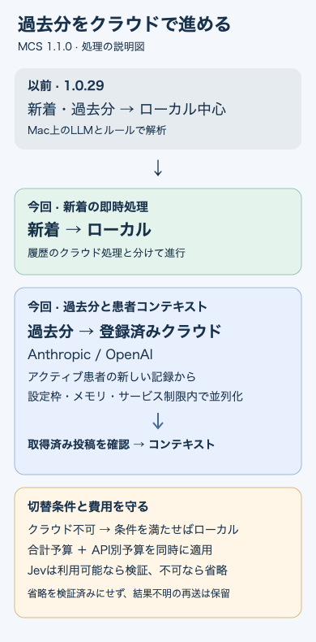
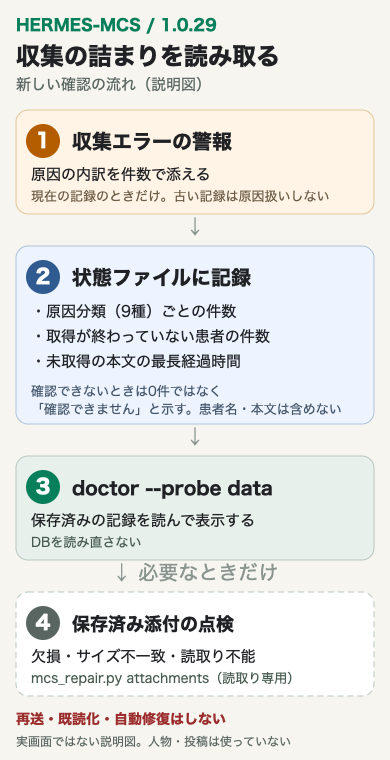
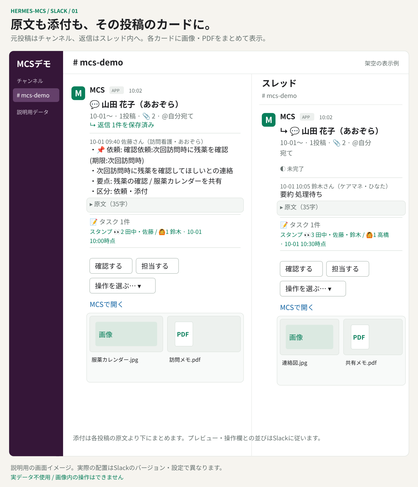
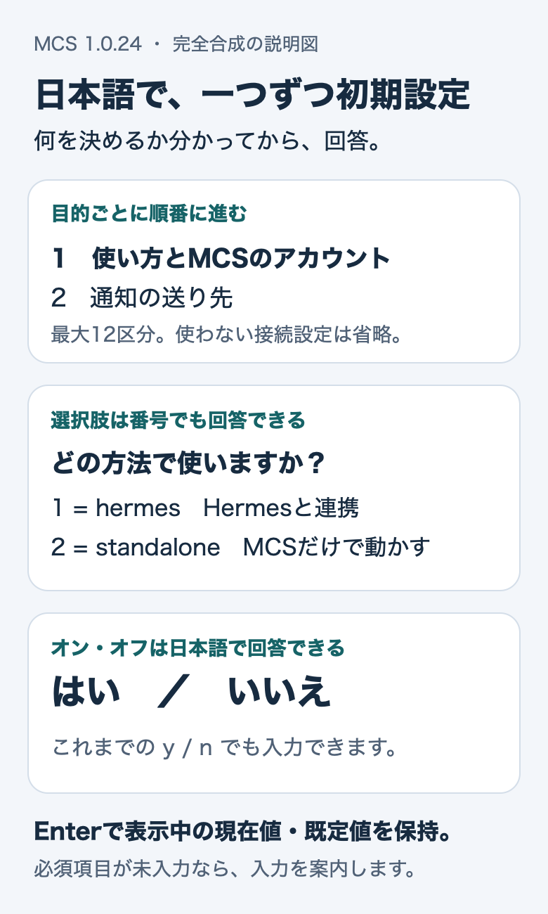
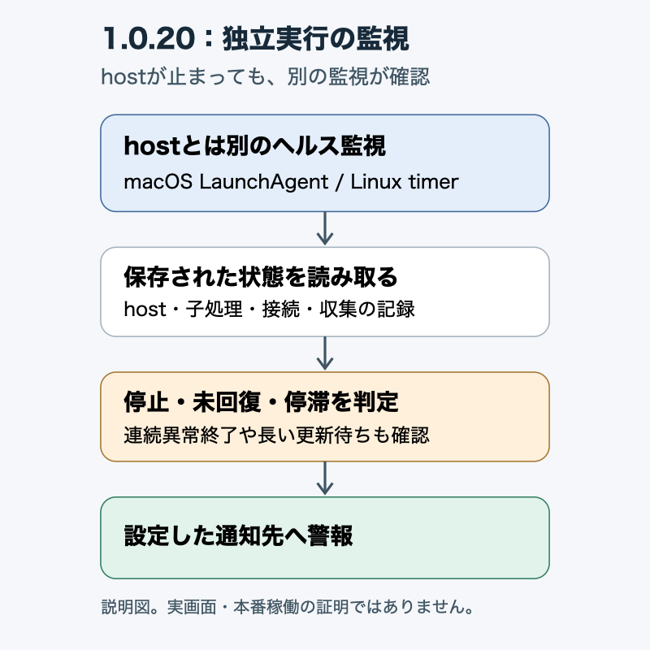
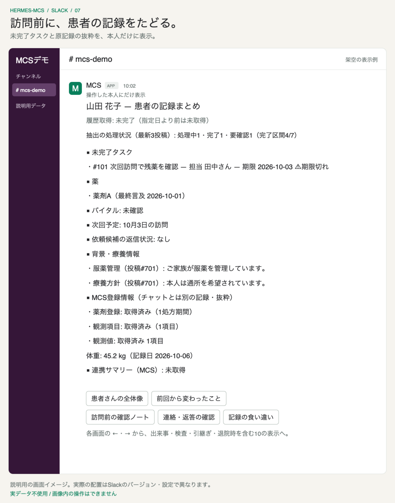
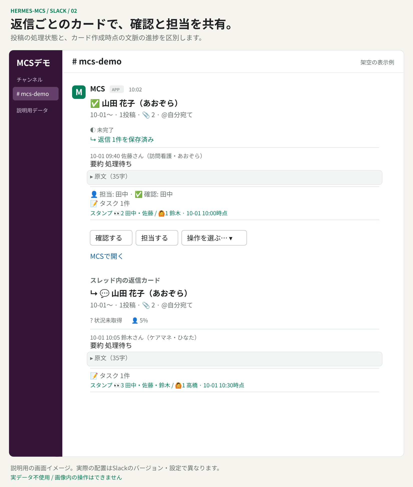

# Changelog

利用者向けの変更履歴です。各版は公開当時の仕様を記載しています。
更新手順・既定値・取得範囲は、導入する版の記録を確認してください。
記載ルールと自動生成の手順は [RELEASE_NOTES.md](docs/development/RELEASE_NOTES.md) を参照してください。

## [Unreleased]

## [1.1.2] — 2026-11-08

**解析済みの資料から患者背景を作り、別スレッドの原資料を検索**

解析と必要な品質確認を終えた資料から、患者コンテキストの概況を作成できるようにしました。同じ患者の別スレッドや添付OCRを検索し、原資料とMCSへ戻って確認できます。ローカルLLMは昼間に新着1枠と背景処理2枠、夜間に最大3枠を使い、新着は次の空き枠を優先します。添付OCR、Slackの患者情報と運用ログの分離も含みます。生成クラウドは患者コンテキスト専用とし、旧予約・結果不明の記録を保持します。DB世代12とOCRモデルの更新を含みます。

| 変更 | 以前（1.1.1） | 今回（1.1.2） | 利用者への効果 |
|---|---|---|---|
| 添付の医療資料 | 投稿本文だけを解析 | 画像・PDFをローカルで文字起こしし、出典付きで患者背景へ反映 | 紹介状・報告書を本文と分けて確認できる |
| 患者背景の作成 | 患者内の処理完了を待って作成 | 品質を確認した資料から部分作成し、未反映を区別 | 全資料の完了前でも確認済みの情報を参照できる |
| クラウド解析の範囲 | 履歴抽出と意味解析でも新規送信 | 新規送信は患者コンテキスト専用、個別はローカルで継続・旧予約は回収 | 外部送信を絞り、保存済みの結果も失わない |

説明図は実画面や速度の測定結果ではありません。患者データ・実投稿は使用していません。クラウド利用には登録・有効設定・対象範囲・予算等の条件があります。[外部送信と費用の条件](https://github.com/yusuketakuma/hermes-mcs/blob/v1.1.2/docs/guides/ANTHROPIC.md)を確認してください。

### 新機能

- **解析済みの資料から患者背景を作成し、未反映を区別**
  患者内の全資料を待たず、原資料・個別解析・必要な品質確認を照合できた資料から概況を作成します。新着が増えても採用済み資料が変わらなければ閲覧でき、訂正・削除・権限失効を検知した資料の古い概況は採用しません。概況は患者ごとに日本時間の1日4回まで、原則3時間間隔で新しい入力を反映し、未解析・未取得を全体完了として扱いません。

- **同じ患者の別スレッド・添付OCRを検索し、原資料を開く**
  「👤 患者情報」「🔎 この患者を検索」から取得済み原文を探し、結果から原資料とMCSの患者ルームを開けます。入力は500文字まで、結果は5件ずつで、未検索範囲・OCR未完了・本文未取得を区別します。検索はLLMや概況作成回数を使わず、Slack・Discordは本人向けの非公開表示、LINE WORKSは本人DMに返します。

- **添付資料を本文と分けて文字起こしし、医療項目を整理**
  画像・PDFをローカルで読み取り、投稿本文を変えずにページと出典を持つ資料として保存します。診療情報提供書、各種報告書、薬剤資料、PCAポンプの文字を医療項目ごとに整理し、紹介状に記載された経過は日付順のタイムラインでも読めます。

- **Discord・LINE WORKSの通知カードに投稿原文と添付を表示**
  DiscordとLINE WORKSの通知カードに各投稿の原文を表示します。Discordでは画像やPDFなどの添付を、その原文の下にまとめて表示します。

- **Slackの患者情報と運用ログの通知先を分離**
  患者情報の送り先と運用通知の送り先を別の非公開チャンネルへ分けます。初回セットアップではテキスト通知だけでも slack:new を指定すれば専用チャンネルを準備し、既存の明示した通知先は変更しません。

- **解析の安全停止・観測制限・再試行拒否を固定コードで診断**
  解析が証拠確認で止まるとき、修復候補の結び付け・現在性・監査準備、事実抽出の再利用・期限・監査待ち、カード集計の停止段階と時間・行サイズなどの制限を固定コードで確認できます。患者情報や例外本文は追加しません。

### 改善

- **昼夜の3枠配分と新着優先で、ローカル解析を継続**
  日本時間08:00〜20:00は新着・対話1枠と背景処理2枠、20:00〜08:00は背景処理に最大3枠を使います。夜間の新着は次の空き枠を優先し、実行中の処理は中断しません。クラウドの患者コンテキスト処理を別の子処理へ分け、ローカル解析がクラウド応答を待って枠を占有する状態を避けます。

- **クラウド解析を患者コンテキストの作成・更新と品質修復に限定**
  個別投稿への新規クラウド送信を停止し、クラウド解析は患者コンテキストの作成・更新とその品質修復だけに限定します。停止前に作られた予約と課金済み回答は従来の対象範囲で回収・保持し、クラウド停止中もローカルの患者コンテキストを検証・表示します。閉じた経路は概算に数えず、残る待ちは患者コンテキストの見積もりへ反映します。

- **患者コンテキストへ原文・添付OCR・補助要約を出典付きで統合**
  投稿の原文・チャット連携サマリー・添付OCR原文と、現行の投稿要約の補助入力を区別して入力し、長い補助要約も分割して全文を確認します。修復証拠と再処理の完了判定を共通の読取経路へ集約し、患者背景の処理順を統一します。確定的に変わった原文の古い予約は解放し、クラウド再開時は原文を全区間確認します。

- **解析状況をJev・ローカルの実行表示と患者背景の進捗に整理**
  チャットの短い解析欄は、実行確認できるJev・ローカルの結果と患者背景の凍結進捗（👤％）を表示します。個別投稿向けのクラウド解析アイコンは廃止し、保存済みのクラウド実行証跡は回収・診断の裏側で照合します。薬剤辞書の進捗確認は読取り専用で再利用します。 JevはSlackでは既存のロゴ、Discordでは右端の小画像で表示し、LINE WORKSのロゴは維持します。 クラウドの動作モードを自動判定する設定で、新しい通知カードの患者背景の進捗が未確認表示に固定される問題を修正しました。

- **推論・保存・更新の責務を整理し、患者背景の証拠を集約**
  推論・保存・更新処理を責務別に分け、患者背景の修復証拠・読取り証拠と再処理の完了判定を共通の読取経路へ集約します。本文や解析の更新後も同じ投稿のスタンプを保持し、設定機能を構文から判定します。

### 不具合修正

- **添付OCRから解析・通知・患者コンテキストまでの処理を接続**
  文字起こし後のローカル解析と、予約を持つページのクラウド結果回収を分けて保存し、未処理や保留を完了扱いにしません。OCRの表・解析状態・測定値・経過表示・誤り報告を接続し、修復結果の読取り拒否と削除済み投稿の添付を完了扱いする問題を修正します。OCRモデルは導入時と実行時で同じバージョンに固定し、開始時に保存ロックが使用中なら既存のジョブ制限内で解放を待ちます。 処理中の保存待機が拒否された場合は、最後に観測した固定の拒否理由を状態記録へ含めます。 認識済みの結果はジョブの残り予算内で保持して保存を待ち、実行失敗の固定理由を残します。 添付OCRの失敗記録から、モデルの読込み・推論・画像読込みのどこで止まったかを区別できるようにしました。表のセルが重なる出力も専用の理由で拒否します。

- **クラウドの残存予約と課金済み回答の回収を修正**
  正準投影済みでも回収中のクラウド結果を完了扱いせず、ロック待ち・確認不能・先頭待ちで後続解析を塞がないよう修正します。確認不能な回答を破棄せず、ローカル解析へ退避もしません。承認証拠が不明な場合は状況を推測で隠さず、観測上限・履歴確認の失敗・部分結果を診断で区別します。

- **患者背景の保存前検証・処理順・読取り証明を修正**
  読取り記録中は補助要約の高速照合を使わず抽出結果を個別に照合し、読取り証明の無効化を防ぎます。不完全な修復記録を決められた検証エラーで拒否し、一部の患者で確認が止まり続ける・期限切れで止まる・書込み待ちが長い・占有期限更新で不要な保留になる問題を修正します。原資料と入力の照合を修正し、補助要約の証明照合で重複していたJOINを削減します。同じスレッドの別投稿が処理待ちでも、原資料との対応と要約・監査の証拠を検証できる非空投稿から概況を作成・更新します。

- **空の部分概況と走査位置の競合による先送りを修正**
  未解析・未取得の資料が残り、確認済みの資料が空本文と削除済み投稿だけなら概況を作成せず、資料の解析と品質確認を続けます。全資料が空本文と削除済み投稿だけで過去の品質不合格がなければ、モデル通信や生成枠を使わず確認結果を保存します。別患者の走査位置の更新だけでは、選択済み資料の解析や品質確認を先送りしません。

- **Slack・Discord通知の準備・配送・復旧を修正**
  通知先の準備完了後の設定変更・保留時の不要な再起動・準備の中断復旧を修正し、権限追加待ちの間に無関係な設定が変わっても宣言内容が同一なら明示的な実行で再開できるようにし、添付ファイル照合の保留理由を記録します。 旧形式で封印されたSlack添付集合は、その形式のハッシュが厳密に一致する場合だけ読み取ります。Discordの非画像添付で非表示指定を保持し、長さ制限で未送信になった本文の復旧用記録を保持します。通知の整理件数を制限し、依存先の結果不明で保留された後着結果を受け付け、監視警報の件数と継続理由を明確化し、メッセージ保存のSQLiteエラーを固定項目で診断します。

- **更新・導入の資産と検証を修正**
  更新候補の一時展開に契約証拠と評価基準の固定ファイルを含め、資産の欠落だけで設定検証が停止する問題を修正します。OCRの導入選択を保存した環境の対話更新で選択を引き継げるよう修正し、導入予定に表示するYomitokuの版を実際の0.16.1へ合わせます。設定ツールの直接起動で内部モジュールを読めず停止する問題を修正します。サービスを省略した導入では初期設定を延期し、古い抽出結果の整理でDBの待機期限を守り、snapshot処理後のhealth観測時間を確保します。

### 更新時の注意

- 患者コンテキストの作成回数：患者ごとに日本時間の1日4回、原則3時間間隔を適用します。全資料の処理完了を初めて反映する更新は間隔だけを省き、1日4回は超えません。同じ入力の回復と有限回の品質修復は同じ1回にまとめます。送信前に止まったと確認できる初回の試行だけ回数を戻し、送信結果不明の記録と回数は保持します。個別資料の解析・品質確認、検索、閲覧はこの制限の対象外で、クラウドの費用・送信回数の上限は別に適用します。

- 患者情報の検索：既存カードの操作ラベルは通常の更新で反映します。添付OCRが無効な場合は投稿本文だけを検索します。原資料は開くたび・ページを進めるたびに同じ患者への所属と現在の閲覧条件を照合し、既読化・スタンプ送信には使いません。

- ローカル処理：抽出worker・取込み処理・常駐サービスを同じ候補へ更新してください。Hermesは夜間用LaunchAgent、独立実行はhostが3本目のworkerを起動します。3物理枠を前提とし、モデルやbackendの起動設定は自動変更しません。任意のadmission brokerは既定OFFのままです。旧workerと枠未記録permitを推測で解放せず、送信結果不明の処理と既存の期限・世代・会計条件を保持します。

- 収集・抽出・患者背景・クラウド回収の各workerと通知worker・アダプターを同じ候補へ更新し再起動してください。Hermes plugin利用時はgatewayの再起動、LINE WORKSは独立アダプターの再起動が必要です。コードの変更だけでは稼働中の処理へ反映されず、本番適用は別途判断・承認が必要です。更新にはdeployment/install/runtime.shを含む完全な配布版を使い、.prevとruntime世代を一体で保持して入口だけを巻き戻しません。

- 添付OCRは既定で無効です。非商用研究等の利用条件を確認のうえ、install.sh --with-yomitokuで専用Python 3.13環境とモデルを導入し、attachment_ocr.enabledと実行ファイルの絶対パスを設定してください。OCR導入済みの環境は通常のアップデーターでOCR用環境も更新します。旧形式・旧版のOCR結果は現行資料から除外し、原本が残る資料から順次再OCRします。原本を取得できない添付は取得不能として表示し、削除済みの原本は自動再取得しません。選択済み環境は更新時にも保持し、定期ジョブは6件から7件になります。

- 個別投稿への新規クラウド送信は停止しています。添付の文章はローカル解析を続け、停止前に予約されたページと課金済み回答は既存の患者範囲・予算・承認条件で証跡を照合して回収します。確認不能な結果を成功・失敗へ推測せず、ローカル結果へすり替えず、結果不明の自動再送は行いません。概算の表示から送信・課金・履歴範囲の承認は行いません。無効・設定上の対象外は表示対象に含めません。

- Slack通知先：アプリにgroups:write・groups:readを許可して再インストールし、招待する操作者をnotify.slack.allowed_user_idsへ指定してください（テキスト専用でも必要で、カードの利用は有効化しません）。新規作成はslack:newを指定した導入・更新と mcs setup slack-channels の明示操作が対象で、両チャンネル設定済みや作成・招待結果が不明な場合は自動で作成・再作成しません。interactive=offで運用通知先を明示済みなら既存のnotify_system_targetを使い、未設定・同一チャンネル・分離を確認できない指定は保留します。install.sh --no-services 後の初期設定は mcs setup を実行してください。

- 通知カード互換：旧形式で配信済みのカードは新版の面と互換がないため再利用せず新しいカードとして投稿します。Discordの添付は対応する本文と同じ要求で配信します。未送信・保留の本文は自動再送・自動再取得せず、配送証明または明示承認で再試行します。本文更新後に旧形式フォームのhashを検証できない場合は送信せず通知も抑止します。既に削除された送信計画の復元や過去の拒否配信結果の自動再取得は行いません。

- 患者背景の承認：ソース変更で候補の識別値が変わるため、旧候補の評価・承認を新候補へ自動で流用・有効化せず、既存手順で再評価・承認してください。承認記録は自動で書き換えません。既存の並び順・A・B・Cの6:3:1配分・会計・結果不明時の再送禁止は維持します。患者背景の読取り部品は呼出側の採用まで既存の処理を変えず、薬剤の進捗比較は対象の読取り処理で明示的に有効にした場合だけ使います。

- DB世代12を読むアダプターと表示コードを同じ候補へ更新してください。公開済みスナップショットだけを読取り専用で使い、未対応の世代13以降は拒否します。閲覧権限・人承認・送信条件は変更しません。

- その他の条件：監視警報の閾値・重複抑制・通知の30秒共有予算とカード2秒窓・既読化・スタンプの旧形式フォーム検証・snapshotの期限切れ時刻（設計余裕5秒・watchdogなし/commands-onlyは従来どおり）の条件は変更しません。通知整理の処理位置は端末内に保存し再起動後も続きから確認します。各診断コードの追加だけでは滞留や再発を解消しません。

- 追加設定は不要です。適用後の通常OCRから記録に反映されます。保存済み結果を削除せず、既存の失敗を強制再試行しません。

- 追加設定は不要です。適用後に新しく作成するカードへ反映します。既存カードの凍結済み進捗と、過去に観測できなかった表示は保持します。

- 空資料と走査位置競合の修正に追加設定は不要です。本文がある資料の抽出項目が0件の場合や、過去の品質不合格に必要な確認は維持します。過去に使用した生成枠と会計履歴は自動で取り消さず、既に消費した枠による原則3時間・日本時間1日4回の制限を保持します。

- 設定変更は不要です。更新後の抽出workerから適用されます。結果が未確定、または原資料との対応を確認できない投稿は引き続き保留です。

### 技術詳細

技術詳細・根拠を表示

#### 添付資料を本文と分けて文字起こしし、医療項目を整理

- Yomitoku 0.16.1の公式固定ソースを別環境に導入し、モデルは導入時に取得します。OCR実行中は通信を禁止します。
- PDFのテキスト層を優先し、文章のないページや画像を含むページはOCRします。取得済みの過去添付も対象とし、削除済みの実体は自動再取得しません。
- 病名、既往歴、医薬品、患者背景、看護等の報告内容は原文の引用位置とともに保持します。PCAの数値は明示されたラベルと単位を残し、誤読補正・換算・投与量計算を行いません。
- 投稿原文とOCR資料の読取り経路を分け、必要な解析が完了した原資料を患者コンテキストへ出典付きで統合します。
- 根拠: mcs/extract/attachment_ocr.py、mcs/extract/clinical/medical_document.py、docs/guides/ATTACHMENT_OCR.md

#### 添付OCRから解析・通知・患者コンテキストまでの処理を接続

- OCR中の停止で子プロセスと一時ファイルを回収し、保存後のスナップショット更新、期限付き走査、失敗の終了コードと監視を整えます。
- ページ原文・添付の内容・患者への所属に解析結果を束縛し、原資料の変更・撤回時は古い患者情報への依存を記録します。親本文だけの編集や、通常の添付実体の保持期限では保存済み原文を失効させません。
- クラウドの有料応答保存と成果採用を分け、設定や原資料の変更・観測不能で二重送信やローカルへのすり替えを起こさないようにします。
- 空ページは推論不要として扱い、画像だけの投稿も必要な解析が完了すれば患者コンテキストへ進みます。
- 既存カードに文字起こしと解析の進捗を反映し、元ファイルの再アップロードを追加しません。薬剤履歴・服薬管理・測定値は原資料に対応する解析済みOCR結果を原文・対象者・否定・明示日付・承認辞書の条件で採用します。
- 根拠: mcs/extract/attachment_inference.py、mcs/core/original_source_keys.py、docs/guides/ATTACHMENT_OCR.md

#### 添付OCRの表と解析状態を正しく扱う

- 推論実行、結果の保存・読取り、途中再開、推論元の証拠検証を責務で分離する。
- 実行中ソースの同一性確認と課金応答の保持を維持し、表形式の更新と責務分離の互換性を区別する。
- 薬剤履歴・服薬管理・測定値にも、原資料に対応する解析済みOCR結果を採用する。
- 原文、対象者、否定、明示日付、承認辞書の条件を維持し、薬剤規格や機器値から用量を推測しない。
- 一表10,000セル・行展開と既存出力上限で過大な表を拒否する。
- 根拠: mcs/extract/attachment_ocr.py、mcs/extract/attachment_extraction.py、mcs/notify/notify_views.py、mcs/views/patient_context_view.py

#### 通知の整理で一度に確認する件数を制限

- 処理位置が壊れている場合や別のデータベースの記録である場合は、先頭から確認し直します。
- 未送信の本文を保持する条件と、配送完了の証明条件は変わりません。
- 根拠: mcs/notify/notify_cards.py

#### カードの観測が止まった段階と制限を記録

- healthのcards.observationに固定のphase・stop、秒単位のbudget_s・elapsed_s・remaining_sを追加します。elapsed_sはカード観測窓全体の経過時間で、段階ごとに予算を取り直しません。
- SQLの割込みは観測期限に達した証拠がある場合だけtime_limitと分類し、行サイズ上限・ストレージ競合・判別不能を区別します。従来のstatusとreasonは維持します。
- SQLや外部通信は追加せず、識別子・通知本文・自由文の例外メッセージを追加診断へ含めません。接続の進捗ハンドラ、行サイズ制限、待機時間とトランザクションの復元経路を維持します。
- 根拠: mcs/ingest/health_report.py、mcs/notify/notify_scope.py

#### Discord・LINE WORKSの通知カードに投稿原文を表示

- 通知仕様に chat_format_version=1 を追加し、DiscordはComponents V2、LINE WORKSはFlexカードで投稿ごとの原文とスタンプ行を描画します。
- 原文が面に収まらない投稿は従来どおりスレッド本文パーツに残り、原文が表示から欠けることはありません。
- 💊薬剤の確認・検索は投稿が表示される面に従います。カード面に原文が収まる投稿はその投稿の横の💊から、スレッドに残る投稿はスレッド本文の先頭にある従来の薬剤ビューから、いずれも本人だけに見える回答で開けます。
- LINE WORKSでは chat_format_version=1 のとき、各投稿の添付ファイルをその投稿の本文・原文の直後へ個別ジャーナルのまま並べ替えます。元投稿に対応づかない添付は末尾に保持します。
- 旧形式の配信済みカードを新版仕様が再利用すると原文がどこにも表示されないため、chat_format_version と face_posts が一致する場合だけカードを再利用します。
- 既存の仕様（chat_format_version なし）は従来どおりの描画・配送を維持し、未知の結果を成功扱いしない・重複送信しない条件は変更していません。
- Discordの添付はカードまたは対応するスレッド本文と同じ送信・更新でまとめて配信し、画像はMediaGallery、PDF等はFileとして原文直下に表示します。画像を開く前の折り畳みは維持します。
- ファイル数10件、1ファイル20MiB、送信全体25MiBから64KiBの余裕を引いた上限を超える場合や、元投稿との対応を確認できない場合は、通知全体を保留します。
- 再利用する添付は、保存したDiscordのファイルID、投稿ID、原本のhash・サイズ・名称と照合します。不明な既存添付を自動で削除・再アップロードしません。
- 送信結果が不明な添付の承認では、既存の人承認条件に加え、対応する投稿と添付集合の証拠を要求します。
- 根拠: adapters/common/spec.py、adapters/discord/cards.py、adapters/discord/delivery.py、adapters/lineworks/cards.py、adapters/lineworks/client.py、mcs/notify/notify_card_renders.py、mcs/notify/notify_parts.py、mcs/notify/presentation/present_discord.py、mcs/notify/presentation/present_lineworks.py、mcs/notify/presentation/present_slack.py、adapters/common/provider_assets.py、mcs/core/ledger_schema.py、mcs/notify/notify_transport.py、mcs/notify/notify_recovery.py

#### 正準投影済みでも回収中のクラウド結果を完了扱いしない

- 必要なクラウド契約が内部で確定した行だけ、確定済み投影をまたいで選択・コンテキスト準備・保存の検証を行います。ローカル・品質確認・人操作の既存経路は投影確定済みの投稿をこれまでどおり拒否します。
- 正準 fact_source が有効な環境で経路が開いている場合、常駐のクラウド解析workerは、人が承認した履歴範囲と選択済みクラウド契約の条件だけで対象を決めます。新規送信を停止した現在の経路では、対象決定は残った予約の回収にだけ適用されます。設定が不正な場合はこれまでどおり対象なし（閉鎖）のままです。
- 経路が開いている場合のクラウド専用実行では、内容の乏しい投稿も事前選別で完了扱いせず、選択したクラウド契約どおり送信して証拠を保存します。
- 占有・リース・原文照合・会計・保留の既存フェンスは維持します。保留中の投稿は投影確定の有無にかかわらずクラウド解析を実行しません。モデル・原文・契約の証拠が一致しない場合は完了扱いしません。
- 根拠: mcs/extract/llm/extract_llm.py、mcs/extract/llm/extraction_context.py、mcs/llm/cloud_backlog.py

#### クラウド抽出がロック待ちで停止し続ける問題を修正

- 意味解析は短い待機を3回行ってもロックを取得できない場合、抽出へ処理を譲り、次の順番で再試行します。
- 処理前の更新状態、予算、保留中の結果の保存に関する確認は維持します。
- 根拠: mcs/llm/cloud_backlog.py

#### 閉じた経路を除いたクラウド概算で後続処理を数える

- 履歴の許可、投稿の訂正・新着、対象範囲、占有期限、保護保留、品質再試行の条件を維持します。許可されていない履歴を処理対象とは見なしません。
- 必要な投稿だけを一時的に読み、既存の読取り件数・容量・時間上限を維持します。上限に達した場合は部分的な観測として報告し、未確認の件数をゼロと断定しません。
- 根拠: mcs/ops/cloud_cli.py

#### 解析状況をJev・ローカルの実行表示と患者背景の進捗に整理

- …は未完了、✓は実行確認済み、!は要確認、?は状況未確認を示し、実行中・結果不明の送信を推測で区別しません。
- 現在の原文と選択契約に対応するクラウド実行の照合は回収・診断の内部で行い、その結果をチャットの解析欄へ反映しません。採用された結果にローカルの証拠が残らない場合、ローカル実行済みとは表示しません。既存の会計・再送禁止・人承認の条件は変更しません。
- 根拠: mcs/notify/processing_route.py、mcs/notify/notify_render.py、adapters/slack/presentation.py

#### クラウド履歴の確認失敗をログで区別

- 診断は標準エラー出力へ記録します。
- SQLiteエラーは検証できた標準エラーコードから主コードを記録し、不明な値はunknownとして扱います。
- 例外の自由文、本文、設定値、患者や要求を識別する値は記録しません。
- 安全拒否、回答と会計の保持、再送やローカル処理への切替条件は従来どおりです。ログ記録に失敗しても安全拒否を維持します。
- 根拠: mcs/llm/cloud_inference.py

#### cloud-llm の保持記録が観測上限を超えても原因と観測範囲を返す

- outstanding: 行数上限・証拠サイズ上限・読取り期限で止まっても、種別ごとの下限件数と artifact_id 昇順 prefix の検証済み組数を coverage 付きで返します。prefix で result が見つからない予約は limit 外に result があり得るため未精算の下限に数えず、全体の未精算・欠落・精算件数は未検証のまま不明（null）を維持します。
- plan/estimate: 読取り予算・期限がどの段階で尽きても、レポート全体を汎用エラーにせず早期終了して send_decision=observation_incomplete の部分レポートを返します。検証済みの節はそのまま表示し、中断・未到達の節は名前を明記して不明とし、保持記録の観測スナップショットを retained_records_observation に添えます。ブロック理由だけが未検証の場合は send_decision=block_reason_unverified で確定ブロックに留めます。会計が未検証（pricing_unverified）または修復保留の件数が数え切れないときも同じスナップショットを添えます。
- 観測上限（100000行/16MiB）と送信可否の安全条件は緩和していません。ペイロード・予約ID・本文は出力に含みません。
- 根拠: mcs/ops/diagnostics/cloud_observation.py、mcs/ops/cloud_cli.py

#### 確認不能なクラウド解析がローカル解析へ退避しないように修正

- 抽出経路で CloudObservationIncomplete を専用に捕捉し、延期理由 cloud_guard で記録します。
- 未送信の場合は一切送信・課金せず、送信済みの課金回答は破棄せず次回に回収します。
- 確認不能な対象ではローカル解析へ切り替えず、失敗バックオフも消費しません。リースと課金証跡は既存の共通処理で保持します。
- 根拠: mcs/extract/llm/extract_llm.py、tests/extract/llm/test_cloud_after_local.py

#### クラウド診断の部分結果と未確認項目を正しく表示

- 共有の読取上限に達した後は追加の読取を行わず、その時点の部分結果を返します。
- 保存済み記録は全体を確認できた場合だけ検証済みとし、部分的な確認や取得不能は区別します。
- 根拠: mcs/ops/cloud_cli.py

#### クラウド設定を確認できない間の回答破棄を防止

- 設定の読取失敗と確認済みの対象変更を共通の例外分類で区別する。
- 設定確認が回復した後は、入力と保存証跡が一致する回答を追加送信せず再利用する。
- 根拠: mcs/llm/cloud_inference.py

#### 回答受信後の確認不能で有料回答を破棄しない

- 確認不能と、根拠の変更が確認された場合を区別します。保存済み回答の利用には、従来の会計証拠と入力の一致確認を必要とします。
- 期限切れや一時的な送信停止でも、既に受信した回答と会計記録を保持します。新たな送信には、従来どおり期限・予算・受付条件を適用します。
- 設定・認証情報・原文の読取失敗も確認不能として扱い、確認不能による延期を未送信と断定しません。明示的なクラウド処理の無効化は、引き続き対象範囲の取消として扱います。
- 根拠: mcs/llm/cloud_inference.py、mcs/semantic/semantic_transport.py、tests/llm/test_cloud_response_recovery.py

#### クラウド送信の承認証拠が不明な場合も進捗を推測で隠さない

- 必要なクラウド抽出の承認証拠を確認できない場合は、進捗を状況未確認として残します。送信を許可する条件は変更しません。
- 根拠: mcs/notify/processing_route.py、tests/notify/test_real_cloud_followup_display.py

#### OCR導入済み環境の対話更新を修正

- 未知のオプションと不正な形式の拒否は維持します。
- 根拠: scripts/mcs_upgrade.py、install.sh

#### クラウド再開時に患者コンテキストの原文を全区間確認

- 同じ入力のクラウド確認記録を優先し、後から保存されたローカル結果で確認済みの位置を失わないようにします。
- 原文の入力署名や処理先が変わった場合は、抽出項目が同じでも患者のまとめを再評価します。
- 根拠: mcs/patients/patient_context_refresh.py、mcs/patients/patient_context_refresh_readiness.py、mcs/patients/patient_context_refresh_sources.py

#### 患者コンテキスト更新時の原資料と入力の照合を修正

- まとめの生成要求に入力署名を含め、同じ抽出項目を持つ別の入力と区別します。
- 本文の品質確認では、同じ投稿に属するOCRページを混ぜず、出典キーが一致する原資料だけを選びます。
- 原資料だけの署名を保存し、保持された証拠の照合で現在の解析設定への依存を避けます。旧記録は従来の署名で検証します。
- 品質修復は原文だけを対象とする既存の要求形式を維持し、保存済み応答の再検証に使います。
- 根拠: mcs/core/inference_dependency_loss.py、mcs/core/mcs_queries.py、mcs/core/patient_context_artifacts.py、mcs/patients/patient_context_plan.py、mcs/patients/patient_context_quality_controller.py、mcs/patients/patient_context_refresh.py、mcs/patients/patient_context_refresh_sources.py、mcs/patients/patient_context_scan.py

#### 患者コンテキストへ原文と補助要約を区別して入力

- 補助要約は原文とは別の項目に置き、引用と属性は原文だけで検証します。過去の患者コンテキストは再入力しません。
- 各要求に出典のキー・署名・原文の区間を付け、補助要約には由来と区間を付けます。
- 現在の入力に結び付かない要約は含めません。同じ入力と処理契約の完了記録は再利用します。
- 根拠: mcs/core/mcs_queries.py、mcs/patients/patient_context_plan.py、mcs/patients/patient_context_scan.py

#### クラウド停止中もローカルの患者コンテキストを検証・表示

- ローカルで処理済みの資料を繰り返し作り直さず、既存の品質監査へ進みます。過去の否定的な品質結果を省略しません。
- クラウド処理にはローカルの再開位置を引き継ぎません。未確定送信の回復と再送防止条件は維持します。
- 根拠: mcs/patients/patient_context_refresh.py、mcs/patients/patient_context_refresh_readiness.py

#### OCRの修復結果が読取り時に拒否される問題を修正

- 本文を省いたOCRの読取りでも、既存の原本取得処理で全文を復元する。投稿IDが0のチャットとして空本文を取得しない。
- 原本の所属・source binding・有料応答の証明と引用の検証を維持する。OCR設定を無効にした後や補助要約の追加後も、原本に結び付いた修復証明を再生できる。
- KarteとOCRの有料修復、独立した読取りトランザクションでの再生、改変拒否、追加POST・予約ゼロを合成テストで確認する。
- 根拠: mcs/patients/patient_context_refresh_sources.py、tests/patients/test_context_external_source_repair_replay.py

#### クラウド解析を患者コンテキストの作成・更新に限定

- 新規クラウド要求は `patient_context` 経路だけに限定し、対象選択・予約の前段で個別経路を除外します。
- 個別の履歴抽出（`reextract`）と意味解析バックログ（`semantic_backlog`）はローカル処理を継続し、既存のworkerは未精算の有償結果を決済してから退役します。
- 確定済みのクラウド結果・予約・会計は旧経路の対象範囲で読み取りと回復を維持し、結果不明の予約を返金・再送しません。
- クラウド設定が無効・未設定でも、予約を持たない添付OCRページのローカル結果は確定・参照でき、旧予約を持つページは復旧待ちのまま保持します。
- 旧予約を持つ抽出対象がクラウド履歴・現況を確認できないときは、一定時間だけ処理を保留して次の対象へ進むため、確認不能な先頭が後続のローカル処理を繰り返し阻害しません。保留中も予約・支払記録は破棄しません。
- 旧予約を持つ処理単位は、設定が明示的な停止・ドライラン・対象外指定で解除を証明した場合にだけローカルへ移行します。mode 未指定や鍵の読み取り不可による計算上の停止では解除せず、契約情報の欠けた旧クラウド結果は読み取り不能として保留して処理ワーカーを止めません。
- semantic 解析の複数対象ジョブでは、予約を持たない対象が会計記録の検証を通れば、クラウド設定の破損や鍵の消失があってもローカル推論へ進みます。予約を持つ対象だけが個別に保留され、閉鎖経路では資格情報を読みません。
- 予約・支払記録が破損・重複などで検証できない対象は、予約が無いと証明できた場合とは区別し、どの経路でもローカル推論へ逃がさず保留します。
- 品質修復は `patient_context` 経路の既存の修復処理で継続します。
- 根拠: mcs/llm/cloud_policy.py、mcs/llm/cloud_inference.py、mcs/llm/cloud_backlog.py、mcs/extract/llm/extract_llm_selection.py、mcs/extract/llm/extract_llm_prepare.py、mcs/semantic/semantic_due_selection.py、mcs/semantic/semantic_drain.py、mcs/ops/cloud_cli.py、mcs/notify/processing_route.py、mcs/extract/llm/extract_llm_runner.py、mcs/semantic/semantic_transport.py、mcs/extract/attachment_inference.py、mcs/extract/attachment_extraction.py、mcs/semantic/semantic_job_processor.py

#### 患者コンテキストのクラウド処理待ちを見積もりに反映

- 患者ごとの対象範囲を保ち、患者選択または状態観測の間だけクラウド可用性の確認結果を再利用します。
- 保存済みのローカル結果は引き続き表示できます。固定された処理契約を渡す見積もりではクラウド可用性を再解決しません。
- 根拠: mcs/patients/patient_context_refresh.py、mcs/patients/patient_context_refresh_readiness.py

#### クラウド動作モードを省略した設定でも患者背景の進捗を観測

- カード生成が既に確認した利用可能な提供元の一覧から、共通の設定解決処理で表示用の動作モードと提供元を決めます。進捗の読取り処理へ秘密鍵を渡さず、追加の秘密鍵読取りも行いません。元の設定と提供元別profileを保持し、表示用の設定をファイルへ保存しません。
- 入力の取得、ローカル解析、全区間の確認、監査と要約の既存の証拠を使って割合を計算します。不明な提供元一覧や不正設定は完了の証拠に使いません。送信・予約・対象範囲・予算の設定は変更しません。
- 既存カードに保存した進捗を読み直したり、過去の数値を推測で補ったりしません。進捗だけを理由にカードを更新せず、個別投稿向けクラウドアイコンの廃止も維持します。
- 根拠: mcs/llm/cloud_policy.py、mcs/notify/notify_card_renders.py、tests/llm/test_cloud_policy.py、tests/notify/test_context_progress_frozen.py、tests/patients/test_patient_context_progress.py、mcs/notify/processing_route.py、tests/notify/test_processing_route.py、tests/notify/test_provider_key_visibility.py、docs/guides/USER_GUIDE.md

#### チャット作成時の患者コンテキストの進捗を表示

- 原文の取得、ローカル解析、現在の入力に対応する点検区間、品質点検、保存済みの要約と表示条件を確認して進捗を算出します。経過時間や確信度から数値を推測しません。
- 表示する値は最初の作成計画と同じトランザクションで保存し、再試行や別の理由による更新でも同じ値を使います。観測時刻は送信先での受信時刻を意味しません。
- 過去の観測記録がない既存チャットには、過去の進捗を推測して表示しません。対象なし・無効は進捗を表示せず、入力や証拠を上限内で確認できない場合は数値を表示しません。
- 新しく作る表示から生成クラウドの処理状況アイコンを除き、ローカル解析とJevの表示は維持します。
- 根拠: mcs/patients/patient_context_progress.py、mcs/notify/notify_card_renders.py、adapters/common/spec.py

#### 患者背景の修復証拠を共通の読取経路へ集約

- 読取は呼出元のDB接続とトランザクションを借用し、修復を送信せず、元の予約・回答・品質判定と保存内容を照合します。接続の開閉、commit、rollbackやモデルの呼出しは引き受けません。
- 送信・時刻・予算・処理権・保存と公開の所有は解析workerに残します。既存の入口、保存形式、モデル、推論エンジンv1.0、人承認、結果不明の再送禁止を変更しません。
- 根拠: mcs/core/patient_context_artifacts.py、mcs/patients/patient_context_refresh.py、mcs/patients/patient_context_scan.py、mcs/semantic/semantic_candidate.py

#### 患者背景の保存前検証で読取り証明が無効になる問題を修正

- SQLの許可範囲は広げません。記録対象の接続では既存の抽出証明照合を実行し、保存前に同じ読取り結果を再検証します。
- 通常の表示で使う高速照合と、不一致・読取り失敗後にその照合を使わない条件は維持します。
- 根拠: mcs/core/mcs_queries.py

#### 不完全な修復記録を決められた検証エラーで拒否

- 原本の署名だけでなく、修復入力全体の署名も読取り前に検証する。欠落した署名を辞書の既定値評価で参照しない。
- Karteと添付OCRの両方で、署名欠落を固定の検証エラーで拒否し、追加送信や会計記録の変更がないことを合成テストで確認する。
- 根拠: mcs/core/patient_context_artifacts.py、tests/patients/test_context_external_source_repair_replay.py

#### 補助要約で重複していた証明照合のための追加JOINを削減

- 再利用は集約を読んだ接続がトランザクション内で、集約の前後と各行の確認時点で（total_changes・in_transaction・data_version・schema_versionの）読取stampが一致する行だけです。照合で1回でも不一致・トランザクションの終了・読取失敗を検知したgeneratorは以後すべて従来の1件ずつ正確な証明確認へ戻り、後でstampが一致に戻っても再び再利用しません。
- yieldを挟んで変更がなければ再利用を続けますが、消費側の書込み・トランザクションの終了・読取失敗を照合で検知した後は必ず個別確認へ戻ります。
- 内部証明の印（internal proof）を持つ抽出や、JSONが読めない抽出は常に従来の正確なwitness確認へ送り、確認を省略しません。
- 行ごとのstamp確認SQLと、設定がある場合のsemantic補助経路の読取は残ります。送信・HTTP・commit・金融・permission・現在性の各guard、診断項目、署名の計算内容は変更しません。
- 根拠: mcs/core/mcs_queries.py

#### 削除済み投稿の添付を誤って完了扱いする問題を修正

- 本文が削除済みのままなら、部分取得の応答に添付が再掲されても取消状態を維持します。full本文を再取得した場合の添付の再開は維持します。
- OCRの完了範囲に取消されていない添付を含め、削除済み投稿の添付が確認できない状態を完了した0件として扱いません。
- 削除済み本文や添付のOCR原文を再び採用する経路は追加しません。
- 根拠: mcs/core/ledger_capture.py、mcs/core/mcs_queries.py、mcs/patients/patient_context_refresh_readiness.py

#### Discordの非画像添付で非表示指定を保持

- SPOILER_で始まる添付名をそのまま送信し、ファイル表示と送信記録の照合で同じ名前を使います。
- 根拠: adapters/discord/cards.py、tests/adapters/discord/test_discord_file_group_views.py

#### 薬剤辞書の進捗検証を読取り専用で再利用

- 保存済み進捗を取得するSQLと、取得値だけを検証する処理を分けます。不正なcursorや辞書世代を正常値へ補正しません。
- 進捗行なしは従来どおり旧形式として扱い、行があって内容がNULLの場合は不正とします。辞書世代の識別値からcursorを除く既存の契約も維持します。
- 根拠: mcs/medications/drug_map.py、tests/medications/test_annotation_progress_parse.py

#### クラウド解析結果の保存待ちを改善

- 実際に対象や利用条件が変わった場合は、従来どおり回答を破棄します。
- 根拠: mcs/extract/llm/extract_llm.py

#### 添付の準備不足で実行しなかったグループ共有を明示承認で再試行

- 結果不明の添付は確認が済むまで変更せず、結果不明のグループ共有を自動で再送しません。
- 明示再試行にはexpected_state=not_sent、proof=dependency_rejected、同じ試行の完全なjournal、ワーカー停止確認と人の承認が必要です。
- 内容の変更や新しい通知による通常の更新条件、送信先・原文・添付の同一性確認、再計画で新しいファイルを追加しない条件は維持します。
- 根拠: adapters/common/worker.py、mcs/notify/notify_recovery.py、docs/guides/NOTIFICATION_RECOVERY.md

#### サービスを省略した導入で初期設定を延期

- --no-services はサービス起動と対話初期設定を延期し、後で再開するためのコマンドを案内します。
- 根拠: deployment/install/runtime.sh、install.sh、tests/meta/test_install_sh_config.py

#### 通知の処理経路ヘッダでJevがアイコンではなく文字になっていた問題を修正

- 処理経路のコンパクトなヘッダは、どの通知先にも送れるように文字だけの並びを作っていました。Slackでは画像を使えるのに、その文字列をそのまま表示していたため、ロゴ画像を持つJevだけが文字のままでした。
- ヘッダの文言と処理順の組み立ては共通処理として取り出し、従来の文字列生成と共有します。SlackではJevを既存の公開ロゴと状態の印で表示し、ローカル実行の💻とカード作成時点の👤と割合を維持します。AnthropicやOpenAIのアイコンは表示しません。
- Discordではヘッダ行を小さな画像を添えられる区画に置き換え、Jevの公開ロゴを右端の画像として表示します。従来の文字は同じ区画内に残るため、画像を表示できない環境でも処理状態が読み取れます。Jevの表示状態が対象外のときは従来どおり文字だけです。
- 画像を添える部品を増やした分も、既存の部品数と文字数の上限検査がそのまま適用されます。承認・予算・更新頻度の扱いは変わりません。LINE WORKSは既存のロゴ表示を維持しています。
- 保存済みの送信計画の形式と送信許可の条件を維持し、表示の組み立てだけを修正します。過去のカードを一括で再投稿する処理は追加しません。
- 根拠: mcs/notify/processing_route.py、adapters/slack/presentation.py、adapters/discord/cards.py、tests/notify/test_compact_provider_icons.py、tests/adapters/discord/discord_testkit.py

#### 依存先の結果不明で保留された本文の後着結果を受け付ける

- 配送先・通知の封印情報・従属部分のattemptが一致する後着結果だけを受け付けます。
- 確定済みの結果と、取消や配送上限などによる独立した保留は上書きしません。
- 配送記録は正常な圧縮でも消えるため、親カードの配信確認と送信処理の停止だけでは従属部分の未送信を確定しません。
- 根拠: mcs/notify/notify_transport.py

#### ローカルLLMの枠を昼夜で配分し、新着を優先

- 配分の境界はJSTの08:00と20:00。MCSの各要求は物理枠ごとのflockを保持し、同じMCS root内で同一枠への同時送信を防ぐ。新着待機の登録は枠の割当前に行い、新着の実行中も他の2枠で背景処理を進める。
- 旧workerの排他turnが終わるまでは新方式を開始しない。新方式同士は旧turnを共有保持するため、異なる物理枠で並行できる。
- brokerを使う場合は物理枠を新permitへ記録する。旧形式の枠未記録permitがある間は全枠を保留し、枠を記録した送信結果不明のpermitはその枠を保留する。期限やPID消失を送信終了の証拠にしない。
- 非MCSクライアントのclass排他、既存の会計・世代・結果不明の判定は保持する。broker OFF時の通信失敗後の確認は従来どおりで、backendに残る要求の終了証明は追加しない。別rootや外部の直接送信はこの枠制御の対象外。
- 根拠: mcs/llm/admission/llm_slot_schedule.py、mcs/llm/admission/llm_admission.py、mcs/llm/transport/local_llm.py

#### 個別クラウド経路の完了判定をローカル解析から独立して検証

- 候補選択、占有取得時の再検証、保存直前の完了判定で同じクラウド結果の検証を使います。ローカル結果の先着だけでは回収中のクラウド解析を取り消しません。
- 投稿・モデル・クラウド契約・保存結果の証拠が一致しない場合は完了扱いしません。既存の会計照合と送信結果不明時の再送禁止を維持します。
- 否定や家族の情報を失う候補は、既存の保護条件でローカル結果を保持します。一般のローカル完了判定と公開条件は変更しません。
- 根拠: mcs/extract/llm/extract_llm.py

#### 夜間用workerと患者コンテキスト用の子処理を追加

- 夜間用workerはJST 20:00〜08:00だけ新規処理を始め、昼間も保存待ち結果の既存処理を維持する。通常の2本は24時間動作し、抽出・semantic/QCの既存選択とclaim leaseを再利用する。
- 空のキューは5秒から最大30秒まで待機間隔を延ばし、既存の再試行予定時刻が近ければ短縮する。処理できる対象がある間は空キュー用の待機を入れない。
- 患者コンテキストのcloud mode=onは既存CloudBacklogPoolの専用子処理から同じrun_dueを呼ぶ。所有controller・source世代・設定・予算・原資料の確認は維持し、旧予約や保存済み回答を削除しない。offとdry_runの既存local経路は維持する。 キーやクラウド予算の制約だけでは子処理の起動を止めず、送信可否とlocal代替の可否はrun_dueで判定する。
- 新着優先は取込み入口の今回の投稿とarrival-seeded semantic jobに限定する。全MCS抽出を新着扱いにはせず、間に合わない対象は既存キューへ残す。
- 根拠: mcs/extract/llm/extract_llm_resident.py、mcs/llm/cloud_backlog.py、mcs/ingest/run_check.py、deployment/launchagents/ai.mcs.extract-drainer-night.plist、mcs_standalone/runtime.py

#### Slackの患者情報とMCSLOGの運用通知を分離

- 運用通知はnotify_system_targetで分離を確認できた宛先だけへ送り、分離を確認できない場合は送信を保留します。
- 根拠: mcs/notify/notify_sender.py、mcs/notify/notify_flush.py、mcs/ingest/health_watch.py、deployment/recovery/mcs_recovery_services.py

#### 監視警報の件数と継続理由を明確化

- 通知の未完全部品は、検証済みの内訳がある場合に現行・過去と配送状態の件数を併記します。結果が不明な部品と未送信の部品を混同せず、過去の部品も非表示や完了扱いにはしません。
- 収集後の処理の失敗や、原因を確認できない異常は引き続き警報の対象です。収集判定が未完了のまま現在の患者別未取得が0件でも、収集全体を完了扱いにはしません。
- 根拠: mcs/ingest/health_report.py、mcs/ingest/health_watch.py、mcs/ingest/collection_diagnostics.py

#### 添付OCRの内部失敗を固定コードで区別

- 従来のengine_failedにまとめていた通常例外を、隔離した実行環境の終了コードからengine_load_failed・engine_inference_failed・input_decode_failedとして記録します。例外本文、原資料の内容やファイル名は記録しません。停止操作と既存の入力・出力上限の終了コードはそのまま伝わります。
- 画像の寸法とページ数を確認した後に読込みを完了させてから推論へ進み、画像読込みの失敗を推論の失敗と区別します。表の重複・重なりはoutput_schema_table_overlapとして従来どおり採用を拒否します。
- モデル・ネットワーク遮断・処理予算・保存条件・再試行間隔と上限回数は変更しません。この変更だけで既存のOCR失敗が解消したとは扱いません。
- 根拠: mcs/extract/attachment_ocr.py、tests/extract/test_attachment_ocr.py

#### OCRとローカル・クラウド解析の停止依存を解消

- クラウド要求の識別とローカル採用証拠を分離し、現行原資料・範囲・実要求・確定会計が一致する応答だけを再利用します。旧記録の帰属不明や破棄済みは保留を維持します。
- 独立ジョブは単一起動・総予算900秒で複数の添付とローカルページを進めます。背景枠・GPU順番待ち・OCR起動前のメモリー確認を使います。
- クラウド会計の復旧待ちを監視に残し、ローカルまで止めません。OCR固有の例外でも通常チャットのクラウド抽出へ次の順番を渡します。
- 対応外と未解析を分け、薬剤が0件のOCRページも本文表示から、人承認・理由・receipt付きで誤りを報告できます。患者・資料・ページ・閲覧権限の検証を維持します。
- アーカイブ・閲覧禁止・権限失効・患者不在を原資料入口で拒否し、送信前・保存前にも再検証します。OCR実行中の設定OFFや実行設定の変更時も新結果を採用しません。
- 根拠: mcs/extract/attachment_inference.py、mcs/llm/cloud_policy.py、mcs/llm/cloud_backlog.py、mcs/ops/mcs_ocr.py、mcs/core/scheduled_jobs.py、mcs/patients/ocr_document_reader.py、mcs/notify/notify_actions.py、docs/specs/ocr-processing.md

#### OCRモデルの版を導入時と実行時で固定

- 重みと実行ファイルの確認後にだけ導入完了の印を保存します。
- 導入・実行・更新判定が同じ固定版契約を参照します。
- 根拠: mcs/extract/ocr_model_contract.py、scripts/setup_yomitoku.py、docs/specs/ocr-processing.md

#### 添付OCRの測定値・経過表示と誤り報告を接続

- 本人・実施済み・引用・日付・単位を共通検証し、作成日・生年月日・予約日を測定日に転記しません。系列化の条件を満たさない記載は未確認に残します。
- 紹介状とPCA候補は現行資料・全ページの解析完了・患者閲覧条件を共通の読取りで確認します。PCAの投与量や終了時刻は算出しません。
- 薬剤詳細の対象ページ別ボタンから、人承認・理由・receipt付きでOCR解析へ訂正依頼を記録します。親チャットの解析へ誤って依頼しません。
- 原画像・OCR原文・旧解析・課金証拠を上書きせず、ページ・原資料・解析記録・操作者を照合します。古い対象・未完了・結果不明は拒否します。
- 根拠: mcs/core/mcs_queries.py、mcs/extract/attachment_feedback.py、mcs/extract/clinical/attachment_observation_seeds.py、mcs/patients/ocr_document_reader.py、mcs/patients/pump_reader.py、mcs/notify/notify_actions.py

#### 文字起こしの保存が保存ロックの競合で先送りになると推論をやり直す問題を修正

- 文字起こしは保存ロックを持たずに推論を実行し、結果の保存時だけ共有の保存ロックを取得します。他の書込み処理がロックを5秒を超えて保持していると保存を諦め、推論結果は残らず次回は同じ添付をもう一度推論していました。
- 保存の待機は既存の保存手順をそのまま使い、期限があるときは残り時間の範囲で5秒ずつ待機を繰り返し、各待機の前に期限・更新中かどうか・設定を確認します。期限を持たない呼出しでは従来どおり1回だけ5秒待ち、ロックを取得する前または取得した時点で期限を過ぎていれば書き込まずに閉じて先送りです。
- 保存の前に更新中かどうか・設定・添付元の同一性を従来どおり全て確認するため、更新や設定や添付元が変わった場合は従来どおり保存を拒否します。処理予算・モデル・保存条件・推論中にロックを持たない扱いは変えません。結果を別の保存場所へ退避する仕組みは追加しません。推論を実行する下位処理が返す固定の失敗理由だけを失敗理由として残し、それ以外は従来どおり一括りの理由にします。
- 根拠: mcs/extract/attachment_ocr.py、mcs/ops/mcs_ocr.py、tests/extract/test_attachment_ocr.py、tests/ops/test_mcs_ocr_entry.py

#### 保存処理との競合で添付OCRが開始を逃す問題を修正

- 既存の待機処理を使い、開始時の待ち時間も900秒の処理枠に含めます。終了処理の5秒を残し、待機で使った時間をOCRへ再配分しません。
- 待機中はOCR専用ロックで同時起動を防ぎます。更新の印とコード世代を確認し、世代が変わった場合や時間が足りない場合はDBを開きません。
- 保存ロックは従来どおりDBを開いた後に解放し、OCRとローカル推論の実行中は保持しません。
- 根拠: mcs/ops/mcs_ocr.py、mcs/core/writer_lock.py、tests/ops/test_mcs_ocr_entry.py

#### 添付OCRの先送りで保存ロックの拒否理由を記録

- 既存の保存ロック待機処理で、待機期限切れ・更新マーカー・実行コードの世代変更を固定コードで記録します。添付OCRジョブは処理中に観測した最後の拒否理由と、それをローカル解析・文字起こしのどちらで観測したかを私有の状態記録へ含めます。
- 原文・添付内容・識別子・例外文は診断へ含めません。拒否の記録は先送り全件の原因を断定するものではありません。待機時間・処理予算・モデル・保存条件・不明な送信結果の扱いは変えません。
- 根拠: mcs/core/writer_lock.py、mcs/ops/mcs_ocr.py、tests/core/test_writer_lock.py、tests/ops/test_mcs_ocr_entry.py

#### 患者コンテキストの完了前にクラウド抽出の完了を確認

- 抽出の選択・占有・保存と同じクラウド完了判定を、患者の処理開始とコンテキストの公開・読取りにも使います。経路が閉じている間は必須契約が存在せず、ゲートは新たな待機を作りません。
- モデル・原文の出現回・保存結果の証拠が一致しない場合や、品質に要確認の項目が残る場合は完了にしません。
- 鍵が取得できないことを理由に必要なクラウド処理を完了扱いせず、予算・権限・照合の条件を維持します。
- 根拠: mcs/patients/patient_context_refresh.py、tests/patients/test_cloud_extraction_context_gate.py

#### 患者コンテキストの作成回数を入力ごとに管理

- 全資料の処理完了を初めて反映する更新では3時間の間隔を省けますが、1日4回の上限は維持します。
- 作成前に入力を識別する記録を保存し、再起動や日付変更によって同じ入力を新しい作成として数え直しません。
- 送信結果が不明な処理の記録と消費した回数は保持します。作業の終了または担当期限切れ後も、送信には従来の送信結果の照合と再送防止を適用します。初回の処理で送信前の中断を確認できた場合だけ未使用の回数へ戻します。
- 保存と送信開始は担当する処理の識別子を照合します。期限が切れた処理や後から届いた古い処理は、新しい処理の結果を上書きできません。
- 回数の制限で待機中の概況作成を選択候補から外し、他の患者や資料単位の調査・品質確認を進めます。
- 根拠: mcs/patients/patient_context_quota.py、tests/patients/test_patient_context_quota.py、mcs/patients/patient_context_refresh.py、mcs/patients/patient_context_refresh_readiness.py、tests/patients/test_patient_context_generation_limits.py

#### 解析済みの資料から患者情報の概況を作成

- 作成対象の資料を固定し、選択、品質監査、保存、表示で同じ出典を照合します。採用済み資料の訂正・削除や権限の失効を検知した場合は、以前の概況を採用しません。 対象外の資料に由来する中止・訂正情報の喪失も、同じ臨床項目への採用制限として残します。
- 新着と対象外の未解析資料を未反映件数で区別します。添付内容の処理が未完了の投稿や、出典・必要な品質確認が未確定の資料は概況へ混ぜません。
- 概況の選択には短い入力IDを使い、返答を元の根拠IDへ厳密に対応付けます。原文にない文章や、提示していないIDは採用しません。
- 根拠: mcs/patients/patient_context_refresh.py、mcs/patients/patient_context_refresh_readiness.py、mcs/patients/patient_context_refresh_sources.py、mcs/patients/patient_context_quality_controller.py、mcs/core/inference_dependency_loss.py

#### 患者背景の確認が一部の患者で止まり続ける問題を修正

- 活動中の患者と最新の活動を優先しながら、一定の割合で対象範囲を固定した患者ID順の巡回を行います。
- 保存された巡回位置が不正な場合は推測せず保留します。候補の確認、状態の保存、予算と送信の判定は呼出側が担当します。
- 根拠: mcs/patients/patient_context_schedule.py

#### 患者背景の候補確認が期限切れでも後続へ進むよう修正

- 未保管・最新活動順と、固定上限の患者ID巡回を3:1で計画します。1周回は最大8候補で、活動順の取得に使うSQLは最大1秒で中断できるようにします。患者自身の証拠確認は周回全体の期限まで使えます。
- 候補計画の前に巡回の番を保存し、取得できた候補の位置だけを追加で保存します。高コストな確認の前に競合を検証します。候補の計画と証拠の確認には期限付きの専用読取接続を使い、推論へ進む前に閉じます。借用接続のトランザクションと取消処理は変更しません。
- 元の保存処理へ進む前に、最新の原文と公開版、進捗、処理権、追加の完了条件を再確認します。巨大な患者の確認が毎回期限を超える場合も、他の患者の進行を止めず、その患者は未確認として残します。
- 根拠: mcs/patients/patient_context_refresh.py、mcs/patients/patient_context_schedule.py、docs/specs/patient-context.md

#### 患者背景の候補確定時の書込み待ちを期限内に制限

- 巡回位置の保存と候補の確定で待機時間の計算を共通化し、待機後は接続の元の設定を戻します。
- 候補確定時の原文・進捗・処理権の確認は維持します。
- 根拠: mcs/patients/patient_context_refresh.py

#### 患者の別スレッドと添付OCRを検索して原資料を開く機能を追加

- 検索語をすべて含む原資料を検索し、6語目以降が捨てられていた動作を修正しました。入力上限は500文字で、資料・分類・投稿日の条件を指定できます。分類は現在の原資料に対応する解析結果で確認できる場合に使います。
- 1回の結果を5件に区切り、探索予算に達した場合も未検索の範囲を明示して続きから進めるようにしました。未完了のOCRや取得範囲を表示し、調べていない範囲を0件とは扱いません。
- 原資料は操作者と同じ患者に結び付く読取専用の参照で開き、長文は4000文字ずつ表示します。ページごとに原資料の更新・削除・閲覧範囲を確認し、別スレッドのスタンプ操作へ参照を流用しません。
- SlackとDiscordは本人向けの非公開表示、LINE WORKSは本人DMへ返します。LINE WORKSの準備中・入力中の要求を識別し、遅れて届いた別患者の入力画面による上書きを防ぎます。
- 根拠: mcs/views/patient_search.py、mcs/notify/notify_views.py、mcs/notify/notify_actions.py、adapters/lineworks/actions.py、docs/specs/patient-search.md

#### 患者背景の保存前確認による他患者の保存待ちを軽減

- 原文とsemantic・QCの証拠を専用の読取スナップショットで検証し、現在の設定・選択契約・辞書ファイル・QC対象・追加完了条件とSQL結果を保存前に確認します。保存トランザクション自身の未commit変更は元の接続で再検証します。
- 証拠が不足する経路や上限超過は従来の完全な検証へ戻します。私有辞書を使う入力ではファイルの完全検証を維持するため、すべての保存時間が一定に短くなる保証はありません。正常な辞書cursorの更新だけでは辞書世代を失効させません。
- 確認済み・入力変更・未確認を区別し、未確認時は保存を延期します。課金済み回答の正確な予約と会計証拠を保持し、既存回答の再利用条件、保持期限と予算を緩めません。入力変更が確認できた場合の処理は維持します。
- 根拠: mcs/patients/patient_context_refresh.py、mcs/patients/patient_readiness_witness.py、tests/patients/test_context_write_readiness_proof.py

#### 患者背景の処理順と保存前判定にも更新検知を適用

- 新しく分離した処理を、抽出workerと正準化候補の既存のコード識別情報に含めます。旧契約で保留した結果の再検証では、保護対象の記録を維持します。
- 根拠: mcs/extract/llm/extract_llm.py、mcs/semantic/semantic_candidate.py

#### 医薬品辞書の進捗確認を効率化

- 辞書の世代や不正な進捗記録の変更は引き続き照合します。
- 根拠: mcs/patients/patient_readiness_witness.py

#### 患者背景の完了判定に使う読取証拠を追加

- 患者情報を含む結果は保存せず、メモリ内の読取証拠で照合します。記録が不完全な場合は採用しません。
- 送信、保存、人承認、医薬品辞書と時刻の検査は、それぞれの既存処理が担当します。
- 根拠: mcs/patients/patient_readiness_witness.py

#### 解析の占有期限更新による患者集約の不要な保留を解消

- 集約の読取りに使わないextract_claimだけを保存前の変更検証から除きます。取得・解析結果・投稿・患者情報・未知のジョブ種別とDB構造の検証は維持します。
- 実際の入力変更時は既存の集約を保持して後続の患者へ進みます。再試行回数、処理期限、共有ロックの範囲は変更しません。
- 根拠: mcs/patients/rollup.py

#### 紹介状に記載された経過を日付順に表示

- 紹介先・患者基本情報・病歴・検査結果・治療経過・処方などを、原文と親投稿・添付・ページに結び付けます。
- 生年月日・文書作成日と出来事の日付を分離し、欠けた年月日や複数日付の関係を推測しません。否定・予定・訂正の記載を引用に残します。
- 読取り上限や未解析がある場合は点検未完了を表示します。既存の投稿順、原文、解析結果、送信範囲、予算、患者の閲覧条件は変更しません。
- 根拠: mcs/extract/clinical/referral_document.py、mcs/patients/referral_reader.py、mcs/notify/notify_views.py、docs/specs/referral-timeline.md

#### クラウド確認待ちの先頭対象が後続解析を塞ぐ問題を修正

- 既存の原文・所有者・leaseを照合する60秒のCAS保留を、ローカルとクラウドを扱う常駐処理のcloud_guardにも適用します。別の所有者や変更後の原文へ保留を書き込みません。
- クラウドの確認不能を未送信や失敗と断定せず、保存済みの課金予約・回答・dispositionを変更しません。保留対象自身のローカル切替や再送を許可する変更ではありません。
- 根拠: mcs/extract/llm/extract_llm.py、tests/extract/llm/test_resident_cloud_guard_fairness.py

#### 結果確認待ちのクラウド要求で後続解析を妨げない

- 既存の60秒の保留と、原文・所有者・占有期限を照合する保存経路を利用します。原文変更や別の所有者の占有を保留で隠しません。
- 結果不明の予約・回答・処理記録は変更せず、自動再送や返金はしません。期限後も既存の送信前確認を通します。
- クラウド専用workerの既存の保留と、品質確認で保留する条件は維持します。
- 根拠: mcs/extract/llm/extract_llm.py、tests/extract/llm/test_resident_refusal_fairness.py

#### 推論・保存・更新処理を責務別に整理

- 抽出17、意味解析7、患者コンテキスト6、クラウド会計・履歴2、Jev証拠1の計33補助モジュールをコードdigestと候補IDの変更検知へ含め、実行時の状態だけを所有先と借用先ごとに明示して除外します。固定の閾値・形式降格表とloaded_extractの束縛を維持します。
- 共有fixtureをtestkitへ分け、移動した関数とparameter付きの旧新node IDを照合します。実際の呼出元に合わせてprivateな差替え先を更新し、同じobjectの値を共有します。
- 完全合成の同じ一時SQLiteでPASS receipt末端のmeta検証だけを測定したところ、decode回数は4回から1回、各3000回・7標本の中央値は0.04433秒から0.02591秒、局所で約1.71倍でした。実OCR・LLM・患者全体や本番の速度を示す値ではありません。
- 根拠: docs/development/RESPONSIBILITY_SPLIT.md、mcs/extract/llm/extract_llm_source_contract.py、mcs/semantic/semantic_usage_receipts.py、deployment/install/runtime.sh、deployment/recovery/prepare_recovery.py

#### ローカル解析の候補照合で不要なクラウド認証参照を停止

- 旧支払済み回答の回復と送信の安全条件は変更しません。
- 根拠: mcs/semantic/semantic_candidate.py

#### 再処理の完了判定を共通の読取経路へ集約

- 読取は呼出元の接続とトランザクションを使い、保存形式、判定基準、予算や送信の条件を維持します。
- 処理権の取得、変更の保存、結果の公開は従来のworkerが担当します。変更対象は既存のソース変更検知に含まれます。
- 根拠: mcs/semantic/semantic_store.py、mcs/semantic/semantic_drain.py、mcs/patients/patient_context_refresh.py

#### 編集済み投稿の意味解析が旧クラウド予約で止まり続ける問題を修正

- 予約の所有判定を、送信ガードと同じ検証済みの単位識別（対象・原文ハッシュ・解析段階）で行います。検証できない予約、壊れた行、記録が不明な行は従来どおり保留のままです。
- 同じ入力（対象・原文・解析段階が一致）への旧予約は、実行世代やモデルの差だけでは解放せず、従来どおり保留して未決の課金を守ります。
- 予約や利用の記録が壊れていたり重複したりして検証できない場合は、別の入力と証明できる場合でもローカルには進みません。
- 根拠: mcs/llm/cloud_policy.py、mcs/semantic/semantic_transport.py、tests/semantic/test_semantic_cloud.py

#### 解析の安全停止理由を固定コードで区別

- 固定語彙だけを滞留理由の集計に伝播し、未知の理由や自由文は既存の汎用コードへ集約します。
- 証拠検証の順番と安全条件、修復予約、試行回数、公開条件、通信回数、DBの状態遷移は維持します。
- 診断追加だけで滞留が解消する保証はありません。根本原因の修正と本番反映は別途判断が必要です。
- 根拠: mcs/semantic/semantic_fact_stages.py、mcs/semantic/semantic_summary_stages.py、mcs/semantic/semantic_job_processor.py、mcs/llm/cloud_backlog.py

#### 更新先の設定機能をコメントから誤認する問題を修正

- コードを実行せず、コマンドのルートと引数パーサーの宣言を構文として照合します。読取りの上限と、片方だけの宣言や検証できないコードを拒否する条件は維持します。
- 根拠: scripts/mcs_upgrade.py

#### 設定ツールの直接起動を修正

- 他モジュールへ再公開する共有部品の読込みを、標準の起動準備の後へ戻します。再公開する名前と利用手順は変わりません。
- 根拠: mcs/ops/mcs_setup.py、tests/ops/test_mcs_setup.py

#### 背景抽出と意味解析の患者順位を共通化

- SQLとPythonに分かれていた日時・同時刻・日時不明の順位を、状態や送信権限を持たない患者順位moduleへ集約します。
- ジョブの公平な順番、占有、予算、原文照合は既存の処理側が引き続き所有します。
- 新しいmoduleを読み込んだソースの変更検知と候補の識別値に含めます。
- 根拠: mcs/patients/patient_priority.py、mcs/extract/llm/extract_llm.py、mcs/semantic/semantic_drain.py

#### 通知先の準備完了後も通常設定を変更できるよう修正

- 宛先がすべて設定済みで分離されていれば、新規作成・招待・作成工程による再起動を行いません。遠隔の存在確認や新しい操作範囲の承認を済ませた扱いにはしません。
- 通常の設定保存は既存の競合確認と接続設定の手順に従い、過去の作成記録を新しい設定の承認記録として使いません。
- テキスト通知先かカード通知先の片側が空欄の場合も、検証済みの患者チャンネルIDで空欄だけを補います。既存の非空の通知先は保持し、補完後に設定を再検証します。
- カード通知先を補った場合は、新しいチャンネルを作成していなくても、設定保存後のworker確認を行います。保存直後に中断した場合も、この確認を省略しません。
- 根拠: mcs/ops/setup/slack_channel_setup.py、mcs/ops/mcs_setup.py

#### 旧形式で封印されたSlack添付集合の配送計画が検証を通らず保留になる問題を修正

- Slackの添付集合を束ねる封印は、添付の識別子・順序・容量・内容hash・送信先等を写した写像のhashで配送計画を結合します。写像へDiscord専用の添付証跡項目を加えた際、それ以前に封印された計画は新しい写像のhashと一致しなくなり、通知workerが計画を毎回拒否していました。
- Discord専用の添付証跡項目はSlackの計画には存在できない契約のため、Slackでは旧写像と新写像が束ねる情報は同一で形だけが異なります。検証は現行のhashを先に照合し、一致しない場合のみ、全添付部品に当該項目が一切存在しないことを確認した上で旧写像のhashを厳密に再計算して受理します。
- 封印対象の識別情報を改変した計画は新旧どちらのhashとも一致せず従来どおり拒否します。他の配信経路、添付集合の形状・順序・不足、プロファイル・送信権限・未送信の扱いは変更しません。新しく作成する計画は従来どおり現行の写像で封印し、実機に残る旧計画の書換えや再封印は行いません。
- 根拠: adapters/common/spec.py、mcs/notify/notify_recovery.py、tests/adapters/slack/test_file_group_hardening.py

#### Slackチャンネル準備の保留中に無関係な設定を更新すると再開できなくなる問題を修正

- 準備中の要求(plan)が記録されたままの場合、設定ファイルのハッシュ(base_hash)以外の全項目が厳密に一致するときだけ、既存の要求を現在の設定へ結び直します。
- 結び直しのたびに旧planハッシュと旧base_hashをrebase監査配列へ保存し、読取り時に旧base_hashを現在のplanへ差し戻したハッシュ照合で、記録ごとのplanハッシュ不一致を拒否します。
- 作成済み・送信中・未解決の記録、作成の証跡、宛先・Bot・利用者・画面・動作モードの変更、不正な新設定は従来どおり拒否します。
- 対象は権限不足(missing_scope)で保留になった要求だけで、pending・verified・applied・unknownの要求は従来どおり変更を拒否します。
- 根拠: mcs/ops/setup/slack_channel_setup.py

#### Slackの患者情報と運用ログの通知先を分離

- 非公開のmcs・mcslogを作成し、作成記録と接続設定を保存して後の照合に使います。
- 根拠: mcs/ops/setup/slack_channel_setup.py、adapters/slack/provision.py、mcs/ops/mcs_setup.py、scripts/mcs_upgrade.py

#### Slack添付ファイルの照合を保留した理由を記録

- ファイルの参照先、所有者、名前、サイズ、ハッシュ、保存形式、外部ファイルかどうか、編集可能かどうかを区別します。
- 送信可否の条件、配信結果、APIの呼出し、結果不明のファイルを再送しない条件は変わりません。
- 根拠: adapters/slack/delivery.py

#### Slack設定の保留時に不要な再起動を防止

- 停止中の記録を読んで理由を表示し、missing_scopeの明示的な再設定による再試行だけを許可します。
- 根拠: mcs/ops/setup/slack_channel_setup.py、tests/ops/test_slack_channel_setup.py

#### Slackチャンネル準備の中断復旧と更新後の確認を修正

- 設定保存前に候補のハッシュを記録し、設定の変更や不完全な作成記録がある場合は復旧を保留します。既存の患者情報先と承認条件を維持します。
- 更新計画はSlackチャンネル準備の対象かどうかを真偽値だけで報告し、対象外と確認できた場合だけ追加の起動を省略します。
- 未公開候補の更新では、適用時の承認済みSHAを保持し、適用後の確認には適用済みSHAを使います。確認の時間切れ・起動失敗・不正な応答では更新を繰り返さず、復旧確認を案内します。
- 根拠: mcs/ops/setup/slack_channel_setup.py、scripts/mcs_upgrade.py

#### 作成した運用通知先の接続設定と自動作成の対象を修正

- 作成記録と現在の部屋・接続設定が一致したMCSLOGだけに、作成元の接続設定を明示して送信します。記録の破損は送信を保留します。新規作成先と一致する場合だけ、記録の未完了や所有者の変更でも送信を保留します。
- 既存の明示した運用通知先、患者情報のテキスト通知、Slack以外、standaloneの送信設定は維持します。
- interactive=offのテキスト専用準備では、カードadapter・操作者許可・患者権限の配線を変更せず、接続に必要な識別情報と資格だけを保存します。
- 監視通知は選択した設定ファイルと同じ保存先の作成記録を確認します。
- 準備記録が処理の途中で失われた場合も、記録を作り直さず未完了として停止します。
- 根拠: mcs/notify/notify_sender.py、mcs/notify/notify_flush.py、mcs/ingest/health_watch.py、mcs/ops/setup/slack_channel_setup.py、mcs/ops/mcs_setup.py

#### Slackテキスト通知の初回セットアップで専用チャンネルを自動準備

- テキスト専用で患者情報用チャンネルを新規作成する場合は slack:new を指定します。カード利用時は患者情報先・カード先の空欄を作成対象とします。セットアップ後は、確定したチャンネルIDだけを保存します。
- テキストのみの構成ではカード用ワーカーを起動せず、操作者の操作許可やプロジェクト権限も有効化しません。
- 新規作成チャンネル宛ての送信は、作成証跡・適用済み設定・接続情報の一致を確認できた場合に限り作成元プロファイルを使います。既存チャンネルや他の通知経路の送信設定は変わりません。
- 接続設定に必須の notify.slack.channel_id が空なら、作成記録で確定した患者情報用IDを保存し、通常の設定検証を行います。既存値と interactive=off は維持します。
- 根拠: mcs/ops/setup/slack_channel_setup.py、mcs/ops/setup/setup_integration.py、mcs/ops/setup/setup_wizard.py、mcs/ops/mcs_setup.py、mcs/notify/notify_sender.py

#### snapshot処理後のhealth観測時間を確保

- healthの上限、watchdog、全体の期限、実行順、snapshotの検証・公開条件は変更しません。
- snapshotが公開前に失敗した場合は既存snapshotとdirty状態を保持し、healthには実際の観測結果または不明状態を保存します。
- モデル、取得範囲、通知、既読化、人承認条件は変更しません。
- 根拠: mcs/ingest/run_check.py

#### 添付識別子追加後の通知画面と測定値表示を復旧

- 添付識別子の列を持つDB世代12のスナップショットを、チャット操作とローカル測定値表示が読取り専用で開きます。
- 根拠: mcs/core/snapshot_access.py、mcs/views/mcs_view.py、mcs/views/measurement_local_view.py

#### 確定的に変わった原文の古い抽出予約を解放

- 判定は『同project/full行の現行有効hashがclaim時hashと異なる』負の証拠だけです。読取失敗・行欠落・不正hash・同一hash・owner交代では解放しません。
- 同一原文の未精算（送信結果や使用量が未確定の処理）の保持は従来どおりです。原文が変わった場合も金融記録・応答記録は変更せず、古いleaseの解放だけを行います。
- 解放は既存のowner_token+next_try一致のCAS削除に委譲し、他者のclaimや置換済みleaseは消しません。新しい本文の使用許可ではありません。
- 送信・HTTP・commit・金融・permission・現在性の各guard、unknown保持、借用transaction、診断項目は変更しません。
- 根拠: mcs/extract/llm/extract_llm_source_contract.py、mcs/extract/llm/extract_llm_runner.py

#### メッセージ保存のSQLiteエラーを固定項目で診断

- 患者情報、識別子、本文、SQL文・引数、秘密値、自由文の例外メッセージは診断に保存しません。未確認項目はnullです。
- 元の例外を維持し、診断補助の失敗で元の失敗状態を隠しません。診断用のSQL・commit・retryは追加しません。
- timeout、busy_timeout、予算、transaction所有権、commit/rollback、通知、既読化、snapshotの35秒予約と検証・公開条件は変更しません。
- 根拠: mcs/core/ledger.py、mcs/core/ledger_capture.py、mcs/ingest/run_check.py

#### 古い抽出結果の整理でDBの待機期限を守る

- 書込みロックの取得待ちとSQL実行に共通の期限を適用し、終了時に接続設定を戻します。
- 整理の進捗とデータ変更は同じトランザクションで確定します。
- 根拠: mcs/extract/llm/extract_llm_selection.py

#### 本文や解析の更新後も同じ投稿のスタンプを保持

- 未送信の操作はtoken発行時のmanifestと投稿IDを固定し、本文hashや解析世代の更新だけでは拒否しない。
- 患者・投稿・親スレッド・操作者・権限・MCSアカウントと人確認receiptの検証を維持する。本文hashは監査履歴と要求全体の改変検証に残す。
- 結果不明の操作はGET照合だけとし、自動取消・再送はしない。旧拒否結果の通知は全通知先で抑止し、空本文は送信しない。
- 本人スタンプの種類変更や観測時刻の逆行は送信せず短く通知し、本文更新とは区別する。
- 根拠: mcs/stamps/stamp_write.py、mcs/notify/notify_actions.py、adapters/common/text.py

#### 長さ制限で未送信になった本文の復旧用記録を保持

- 通知の健全性確認と同じ配送証明を使い、送信先や本文が異なる更新では未送信の記録を解消しません。
- 配送完了を確認できた送信計画は、従来どおり本文を削除して必要なハッシュ証明だけを残します。
- 保持対象が多くても、後続の削除可能な送信計画を順に処理します。
- 根拠: mcs/notify/notify_cards.py、mcs/notify/notify_scope.py

#### 更新候補の設定検証に必要な契約資産を同梱

- 対象は必要な2ファイルだけとし、候補のGit blobから展開します。
- 根拠: scripts/mcs_upgrade.py、mcs/ops/update_preflight.py

#### 再試行準備と抽出起動の停止理由を区別

- 診断には固定コードだけを追加し、患者情報、識別子、通知先、例外本文は含めません。
- 拒否後の再検査で原因を推定せず、確認できない拒否は未分類として保持します。
- 診断だけを追加し、滞留を再処理したり安全停止を解除したりしません。
- 根拠: mcs/core/writer_lock.py、mcs/extract/llm/extract_llm_source_contract.py、mcs/extract/llm/extract_llm_errors.py、mcs/extract/llm/extract_llm_resident.py

#### 添付OCRをYomitoku 0.16.1へ更新

- 公式タグv0.16.1のコミット0279cf256e2588430d085e2dc958e8740be82921へ固定する。
- Python 3.13の独立環境、CPU実行、4種類の固定モデルを維持する。幾何補正は有効化しない。
- OCRの有効化設定とMCSの本番コードの適用は別に行う。
- 根拠: mcs/extract/ocr_model_contract.py、deployment/requirements-ocr.txt、tests/ops/test_yomitoku_install.py、tests/extract/test_attachment_ocr_migration.py

#### 空の部分概況による生成枠の消費を防止

- 概況の作成候補に、未反映資料や取得状況と、本文を利用できる資料の有無を照合する条件を追加しました。資料の調査と根拠の品質確認は引き続き進めます。
- 全資料が空の場合の保存では既存の処理経路の記録形式を再利用し、クラウドで生成したとは記録しません。概況に採用する項目が0件なら、概況選択のための推論処理は起動しません。
- 本文のある資料から抽出された項目が0件の場合も、資料と概況に必要な品質確認および生成枠の扱いは維持します。過去の品質不合格も、空本文を理由に確認対象から除外しません。
- 原文の訂正や削除で根拠が変わった古い概況は、従来の照合で閲覧対象から外します。未解析や未取得の資料が残る状態を全体の完了として表示しません。
- 根拠: mcs/patients/patient_context_quality_receipts.py、mcs/patients/patient_context_refresh.py、mcs/patients/patient_context_refresh_readiness.py、tests/patients/test_context_empty_overview.py

#### 別患者の走査位置更新による解析の先送りを防止

- 保存前の短い書込みトランザクションで、全患者共通の処理順を再読込みします。患者の走査位置だけが変わり、処理段階の順番、処理単位数、その他の記録とメタ情報が一致する場合だけ、選択済みの処理を継続します。
- 最新の走査位置を残したまま処理順を更新するため、他の処理が進めた位置を巻き戻しません。走査位置の形式不正や、処理単位、メタ情報の変更は従来どおり拒否します。
- 患者ごとの公開版、原資料の署名、品質確認、処理世代、書込み権限の照合と、概況・資料解析・品質確認の6対3対1の配分を維持します。
- 根拠: mcs/patients/patient_context_refresh.py、tests/patients/test_context_bookmark_competition.py

#### 検証済みの投稿がスレッド全体の処理待ちで止まる問題を修正

- 要約が有効な非空投稿は、既存のreprocess_target_stateが返すcurrentまたはcurrent_skippedだけを受け入れます。current_skippedは既存方針に基づく省略の証拠を確認する状態であり、監査合格への置換ではありません。
- 原文、添付OCR、抽出QC、取得範囲、権限、原資料との対応に関する検証は維持しました。canonicalは検証済み投影を要求し、legacyの証拠で代用しません。
- 要約OFF、空本文、削除済み投稿では、スレッド全体の処理完了を待つ従来の条件を維持しています。
- 根拠: mcs/patients/patient_context_refresh_readiness.py、tests/patients/test_context_semantic_member_readiness.py、tests/patients/test_patient_context_readiness.py

## [1.1.1] — 2026-11-04

**添付を投稿ごとにまとめて解析の待ちを改善**

親投稿と各返信の添付を、対応するSlackカードの原文の下にまとめます。新着のローカル推論中もクラウド結果を保存できるようにし、患者ごとの処理順序と履歴選択のメモリ使用を改善します。保存済みの有料回答は、入力と証跡を照合して再利用します。モデル・予算・推論エンジンv1.0・人承認の条件は維持します。

| 変更 | 以前（1.1.0） | 今回（1.1.1） | 利用者への効果 |
|---|---|---|---|
| 投稿の添付 | 添付が本文と別の投稿へ分かれる | 親投稿・返信それぞれの原文の下へ全添付をまとめる | 画像やPDFと元の書込みを同じカードで確認できる |
| ローカルとクラウドの解析 | ローカル通信中の共有ロックが別処理の保存を待たせる | 通信中だけロックを解放し、患者を前回の処理順序で選ぶ | 別処理の保存を進め、新着が続く患者への偏りを防ぐ |
| メモリと中断後の再開 | 全投稿の並べ替え情報や保存前の回答をメモリに保持する | 投稿を少しずつ読み、保存済みの回答と会計記録を照合して再利用する | 履歴選択のメモリ使用と、中断後の重複した有料推論を抑える |

説明図は実画面や速度の測定結果ではありません。保存待ちの間も、通知には未完了・保留を区別して表示します。添付表示の説明例は[Slack画面集](https://github.com/yusuketakuma/hermes-mcs/blob/v1.1.1/docs/screenshots/slack-gallery/README.md)で確認できます。

### 新機能

- **すべての投稿の添付を対応するカードにまとめて表示**
  画像・PDFなどの添付を、親投稿・返信それぞれの原文の下にまとめて表示します。本文がない投稿にも対応し、複数添付は全件の準備が揃ってから同じカードへ載せます。返信は親投稿のスレッド内に表示します。

- **医薬品マスターの参考候補と服用量の表示を改善**
  承認済み辞書の名称・別名をローカルLLMの未確定参考候補に使い、薬名・製品規格・服用量や本人と家族の服用を区別します。本文にない用量は補わず、公開薬剤情報の照会は共通ゲートウェイを使います。

- **臨床状態の根拠と任意の参考評価を改善**
  原文に結び付いた測定値を参照できるようにし、本人の現在の呼びかけへの無反応を一般的な症状の否定と区別します。Jevの任意命題は明示設定で追加でき、既定の必須12命題を維持します。

- **通知部品の未完了集計に、配送計画の新旧による内訳 by_plan を追加**
  稼働状態(health.json)の通知部品の未完了集計に by_plan を追加し、未完了部品を2つに区別します。current は同じカードにより新しい配送成功の計画記録がない計画の未完了部品、superseded はその記録がある古い計画の未完了部品です。unknown を未送達と断定せず、どちらも未完了部品として総数に含めます。未完了の合計件数・警告条件・再送・承認条件は変わりません。

### 改善

- **新着のローカル推論中もクラウド結果の保存を継続**
  ローカルLLMとの通信中だけ共有の書込みロックを解放し、ほかの解析結果を保存できるようにします。保存前にはロックを取り直し、原文と担当権限を確認します。患者背景の処理は前回の処理順序を使い、新着が続く患者への偏りを防ぎます。

- **過去チャットの候補選択を省メモリ化**
  全投稿の並べ替え情報を保持せず、患者ごとの順序と読取り中の一ページ分だけを保持します。時間切れになった走査は既存の進捗から再開し、送信範囲と原文の照合条件は維持します。

- **保存済みのクラウド回答から中断した処理を再開**
  回答と会計記録を保存した後に処理が止まっても、入力・取得世代・モデル・プロンプトと証跡が一致すれば回答を再利用します。予算上限やクラウドの回路停止時も、保存済み回答を先に確認します。送信結果が不明な場合はクラウドへの再送とローカルへの切替を保留し、未送信と確認できる新規入力だけを既存のローカル処理へ戻します。

- **計測済みの時間と未観測の値を区別**
  クラウド処理のログに既存の呼出し時間とロック再取得の時間を残し、未計測の待ち時間やメモリ使用量を0で補いません。一括抽出の共通計測値を複数結果から重複加算せず、確かな合計を得られない場合は未取得と表示します。

- **解析状況をコンパクトに表示**
  解析状況と使用サービスをアイコン・記号で短く表示し、医療情報と原文を確認しやすくします。通知の区切り線と旧形式の更新判定も整え、内容が変わっていないカードの不要な更新を防ぎます。

- **LLMの未送信・延期と処理停滞を正しく扱う**
  未完了のLLM応答は採用せず、未送信の形式確認は未観測として扱い、確定済みの支払証跡を保持します。処理枠の期限・メモリ・更新ロックに合わせて巡回し、延期理由を固定分類で記録します。

- **設定読取りとクラウド費用集計を安定化**
  設定と無関係な実行時ファイルの変化や、保存中の短い読取り競合による不要な停止を減らします。クラウド費用の予約・利用結果をまとめて照合し、既存の日額・月額上限と不正記録の拒否条件を維持します。

- **完了・保留の観測とスナップショット公開を改善**
  再ログイン後の再実行でも先行する診断を保持し、解析と通知全体の完了・保留を区別します。スナップショットの並行公開を防ぎ、仕様の拒否理由には安全な形式のキー名だけを残します。

- **共通推論の内部ファイルを責務ごとに整理**
  共通推論の内部ファイルをprovider固有の通信・共通通信と再試行・共有枠と回路状態の3領域に整理します。7ファイルの本文と従来のflat import名を維持し、公開CLI・設定・保存形式・モデル・予算・品質検証の条件は変更しません。

- **内部モジュールと共有APIを役割に合う名前へ整理**
  公開処理・変換処理・抽出の固定参照情報・患者背景の投影を担う内部モジュール名を整理しました。クラウド実行と課金証跡の共有APIも、実体のあるモジュールから直接使う名前へ統一しました。

- **解析再開時の重複した分割と読取りを削減**
  ローカル・クラウド解析の再開時に、同じ本文の分割計画と保存内容の検証を繰り返す処理を減らしました。処理担当を確保してから最新の保存状態を読み取り、区間ごとの分割計画と同一内容のhash計算を再利用します。

- **CIを2群で並列実行し、失敗時の診断を保存**
  LinuxとmacOSの開発テストを、対象を減らさず同じジョブ内の2群で並列実行します。失敗時も各群のログとJUnitを保存し、原因を確認しやすくします。

- **クラウド利用履歴の読込みを省メモリ化**
  クラウドの利用履歴を一度に読み込まず、順番に集計するようにしました。会計記録のJSON解析も1回に集約し、履歴が増えたときのメモリ使用量と重複処理を抑えます。

- **過去チャットの処理対象確認で重複する読取りを削減**
  過去チャットをクラウドで処理できるか確認するとき、同じスレッドの投稿情報を二重に読み取る処理を整理しました。対象確認に使った同じ時点の情報で、処理対象を記録します。

- **クラウド provider・契約の共有ownerを mcs/llm へ集約**
  抽出・semantic・患者contextで重複していたクラウド provider と契約検証を、共通owner `mcs/llm/cloud_inference.py` へ集約しました。送信前ガード・予約・受領・結果不明・fallback・no-proxy/no-redirect・課金記録の意味は変わりません。更新ロールバック後もこの共有ownerが読み込まれたまま保たれるようになり、旧版との混在読み込みを防ぎます。

- **解析結果の保存時の重複処理を削減**
  分割した解析結果を保存するとき、同じトランザクション内で途中結果を重ねて読み直す処理を減らしました。保存待ちの結果がある場合に使われなくなった旧経路も削除しました。

- **ローカル推論の待機時に不要な照合を省略**
  ローカル推論の実行枠が埋まっているとき、実行許可の判定を変えない照合処理を省きました。送信結果が不明な処理は引き続き保留し、安全に終了したと確認できるまで枠を解放しません。

- **新着通知の生成と公開記録を小単位に集約**
  新着通知が集中したとき、通知の生成と公開済み記録のDB更新を最大10件ずつまとめます。確定した内容だけを公開し、途中の失敗は保存済みの内容から回復します。

- **通知カード描画時の重複した文書読取りを削減**
  同じ通知カードを描画する間は、従来の検証を通した抽出文書を同じ読取り範囲内で再利用します。描画が終わると保持した内容を破棄し、次の描画でも文書を検証して読み直します。

- **通知作成時の重複した読取りを削減**
  同じ通知を組み立てる間は薬剤ボタンと緊急度の読取り結果を再利用し、配信結果の記録で重複していた更新を省きます。

- **通知の送信許可と配信結果を小単位でまとめて記録**
  通知が集中したときのDB更新を最大32件ずつまとめ、記録が確定してから送信許可や配信結果を公開します。

- **患者まとめの品質検証で本文hashの重複計算を削減**
  患者まとめの品質検証では同じ本文の文字コード変換とhash計算を1回にまとめ、入力照合と修復範囲の照合に再利用します。原文・改訂・患者範囲を検証する条件と、本文から得る照合値は維持します。

- **保存済み解析結果の確認時に重複する課金記録の読取りを削減**
  クラウド解析の再開時に、検証済みの保存区間をまとめて同じ読取り範囲の課金記録と照合します。不正な記録が混在する場合は、従来どおり区間ごとに判定し、有効な結果を再利用します。

### 不具合修正

- **解析の占有解除・期限更新のDB障害後も再試行を維持**
  自分で開始した書込みが失敗した場合はトランザクションを取り消し、同じ接続で後続処理を再試行できるようにします。呼出元のトランザクションや、所有者・期限・入力の一致条件、会計・送信結果不明の保護は変更しません。

- **未確認候補と分割履歴を正確に読み戻して解析を再開**
  元の入力・文脈・モデルと保存内容が完全一致する既知の検証損失だけを保持し、未確認の候補を確認済みに変えず読み戻します。同じモデルの推論設定を変えた後も、対応済みの有限な契約から元の分割履歴を識別します。過去の結果を現在の設定へ置き換えず、不明な証拠や新たな損失は引き続き保留します。

- **保存待ちの課金済み回答を保持し、停止理由を固定分類で表示**
  候補を保存できない間の新たな送信と、受領済み回答の保存条件を分け、保存待ちだけを理由に回答を破棄しません。入力や処理権の失効は従来どおり拒否します。抽出の完全性・文脈の準備・常駐解析の停止理由は、本文や患者情報を含まない既知の分類で記録します。

- **抽出結果の保存拒否の反復と理由の記録を改善**
  同じ入力で保存できない候補は、所有する処理枠を60秒待機させて後続の抽出へ進みます。現在の確認項目に合わない品質判定や失効した参照元を持つ候補も保留し、保存を止めた条件を固定分類で記録します。投稿内容や任意の文字列は記録せず、以前の入力・結果・会計記録・不明な送信結果を保持します。原因の解除、自動削除や再送は行いません。

- **処理中の会話を中断せず、通常再起動を待機**
  更新後の公式CLIが既知の処理中拒否を返した場合だけ、全体660秒の期限内で通常再起動を再試行します。PIDが置換済みなら要求を重複させず、別の失敗や不明な結果は再試行しません。復旧補助処理を導入済みの環境では、更新手順書に従ってcheckout外の本体も同期してください。

- **定期通知と添付の回復を修正**
  実行するフォルダに左右されず、定期通知と人確認の処理で同じ添付ハッシュ・検証処理を使います。人が確認した添付は集合と部品行を同時に再封印し、親から移した添付も子カードの厳密な証跡で再利用します。改変・通知先の不一致・結果不明の保留条件は維持します。

- **解析準備の保留で後続投稿が止まる問題を修正**
  保存済みフレームを確認できない先頭の投稿は保留したまま、同じ巡回で後続の健全な投稿へ進みます。同じ本文でも取得時点が変わった旧フレームは、保存済みの結び付きを検証して履歴として区別し、破損や不明送信を未送信と推定しません。

- **会計記録を照合できないときの停止状態を維持**
  結果側の会計記録の破損を通常の予算待ちと区別し、費用を確認できない停止理由を保持します。停止状態の保存が失敗しても、その入力を未送信と推定してローカル処理や再送へ進めません。会計記録を自動修復する変更ではありません。

- **クラウド処理の停止理由を確認しやすく改善**
  既知の内部理由と整合するSQLite標準コードを記録し、例外名だけでは区別できなかった原因を絞り込めるようにします。任意の例外本文、パス、患者識別子は記録せず、未知の理由から原因を推測しません。

- **複数添付の配送証跡と人の確認による復旧を修正**
  非公開の準備済みファイルと共有済みの状態を区別し、対象ファイル全件のID・所有者・内容と送信権限を確認します。結果不明の共有は自動で繰り返さず、操作者が確認したファイル集合だけを再利用して復旧します。定期整理後も、確認に必要な配送計画とファイルの照合記録を保持します。

- **カード準備中の返信が未確認一覧から消える問題を修正**
  親投稿を確認した後も、新しい返信カードが同じ通知先へ配信されるまでは「返信（カード準備中）」を表示します。削除済みの返信や別患者・別通知先のカードを混ぜず、親投稿の確認記録は保持します。解析の件数表示も「未完了」に統一します。

- **Slack返信と添付の配送・復旧を改善**
  返信は元投稿のスレッド内にまとめ、履歴や配送先を確認できない場合は保留します。添付の証明が欠けた保留には、人の確認と監査記録による復旧経路を用意します。送信結果が不明な通知を自動で再送しません。

- **更新失敗時の復旧と原因記録を改善**
  設定形式の互換性を確認した復帰先と検証可能な旧世代のログ処理を扱い、再マウント後も旧ログを重複取込みせず更新を継続します。更新・ログ移行・復元保留の原因を固定コードで区別します。

- **患者背景の再点検で抽出できる属性を明示**
  患者背景を再点検する推論入力に35種類の属性キーを明示します。分類と属性は既存の共通定義から生成し、原文の引用・主体・否定・時点を検証する条件は維持します。

- **患者背景の修復回数を課金予約と同時に確定**
  患者背景の要約を修復する回数の記録を、クラウドの課金予約と同じDB transactionで保存するようにしました。通信枠・予算・保存ロックなどの予約前の拒否では修復回数を消費せず、後で処理を再開できます。

- **患者背景のクラウド解析結果を保存待ちから再開**
  患者背景の解析が成功した後に保存用ロックを60秒待っても取得できなかった場合、完了結果を1件保持し、次の処理で保存を再開するようにしました。保存のためにクラウドへ再送しません。

- **DBを閉じた後の課金集計キャッシュを解放**
  DBの処理を終了した際、月次と期間指定の課金集計キャッシュも解放します。終了済みのDBオブジェクトが保持されていても、集計結果をメモリーに残し続けないようにしました。

- **クラウドのバックログ処理のログに診断用の集計を追加**
  クラウドのバックログ処理で完了件数が0件のときも、既存の返却値にある失敗件数・既存結果の保持件数・持越し件数・ディスク不足・LLM呼出し件数をログで確認できるようにしました。保留の原因を特定するものではありません。

- **クラウド処理のロック取得失敗時にFDを解放**
  クラウド処理の共有枠や子workerを管理するロックで、ファイルの検証や取得に失敗したときもFDを必ず閉じます。繰り返す失敗で未使用のFDが残ることを防ぎ、通常ファイル以外を開く際の待機も避けます。

- **クラウド送信前拒否の未送信判定・semantic待機の往復・待機理由の記録を修正**
  クラウド利用の送信前に予約層が拒否した場合、確実な未送信の型(CloudNotSent)として伝播するようになり、試行回数を消費せず・有料または部分完了の単位をローカル作業へ混ぜず・同じ要求を送り直さず次回まで待機します。semantic実行ロックの取得失敗で900秒の抽出待機へ戻されていた問題も修正し、競合が続いても未実行のsemanticを次の抽出より先に保ちます。抽出では正当な終端記録が証跡不一致で保存拒否される問題を修正し、品質記録は実本文から再計算して照合します。

- **課金証跡の照合を中断した後の読取り状態を解放**
  クラウドの課金証跡を照合する処理が時間切れで中断されても、読取り状態が残らないよう修正しました。同じ時点の課金証跡をまとめて検証し、呼出元の書込みや中断指示を維持します。

- **設定の並行更新でバックグラウンド処理が終了する問題を修正**
  クラウドのバックログworkerが設定読取りの一時的な競合で終了しないよう修正しました。実行状態ファイルの更新で設定の検出に競合が起きたときは1回やり直し、安全に読めない間は処理を保留して10秒後に設定を読み直します。

- **保存待ちの推論結果が増え続ける問題を修正**
  保存ロックが長く取れない間は、前回の推論結果の保存と所有期限の更新を先に行い、新しい推論を受け付けません。保存待ちの結果を捨てず、ロックが空いたら再推論や再送信なしで保存を再開します。

- **復元中の抽出処理による書込みを防止**
  抽出処理の起動時にも、書込みロックの取得後に更新・復元の状態を確認します。復元中はデータベースを開かず、受信済みのクラウド結果を再送せずに保持します。

- **DB監査で初期取込状態の保存欄の欠落を検知**
  schema 10のDBで初期取込状態を保存する列が欠けている場合に、監査が正常と判定していた問題を修正しました。監査と復旧用の検証で共通の必須列判定を使い、schema 9以前のDBとの互換性を維持します。

- **依頼候補の判定で呼出元のモデル設定を使用**
  患者要約の依頼候補を、要約に渡された設定と同じローカルモデルで照合できるようにしました。モデルを明示した状態判定ではホスト設定を読み直さず、別のモデルによる出典の不一致を防ぎます。

- **解析済みの測定値が読み取れない問題を修正**
  内部の完了証跡を含む解析結果でも、患者の測定値とその根拠を読み取れるようにしました。保存した本文と表示用の本文を同じ方法で照合します。

- **患者背景の属性と根拠引用の返却形式を明示**
  患者背景の再点検で、服薬管理者や支援方法などの属性を値と根拠引用付きで返す形式を明示しました。原文に明示された情報だけを採用し、引用内にない値は従来どおり拒否します。

- **更新失敗後の復旧で設定検証が停止する問題を修正**
  更新失敗から旧版へ戻す際、設定検証に必要なモジュールを見つけられず復旧が停止する問題を修正します。

- **別患者の更新で患者集約が保留され続ける問題を修正**
  集約中に別患者や共有のクラウド利用量記録が更新されても、対象患者の入力が変わっていなければ集約を保存します。対象患者のメッセージ・抽出結果・添付・薬剤参照・取得状態や共有の推論設定が変わった場合は保存を見送り、以前の集約を保持します。

- **復元中の書込み停止と制御ファイルの安全な読取りを統一**
  制御ファイルやロックがFIFOなどに置き換わると、導入・更新・復旧や監視が待ち続ける問題を修正します。復元マーカーが欠けても、更新記録に同意待ちや復元未完了が残る間は書込みを停止します。cross-list取得と独立動作の起動でも同じ停止条件を確認し、採用済みバックアップ復元のwriter再開と配送の保留を分けます。

- **定期処理が実行ログの書込み競合や健康観測の遅延で打ち切られる問題を修正**
  実行ログの状態ファイルを data 直下で置き換えるたびにディレクトリ識別情報が変わり、同時刻の設定読取りが失敗して入口処理が記録前に終了することがありました。正本を mcs-log-backups 内へ移し、data 直下は上書きのみにしたため追記中は識別情報が変わりません。また健康観測の各SQL読取りに共有の時間予算を設け、残り時間が少ない実行では新たな長い集計を始めず、遅い集計は件数不明(unknown/null)として記録します。送信待ち件数が確認できない場合は「正常」と表示せず理由コード付きで低下として扱います。

- **原文照合の中断時に読取り状態が残る問題を修正**
  原文をまとめて照合する処理が時間切れで中断されても、読取り用の状態を確実に解放します。原文と改訂番号を同じ問い合わせで取得し、最大64件の照合で重複する読取りを減らします。

- **未完了DB復元のwriter holdをstandaloneが解除し得た問題と復元中writer起動を修正**
  更新マーカーが残ったまま更新ジャーナルが空・消失した場合、standaloneが孤児と判断してマーカーを削除し、復元のwriter停止が有効な間に通常ジョブやDBマイグレーションを再開し得ました。復元目撃情報がupdater/独立復旧由来で未完了、またはawaiting_consent・破損・読取不能ならマーカーを保持してジョブを停止し続けます。`ops cloud`・`ops job`・init_dataの書込み経路でも、run.lock取得後・Adapter/Ledgerを開く前に同じ条件を確認し、復元中・更新中は書込みを拒否します。

- **通知停止中の再送とLINE WORKSの配送停滞を修正**
  Discordは、送信待ちの間に通知が停止されたり配送先が変わったりした場合、SDK内の再試行でも送信条件を確認します。LINE WORKSは一時停止中も受領済みの正しい配送許可を保持し、現在の送信条件を満たすまで待機します。

### 更新時の注意

- Slackの配送workerを含む利用中の通知接続と、収集・解析サービスを同じ候補へ更新・再起動してください。通知履歴を保ってschema 11へ移行します。旧workerは新しい添付表示形式を処理しません。

- クラウド回答の永続保存と再利用は、更新後に受信した回答が対象です。回答本文がない既存の会計記録や、回答保存前に停止した処理からは復元できません。結果不明の処理は保留を維持します。一括抽出は既定で無効のままです。

- 通常の更新手順で、利用中の通知接続と抽出workerを同じ候補へ更新・再起動してください。checkoutだけでは反映されません。設定済みのモデル・予算・対象範囲・人承認と、結果不明の配送を保留する条件は維持します。

- 添付の証明が欠けた保留は、配送先で同一性を確認した操作者が計画を確認し、人承認と理由・証拠を付けて復旧します。worker停止の証拠が必要です。更新だけで保留を解除したり、同じ添付を再アップロードしたりしません。

- Jevの任意命題を使う場合だけ `semantic.extra_propositions` を明示設定します。有効な命題集合が変わると通常の再評価が必要になり、照会と費用が増える場合があります。医薬品マスターの同梱は、本番辞書の承認・有効化を代行しません。

- 保存待ちや旧世代の結果は、原文・モデル・契約・所有権を照合する既存の条件に従って扱います。更新・復元の保留や送信結果不明を、記録の削除や強制再送で解除しません。

- 個別の適用条件と制約は、以下の技術詳細と各変更記録に残しています。

### 技術詳細

技術詳細・根拠を表示

#### 患者背景の再点検で抽出できる属性を明示

- 再点検の推論入力に26分類と35属性キーを共通定義から渡す。通常抽出の既存列挙も同じ集合であることを回帰テストで確認する。
- モデル・出力上限・原文引用の検証・公開条件は変更しない。
- 根拠: mcs/patients/patient_context_plan.py、mcs/patients/patient_context_refresh.py

#### 患者背景の修復回数を課金予約と同時に確定

- 既存のon_reserved_txを使い、原典と処理の所有権を同じ予約内で検証します。
- 修復回数の記録に課金予約IDと要求のhashを結び付けます。
- 推論エンジンの公開版1.0と内部版11、モデル、予算、品質検証の条件は維持します。
- 根拠: mcs/patients/patient_context_refresh.py、tests/patients/test_patient_summary_quality.py、tests/patients/test_anthropic_context_refresh.py

#### 共通推論の内部ファイルを責務ごとに整理

- providers/にanthropic_client・openai_client、transport/にcloud_client・local_llm・llm_retry、admission/にllm_admission・llm_availabilityを置く。cloud_inference・cloud_policy・cloud_backlogはllm/直下に保持する。
- 再帰bootstrapと更新時の世代照合を維持し、旧パスに同名のソースが残る場合の停止条件を配置テストに追加する。
- 根拠: mcs/llm/providers/、mcs/llm/transport/、mcs/llm/admission/、tests/meta/test_module_layout.py、tests/meta/test_mcs_path_retired_extraction.py

#### 内部モジュールと共有APIを役割に合う名前へ整理

- semantic_publicationが公開、semantic_conversionが変換を担当します。extraction_contextはextract/llm配下へ移し、患者背景の投影はpatient_context_projectionに統一しました。
- 共通クラウド実行の5つの入口とCloudBacklogPool、reservation_evidence_batchを役割が分かる名前にし、extract_llmの非公開ヘルパーの再exportを除きました。課金証跡の検証条件と、同じ時点の読取りを維持します。
- patient_state_context等の設定・保存キー、v4の保存kind、コード照合に使う既存の論理ラベルは維持します。旧候補と承認記録の採用条件を緩めず、生成するsource inventoryは新しい配置に合わせます。
- 根拠: mcs/semantic/semantic_publication.py、mcs/semantic/semantic_conversion.py、mcs/extract/llm/extraction_context.py、mcs/patients/patient_context_projection.py、mcs/llm/cloud_inference.py、mcs/llm/cloud_policy.py、mcs/llm/cloud_backlog.py

#### 患者背景のクラウド解析結果を保存待ちから再開

- 原典・患者範囲・設定・処理の所有者・復元待ち・課金の応答記録を保存前に再検証します。
- 保存待ちの間はDB transaction、run lock、通信枠、開いたHTTP応答オブジェクトを保持しません。
- 推論エンジンの公開版1.0と内部版11、モデル、予算、品質検証の条件は維持します。
- 根拠: mcs/patients/patient_context_refresh.py、mcs/core/ledger.py、tests/patients/test_context_completed_carry.py

#### 解析再開時の重複した分割と読取りを削減

- 処理担当を確保できなかった候補のチェックポイント全文検証を省き、確保後の原典・所有権・競合確認を維持します。
- 原文の文字位置・根拠・分割親の検証を保ったまま、1回の保存状態読取りで本文の先頭分割と位置計算を共有します。
- 保存前後の確認に使う同じJSON文字列とhashを、内容が変わらない範囲だけで再利用します。
- 根拠: mcs/extract/llm/extract_llm.py、tests/extract/test_checkpoint_read_efficiency.py、tests/extract/test_chunk_dedup_growth.py、tests/extract/test_checkpoint_commit_atomicity.py

#### CIを2群で並列実行し、失敗時の診断を保存

- 既存の6ジョブ名、SDK統合、安全ゲートと一時HOMEの隔離を維持し、片方の失敗後も全群を実行します。
- uvの固定版とイベントに応じた依存キャッシュを使い、仮想環境は毎回作成します。LinuxとmacOSのテスト用PythonにはSQLiteの安全性要件を満たすuv管理版を使います。
- 合成テストの署名鍵は不変の素材だけを再利用し、ケースごとのファイル・権限・署名・台帳は独立させます。
- 遅い30件の実行時間を出力し、診断ファイルを7日間保持します。Linuxジョブ全体の制限を45分から60分へ変更し、テスト単位の停止監視は維持します。
- 根拠: .github/workflows/ci.yml、ci/run_pytest_groups.py、scripts/development/ci_local.sh、tests/ops/test_release_apply_owner.py

#### DBを閉じた後の課金集計キャッシュを解放

- 保存待ち結果の終了処理が例外になった場合も、集計キャッシュを解放してDBを閉じる。
- 根拠: mcs/core/ledger.py、tests/llm/test_cloud_tally_cache.py

#### クラウド利用履歴の読込みを省メモリ化

- 重複キー・数値の不正・オブジェクト以外の記録は従来どおり拒否します。
- 読込みの中断や不正な記録では集計キャッシュを破棄し、読取りカーソルを閉じます。
- 根拠: mcs/llm/cloud_policy.py、tests/llm/test_cloud_tally_cache.py

#### クラウドのバックログ処理のログに診断用の集計を追加

- 集計には型を確認した非負整数と真偽値だけを使い、欠損値・不正な型・負数は出力しない。
- LLM呼出し情報はcallsの件数だけを出力し、本文や余分な返却内容は含めない。
- 根拠: mcs/llm/cloud_backlog.py

#### 過去チャットの処理対象確認で重複する読取りを削減

- 根拠: mcs/llm/cloud_policy.py、tests/llm/test_cloud_continuous_scope.py

#### クラウド provider・契約の共有ownerを mcs/llm へ集約

- CloudInferenceUnit・resolve_cloud_settings・cloud_provider_contract・is_supported_cloud_contract・verify_cloud_repair_evidenceを共通ownerの入口とし、CloudFallback・CloudBusyも直接参照します。extract_llmの薄いaliasは削除し、_current_cloud_settingsは共通owner内の非公開処理として保持します。
- 抽出固有のキャッシュ接頭辞(_PROMPT_HEAD/_BATCH_HEAD)は provider 構築時に cache_heads として渡し、品質repairの子providerへも伝播します。COMMIT_MARGIN=5 は共有ownerの定数に一本化しました。
- semantic_candidate の source witness(_MODULES)と extract_llm の _LOADED_SOURCE_DIGESTS に cloud_inference を登録し、mcs_update の有限preloadにも加えて、ロールバックがこの世代の契約検証を保持するようにしました。
- 根拠: mcs/llm/cloud_inference.py、mcs/extract/llm/extract_llm.py、mcs/ops/mcs_update.py、mcs/llm/cloud_backlog.py、mcs/semantic/semantic_candidate.py、mcs/semantic/semantic_drain.py、mcs/semantic/semantic_extraction.py、mcs/semantic/semantic_transport.py、mcs/semantic/semantic_publication.py、mcs/patients/patient_context_refresh.py、mcs/core/patient_context_artifacts.py、mcs/notify/processing_route.py、tests/ops/test_update_loaded_rollback_closure.py、tests/semantic/test_semantic_cloud.py

#### クラウド処理のロック取得失敗時にFDを解放

- ロックを取得した場合だけFDの所有権を呼出元へ渡し、失敗・中断・使用中の場合は同じ解放経路を通す。
- O_NOFOLLOWとO_CLOEXECに加えてO_NONBLOCKを使い、対象ファイルを検証する前の待機を防ぐ。
- 根拠: mcs/llm/cloud_backlog.py、tests/llm/test_cloud_lock_resources.py

#### クラウド送信前拒否の未送信判定・semantic待機の往復・待機理由の記録を修正

- cloud_client.CloudClient.complete は、同一呼出の最初の試行で予約関数(reserve_fn)が型付きの拒否を返した場合だけ CloudNotSent として伝播します。先に HTTP 試行が送られた後の予約拒否は、直前の送信失敗(例: 429/529)がそのまま結果を運び、無料の待機扱いには変換しません。HTTP 実行・結果不明・確定済み受領は従来どおり送信済みの可能性を保ちます。AnthropicClient・OpenAIClient の両方で同じ境界です。
- 抽出の provider 呼出では、CloudNotSent はその単位を待機へ回します(再選択・再送信・ローカル代替なし)。semantic の backlog 推論では LLMNotSent(cloud_not_sent) として無料の待機へ、患者コンテキスト更新では Deferred(nightly_cloud_not_sent) へ、クラウド比較監査ではその回の監査だけをスキップします。いずれもローカル代替へ有料または部分完了のクラウド単位を混ぜません。この予算待機では、既に確定した成功断片・受領記録は破棄されません。スコープ・リース喪失など送信元の無効化は従来どおり全 provider を破棄します。
- cloud_backlog の worker は、semantic の実行ロック取得に失敗しても位相を進めず、短い待機/再獲得を繰り返して未実行の semantic を次の抽出試行より先に保ちます。2回以上の連続競合でも抽出選択へ戻りません。親終了・更新世代・メモリ・carry の条件は変わりません。
- worker の待機は cloud_backlog_deferred イベントに固定コード(provider_settings_unreadable, cloud_mode_off, cloud_profile_unavailable, paused, circuit_open, pricing_unverified, daily_cap 等の allowlist 内ブロック理由、それ以外は cloud_blocked)で記録し、同じ理由の継続中は繰り返し記録しません。実ID・本文・秘密・設定値は記録されません。semantic_drain の cloud_only 選択が期限内に完了しない場合も、初回・補充の両経路で cloud_selection_reason(deadline, active_transaction, reader_unavailable, reader_changed, memory, selection_busy 等)を返し、worker の記録はそのまま固定コードへ写します。観測不能(cloud_selection_incomplete)と、選択できたが0件だった通常の待ちは引き続き区別されます。
- extract_llm の inline proof 照合では、品質記録を証拠の正当性と分けて検証します。hint_gaps_resolved・unresolved・dispatch_unknown・skipped_budget の終端状態のみが保存対象で、pending・started は再開マーカーとして拒否します。記録はちょうど state と remaining_hint_candidates の2キーを持ち、残り件数はその断片の実本文から再計算して一致を要求します。dispatch_unknown・skipped_budget は実行履歴として保存値を保ち、内容が解決していても解決済みへ昇格させません。型の逸脱・余分なキー・件数不一致・改ざんされた終端状態はすべて拒否し、進行表示は attention のままです。
- 最終成果物の integrity.completeness・completeness_chunks は、採用された全断片のキー・状態・件数・断片数が、保存済み断片の本文とヒントから再計算した結果と一致する場合だけ書き込まれます。臨床文書の一致だけでなく、1項目でも一致しない記録・過不足のあるキー・断片数の不一致はコミットを拒否します。採用キーには分割で置き換えられた保留/開始中の親断片の清掃対象キーが含まれ得るため、照合は採用済み終端断片だけを対象にし、チェックポイントを持たない非分割文書は文書自身を断片0として再計算します。
- 進行表示の reader 側でも、最終成果物の completeness 主張は保存済み断片の本文へ結合されます。新規コミットでは照合済みの主張を成果物本文の内部フィールド(__mcs_leaf_claims_v1)へ埋め込んで保存し、成果物メタだけを書き換えて未解決の断片や実行履歴へ解決済み主張を作っても進行状態は complete に昇格せず attention のままです。残り件数0の内容解決済み断片が dispatch_unknown・skipped_budget の実行履歴を持つ場合、件数が再計算と一致すれば正当な終端記録として受理し、履歴は解決済みへ昇格しません。埋め込みフィールドは内部専用で、公開の抽出投影からは取り除かれます。
- seal 導入前に保存された成果物(本文に主張の写しを持たず、チェックポイント証跡も清掃済みのもの)については、合併済み文書から証明できる範囲だけを検証します。各主張が終端状態の2キー記録であること・解決済み主張が残り0を持つこと・記録された残り件数の合計が合併文書の未解決ヒント再計算を下回らないことを確認し、内容だけでは判別できない断片ごとの帰属差(例: 内容解決済みの dispatch_unknown と解決済み)は従来どおり履歴として扱います。これにより正常な旧結果は attention へ固定されず再選択もされませんが、メタ書換えで未解決の内容へ解決済みを捏造する試みは引き続き拒否します。旧成果物の保持結果を再コミットする際は内容を書き換えないため、保存済みの provider 証跡はそのまま維持されます。
- cloud_backlog の worker は、semantic 実行ロックの獲得に成功した直後・run_due 開始前に、親プロセスと更新世代がロック待機中に変わっていないことを再検証します。変化があればロックを持ったまま stale な semantic 作業を実行せず終了します。既存のソース・リース・所有者・世代境界の意味は変わりません。
- seal 埋め込み(__mcs_leaf_claims_v1)付きの最終成果物は、メタの completeness 主張と本文内の耐久記録が一致しても、記録された provider_provenance の result_hash・source_binding が保存時の本文へ一致しない限り完了扱いしません。seal・メタ・provider 証跡・source を変えずに本文の臨床内容だけを削除・改変した場合、既存の result_hash 検証と同じ仕組みで attention・準備未完了へ戻り、再推論や再送信は行いません。provider 不明の履歴・旧形式の未 seal 成果物・受領・課金・予約の意味は変わりません。
- 保存済み本文の厳格なハッシュ計算が失敗した場合は、記録されたハッシュも欠落していても完了と判定しません。
- 根拠: mcs/llm/transport/cloud_client.py、mcs/extract/llm/extract_llm.py、mcs/llm/cloud_backlog.py、mcs/semantic/semantic_drain.py、mcs/semantic/semantic_transport.py、mcs/patients/patient_context_refresh.py、tests/extract/llm/test_cloud_accounting_uncertain.py、tests/extract/llm/test_cloud_repair_final_proof.py、tests/extract/llm/test_audit_sealed_content_loss_7e43547f.py、tests/llm/test_cloud_backlog.py、tests/semantic/test_semantic_cloud.py

#### 課金証跡の照合を中断した後の読取り状態を解放

- 根拠: mcs/llm/cloud_policy.py、tests/llm/test_cloud_receipt_batch.py

#### 設定の並行更新でバックグラウンド処理が終了する問題を修正

- 設定の再検出は、ディレクトリの識別情報・所有者・権限が変わらず、提供元設定の痕跡が検出されなかった場合に限る。
- pending・authority・提供元ディレクトリの新設、連続する変更、ディレクトリの差替え・権限・所有者の変更は引き続き拒否する。
- 設定の読取り失敗を空設定に置き換えず、再読取り後も無効設定・停止・予算の判定を通す。
- 根拠: mcs/core/mcs_util.py、mcs/llm/cloud_backlog.py

#### 保存待ちの推論結果が増え続ける問題を修正

- 保存待ちは前回の一処理分にとどめ、既に保持している結果が多い場合も削除せず順に保存する。新しい設定や任意の件数上限は追加しない。
- 保存専用の処理では残件数・投稿の経過時間・推論呼出数を未観測として返し、残件数の重複走査を避ける。常駐処理は保存待ちの間だけ新しい患者背景・意味解析を開始しない。
- 期限・原文・所有権が失効した結果の破棄条件や、送信結果が不明な処理を再送しない条件は維持する。
- 根拠: mcs/extract/llm/extract_llm.py、tests/extract/llm/test_carry_backpressure.py

#### 解析結果の保存時の重複処理を削減

- 保存直前のチェックポイント取得結果を、同じ書込みトランザクション内の整合確認と保存後の清掃判定で共有します。別トランザクションの結果は再利用せず、本文・所有権・レイアウト・祖先の検証を維持します。
- 保存待ちの結果を先に処理して戻る現行経路へ集約し、新規処理後の到達不能な旧保存待ち経路を削除しました。
- 根拠: mcs/extract/llm/extract_llm.py、tests/extract/test_checkpoint_commit_atomicity.py、tests/llm/test_cloud_selection_progress.py

#### 復元中の抽出処理による書込みを防止

- 失敗ジョブの再開入口も、データベースの初期化前に同じ条件で停止します。
- 既存の保持結果は、保存前に復元状態を再確認します。保持中は結果の破棄や所有権の更新を行いません。
- 根拠: mcs/extract/llm/extract_llm.py、mcs/core/writer_lock.py、tests/extract/llm/test_extractor_restore_startup.py

#### DB監査で初期取込状態の保存欄の欠落を検知

- 実DBのuser_versionに応じてpatients.initial_importの有無を検証します。
- 列の有無とschema 9・10を組み合わせ、監査・復旧・バックアップ検証の一致とDB内容の不変を確認します。
- 根拠: mcs/core/ledger_audit.py、mcs/core/ledger_schema.py

#### ローカル推論の待機時に不要な照合を省略

- 常に解除件数0を返す照合の自動呼出しと、使われない待機時刻の管理を削除しました。
- 明示的な状態確認・照合の入口と、終了確認・世代による保護条件は維持します。
- 根拠: mcs/llm/transport/local_llm.py、mcs/llm/admission/llm_admission.py

#### 依頼候補の判定で呼出元のモデル設定を使用

- 単件・一括の状態判定から、共通の出典検証へlocal_modelを渡す。
- モデル省略時の既存動作と、候補の出典・ポリシー・証拠の検証は維持する。
- 根拠: mcs/ops/commands/request_loops.py、mcs/patients/rollup.py

#### 解析済みの測定値が読み取れない問題を修正

- 測定値と集約処理が使う本文の照合で、内部の完了証跡だけを除く共通処理を使います。測定値などの内容が異なる本文は引き続き拒否します。
- 根拠: mcs/core/mcs_queries.py、mcs/patients/rollup.py、mcs/patients/measurement_sources.py、tests/patients/test_measurement_sources.py

#### 新着通知の生成と公開記録を小単位に集約

- 通常の新着カード通知は、各通知の原文・送信範囲・保存状態を確認してから最大10件を同じDB更新で確定します。一件の処理で失敗した場合は、その一件の変更と未公開の内容を取り消します。全体の確定に失敗した場合は公開しません。
- 公開するファイルは従来どおり一件ずつ原子的に置き換え、ファイルとディレクトリを同期します。公開済みの記録だけを最大10件ずつ確定し、後続の公開が失敗しても、先に公開できた分の記録は残します。最初の公開日時は再公開しても変えません。
- 緊急通知、集計通知、シグナル、履歴、添付、通常テキストの既存処理順を保ちます。復元の保留と患者のアーカイブ状態は各通知の開始前にも確認し、期限後は新しい処理を始めません。送信結果が不明な通知や人承認が必要な保留は自動解除しません。
- 単件の通知入口は同じ処理本体を使います。確定前のDB更新を借りている呼出元に対しては、通知の確定とファイル公開を拒否し、呼出元の変更を勝手に確定・取消しません。
- 根拠: mcs/notify/notify_cards.py、mcs/notify/notify_flush.py、mcs/notify/notify_spool.py、tests/notify/test_dispatch_transaction_groups.py、tests/notify/test_perf_cards.py

#### 通知部品の未完了集計に、配送計画の新旧による内訳 by_plan を追加

- superseded は「同じカードに、より新しい配送成功の計画記録がある」ことだけを示し、部品の配送完了や対応不要を意味しません。同じカード・通知先・部品・内容の送達を後続の記録で確認できない限り未完了の件数に残ります。
- 新しい計画が送信待ち・送信中・保留・未送信・取消・送信結果不明なら分類は変わらず current に残ります。分類は計画の新旧だけを示し、通知先の異なる新しい計画でも同じカードの配送成功記録なら superseded です。
- 観測に失敗した場合(status=unknown)は by_plan も件数不明(null)で返し、成功時と同じキー構成にします。
- 配送状態の読取りだけを変更し、送信・受領記録の書き方は変えません。
- 根拠: mcs/notify/notify_scope.py、mcs/ingest/health_report.py、tests/notify/test_incomplete_part_health.py、tests/ingest/test_health_observation_budget.py

#### 通知カード描画時の重複した文書読取りを削減

- 文書の内容は呼出しごとに独立して返し、結果がない場合と空の文書を区別します。読取り例外は再利用しません。
- DBの書込みや読取り状態の変化を検出した場合は、その描画中の再利用を停止します。呼出し元のトランザクションを確定・取消しません。
- 保持する文書の件数と量に内部上限を設け、上限を超えた文書も従来の読取り経路で扱います。本文や表示項目を省略しません。
- 配送記録の保存、送信前の検証、ファイルとDBの耐久性、既存の性能基準は維持します。
- 根拠: mcs/core/mcs_queries.py、mcs/notify/notify_render.py

#### 通知作成時の重複した読取りを削減

- 薬剤ボタンの表示判定は同じ通知内で共有し、ボタンの認証用トークンは毎回新しく発行します。
- 全投稿の緊急度を確認し、最大8投稿分だけを同じ通知のプレビューに再利用します。別の通知や次回の処理には持ち越しません。
- 配信結果の確定時に必要な更新は保持し、同じ更新の重複実行と状態が変わらない再報告での不要な更新を省きます。
- 根拠: mcs/notify/notify_cards.py、mcs/notify/notify_render.py、mcs/notify/notify_transport.py、tests/notify/test_notification_read_reuse.py

#### 通知の送信許可と配信結果を小単位でまとめて記録

- 送信許可と配信結果はそれぞれ別の小単位で記録し、既存の件数上限と期限を守ります。添付部品・スレッド・人の操作は既存の単件処理を維持します。
- 一件の入力に起因する保存エラーはその一件だけを戻します。DBの競合や確定時の失敗では、その小単位の結果を公開せず、入力を保持して再試行します。
- DBの確定後に公開が失敗しても、保存済みの事実を未実行や拒否へ変換しません。同じ操作の再実行では既存の記録を使い、送信権限を重複して作りません。
- 復元の保留、原文と送信範囲の照合、HTTP前後の同期済み記録、単件APIの互換性を維持します。呼出元の未確定なDB更新を確定・取消する操作は拒否します。
- 根拠: mcs/notify/notify_transport.py、mcs/notify/notify_cmds.py、tests/notify/test_transport_transaction_groups.py

#### 患者背景の属性と根拠引用の返却形式を明示

- 点検の指示文を既存の計画モジュールへ移し、属性定義と同じ契約hashで管理する。
- 属性がない場合は空配列を返し、否定・予定・対象不明の条件を維持する。
- 根拠: mcs/patients/patient_context_plan.py、mcs/patients/patient_context_refresh.py、tests/patients/test_context_refresh_prompt_input_equivalence.py

#### 患者まとめの品質検証で本文hashの重複計算を削減

- 本文が空文字の場合と削除済みの場合を区別し、原文の検証とsource signatureの計算順を維持する。
- 品質判定・予算・再試行・モデル・出力上限は変更しない。
- 根拠: mcs/patients/patient_context_refresh.py

#### 更新失敗後の復旧で設定検証が停止する問題を修正

- コードを切り替える前に提供元設定・モデルの検証モジュールを読み込み、復旧処理で同じ世代のコードを使います。
- インストーラーと復旧の合成テストを、現在の関数依存・設定移行・保留マーカーの権限に合わせます。
- 根拠: mcs/ops/mcs_update.py

#### 別患者の更新で患者集約が保留され続ける問題を修正

- 集約に使う入力と保存時の検証値を同じ読取りスナップショットから取得し、集約処理中は書込みロックを保持しない。
- 外部の更新があった場合だけ、書込みロックを取得して対象患者の行と共有設定の内容を再確認する。同じ患者に属する未使用の行が変わった場合も保留する。
- 対象患者の本文・連携サマリー・薬剤参照・抽出途中の記録・取得ジョブなどは、IDと件数が変わらない訂正も検出する。
- 稼働中DBの登録データは鮮度の切替時刻も保存期限へ反映し、固定時刻のスナップショットではその時刻を使う。保存期限を確認できない場合も保存を見送る。
- 期限切れ・文字コード異常・検証できないスキーマ・SQLiteの読取り失敗では保存せず、呼出元のトランザクションを終了しない。
- 返信判定にも呼出元のモデル設定を渡し、判定途中で別の設定を読み直さない。
- 根拠: mcs/patients/rollup.py、mcs/ops/commands/request_loops.py

#### 復元中の書込み停止と制御ファイルの安全な読取りを統一

- 共有readerは制御ファイルの末端をO_NOFOLLOW・O_NONBLOCKで開き、regular fileと読取り上限を確認します。復元マーカーと配備済みplistは1MiB、更新journalは16MiB、repo_pathは64KiBを超える場合に読取不能として扱います。祖先ディレクトリのaliasは従来どおり利用でき、末端のsymlinkは拒否します。
- run.lock・update.lock・health_watch.lock・standalone.lockは、FIFO等を待たずに拒否します。新規lockの0600と非待機flock、失敗時のFD閉鎖を維持します。
- 独立復旧ツールはcheckoutのmoduleをimportせず、同じ制約のreaderとlock処理を内部に保持します。切り離し起動する再起動処理にもreader本体を含め、更新後に旧treeへ戻った場合の依存を増やしません。
- 共有restore_writer_holdは、復元目撃に加えて更新journalのrestore_consent・applying.restore_incompleteを確認します。マーカー欠落・空の同意記録・破損journalも、書込み再開の根拠にはしません。updaterの互換入口は、起動時に読み込んだ共有gateへ委譲します。
- バックアップ復元の採用済みreceiptがwriter再開を許可する場合は、ほかに保留がなければwriterだけを再開できます。配送の停止はrestore_pendingで別に維持し、採用を送信許可へ読み替えません。
- cross-list取得はrun.lock取得後、AdapterとLedgerを開く前に共有gateを確認します。cloud stop/resumeとjob retryも、実際のCLI入口から同じ停止条件とlock保持を回帰で確認します。
- 独立動作は更新マーカーがなくても復元保留中にジョブを開始しません。直接sendも配送保留を確認して接続前に停止します。writer_lockの共通判定は更新・復元のどちらでも書込みを禁止し、判定不能な場合も再開しません。
- 根拠: mcs/core/safe_io.py、mcs/core/writer_lock.py、mcs/notify/notify_spool.py、mcs/ops/update/update_journal.py、mcs/ops/mcs_update.py、mcs/ops/diagnostics/runtime_inspection.py、mcs/ops/services/service_management.py、mcs/ops/mcs_setup.py、mcs/ops/mcs_cli.py、deployment/recovery/mcs_recover.py、install.sh、mcs/ingest/health_watch.py、mcs/ingest/cross_lists.py、mcs_standalone/__main__.py、mcs_standalone/runtime.py、tests/core/test_control_lock_boundaries.py、tests/ops/test_restore_control_boundaries.py、tests/ops/test_independent_recovery_control_boundaries.py、tests/adapters/standalone/test_restore_startup_boundaries.py

#### 定期処理が実行ログの書込み競合や健康観測の遅延で打ち切られる問題を修正

- data/.mcs-log-state.json は正本と同じ全量(pendingを含む)を、既存ファイルへの上書きで写すミラーになりました。エントリの作成・置換・削除を伴わないため、追記のたびに data ディレクトリ自体の更新日時が変わることはありません。正本は mcs-log-backups/.mcs-log-state.json で、一時ファイルの作成・置換・削除はすべてその中で行います。未処理の pending を記録・解消する保存ではミラーが先に書かれるため、未確定の追記を隠した古いミラーが読まれることはありません。
- 固定ハッシュで保存された旧版の実行ログ補助プログラム(run_log_install が展開するもの)は旧位置の状態ファイルを読み、記録された pending を自分で回復してから追記します。ミラーが途中で破れた場合は、ロックの内側で正本から再生成します。旧補助プログラムが回復を完了してステージを消した後の未処理記録は、対象ログの同一性と記録範囲のdigestを検証してから適用済みとみなします。
- 新旧どちらにも互いに異なる未処理の pending がある場合は順序が確定できないため失敗として扱い、sources は同名で検証できるより新しい記録だけを採用します。外部側の進捗を取り込んだ結果は、ミラーを上書きする前に必ず正本へ確定させるため、上書きが途中で破れても取り込み記録が消えることはなく、同じ従来ログが二度取り込まれることもありません。確定済みの取り込み記録・ローテーション準備・未処理の回復が失われることはありません。
- 健康観測で今まで時間制限がなかった読取り(保留理由の集計・ジョブ待ち件数・抽出カバレッジ・未保存epoch・失敗ジョブ集計・停滞判定・監査ガード・pending件数のフォールバック)に、観測全体で共有する時間予算を設けました。run_check は稼働監視の強制終了期限から安全余白を引いた期限を観測に渡し、共有予算はその期限を超えません。期限切れ後は新しい読取りを始めず、該当ブロックは status=unknown・件数 null で記録され、0件や成功として偽装されることはありません。health.json の書出し自体は期限内に完了します。
- 抽出カバレッジの poison_gated・current 件数は、対象メッセージ全走査のEXISTSから、稀な artifact 側を起点にする COUNT(DISTINCT message_id) へ書き換えました。数え方の意味は変わりません。
- 送信待ち通知件数を測れないとき(pending が null)は、通知状態を incomplete・全体を低下として記録し、理由コード notification_pending_unavailable を付けます。監視側 classify_health も同じ条件で status を degraded に落とし、理由が無い出力には同じコードを補います。観測できた0件は従来どおり正常のままです。保留キューが測れないときも通知状態を incomplete、保留ピン止め容量が測れないときは件数・バイト数を null で記録し、pending件数フォールバックが本当のSQLiteエラーで失敗した場合は従来どおり失敗として伝播します。
- 記録・回復・ローテーション・取り込みの検証条件と、承認・配送・受領記録の意味は変えていません。
- health_watchの二重起動防止ロックは、共通のopen_lock_fileでO_NOFOLLOW・O_NONBLOCK・O_CLOEXECを指定して開き、取得した記述子が通常ファイルかをfstatで確認します。ロックパスが通常ファイル以外の場合は、状態保存の失敗として観測・配送を行いません。
- 根拠: mcs/core/run_log.py、mcs/ingest/health_report.py、mcs/ingest/health_watch.py、mcs/ingest/run_check.py、tests/core/test_run_log.py、tests/core/test_run_log_migration.py、tests/ingest/test_health_observation_budget.py、tests/ingest/test_run_check_stages.py、mcs/core/safe_io.py、tests/ingest/test_health_watch.py、tests/ingest/test_health_watch_file_boundary.py

#### 保存済み解析結果の確認時に重複する課金記録の読取りを削減

- 保存区間の件数と本文量に応じて照合を分け、区間と課金記録を同じDB読取り範囲で確認します。読取りを終えた後に証跡を保持しません。
- 課金記録が欠けた結果や送信結果が不明な結果は再利用せず、別の有効な区間の判定を維持します。
- DBの取消・ロック・資源不足を保存結果の欠落として扱いません。呼出し元のトランザクションや取消handlerを変更しません。
- ローカル解析と過去結果の表示では、従来どおりクラウドの課金記録を要求しません。
- 根拠: mcs/semantic/semantic_extraction.py、tests/semantic/test_cached_chunk_receipt_batch.py、tests/semantic/test_provider_provenance.py

#### 原文照合の中断時に読取り状態が残る問題を修正

- 呼出元のトランザクションと中断指示を保持します。中断・ロック競合・入出力エラーは読み直しで隠しません。
- 取得順・重複・欠落・別患者の扱いを維持し、既知のSQL互換性エラーだけ従来の順次読取りへ戻します。
- 根拠: mcs/core/inference_dependency_loss.py、tests/core/test_source_binding_batch.py、tests/core/test_source_binding_savepoint.py

#### 未完了DB復元のwriter holdをstandaloneが解除し得た問題と復元中writer起動を修正

- notify_spool.restore_writer_hold は、復元の writer 停止が有効かを返す共有ゲートです。restore_awaiting_consent が返す awaiting_consent・読取不能(unreadable)の目撃情報、および by=mcs_update|mcs_recover で phase=restored の未完了復元目撃を「保持」と判定します。by=mcs_backup_restore の採用済み復元は writers_resumed が許可すれば保持対象外で、配送の停止は従来どおり restore_pending 側が独立して管理します。
- mcs_standalone の定期 tick は、更新マーカーの孤児判定で update.lock・run.lock が取れてジャーナルが空の場合でも、restore_writer_hold が有効ならマーカーを削除せず journal_pending として保持します。共有ゲートを import できない・想定外の形の場合も fail-closed で保持します。正当な孤児(復元目撃なし)は従来どおり削除して再開します。
- ops cloud stop/resume・ops job の Ledger 書込み経路は、run.lock 取得・更新マーカー/コード一致の確認に加えて、同じ restore_writer_hold が有効な間は restore_in_progress で拒否します。復元中に新規 Ledger を開く・書き込む経路が塞がれます。既存の --confirm-human・reason・receipt の承認経路は変わりません。
- init_data の初期インポートも、run.lock 取得直後に更新マーカーの存在またはコード世代の不一致を update_in_progress、restore_writer_hold が有効な場合を restore_in_progress として拒否します。復元の同意待ちだけで旧 schema の DB をネットワーク取得前にマイグレーションしたり、認証失敗・空プロジェクトでも DB を変更したりする経路が入口で止まります。正式なバックアップ復元の採用済み(writers_resumed)環境では従来どおりインポートを実行でき、配送の停止は restore 目撃情報が独立して保持します。
- updater 側の _restore_writer_hold_marker と _awaiting_consent_marker は、起動時に読み込む共有ゲートへ委譲します。旧treeへ戻った後も起動時の実装で判定し、マーカー欠落時の同意待ち・復元未完了・読取不能を同じ条件で保持します。判定行列(updater/recover 由来は保持、manual 由来は保持しない、採用済み backup 復元は writer のみ再開)は維持します。
- 明示的な live Jev ツール(jev_value・semantic_bench・wire_smoke・models 取得)の HTTP 予約も同じ境界を持ちます。run.lock 取得後・Ledger を開く前に restore_writer_hold を照合し、保持中は usage_restore_in_progress(budget_exceeded)で拒否して Ledger を開きません。予約の BEGIN 待ち中に復元目撃が現れた場合も、予約を保持したまま送信だけを止めます。再試行・再送信の意味は変わりません。
- 根拠: mcs/notify/notify_spool.py、mcs_standalone/runtime.py、mcs/ops/cloud_cli.py、mcs/ops/commands/job_cli.py、mcs/ingest/init_data.py、mcs/semantic/semantic_jev.py、tests/adapters/standalone/test_stab_runtime_supervision.py、tests/ops/test_update_loaded_rollback_closure.py、tests/ingest/test_init_data_lifetime.py、tests/semantic/test_jev_live_budget.py

#### 通知停止中の再送とLINE WORKSの配送停滞を修正

- DiscordのHTTP 429後の再試行で、停止状態・配送先・復元待機と、公開中の送信指示を再確認します。権限を確認できない場合は送信しません。
- スレッド本文の送信後に追加案内を停止しても、本文の配送記録を保持し、本文を再送しません。
- LINE WORKSの配送許可の照合と現在の送信条件を分離します。送信結果が不明な場合の自動再送禁止は維持します。
- 根拠: adapters/common/worker.py、adapters/discord/delivery.py、adapters/lineworks/delivery.py

#### 追加統合した変更の詳細

##### 呼びかけへの反応がない記述で緊急度判定が保持されない問題を修正
- 「呼びかけに反応がありません」など呼びかけ・刺激への反応の欠如が、一般的な症状の否定（「発熱なし」等）と同じ扱いで緊急度highの根拠から除外され、LLMがhighと判定した原文引用付きの報告が「要確認」に落ちていました。否定形の「反応」の直前に呼びかけ・刺激が対象として続く場合は、臨床上の無反応として意識なし・呼吸なしと同様にhighの根拠へ戻します。薬剤への反応なし・チャットへの返信なし・同じ文の別の対象を指す記述・家族や過去・条件文は従来どおり昇格しません。
- 更新条件: 追加操作は不要です。判定を共有する表示・通知の呼出元はそのまま同じ共通経路を使います。
- clinical_urgency_quote で、否定形の「反応」の直前が呼びかけ・刺激類に接続助詞を挟んで終わる場合だけ除外しない判定を追加。「声かけをしたが、薬剤への反応なし」のような別対象の否定は昇格しない。
- rule経路の句抽出でも、呼びかけ・刺激と否定形の反応が直接結び付く文節だけを緊急根拠の候補として共通判定へ渡す。
- 本人・現在・一意引用・scope/QC条件は従来どおり維持。
- 根拠: mcs/extract/clinical/clinical_urgency.py、tests/extract/clinical/test_alert_subject_guard.py

##### クラウドバックログの延期理由を記録
- クラウドバックログの処理記録に、延期理由の固定分類と件数を表示します。判別できない原因は推測せず、未分類として扱います。
- 更新条件: 反映には既存の更新手順とワーカーの再起動が必要です。抽出コードの指紋が変わるため、旧保留の再評価対象や評価候補の承認指紋に影響する場合があります。候補承認を自動更新しません。
- 延期理由は固定された分類だけを記録し、エラー内容・設定値・識別子は出力しません。
- 準備時、推論時、保存時、持越し結果の確定時の延期を件数に含め、更新に伴う終了時も確定済みの件数を記録します。元データの変更・所有権・対象範囲を区別できない場合は確認不能として記録します。ロック未取得と更新による書込み不可を区別できない場合は書込み不可として記録します。
- 分類ごとの合計と延期件数が一致しない場合は、個別の分類を出さず未分類として記録します。送信条件と予算の制御は変更しません。
- 根拠: mcs/extract/llm/extract_llm.py、mcs/llm/cloud_backlog.py、tests/llm/test_cloud_backlog.py、tests/llm/test_cloud_selection_progress.py

##### 送信前に拒否された呼出しで確定済みの支払証跡が破棄される問題を修正
- クラウドの容量不足・プロファイル構築失敗・対象外経路・ローカル推論の送信前拒否で、確定済みの支払証跡が破棄され同一要求の再送が恒久的に停止することがありました。送信が行われていないことが証明できる拒否では、確定済みの証跡を保持するようにしました。
- 更新条件: 追加操作は不要です。
- 容量不足・プロファイル構築失敗・対象外経路・ローカル側の未送信拒否（受理待ちを含む）を、受領保持の対象に追加した。
- 未送信拒否の分類に、期間未到来（expired/not_started）を期限系へ、価格検証系の失敗をkind基準で価格未検証へ集約した。
- バックログ経路の開始時にプロバイダ構築が失敗した場合も、呼出し内と同じ未送信拒否として処理し、試行回数を消費しない延期にする。
- 証跡の破棄書込み自体が失敗した場合、元の拒否理由を隠さず、確定済みの証跡は破棄されず可視のまま残る。
- 根拠: mcs/semantic/semantic_transport.py、mcs/llm/transport/cloud_client.py

##### クラウドの延期理由と未解決投稿による処理停滞を改善
- 未送信の拒否理由を固定分類で記録し、意味解析の延期理由も処理記録へ集計します。再送可否を照合できない投稿は既存の期限付き処理枠を保持し、次のクラウド巡回で別の投稿へ進めます。
- 更新条件: 通常の更新手順で抽出ワーカーと接続サービスを再起動してください。保持中の投稿はローカルを含む通常抽出の選択も既存の処理枠の期限まで延期します。期限は少なくとも15分で、処理開始時の予算などに依存します。途中で本文が変わった場合も期限まで延期します。期限切れは再送許可ではなく、送信記録を再確認します。
- 未解決の送信記録、予算、価格の確認不能、処理所有者のトランザクション、期限切れを区別し、未知の文字列は出力しません。予算・承認・再送防止条件を維持し、記録を消去しません。
- ワーカーの起動ロック待ちにも既存の空きメモリー確認を適用し、不足時はDBを開かず終了します。稼働中の送信・保存を強制終了せず、並列数の設定やメモリー閾値は変更しません。
- 処理速度・メモリー削減量の改善値は未測定です。
- 根拠: mcs/llm/cloud_backlog.py、mcs/llm/transport/cloud_client.py、mcs/extract/llm/extract_llm.py、mcs/semantic/semantic_drain.py、mcs/semantic/semantic_transport.py

##### ローカルLLMの状態表示を短くする
- Slackのコンパクトな解析状態表示で、ローカルLLMの状態をアイコンと記号で表示します。
- 更新条件: 追加の設定操作は不要です。更新した表示は、既存の更新手順で反映した後に利用できます。
- 根拠: adapters/slack/presentation.py

##### 解析状態を短く表示
- 投稿の解析状況と使用したサービスを短く表示し、医療情報を確認しやすくします。スレッドがある場合も本文表示から処理の詳細を確認できます。
- 更新条件: 追加操作は不要です。更新した表示を利用するには既存の更新手順に従って反映してください。
- 状態を確認できない場合は未取得として表示する。
- 以前の配送形式と新しい表示形式を区別し、LINE WORKSの更新時に異なる表示を再利用しない。
- 根拠: mcs/notify/processing_route.py、mcs/notify/notify_cards.py、adapters/slack/presentation.py

##### Discordカードの区切り線を維持
- Discordカードの投稿ごとの区切り線を、表示部品が多い場合も見やすく表示します。
- 更新条件: 既存の更新手順で反映してください。新しい表示形式を使うには、通知処理とDiscord接続をともに更新する必要があります。
- 過去の表示形式は維持し、新しい表示形式のカードで投稿と状態を区切ります。
- 文字数や表示部品の上限を守れない場合は、内容を削らず表示を保留します。
- 根拠: adapters/discord/cards.py

##### 公開薬剤情報の通信先を共通ゲートウェイに限定
- 医薬品情報の照会でゲートウェイの認証情報がない場合は停止し、別の検索先へ自動で切り替えません。
- 更新条件: 追加操作は不要です。公開情報の照会には、既存の共通ゲートウェイの設定が必要です。
- 根拠: mcs/medications/drug_info.py

##### 医薬品マスターを薬剤抽出の参考入力に利用
- 本文に一致する承認済み辞書の名称・別名を未確定の参考候補としてローカルLLMへ渡します。薬名・製品規格・服用量を区別し、本文にない用量を補わない指示はローカルとクラウドの両方に追加します。
- 更新条件: 通常の更新で抽出ワーカーを再起動すると、新規・未処理の抽出に適用します。辞書の承認・固定・有効化の手順は変わりません。完成済み結果を一括再処理せず、再利用できる未完了の処理は元の入力で再開します。入力や辞書の世代を照合できなければ記録を保持して延期します。
- 私有辞書の候補はローカルLLMだけに渡し、クラウドの通常抽出・修復・比較へ送信しません。薬ごとのJev照会は追加しません。既存の提供元選択・利用条件・予算・送信不明時の保留を維持します。
- 本文の薬名は原表記と引用を保ち、候補から正式名・用量・服用中の薬を確定しません。本文中の剤形・規格、複数候補、短い別名を既存の臨床表記の規則で扱います。走査・参考入力の上限や中断は未評価として区別します。
- 参考候補・辞書SHA・本文スパンを処理の入力として保存し、再開・送信直前・完成結果の保存時に照合します。送信済み処理の途中記録・旧形式の完成結果・クラウド修復の証明を維持し、対応が不明な未完了記録を未送信と扱いません。壊れた旧ローカルの保存値は元の入力を検証できる場合だけ再抽出します。
- 参考入力の対象は通常の薬剤抽出です。別経路の意味解析（shadow・canonical）には追加せず、既存の抽出指示と保存済み結果を維持します。
- 実際のモデルでの抽出精度や処理時間の改善値は未測定です。
- 根拠: mcs/medications/drug_mentions.py、mcs/extract/llm/extraction_medications.py、mcs/extract/llm/extraction_context.py、mcs/extract/llm/extract_llm.py

##### 投稿中の薬剤名から辞書の参考候補を表示
- 投稿から抽出された薬剤名について、医薬品辞書の部分一致候補や製品情報を未確認の参考情報として表示します。
- 更新条件: 既存の更新手順に従って反映してください。候補表示には承認済み辞書の設定と、その版の導出処理が必要です。既存投稿を自動で一斉再抽出しません。
- 辞書の照合候補が複数ある場合はその候補を表示し、照合できなかった場合は部分一致の候補を表示する。未抽出の薬剤名については候補を表示できない。
- 薬剤名の規格と用量が同じ場合は両方を表示して確認を促す。保存済みの抽出結果は書き換えない。
- 部分一致候補は処方・成分の確定に使わず、候補数と省略を表示する。辞書が無効・未承認・切替中なら古い候補を表示しない。
- 根拠: mcs/notify/notify_views.py、mcs/views/structured_view.py、mcs/medications/drug_map.py

##### 抽出ワーカーの更新後の起動待ちを修正
- 更新処理が書込みロックを保持している間、常駐する抽出ワーカーはロックが空くまで最大10分待ってから起動します。
- 更新条件: 通常の更新手順で抽出ワーカーを再起動してください。待機中のプロセス存在だけで抽出処理の起動完了と判断せず、起動後の状態を確認してください。
- 更新または復元の保留を検知した場合と、読み込んだコードの世代が変わった場合は待機を中止します。--stop-after を指定した場合、起動待ちもその時間に含めます。
- 待機と台帳を開いた時点は異なるイベントとして記録します。単発実行のロック取得は待機しません。
- 根拠: mcs/extract/llm/extract_llm.py、tests/extract/llm/test_extractor_startup_lock.py

##### 再ログイン後の収集失敗でも先行する診断記録を保持
- 収集途中で認証が切れ、再ログイン後の再実行も失敗した場合に、最初の試行で記録したエラーや取得件数が消える問題を修正しました。
- 更新条件: 追加設定は不要です。更新後の収集処理から適用されます。
- 未読収集・履歴補完・最新投稿確認の再実行が失敗した場合も、最初の試行の診断記録を残します。
- 未読の取得件数は、再実行との重複を除いて保持します。
- 根拠: mcs/ingest/collection_stages.py

##### semantic.extra_propositions で任意Jev命題群を有効化可能に（皮膚・転倒・感染・摂食・睡眠・注入検知）
- Jev命題の必須12件に加え、config.json の semantic.extra_propositions で皮膚・転倒・感染・摂食・睡眠・評価者への指示文に関する任意命題を追加できます。結果は未確認の参考情報として既存形式で記録されます。命題別の判定分布を集計する読取専用の診断関数も追加します。
- 更新条件: 既定は必須12命題のみで、既存の指紋を維持します。有効化する場合は config.json の semantic.extra_propositions に ["E01", ...] の形式でIDを列挙します。無効な値は semantic_extra_propositions_invalid として処理を停止します。命題の集合や内容が変わると、既存結果を保存したまま必須命題を含む再評価が必要になり、追加の照会が発生し得ます。再評価にも既存の送信条件と予算上限が適用されます。コードの変更により、canonical候補の承認指紋を確認する必要があります。
- semantic_jev.py に OPTIONAL_PROPOSITIONS（E01-E06）と active_propositions() を追加。必須 PROPOSITIONS は不変。
- semantic_policy.py: extra_propositions を既知IDの重複なしリストとして検証。非空の命題集合と定義内容を policy_fingerprint に含め、同じ版・集合は入力順によらず同じ指紋とする。
- semantic_drain.py: 評価は有効な命題集合と指紋に束縛する。proposition_quality_report は投稿ごとの最新評価の元データ・モデル・指紋を照合し、一致しない結果を集計から除く。正当なあいさつの評価省略は prefiltered として別に数え、命題の平均に含めない。
- 保存済み評価は最新の記録と元投稿・モデル・命題集合を再確認する。検証済みの部分回答を保ち、未回答の命題だけを追加照会する。あいさつの照会省略は、最新の抽出記録と現在の本文が条件を満たす場合に限る。
- semantic_llm.py: _verdicts_brief のラベル解決が任意命題も表示。
- E06（evaluator_instruction_mention）はプロンプト注入監視用: context を無視して target 本文の評価者向け指示だけを判定する。
- 推論エンジン v1.0・Jevモデル固定・日次上限・request_cap・fail-closed 契約は不変。
- 根拠: mcs/semantic/semantic_jev.py、mcs/semantic/semantic_policy.py、mcs/semantic/semantic_drain.py、mcs/semantic/semantic_llm.py、tests/semantic/test_jev_extra_propositions.py

##### 従来の解析表示の更新判定を維持
- 旧形式カードの解析状況と投稿範囲を旧版どおりに照合し、表示が変わっていないカードの不要な更新を防ぎます。
- 更新条件: 既存の更新手順に従って反映してください。Slackの旧返信配置は現行方針で照合し、送信結果が不明な通知は保留します。
- 根拠: mcs/notify/notify_render.py、mcs/notify/notify_cards.py

##### LLMの未完了応答と未送信を正しく扱う
- 正常終了していないLLM応答を解析結果として採用せず、クラウドへの初回要求が送信前に期限切れになった場合は未送信として扱います。
- 更新条件: 追加操作は不要です。更新した処理を利用するには既存の更新手順に従って反映してください。
- 送信済みの再試行を未送信と判定しない。
- 長さ上限による中断は従来どおり区別する。
- 根拠: mcs/llm/transport/cloud_client.py、mcs/llm/transport/local_llm.py

##### LLM枠の一時拒否で形式probeが「plain判定」として600秒固定される問題を修正
- 推論枠の一時的な占有や送信前の期限切れで、形式確認が未送信でもplain形式として600秒固定される問題を修正しました。未送信は未観測として延期し、失敗回数を消費しません。送信後の形式降格とタイムアウト判定は維持します。
- 更新条件: 追加操作は不要です。既存の形式キャッシュはそのまま有効です。
- 共有brokerの一時的な占有・送信前期限切れで1バイトも送られなかった形式probeが「形式非対応（plain）」として600秒キャッシュされ、枠が復帰してもjson_schema/json_objectが再確認されず、semantic側は未観測のままplain送信へ進んでいました。送信前の期限切れ（NotSentTimeout）は明確な未送信（not_sent）として伝搬し、未送信のprobeは「未観測」として既存の無料保留経路（失敗回数を消費しない延期）へ返します。実際にHTTPで拒否された形式の降格と600秒の再probe・未知routeの認可拒否・送信後のタイムアウト判定は従来どおりです。
- admitted_probe_formatがadmission拒否・未送信・送信前期限切れでNone（未観測）を返し、呼出元の既存保留経路に委ねる。未知routeの拒否は従来どおり。
- probe_formatが最初の送信前に期限切れした場合もNoneを返す（一度でも送信した後の降格判定は維持）。
- bounded_httpの送信前期限切れ（NotSentTimeout）をkind=not_sentとして伝搬。probeはnot_sentを未送信として延期し、extract/semanticの本送信も既存の無料保留（_DEFERRED/LLMNotSent）へ返る。permitはnot_sentとしてterminal退避。
- semanticのllm_chatがprobe未送信時にLLMNotSentへ返し、plain送信へ進まない。probe例外時もplain判定を記録しない。
- 根拠: mcs/llm/transport/local_llm.py、mcs/semantic/semantic_transport.py、tests/llm/test_llm_admission.py

##### 未登録routeの形式probeが偽の「plain判定」としてキャッシュされる問題を修正
- 共有brokerに未登録のrouteからの形式確認を、送信せずに形式非対応と誤判定していた問題を修正します。形式を確認できなかった場合として扱い、誤判定を新たにキャッシュしません。
- 更新条件: 更新時は保留済み推論の再評価と候補承認の状態を確認してください。既存の形式キャッシュは変更しません。
- admitted_probe_formatが未登録route（routesに無いclient_route）でNoneを返す。拒否・保留・送信前期限切れと同じ未観測扱いで、偽のplain判定はキャッシュされない。
- 送信されるprobe要求・permitの作成は従来どおり一切行われない（_validate_chat_argsより前で返る）。
- 根拠: mcs/llm/transport/local_llm.py、tests/llm/test_llm_admission.py

##### 更新失敗時に検証済みの候補へ戻せるよう修正
- プロバイダー設定を分離済みの環境で、更新失敗時の復帰先として検証済み候補 ef091422 を扱えるようにしました。未知のソースや設定の不整合は引き続き拒否します。
- 更新条件: この修正を含む更新処理に適用されます。追加の設定変更は不要です。復帰先には抽出ワーカーの起動待機修正が含まれないため、復帰後の稼働確認は従来どおり必要です。
- 対象は ef091422fa98c2dc522787ea2d050c226864e53d と同一の実行ソースツリーに限定します。
- 通常の設定移行は同一ソースのみを許可し、復帰時も現在のソース実体・設定読取りコードの一致・設定の一貫性を検証します。
- 根拠: mcs/ops/mcs_update.py

##### 更新失敗時に検証済みの1.1.0へ戻せるよう修正
- プロバイダー設定を分離済みの環境でも、保存形式の互換性を確認した1.1.0のソースへ通常のロールバックで戻せます。未知のソースや設定の不整合は引き続き拒否します。
- 更新条件: 追加の設定変更は不要です。この修正を含む更新処理に適用されます。停止中の環境の復旧は、既存の更新・復旧手順に従ってください。
- 対象は2b3ecd02b1412868eb2fb92d3124345dd3d606e6と同一の実行ソースツリーに限定する。
- 現在のソース実体、必須の設定読取りコード、設定の一貫性を検証する。通常の設定移行では同一ソースの条件を維持する。
- 根拠: mcs/ops/mcs_update.py

##### プロバイダ設定の読取検証を無関係な実行時ファイルに耐性化
- data/ 配下の実行時ファイル（ジャーナル・スプール等）の作成・置換でディレクトリの時刻だけが変わっても、プロバイダ設定を破損扱いして読取を延期しなくなりました。設定に関係する名前空間（authority・pending・provider_settings・backup/stage残骸）の変化は引き続き拒否します。
- 更新条件: 通常の更新でワーカーを再起動すると適用します。実行時ファイルの増減でクラウド処理が延期する頻度が下がります。
- ディレクトリの比較を既存の安定識別子（dev/ino/mode/owner）へ揃え、プロバイダ関連名の出現・消失だけを変更として検出します。ディレクトリ自体の差替え・権限・所有者の変更は変わらず拒否します。
- 初回のスキャンで時刻差分があれば同一条件で再スキャンし、安定なら受理します。pending・authority・providerファイルの内容照合、ルートのシンボリック差替え検出、移行残骸の拒否は全て維持します。
- 読み取れない・曖昧な状態で有料経路を有効化する動作は変更していません。
- 根拠: mcs/core/mcs_util.py、mcs/core/provider_settings.py

##### 設定保存中の一瞬にプロバイダ設定が読めないと報告される問題を修正
- プロバイダ設定の保存（コミット）が行われている間の一時的な読取不可が、リトライなしの「設定未検証」エラーになり、診断やバックログ処理を不必要に停止させることがありました。コミット窓内で起こり得る一時的な失敗には有界の再読を行い、継続する失敗は従来どおり停止します。あわせて、設定初期化のスナップショット照合がディレクトリの時刻差分を誤検出し、常に失敗していた不具合を修正しました。
- 更新条件: 追加操作は不要です。設定保存と診断・処理のタイミングが重なっても、一時的な読取不可で停止しなくなります。
- provider_settings_pending・provider_file_changed・provider_file_missing・provider_snapshot_changed・provider_settings_changed を有界リトライ（最大3回・0.15秒間隔）の対象に追加した。
- _init_split_snapshot の data/ 照合を名前空間・アンカー基準へ更新し、実行時のファイル出入りを許容しつつプロバイダ関連エントリの変化は検出する。
- 根拠: mcs/core/mcs_util.py、mcs/ops/mcs_setup.py

##### 旧世代の復旧用ログ処理が残る更新時の停止を修正
- 更新中に新しいログ処理へ切り替えても、復旧監視に設定されている旧世代のログ処理を安全に検証できる場合は、常駐処理の設定更新を継続します。
- 更新条件: 追加操作は不要です。既存の復旧監視が使うファイルについて、保存先と所有者、権限、対象環境との対応、内容のハッシュを確認します。現在の導入記録やファイルを検証できない場合は停止を維持します。
- 現在の導入記録との完全一致に加えて、同じ対象環境へ導入した旧世代のファイルも検証します。
- 検証ではログ処理のコードを実行せず、シンボリックリンク、ハードリンク、内容の改変、別の対象環境のファイルを拒否します。
- 根拠: mcs/ops/run_log_install.py、mcs/ops/diagnostics/runtime_inspection.py、mcs/ops/services/service_management.py

##### 測定カバレッジが常に「未取得・不完全」扱いになる問題を修正
- 内部証明を含む抽出結果が原文と結び付かないものとして扱われ、測定値が未取得・不完全と表示される問題を修正しました。保存本文を照合し、正しく結び付いた結果を最新バイタル・検査値に反映します。
- 更新条件: 追加操作は不要です。
- 内部証明（leaf claims）を含む抽出artifactが、rollup/measurement_sourcesのsource-bound判定で常に「未束縛」として扱われ、measurement_coverageが常にincomplete・latest_vitals/recent_labsが出ない状態になっていました。artifact参照の照合を、生content一致を優先・consumer形式（内部キー除去済み）同士の比較は不一致時のみとする形に修正し、追加のJSON再デコードを伴わずに正しく束縛された抽出が測定カバレッジ・最新バイタル・検査レポートへ反映されるようになります。
- _clinical_artifact_refs と measurement_sources の照合で、内部証明キーを含むartifact contentと読出し済みblobの比較が常に不一致になり、bound_sourceが全件Falseになっていた。
- 生content一致を優先して比較し、不一致時だけ両側をconsumer形式に正規化して比較。同一行のcontentであることを再デコードなしで検証する。
- 根拠: mcs/patients/rollup.py、mcs/patients/measurement_sources.py

##### 再マウント後の旧ログ確認による更新停止を修正
- ファイルシステムの再マウントなどでデバイス番号だけが変わった場合、取込み済みの旧ログと保存済みバックアップを再検証して更新を継続します。旧ログを重複して取り込みません。
- 更新条件: 追加操作は不要です。旧ログのinodeと取込み済み範囲の内容、バックアップを確認できる場合だけ適用します。未完了の書込みや検証できない変更がある場合は停止を維持します。
- 取込み済み記録のデバイス番号を、旧ログとバックアップの検証後に更新して永続化します。
- 旧ログとバックアップは保持し、未取込みの追記がある場合はその範囲だけを取り込みます。
- 根拠: mcs/core/run_log.py、tests/core/test_run_log_device_change.py

##### 実行ログ処理の導入・移行失敗で固有の原因が失われる問題を修正
- 実行ログ処理の導入・移行・世代照合で失敗したとき、受領書の不一致やハッシュ不一致など固有の原因が一律「未検証」へ丸められ、内側の原因も外側の失敗コードへ引き継がれませんでした。固有コードをそのまま伝え、外側の失敗にも内側の原因を付記するようにしました。
- 更新条件: 追加操作は不要です。失敗報告の文言に、より具体的な固定コードが含まれる場合があります。
- helper_pathとverify_installed_helperがLogInstallErrorの固有コードを潰さず伝播する。
- prepareとmigrate_installedの失敗に、内側で発生した固定コードをhelper_codeとして引き継ぐ。
- 引き継がれるコードは従来どおり固定語彙に限定され、任意の文字列は記録されない。
- 根拠: mcs/ops/run_log_install.py

##### 証明が欠けたSlack添付を人の確認で復旧
- Slackスレッドカードで添付のアップロード証明が欠けて送信保留（attachment_upload_identity_unverified）になると、これまで人による解除経路がなく全更新が止まっていました。新しい人承認操作 ops.attachment_identity_confirm を追加し、配送先で添付の同一性を確認した操作者だけが、監査receiptつきで「このファイルはこの添付」と証明できるようにしました。証明された添付は重複アップロードせず既存ファイルの編集だけを再利用します。証明しない限り昇格されず、状態が変わった承認は拒否されます。
- 更新条件: 保留中の添付部品について、Slack側のファイルと記録を目視照合のうえ mcs_view attachment_identity_plan で計画を確認し、control attachment_identity_confirm --confirm-human でJSON承認を投入する（worker停止証拠が必須）。複数添付は部品ごとに承認する。
- attachment_upload_identity_unverified の held 通知が残る場合に有効。既存の ops.card_part_resolve 契約は変更なし。
- 承認は監査receiptの追加と、まだ送信されていない未公開の held render（specと部品行）の再封印、およびその配信に必要なカード状態・スナップショット公開の更新だけを行います。送信済みの履歴と証跡は変更しません。再封印は全ての保留添付が承認済みの場合だけ行われ、証跡のない部分変更は残りません。
- 根拠: mcs/notify/notify_recovery.py、mcs/notify/notify_parts.py、tests/notify/test_attachment_upload_identity.py

##### 薬剤照合・集計・シグナルと通知診断の時間を確保
- ルール抽出やLLM処理が残り時間を使い切らないようにし、薬剤照合・集計・シグナル評価へ時間を残します。ディスク容量は収集処理の完了を待たずに監視します。
- 更新条件: 更新後は収集・ヘルス監視を所有する常駐サービスの再起動が必要です。収集間隔、取得範囲、既読化、人承認条件は変更しません。
- 同じ回のLLM抽出結果を使って薬剤照合する順序を維持する。
- 通知の件数・送信部分・保留理由の診断を、重い全体集計より先に同じ制限時間内で行う。
- 収集終了時のコマンド処理とsnapshot処理の時間を分けて記録する。
- ヘルス記録が古い場合も最新の空き容量でディスク警報と回復を判定する。
- 抽出ワーカーの起動・例外イベントにも時刻とPIDを記録する。
- 根拠: mcs/ingest/run_check.py、mcs/ingest/health_report.py、mcs/ingest/health_watch.py、mcs/extract/llm/extract_llm.py

##### クラウド解析の停滞理由と常駐数を管理
- メモリに応じた総ワーカー数を維持し、未確定の送信を再送せずに処理段階と延期理由を確認できるようにします。
- 更新条件: 更新後は抽出ワーカーを所有する常駐サービスの再起動が必要です。並列数の設定上限・モデル・予算・送信承認条件は変更しません。
- 既存ワーカー数へ追加余力を足し続けず、総目標数を計算する。
- 処理結果の精算が終わった待機境界でのみワーカーを縮小する。
- 処理段階の開始と進行中の経過を記録し、精算失敗の再試行間隔を最大60秒まで延ばす。
- 抽出準備の延期を期限・ソース変更・設定・薬剤参照・コンテキスト・DB読取りの固定理由へ分類する。
- 根拠: mcs/llm/cloud_backlog.py、mcs/extract/llm/extract_llm.py

##### 通知の送信証跡を稼働中も定期照合
- 再起動を待たずに以前のワーカーが残した送信結果を照合し、現在のワーカーによる送信処理を保護します。
- 更新条件: 更新後は利用中の通知アダプターまたはHermes gatewayの再起動が必要です。送信結果が不明な通知は自動再送しません。
- 同じ送信範囲のロックを保持した状態で5分ごとに照合する。
- 現在の送信claimと未終了の送信記録を照合対象から除く。
- 確認済みの結果はreceiptを再公開し、送信後の結果が不明なものはunknownを維持する。
- 根拠: adapters/common/worker.py

##### Slackの旧本文を再計画する際の上限なし分岐を修正
- バイト上限が設定されていない本文計画でも、区切り線の結合時に例外を起こさず既存の文字数制限を適用します。
- 更新条件: 更新後は利用中の通知サービスへのコード反映が必要です。現在のSlackバイト上限や不明な送信を再送しない条件は変更しません。
- 文字数制限と任意のバイト制限を別々に判定する。
- 送信されなかったと確定したサイズ拒否だけの再計画と、unknownの保護を維持する。
- 根拠: mcs/notify/notify_parts.py、tests/adapters/slack/test_slack_body_limits_hotfix.py

##### クラウド費用集計の重複走査を削減
- 月をまたぐ予約と利用結果の照合をまとめ、結果ごとの履歴全走査を避けます。
- 更新条件: 追加操作は不要です。日額・月額の上限、予約照合、不正記録の拒否条件は維持します。
- 既存の一括照合を使い、新規会計行がない同一snapshot内の重複hash計算も省きます。
- 性能の改善は合成DBで検証し、本番の処理時間の改善とは区別しています。
- 根拠: mcs/llm/cloud_policy.py

##### 保存結果と通知全体の完了、保留の解決手順を表示
- ジョブ完了、有効な保存結果、カード本体と本文・添付全体の配送を分け、長期保留には種類に合った既存の解決操作を案内します。
- 更新条件: 追加操作は不要です。送信結果が不明な記録の自動解除や再送、人承認条件の変更は行いません。
- 配送時間は取得記録から全パートのreceipt確定までの最新20件を対象とし、相手側への到着時刻や既読を意味しません。
- 新着・過去分・QCの待機開始、取得からの経過、巡回と現在世代の完了を区別します。時間目標が未定義なら未定義と示します。
- 観測できない値は理由付きの不明として扱い、0件や完了として扱いません。
- 根拠: mcs/notify/notify_scope.py、mcs/notify/notify_recovery.py、mcs/views/operational_progress.py、mcs/ops/semantic_observe.py、mcs/ingest/health_report.py

##### 薬剤の規格と服用量、本人と家族の服用を区別
- 用量未記載の本文から製品規格を服用量として残す出力を拒否し、1回量と頻度、家族自身の服用を正しく検証します。
- 更新条件: 更新後の抽出・読取り・表示に適用します。旧保存値は原本を保持して再検証し、rollupキャッシュは既存の版管理で更新します。一括のLLM再抽出や追加の照会は行いません。
- 薬剤に対応する用量未記載だけを扱い、別の薬剤の用量不明を混ぜません。
- 明示された用量・頻度・服用者が出力から欠落した場合は、既存の上限付き修正依頼へ理由を渡します。
- 共通の対象者判定で本人自身、家族自身、他者自身を区別し、予定を実施済みとして確定しません。
- 保存済みの矛盾する用量を確定用量へ採用せず、表示は元の値を用量要確認として残します。
- 根拠: mcs/extract/clinical/clinical_scope.py、mcs/extract/llm/extract_validation.py、mcs/patients/patient_context_projection.py、mcs/patients/rollup.py、mcs/views/structured_view.py

##### snapshotの並行公開を抑止して計測を分離
- 鮮度判定から公開とmarker保存まで同じロックを保持し、並行呼出しによる重複コピーを防ぎます。
- 更新条件: 追加操作は不要です。整合性検証と公開時の保護は維持します。
- 借用ロックの発行元と実ファイル、OS上の取得状態を検証します。
- 署名・コピー・検証・公開・marker・全体時間を記録し、並行する呼出しの診断を分離します。
- markerの保存失敗を公開失敗と混同せず、保存状態を示します。
- 根拠: mcs/core/maintenance.py、mcs/core/snapshots.py

##### 意味解析の延期理由の一部が処理記録に現れない問題を修正
- 意味解析で一時停止・機能停止・対象範囲外・期限不足・世代競合・Jev検証不能で延期した場合、延期件数には数えられる一方で理由の集計から漏れ、分類合計と延期件数が一致しませんでした。これらの延期にも固定の理由を記録するようにしました。
- 更新条件: 追加操作は不要です。処理記録の延期理由に paused・mode_off・out_of_scope・jev_skip_unverified・deadline・commit_rejected が現れることがあります。
- ジョブ準備段階で延期された6経路に固定理由を計上し、分類合計と延期件数の一致を回復した。
- 根拠: mcs/semantic/semantic_drain.py、mcs/llm/cloud_backlog.py

##### Slackの返信を元投稿のスレッドに表示
- MCSの返信を元投稿のスレッド内に表示し、チャンネルには表示しません。既存の会話に後から届く返信にも適用します。
- 更新条件: 追加の設定操作は不要です。更新した処理を利用するには、既存の更新手順に従ってHermesまたは独立接続を反映してください。
- Slackでは返信カードとスレッドの設定にかかわらず、後着の返信を元投稿のスレッドに表示する。
- 親スレッドや添付の配送先を確認できない場合は保留する。過去の返信は一括再送しない。
- 根拠: mcs/notify/notify_cards.py、mcs/notify/notify_parts.py、adapters/slack/delivery.py

##### Slackスレッドの履歴を確認してから投稿
- Slackのスレッドへ本文や添付を追加するとき、履歴を確認できない場合は投稿を保留します。別の投稿と内容が同じ場合も、それぞれの投稿を区別します。
- 更新条件: 更新を反映するには、既存の更新手順に従ってHermesまたは独立接続を再起動してください。履歴を確認できない保留は、自動で再送せず照合します。
- 根拠: adapters/slack/delivery.py

##### 複数の未対応キーがある通知仕様の拒否理由が記録から消える問題を修正
- 通知仕様に未対応のキーが複数含まれる場合、拒否理由がイベント記録で伏字になり原因を特定できませんでした。区切り文字を記録許容の形式に変え、複数キーでも拒否理由が残るようにしました。
- 更新条件: 追加操作は不要です。
- 未対応キーの列挙区切りを`,`から`.`へ変更し、イベント記録の文字集合検査を通るようにした。
- 根拠: adapters/common/spec.py、adapters/common/eventlog.py

##### spec拒否の記録に安全な不明キー名を付与
- ワーカーが未知のspecフィールドを拒否したとき、安全な形式のキー名だけを拒否理由へ付記します。どの拡張キーが原因か運転者が特定でき、任意の文字列が記録へ混入することはありません。
- 更新条件: 通常の更新でワーカーを再起動すると、新しい拒否から理由名が付きます。旧形式の拒否理由を完全一致で照合している運用記録は、接頭辞一致へ直してください。
- 安全なキー名（英小文字・数字・下線のみ64字以内）は `unsupported_parts_key:future_poll` のように理由へ付記され、安全でない名前は付記しません。本文やペイロードの値は記録しません。
- 未知のフィールドを落とさず全体を拒否するfail-closedの契約は変わりません。拒否の判定条件も変更していません。
- 根拠: adapters/common/spec.py

##### 通知の要約と原文の区切りを表示
- Slack・Discord・LINE WORKSの新形式通知で、要約やスタンプと原文の間に区切り線を表示します。
- 更新条件: 既存の更新手順に従い、対応する通知アダプターを再起動してください。未対応の旧ワーカーは新しい形式の通知を保留します。配信済みの旧形式はそのまま保持します。
- 根拠: mcs/notify/notify_parts.py、adapters/common/spec.py、adapters/slack/presentation.py

##### 更新失敗後の復元保留でも元の失敗理由を保持
- 更新後の処理に失敗して復元が保留された場合も、元の失敗理由を更新履歴に保存します。復元の事前確認で停止した場合は、復元保留の理由と元の失敗理由を復旧レポートで区別できます。ログ移行の失敗では検証済み処理の固定原因コードを残し、長いエラー出力でも末尾の原因を保持します。
- 更新条件: 追加操作は不要です。更新失敗時の記録に適用されます。復元の安全確認、処理の停止状態、承認条件は変わりません。
- 元の失敗理由は既存の私有履歴と復旧レポートに保存し、通知への出力を増やしません。
- ログ移行では検証済み処理のRunLogErrorから長さを制限した固定コードだけを引き継ぎ、任意の例外メッセージやパスを追加しません。
- 根拠: mcs/ops/mcs_update.py、mcs/ops/run_log_install.py

#### 初回候補の個別更新条件

- 追加操作は不要です。以前の推論入力で完了した点検・途中経過・患者背景のまとめは、既存の契約hashに従って通常処理で再評価します。公開推論エンジン1.0と内部抽出契約11は維持します。

- 追加操作は不要です。予約が確定した後の送信結果が不明な場合は消費済みの記録を保持し、同じ修復を再送しません。既存の修復・課金記録は保持します。

- 通常の更新手順で適用し、保存済みの証跡はコード位置を含む同一性を照合する既存の契約に従って評価します。推論や再送信の許可条件を増やさず、公開推論エンジン1.0と内部抽出契約11を維持します。

- 既存の更新手順で常駐workerと利用中の通知接続へ反映してください。保存データや設定キーの書換えは不要です。推論エンジンv1.0・内部世代11・モデル・予算・人承認の条件は変わりません。

- 追加操作は不要です。保持は同じworkerとLedgerの生存中、元の処理期限までに限ります。終了時や期限切れには本文を解放し、課金記録を保持します。再起動時に応答本文を復元する機能は追加していません。

- 通常の更新で適用されます。推論エンジンv1.0・内部版11・分割境界・保存形式・モデルは変わりません。追加設定や過去結果の再解析は不要です。

- CIを利用する開発者向けの変更です。MCSの設定変更や追加操作は不要です。

- 通常の更新で適用されます。保存済みの課金記録・予算・再送を防ぐ条件は変わりません。

- 通常の更新で適用されます。予算・料金・保存形式・推論エンジンv1.0は変わらず、設定変更は不要です。

- 通常の更新手順でworkerを更新すると適用されます。追加の設定変更は不要です。

- 通常の更新で適用されます。処理対象・承認・予算の条件と、推論エンジンv1.0は変わりません。

- 通常の更新で適用され、追加の設定変更は不要です。

- 追加操作は不要です。使用中のロックは従来どおり未取得として返し、それ以外の例外は維持します。所有者・リンク数・権限の検証、課金・推論・再試行の条件は変更しません。

- 通常の更新で適用され、追加の設定変更は不要です。待機理由の出力コードが増えた以外、既存のイベント名・記録形式・承認・配送・受領記録の意味は変わりません。

- 通常の更新で適用されます。予算・課金予約・承認・証跡の検証条件は変わらず、APIへの再送は行いません。

- 追加の設定変更は不要です。稼働中のworkerへの反映は通常の更新手順で行ってください。

- 追加操作は不要です。保存待ちがなくなれば従来の処理順と並列数へ戻ります。原文・処理所有権・復元保留・課金証跡の検証と失効時の扱いは維持し、公開推論エンジン1.0と内部抽出契約11は変更しません。

- 既存の更新手順で抽出workerへ反映してください。推論エンジンv1.0、モデル、予算、保存前の検証条件は変わりません。

- 通常の更新で適用されます。復元の承認手順・予算・推論エンジンv1.0は変わらず、追加の設定は不要です。

- 追加操作は不要です。この変更によるDBの書き換えや修復は行いません。

- 追加操作は不要です。実行枠の数と推論エンジンv1.0は変わりません。

- 通常の更新手順で適用してください。追加の設定変更は不要です。

- 既存の更新手順で収集・解析の常駐処理へ反映してください。保存データの書換えや再解析は不要です。推論エンジンv1.0・内部世代11と、根拠・現在性の検証条件は維持します。

- 利用中のサービスと通知ワーカーへ通常の更新手順で反映してください。追加の設定変更は不要です。通知先、取得範囲、API予算、人承認の条件は変わりません。

- 通常の更新で適用され、追加設定は不要です。通知の再送・承認条件は変わりません。

- 変更を反映するには、利用中の通知接続を既存の更新手順に従って再起動してください。モデル・予算・人承認の条件は変わりません。

- 追加操作は不要です。既存の通知・承認条件・送信結果が不明な場合の保留は維持します。

- 利用中のサービスと通知ワーカーへ通常の更新手順で反映してください。送信先・予算・人承認・送信結果が不明な場合の保留は変更しません。

- 通常の更新で適用されます。推論入力の変更は既存の契約hashで検出し、必要な再点検を通常処理で行います。推論エンジンv1.0・内部世代11・モデル・予算は維持します。

- 追加操作は不要です。コードの同一性を照合する既存の契約に従って必要な再評価を行い、公開推論エンジン1.0と内部抽出契約11は維持します。

- 通常のアップデートで適用されます。既に保留中の復旧の承認条件や、設定の保存先は変わりません。

- 追加の設定変更は不要です。稼働中の処理への反映は通常の更新手順で行ってください。

- 既存の導入・更新手順で反映します。ソース変更だけでは配備済みの独立復旧ツールへ反映されません。同意待ち・破損・読取不能による保留は削除せず、復旧手順で確認してください。既存の人承認・receipt・取得範囲・モデル・抽出世代は変わりません。

- 通常の更新で適用され、追加の設定変更は不要です。稼働中の各定期処理への反映は通常の更新手順で行ってください。旧版の固定ログ補助プログラムが残っている環境でも、確定済みの取り込み記録と未処理の追記記録は両方向に引き継がれます。

- 通常の更新で適用されます。推論エンジンv1.0・内部版11・モデル・努力量・予算・原文の検証条件は変わりません。追加設定や過去結果の再解析は不要です。

- 通常の更新で適用されます。保存形式・照合条件・推論エンジンv1.0は変わらず、追加の設定変更は不要です。

- 通常の更新で適用され、追加の設定変更は不要です。バックアップ復元の採用(writers_resumed)後は、これまでどおり writer のみ再開でき、配送の停止は別ゲートで継続します。復元目撃情報の読み方・マーカー保持の意味・承認条件は変わりません。

- 変更を反映するには、利用中の通知接続（Hermes gateway、standalone、LINE WORKSアダプター）を既存の更新手順に従って再起動してください。モデル・予算・人承認の条件は変わりません。

#### クラウド解析ログで呼出し時間とロック待ちを確認できるよう修正

- 呼出し側で計測済みの4項目と、ロック再取得に失敗した際の固定項目だけを引き継ぐ。欠落した値や不正な数値は0秒で補わない。
- 呼出し時間には内部の待機などを含むため、HTTP通信だけの時間やGPU処理時間とは区別する。
- ログには原文、識別子、任意のエラー本文を追加しない。
- 完了数は保存した投稿やジョブの件数として記録し、患者全体の処理完了、臨床上の正しさ、通知の配送完了とは区別する。
- 更新条件: 更新後、解析を担う常駐サービスの再起動で反映します。設定変更とデータ移行は不要です。
- 根拠: mcs/llm/cloud_backlog.py

#### 予算上限に達した後も保存済みのLLM応答を再利用

- 保持している対象入力の予約と結果を月をまたいで照合し、会計記録の完全性も検証してから、予算や回路による新規送信の拒否を判定します。旧形式、欠損、不整合の証拠を未送信と推定しません。
- 保存済みのクラウド処理の途中経過を、予算による拒否だけでローカル処理へ切り替えません。入力、取得時点、対象範囲、所有権の検証を維持します。
- 患者単位の処理にあった重複した予算判定を共通推論経路へ集約します。新しい送信は従来の予約・予算検証も通します。
- クラウド専用の意味解析で、送信前の予算・回路による拒否を通常の生成失敗にせず、既存の保留として扱います。
- 更新条件: 更新後、稼働中の解析workerを新しいコードへ切り替えると適用されます。予算、モデル、取得範囲、通知、既読化、人承認の設定変更は不要です。クラウド専用処理の保留条件は維持します。
- 根拠: mcs/llm/cloud_inference.py、mcs/llm/cloud_policy.py、mcs/extract/llm/extract_llm.py、mcs/patients/patient_context_refresh.py、mcs/semantic/semantic_transport.py

#### 保存済みのクラウド回答から中断した処理を再開

- 抽出、意味解析、患者コンテキストと品質修復で、回答本文を既存のローカルDBへ会計記録と同時に保存する。本文を診断ログや会計メタデータへ出さない。
- 再利用時も現在の入力、取得世代、モデル、プロンプト、処理担当と停止条件を確認する。証跡の欠落、改変、破棄済み、複数回答は採用しない。
- 回答を保存する前に停止した場合は結果不明のまま保留する。保存済み回答の再利用は新たなHTTP呼出しや使用トークンとして集計しない。
- 患者コンテキストは抽出のメタデータからモデルとプロンプトの情報を取り出して検証し、有効なクラウド抽出を準備完了として扱う。
- 更新条件: 更新後に受信した回答が対象です。既存の回答本文がない会計記録からは復元できません。通常の更新手順でワーカーを再起動してください。予算、推論エンジンv1.0、人承認の条件は変わりません。
- 根拠: mcs/llm/cloud_policy.py、mcs/llm/cloud_inference.py、mcs/patients/patient_context_refresh.py

#### クラウド処理の候補選択で全投稿の並べ替えデータを保持しないよう修正

- 期限切れで中断した候補走査は、既存の進捗から再開します。クラウドへの送信範囲と原文の照合は維持します。
- 確認できない候補の後ろにも走査を進め、履歴全体の投稿情報をメモリへ積み上げません。患者数に応じた順序の保持と、読み出し中の一ページ分は残ります。
- 投稿日時が変更された場合の順序は再読時点の値に従います。選択順序を、解析や患者コンテキストが完了した証拠には使いません。
- 更新条件: 更新後、解析を担う常駐サービスの再起動で反映します。設定変更やデータ移行は不要です。
- 根拠: mcs/extract/llm/extract_llm.py

#### 一括抽出の実行回数とトークン数の重複集計を防止

- 共通の呼出しを特定できる識別子がない既存の一括計測値から、正確な合計を推定しない。
- 更新条件: 追加操作は不要です。一括処理は既定で無効のままです。会計記録と予算の集計は変更しません。
- 根拠: mcs/ops/semantic_observe.py

#### 患者コンテキストの処理が一部の患者に偏る問題を修正

- 既存の処理順序の記録を患者選択に使い、呼び出されていなかった並べ替え関数を削除しました。
- 原文と推論結果の照合、未完了データの公開制限、推論エンジンv1.0を維持します。
- 更新条件: 更新後、解析を担う常駐サービスの再起動で反映します。設定変更や保存済みデータの移行は不要です。
- 根拠: mcs/patients/patient_context_refresh.py、mcs/patients/patient_context_plan.py

#### 新着のローカル推論中にほかの解析結果を保存できるよう修正

- 通信後は既存の期限と更新検知に従ってロックを再取得し、原文と担当権限を検証してから保存します。
- ロックを再取得できない場合や更新を検知した場合は抽出処理を終了し、抽出の終了処理でもDBへ書き込みません。実行診断の記録は既存の条件に従います。
- 並列処理から同じロックを解放する使い方を拒否します。推論エンジンv1.0と既存の処理上限は維持します。
- 更新条件: 更新後、収集と解析を担う常駐サービスの再起動で反映します。設定変更やデータ移行は不要です。
- 根拠: mcs/extract/llm/extract_llm.py、mcs/ingest/run_check.py

#### Slackの添付表示と配送証跡を保護

- 再利用するファイルは正確なID、所有者、保存済みの内容情報を照合する。既存の人確認による証明は区別して維持する。
- 各SDKリクエストの前に配送権限と封印済みの通知を確認する。複合アップロードの結果が不明な場合は再アップロードしない。
- ファイル群の表示結果にも独立した証跡と対象集合のハッシュを保存する。
- 更新条件: 更新後はSlackの配送workerを再起動してください。既存の通知履歴を保ったままschema 11へ移行します。旧workerは新しい添付表示形式を処理しません。
- 根拠: adapters/slack/delivery.py、adapters/common/spec.py、mcs/notify/notify_parts.py

#### Slackの複数添付を含む配送確認後の復旧を修正

- 同じカードで共有が完了した記録と、添付ごとの正確なファイルID・内容を照合します。
- 複数添付の復旧計画は一つのトランザクションで確定し、確認できない添付があれば全体を保留します。
- 添付全件の共有結果が不明な場合も、操作者による確認後に限り、保存済みの集合とカードの投稿IDを照合して復旧します。
- 共有の再試行に新たな添付が混じる場合は、確認済みのファイルID全集合と一致しないため、配送確認と再計画をまとめて取り消します。
- 更新条件: 更新後はSlack通知ワーカーの再起動が必要です。未確定の配送を自動再送する条件や、人による確認の条件は変わりません。
- 根拠: mcs/notify/notify_recovery.py

#### 人が確認した添付更新の保存証拠を引き継ぐ

- 非公開の準備と人が確認した更新を区別したまま、既存の証明チェーンで検証します。
- 旧形式の保存証拠も、同じ厳密な確認記録と元のアップロード証拠がそろう場合に引き継ぎます。
- 更新条件: 通知処理の再起動後に反映されます。保存形式と人による確認の条件は変わりません。結果不明の送信を自動再送しません。
- 根拠: mcs/notify/notify_parts.py、mcs/notify/notify_recovery.py、mcs/notify/notify_cards.py

#### 複数添付の共有結果が不明なときに復旧用の記録を保持

- 本文の配送が完了していても、添付一式の共有結果が未確定なら、DB内と通知ワーカー用の配送計画を削除しません。
- 添付一式の共有待ちと結果不明を、配送待ちの診断でも区別します。
- 更新条件: 追加操作は不要です。結果不明の共有は自動再送せず、人による確認を待ちます。
- 根拠: mcs/notify/notify_cards.py、mcs/notify/notify_scope.py

#### カード準備中の返信を未確認一覧に表示

- 同じ通知先と経路世代の返信カードが配信されるまでは、未確認一覧に「返信（カード準備中）」を表示する。
- 削除された返信と別患者の投稿は対象にせず、別の通知先のカードでは未確認項目を消さない。
- 親投稿の確認記録は保持し、返信カードの配信後は各カードの既存の確認条件を使う。
- 更新条件: 更新後は利用中の通知アダプターまたはHermes gatewayの再起動が必要です。確認済みの記録と原文の一致条件は変更しません。
- 根拠: mcs/notify/notify_views.py、mcs/views/extraction_progress.py

#### 添付の人確認後にまとめ表示の配送計画も再封印

- 未公開で試行のないheld更新だけを対象にし、元の添付集合ハッシュも検証します。
- 全添付の証明と更新後の正本validatorを確認してから、添付名、集合ハッシュ、配送計画と部品行を同一トランザクションで更新します。
- 改変した集合、未承認の添付や検証できない計画は再封印せず、部品行を部分更新しません。
- 更新条件: 通知処理を更新・再起動すると反映されます。人による確認、結果不明の配送を自動再送しない条件、保存済み履歴は維持します。
- 根拠: mcs/notify/notify_recovery.py、tests/notify/test_attachment_upload_identity.py

#### Slackの添付付き通知カード更新が止まる問題を修正

- 共通の起動処理で、そのcheckoutのルートを検索対象へ登録し、既存の正本による添付集合のハッシュ生成と検証を使います。作業ディレクトリには依存しません。
- 既存のモジュール優先順位と重複検知を保ちます。検索対象の登録だけではadapterやSDKを読み込まず、通信も開始しません。
- 更新条件: 更新後の定期処理から適用されます。追加の設定変更は不要です。添付の配送先、承認条件、既存の保存形式は変わりません。
- 根拠: mcs/_mcs_path.py、mcs/notify/notify_parts.py、mcs/notify/notify_recovery.py

#### クラウド処理の停止原因を固定コードで確認できるように修正

- 既知のRuntimeError理由は固定の許可リストと完全一致した場合だけ記録します。SQLiteは標準の名前と数値が一致した場合だけ記録します。
- 任意の例外メッセージ、traceback、パス、患者IDは記録しません。未知の例外は従来どおりクラス名だけを残します。
- 更新条件: 更新後、バックログworkerを新しいコードへ切り替えると適用されます。追加設定は不要です。既存の再試行、保存待ち結果の保持、送信、課金、通知、既読化、人承認の条件は変わりません。
- 根拠: mcs/llm/cloud_backlog.py

#### 会計記録の破損をクラウドの停止理由として保持

- 予約が不明・欠落している場合の保留と、結果の形式・費用・usage・bindingが壊れている場合のpricing_unverifiedを区別します。
- 送信前の共通照合でも既存のpricing circuitへ停止理由を記録します。会計不整合の検証、課金上限、再送防止の条件は緩和しません。
- 更新条件: 更新後、解析workerを新しいコードへ切り替えると適用されます。追加設定は不要です。予算、通知、既読化、人承認の条件を維持し、会計記録の自動修復や不明送信の再送は行いません。
- 根拠: mcs/llm/cloud_policy.py

#### 抽出を保留する投稿が後続の解析を止める問題を修正

- 準備できない現行入力のclaimを取得できる場合は、既存の期限付きclaimで60秒待機します。別の所有者のclaimは変更せず、推論の失敗回数や成功件数には加算しません。
- 同じ巡回で確認した候補を除外して後続を選びます。期限、健全な解析件数の上限、取得対象の指定、shard、入力と品質の条件を維持します。
- 薬剤参照付きの旧フレームは、payload・digest・形式・入力・モデルと保存済みbindingの再計算が一致する場合だけ、別の取得時点の履歴として区別します。破損・不足・曖昧な証拠や不明送信は保留し、旧記録を削除したり成功扱いにしたりしません。
- 対応する旧契約で保存された同じ入力のフレーム・途中経過・課金済み応答を引き継ぎます。旧契約の指定だけで未知の送信や改変した記録を許可しません。
- 更新条件: 更新後、解析workerを新しいコードへ切り替えると適用されます。追加設定は不要です。予算、モデル、取得対象、通知、既読化、人承認の条件は変わりません。
- 根拠: mcs/extract/llm/extraction_context.py、mcs/extract/llm/extract_llm.py

#### 返信カードの同じ添付を次の更新でも再利用

- 子カードの確認済みファイルと非公開の準備を、同じファイルID・内容・投稿・通知先の証跡として照合します。非公開の準備を共有完了と同一視しません。
- 親の証明で子カードの矛盾や未確定状態を消さず、原文側の対象や通知先が一致しない子履歴は拒否します。
- 収集済みのメタデータや証明の欠落は許可対象へ加えません。
- 更新条件: 通知処理を更新・再起動すると反映されます。添付の再アップロードや、人による確認の条件は変更しません。結果不明のまとめ表示は引き続き保留します。
- 根拠: mcs/notify/notify_parts.py、tests/notify/test_slack_reply_attachment_migration.py

#### 抽出結果を保存できなかった理由を固定分類で確認可能に修正

- 分類は既知の固定語彙だけを使い、任意の文字列、投稿内容、パス、識別子は記録しません。診断欄は処理中だけ保持し、成功時に以前の理由を持ち越しません。
- 既存の延期件数に内訳を付けるため、同じ拒否を二重に加算しません。未知の拒否は従来のcommit_rejectedを使います。
- 更新条件: 更新後、解析workerを新しいコードへ切り替えると適用されます。追加設定は不要です。結果の保存・保留、送信、課金、通知、既読化、人承認の条件は変わりません。
- 根拠: mcs/extract/llm/extract_llm.py、mcs/llm/cloud_backlog.py

#### 保存を保留した投稿が後続の抽出を妨げる問題を修正

- 待機には既存の処理枠を使い、所有者と期限、入力が一致し、期限内の場合だけ更新します。別の所有者や変更済みの入力を待機させません。期限切れと通常の終了処理は従来どおりです。
- 保存済みの部分結果、課金記録、送信結果が不明な記録を保持し、推論の失敗や成功件数には加えません。通常の保存成功や現在有効な結果の確認には、この待機を残しません。送信、通知、既読化、人承認の条件は変わりません。
- 更新条件: 更新後、解析workerを新しいコードへ切り替えると適用されます。追加設定は不要です。保存拒否の原因を解除する変更ではありません。
- 根拠: mcs/extract/llm/extract_llm.py

#### 処理中の会話が終了してからゲートウェイを通常再起動

- 通常の収集処理480秒、ロック待機150秒、PID確認30秒を合わせた660秒を、待機・CLI・PID確認の共通上限にします。期限を過ぎた場合は成否不明として記録し、強制再起動しません。LLMの処理予算は変更しません。
- 再試行は公式CLIの既知の処理中拒否と終了コード1が一致した場合に限ります。出力は非公開の一時ファイルで判定し、会話の説明などを結果の記録へ保存しません。
- 更新条件: 復旧補助処理を導入済みの環境は、更新手順書UPGRADE_AGENTの§2に従い、checkout外の復旧本体も同期してください。recovery_tool_changedがtrueの場合、apply後は保存済みのopt-outを維持してinstall.shを--no-services付きで再実行します。reinstall経路では復旧機能を省略しなければ同期されます。mcs setup servicesだけでは本体は更新されません。追加設定は不要です。所有するサービスと復旧保留を毎回確認し、未知の失敗や成否不明の場合は自動で再試行しません。
- 根拠: deployment/recovery/mcs_recover.py、docs/guides/UPGRADE_AGENT.md

#### 参照元が失効した抽出結果の保存拒否が繰り返される問題を修正

- 準備時と保存時で、同じ参照元の有効性判定を使います。参照元が有効な入力の再開と保存は従来どおり続けます。
- 元の証拠を保持したまま、既存のprepare_context_invalidとして保留します。新しい入力への切替や人承認の条件は緩めません。
- 更新条件: 更新後、解析workerを新しいコードへ切り替えると適用されます。追加設定は不要です。以前の入力、保存待ち結果、会計記録、不明な送信結果は保持し、自動削除や再送は行いません。
- 根拠: mcs/extract/llm/extract_llm.py

#### 現在の確認項目と矛盾する保存候補を保留して後続の抽出へ進行

- 未確定の送信結果、予算不足による中断、既に修復した候補も、自動で未派遣の状態へ戻しません。既存の送信前証拠を持つ確認待ち候補は、従来の品質修復経路で扱います。
- 待機は現在の入力、所有者、処理権を照合する既存の60秒の待機処理を使います。原本、保存候補、送信結果、課金記録を削除せず、通知、既読化、人承認の条件も変えません。
- 更新条件: 更新後、解析workerを新しいコードへ切り替えると適用されます。追加設定は不要です。保留した候補を自動で修復済みに変更したり、品質確認のために追加送信したりしません。
- 根拠: mcs/extract/llm/extract_llm.py

#### 抽出候補を保存できない場合も課金済み回答を保持

- 候補を保存できない間の新しい送信と、受領済み回答を保存するための検証を分けます。入力や対象範囲などが実際に変わった場合は、従来どおり回答の採用を拒否します。品質修復にも同じ送信制御を適用します。
- 保存を拒否した理由のうち、完全性の検証を、形式、分割構造、未完了候補、採用した候補集合、保存済み判定との違い、現在の確認項目との違い、検証失敗の固定分類に分けます。
- 文脈の準備ができない場合も、失敗した段階と既知の固定理由を記録します。未知の理由は固定のotherにまとめ、例外本文、投稿内容、識別子、パスは記録しません。既存の短い待機と後続候補の選択は維持します。
- 意味解析でも、処理枠や設定、入力の確認待ちなど、既知の延期理由を固定分類のまま記録します。未知の理由は従来どおりunclassifiedとして扱い、自由な文字列をそのまま件数の集計へ取り込みません。
- 更新条件: 更新後、解析workerを新しいコードへ切り替えると適用されます。追加設定は不要です。対象範囲、入力と処理権、予算、人承認の条件は維持します。保存失敗を理由に、未確定の送信結果を未送信扱いに変えることはありません。
- 根拠: mcs/extract/llm/extract_llm.py、mcs/llm/cloud_inference.py、mcs/llm/cloud_backlog.py、mcs/llm/transport/cloud_client.py、mcs/semantic/semantic_transport.py

#### 常駐解析の停止理由を安全に識別

- 既存のクラウド処理と同じ分類処理を再利用します。例外の本文、SQL、投稿、患者情報は記録しません。分類できない例外は従来どおり種類だけを記録します。
- 再試行の間隔、保存・予算・送信結果不明の保護条件は変更しません。この変更自体が処理失敗を解消したとは扱いません。
- 更新条件: 更新後、解析workerを新しいコードへ切り替えると適用されます。追加設定は不要です。
- 根拠: mcs/extract/llm/extract_llm.py、mcs/llm/cloud_backlog.py

#### クラウドの処理条件を変えた後も元の分割履歴を正確に識別

- 契約を持たない従来の単純な分割・配置計画だけを対象にします。未知の契約、不正な明示証拠、複数の入力frameが一致する場合は、保留を続けます。保護された修復証拠を持つ旧計画を、この互換処理で推測して採用しません。
- 元のframe、部分結果、会計記録は変更しません。過去の設定による臨床結果を現在の設定の結果として扱わず、保存・派遣・予算・送信結果不明の保護は現在の既存経路で判定します。送信、通知、既読化、人承認の権限は変わりません。
- 基点f451fc3cの保存reader修正は維持します。今回の互換処理で、既知の検証損失を保持する条件や、会計・送信結果不明の照合を緩めません。
- 準備時に部分結果の本文を履歴件数分保持せず、一致候補の保存行だけを読み直して検証します。照合中に行の識別情報や内容が変わった場合は、異なる時点の証拠を組み合わせず保留します。
- 更新条件: 更新後、解析workerを新しいコードへ切り替えると適用されます。追加設定は不要です。以後の分割計画には当時のprovider契約と入力frameの証拠を保存します。
- 根拠: mcs/extract/llm/extract_llm.py、mcs/llm/cloud_inference.py

#### 未確認の抽出候補を読み戻せず保存が拒否される問題を修正

- 臨床内容の変化、新たな損失の増加、検証記録の欠落・改変がある候補は引き続き拒否します。既知の損失数だけを根拠に候補を採用することはありません。
- 既存の薬剤・症状の正規化形式と、課金済み回答・品質修復の証拠検証を維持します。未確認の候補と送信結果が不明な処理は、それぞれ未確認・不明のまま扱います。
- 更新条件: 更新後、解析workerを新しいコードへ切り替えると適用されます。追加設定は不要です。モデル、取得範囲、予算、通知、既読化、人承認の条件は変わりません。
- 根拠: mcs/extract/llm/extract_llm.py

#### 解析の保存待ち処理でDB障害後の再試行を維持

- 呼出元が既に開始しているトランザクション、占有者・期限・投稿の一致条件、会計記録、送信結果不明の保護条件は変更しません。
- 取消処理も失敗した場合は、元の書込みエラーを維持します。本番で観測した別のRuntimeErrorの原因が解消したとは扱いません。
- 更新条件: 更新後、解析workerを新しいコードへ切り替えると適用されます。追加設定は不要です。
- 根拠: mcs/extract/llm/extract_llm.py

## [1.1.0] — 2026-10-30

**クラウドAIの選択・予算管理、過去チャットの並列解析と返信のチャンネル通知を追加**

過去チャットと患者コンテキストをAnthropicまたはOpenAIで処理し、新着はローカルで解析できます。利用先の優先順位・API別の予算を設定でき、アクティブな患者から過去分を並列処理します。過去の投稿に新しい返信が付くとSlackのチャンネルにも表示します。処理サービスはSlackではアイコン、DiscordとLINE WORKSではサービス名と状態で確認できます。APIキーと通知先の認証情報は対話で登録できます。収集・通知・更新の安全性と、処理が進まない場合の診断・復旧も改善しました。

> 更新前の確認：MCS専用のAPIキーがあり、modeを省略している環境では外部AIを自動使用します。患者名を含み得る原文や患者文脈を匿名化せずに送信するため、送信先・対象・費用を確認してください。使わない場合は対象サービスのmodeをoffにします。合計費用の既定上限は1日25ドル・1か月75ドルです。明示した無効化・低い上限・対象範囲は保持します。

| 変更 | 以前（1.0.29） | 今回（1.1.0） | 利用者のメリット |
|---|---|---|---|
| 過去分の解析 | ローカルLLMを中心に処理 | 登録済みクラウドを優先し、利用できない場合は条件を満たす処理をローカルへ切替 | 新着をローカルで処理しながら、アクティブ患者の過去分を進められる |
| 利用先と費用 | 今回追加するAPI別の選択・予算設定はない | Anthropic / OpenAIの選択・優先順位と、合計・API別の上限を設定 | 送信先と利用額を確認して運用できる |
| 古い投稿への新しい返信 | 返信カードは元のSlackスレッド内に表示 | 元のスレッドに投稿し、チャンネルにも表示 | スレッドを開かなくても返信の追加に気付ける |

患者ごとの取得済み投稿を現行の推論と必要な品質確認で処理してから、患者コンテキストを作ります。説明図は実画面や速度の実測結果ではありません。

### 新機能

- **過去スレッドの新しい返信をSlackチャンネルでも確認**
  元スレッドのBot所有を確認し、新しい返信カードの初回投稿だけをチャンネルにも表示します。更新・再処理・本文の続き・添付で同じ通知を繰り返しません。設定追加は不要です。通知音やプッシュ通知はSlack側の設定に従います。

- **AnthropicとOpenAIを選び、API別に費用を管理**
  AnthropicのClaude Haiku 5.5とOpenAIのgpt-6-luna・gpt-6.1-solに対応します。OpenAIの既定は、背景解析にLunaのmedium、患者コンテキストにSolのmedium、正式な品質修復にSolのhighを使います。それぞれの最大出力は8192・16384・32768トークンです。既存の明示モデルと費用上限は保持し、Lunaを明示していた場合の推論度はlowを維持します。利用先を固定するか、登録済みキーの優先順位を指定でき、合計とAPI別の上限を同時に適用します。選択したAPIの予算到達や失敗を理由に、別APIへ同じ要求を自動再送しません。

- **アクティブ患者の履歴を優先してクラウドで並列解析**
  過去の投稿抽出・意味解析と患者コンテキストをクラウド優先で処理します。並列数は設定した1〜32の枠とメモリ・サービス側の制限内です。Jevを使える場合は検証し、未設定・枠切れ等では省略理由を記録します。既知の不一致や承認待ちは解除しません。

- **初期設定・更新後・API追加で認証情報を対話登録**
  OpenAI・Anthropic・JevのAPIキーとSlack・Discord・LINE WORKSの接続情報を、非表示で入力できます。既存の値を保持する選択と、保存前の送信先・実効予算の確認を追加しました。接続方式ごとの保存先は維持し、安全な切替を確認できない登録済み接続情報の変更は保留します。

- **投稿で使われたサービスと解析状況を確認**
  患者名の下に、処理サービスと「解析中」「結果を準備中」「解析完了」「解析未完了・要確認」「状況不明」を表示します。Slackはサービスの画像アイコンとローカルの💻を使い、DiscordとLINE WORKSはサービス名と状態を表示します。AnthropicとOpenAIはAPIキーが登録済みのサービスだけを表示します。現在表示する採用結果の生成・検証順を確認できた場合は、その順に表示し、ほかのサービスは順序不明の別の群に表示します。複数投稿や証拠不足の場合は処理順を不明とします。患者名の先頭の固定アイコンは維持します。

- **失敗ジョブの理由を調べ、対策後に再試行**
  `mcs jobs failed`で本文を出さずに失敗理由と対策を確認できます。再試行は診断・入力内容のハッシュと、人の確認・理由を照合して予約します。旧世代・保留・送信結果不明などの安全条件は維持します。

- **患者の出来事・薬剤の記録と、運用状態の確認を拡充**
  原文に結び付いた出来事や薬剤の変更経緯をたどれます。DB容量・バックアップの内訳、保守の遅れ、共有用の限定診断も確認でき、読取りに失敗した状態を0件と表示しません。

### 改善

- **個人設定をconfig.jsonへ集約し、更新で保持**
  設定値は導入環境で作成する私有の`config.json`に保存します。省略した項目は最新版の既定値に従い、明示した値は保持します。認証情報とHermes固有の設定は既存の別管理を維持し、Gitへ含めません。

- **運用ログをdata/mcs.logへ集約**
  導入・更新時に既知の旧ログの追記分を統合します。原本と検証済みコピーを保持し、中断後の重複取込みを防ぎます。共有Hermesログ・DB・設定・監査記録は統合しません。

- **投稿の再処理と患者コンテキストの順序を統一**
  取得済み投稿を現行の推論と必要な品質確認で処理してから、患者コンテキストを生成します。新着・原文変更・未取得・保留を再確認し、途中結果や品質の異なる確認記録を混ぜません。要約やループを使わない設定でも、現在の抽出・分類を確認して進めます。

- **内部の共通処理と依存を整理**
  保存・通信・描画・更新の重複経路を既存の共通処理へ集約しました。standaloneの固定依存をSlack SDK 3.46.0・multidict 7.2.1、検証ツールをpytest 9.2.0・Ruff 0.17.3・uv 0.13.6へ更新しています。

### 不具合修正

- **更新後の抽出ワーカーを正しい順序で再開**
  全対象の停止を確認してから停止記録を解除し、新しいワーカーを起動します。更新と中断時の復旧で、起動直後に終了して完了を確認できない競合を修正します。停止や停止記録の解除を確認できない場合は起動を保留します。

- **抽出前の整理でロック待ちが長引く問題を修正**
  古い抽出結果の整理が収集処理のロックを待つ場合、整理の制限時間を超えて抽出対象の選択が遅れる問題を修正します。

- **Slackの返信で絵文字による重複投稿を抑制**
  Slackの返信履歴で絵文字の表記が変わった場合も、対応する既存の返信を確認して重複投稿を抑えます。

- **途中の解析と未送達の通知を、完了と混同しないよう修正**
  解析の制限時間到達を監視へ反映し、集約位置の保存だけが一時的に競合した場合は、残り時間がある範囲で解析を続けます。通知カードだけの更新では未送達の本文・添付を解消せず、同じ通知先と内容の配送記録を確認します。監視できなかった件数は0件ではなく不明として扱います。

- **クラウドの過去分処理ワーカーの起動を修正**
  必要なモジュールを読み込めずに起動しない問題を修正しました。更新後は、Hermesモードではゲートウェイを、standaloneモードでは常駐プロセスを再起動してください。

- **外部AIの設定と解析結果の扱いを改善**
  新規導入時は利用先ごとに設定を分けます。既存環境の設定分離は対応する更新手順で行います。設定や認証情報を確認できない場合は有料処理を停止し、収集・通知の設定と保存済み結果を保持します。

- **更新失敗時の停止確認を修正**
  更新後の確認に失敗し、設定や復旧先を確認できない場合は、起動済みの処理の停止を試み、更新記録を保持します。停止を確認できない場合は、その状態を報告します。

- **修復した結果と処理元の確認を改善**
  保存した回答と使用記録から処理元を確認し、証拠を確認できない修復結果は未確認として扱います。内部の検証用回答は通常の記録に表示しません。回答の照合情報がない過去の処理は、処理元を確認できない場合があります。

- **利用先を保存した後も認証情報の設定を継続**
  利用先と予算の保存後も、同じ画面から認証情報を設定できます。利用先の切替では、指定しないほかの利用先の設定を保持します。

- **SDC設定の診断表示を修正**
  正しいSDC設定を、診断で未対応の項目として表示しないよう修正します。設定値や有効状態は自動で変更しません。

- **クラウド処理の料金と応答の扱いを修正**
  使用したサービスと料金版を記録し、過去の予約をその料金版で精算します。送信前に失敗したと確認できるタイムアウトを区別し、通信結果が不明な場合は引き続き保留します。

- **手動確認した添付説明の後続更新を修正**
  元の添付と人の承認記録を照合できる場合、同じ添付を再利用して通知を更新します。整理後も本文やファイル名を含まない照合用ハッシュを保持し、証拠が足りない場合は保留します。

- **設定読取りの一時的な競合を改善**
  実行中の別ファイル更新と設定の読取りが重なった場合、設定全体を一度だけ読み直します。再び競合した場合や安全性を確認できない場合は処理を停止します。

- **解析ワーカーの直接起動を修正**
  必要なモジュールを読み込めずに終了する問題を修正しました。更新後は、Hermesモードではゲートウェイを、standaloneモードでは常駐プロセスを再起動してください。

- **Slackの分割配送後に残る警報を修正**
  長さ超過で送れなかった本文を分割して届けた場合、元の各区間と全分割の配送成功を照合して、証明できた古い未送信記録を未完了の件数から除外します。本文整理後も照合用のハッシュを保持し、不正な型や通知先の変更を検出した記録は未証明として残します。

- **推論枠と起動状態の確認を改善**
  送信元の終了だけで、処理中か確認できない推論要求を解放しません。旧形式で送信状況を確認できない記録も保持して受付を閉じ、確認が済むまで新しい処理を混在させません。起動時刻の読取りが子プロセスの回収待ちで止まる問題も修正しました。

- **クラウド応答の出力上限到達を、処理途中として扱う**
  Anthropicの応答が本文を返す前に出力上限へ達した場合も、形式エラーと区別します。投稿の抽出は本文を分割し、保存済みの完了区間から再開します。分割計画や完了区間を保存できない場合は、その回の後続の有料要求を止めます。意味解析や患者コンテキストの要約は、未完了のまま保持します。

- **配送結果の反映がロック競合で止まらないよう修正**
  通知コマンドの処理にも世代・更新確認付きのロック待ちを使い、Hermesの監視処理へ5秒間隔の再試行を追加します。待機は通知コマンドの既存予算に含め、通常収集の処理時間は維持します。送信結果不明の通知を自動で再送する変更ではありません。

- **ログ統合後も手動復旧コマンドを使えるよう修正**
  正式な起動設定と導入先に結合した補助プログラムを確認し、`mcs recover`と`mcs recover --status`から独立した復旧ツールを実行します。従来の起動形式と対話操作も維持します。

- **DB復元が未完了の場合は復旧を保留**
  スキーマを戻す前に未完了の記録を残し、バックアップや復旧記録の変更・欠損を照合します。復元に失敗した場合は保留を維持し、復旧処理から旧コードを再起動しません。ワーカーが実際に停止しているかは別に確認が必要です。正常な復旧と人の承認・通知照合の経路は維持します。

- **薬剤統計で原本の記載位置を保持**
  患者以外の薬剤を除いた後も元の配列位置で辞書注記を照合し、同名の別の記載と誤って結び付けることを防ぎます。

- **収集と患者集約で、期限内に次の対象へ進めるよう修正**
  集約の走査位置を継続し、再構築にも時間を残します。無関係なDB更新による未確認や、空本文と未取得の混同、クラウド候補確認が長く書込みを妨げる問題を修正しました。実行期限や原文照合を緩めず、未完了は次回へ残します。

- **クラウドの途中結果・使用量・待機状態を保護**
  取得済み結果の保存、予算期間変更、並行要求の混雑待ち、料金・使用量の読取りを修正しました。送信・精算が不明な記録は保持し、二重送信や未確認の完了扱いを防ぎます。全体と患者ごとの進捗も照合します。

- **通知と独立実行の再開・停止・復旧を修正**
  返信カード・添付・複数部品の配送記録を照合し、消失した更新先や不正な情報を配送済みにしません。接続の停止時は実際の処理終了を待ち、旧ワーカーとの契約不一致を保留します。監視では収集エラーを原因ごとに分類して対処を案内します。

- **認証情報と更新処理の境界を強化**
  キー登録中の設定変更、保存先のリンク・特殊ファイル・権限不正、別設定行になる入力を拒否します。導入と更新の競合、バックアップに必要な空き容量、承認の期限、移行中断を反映前に確認します。

- **取得済みの空投稿・日付・旧形式カードの扱いを修正**
  取得完了の証拠がある空投稿や削除済み投稿で患者コンテキストが止まる問題と、日付を薬剤量として扱う問題を修正しました。入力超過は要確認として保存し、外部AIを無効にした候補では鍵を探索しません。旧形式カードは表示版だけの変更で一斉再送せず、移行中の復旧記録と復元承認待ちも保護します。

- **クラウド抽出の重複準備と待機による停滞を改善**
  他のワーカーが先頭候補を確保済みでも次の候補へ進み、必要な件数だけ文脈を準備します。周回ごとの全投稿集計や予算履歴の重複走査を減らし、意味解析のロック待ちやAPIの再試行待機がほかの処理を止める経路を修正しました。候補の確認が期限内に終わらない場合は同じワーカーの次の処理で続行し、保存待ちの結果は新規送信の停止中も保存を試みます。ワーカーの再起動や強制終了では、メモリ内の途中状態は保持されません。予算履歴の同じ文字数での変更や並行更新も検証します。予算・モデル・原文照合・二重課金防止は維持し、周回ログに選択・延期などの集計を残します。実環境での改善幅は未測定です。

- **通知カードの状態確認とスナップショットの期限切れへの対応を修正**
  通知カードの状態を時間内に確認できない場合は、取得できなかった件数や一覧を不明として監視に表示し、次回の収集で再確認します。スナップショットの準備や検証で期限切れを検知した候補は公開せず、処理が残る間は一時ファイルを保護します。最終的なファイル公開中にディスクが停止した場合は、期限内の終了を保証できません。

- **ジョブ診断とクラウド応答の扱いを修正**
  ジョブの履歴を新しい順に確認し、途中で読めない記録がある場合は古い理由を確定せず不明とします。署名付きで思考部分が空の正常なクラウド応答も処理し、不正な形式や回答のない完了応答は引き続き拒否します。

- **更新後のHermes再起動を正規手順に合わせる**
  所有先と復元状態を確認してから、Hermesの正規手順に再起動を依頼します。初回は正式な更新手順で再導入し、再起動の結果と稼働状態を確認してください。Hermesの版や設定によっては、実行中の処理を理由に再起動を拒否しません。

### 更新時の注意

- 通常の更新手順を使い、Hermes gateway、利用中の独立実行host・worker・通知アダプター、抽出workerを再起動してください。Gitの差分だけの反映では、旧コードや旧サービス設定が動き続けます。[更新ガイド](https://github.com/yusuketakuma/hermes-mcs/blob/v1.1.0/docs/guides/UPGRADE_AGENT.md)に従ってください。

- 更新時は既存の外部AI設定を検証し、提供元別の私有ファイルへ移します。未移行の環境では、対応する橋渡し版を先に適用してください。旧い復旧監視を導入済みの場合は、その適用を確認して旧監視を停止し、通常の再導入で新しい復旧ツールを配置・起動して確認してください。移行元や処理の停止を確認できない場合は設定を分離せず停止し、分離済みの状態を確認できない場合は復旧を保留します。分離済みの設定は再移行せず整合性を確認します。更新後は提供元別の設定を確認してください。

- 外部AIを使う場合は`mcs setup api-keys`でキー・利用先・送信範囲・費用を確認してください。合計の既定上限は日25ドル・月75ドルです。API別予算を設定していない既存環境は合計上限を使い、設定した場合は予算未割当のAPIへ送りません。個別上限を解除する場合は`none`を指定し、`null`として明示保存します。mode未指定で日・月を両方解除し期間予算もない場合は送信しません。[AI設定ガイド](https://github.com/yusuketakuma/hermes-mcs/blob/v1.1.0/docs/guides/ANTHROPIC.md)で確認してください。

- 新着の即時処理はローカルです。クラウドを使えない場合のローカル処理にも受付・期限・原文照合・品質条件を適用します。処理結果や料金の不明な同一要求を自動再送せず、従来の固定対象も自動では継続対象に変えません。Jev省略は検証済みの意味ではありません。

- 推論・品質確認の世代変更により保存済み投稿の再評価や候補・承認の再照合が必要になる場合があります。元の投稿を書き換えず、実データの再処理は承認された範囲だけで行います。失敗ジョブの再試行や保留解除にも既存の人承認条件を適用します。

- 新しい返信のチャンネル表示は更新後の初回投稿から適用します。すでに送った返信を追加投稿し直しません。Hermes gatewayを再起動してください。配送結果の再試行設定も通常のサービス再配置で適用されます。

- 過去の配送計画の本文がすでに整理され、対応する証明を確認できない部品は、更新後も未完了の表示が残ります。送信結果不明の部品とともに、[通知の復旧手順](https://github.com/yusuketakuma/hermes-mcs/blob/v1.1.0/docs/guides/NOTIFICATION_RECOVERY.md)で個別に照合してください。

- 更新時は既知の旧運用ログを自動統合し、原本を保持します。バックアップの必要容量を含む空き容量確認で停止した場合は、原本や進行中の更新を保護して容量を確保してから再実行してください。

- 状態監視・遠隔支援（CSDC）はコードのみ同梱し、1.1.0の提供機能には含めません。新規導入は既定OFFです。既存の明示ONは自動で停止・変更しないため、更新前に設定を確認してください。公開医薬品情報の照会は、TinyFish未設定時にExa MCPへ公開薬品名等を送る既存経路を含み、患者データは送りません。取得資料は人が原典を確認してください。

- OpenAIから利用枠不足が明確に返った場合は自動再試行を停止します。利用枠の回復後、理由を添えた人の承認操作でクラウド処理を再開してください。判別できない429は速度制限として扱い、利用枠不足と断定しません。

### 技術詳細

変更記録425件の詳細・更新条件・根拠を表示

各リンクは、この版の変更記録です。要約・適用条件・更新操作・技術詳細・根拠を参照できます。同じ箇所に複数の記録がある場合、後続の修正を含む現行の説明は上の本文と各機能のガイドを確認してください。たとえば、処理方式アイコンの初期配置は後続の見出し行への移動で置き換えています。

- [アレルギー投稿後の訂正を表示前に確認](https://github.com/yusuketakuma/hermes-mcs/blob/v1.1.0/changes/archive/1.1.0/allergy-ambiguous-corrections.json)
- [アレルギーの投稿時点の記載を確認](https://github.com/yusuketakuma/hermes-mcs/blob/v1.1.0/changes/archive/1.1.0/allergy-posted-record.json)
- [患者コンテキストと再抽出にAnthropicの処理経路を追加](https://github.com/yusuketakuma/hermes-mcs/blob/v1.1.0/changes/archive/1.1.0/anthropic-cloud-route.json)
- [患者コンテキストと旧版の再抽出にAnthropic経路を追加](https://github.com/yusuketakuma/hermes-mcs/blob/v1.1.0/changes/archive/1.1.0/anthropic-extraction-context.json)
- [複数添付の未送信をまとめて確認して復旧する](https://github.com/yusuketakuma/hermes-mcs/blob/v1.1.0/changes/archive/1.1.0/attachment-preflight-batch-recovery.json)
- [血圧の値を日付と誤認する問題を修正](https://github.com/yusuketakuma/hermes-mcs/blob/v1.1.0/changes/archive/1.1.0/blood-pressure-date-disambiguation.json)
- [患者集約の一時欠落による出力ページの削除を防止](https://github.com/yusuketakuma/hermes-mcs/blob/v1.1.0/changes/archive/1.1.0/brain-export-missing-rollup.json)
- [患者の出力でバイタルの未確認を表示](https://github.com/yusuketakuma/hermes-mcs/blob/v1.1.0/changes/archive/1.1.0/brain-export-vitals-unknown.json)
- [出来事の訂正と本人が不明な記載を区別](https://github.com/yusuketakuma/hermes-mcs/blob/v1.1.0/changes/archive/1.1.0/care-event-correction-context.json)
- [出来事の記録を患者ごとに確認](https://github.com/yusuketakuma/hermes-mcs/blob/v1.1.0/changes/archive/1.1.0/care-event-view.json)
- [設定の読取結果を確認できるようにする](https://github.com/yusuketakuma/hermes-mcs/blob/v1.1.0/changes/archive/1.1.0/checked-config-read.json)
- [丁寧な依頼・理由の「から」・「〜もし」・作業メモの判定を修正](https://github.com/yusuketakuma/hermes-mcs/blob/v1.1.0/changes/archive/1.1.0/claude-review-fixes.json)
- [実施の追加と条件付きの記録を区別する](https://github.com/yusuketakuma/hermes-mcs/blob/v1.1.0/changes/archive/1.1.0/clinical-additive-condition.json)
- [外部推論の利用開始時に旧候補の承認を再利用しない](https://github.com/yusuketakuma/hermes-mcs/blob/v1.1.0/changes/archive/1.1.0/cloud-candidate-provider-binding.json)
- [config.jsonが読めないとき・cloud_llmがnullのときにAnthropicを自動有効化しない](https://github.com/yusuketakuma/hermes-mcs/blob/v1.1.0/changes/archive/1.1.0/cloud-config-fail-closed.json)
- [Anthropicの1日・1か月の費用上限をコマンドで設定](https://github.com/yusuketakuma/hermes-mcs/blob/v1.1.0/changes/archive/1.1.0/cloud-cost-budget.json)
- [外部AIの鍵未登録とドライランの状況を診断に表示](https://github.com/yusuketakuma/hermes-mcs/blob/v1.1.0/changes/archive/1.1.0/cloud-doctor-observations.json)
- [外部AIの送信に期間・期間予算と費用上限の必須化を追加](https://github.com/yusuketakuma/hermes-mcs/blob/v1.1.0/changes/archive/1.1.0/cloud-guardrails-until-cost-limit.json)
- [Anthropicの出力上限停止を分割再計画に渡し、失敗した有料要求を次回すぐ再送しない](https://github.com/yusuketakuma/hermes-mcs/blob/v1.1.0/changes/archive/1.1.0/cloud-length-stop-and-retry.json)
- [外部AIの受信済みの結果を保存し、送信済みかもしれない失敗は再送しない](https://github.com/yusuketakuma/hermes-mcs/blob/v1.1.0/changes/archive/1.1.0/cloud-paid-result-keep.json)
- [Anthropicへの再抽出要求で固定の指示部をprompt cacheに載せる](https://github.com/yusuketakuma/hermes-mcs/blob/v1.1.0/changes/archive/1.1.0/cloud-prompt-cache.json)
- [原典修復の保留に関わる記録の件数を表示](https://github.com/yusuketakuma/hermes-mcs/blob/v1.1.0/changes/archive/1.1.0/cloud-repair-evidence-holds.json)
- [患者情報の修復証拠をまとめて照合](https://github.com/yusuketakuma/hermes-mcs/blob/v1.1.0/changes/archive/1.1.0/cloud-repair-receipt-batch.json)
- [Anthropicの予約額を要求の大きさで見積もり、未送信の予約を0ドルで精算する](https://github.com/yusuketakuma/hermes-mcs/blob/v1.1.0/changes/archive/1.1.0/cloud-reservation-request-sized.json)
- [クラウド解析の結果不明時に再送を抑制](https://github.com/yusuketakuma/hermes-mcs/blob/v1.1.0/changes/archive/1.1.0/cloud-result-accounting-retry.json)
- [収集エラーを細かく分類し、一時的な異常は3回続いたときに通知](https://github.com/yusuketakuma/hermes-mcs/blob/v1.1.0/changes/archive/1.1.0/collection-error-guidance.json)
- [設定編集時の停止と更新の消失を防止](https://github.com/yusuketakuma/hermes-mcs/blob/v1.1.0/changes/archive/1.1.0/config-edit-concurrency-safety.json)
- [config.jsonの重複キー・NaNをすべての読取りで同じく不正として扱う](https://github.com/yusuketakuma/hermes-mcs/blob/v1.1.0/changes/archive/1.1.0/config-strict-parse.json)
- [患者コンテキストの比較監査を欠測と重複から保護](https://github.com/yusuketakuma/hermes-mcs/blob/v1.1.0/changes/archive/1.1.0/context-shadow-audit-integrity.json)
- [認証情報の設定先を確認](https://github.com/yusuketakuma/hermes-mcs/blob/v1.1.0/changes/archive/1.1.0/credential-destination-check.json)
- [認証情報を接続先ごとに対話設定](https://github.com/yusuketakuma/hermes-mcs/blob/v1.1.0/changes/archive/1.1.0/credential-setup-menu.json)
- [横断リストの保存データを小さくする](https://github.com/yusuketakuma/hermes-mcs/blob/v1.1.0/changes/archive/1.1.0/cross-list-compact-json.json)
- [更新中断後の旧コード削除をまたぐ復旧を修正](https://github.com/yusuketakuma/hermes-mcs/blob/v1.1.0/changes/archive/1.1.0/csdc-cold-recovery.json)
- [health.jsonでDB容量とバックアップの内訳、日次保守の延期を確認可能に](https://github.com/yusuketakuma/hermes-mcs/blob/v1.1.0/changes/archive/1.1.0/db-capacity-observability.json)
- [抽出結果の更新時に対象の記録だけを読み取る](https://github.com/yusuketakuma/hermes-mcs/blob/v1.1.0/changes/archive/1.1.0/dependency-selected-artifacts.json)
- [未確定の取引がある状態で後続処理を続けないよう修正](https://github.com/yusuketakuma/hermes-mcs/blob/v1.1.0/changes/archive/1.1.0/derive-open-transaction.json)
- [Discord のカードに投稿ごとのスタンプ行を表示](https://github.com/yusuketakuma/hermes-mcs/blob/v1.1.0/changes/archive/1.1.0/discord-face-stamp-rows.json)
- [Discordでもスレッドへの新しい返信をチャンネルに知らせる](https://github.com/yusuketakuma/hermes-mcs/blob/v1.1.0/changes/archive/1.1.0/discord-late-reply-channel-notice.json)
- [Discordに /mcs-summary を追加し、患者の記録をカード形式で表示](https://github.com/yusuketakuma/hermes-mcs/blob/v1.1.0/changes/archive/1.1.0/discord-summary-and-context-view.json)
- [収集処理の時間上限の説明と内部の説明文を現在のコードに合わせる（動作は変更なし）](https://github.com/yusuketakuma/hermes-mcs/blob/v1.1.0/changes/archive/1.1.0/docs-s7-docstring-corrections.json)
- [薬剤別名の辞書切り替え時に設定の競合を検出](https://github.com/yusuketakuma/hermes-mcs/blob/v1.1.0/changes/archive/1.1.0/drug-alias-config-conflict.json)
- [薬剤辞書の復旧待ちを表示](https://github.com/yusuketakuma/hermes-mcs/blob/v1.1.0/changes/archive/1.1.0/drug-alias-recovery-status.json)
- [薬剤別名の保留中も他の操作を処理](https://github.com/yusuketakuma/hermes-mcs/blob/v1.1.0/changes/archive/1.1.0/drug-alias-retirement-queue.json)
- [薬剤履歴で削除された投稿があることを表示](https://github.com/yusuketakuma/hermes-mcs/blob/v1.1.0/changes/archive/1.1.0/drug-timeline-withdrawn-posts.json)
- [TinyFish未設定の環境でも公開医薬品情報を照会](https://github.com/yusuketakuma/hermes-mcs/blob/v1.1.0/changes/archive/1.1.0/drug-web-fallback.json)
- [認証情報の同時保存による上書きを防止](https://github.com/yusuketakuma/hermes-mcs/blob/v1.1.0/changes/archive/1.1.0/env-writer-coordination.json)
- [緊急度の評価で現行の推論結果を判定](https://github.com/yusuketakuma/hermes-mcs/blob/v1.1.0/changes/archive/1.1.0/evaluation-priority-generation.json)
- [導入済みのMCS管理AIモデルも整合性を確認](https://github.com/yusuketakuma/hermes-mcs/blob/v1.1.0/changes/archive/1.1.0/existing-model-integrity.json)
- [抽出の途中保存で同じ記録の増加を抑制](https://github.com/yusuketakuma/hermes-mcs/blob/v1.1.0/changes/archive/1.1.0/extract-checkpoint-dedup.json)
- [抽出の再開時に中間記録が重複する問題を修正](https://github.com/yusuketakuma/hermes-mcs/blob/v1.1.0/changes/archive/1.1.0/extract-checkpoint-replay.json)
- [抽出途中の同じ保存記録の重複を抑制](https://github.com/yusuketakuma/hermes-mcs/blob/v1.1.0/changes/archive/1.1.0/extract-pending-checkpoint-reuse.json)
- [抽出結果の更新時に患者の対象範囲を保護](https://github.com/yusuketakuma/hermes-mcs/blob/v1.1.0/changes/archive/1.1.0/extract-replacement-patient-scope.json)
- [抽出監査で保留状態の未確認を表示](https://github.com/yusuketakuma/hermes-mcs/blob/v1.1.0/changes/archive/1.1.0/extraction-audit-target-version.json)
- [抽出後の履歴通知の更新予定を保存](https://github.com/yusuketakuma/hermes-mcs/blob/v1.1.0/changes/archive/1.1.0/extraction-history-consolidation-wip.json)
- [抽出進捗の照合をまとめて扱う内部処理を追加](https://github.com/yusuketakuma/hermes-mcs/blob/v1.1.0/changes/archive/1.1.0/extraction-progress-batch.json)
- [抽出の再処理対象と待機時刻を揃える](https://github.com/yusuketakuma/hermes-mcs/blob/v1.1.0/changes/archive/1.1.0/extraction-retry-fact-parity.json)
- [投稿の変更中に古い内容を抽出結果へ保存する問題を修正](https://github.com/yusuketakuma/hermes-mcs/blob/v1.1.0/changes/archive/1.1.0/extraction-source-occurrence-fence.json)
- [解析結果の採用方法の保存時に設定の競合を検出](https://github.com/yusuketakuma/hermes-mcs/blob/v1.1.0/changes/archive/1.1.0/fact-source-config-conflict.json)
- [家族や他者の症状を本人の状態に混ぜないよう修正](https://github.com/yusuketakuma/hermes-mcs/blob/v1.1.0/changes/archive/1.1.0/family-symptom-subject.json)
- [任意機能の設定と他の設定変更が重なった場合に保存を中止](https://github.com/yusuketakuma/hermes-mcs/blob/v1.1.0/changes/archive/1.1.0/features-edit-conflict.json)
- [復元の承認がすでにあるときの失敗理由を明示する](https://github.com/yusuketakuma/hermes-mcs/blob/v1.1.0/changes/archive/1.1.0/fix-restore-approval-exists.json)
- [更新時の通信失敗を「タグが変わった」と誤って報告しない](https://github.com/yusuketakuma/hermes-mcs/blob/v1.1.0/changes/archive/1.1.0/fix-update-discovery-ls-remote.json)
- [外部解析のAPIキーを対話で設定](https://github.com/yusuketakuma/hermes-mcs/blob/v1.1.0/changes/archive/1.1.0/guided-api-key-setup.json)
- [通知形式の診断集計で同じ配送履歴を繰り返し調べる処理を修正](https://github.com/yusuketakuma/hermes-mcs/blob/v1.1.0/changes/archive/1.1.0/health-layout-counts.json)
- [Hermes版のSlack・Discord接続トークンを対話で登録・変更](https://github.com/yusuketakuma/hermes-mcs/blob/v1.1.0/changes/archive/1.1.0/hermes-credential-setup.json)
- [Hermesへトークンを渡す前に実行ファイルの安全性を確認](https://github.com/yusuketakuma/hermes-mcs/blob/v1.1.0/changes/archive/1.1.0/hermes-credential-trusted-command.json)
- [投稿ごとのスタンプ行から自分のスタンプ表示を外す](https://github.com/yusuketakuma/hermes-mcs/blob/v1.1.0/changes/archive/1.1.0/hide-own-stamp-line.json)
- [閉じていないHTMLを含む投稿の変換負荷を抑制](https://github.com/yusuketakuma/hermes-mcs/blob/v1.1.0/changes/archive/1.1.0/html-text-unclosed-tags.json)
- [推論エンジンv1.0の再処理と根拠保持を開発候補に追加](https://github.com/yusuketakuma/hermes-mcs/blob/v1.1.0/changes/archive/1.1.0/inference-engine-v1.json)
- [矛盾する記録日時を確定しないよう修正](https://github.com/yusuketakuma/hermes-mcs/blob/v1.1.0/changes/archive/1.1.0/inference-v1-date-conflict.json)
- [初回履歴の取込みを再開できない問題を修正](https://github.com/yusuketakuma/hermes-mcs/blob/v1.1.0/changes/archive/1.1.0/initial-history-explicit-recovery.json)
- [初回履歴を患者ごとの進捗カードに集約](https://github.com/yusuketakuma/hermes-mcs/blob/v1.1.0/changes/archive/1.1.0/initial-history-notifications.json)
- [新しく認識した患者の初回履歴をまとめて管理](https://github.com/yusuketakuma/hermes-mcs/blob/v1.1.0/changes/archive/1.1.0/initial-history-storage.json)
- [初回インストール時に個人設定ファイルを作成](https://github.com/yusuketakuma/hermes-mcs/blob/v1.1.0/changes/archive/1.1.0/initial-private-config.json)
- [導入時の接続方法と復旧用 Python の設定保存で競合を検出](https://github.com/yusuketakuma/hermes-mcs/blob/v1.1.0/changes/archive/1.1.0/install-existing-config-race.json)
- [職種別の介入記録を古い投稿まで確認できるよう変更](https://github.com/yusuketakuma/hermes-mcs/blob/v1.1.0/changes/archive/1.1.0/intervention-history-navigation.json)
- [旧世代の記録がある患者の介入予定を再照合](https://github.com/yusuketakuma/hermes-mcs/blob/v1.1.0/changes/archive/1.1.0/intervention-reconcile-generations.json)
- [職種別の介入予定の記載を確認](https://github.com/yusuketakuma/hermes-mcs/blob/v1.1.0/changes/archive/1.1.0/intervention-records.json)
- [次回介入の職種表記を追加](https://github.com/yusuketakuma/hermes-mcs/blob/v1.1.0/changes/archive/1.1.0/intervention-role-aliases.json)
- [介入予定の履歴が未確認の場合にその状態を表示](https://github.com/yusuketakuma/hermes-mcs/blob/v1.1.0/changes/archive/1.1.0/intervention-source-completeness.json)
- [介入予定の読取りで不正な本文を保留](https://github.com/yusuketakuma/hermes-mcs/blob/v1.1.0/changes/archive/1.1.0/intervention-source-nul-limit.json)
- [修復された投稿の介入予定を再確認](https://github.com/yusuketakuma/hermes-mcs/blob/v1.1.0/changes/archive/1.1.0/intervention-source-reconcile.json)
- [日付を確定できない介入予定の記載を表示](https://github.com/yusuketakuma/hermes-mcs/blob/v1.1.0/changes/archive/1.1.0/intervention-unresolved-dates.json)
- [Jevのバックログ処理が1日の予算の1割を新着向けに残す](https://github.com/yusuketakuma/hermes-mcs/blob/v1.1.0/changes/archive/1.1.0/jev-backlog-budget-reserve.json)
- [Jevの1日の上限を10000要求に引き上げ](https://github.com/yusuketakuma/hermes-mcs/blob/v1.1.0/changes/archive/1.1.0/jev-daily-cap-10000.json)
- [手動のJev評価ツールが設定の範囲外の予算を拒否する](https://github.com/yusuketakuma/hermes-mcs/blob/v1.1.0/changes/archive/1.1.0/jev-live-budget-range.json)
- [壊れた抽出metaが1行あるとJev評価ジョブが失敗する問題を修正](https://github.com/yusuketakuma/hermes-mcs/blob/v1.1.0/changes/archive/1.1.0/jev-prefilter-poison-meta.json)
- [Jevへの要求数を減らす](https://github.com/yusuketakuma/hermes-mcs/blob/v1.1.0/changes/archive/1.1.0/jev-request-efficiency.json)
- [Jev送信前の対象と期限を再確認](https://github.com/yusuketakuma/hermes-mcs/blob/v1.1.0/changes/archive/1.1.0/jev-reservation-recheck.json)
- [config.jsonのsemanticがnullのときJevを自動有効化しない](https://github.com/yusuketakuma/hermes-mcs/blob/v1.1.0/changes/archive/1.1.0/jev-semantic-null-off.json)
- [APIキーの登録に応じてJevとAnthropicを自動で使用](https://github.com/yusuketakuma/hermes-mcs/blob/v1.1.0/changes/archive/1.1.0/key-auto-enable.json)
- [LINE WORKSの初回認証設定を対話で選択](https://github.com/yusuketakuma/hermes-mcs/blob/v1.1.0/changes/archive/1.1.0/lineworks-credential-dialog.json)
- [LINE WORKSアダプターの起動記録・常駐診断と、独立動作での認証設定に対応](https://github.com/yusuketakuma/hermes-mcs/blob/v1.1.0/changes/archive/1.1.0/lineworks-diagnostics-and-standalone-init.json)
- [LINE WORKSの秘密値を表示せず入力できない端末では停止](https://github.com/yusuketakuma/hermes-mcs/blob/v1.1.0/changes/archive/1.1.0/lineworks-noecho.json)
- [LINE WORKSで自分の名前を毎回入力しなくてよいように変更](https://github.com/yusuketakuma/hermes-mcs/blob/v1.1.0/changes/archive/1.1.0/lineworks-own-name-default.json)
- [LINE WORKSでも緊急度高の再確認通知を受け取れるように変更](https://github.com/yusuketakuma/hermes-mcs/blob/v1.1.0/changes/archive/1.1.0/lineworks-urgency-room-notice.json)
- [会計記録の保留中もデータベースの保守を継続](https://github.com/yusuketakuma/hermes-mcs/blob/v1.1.0/changes/archive/1.1.0/maintenance-retention-checkpoint.json)
- [直後の訂正候補がある測定値を未確認として扱う](https://github.com/yusuketakuma/hermes-mcs/blob/v1.1.0/changes/archive/1.1.0/measurement-adjacent-corrections.json)
- [測定値の一括確認で予期しないエラーを見逃さない](https://github.com/yusuketakuma/hermes-mcs/blob/v1.1.0/changes/archive/1.1.0/measurement-batch-error-boundary.json)
- [添付と本文欠落を測定値の確認範囲に反映](https://github.com/yusuketakuma/hermes-mcs/blob/v1.1.0/changes/archive/1.1.0/measurement-correction-rollup.json)
- [測定値と次回の確認を区別](https://github.com/yusuketakuma/hermes-mcs/blob/v1.1.0/changes/archive/1.1.0/measurement-followup-distinction.json)
- [測定時点と原文を照合する集約処理を準備](https://github.com/yusuketakuma/hermes-mcs/blob/v1.1.0/changes/archive/1.1.0/measurement-rollup-checkpoint.json)
- [検査値の入力範囲と患者のアクセス状態を確認する](https://github.com/yusuketakuma/hermes-mcs/blob/v1.1.0/changes/archive/1.1.0/measurement-snapshot-coverage.json)
- [検査値の参照元と訂正の確認を強化](https://github.com/yusuketakuma/hermes-mcs/blob/v1.1.0/changes/archive/1.1.0/measurement-source-safety.json)
- [測定値のローカル表示と患者まとめの導線を保存](https://github.com/yusuketakuma/hermes-mcs/blob/v1.1.0/changes/archive/1.1.0/measurement-view-consolidation-wip.json)
- [診療情報の取得記録を小さく保存](https://github.com/yusuketakuma/hermes-mcs/blob/v1.1.0/changes/archive/1.1.0/metadata-compact-json.json)
- [未読がない新規招待患者の取込みと通知を修正](https://github.com/yusuketakuma/hermes-mcs/blob/v1.1.0/changes/archive/1.1.0/new-invite-read-projects.json)
- [未発行通知の取消をDiscord・LINE WORKSにも対応](https://github.com/yusuketakuma/hermes-mcs/blob/v1.1.0/changes/archive/1.1.0/notification-cancel-all-transports.json)
- [検査・観測の記載を項目ごとに確認](https://github.com/yusuketakuma/hermes-mcs/blob/v1.1.0/changes/archive/1.1.0/observation-series.json)
- [checkのJevキー未取得を警告にし、受付制御の検査を設定値に合わせる](https://github.com/yusuketakuma/hermes-mcs/blob/v1.1.0/changes/archive/1.1.0/ops-check-key-and-admission.json)
- [.envに同じキーの行が複数あっても init で1行に直す](https://github.com/yusuketakuma/hermes-mcs/blob/v1.1.0/changes/archive/1.1.0/ops-env-duplicate-keys.json)
- [初期設定・更新に任意機能（CSDC）のセットアップ案内の選択を追加し、既定は省略](https://github.com/yusuketakuma/hermes-mcs/blob/v1.1.0/changes/archive/1.1.0/optional-feature-defaults.json)
- [外来へ行った記載を原文付きの候補として保持](https://github.com/yusuketakuma/hermes-mcs/blob/v1.1.0/changes/archive/1.1.0/outpatient-arrival-candidates.json)
- [以前の患者情報を読み取る際の重複した読込みを削減](https://github.com/yusuketakuma/hermes-mcs/blob/v1.1.0/changes/archive/1.1.0/patient-context-history-selection.json)
- [患者情報の経過に旧連携サマリーと取得待ちの理由を表示](https://github.com/yusuketakuma/hermes-mcs/blob/v1.1.0/changes/archive/1.1.0/patient-context-history-view.json)
- [患者コンテキストの処理日を日本時間の0時に切替](https://github.com/yusuketakuma/hermes-mcs/blob/v1.1.0/changes/archive/1.1.0/patient-context-midnight-workday.json)
- [患者情報の表示と進捗確認で重複する照合を削減](https://github.com/yusuketakuma/hermes-mcs/blob/v1.1.0/changes/archive/1.1.0/patient-context-read-snapshot-sharing.json)
- [患者コンテキストの処理名を終日更新の動作に統一](https://github.com/yusuketakuma/hermes-mcs/blob/v1.1.0/changes/archive/1.1.0/patient-context-refresh-names.json)
- [Anthropicの切替えや鍵の削除で患者コンテキストが非表示にならない](https://github.com/yusuketakuma/hermes-mcs/blob/v1.1.0/changes/archive/1.1.0/patient-context-view-and-shadow.json)
- [品質判定の設定変更後に患者要約を再確認する](https://github.com/yusuketakuma/hermes-mcs/blob/v1.1.0/changes/archive/1.1.0/patient-quality-policy-requeue.json)
- [原典照合の不合格を一度だけ修復して再確認](https://github.com/yusuketakuma/hermes-mcs/blob/v1.1.0/changes/archive/1.1.0/patient-source-finite-repair.json)
- [原典ごとのJev照合を患者コンテキストの完了条件に追加](https://github.com/yusuketakuma/hermes-mcs/blob/v1.1.0/changes/archive/1.1.0/patient-source-jev-quality.json)
- [原典の質問と元回答を結び付けて再抽選を防止](https://github.com/yusuketakuma/hermes-mcs/blob/v1.1.0/changes/archive/1.1.0/patient-source-question-receipts.json)
- [原典の照合で保存記録の重複走査を削減](https://github.com/yusuketakuma/hermes-mcs/blob/v1.1.0/changes/archive/1.1.0/patient-source-scan-proof-reuse.json)
- [患者要約の処理順序と履歴取得の完了判定を修正](https://github.com/yusuketakuma/hermes-mcs/blob/v1.1.0/changes/archive/1.1.0/patient-summary-acquisition-scheduling.json)
- [Jevによる患者要約の品質判定と再処理の開発差分を保存](https://github.com/yusuketakuma/hermes-mcs/blob/v1.1.0/changes/archive/1.1.0/patient-summary-quality-consolidation-wip.json)
- [Jevの結果不明と不合格を再判定してしまう経路を修正](https://github.com/yusuketakuma/hermes-mcs/blob/v1.1.0/changes/archive/1.1.0/patient-summary-request-receipts.json)
- [患者の経過と依頼への返信を根拠付きで表示](https://github.com/yusuketakuma/hermes-mcs/blob/v1.1.0/changes/archive/1.1.0/patient-timeline-evidence.json)
- [患者情報の原文照合で過大な本文の読込みを抑制](https://github.com/yusuketakuma/hermes-mcs/blob/v1.1.0/changes/archive/1.1.0/patient-view-source-limits.json)
- [職種ごとの次回介入を投稿に結び付けて保存](https://github.com/yusuketakuma/hermes-mcs/blob/v1.1.0/changes/archive/1.1.0/professional-intervention-records.json)
- [履歴取込み後の確認ジョブ登録で起きるDB書込み競合を修正](https://github.com/yusuketakuma/hermes-mcs/blob/v1.1.0/changes/archive/1.1.0/reconcile-seed-writer-race.json)
- [SlackとLINE WORKSのカード本体復旧をCLIから受け付ける](https://github.com/yusuketakuma/hermes-mcs/blob/v1.1.0/changes/archive/1.1.0/recovery-transport-envelope.json)
- [バックアップ処理の重複計算と未使用の引数・別名を整理（挙動は変更なし）](https://github.com/yusuketakuma/hermes-mcs/blob/v1.1.0/changes/archive/1.1.0/refactor-backup-b34.json)
- [外部送付用の分割データの検証で同じ集計を繰り返さない整理（判定は変更なし）](https://github.com/yusuketakuma/hermes-mcs/blob/v1.1.0/changes/archive/1.1.0/refactor-c1-envelopes-b26.json)
- [Slack・Discord の操作確定と Slack のコマンド判定の重複を整理](https://github.com/yusuketakuma/hermes-mcs/blob/v1.1.0/changes/archive/1.1.0/refactor-chat-action-contracts.json)
- [Slack・Discord の配信で投稿単位の判定とヘッダー判定を共通化](https://github.com/yusuketakuma/hermes-mcs/blob/v1.1.0/changes/archive/1.1.0/refactor-chat-delivery-contracts.json)
- [収集・抽出・通知・LINE WORKS・導入スクリプトの重複を整理（挙動は変更なし）](https://github.com/yusuketakuma/hermes-mcs/blob/v1.1.0/changes/archive/1.1.0/refactor-core-low-b22.json)
- [添付ダウンロードの URL 許可判定を1か所にまとめる整理（判定は変更なし）](https://github.com/yusuketakuma/hermes-mcs/blob/v1.1.0/changes/archive/1.1.0/refactor-download-url-b27.json)
- [公開医薬品情報の照会と同梱マスターの読取りの重複を整理](https://github.com/yusuketakuma/hermes-mcs/blob/v1.1.0/changes/archive/1.1.0/refactor-drug-info-contracts.json)
- [外部連携の送信・受信の検証と記録読取りの重複を整理](https://github.com/yusuketakuma/hermes-mcs/blob/v1.1.0/changes/archive/1.1.0/refactor-export-contracts.json)
- [抽出処理の重複と無駄な読取りを整理（判定結果は変更なし）](https://github.com/yusuketakuma/hermes-mcs/blob/v1.1.0/changes/archive/1.1.0/refactor-extraction-boundaries.json)
- [保守用の共通処理を整理（利用者向けの挙動は変更なし）](https://github.com/yusuketakuma/hermes-mcs/blob/v1.1.0/changes/archive/1.1.0/refactor-foundation-fixtures.json)
- [MCS取得処理の重複を整理（利用者向けの挙動は変更なし）](https://github.com/yusuketakuma/hermes-mcs/blob/v1.1.0/changes/archive/1.1.0/refactor-ingest-parse-contracts.json)
- [連携サマリーの保存を取得予定の解除と同時に確定し、台帳の重複処理を整理](https://github.com/yusuketakuma/hermes-mcs/blob/v1.1.0/changes/archive/1.1.0/refactor-ledger-b35.json)
- [台帳のスキーマ版の更新を移行処理だけに一本化（形式は変更なし）](https://github.com/yusuketakuma/hermes-mcs/blob/v1.1.0/changes/archive/1.1.0/refactor-ledger-schema-b36.json)
- [常駐処理の確認と独立実行の監督処理の重複を整理（判定は変更なし）](https://github.com/yusuketakuma/hermes-mcs/blob/v1.1.0/changes/archive/1.1.0/refactor-lifecycle-b38.json)
- [LINE WORKS 接続の重複した判定と保存先の指定を整理（挙動は変更なし）](https://github.com/yusuketakuma/hermes-mcs/blob/v1.1.0/changes/archive/1.1.0/refactor-lineworks-helpers-b32.json)
- [LLM の受付・可用性判定、確認候補の判定、スタンプ表示の未使用部分と重複を整理](https://github.com/yusuketakuma/hermes-mcs/blob/v1.1.0/changes/archive/1.1.0/refactor-llm-signal-stamp-contracts.json)
- [薬剤言及履歴・照合・辞書参照の重複した読取りを整理](https://github.com/yusuketakuma/hermes-mcs/blob/v1.1.0/changes/archive/1.1.0/refactor-medication-read-contracts.json)
- [通知カードの組み立て処理の重複を整理（利用者向けの挙動は変更なし）](https://github.com/yusuketakuma/hermes-mcs/blob/v1.1.0/changes/archive/1.1.0/refactor-notification-card-contracts.json)
- [通知の送信・まとめ処理の重複を整理（利用者向けの挙動は変更なし）](https://github.com/yusuketakuma/hermes-mcs/blob/v1.1.0/changes/archive/1.1.0/refactor-notification-dispatch-contracts.json)
- [通知カードと患者まとめの描画で同じ読取りの繰り返しを削減](https://github.com/yusuketakuma/hermes-mcs/blob/v1.1.0/changes/archive/1.1.0/refactor-notification-display-reads.json)
- [通知の配送・受領処理の重複を整理（利用者向けの挙動は変更なし）](https://github.com/yusuketakuma/hermes-mcs/blob/v1.1.0/changes/archive/1.1.0/refactor-notification-receipt-contracts.json)
- [運用コマンドのエラー表示と JSON 検査を共通処理にそろえる整理（挙動は変更なし）](https://github.com/yusuketakuma/hermes-mcs/blob/v1.1.0/changes/archive/1.1.0/refactor-ops-helpers-b33.json)
- [患者文脈・夜間要約の処理の重複を整理](https://github.com/yusuketakuma/hermes-mcs/blob/v1.1.0/changes/archive/1.1.0/refactor-patient-context-contracts.json)
- [照会処理の重複を整理（利用者向けの挙動は変更なし）](https://github.com/yusuketakuma/hermes-mcs/blob/v1.1.0/changes/archive/1.1.0/refactor-query-and-test-foundation.json)
- [患者文脈の根拠一覧で不要な読取りを省く整理（表示内容は変更なし）](https://github.com/yusuketakuma/hermes-mcs/blob/v1.1.0/changes/archive/1.1.0/refactor-read-model-b25.json)
- [閲覧・統計処理の重複を整理](https://github.com/yusuketakuma/hermes-mcs/blob/v1.1.0/changes/archive/1.1.0/refactor-read-view-contracts.json)
- [保守用の共通処理とテスト補助を追加整理（利用者向けの挙動は変更なし）](https://github.com/yusuketakuma/hermes-mcs/blob/v1.1.0/changes/archive/1.1.0/refactor-remaining-foundation.json)
- [独立実行用の使われていない設定変化の検出処理を削除（動作は変更なし）](https://github.com/yusuketakuma/hermes-mcs/blob/v1.1.0/changes/archive/1.1.0/refactor-remove-config-generation.json)
- [返信の取り直しで使われていない取得方法の分岐を削除（動作は変更なし）](https://github.com/yusuketakuma/hermes-mcs/blob/v1.1.0/changes/archive/1.1.0/refactor-reply-job-thread-window.json)
- [依頼ループの関連依頼を患者ごとに1回で読むように整理（表示内容は変更なし）](https://github.com/yusuketakuma/hermes-mcs/blob/v1.1.0/changes/archive/1.1.0/refactor-request-loops-b24.json)
- [通知の対象患者範囲の設定チェックを1か所にまとめる（判定は変更なし）](https://github.com/yusuketakuma/hermes-mcs/blob/v1.1.0/changes/archive/1.1.0/refactor-s29a-config-scope.json)
- [バックアップ処理の import の重複を整理（動作は変更なし）](https://github.com/yusuketakuma/hermes-mcs/blob/v1.1.0/changes/archive/1.1.0/refactor-s29b-maintenance-imports.json)
- [復旧処理が1つの判断の中で実行モードを読み直さないようにする（動作は変更なし）](https://github.com/yusuketakuma/hermes-mcs/blob/v1.1.0/changes/archive/1.1.0/refactor-s33b-recover-mode-reads.json)
- [更新処理の重複した確認を共通の処理にまとめる（動作は変更なし）](https://github.com/yusuketakuma/hermes-mcs/blob/v1.1.0/changes/archive/1.1.0/refactor-s33b-update-helpers.json)
- [更新の入口と更新確認の重複した処理をまとめる（動作は変更なし）](https://github.com/yusuketakuma/hermes-mcs/blob/v1.1.0/changes/archive/1.1.0/refactor-s33c-upgrade-entry-and-check.json)
- [更新処理の繰り返し処理を共通の処理にまとめる（動作は変更なし）](https://github.com/yusuketakuma/hermes-mcs/blob/v1.1.0/changes/archive/1.1.0/refactor-s33d-updater-helpers.json)
- [llama.cpp の再起動スクリプトが空白を含む導入先でもログを正しい場所に書く](https://github.com/yusuketakuma/hermes-mcs/blob/v1.1.0/changes/archive/1.1.0/refactor-s7-lowfix.json)
- [意味チェックの評価・候補判定の重複を整理](https://github.com/yusuketakuma/hermes-mcs/blob/v1.1.0/changes/archive/1.1.0/refactor-semantic-evaluation-contracts.json)
- [意味チェックの薬剤詳細判定で履歴の読み直しを削減](https://github.com/yusuketakuma/hermes-mcs/blob/v1.1.0/changes/archive/1.1.0/refactor-semantic-execution.json)
- [意味チェックの抽出経路で設定・候補・正規化の読み直しを削減](https://github.com/yusuketakuma/hermes-mcs/blob/v1.1.0/changes/archive/1.1.0/refactor-semantic-extraction-paths.json)
- [意味チェックの品質確認（QC）・判定接続・要約の定型文の重複を整理（挙動は変更なし）](https://github.com/yusuketakuma/hermes-mcs/blob/v1.1.0/changes/archive/1.1.0/refactor-semantic-qc-low-b23.json)
- [設定コマンドのヘルプ処理と設定項目の初期化の重複を整理（表示は変更なし）](https://github.com/yusuketakuma/hermes-mcs/blob/v1.1.0/changes/archive/1.1.0/refactor-setup-b37.json)
- [スタンプ送信の確認処理と一時ファイル名の定義を整理（承認・判定は変更なし）](https://github.com/yusuketakuma/hermes-mcs/blob/v1.1.0/changes/archive/1.1.0/refactor-stamp-write-b29.json)
- [独立接続の添付送信で読取り時にも保存先を確認](https://github.com/yusuketakuma/hermes-mcs/blob/v1.1.0/changes/archive/1.1.0/refactor-standalone-attachments-b31.json)
- [独立実行の初期設定・封入添付・設定変更の検知を共通処理に整理](https://github.com/yusuketakuma/hermes-mcs/blob/v1.1.0/changes/archive/1.1.0/refactor-standalone-config-contracts.json)
- [投稿の構造化表示で元投稿の読取りを1回にまとめる整理（表示は変更なし）](https://github.com/yusuketakuma/hermes-mcs/blob/v1.1.0/changes/archive/1.1.0/refactor-structured-view-b30.json)
- [Slack・Discord 接続の終了処理と配信の判定の重複を整理（挙動は変更なし）](https://github.com/yusuketakuma/hermes-mcs/blob/v1.1.0/changes/archive/1.1.0/refactor-worker-hooks-b28.json)
- [返信カードの本文・操作・配送先を投稿ごとにそろえる](https://github.com/yusuketakuma/hermes-mcs/blob/v1.1.0/changes/archive/1.1.0/reply-card-ownership-hotfix.json)
- [親カードのスレッドができたら返信カードをすぐ送る](https://github.com/yusuketakuma/hermes-mcs/blob/v1.1.0/changes/archive/1.1.0/reply-card-wake-after-parent-thread.json)
- [原文に書かれた複数の依頼を区別する](https://github.com/yusuketakuma/hermes-mcs/blob/v1.1.0/changes/archive/1.1.0/request-evidence-matching.json)
- [復元の承認を推論履歴の変更にも結び付ける](https://github.com/yusuketakuma/hermes-mcs/blob/v1.1.0/changes/archive/1.1.0/restore-artifact-consent-binding.json)
- [復元承認前に損失報告の範囲を案内](https://github.com/yusuketakuma/hermes-mcs/blob/v1.1.0/changes/archive/1.1.0/restore-loss-display.json)
- [復元時の損失報告で読取りエラーを検出します](https://github.com/yusuketakuma/hermes-mcs/blob/v1.1.0/changes/archive/1.1.0/restore-loss-read-failures.json)
- [空本文を含む患者記録の集約を整理](https://github.com/yusuketakuma/hermes-mcs/blob/v1.1.0/changes/archive/1.1.0/rollup-empty-proof-stream.json)
- [患者集約の現行性を確かめる処理を保存](https://github.com/yusuketakuma/hermes-mcs/blob/v1.1.0/changes/archive/1.1.0/rollup-freshness-consolidation-wip.json)
- [患者の記録まとめに脈拍の表記を反映](https://github.com/yusuketakuma/hermes-mcs/blob/v1.1.0/changes/archive/1.1.0/rollup-pulse-label.json)
- [患者まとめの履歴読取りを分割](https://github.com/yusuketakuma/hermes-mcs/blob/v1.1.0/changes/archive/1.1.0/rollup-source-pages.json)
- [患者集約で呼出元の未確定データを確定しないよう修正](https://github.com/yusuketakuma/hermes-mcs/blob/v1.1.0/changes/archive/1.1.0/rollup-transaction-ownership.json)
- [予定に関する記載を訪問前の確認ノートへ表示](https://github.com/yusuketakuma/hermes-mcs/blob/v1.1.0/changes/archive/1.1.0/schedule-mention-unconfirmed.json)
- [状態監視の設定保存で他の変更を保護](https://github.com/yusuketakuma/hermes-mcs/blob/v1.1.0/changes/archive/1.1.0/sdc-config-write-conflict.json)
- [状態監視の同意を保存して管理者承認後に接続](https://github.com/yusuketakuma/hermes-mcs/blob/v1.1.0/changes/archive/1.1.0/sdc-consent-auto-connect.json)
- [顧客の状態監視をKeychainと別の私有領域で登録できるようにする](https://github.com/yusuketakuma/hermes-mcs/blob/v1.1.0/changes/archive/1.1.0/sdc-customer-mode.json)
- [設定が無効なら残ったCSDCジョブからも新しい送信を開始しない](https://github.com/yusuketakuma/hermes-mcs/blob/v1.1.0/changes/archive/1.1.0/sdc-default-off-tick-guard.json)
- [固定診断コードを別同意で送信・停止](https://github.com/yusuketakuma/hermes-mcs/blob/v1.1.0/changes/archive/1.1.0/sdc-diagnostic-event-sender.json)
- [mcsコマンドからdiagnosticsを実行できるように修正](https://github.com/yusuketakuma/hermes-mcs/blob/v1.1.0/changes/archive/1.1.0/sdc-diagnostics-launcher.json)
- [初回の監視設定を本人確認付きで取り込み](https://github.com/yusuketakuma/hermes-mcs/blob/v1.1.0/changes/archive/1.1.0/sdc-initial-provision-caller.json)
- [公開構成情報の送信を通常監視とは別の同意で利用可能に](https://github.com/yusuketakuma/hermes-mcs/blob/v1.1.0/changes/archive/1.1.0/sdc-inventory-transport.json)
- [公開依存関係だけを採取する防御センター向け構成情報を追加](https://github.com/yusuketakuma/hermes-mcs/blob/v1.1.0/changes/archive/1.1.0/sdc-inventory.json)
- [資格情報読取りの子の終了確認を失った場合の無限待機を修正](https://github.com/yusuketakuma/hermes-mcs/blob/v1.1.0/changes/archive/1.1.0/sdc-keychain-lost-reap-hold.json)
- [顧客Keychainの書込み・削除を記録付きの1回操作に変更](https://github.com/yusuketakuma/hermes-mcs/blob/v1.1.0/changes/archive/1.1.0/sdc-keychain-mutation-owner.json)
- [顧客用資格情報の通常読取りと終了処理を追跡](https://github.com/yusuketakuma/hermes-mcs/blob/v1.1.0/changes/archive/1.1.0/sdc-keychain-read-owner.json)
- [顧客向け防御センター資格情報のKeychain保存基盤を追加](https://github.com/yusuketakuma/hermes-mcs/blob/v1.1.0/changes/archive/1.1.0/sdc-keychain.json)
- [再起動準備で現在の管理済み接続先を照合](https://github.com/yusuketakuma/hermes-mcs/blob/v1.1.0/changes/archive/1.1.0/sdc-managed-monitor-planning.json)
- [管理された再起動配布と実行元の照合を修正](https://github.com/yusuketakuma/hermes-mcs/blob/v1.1.0/changes/archive/1.1.0/sdc-managed-restart-owner.json)
- [個別配布した支援・再起動設定を同じ端末で利用](https://github.com/yusuketakuma/hermes-mcs/blob/v1.1.0/changes/archive/1.1.0/sdc-managed-support-profiles.json)
- [受動診断の読取り範囲と締切を維持](https://github.com/yusuketakuma/hermes-mcs/blob/v1.1.0/changes/archive/1.1.0/sdc-passive-diagnostic-boundaries.json)
- [初回接続設定と診断イベントの受入項目を固定](https://github.com/yusuketakuma/hermes-mcs/blob/v1.1.0/changes/archive/1.1.0/sdc-provision-diagnostics-contracts.json)
- [再起動準備の未導入時処理と配布照合の時間切れ案内を改善](https://github.com/yusuketakuma/hermes-mcs/blob/v1.1.0/changes/archive/1.1.0/sdc-provision-operability.json)
- [遠隔更新の契約検査と固定依存の導入部品を追加](https://github.com/yusuketakuma/hermes-mcs/blob/v1.1.0/changes/archive/1.1.0/sdc-release-apply.json)
- [開発用の署名付き更新経路を接続](https://github.com/yusuketakuma/hermes-mcs/blob/v1.1.0/changes/archive/1.1.0/sdc-release-live-owner.json)
- [再起動候補の純粋な契約検証部品を追加](https://github.com/yusuketakuma/hermes-mcs/blob/v1.1.0/changes/archive/1.1.0/sdc-restart-contract.json)
- [再起動支援8ルートの純粋な要求・応答検証を追加](https://github.com/yusuketakuma/hermes-mcs/blob/v1.1.0/changes/archive/1.1.0/sdc-restart-control.json)
- [再起動の受付と一度の開始判断を生存中の担当へ固定](https://github.com/yusuketakuma/hermes-mcs/blob/v1.1.0/changes/archive/1.1.0/sdc-restart-execution-state.json)
- [遠隔再起動の鍵確認を専用プロセスで追跡](https://github.com/yusuketakuma/hermes-mcs/blob/v1.1.0/changes/archive/1.1.0/sdc-restart-keychain-owner.json)
- [再起動専用の変更同意と受付証拠をローカルに固定](https://github.com/yusuketakuma/hermes-mcs/blob/v1.1.0/changes/archive/1.1.0/sdc-restart-local-state.json)
- [再起動準備と個別変更同意を前景CLIへ接続](https://github.com/yusuketakuma/hermes-mcs/blob/v1.1.0/changes/archive/1.1.0/sdc-restart-planning-client.json)
- [再起動の準備確認で稼働中Runtimeの状態を照合](https://github.com/yusuketakuma/hermes-mcs/blob/v1.1.0/changes/archive/1.1.0/sdc-restart-planning-runtime.json)
- [再起動の初回登録情報を取得する契約を追加](https://github.com/yusuketakuma/hermes-mcs/blob/v1.1.0/changes/archive/1.1.0/sdc-restart-registration-contract.json)
- [再起動登録の取得が拒否された場合の再試行分類を修正](https://github.com/yusuketakuma/hermes-mcs/blob/v1.1.0/changes/archive/1.1.0/sdc-restart-registration-terminal-errors.json)
- [再起動専用の署名と独立した対象bindingを検証](https://github.com/yusuketakuma/hermes-mcs/blob/v1.1.0/changes/archive/1.1.0/sdc-restart-signatures.json)
- [再起動支援専用の通信部品を追加](https://github.com/yusuketakuma/hermes-mcs/blob/v1.1.0/changes/archive/1.1.0/sdc-restart-transport.json)
- [遠隔支援の再起動通信を安全に回収する基盤を追加](https://github.com/yusuketakuma/hermes-mcs/blob/v1.1.0/changes/archive/1.1.0/sdc-runtime-restart-carrier.json)
- [署名検証の中断時に子プロセスの回収完了を待つ](https://github.com/yusuketakuma/hermes-mcs/blob/v1.1.0/changes/archive/1.1.0/sdc-signature-process-owner.json)
- [遠隔支援の内容確認・同意登録・ローカル停止を追加](https://github.com/yusuketakuma/hermes-mcs/blob/v1.1.0/changes/archive/1.1.0/sdc-support-consent-client.json)
- [遠隔支援の固定診断契約を純粋に検証する部品を追加](https://github.com/yusuketakuma/hermes-mcs/blob/v1.1.0/changes/archive/1.1.0/sdc-support-contract.json)
- [遠隔支援の操作5POSTを固定DTOで検証する部品を追加](https://github.com/yusuketakuma/hermes-mcs/blob/v1.1.0/changes/archive/1.1.0/sdc-support-control-contract.json)
- [遠隔支援用の固定診断を純粋に整形する部品を追加](https://github.com/yusuketakuma/hermes-mcs/blob/v1.1.0/changes/archive/1.1.0/sdc-support-diagnostic-projection.json)
- [固定診断で独立動作の新鮮な稼働記録を確認](https://github.com/yusuketakuma/hermes-mcs/blob/v1.1.0/changes/archive/1.1.0/sdc-support-diagnostic-provider.json)
- [個別承認済みの固定支援診断を前景で1回実行](https://github.com/yusuketakuma/hermes-mcs/blob/v1.1.0/changes/archive/1.1.0/sdc-support-diagnostic-runner.json)
- [遠隔支援の前景継続照会を明示起動できるよう追加](https://github.com/yusuketakuma/hermes-mcs/blob/v1.1.0/changes/archive/1.1.0/sdc-support-foreground-poll.json)
- [遠隔支援のローカル同意と停止を単一記録で保存](https://github.com/yusuketakuma/hermes-mcs/blob/v1.1.0/changes/archive/1.1.0/sdc-support-local-state.json)
- [遠隔支援の操作と個別承認・実行grantを照合する部品を追加](https://github.com/yusuketakuma/hermes-mcs/blob/v1.1.0/changes/archive/1.1.0/sdc-support-operation-binding.json)
- [遠隔支援の同意対象を検証するpreview部品を追加](https://github.com/yusuketakuma/hermes-mcs/blob/v1.1.0/changes/archive/1.1.0/sdc-support-preview.json)
- [遠隔支援の公開鍵署名を検証する独立部品を追加](https://github.com/yusuketakuma/hermes-mcs/blob/v1.1.0/changes/archive/1.1.0/sdc-support-signatures.json)
- [遠隔支援専用の固定通信部品を追加](https://github.com/yusuketakuma/hermes-mcs/blob/v1.1.0/changes/archive/1.1.0/sdc-support-transport.json)
- [新しい会話履歴の保存量を抑制](https://github.com/yusuketakuma/hermes-mcs/blob/v1.1.0/changes/archive/1.1.0/semantic-bundle-compact.json)
- [解析の継続中にも過去の投稿を処理する機会を設ける](https://github.com/yusuketakuma/hermes-mcs/blob/v1.1.0/changes/archive/1.1.0/semantic-extraction-fair-turns.json)
- [意味解析で未確定データが誤って確定されることを防ぐ](https://github.com/yusuketakuma/hermes-mcs/blob/v1.1.0/changes/archive/1.1.0/semantic-extraction-transaction-ownership.json)
- [解析の延期記録を保護](https://github.com/yusuketakuma/hermes-mcs/blob/v1.1.0/changes/archive/1.1.0/semantic-long-defer-reservation.json)
- [推論条件を戻した後の解析計画の修正を準備](https://github.com/yusuketakuma/hermes-mcs/blob/v1.1.0/changes/archive/1.1.0/semantic-manifest-current.json)
- [再処理中の解析待ちを保護](https://github.com/yusuketakuma/hermes-mcs/blob/v1.1.0/changes/archive/1.1.0/semantic-reprocess-held-job.json)
- [再処理の完了判定を保留する](https://github.com/yusuketakuma/hermes-mcs/blob/v1.1.0/changes/archive/1.1.0/semantic-reprocess-rollup-unverified.json)
- [解析ジョブの再試行で巨大な内容を読み込まずに停止](https://github.com/yusuketakuma/hermes-mcs/blob/v1.1.0/changes/archive/1.1.0/semantic-retry-payload-limit.json)
- [未対応の版の意味解析ジョブを再試行で保持する](https://github.com/yusuketakuma/hermes-mcs/blob/v1.1.0/changes/archive/1.1.0/semantic-retry-unknown-version.json)
- [初期設定で未選択の項目は各版の既定値を使う](https://github.com/yusuketakuma/hermes-mcs/blob/v1.1.0/changes/archive/1.1.0/setup-follow-defaults.json)
- [初回の通知接続起動前に通知先設定を準備](https://github.com/yusuketakuma/hermes-mcs/blob/v1.1.0/changes/archive/1.1.0/setup-gateway-flags.json)
- [初期設定中の設定保存の競合を検出](https://github.com/yusuketakuma/hermes-mcs/blob/v1.1.0/changes/archive/1.1.0/setup-init-config-conflict.json)
- [初期設定の保存前に送信先と保存内容を確認](https://github.com/yusuketakuma/hermes-mcs/blob/v1.1.0/changes/archive/1.1.0/setup-save-confirmation.json)
- [通知復旧の内部処理を一本化する](https://github.com/yusuketakuma/hermes-mcs/blob/v1.1.0/changes/archive/1.1.0/seven-day-dead-notify-wrapper.json)
- [構造化表示に残っていた未使用のJSON読取処理を整理する](https://github.com/yusuketakuma/hermes-mcs/blob/v1.1.0/changes/archive/1.1.0/seven-day-dead-view-helper.json)
- [添付文書の変更通知を取得順にかかわらず再試行する](https://github.com/yusuketakuma/hermes-mcs/blob/v1.1.0/changes/archive/1.1.0/seven-day-drug-notice-retry.json)
- [長文の検査値を統合するときに異なる測定結果を残す](https://github.com/yusuketakuma/hermes-mcs/blob/v1.1.0/changes/archive/1.1.0/seven-day-lab-merge.json)
- [独立実行の再開時に識別待ちの処理を重複起動しない](https://github.com/yusuketakuma/hermes-mcs/blob/v1.1.0/changes/archive/1.1.0/seven-day-orphan-identity.json)
- [投稿別カードの更新先消失を配送完了として扱わない](https://github.com/yusuketakuma/hermes-mcs/blob/v1.1.0/changes/archive/1.1.0/seven-day-post-edit-receipts.json)
- [状態監視の通信が低速応答で待ち続ける問題を修正](https://github.com/yusuketakuma/hermes-mcs/blob/v1.1.0/changes/archive/1.1.0/seven-day-sdc-deadline.json)
- [ローカル検証と推論比較で不完全な結果を合格扱いしない](https://github.com/yusuketakuma/hermes-mcs/blob/v1.1.0/changes/archive/1.1.0/seven-day-verification-boundaries.json)
- [Slackの長い本文を送信容量も考慮して分割する](https://github.com/yusuketakuma/hermes-mcs/blob/v1.1.0/changes/archive/1.1.0/slack-body-wire-budget.json)
- [Slackの薬剤ボタンの回答が、スレッドに返信のないカードで表示されない問題を修正](https://github.com/yusuketakuma/hermes-mcs/blob/v1.1.0/changes/archive/1.1.0/slack-meds-face-answer.json)
- [Slackの原文の折りたたみを表示幅いっぱいに広げる](https://github.com/yusuketakuma/hermes-mcs/blob/v1.1.0/changes/archive/1.1.0/slack-original-full-width.json)
- [Slackのスタンプメニューで、押しているスタンプを選択済みに表示](https://github.com/yusuketakuma/hermes-mcs/blob/v1.1.0/changes/archive/1.1.0/slack-stamp-selected.json)
- [薬剤名に続く操作と原文の依頼を取りこぼさないよう修正](https://github.com/yusuketakuma/hermes-mcs/blob/v1.1.0/changes/archive/1.1.0/source-bound-request-medication-fixes.json)
- [集約中の保存領域や読取りの障害を正しく伝える](https://github.com/yusuketakuma/hermes-mcs/blob/v1.1.0/changes/archive/1.1.0/sqlite-read-interruption.json)
- [更新を検出した収集処理の実行を保留](https://github.com/yusuketakuma/hermes-mcs/blob/v1.1.0/changes/archive/1.1.0/stale-tick-update-fence.json)
- [独立接続の認証情報を保持するか選択](https://github.com/yusuketakuma/hermes-mcs/blob/v1.1.0/changes/archive/1.1.0/standalone-credential-choice.json)
- [遠隔再起動用の資格情報の子プロセスは終了を確認できるまで待つ](https://github.com/yusuketakuma/hermes-mcs/blob/v1.1.0/changes/archive/1.1.0/standalone-credential-reap-safety.json)
- [独立実行の再接続・停止時に配送処理の完了を待つ](https://github.com/yusuketakuma/hermes-mcs/blob/v1.1.0/changes/archive/1.1.0/standalone-delivery-lifecycle.json)
- [独立実行の受付停止中の閲覧回答を修正](https://github.com/yusuketakuma/hermes-mcs/blob/v1.1.0/changes/archive/1.1.0/standalone-delivery-runtime-review-fixes.json)
- [独立実行の操作受付と終了待ちを実処理に一致](https://github.com/yusuketakuma/hermes-mcs/blob/v1.1.0/changes/archive/1.1.0/standalone-native-admission.json)
- [遠隔再起動の通信中も同じ実行主体が予約を保持する部品を追加](https://github.com/yusuketakuma/hermes-mcs/blob/v1.1.0/changes/archive/1.1.0/standalone-restart-carrier-owner.json)
- [承認済みの遠隔再起動を同じ実行元で開始する基盤を追加](https://github.com/yusuketakuma/hermes-mcs/blob/v1.1.0/changes/archive/1.1.0/standalone-restart-execution.json)
- [遠隔再起動の開始直前に届いた取消を反映](https://github.com/yusuketakuma/hermes-mcs/blob/v1.1.0/changes/archive/1.1.0/standalone-restart-pending-cancellation.json)
- [独立Runtimeのローカル再起動予約部品を追加](https://github.com/yusuketakuma/hermes-mcs/blob/v1.1.0/changes/archive/1.1.0/standalone-restart-reservation.json)
- [独立実行の停止時にチャット操作の実終了を確認](https://github.com/yusuketakuma/hermes-mcs/blob/v1.1.0/changes/archive/1.1.0/standalone-runtime-admission.json)
- [独立実行の終了時に配送の実処理を待つ](https://github.com/yusuketakuma/hermes-mcs/blob/v1.1.0/changes/archive/1.1.0/standalone-runtime-delivery-owner.json)
- [稼働状況の書き出しで設定済みAI接続先と制限時間の超過秒数を正しく扱う](https://github.com/yusuketakuma/hermes-mcs/blob/v1.1.0/changes/archive/1.1.0/status-snapshot-configured-llm.json)
- [稼働状況を数値と状態コードだけで書き出す状態スナップショット](https://github.com/yusuketakuma/hermes-mcs/blob/v1.1.0/changes/archive/1.1.0/status-snapshot.json)
- [設定値や患者件数を含めない共有用の診断表示](https://github.com/yusuketakuma/hermes-mcs/blob/v1.1.0/changes/archive/1.1.0/support-diagnostics-share.json)
- [LINE WORKSの配送停滞の警告に、アダプター向けの対処を表示](https://github.com/yusuketakuma/hermes-mcs/blob/v1.1.0/changes/archive/1.1.0/transport-foundation-lineworks-diagnostics.json)
- [Discordのカード描画と文字数の検査を修正](https://github.com/yusuketakuma/hermes-mcs/blob/v1.1.0/changes/archive/1.1.0/transport-integration-budget-fixes.json)
- [取得内容の保存失敗後に返信を既読にしない](https://github.com/yusuketakuma/hermes-mcs/blob/v1.1.0/changes/archive/1.1.0/unread-save-ack-hold.json)
- [更新記録の保存先を保持したフォルダーに固定](https://github.com/yusuketakuma/hermes-mcs/blob/v1.1.0/changes/archive/1.1.0/update-journal-directory.json)
- [更新後にAPIキーの設定を選べるように変更](https://github.com/yusuketakuma/hermes-mcs/blob/v1.1.0/changes/archive/1.1.0/update-offer-api-keys.json)
- [元投稿の本文が読めない「緊急度: 高」を要確認として表示](https://github.com/yusuketakuma/hermes-mcs/blob/v1.1.0/changes/archive/1.1.0/urgency-missing-source-review.json)
- [抽出の事前判定・ディスク下限・LLM受付制御をconfig.jsonで設定](https://github.com/yusuketakuma/hermes-mcs/blob/v1.1.0/changes/archive/1.1.0/user-settings-in-config.json)
- [1.1.0ではCSDCへ接続しない（コードは同梱・既定OFF）](https://github.com/yusuketakuma/hermes-mcs/blob/v1.1.0/changes/archive/1.1.0/v110-csdc-default-off.json)
- [Slack返信と添付の照合で不正なメタデータを保留](https://github.com/yusuketakuma/hermes-mcs/blob/v1.1.0/changes/archive/1.1.0/v110-delivery-boundaries.json)
- [機能追加と不具合修正を版番号で区別](https://github.com/yusuketakuma/hermes-mcs/blob/v1.1.0/changes/archive/1.1.0/version-policy-110.json)
- [共有中の推論受付でも旧版の解放記録を確認](https://github.com/yusuketakuma/hermes-mcs/blob/v1.1.0/changes/archive/1.1.0/admission-live-fence-20261030.json)
- [実行元の終了だけで送信済み推論の枠を解放しない](https://github.com/yusuketakuma/hermes-mcs/blob/v1.1.0/changes/archive/1.1.0/admission-owner-retirement-proof-20261030.json)
- [完了未確認のローカル推論をidle表示だけで終了扱いにしない](https://github.com/yusuketakuma/hermes-mcs/blob/v1.1.0/changes/archive/1.1.0/admission-retirement-proof-20261030.json)
- [Anthropicの通常速度の使用量を正しく扱う](https://github.com/yusuketakuma/hermes-mcs/blob/v1.1.0/changes/archive/1.1.0/anthropic-usage-compat-20261029.json)
- [登録済みの外部処理サービスを表示](https://github.com/yusuketakuma/hermes-mcs/blob/v1.1.0/changes/archive/1.1.0/api-key-provider-icons-20261030.json)
- [APIキー登録中の設定変更と保存結果を確認](https://github.com/yusuketakuma/hermes-mcs/blob/v1.1.0/changes/archive/1.1.0/api-key-registration-hardening-20261029.json)
- [アーカイブ済み投稿の内部監査を再開](https://github.com/yusuketakuma/hermes-mcs/blob/v1.1.0/changes/archive/1.1.0/archived-context-reprocess-20261029.json)
- [添付の名前が変わった後も既存の投稿を安全に更新](https://github.com/yusuketakuma/hermes-mcs/blob/v1.1.0/changes/archive/1.1.0/attachment-upload-identity-20261031.json)
- [監査できなかった理由を区別し同じ不正な要約の再試行を停止](https://github.com/yusuketakuma/hermes-mcs/blob/v1.1.0/changes/archive/1.1.0/audit-failure-reasons-20261029.json)
- [背景処理がJevの予算で待機する理由を表示](https://github.com/yusuketakuma/hermes-mcs/blob/v1.1.0/changes/archive/1.1.0/cloud-backlog-budget-observation-20261029.json)
- [背景の意味解析と投稿抽出を登録済みクラウドへ接続](https://github.com/yusuketakuma/hermes-mcs/blob/v1.1.0/changes/archive/1.1.0/cloud-backlog-routing-20261029.json)
- [混雑時の待機を並行要求の成功で早期解除しない](https://github.com/yusuketakuma/hermes-mcs/blob/v1.1.0/changes/archive/1.1.0/cloud-circuit-late-success-20261029.json)
- [履歴のクラウド処理とローカルへの切り替えを改善](https://github.com/yusuketakuma/hermes-mcs/blob/v1.1.0/changes/archive/1.1.0/cloud-main-local-fallback-20261029.json)
- [本文が出る前の出力上限到達を契約違反にしない](https://github.com/yusuketakuma/hermes-mcs/blob/v1.1.0/changes/archive/1.1.0/cloud-output-length-20261030.json)
- [クラウド利用の未精算記録を少量の読取りで照会](https://github.com/yusuketakuma/hermes-mcs/blob/v1.1.0/changes/archive/1.1.0/cloud-outstanding-observation-20261029.json)
- [アクティブ患者の履歴解析を優先して並列処理](https://github.com/yusuketakuma/hermes-mcs/blob/v1.1.0/changes/archive/1.1.0/cloud-parallel-patient-priority-20261029.json)
- [クラウド処理の料金と応答の扱いを修正](https://github.com/yusuketakuma/hermes-mcs/blob/v1.1.0/changes/archive/1.1.0/cloud-provider-modules-20261031.json)
- [外部AIの設定と解析結果の扱いを改善](https://github.com/yusuketakuma/hermes-mcs/blob/v1.1.0/changes/archive/1.1.0/cloud-provider-settings-split-20261031.json)
- [クラウド処理の対象が待機したままになる問題を修正](https://github.com/yusuketakuma/hermes-mcs/blob/v1.1.0/changes/archive/1.1.0/cloud-selection-progress-20261029.json)
- [クラウド処理の候補確認が収集を長時間妨げる問題を修正](https://github.com/yusuketakuma/hermes-mcs/blob/v1.1.0/changes/archive/1.1.0/cloud-selection-writer-lock-20261030.json)
- [分割計画を保存できない場合の追加課金を防止](https://github.com/yusuketakuma/hermes-mcs/blob/v1.1.0/changes/archive/1.1.0/cloud-split-checkpoint-ack-20261030.json)
- [テストから外部クラウドへの接続を遮断](https://github.com/yusuketakuma/hermes-mcs/blob/v1.1.0/changes/archive/1.1.0/cloud-test-isolation-20261031.json)
- [クラウドの過去分処理ワーカーが起動しない問題を修正](https://github.com/yusuketakuma/hermes-mcs/blob/v1.1.0/changes/archive/1.1.0/cloud-worker-entry-bootstrap-20261031.json)
- [通知の受領記録が書込み待ちのまま残る問題を修正](https://github.com/yusuketakuma/hermes-mcs/blob/v1.1.0/changes/archive/1.1.0/command-worker-contention-retry-20261030.json)
- [予算の期間変更で取得済みの患者文脈が破棄される問題を修正](https://github.com/yusuketakuma/hermes-mcs/blob/v1.1.0/changes/archive/1.1.0/context-budget-window-result.json)
- [認証情報の保存で不正なファイルと行の混入を拒否](https://github.com/yusuketakuma/hermes-mcs/blob/v1.1.0/changes/archive/1.1.0/credential-writer-boundary-20261029.json)
- [抽出応答の必須項目の欠落を検出](https://github.com/yusuketakuma/hermes-mcs/blob/v1.1.0/changes/archive/1.1.0/current-response-contract-20261030.json)
- [薬剤集計で別の記載の辞書注記を結び付ける問題を修正](https://github.com/yusuketakuma/hermes-mcs/blob/v1.1.0/changes/archive/1.1.0/drug-stat-source-index-20261030.json)
- [薬剤言及履歴で原文の重複読取りを削減](https://github.com/yusuketakuma/hermes-mcs/blob/v1.1.0/changes/archive/1.1.0/drug-timeline-bindings-20261029.json)
- [失敗した解析ジョブの理由調査と対策後の再試行を追加](https://github.com/yusuketakuma/hermes-mcs/blob/v1.1.0/changes/archive/1.1.0/failed-job-diagnostics-20261029.json)
- [過去の失敗理由を対象ジョブの記録から確認](https://github.com/yusuketakuma/hermes-mcs/blob/v1.1.0/changes/archive/1.1.0/failed-job-targeted-evidence-20261029.json)
- [グループのチャットに正式な名前を表示](https://github.com/yusuketakuma/hermes-mcs/blob/v1.1.0/changes/archive/1.1.0/group-display-name-20261031.json)
- [通知状況の確認時間を調整](https://github.com/yusuketakuma/hermes-mcs/blob/v1.1.0/changes/archive/1.1.0/health-aggregate-runtime-budget-20261031.json)
- [監視警告のログ案内を統合ログへ修正](https://github.com/yusuketakuma/hermes-mcs/blob/v1.1.0/changes/archive/1.1.0/health-log-guidance-20261030.json)
- [通知の完了確認と監視の発報条件を修正](https://github.com/yusuketakuma/hermes-mcs/blob/v1.1.0/changes/archive/1.1.0/health-part-observation-budget-20261030.json)
- [Bot変更後の初回履歴通知を修正](https://github.com/yusuketakuma/hermes-mcs/blob/v1.1.0/changes/archive/1.1.0/history-application-scope-20261029.json)
- [保存済みチャットの再処理で完了を確認できるよう修正](https://github.com/yusuketakuma/hermes-mcs/blob/v1.1.0/changes/archive/1.1.0/inference-reprocess-completion-20261029.json)
- [導入時の省略項目を設定ファイルに保存](https://github.com/yusuketakuma/hermes-mcs/blob/v1.1.0/changes/archive/1.1.0/install-options-central.json)
- [導入設定の移行中断を保留として検出](https://github.com/yusuketakuma/hermes-mcs/blob/v1.1.0/changes/archive/1.1.0/install-settings-durability.json)
- [Python未導入の初回導入と事前確認の順序を修正](https://github.com/yusuketakuma/hermes-mcs/blob/v1.1.0/changes/archive/1.1.0/installer-bootstrap-guards-20261028.json)
- [導入時の所有者と権限の読取りを修正](https://github.com/yusuketakuma/hermes-mcs/blob/v1.1.0/changes/archive/1.1.0/installer-stat-fields-20261028.json)
- [導入と更新の同時実行を防止](https://github.com/yusuketakuma/hermes-mcs/blob/v1.1.0/changes/archive/1.1.0/installer-update-exclusion.json)
- [空の解析結果で再処理が進まなくなる問題を修正](https://github.com/yusuketakuma/hermes-mcs/blob/v1.1.0/changes/archive/1.1.0/jev-empty-summary-20261029.json)
- [Jevを利用できないときもクラウド解析を継続](https://github.com/yusuketakuma/hermes-mcs/blob/v1.1.0/changes/archive/1.1.0/jev-optional-runtime-20261029.json)
- [リポジトリの起動コマンドでジョブの調査を利用可能に修正](https://github.com/yusuketakuma/hermes-mcs/blob/v1.1.0/changes/archive/1.1.0/jobs-repository-launcher-20261029.json)
- [通知前の監査記録の照合を強化](https://github.com/yusuketakuma/hermes-mcs/blob/v1.1.0/changes/archive/1.1.0/latest-audit-send-gate-20261029.json)
- [LINE WORKSの認証情報を保存前後に確認](https://github.com/yusuketakuma/hermes-mcs/blob/v1.1.0/changes/archive/1.1.0/lineworks-registration-boundary-20261029.json)
- [ログ統合後も復旧用Pythonを安全に変更できるよう修正](https://github.com/yusuketakuma/hermes-mcs/blob/v1.1.0/changes/archive/1.1.0/log-service-ownership-20261030.json)
- [ループのみを使う設定で患者文脈の更新が止まる問題を修正](https://github.com/yusuketakuma/hermes-mcs/blob/v1.1.0/changes/archive/1.1.0/loop-only-context-readiness-20261030.json)
- [復元前の照合に未保存の範囲と世代を追加](https://github.com/yusuketakuma/hermes-mcs/blob/v1.1.0/changes/archive/1.1.0/merge-restore-intake-evidence.json)
- [本文・添付の未完了を通知監視へ反映](https://github.com/yusuketakuma/hermes-mcs/blob/v1.1.0/changes/archive/1.1.0/notification-part-health-20261029.json)
- [通知本文や添付の未完了を後続のカード更新で見落とす問題を修正](https://github.com/yusuketakuma/hermes-mcs/blob/v1.1.0/changes/archive/1.1.0/notification-part-health-proof-20261030.json)
- [配送先が確認できない通知の未完了警告を保持](https://github.com/yusuketakuma/hermes-mcs/blob/v1.1.0/changes/archive/1.1.0/notification-part-scope-proof-20261030.json)
- [OpenAIの利用先選択とAPI別予算に対応](https://github.com/yusuketakuma/hermes-mcs/blob/v1.1.0/changes/archive/1.1.0/openai-provider-budgets-20261029.json)
- [OpenAIの利用枠不足を区別して再試行を停止](https://github.com/yusuketakuma/hermes-mcs/blob/v1.1.0/changes/archive/1.1.0/openai-quota-classification-20261031.json)
- [OpenAIの使用量を診断で読み取れるよう修正](https://github.com/yusuketakuma/hermes-mcs/blob/v1.1.0/changes/archive/1.1.0/openai-usage-log-20261029.json)
- [通知ワーカーの起動確認が子プロセスの回収待ちで止まる問題を修正](https://github.com/yusuketakuma/hermes-mcs/blob/v1.1.0/changes/archive/1.1.0/owned-process-lost-reap-20261030.json)
- [患者の全投稿の解析を終えてからコンテキストを生成](https://github.com/yusuketakuma/hermes-mcs/blob/v1.1.0/changes/archive/1.1.0/patient-context-after-inference-20261029.json)
- [患者コンテキストの進捗集計を改善](https://github.com/yusuketakuma/hermes-mcs/blob/v1.1.0/changes/archive/1.1.0/patient-context-observation-20261029.json)
- [一部の氏名が未取得でも表示を保持](https://github.com/yusuketakuma/hermes-mcs/blob/v1.1.0/changes/archive/1.1.0/patient-name-presence-20261031.json)
- [パターンカード検査時の氏名照合漏れを修正](https://github.com/yusuketakuma/hermes-mcs/blob/v1.1.0/changes/archive/1.1.0/pattern-denylist-snapshot-20261030.json)
- [投稿ごとに処理サービスをアイコンで表示](https://github.com/yusuketakuma/hermes-mcs/blob/v1.1.0/changes/archive/1.1.0/per-post-provider-icons-20261029.json)
- [投稿カード上部に解析状態を表示](https://github.com/yusuketakuma/hermes-mcs/blob/v1.1.0/changes/archive/1.1.0/post-processing-status-order-20261030.json)
- [通知状況の確認で時間切れになりやすい問題を修正](https://github.com/yusuketakuma/hermes-mcs/blob/v1.1.0/changes/archive/1.1.0/postapply-health-indexes-20261031.json)
- [未完了の通知部品の確認を改善](https://github.com/yusuketakuma/hermes-mcs/blob/v1.1.0/changes/archive/1.1.0/postapply-parts-health-20261031.json)
- [チャット上部に処理サービスの状態を表示](https://github.com/yusuketakuma/hermes-mcs/blob/v1.1.0/changes/archive/1.1.0/processing-route-icon-20261029.json)
- [Anthropicの初期費用上限を1日25ドル・1か月75ドルに設定](https://github.com/yusuketakuma/hermes-mcs/blob/v1.1.0/changes/archive/1.1.0/provider-default-budgets-20261029.json)
- [処理サービスの表示をチャットの見出し行へ移動](https://github.com/yusuketakuma/hermes-mcs/blob/v1.1.0/changes/archive/1.1.0/provider-header-location-20261030.json)
- [品質の再点検で問題が見つかった後の完了表示を修正](https://github.com/yusuketakuma/hermes-mcs/blob/v1.1.0/changes/archive/1.1.0/quality-epoch-invalidation-20261029.json)
- [ログ統合後の復旧コマンドを修正](https://github.com/yusuketakuma/hermes-mcs/blob/v1.1.0/changes/archive/1.1.0/recover-cli-log-wrapper-20261030.json)
- [旧版の更新プログラムからの再導入を最初に止める](https://github.com/yusuketakuma/hermes-mcs/blob/v1.1.0/changes/archive/1.1.0/reinstall-old-updater-parent.json)
- [release更新の開始直前に承認の期限を再確認](https://github.com/yusuketakuma/hermes-mcs/blob/v1.1.0/changes/archive/1.1.0/release-grant-time-recheck.json)
- [release更新の開始前に導入設定の移行を確認](https://github.com/yusuketakuma/hermes-mcs/blob/v1.1.0/changes/archive/1.1.0/release-settings-preflight.json)
- [Gitの管理対象外にあるPythonコードの見落としを修正](https://github.com/yusuketakuma/hermes-mcs/blob/v1.1.0/changes/archive/1.1.0/release-source-ignored-import-20261029.json)
- [リリースノートの同期対象を限定](https://github.com/yusuketakuma/hermes-mcs/blob/v1.1.0/changes/archive/1.1.0/release-targeted-sync-20261029.json)
- [保存済みチャットの空本文を未取得と区別](https://github.com/yusuketakuma/hermes-mcs/blob/v1.1.0/changes/archive/1.1.0/reprocess-empty-body-20261029.json)
- [復元前の比較に保留解除後の記録を追加](https://github.com/yusuketakuma/hermes-mcs/blob/v1.1.0/changes/archive/1.1.0/restore-intake-release-evidence-20261028.json)
- [復元失敗時に常駐処理を再開しないよう修正](https://github.com/yusuketakuma/hermes-mcs/blob/v1.1.0/changes/archive/1.1.0/rollback-restore-failure-hold-20261030.json)
- [手動の集約修復に現在の設定を反映](https://github.com/yusuketakuma/hermes-mcs/blob/v1.1.0/changes/archive/1.1.0/rollup-cli-config-20261029.json)
- [集約走査が無関係なDB更新で未確認になる問題を修正](https://github.com/yusuketakuma/hermes-mcs/blob/v1.1.0/changes/archive/1.1.0/rollup-concurrent-observation-20261029.json)
- [巡回位置の保存時にDBが混雑しても患者集計を続行](https://github.com/yusuketakuma/hermes-mcs/blob/v1.1.0/changes/archive/1.1.0/rollup-cursor-busy-20261030.json)
- [患者集約の確認繰越を先送りとして案内](https://github.com/yusuketakuma/hermes-mcs/blob/v1.1.0/changes/archive/1.1.0/rollup-deadline-classification-20261030.json)
- [患者情報の集約が期限内に進みやすくなるよう修正](https://github.com/yusuketakuma/hermes-mcs/blob/v1.1.0/changes/archive/1.1.0/rollup-deadline-fair-progress-20261030.json)
- [集約の時間切れとデータの確認不能を区別](https://github.com/yusuketakuma/hermes-mcs/blob/v1.1.0/changes/archive/1.1.0/rollup-rebuild-deadline-reasons-20261031.json)
- [患者集約で実行期限と閲覧用スナップショットの検証時間を確保](https://github.com/yusuketakuma/hermes-mcs/blob/v1.1.0/changes/archive/1.1.0/rollup-stage-budget-20261029.json)
- [解析ワーカーの直接起動を修正](https://github.com/yusuketakuma/hermes-mcs/blob/v1.1.0/changes/archive/1.1.0/semantic-entry-bootstrap-20261031.json)
- [解析処理の実行時間の重複計上を修正](https://github.com/yusuketakuma/hermes-mcs/blob/v1.1.0/changes/archive/1.1.0/semantic-fallback-timing-20261031.json)
- [解析の保留を証拠と通知対象を確認して解除](https://github.com/yusuketakuma/hermes-mcs/blob/v1.1.0/changes/archive/1.1.0/semantic-intake-current.json)
- [初期設定の外部AI送信先の確認表示を修正](https://github.com/yusuketakuma/hermes-mcs/blob/v1.1.0/changes/archive/1.1.0/setup-provider-consent-20261029.json)
- [シグナル確認の時間切れを監視状態へ反映](https://github.com/yusuketakuma/hermes-mcs/blob/v1.1.0/changes/archive/1.1.0/signals-deadline-health-20261030.json)
- [検査を省略した要約の事実表示を修正](https://github.com/yusuketakuma/hermes-mcs/blob/v1.1.0/changes/archive/1.1.0/skipped-audit-display-20261030.json)
- [Slackの形式変更後の再送前に権限を再確認](https://github.com/yusuketakuma/hermes-mcs/blob/v1.1.0/changes/archive/1.1.0/slack-block-fallback-authority-20261031.json)
- [Slack通知更新時のメンバー名を修正](https://github.com/yusuketakuma/hermes-mcs/blob/v1.1.0/changes/archive/1.1.0/slack-header-member-names-20261030.json)
- [Slackの長さ拒否を調べるための情報を記録](https://github.com/yusuketakuma/hermes-mcs/blob/v1.1.0/changes/archive/1.1.0/slack-rejection-metrics-20261031.json)
- [Slackの新しい返信をチャンネルにも表示](https://github.com/yusuketakuma/hermes-mcs/blob/v1.1.0/changes/archive/1.1.0/slack-reply-card-broadcast-20261030.json)
- [Slack独立接続のSDKを3.46.0へ更新](https://github.com/yusuketakuma/hermes-mcs/blob/v1.1.0/changes/archive/1.1.0/slack-sdk-stable-20261030.json)
- [要約と原文の確認記録が混在する場合の読取りを修正](https://github.com/yusuketakuma/hermes-mcs/blob/v1.1.0/changes/archive/1.1.0/source-quality-mixed-receipts-20261029.json)
- [実行環境と検証ツールの依存を更新](https://github.com/yusuketakuma/hermes-mcs/blob/v1.1.0/changes/archive/1.1.0/stable-dependencies-20261029.json)
- [独立接続の認証情報利用を保護](https://github.com/yusuketakuma/hermes-mcs/blob/v1.1.0/changes/archive/1.1.0/standalone-credential-gate.json)
- [状態を取得できない場合の表示を修正](https://github.com/yusuketakuma/hermes-mcs/blob/v1.1.0/changes/archive/1.1.0/status-unknown-snapshot-20261029.json)
- [要約を使わない設定で患者文脈の更新が止まる問題を修正](https://github.com/yusuketakuma/hermes-mcs/blob/v1.1.0/changes/archive/1.1.0/summary-off-context-readiness-20261030.json)
- [通知接続のログ処理を実行制約に対応](https://github.com/yusuketakuma/hermes-mcs/blob/v1.1.0/changes/archive/1.1.0/unified-log-adapter-sandbox-20261030.json)
- [旧版からの更新前に実行環境を確認できるよう修正](https://github.com/yusuketakuma/hermes-mcs/blob/v1.1.0/changes/archive/1.1.0/unified-log-runtime-upgrade-20261030.json)
- [導入と更新時に共通ログの保存先を準備](https://github.com/yusuketakuma/hermes-mcs/blob/v1.1.0/changes/archive/1.1.0/unified-log-update-20261029.json)
- [常駐処理と定期処理の出力先を共通ログに統一](https://github.com/yusuketakuma/hermes-mcs/blob/v1.1.0/changes/archive/1.1.0/unified-log-writers-20261029.json)
- [MCSの運用ログを一つのファイルへ集約](https://github.com/yusuketakuma/hermes-mcs/blob/v1.1.0/changes/archive/1.1.0/unified-runtime-log-20261029.json)
- [更新計画でバックアップ容量の不足を事前に検出](https://github.com/yusuketakuma/hermes-mcs/blob/v1.1.0/changes/archive/1.1.0/update-backup-capacity-precheck-20261030.json)
- [導入・更新中の更新要求を未実行として返す](https://github.com/yusuketakuma/hermes-mcs/blob/v1.1.0/changes/archive/1.1.0/update-busy-apply.json)
- [更新時に定期処理の短いロック解放を見逃さないよう修正](https://github.com/yusuketakuma/hermes-mcs/blob/v1.1.0/changes/archive/1.1.0/update-lock-short-window-20261029.json)
- [通知ワーカーの起動記録をプロセスの開始時刻でも照合](https://github.com/yusuketakuma/hermes-mcs/blob/v1.1.0/changes/archive/1.1.0/worker-birth-witness-20261030.json)
- [長文を分割して配送した後も未完了の警報が続く問題を修正](https://github.com/yusuketakuma/hermes-mcs/blob/v1.1.0/changes/archive/1.1.0/notification-split-delivery-evidence-20261030.json)

- [導入・更新の案内を現行の設定と保護条件に合わせる](https://github.com/yusuketakuma/hermes-mcs/blob/v1.1.0/changes/archive/1.1.0/install-update-guidance-20261030.json)

- [機能別の配置へ整理し、入口と保存データを保持](https://github.com/yusuketakuma/hermes-mcs/blob/v1.1.0/changes/archive/1.1.0/repository-layout-organization-20261030.json)
- [移行中の復旧記録と復元承認待ちの状態を保護](https://github.com/yusuketakuma/hermes-mcs/blob/v1.1.0/changes/archive/1.1.0/baseline-lifecycle-recovery-20261031.json)
- [取得済みの空投稿と日付の扱いを修正](https://github.com/yusuketakuma/hermes-mcs/blob/v1.1.0/changes/archive/1.1.0/baseline-empty-readiness-calendar-20261031.json)
- [無効なクラウドの鍵探索と通知の一斉再送を防止](https://github.com/yusuketakuma/hermes-mcs/blob/v1.1.0/changes/archive/1.1.0/baseline-semantic-notify-20261031.json)

- [クラウド抽出の重複準備と待機による停滞を改善](https://github.com/yusuketakuma/hermes-mcs/blob/v1.1.0/changes/archive/1.1.0/cloud-extraction-claim-progress-20261031.json)
- [既存カードにも処理元を表示](https://github.com/yusuketakuma/hermes-mcs/blob/v1.1.0/changes/archive/1.1.0/provider-generation-compat-20261031.json)
- [更新失敗時の停止確認を修正](https://github.com/yusuketakuma/hermes-mcs/blob/v1.1.0/changes/archive/1.1.0/provider-native-recovery-hold-20261101.json)
- [解析候補の確認を中断後も続行](https://github.com/yusuketakuma/hermes-mcs/blob/v1.1.0/changes/archive/1.1.0/cloud-selection-resume-20261031.json)
- [不正なクラウド利用履歴がある場合に送信を保留](https://github.com/yusuketakuma/hermes-mcs/blob/v1.1.0/changes/archive/1.1.0/cloud-ledger-integrity-20261031.json)
- [再解析が入力上限を超えた場合も確認結果を保持](https://github.com/yusuketakuma/hermes-mcs/blob/v1.1.0/changes/archive/1.1.0/repair-oversize-preservation-20261031.json)

- [通知カードの状態確認が長引く問題を修正](https://github.com/yusuketakuma/hermes-mcs/blob/v1.1.0/changes/archive/1.1.0/health-cards-observation-budget.json)
- [スナップショット処理の期限切れへの対応を改善](https://github.com/yusuketakuma/hermes-mcs/blob/v1.1.0/changes/archive/1.1.0/snapshot-deadline-boundary.json)

- [ジョブの診断履歴を安全に確認する](https://github.com/yusuketakuma/hermes-mcs/blob/v1.1.0/changes/archive/1.1.0/job-diagnostic-history-budget.json)
- [クラウドの正常な応答を処理できない問題を修正](https://github.com/yusuketakuma/hermes-mcs/blob/v1.1.0/changes/archive/1.1.0/anthropic-thinking-contract.json)
- [更新後のHermes再起動を正規手順に合わせる](https://github.com/yusuketakuma/hermes-mcs/blob/v1.1.0/changes/archive/1.1.0/native-gateway-restart-guard.json)

- [AI利用先の設定と要約の再確認を修正](https://github.com/yusuketakuma/hermes-mcs/blob/v1.1.0/changes/archive/1.1.0/cloud-final-review-fixes-20261101.json)
- [OpenAI解析のモデルを用途別に選択](https://github.com/yusuketakuma/hermes-mcs/blob/v1.1.0/changes/archive/1.1.0/cloud-model-profiles-20261031.json)
- [品質確認後の再解析で処理元を確認](https://github.com/yusuketakuma/hermes-mcs/blob/v1.1.0/changes/archive/1.1.0/cloud-model-projection-contract-20261101.json)
- [内部検証用の回答を通常表示から除外](https://github.com/yusuketakuma/hermes-mcs/blob/v1.1.0/changes/archive/1.1.0/cloud-replay-private-view-20261101.json)
- [修復結果の参照前に保存証拠を確認](https://github.com/yusuketakuma/hermes-mcs/blob/v1.1.0/changes/archive/1.1.0/cloud-replay-verified-readers-20261101.json)
- [利用先を保存した後も認証情報の設定を継続](https://github.com/yusuketakuma/hermes-mcs/blob/v1.1.0/changes/archive/1.1.0/credential-provider-save-admission-20261101.json)
- [提供元別設定への更新手順を追加](https://github.com/yusuketakuma/hermes-mcs/blob/v1.1.0/changes/archive/1.1.0/provider-initial-migration-20261101.json)
- [通常更新時のAI設定移行を修正](https://github.com/yusuketakuma/hermes-mcs/blob/v1.1.0/changes/archive/1.1.0/provider-legacy-update-migration-20261101.json)
- [SDC設定の診断表示を修正](https://github.com/yusuketakuma/hermes-mcs/blob/v1.1.0/changes/archive/1.1.0/sdc-config-known-key-20261101.json)

- [抽出前の整理でロック待ちが長引く問題を修正](https://github.com/yusuketakuma/hermes-mcs/blob/v1.1.0/changes/archive/1.1.0/cloud-gc-lock-deadline-20261101.json)
- [Slackの返信で絵文字による重複投稿を抑制](https://github.com/yusuketakuma/hermes-mcs/blob/v1.1.0/changes/archive/1.1.0/slack-emoji-remote-match-20261101.json)
- [設定読取りの一時的な競合を改善](https://github.com/yusuketakuma/hermes-mcs/blob/v1.1.0/changes/archive/1.1.0/provider-reader-directory-race-20261101.json)
- [手動確認した添付説明の後続更新を修正](https://github.com/yusuketakuma/hermes-mcs/blob/v1.1.0/changes/archive/1.1.0/manual-caption-successor-20261101.json)

- [更新後の抽出ワーカー起動と復旧の競合を修正](changes/archive/1.1.0/restart-marker-order-20261101.json)

## [1.0.29] — 2026-10-23

**Slack・Discordで返信ごとのカード表示を追加し、収集の診断とMCSサーバー負荷の抑制、既読化・統計の誤判定を修正**

**変更点の要約**

- **返信ごとに内容を確認・操作できます。** Slack・Discordでは、更新後に新しく作られる会話で、返信を1件ずつ元の会話のスレッドへ表示します。要約・原文の確認やタスク作成は、そのカードの投稿だけが対象です（`notify.card_thread`・`notify.reply_cards` が有効な場合）。
- **収集の遅れや不足の原因を確認できます。** 警報と診断でエラーの内訳、未取得本文や処理の進み具合を確認でき、保存済み添付も読取り専用で点検できます。
- **未取得の投稿を残したまま既読にする問題を修正しました。** 親投稿の本文を取得できていない患者は既読にせず、次の収集で補完します。MCSサーバーの混雑時は待ち時間を守り、取得を次回へ回します。

> 更新前の確認：Hermes gateway・独立実行のアダプター・抽出workerの再起動が必要です。`config.json`・`.env` をシンボリックリンクにしている場合は実ファイルへ置き換え、独立実行で `config.json` がグループ/他者書込み可なら `chmod 600` にしてください（独立実行は起動を止めます）。

| 場面 | これまで | この版 |
|---|---|---|
| 収集エラーの警報が出た | 警報の種類だけで、原因の見当を付けにくい | 原因の分類と件数、未取得の本文が最初に保存されてからの最長経過時間を警報と診断に表示 |
| MCSサーバーが混雑を返す（HTTP 429） | 短い間隔で再試行し、同じ回で残りの患者への問い合わせを続ける | 指定された待ち時間を守り、1回の定期実行で2回受けたら残りは次回（10分後）へ回す |
| 本文を取得できていない親投稿がある | 患者を既読にする場合がある | 既読にせず、後続の収集で本文を補完する |

### 新機能

- **収集エラーの内訳と未取得本文の経過時間を確認**
  収集エラーの警報と `mcs_setup.py doctor --probe data` に、固定の原因分類ごとの件数、取得未完了の件数、保存された未取得の親本文が最初に保存されてからの最長経過時間を表示します。患者名や本文は含めず、確認できない場合は0件や正常と区別して「確認できません」と表示します。診断は書込み・再送・既読化・自動修復を行いません。

  

  警報から診断、必要なときの添付の点検までの流れを示す説明図です（実画面ではありません）。

- **状態ファイルで早期警告と処理の進み具合を確認**
  health に、隔離したコマンドファイルの件数、台帳のWALの大きさ、読取り用コピーの検証時間の超過傾向、空き容量の減少、手動バックアップの合計容量を早期警告として記録します。あわせて、保留・結果不明の通知部品の件数、患者コンテキストの対象数・作成済み数・処理中の件数、lane（要約・過去走査・根拠点検）ごとの失敗理由の件数も表示します。これらの件数は固定コードだけで記録し、全体の判定と監視通知の条件は変えません。Slack・Discordで所有者確認後に公開された配送条件が揃わない場合は、理由を状態記録とログに残し、前回の起動記録だけで稼働中に見えることを防ぎます。

- **保存済み添付の読取り専用点検**
  DBで保存済みの添付について、実ファイルの欠損・サイズ不一致・読取り不能を `mcs_repair.py attachments` で手動点検し、再取得の候補を本人だけが読めるファイルへ整理できます。件数と時間に上限があり、途中で止まった場合は続きの位置を残します。DB・ファイルの変更、再取得、再送、既読化は行いません。手順は[添付の点検ガイド](https://github.com/yusuketakuma/hermes-mcs/blob/v1.0.29/docs/guides/ATTACHMENT_RECOVERY.md)です。

- **Slack・Discordで返信を1件ずつのカードで表示**
  notify.card_threadが有効なとき、SlackとDiscordで新しく作られる会話カードは元投稿だけを表示し、その後の返信は1件ごとに専用のカードとして元投稿のスレッド内へ投稿します。返信カードの要約・原文・スタンプ・タスク作成・報告・💊などの操作は、そのカードが表示している投稿だけを対象にします。返信カードはチャンネルには再掲しません。LINE WORKSはスレッドがないため従来どおりです。

  

  元の投稿と、スレッドに届く返信のカードの配置を示す説明図です（架空のデータで、実画面ではありません）。

- **自社Macの版とプロセス状態を送信専用Connectorで確認（未配備・試験段階）**
  承認済みの自社検証環境だけに状態監視を接続できます。登録は管理画面と端末の両方で確認し、既定では送信しません。患者情報・本文・添付・hostname・任意の診断出力は送信しません。

### 改善

- **再解析を残りの少ない患者から進める**
  再解析の順番を、未解析の投稿が少ない患者から終わらせる形に変え、患者の参考情報を作れる患者が早く増えるようにしました。新しく届いた投稿を先に解析する順番、解析の内容・承認条件、参考情報を作る条件（患者の投稿をすべて解析してから）は変わりません。本番での効果は適用後に観測します。

- **定期処理と操作の待ち時間を短縮**
  返信の既読確認と本文再取得の対象探しを索引で行い、定期実行ごとの全件の読み直しをなくしました。依頼候補の一覧と抽出状況の集計では、同じ患者の履歴を候補ごとに繰り返し調べる処理をまとめ、古い完了・取消の根拠と全候補の件数を保ちます。カード操作と定期処理の後片付けは台帳のロックの外で行い、結果と対象の条件を変えずに待ち時間を抑えます。

- **Slack添付の配送記録とスタンプ操作の案内**
  新しく処理するSlack添付で、アップロードした場合・既存ファイルに照合した場合・既存の説明を編集した場合を区別して記録します。表示後に投稿や自分のスタンプが変わった操作は従来どおり拒否し、カードを更新して「別の投稿」から選び直す手順を案内します。旧ボタンを最新の投稿へ振り替えたり、自動で再送したりはしません。

- **開発者向け：CIを開始できない場合のローカル同等チェック**
  課金やrunner障害でCIが開始できないとき、ci.ymlの6つのjobに対応するチェックを同じSHAのcleanなcloneで直列に実行し、jobごとの結果とログを残せます。CIが実行されて失敗した場合の代わりにはならず、結果をCI成功として記録しません。利用者の実行時の動作は変わりません。

### 不具合修正

- **セキュリティ：接続の切替え後や対象範囲が不明なときに情報を送らない**
  Discordの接続に経路世代を固定し、Slackのサマリーと `/mcs` は処理の前・送信の前・再試行の前に接続と通知経路がまだ有効かを確認します。本文・まとめ・一覧・ダイジェスト・タスクの結果に患者範囲が付いていない場合は内容を送らず、範囲変更の案内を返し、経路世代のないDiscord接続は開始しません。LINE WORKSも送信混雑や送信制限の待機後に停止・配送先・送信対象を再確認して追加送信を中止し、確認済みの未送信を結果不明へ変えません。

- **セキュリティ：設定・更新ファイルを安全に読み書きする**
  `config.json`・`~/.mcs/.env`・`~/.hermes/.env` は、シンボリックリンク・通常ファイル以外・上限超過（config 1 MiB、.env 64 KiB）を読みません。設定の初期化・事実の参照元設定でも読めない既存設定を空の設定で上書きせず停止し、グループ/他者が書込みできるファイルは警告 `local_file_permissions_weak` を出して独立実行の `config.json` では起動を止めます。更新ログと更新中マーカーはリンクを辿らず所有者だけが読み書きできる権限で作り、更新・復元のレポートには例外本文を含めません。

- **セキュリティ：導入とログインの経路を限定する**
  `install.sh` は `MCS_MODEL_SHA256` だけではモデルの固定sha256を置き換えず、`MCS_ALLOW_MODEL_SHA_OVERRIDE=1` を併せて指定した場合だけ上書きします（いずれも警告を出します）。MCSログイン用のChrome DevToolsは、127.0.0.1・::1・localhost以外の宛先へ接続しません。

- **未取得の投稿・添付・予定を正しく扱う**
  未読範囲の親投稿の本文を取得できていない患者は、未読件数の上限に達した場合も既読にせず、後続の収集で補完します。アクセス制限で送信せず保留した追加情報の取得は失敗扱いにせず、保存済みの続きから再開し、添付は保存先ディレクトリの同期まで済んでから保存済みと記録します。未来の予定より古い実施記録をその予定の進行とは扱わず、過去に既読化した投稿や消えた添付を自動で取り戻す変更は行いません。

- **服薬・検査値のシグナルと統計の誤判定を修正**
  「飲み忘れは特にない」のような否定を服薬の懸念として拾わず、「全くないわけではない」のような二重否定は懸念として確認します。項目に合わない単位や原文の錠・包・カプセルを、単位が省略された検査値として確定せず、削除された投稿を薬変更後の後続記録に数えません。承認済み閾値の組合せによる空の対象期間を補正して警告し、薬の統計の本人・アーカイブの既存対象条件と、壊れた解析結果が1件あっても全体を止めない処理を維持します。

- **依頼・事実の根拠と保存・通知の境界を厳密にする**
  依頼と対応する現行の記録がある場合だけ返信状態を表示し、同じスレッドの別件の返信を流用せず、対応を確認できない場合は「返答が見つからない」「返信: 記録なし」と表示して未対応とは断定しません。意味解析の事実は、有効時点も原文との照合へ渡し、異なる時点を同じ検証内容として扱いません。DBの競合・復旧バックアップの保持・認証情報の入力先の照合を改善し、通知本文の空白を黙って削除しません。

- **処理が止まる・遅れる問題を修正**
  毎回同じ保存エラーになる操作は `.invalid` として隔離し、後ろに並んだ操作を続けて処理します（DBの使用中・ロック中・破損などは従来どおり次回に再試行します）。読取り用コピーの作成中に起きた変更が反映されないことがある問題と、ログの切替えが何日も遅れる問題を直し、強制終了で残った書込み途中の一時ファイルを1日後に削除します。ローカルAIの定期再起動は、全枠の待機を確認できた場合だけ行います。開発者向けの推論比較ベンチも、空や不正な枠状態を空き枠と扱わず投入を待機します（通常の収集・解析の枠や設定は変更しません）。

- **進捗表示とスタンプ・保留通知の状態更新を修正**
  抽出が再試行の上限に達した患者を、抽出済みの患者数に含めないようにしました。スタンプ操作が拒否された場合もカードの処理中表示を更新します。空白だけの本文を安全に分割できず保留した通知は、復旧処理でも送信用ファイルを再公開しません。

### 動作・設定の変更

- **MCSサーバーが混雑したら、その回の取得を止めて次回に再試行**
  MCSサーバーへの問い合わせを、遅く・控えめになる方向だけに変えました。HTTP 429を受けたら、サーバーが指定する待ち時間（最大60秒、その回の実行時間の上限内）を守ってから再試行します。1回の定期実行で2回受けた時点で残りの取得を止め、次の定期実行（10分後）で取得します。既読化・人承認・no-redirect/no-proxyの条件は変わりません。

- **統計の追跡日数と通知記録の保存期間**
  統計の「薬変更後の後続記録」は、固定の7日ではなく、シグナルと同じ承認済みの追跡日数で数えます（既定は7日のままです）。実際に採用した日数はローカル出力の `window_days` で確認できます。外部向け集計の `mcs-read-model/1` は従来の項目を維持するため、追跡日数の確認はローカルで行ってください。日次の整理で、送られなかった通知の記録のうち、90日より古く、同じカードに新しい版があり、外部への影響の記録や参照が残っていないものを削除します。

### 更新時の注意

- 通常の更新手順で、Hermes gateway、使用中の独立実行のアダプター、抽出workerを再起動してください。接続・送信の確認、収集、抽出の修正は再起動後または次の定期処理から反映されます。

- `config.json`・`.env` をシンボリックリンクにしている場合は実ファイルへ置き換えてください。警告 `local_file_permissions_weak` が出た場合は `chmod 600` で権限を絞ってください。独立実行で `config.json` がグループ/他者書込み可の場合は、`chmod 600`（または644）にするまで起動しません。Hermes経由の導入には影響しません。`init`・`fact-source`は、読めない既存設定がある場合には保存を停止します。`init --yes`ではリンク自体を日時付きの退避名へ移し、リンク先を変更しません。

- ローカルAIの定期再起動スクリプトを使用している環境では、更新後の配備候補を適用してください。スロット状態を取得できない環境では自動再起動を見送ります。

- 抽出・意味判定のコードが変わるため候補識別値も変わり、旧候補の評価・承認は新候補の承認になりません。以前の候補と保留の記録は更新後の現行性確認・再評価に従い、保存済みの結果と人の承認を自動で置き換えたり、過去結果を一括再解析したりしません。設定・臨床閾値・抽出世代は変更せず、患者集約は既存の版12で再構築されます。

- 次にDBを開いたときに返信用の索引が自動で作られます（schema versionは変わりません）。返信の多いDBでは初回に少し時間がかかります。更新後の最初の処理で読取り用コピーを1回作り直します。複数の変更境界のバックアップを保持するため、保存容量が従来より必要になる場合があります。

- 承認済みの閾値を変更している環境では、シグナルの警告コード `threshold_window_clamped:*` と統計の対象期間の変化が出る場合があります。本人以外の記載とアーカイブ済み患者を除くため、薬関連の統計の件数が減る場合があります。

- 返信状態の根拠となる関係の取得にはJevが必要です。無効または予算0で関係を取得していない場合は返信状態を表示できません。

- 新しい診断の内訳は、更新後に収集が一度診断情報を保存してから表示されます。旧版の記録では「確認できません」と表示されます。

- 検証用に別のsha256でモデルを照合する場合だけ、`MCS_ALLOW_MODEL_SHA_OVERRIDE=1` を併せて指定してください。

- 送信前保留の追加情報取得に、旧版ですでに失敗待ちが記録されている場合は従来の再取得時刻まで待ちます。取得範囲・試行予算・設定の既定値は変わりません。推論ベンチは従来の実行窓と停止確認が必要で、今回の合成検証は実推論の速度・生成品質の確認ではありません。

- 既定で有効です。notify.card_threadが有効なSlack・Discordでは、更新後に新しく作られる会話から返信カードになります。従来の表示に戻すにはnotify.reply_cardsをfalseにします。すでにあるカードは従来どおり返信をまとめて表示し、過去の返信を再投稿しません。一度返信カード形式で作った会話は、設定をオフにしても返信カードで続けます。返信カードはチャンネルに再掲しないため、通知はSlack・Discordのスレッド通知の設定に従います。このバージョンは新しいカード形式（layout 4）を書くため、返信カードを作った後は、それを読めない以前のバージョンへの戻しを更新ツールが止めます。

- 実機受入後、専用OSユーザー・FileVaultと承認済みHTTPS送信先を確認し、0700の専用領域へ0600のendpoint.jsonを導入してください。mcs connectで登録し、mcs disconnectでConnectorだけを停止します。R1のファイル鍵保管を顧客へ提供せず、常駐導入と実通信は別途承認が必要です。

### 技術詳細

技術詳細・根拠を表示

#### SlackとDiscordで返信ごとにカードを作る表示

- kindは増やさず、kind=threadのままanchor_keyに{root, source}を記録する。card_keyは元のキーに|reply:返信IDを付けたもの。
- 元投稿カードが配送されスレッドができるまで、返信カードは描画を待つ（source_thread_not_ready）。6時間待っても届かない場合はチャンネルへ投稿する。
- 元投稿カードは元投稿だけを表示し、「↳ 返信 N件はスレッド内」を出す。返信の本文・新着通知を元投稿スレッドへ出さない。
- 返信の添付は返信カードの配送で元投稿のスレッドへ送る。遅れて届いた添付の宛先とsignalのスレッド検索では、返信カードとlayout 4の元投稿カードを取り違えないよう除外する。
- 添付を返信カード本体へ統合する（files/chat.update file_ids）のは次の段階で、今回は行わない。
- layout 4のカードは、操作の対象（タスク作成・報告・💊・📋）、元情報の変化の判定、反応の読取りを自分の投稿1件に限る。新しい返信が来ても、それ以前のカードは再描画しない。
- Discordは元投稿カードのスレッド（別チャンネル）が作成済みであることを確認してから、その中へ返信カードを投稿する。
- 根拠: adapters/common/spec.py, mcs/core/mcs_config.py, mcs/notify/notify_action_context.py, mcs/notify/notify_cards.py, mcs/notify/notify_parts.py, mcs/notify/notify_render.py, tests/adapters/slack/test_reply_cards.py, tests/notify/test_discord_reply_cards.py

#### 自社Macの版とプロセス状態を送信専用Connectorで確認

- connect / connection / disconnect / rotate-keyを選択済みのPythonへ委譲します。
- 5分周期の短時間tickは送信中の本文を固定し、失効・順序巻戻し時は送信を止めます。
- 既存ジョブ・医療core・通知・更新・Keychainは変更しません。実D1/自社Macの負荷と撤去受入は未実施です。
- 根拠: adapters/sdc/, mcs/ops/sdc_cli.py, mcs/ops/service_contract.py

#### Chrome DevTools への接続をローカルだけに限定

- mcs_cdp._WSConn が接続前に宛先ホストを確認する。
- 根拠: mcs/ingest/mcs_cdp.py

#### 接続先の切替後に古い経路から回答しないよう確認を強化

- Discord factoryで接続先・有効設定と整数のroute_epochを確認し、Supervisorと操作handlerへ同じ世代を渡す。復旧照合中もSupervisorは維持し、配送・操作は照合完了まで既存ゲートで止める。
- Slack /mcs-summaryの本人・workspace・app・channelの既存照合に、接続の現行性とrestore/transport/epochの再検証を追加。停止・切替後はsnapshotを読み始めず、計算中に変化した場合も回答を送らない。
- 429の待機後も送信権限を再確認する。一般のカード操作の旧epoch互換条件は変更しない。
- 根拠: hermes_plugin/card_workers.py、adapters/slack/actions.py、tests/plugin/test_hermes_plugin_mcs.py、tests/adapters/slack/test_mcs_slack_actions.py

#### 更新・復元レポートに例外本文を含めない

- mcs_update._run の起動失敗は stderr に例外型名を入れる。
- restore_evidence の DB オープン失敗は restore_report_live_db・restore_report_backup_db の後ろに例外型名だけを付ける。
- 根拠: mcs/ops/mcs_update.py、mcs/ops/restore_evidence.py

#### 「飲み忘れは特にない」などを服薬の懸念として拾わないように

- 否定の確認範囲を言及直後の10文字から16文字に広げた。
- 回帰: tests/signals/test_mcs_signals.py
- 根拠: mcs/signals/mcs_signals.py

#### 削除された投稿を薬変更後の後続記録として数えないように

- med_change_no_followup シグナルと統計 med_change_followup の両方で、既存の自分の投稿確認と同じ body_state IS NOT 'deleted' 条件を使う。
- 回帰: tests/signals/test_mcs_signals.py, tests/views/test_mcs_stats.py
- 根拠: mcs/signals/mcs_signals.py、mcs/views/mcs_stats.py

#### 検査値の単位が項目に合わない場合は確認済みにしない

- 項目ごとの許容単位は既存の単位一覧の中から選び、単位換算はしない。項目名が一覧にない検査は従来の共通一覧で判定する。単位が省略された場合も、原文の数値の直後に書かれた単位を同じ表で確認する。
- 回帰: tests/extract/clinical/test_clinical_values.py
- 根拠: mcs/extract/clinical/clinical_values.py

#### 承認済みの閾値の組合せでシグナルの対象期間が空になる問題を修正

- 対象の組: followup_days と followup_max_age_d、request_response_days と fyi_max_age_d。transition_lookback_d と transition_med_window_d は前後の窓で対象期間が空にならないため対象外。
- 回帰: tests/signals/test_mcs_signals.py
- 根拠: mcs/signals/signal_policy.py、mcs/signals/mcs_signals.py

#### 薬変更後の後続記録の統計を承認済みの追跡日数に合わせる

- 処方期間の終了が近い記録の統計（14日先まで）は、シグナルの既定3日とは用途が異なるため変えていない。
- 回帰: tests/views/test_mcs_stats.py
- 根拠: mcs/views/mcs_stats.py

#### 薬の統計を本人の記載だけで数え、壊れた解析結果で統計全体が止まらないように

- 範囲判定は clinical_values.patient_item_scope（シグナルの _patient_fact_keys と同じ規則）を使う。アーカイブ除外は薬変更後の後続記録の統計だけで、過去の集計である薬の動きの統計には適用しない。
- 回帰: tests/views/test_mcs_stats.py
- 根拠: mcs/views/mcs_stats.py

#### モデルの sha256 照合を環境変数だけで上書きできないように変更

- 固定値は install.sh の MODEL_SHA256 に記録する。
- 根拠: install.sh

#### 処理中や状態不明のローカルAIを定期再起動しない

- 単調時計で最大15分を管理し、空配列・欠落キー・真偽値以外・不正JSONを待機状態とみなさない。
- 固定loopbackへの状態取得はproxy・redirectを使用せず、1要求5秒・応答64KiBを上限とする。
- 既存の管理ラベル選択順、未管理サーバーの正常スキップ、再起動失敗の終了コードを維持する。
- 待機確認と再起動を原子的に実行するAPIはなく、その間の新規要求の到着までは防げない。
- 根拠: deployment/scripts/llamacpp_restart_if_idle.sh

#### 設定ファイルと .env の読取りを安全化

- mcs_util.load_config・env_value が safe_io.read_regular_nofollow を使う。
- 権限の警告はファイル名だけを出し、内容は出さない。
- 根拠: mcs/core/mcs_util.py

#### MCSサーバーから混雑の応答（429）を受けたら、その回の取得を止めて次の定期実行で再試行するように

- 429の最終的な失敗を再試行対象として扱う（408・425も同じ扱い。mcs_util.RETRY_LATER_4XX）。連携サマリーは再取得予約が残り、次回に再取得する。
- 停止後のAPI要求は通信せずに理由コード rate_limited（status 429・再試行対象）で失敗し、各段階は既存の再試行経路（未完了・再取得ジョブ）に回す。送っていない返信・スレッド・履歴・照合ジョブは試行回数を使わずに次回へ延期し、上限到達で失敗にしない（実際に受けた429は従来どおり試行回数を使う）。送っていない連携サマリーの取得には6時間の失敗待ちを付けず、投稿の付加情報の再確認は rate_limited として次回へ繰り越し、観測エラーとして記録しない。停止は1回の実行（adapter 1つ）に限り、次の実行では解除される。
- 人が承認したスタンプの送信（1回だけの書込み）と添付ファイルのダウンロードはこの停止の対象外。
- 回帰: tests/ingest/test_v1029_rate_limit.py
- 根拠: mcs/ingest/mcs_adapter.py、mcs/ingest/collection_stages.py、mcs/ingest/job_ops.py

#### 再解析を残りの少ない患者から進め、患者の参考情報を作れる患者を早く増やすように

- まだ一度も解析していない投稿（新着の時刻順ではなく、未解析であることで判断）を先に選ぶ順番は維持する。その後の再解析では、活動中で再解析の対象が残る患者のうち、残りが少ない3人の投稿を患者ごとの索引で先に取り出す。残りは従来の順番（新しい投稿から、更新で解除された保留は最後）で選ぶ。
- 患者ごとの残り件数は、参考情報の完了判定（patient_extraction_complete）と同じ条件に、次の再試行時刻が来ていることを加えて数える（完了判定では再試行待ちの投稿も残りに数える）。結果はプロセス内で10分間使い回し、選択のたびに全件を数えたり並べ替えたりはしない。
- 古い順に取り出す呼出し、担当の分割（shard）、受け入れ対象の絞込み、再試行の上限・待ち時間、QC・薄い結果・保留の再解析の条件はそのまま。使い回しの間にアーカイブされた患者は、活動中の患者の後に回る。
- 回帰: tests/extract/llm/test_patient_focus_order.py
- 根拠: mcs/extract/llm/extract_llm.py

#### 返信の既読確認と本文再取得の対象探しを索引で行い、定期実行ごとの全件走査をなくすように

- 追加索引: idx_messages_reply_first_seen（返信のfirst_seen）、idx_messages_reply_open（本文がfull/deleted以外の返信）、idx_nrenders_state_updated（notification_renders(state, updated_at)）、idx_nparts_pending（未配送のnotification_render_parts）。
- クエリ本体は変更しない。合成DBのEXPLAIN QUERY PLANで索引の使用を確認する。
- 回帰: tests/core/test_v1029_reply_indexes.py
- 根拠: mcs/core/ledger_schema.py

#### 依頼の返信根拠と保存・通知の境界を厳密にする

- messageの読取り前にwriter予約を取得し、既存transactionとsavepointのrollbackを保持する。別projectへのREPLACEは親子整合性監査を失効させる。schema版は変更しない。
- 更新履歴中の全schema変更境界に必要なbackupを保持する。通常更新の不要コピー削除は従来の条件を維持する。
- Chrome接続の確立後にpeerを確認し、同じ接続にのみ認証情報を入力する。
- 原文を保った分割と外部の空投稿禁止を両立できない場合は配送を保留し、本文を欠落させない。従来の余剰空白削除をやめるため、この条件ではカード全体が保留となる。
- LLMのowner識別が取れない新規permitは理由付きで拒否し、次回取得時に再確認する。既存の識別不能なownerは安全な解放証拠がない限り保持し、正規の照合とepoch境界で扱う。
- realtime抽出はbatch分割とsingle fallbackの予算を含めてclaim数を決める。
- semantic候補をskipした場合は既検査行を除いて有限に補充する。実行数・検査数・deadline・患者優先順と公平性を分け、検査上限に達した未処理行はpendingで保持する。内部metricsのlanesは初回選択件数から補充を含む検査候補件数へ変わり、実行数はselected系で別に記録する。
- 返信判定は依頼文と同一のLoop根拠を一意対応させ、患者・投稿版・policy・時刻・投稿者を照合する。言い換え等で一意に対応しないものは未確認とする。旧形式のoriginだけを持ちloop_artifact_idがないLoop eventは、依頼ごとの返信根拠には使用しない。
- 評価は全evidence参照を使用する。Loopの表示件数を保ちながら重複評価防止では過去の対応記録も照合する。
- signal抑制集計は新形式の観測時刻を使い期間内だけを数える。同時刻を合算し、明細4096件超は有界の期間集計へ保持する。超過区間や過去形式の時刻内訳を分割できない場合はpartialを維持する。
- revoked/deletedカードも旧版のsweepや再描画の対象になり得るため、保存layoutのrollback下限を維持し回帰テストで固定する。
- 根拠: mcs/core/ledger.py、mcs/core/ledger_schema.py、mcs/core/maintenance.py、mcs/ingest/mcs_cdp.py、mcs/ingest/run_check.py、mcs/llm/llm_admission.py、mcs/notify/notify_parts.py、mcs/notify/notify_cards.py、mcs/patients/rollup.py、mcs/semantic/semantic_drain.py、mcs/signals/mcs_signals.py

#### Slack添付のアップロードと既存ファイル照合を配送記録で区別

- 既存result行のattachment_originにupload/remote_match/edit、封印済みattachment_id・sha256・bytesと送信先thread_idを保存する。同じ行のremote_idとreceipt_envelopeがdelivery_id・part_id・payload_hash・routeを束縛する。path・本文・添付説明は追加しない。
- 送信結果の通知前に既存のfsyncで記録する。通知の保存失敗後は結果を再通知し、再アップロードしない。応答不明・取得失敗の表示行を実アップロードの証拠にしない。DB schema・既存receiptの形式・公開条件は変更しない。
- 回帰: tests/adapters/slack/test_slack_upload_origin.py。実Slackへの接続・実ファイルの再送・本番の保留解除は行わない。
- 根拠: adapters/slack/delivery.py、adapters/common/worker.py

#### 変更されたスタンプ操作で対象投稿を選び直せるよう案内

- 現在の操作者・有効なスタンプtoken・同じ患者とスレッドの投稿であることを確認した拒否だけが既存再描画経路を使用する。失効・別患者・無権限・送信結果不明の操作は再選択要求で再送しない。
- Slackはスタンプメニュー、DiscordとLINE WORKSは別の投稿ボタン（部品上限時はメニュー）の既存フォームを利用する。
- 根拠: mcs/stamps/stamp_write.py、mcs/notify/notify_cmds.py、adapters/common/text.py

#### 独立実行の config.json をグループ/他者書込み可なら拒否

- stat と読取りの間でファイルが差し替わる余地をなくした。
- 根拠: mcs_standalone/config.py

#### 更新ログと更新中マーカーをリンクを辿らず 0600 で作成

- O_NOFOLLOW|O_CREAT と 0o600 で開き、safe_io.fdopen_owned で閉じる。
- 根拠: mcs/ops/update_launch.py、mcs/ops/mcs_update.py

#### 保存済み添付の読取り専用点検を追加

- 静的snapshotをmode=roで開き、sidecarや実行中の変更を拒否する。添付ディレクトリは`/`から1階層ずつsymlinkをたどらずに開き、ファイルはnofollow・非ブロッキングで開く。
- missing・size_mismatch・unreadableを再取得候補、not_regular・path_mismatch・record_invalidを人の確認対象に分ける。内容hashは比較しない。
- 件数と時間に上限がある。時間上限はDB検索とファイル点検の合計、および前後のsnapshot hashそれぞれに適用し、hashが上限を超えた場合は結果を拒否する。点検が止まった場合はpartialと続きの位置を返し、件数を数える前に止まった未点検数は不明（null）とする。標準出力は件数と固定理由だけで、添付IDなどは0600の私有ファイルにだけ書く。
- 根拠: mcs/ops/attachment_audit.py、mcs/ops/mcs_repair.py、docs/guides/ATTACHMENT_RECOVERY.md

#### 未取得投稿の既読化と送信・添付保存・予定の時系列判定を修正

- 本文のfull（添付だけの空本文も含む）とdeletedは従来どおり収集完了にできる。unknownとsnippetは親本文未取得として保持する。
- Slackは処理開始前、各結果chunkの送信前、429再試行前にhost・interactive・route epochを再確認する。
- 添付rename後に既存のfsync_dirを実行し、失敗時はDBのdownloaded確定へ進まず再試行対象に残す。
- 予定と実施の比較可能な日時が逆転している場合はTRANSITIONを作らず、既存の関係分類に戻す。event_timeが精度・timezoneの不一致で比較できない場合はvalid_timeを確認し、最初の比較可能な軸を使う。どちらも比較不能なら従来の未確定の扱いを保ち、factは保持する。
- 根拠: mcs/ingest/collection_stages.py、adapters/slack/actions.py、mcs/ingest/mcs_adapter.py、mcs/semantic/semantic_relations.py

#### hosted CI を開始できない場合のローカル同等チェックを追加

- 未commit・untracked の変更がある checkout では実行を拒否し、記録した SHA の clone 側にあるランナーで job を実行する。
- python・pytest・uv・hermes-agent の ref は ci.yml から読み取り、ランナーに別の固定値を持たない。
- 前提（Python・pytest の版、shellcheck、固定SDKの venv、hermes-agent の ref）が揃わない job は実行不能とし、全6 job が pass した場合だけ終了コード0とする。
- ubuntu runner で動く job は macOS 上で実行するため、ubuntu 固有の差は未検証として要約に残す。
- 根拠: scripts/development/ci_local.sh、tests/meta/test_ci_local_runner.py、docs/development/DEVELOPMENT.md

#### 同じ操作が毎回保存エラーになると後続の操作がすべて止まる問題を修正

- 対象は sqlite3 の IntegrityError・DataError（閉じた接続などの ProgrammingError はコマンドに依存しないため隔離せず再送出）。data/cmd では cmd_invalid: apply_failed （型名）、data/cmd_int では storage_rejected:（型名） の固定コードで記録し、例外の文言は記録しない。
- OperationalError と DatabaseError（破損など）は従来どおり再送出し、コマンドを消費しない。
- 回帰: tests/notify/test_v129_notify_stability.py, tests/ingest/test_v129_ingest_stability.py
- 根拠: mcs/notify/notify_cmds.py、mcs/ingest/job_ops.py

#### 収集エラーの内訳と未取得本文の経過時間を確認できるように

- エラーは最大256件の内訳と総数を区別する。患者と親投稿はそれぞれ最大1024行・既存0.25秒の観測予算で読み、完走できなければ件数を不明にする。
- 経過時間は未取得本文のfirst_seenから測り、連続失敗時間や投稿時刻からの時間とは区別する。
- 公開前に固定キーと数値を検証し、生の理由文字列・例外詳細を警報やdoctorの新項目へ流さない。
- 未取得親本文は不完全患者を起点に既存の患者別索引で読み、正常患者の全親投稿の走査と並べ替えを避ける。
- 根拠: mcs/ingest/collection_diagnostics.py、mcs/ingest/health_report.py、mcs/ingest/health_watch.py、mcs/ops/mcs_setup.py、docs/guides/COLLECTION_DIAGNOSTICS.md

#### 状態ファイルに早期警告と件数・容量を追加

- 新しいキー: warnings（cmd_quarantined / ledger_wal_large / snapshot_verify_near_budget / disk_space_low_soon / cmd_quarantined_unknown）、cmd_quarantined、ledger_wal_bytes、snapshot_verify_slow_runs、manual_backup_bytes。
- 隔離件数は data/cmd と data/cmd_int だけを、シンボリックリンクをたどらずに数える。2048件または0.5秒を超えた場合と読めない場合は数えずに不明（null）とし、cmd_quarantined_unknown を記録する。
- WAL の警告は 256MB 超、空き容量の警告は MCS_DISK_GUARD_MB + 4096MB 未満（disk_low の基準 +2048MB より手前）で出す。
- 異常終了時は errors に crash_site: （型名）@（ファイル名）:（行） を追加する。パス・例外の文言・患者情報は含めない。通知の detail は従来の crash: （型名） のまま。
- 回帰: tests/ingest/test_v129_ingest_stability.py
- 根拠: mcs/ingest/health_report.py、mcs/ingest/run_check.py、mcs/core/maintenance.py

#### ログの切替えを毎回の処理で行い、取り残された一時ファイルを掃除するように

- rotate_log は通常ファイルであることを lstat で確かめ、本体を O_NOFOLLOW で開いて copytruncate する。.1 側がシンボリックリンクの場合は従来どおり拒否して報告する。
- prune_leftovers は data/cmd_results・data/*_render・data/*_state の .atomic.*.tmp・.pub-*・.alias-*.tmp のうち1日より古いものを削除する。公開済みの spec・claim・journal には触れない。各ディレクトリはシンボリックリンクをたどらずに開いて固定し、その中の通常ファイルだけを検査・削除する（リンク先の外部ディレクトリやリンクされたファイルは削除しない）。
- 回帰: tests/core/test_v129_maintenance_stability.py, tests/ingest/test_v129_ingest_stability.py
- 根拠: mcs/core/maintenance.py、mcs/ingest/run_check.py

#### 患者コンテキスト作成の失敗理由を lane ごとに件数で表示

- 固定コード: length_stop / unsupported（nightly_unsupported_items・nightly_unsupported_summary）/ other_failure / split / repair。患者・投稿・本文は出さない。
- 件数は保存済みの最新状態（後の成功で失敗は消える）を数える。累積の発生回数ではない。古い契約の走査記録も含む。
- 走査記録に修正依頼が通った回数 repairs を追加する。
- 回帰: tests/patients/test_patient_nightly.py、tests/ops/test_nightly_setup.py
- 根拠: mcs/patients/patient_nightly.py、mcs/ops/mcs_setup.py、mcs/ingest/health_report.py

#### 送られなかった通知の古い記録を90日で整理するように

- 削除する条件: 状態が not_sent/cancelled、更新が90日より前、送信用ファイルが掃除済み（spec_published=0）、同じカードに後の版がある（カードのない通知を含む）、部品と送信試行がすべて not_sent、通知の対応付け（intent）と復元時の保留（restore hold）から参照されていない。
- 表示内容の記録（view manifest）は、90日より古く、そのカードの最新ではなく、通知・確認・操作ボタンのどれからも参照されていないものだけを削除する。
- 残すもの: 配信済みの通知とその部品・送信試行（表示した証拠として統計と照合が読む）、command_receipts（承認・スタンプ・辞書・更新の記録とコマンドの重複防止）、確認の記録（notification_acknowledgements）、thread_read_marks と message_reaction_actor_fetch（スレッド・投稿ごとの現在の状態で、ログではない）。
- 回帰: tests/core/test_v129_maintenance_stability.py
- 根拠: mcs/core/maintenance.py

#### カード操作と定期処理の後片付けで台帳を長くロックしないように

- notify_cards.gc: data/cmd_results の走査と期限切れファイルの削除を書込みトランザクションの後へ移動した。トークン削除と spec の消去はこれまでどおりトランザクション内で行う。
- notify_spool.recover: 対象の読取り・ファイル確認・再公開をトランザクションの外で行い、最後に短い BEGIN IMMEDIATE で、読み取った時と同じ状態の行だけを更新する。途中で状態が変わった行は更新せず、次の recover で判断し直す。
- 回帰: tests/notify/test_v129_notify_stability.py
- 根拠: mcs/notify/notify_cards.py、mcs/notify/notify_spool.py

#### 保留中の通知部品と残っている送信仕様を件数で表示

- 固定の理由: part_budget_exceeded / thread_cleanup_budget_exceeded / blank_part_unrepresentable / card_revoked / edit_target_unverified / edit_history_unverified。理由が記録されていないものは not_recorded、その他の値は unknown として数える。0件の理由も表示する。
- card 部品は ops.card_resolve の対象なので数えない。
- 集計は notify_recovery.part_hold_report が持つ。
- 回帰: tests/notify/test_v129_recovery_outlook.py
- 根拠: mcs/notify/notify_recovery.py、mcs/ingest/health_report.py

#### 患者コンテキストの進み具合を状態ファイルに件数で表示

- 新しいキー: active_patients / extraction_complete / focus_eligible / focus_targets / published / publication / status / observed_at / source / extract_version。
- 抽出済み・patient-focus の判定は、患者コンテキスト作成と再抽出の順序付けと同じ条件を使う。published は保存済みの公開フラグの件数で、現在の設定 publication を並べて記録する。
- 回帰: tests/patients/test_patient_nightly.py、tests/extract/llm/test_patient_focus_order.py
- 根拠: mcs/ingest/health_report.py、mcs/extract/llm/extract_llm.py、mcs/patients/patient_nightly.py

#### 読取り用コピーの作成中に起きた変更が反映されないことがある問題を修正

- notification_meta.notify_dirty を世代カウンタとして使う（列の追加はない）。clear_snapshot_dirty(ledger, generation) は値が変わっていないときだけ 0 に戻す。
- _content_signature に requests の MAX(updated_at) と、patients の表示項目（種別・氏名・病名・事業所・URL）のハッシュを追加した。last_seen などの記録用の列は含めない。
- 回帰: tests/notify/test_v129_notify_stability.py, tests/core/test_v129_maintenance_stability.py
- 根拠: mcs/notify/notify_cards.py、mcs/ingest/run_check.py、mcs/core/maintenance.py

#### 対象範囲が不明な表示結果を送らない

- adapters/common/text.view_scope_ok が projects の list を必須にする。
- 根拠: adapters/common/text.py

#### 進捗表示とスタンプ・保留通知の状態更新を修正

- 進捗の完了判定を再試行できるかどうかと分離し、focus候補だけに再試行の予算を適用する。workerの既存完了ゲートは変更しない。
- 拒否されたスタンプ操作は再選択用の再描画が成功済みの場合を除きカードを再描画する。送信結果不明と自動再送禁止の条件を維持する。
- blank_part_unrepresentableをpublish_specsとrecover共通の公開除外へ追加し、原文の空白と保留状態を維持する。
- ローカルCIのpin抽出で引用符の両端を除去し、実interpreterによる版照合の合成回帰を追加。設定権限のテストは初期modeを明示してumask依存をなくす。
- 根拠: mcs/extract/llm/extract_llm.py、mcs/stamps/stamp_write.py、mcs/notify/notify_spool.py、scripts/development/ci_local.sh

#### 推論ベンチで状態不明を空き枠と誤認しない

- 枠一覧は空でない配列かつ全要素のis_processingが真偽値の場合だけ観測値として使用する。
- 不正な4種類と正常なbusy/idle対照を、実サーバーに接続しないstubで確認する。
- 根拠: scripts/evaluation/llm_lane_bench.sh、tests/meta/test_llm_research_p5_ubatch_bench.py

#### 検査値の単位と服薬状況の二重否定を正しく確認する

- 引用された検査値の単位文法を共有し、数値・値文字列・高低の根拠で同じ境界を使用する。原文やevidenceは改変せず、不一致は未確認候補として保持する。
- 服薬の否定判定は原文の位置から照合し、短い切出しによる二重否定の欠落を防ぐ。単純な否定の除外と患者主体の確認は維持する。
- 根拠: mcs/extract/clinical/clinical_values.py、mcs/signals/mcs_signals.py

#### 収集の送信前保留と未読上限時の本文確認を修正

- 臨床メタデータの送信前rate_limitedでは、失敗artifact・phase・backoffを進めず、保存済みのページcheckpointを維持します。
- スタンプ操作者の送信前保留では、従来の取得観測を上書きせず次の収集へ繰り越します。
- 未読上限fallbackは最古未読以降の親投稿にもfull/deletedを要求します。時刻不明の本文未取得は保留し、範囲外の古いunknown投稿は既存どおり妨げません。
- 根拠: mcs/ingest/project_metadata.py、mcs/ingest/collection_stages.py、mcs/core/ledger.py

#### リンクや大きすぎる設定ファイルを空の設定で上書きしないよう修正

- _config_problemをload_configと同じno-follow・通常ファイル限定・1 MiB上限の読込にそろえ、読めないファイルを未設定として扱わない。
- init --yesの退避では、シンボリックリンクの権限変更でリンク先を変えないよう、通常ファイルだけ0600にする。
- 根拠: mcs/ops/mcs_setup.py、tests/ops/test_mcs_setup_config_boundary.py

#### 事実の有効時点も原文との照合対象に含める

- fact audit targetと構造fieldの照合指示にvalid_timeを追加する。原文evidenceと参考contextの分離、Jev予算・失敗時保留を維持する。
- 有効時点のみを変更したとき関係の方向と監査入力がともに変わる完全合成回帰を追加する。実モデルの生成品質を合成テストで検証済みとは扱わない。
- 根拠: mcs/semantic/semantic_audit.py、mcs/semantic/semantic_relations.py

#### LINE WORKSの停止中に新たな配送を始めないよう修正

- カード・本文・添付の再試行は現在の配送権限と配信対象を確認し、429やローカル混雑で確定した未送信結果を送信結果不明へ置き換えません。
- 根拠: adapters/lineworks/delivery.py

#### 依頼候補をまとめて読む際の履歴の重複走査を抑制

- 一覧は患者ごとの既存batch正本へ移行し、最大200候補の履歴照会をまとめる。
- 集計は対象となる薬剤関連の候補だけを200件ずつ評価し、元の分類・件数とread-only snapshotを維持する。
- 意味解析のoffline観測も同じ正本を使い、入力候補の順序と不完全時の拒否を維持する。
- 根拠: mcs/views/mcs_view.py、mcs/views/extraction_audit.py、mcs/semantic/eval/semantic_snapshot_observations.py

#### 薬変更後の統計に実際の追跡日数を記載

- ST-T2のwindow_daysに既存のresolved_thresholdsによる値を記載し、固定7日というdocstringを訂正する。
- change_mentions_7d_plusの旧キー、分母、対象、scopeと順序を維持する。外部集計への新field追加は旧receiverが拒否するため採用せず、projectionによる既存wire保持を回帰検証する。
- 根拠: mcs/views/mcs_stats.py、tests/views/test_mcs_stats.py、tests/ops/test_receipt_contract.py

#### 通知workerの起動条件が揃わない理由を診断へ記録

- 所有者確認後の既存の起動拒否分岐でworker_disabled / route_flags_unreadyを記録し、card_worker_statusとhealth_watchへ理由を追加する。
- ログとwitnessには固定の理由だけを追加し、設定・認証情報・接続先識別子を含めない。Discord5条件・Slack3条件と正常系の合成回帰を保持する。
- 根拠: hermes_plugin/card_workers.py、mcs/views/card_worker_status.py、mcs/ingest/health_watch.py、tests/plugin/test_card_worker_owner.py

## [1.0.28] — 2026-10-21

**チャットからMCSスタンプを操作し、添付の配送と処理の再開を改善**

この版では、カードからのMCSスタンプ操作と、公式の医薬品情報を調べる機能を追加しました。後から取得した添付の届け先、測定値の対象者、登録情報の表示を修正し、収集・解析・復旧が途中で止まった場合の記録と再開処理を見直しています。

| 場面 | これまで | この版 |
|---|---|---|
| 投稿にスタンプを付ける | MCS本体で操作 | 設定した操作者がチャットのカードから追加・変更・取消を依頼可能 |
| 本文の通知後に添付を取得 | 別の通知になったり、添付なしで完了したりする場合がある | 条件を満たす元のカード・スレッドへ追加し、添付の配送結果を確認 |
| 復元したDBが実行中の版より古い | 新しい実装で再移行して再開するおそれがある | 古い保存形式を保って停止し、適合する版と通知の照合方法を管理担当者が確認 |

### 新機能

- **カードからMCSスタンプを操作**
  Slackでは他職種のスタンプ表示と送信を同じエリアにまとめ、「スタンプを押す…」を開いてから種類を選びます。5種類を絵文字と名前で判別でき、自分の同じスタンプを選ぶと取消になります。Discord・LINE WORKSも通常操作をメニューへまとめ、スタンプと投稿選択を小型の操作欄へ配置します。表示済みの別の投稿を選ぶフォームも使え、画像・PDFは添付が属する投稿が対象です。フォームでも同じスタンプを選ぶと取消になります。対象の状態が変わった場合や、押してから20分を過ぎて届いた操作は送信しません。結果不明の操作を自動で再送せず、拒否された理由も表示します。
- **添付文書・診療ガイドラインの照会と更新確認**
  同梱マスターの品名からPMDAの添付文書を、一般の疾患名からMindsの診療ガイドラインを調べられます。登録した採用薬の添付文書と公式医薬品マスターの公開一覧を毎日確認します。結果は参考情報として原典を確認してください。利用にはローカルのTinyFish無料ゲートウェイが必要です。
- **未公開のローカル候補を固定して更新**
  管理担当者が候補と更新前のコミットを指定し、人の確認と理由を記録して適用できます。通常更新と同じバックアップ・停止・適用後確認・失敗時の復旧を使います。自動更新やチャット承認から未公開候補を適用することはありません。

### 改善

- **同名患者の確認と同じスレッドの一括保存を効率化**
  通知見出しで使う患者名の索引を追加し、同じスレッドの投稿をまとめて保存する際の重複処理を減らしました。対象の患者・投稿、照合結果、保存失敗時に変更を取り消す条件は維持します。効果は確認した合成データの範囲であり、すべての運用環境の速度を保証するものではありません。
- **解析の保留・再開と原文の照合を安定化**
  保存待ちの解析結果が後の周回で完了・保留された場合も進捗に記録します。再び保留になりやすい再解析は後に回し、患者の参考情報の長文回答が上限に達した区間は細かく分けて再試行します。修復回答が最初の回答で検証できた情報を落とした場合は採用せず保留し、未完了の範囲を完了扱いにしません。確認待ちの記録が重複したり、終了した依頼が再び現れたりする問題を修正しました。原文、対象者、解析世代を確認してから結果を再利用し、根拠や取得範囲が不足する結果は保留します。
- **失敗・中断後にファイルやロックが残る経路を修正**
  収集、承認記録、登録情報、バックアップ、評価、ログ整理などで、開始や終了処理に失敗した場合も、この操作で開いたファイルやロックを解放します。評価の基準や人の確認は変えず、内部の整理を新たな評価・承認の実績とは扱いません。

### 不具合修正

- **接続の再作成と停止時に古い処理を解放**
  Slack・Discordで接続を作り直すたびに、古い送信処理が終了まで残る問題を修正しました。起動直後に停止した場合も保持参照を解放し、別の接続で動いている処理は止めません。独立接続の終了や権限変更の後に、待機中の確認操作が遅れて受け付けられる経路も修正しました。配送中の結果不明や、ロックを解放する条件は維持します。
- **後から取得した画像・PDFを元の会話へ追加**
  Slack・Discordでは元のカードのスレッドへ、LINE WORKSでは元のカードと同じトークルームへ送ります。対象の投稿・送信先と添付の一致を確認し、添付が届いていないのに本文だけで完了扱いにしません。Slackの添付説明は投稿者の本人情報と最新のファイル情報を再照合し、確認できない場合は再送せず保留します。添付だけの追加を新しい返信として通知することも防ぎます。適用条件と再送しない範囲は「更新時の注意」を確認してください。
- **通知の重複と緊急アラートの誤った取り下げを防止**
  Slackの長いタスク一覧が二重に表示される問題を修正しました。送信中・結果不明の緊急アラートは未送信として取り下げず、Slackのサーバーエラーでも結果が不明なら自動再送しません。明確な送信拒否への再試行では、現在の権限を再確認します。LINE WORKSでは操作受付の再試行でも最初の操作時刻を保持し、表示できない制御文字は保存した原文を変えずに処理します。
- **測定値の対象者と測定時点の区別を修正**
  家族の値や酸素流量を本人の最新バイタルとして扱う問題と、日常語や測定成功の記載によって本人の閾値警告が落ちる問題を修正しました。家族・過去・予定・否定・測定不能の区別は保ちます。バイタル閾値警告は引き続き明示的に有効にした場合だけ使います。
- **患者まとめと依頼一覧の誤解を招く表示を修正**
  同じ投稿の引用の重複を抑え、未確認の依頼候補を「返答が見つからない記録」から外します。連絡の確認一覧では未確認と分かるように表示します。抽出処理を読み込めない場合は、進捗の表示を止めず「不明」とします。「記録が見つからない」ことを「対応がなかった」とは断定しません。
- **登録情報の不正なIDと過去の記録の扱いを修正**
  不正な型のIDによって別の情報を「0件」と表示したり、取得対象の件数を増やしたりする問題を修正しました。最新のグループ相談のIDが不正な場合も、以前の正常な記録を最新として表示しません。取得済みの空の結果と、未取得・取得失敗は区別します。検査項目の取得でも正式な整数IDと一覧の指定を照合し、不正な保存データを取得元として使いません。保存データは書き換えません。
- **読取り用スナップショットの公開と失敗理由を改善**
  ファイルの大きさに応じた検証の待ち時間を長めに見直し、コピーにかかった時間も使って検証予算を決めます。遅いディスクで公開に失敗し続ける問題を修正し、成功した回もコピー・検証の所要時間を記録します。上限180秒と収集全体の期限を守り、検証内容は変えません。時間切れ・検証拒否などを区別して記録し、中断時は検証用プロセスの終了・回収を試みます。検証未完のファイルは公開しません。
- **収集の再照合と薬剤辞書の処理で進捗を保持**
  過去の投稿を巡回する再照合では、完了した周回ごとに失敗回数を戻し、時間切れを失敗に数えません。薬剤辞書の照合は変化した投稿だけを書き込み、途中位置を保持します。監視通知の収集ログ案内は実際の `data/run.log` に合わせました。取得範囲・間隔・既読化の条件は変えません。

### 動作・設定の変更

- **旧版への復元で、適合しないDBを再移行せず保留**
  復元したDBが現在の実装と適合しない場合、復元内容を保って停止します。空のバックアップは復元候補にしません。適合する版で書込み処理を再開できても、通知の照合が済むまでは配送を保留します。確認不能の残存プロセスを停止したり、終了済みと扱ったりすることも避けます。
- **手動の外部搬出は引き続き既定で無効**
  承認、送受領、撤回の記録を整理し、失敗・中断時の後始末を修正しました。新しい送信先、自動送信、自動再送は追加しません。人の確認、対象データの範囲、結果不明時の保留、受領・削除の確認条件は維持します。
- **配布する設定例とコード配置を整理**
  設定例・文書から個別端末のパスや機種・実測情報への依存を除き、コードとテストの担当範囲を整理しました。画面・フォーム・スタンプ表示の共通処理と接続先ごとの描画を分離し、収集・抽出・運用の重複する処理をそれぞれの正本へ集約しました。既存の稼働設定を自動で置き換える変更ではありません。コマンド、保存形式、モデル・プロンプト、解析世代と公開・人承認の条件は、上記で明記した変更を除き維持します。

### 更新時の注意

- **通常の更新ツールを使用してください。** `mcs_upgrade.py` / `mcs update` はサービス設定の作り直しと再起動を行います。公開前の候補も更新ガイド§2-Aの固定SHA適用を使い、稼働checkoutへ先にGitだけで取り込まないでください。Hermes gateway・抽出worker・独立host・使用中のLINE WORKSアダプターに新しいコードが反映されたことを確認してください。旧配置の同名Pythonファイルが残ると、安全のため起動を停止します。履歴と保持先を確認せず削除しないでください。再導入を求められた場合は、更新ガイドに従い `--reinstall` と以前の省略オプションを維持します。
- **スタンプは本人IDと1人の操作者を設定すると既定で有効です。** `stamps.account_user_id` と `stamps.operator` の対応を確認してください。操作付き通知も有効である必要があります。無効にするには `stamps.enabled=false` を指定します。設定がない状態では送信しません。既存カードには次の更新からスタンプ操作欄が反映され、LINE WORKSでは有効・無効の切替時に更新版カードが順に追加投稿される場合があります。`data/stamp_operations` の記録は削除・巻戻しせず、DB復元時も一緒に扱ってください。記録を伴わない別配置への復元では古い操作を停止します。LINE WORKSで操作時刻が残っていない古い記録のスタンプ操作は送信しません。新しいカードから改めて操作してください。実APIでの反映と本番適用は、合成検証とは別に確認が必要です。
- **後着添付の追加には通知の設定条件があります。** Slack・Discordは操作付き通知とスレッド表示、LINE WORKSは操作付き通知が必要です。スレッド表示が無効・未設定の場合は従来のファイル付きテキスト通知を維持します。未送信と確認できる場合だけ従来経路へ切り替え、送信済み・結果不明・過去に完了扱いとなった通知は自動再送しません。元のカードや送信先を確認できない場合も、別の送信先へ送り直しません。
- **医薬品情報の定期確認は既定で有効です。** 停止する場合は `drug_info_watch: false` を設定します。送信するのは同梱マスターと完全一致する品名と一般の疾患名だけで、患者の投稿・属性・台帳・私有辞書は送りません。ゲートウェイがない場合、照会は失敗として表示し、定期確認は通知しません。通知がないことを「更新なし」と判断せず、必要なら別途原典を確認してください。公開一覧の比較は、リリース時の公式原本の照合の代わりにはなりません。採用薬の登録・確認は明示的に行います。
- **旧候補の評価・承認は新しい実装へ流用できません。** 抽出・表示・参照条件の実装識別が変わるため、該当する候補と保留済みの再抽出は既存の手順で再評価・独立承認します。コードの識別値だけを理由に、同じ解析世代の保存済み投稿を全件再解析しません。本人・家族の値を扱う患者集約は次の収集から順に作り直されますが、意味解析の事実は別系統です。抽出世代9・ルール世代24、日付境界の日本時間03:30、通常抽出のモデル・プロンプト・品質・公開条件は変更しません。患者の参考情報では長文の分割計画と修復指示を見直し、検査処理が変わった場合は上限まで失敗した記録を1回だけ再試行します。
- **DBの索引作成と復元保留に注意してください。** 患者名の索引は更新後の最初の書込み開始時に自動作成し、既存DBでは時間と追加容量を使います。スキーマ世代は変えません。`restore_reconcile_schema_blocked` / `restore_reconcile_pending` が出た場合は保留を維持し、適合する版・復旧Python・通知の照合方法を管理担当者が確認してください。追加承認や復元記録の削除では解除しないでください。記録が空・不読であることも復旧完了の証拠にはなりません。
- **未公開候補と配備ひな形は自動適用しません。** ローカル候補の適用には、候補と更新前HEADの40桁SHA、`--confirm-human`、200字以内の理由が必要です。変更をコミットして候補を固定し、更新計画の阻害条件を解消してください。CCOの設定候補は未承認のひな形です。私有作業領域で導入先パスと検証済みimage digestを指定し、描画後に確認・承認します。承認票と環境固有のhashはリポジトリ外へ保管してください。
- **添付説明の保留は自動解除しません。** Slackの最新ファイル情報の取得には既存接続の`files:read`権限が必要です。名前・容量・内容を照合できない添付は、既存の表示を保って説明更新を保留します。書込み前の拒否を証明できる場合だけ、通知ワーカー停止と人の承認を伴う[復旧手順](https://github.com/yusuketakuma/hermes-mcs/blob/e60ea7e7358e942964db5f42326b808443e3a5b4/docs/guides/NOTIFICATION_RECOVERY.md)で既存対象の更新を計画し直せます。過去の保留を送信済み扱いにしたり、自動で再アップロードしたりしません。
- **薬剤コマンドの件数指定を確認してください。** `related` / `master-impact` は1〜200件、その他の薬剤コマンドは従来どおり0〜200件を指定します。辞書の承認や参照する世代は変えません。

### 技術詳細

技術詳細・根拠を表示

#### 評価用の固定集合保存でファイルを確実に閉じる

抽出評価の固定集合を保存する際、権限設定やファイル準備に失敗した場合も一時ファイルを閉じ、以前の保存結果を保ちます。

- 更新時の注意: 追加操作は不要です。評価対象の世代、判定式、保存形式、公開条件は変更しません。
- 一時ファイルの所有権を既存の共通処理へ渡してから権限を設定し、失敗時のクローズと一時ファイル除去を順序付ける。
- 根拠: mcs/extract/eval/audit_cohort.py、tests/extract/evaluation/test_audit_cohort.py

#### バックアップの復旧証拠と読取り専用検査を共通化

バックアップの記録・状態確認・復旧前の検査を専用の正本へまとめました。健康状態の確認は暗号処理や鍵取得の入口を経由せず、保存済みの証拠を直接読みます。

- 更新時の注意: 設定変更は不要です。暗号形式、人承認、復元後の配送hold、記録の公開順序と検査予算は変わりません。
- バックアップ記録・読取り専用inventory・復旧準備の判定をbackup_evidenceへ移し、暗号処理と操作を囲む記録ロックは従来の所有者が保持する。
- 根拠: mcs/ops/backup_evidence.py、mcs/ops/mcs_backup.py、mcs/ingest/health_report.py

#### 集計と抽出進捗の読み取り責務を整理

患者集計、抽出の参照文脈、保存済み進捗の読取りを、呼出元が開いたDB接続で行う共通契約へ揃えました。原文の適格性、履歴の選択順、保留結果や公開結果の判定は維持します。

- 更新時の注意: 設定変更は不要です。更新時は通常の手順で抽出workerを再起動してください。参照文脈と履歴入力の共通処理も候補hashに含めるため、旧candidate承認・旧保留receiptは新しい契約には一致せず再判定します。同世代の抽出済み結果をコードhashだけで全件再抽出しません。
- 読取り関数は接続の開閉やtransactionの確定を行わず、書込みとその所有者は従来のままです。
- 原文参照と履歴読取りの正本mcs_queriesを、読み込み済みsource digestとcandidate実体定義moduleの双方で検査します。
- 根拠: mcs/core/mcs_queries.py、mcs/patients/rollup.py、mcs/extract/llm/extract_llm.py、mcs/semantic/semantic_extraction.py、mcs/semantic/semantic_store.py、mcs/semantic/semantic_v4.py

#### 承認記録の準備失敗時にもファイルを閉じる

人が明示的に確認した承認記録を作る際、ファイル準備で失敗しても開いたファイルを閉じるようにしました。既存記録の競合や不完全な記録を拒否する条件は保持します。

- 更新時の注意: 追加操作は不要です。承認に必要な証拠、記録の識別子・権限、再承認・公開条件は変更しません。
- 排他的に作成した承認ファイルの所有権を既存fdopen_ownedへ渡し、streamへの移管失敗時にもraw descriptorを閉じる。失敗した記録の削除や上書きは追加しない。
- 根拠: mcs/semantic/semantic_candidate.py、tests/semantic/test_sealed_candidate.py

#### 実行中キャッシュによる候補識別値の揺れを修正

臨床判定のキャッシュを使っただけで候補識別値が変わり、同じコードの承認照合が不一致になる問題を修正しました。関数・メソッド・定数の変更は引き続き別の候補として検知します。

- 更新時の注意: 候補識別値の算出契約が変わるため、旧候補の評価・人承認は新候補へ流用できません。再評価と独立承認は既存の手順に従ってください。本作業では昇格・配備・既定値の変更を行いません。
- コードの参照数や文字列の内部共有状態を除き、読み込み済みの定義・入れ子のコード・slice・定数の型と順序を識別に保持。変換したコードは識別用に直列化するだけで実行しない。
- 実行中workerの識別を固定する既存契約、変更後の候補による旧receipt失効、臨床判断と公開条件は維持。
- 根拠: mcs/semantic/semantic_candidate.py、tests/extract/llm/test_extract_upgrade_preservation.py、tests/semantic/test_sealed_candidate.py

#### 確定候補の再利用と公開判断を集約

原文に結び付く事実候補と完了した監査だけを再利用し、公開結果とその記録を同じ処理元で保存するよう整理しました。

- 更新時の注意: 追加設定は不要です。通常のworker更新で反映します。実装識別が変わるため、既存候補と保留済み再抽出は通常の再評価対象になります。
- 原文・添付・完全性の検査、一度だけの補完と修復、原文根拠の数量検査、公開とreceiptの同一トランザクションを維持します。
- モデル、抽出世代、既定値、予算、承認・公開条件は変更しません。
- 根拠: mcs/semantic/semantic_facts.py、mcs/semantic/semantic_audit.py、mcs/semantic/semantic_v4.py

#### LLM状態ロックの取得中断で専用FDを回収

LLMの稼働状態を共有するロックの取得中に処理が中断された場合も、所有するFDを回収します。ロックを開けない場合の従来の継続条件、状態ファイル、待機時間と再試行条件は変更しません。

- 更新時の注意: 設定変更は不要です。通常の更新・再起動でworkerへ反映してください。モデル・prompt・公開条件・承認条件やDB形式は変更しません。
- 外側のfinallyが取得とyieldの全体を覆うようにし、KeyboardInterrupt/SystemExitでも所有FDを閉じます。OSErrorで処理を継続する既存契約とcloseによるunlockを維持します。例外detailsをログへ追加しません。
- 根拠: mcs/llm/llm_availability.py、tests/core/test_circuit_lock_acquisition_cleanup.py

#### 原文の数量検証と分割計画の実装識別を補完

薬剤の量・単位・回数を原文と照合する処理と、入力を分割する計画の実体まで、候補承認の実装識別に含めました。同じ原文の数値は従来どおり扱い、換算や数量の補完は行いません。

- 更新時の注意: 追加設定や再取得は不要です。実装識別が変わるため、候補承認と保留済み再抽出は通常の再評価対象です。モデル、分割世代、抽出世代、上限、公開・通知・既読化・人承認条件は変更しません。
- 数量の書式正規化は既存の一つの実体を直接共有し、有限数の判定や単位変換とは混同しません。
- 数量検証は各事実自身の引用だけを使用し、別薬剤・別時点や根拠外の値で救済しない従来条件を維持します。
- 根拠: mcs/extract/clinical/semantic_quantities.py、mcs/extract/clinical/clinical_values.py、mcs/extract/llm/extract_llm.py、mcs/semantic/semantic_candidate.py

#### 緊急度の読取を臨床判断の正本へ統一

シグナル・通知・画面・評価が同じ原文根拠と本人の状態に基づく緊急度を読みます。判定条件や通知の許可条件は変更しません。

- 更新時の注意: 追加操作は不要です。変更した抽出workerを次回起動した際に新しいコード識別が適用され、以前の候補・保留判定は既存の再評価経路で照合されます。
- 臨床urgencyの語句・否定・subject・原文根拠の判断をclinical_urgencyへ集約し、表示moduleへの依存を除去する。
- 現行artifactとQCのSQL読取はmcs_queriesへ移し、同じ借用接続・世代・fallback順序を保持する。
- 移動先を定義moduleとloaded source digestの両方で識別し、held_prior保護と失効回帰を維持する。
- 共通fact表示の属性ラベルはsemantic_renderの公開契約名から共有します。臨床判断と表示を分け、同じ表示規則をprivate名や二重定義で持ちません。
- 根拠: mcs/extract/clinical/clinical_urgency.py、mcs/core/mcs_queries.py、mcs/semantic/semantic_render.py、mcs/views/structured_view.py

#### 測定値の原文・対象者・時点の確認を一元化

測定値や要約の対象者・時点を確認する処理を、原文に基づく臨床値の実装へ集約しました。本人以外の測定、過去・条件付きの値、未確認の根拠を扱う条件は変わりません。

- 更新時の注意: 追加操作は不要です。抽出世代、数値の丸め、閾値、機能の既定off、要約・修復・公開条件は変更しません。
- 測定値の閾値判定に使う原文の適格性と、要約が現在値を偽らないための純粋な判断を既存clinical_valuesへ集約する。設定解釈と項目ごとの不採用理由・会計は検証側に保持する。
- 既存の測定値ガードと数値文法を実体の公開入口へ統一し、旧private転送入口は残さない。
- 根拠: mcs/extract/clinical/clinical_values.py、mcs/extract/llm/extract_validation.py、mcs/extract/llm/extract_quality.py

#### 収集処理と定期実行の責務を整理

未読・履歴・添付などの収集処理と、定期実行の順序制御を分離しました。取得範囲・通知・既読化の条件、再ログインの回数、各処理の時間制限と既定値は維持します。

- 更新時の注意: 追加の設定操作は不要です。通常の更新手順で反映されます。保存済みの投稿・通知・取得位置を引き継ぎ、人承認・復元同意・サービスの起動条件は変更しません。
- 収集stageと取得位置・既読化・再ログイン時の再実行管理をcollection_stagesへ集約し、CLIにはロック・実行順・世代判定・watchdogと終了処理を維持します。
- 収集処理には既読化の指定を値として渡し、構造化エラーの表示を共有契約の公開実装へ揃えました。投稿保存と通知intentの同一transaction、保存後の既読化、部分保存と再実行の境界を維持します。
- 根拠: mcs/ingest/collection_stages.py、mcs/ingest/run_check.py、mcs/core/mcs_contract.py、mcs/views/operational_progress.py

#### 接続先共通のコマンドと患者権限を一元化

Slack・Discord・LINE WORKS の閲覧・人承認操作は従来の検証と患者境界を保ち、Hermes 接続の有無に依存しない共通実装を使います。コマンド名・設定・既定値は変更しません。

- 更新時の注意: 追加の設定操作は不要です。稼働中の Hermes gateway・独立アダプターへの反映には従来どおり再起動が必要です。この変更自体は再起動や配備を行いません。
- 認可・患者 scope・preview/confirm・dispatch の正本を adapters/common に移し、host 接続・登録・遅延 bootstrap を Hermes plugin に残した。
- 配送 journal の確定カード結果の照会を journal の公開 API に集約し、送信状態・lock・task の所有者は維持した。
- LINE WORKS の設定検証は setup CLI ではなく共有設定モジュールを使用する。
- 根拠: adapters/common/、hermes_plugin/、adapters/lineworks/config.py

#### AIの稼働状態と本人判定の共有処理を整理

AIの利用可否・障害記録、ファイルの安全な公開、本人情報の参照をそれぞれ一つの実装へ整理しました。障害時の待機時間、空き容量の基準、本人判定、通知・承認条件は維持します。

- 更新時の注意: 稼働状態ファイルの移動や追加設定は不要です。候補を識別するコード情報が更新されるため、既存の候補承認を新コードへ流用しません。canonical抽出を使う場合は、通常の合成評価と人承認を新候補について再確認してください。実機への適用や再起動は通常の更新手順で行います。
- LLMの障害記録・circuit・disk guardはllm_availability、ファイル公開はsafe_io、検索SQL関数の接続登録はmcs_queriesを正本とします。DB接続は呼出元から借用し、接続の終了やtransactionの確定を行いません。
- 本人情報の公開参照APIをself_identityへ揃え、signals経由の不要な再exportを除去します。ID不明・曖昧な本人情報、明示した空リストと未設定の区別は維持します。
- 候補identityは移動した定義moduleとloaded sourceの両方を含みます。古いworkerの識別子を最新のdisk内容へ置換せず、held_priorによる原文の否定・主体等の保護も維持します。
- writer lockと更新世代fenceは今回の可用性ownerへ混ぜず、既存の処理・例外境界を維持します。
- 根拠: mcs/llm/llm_availability.py、mcs/core/safe_io.py、mcs/core/self_identity.py

#### 収集・読取・保存の内部責務を整理

収集データの検証、患者情報の読取、状態監視、snapshot公開の実装を責務ごとにまとめました。収集範囲、表示内容、通知の承認条件と既定値は維持します。

- 更新時の注意: 本変更は開発候補です。この作業では版の公開や本番適用は行いません。DB schemaの変更はありません。
- MCSの値・例外と応答の正規化を通信クライアントから分離し、登録情報の読取が収集処理をimportする依存を解消。
- 読取は呼出元が検証した同一snapshot connectionを借用し、scope・全体件数・表示limitの意味を保持。
- snapshot公開処理が一時接続・検証用子プロセス・一時ファイルの寿命を所有。台帳は接続とwriterを所有し、schema・migration・構造検証はledger_schemaへ集約。
- health集計は借用connectionのみを受け取り、収集統括が失敗時のincident記録を所有。
- 連携サマリーとartifact履歴の読取はmcs_queriesを正本とし、既存台帳APIと患者集約が同じ借用connectionで読む。接続の作成・終了やtransactionの確定は行わない。
- 収集用の子プロセスで共通契約を読む前にbootstrapし、リポジトリ外からの通常起動・隔離起動を回帰検証。通信・秘密値・応答とdeadlineの検査は維持。
- MCSのWebSocketと添付streamを子processの通信責務へまとめ、workerから親adapterを生成・呼戻しする依存を解消。認証・再試行・全体期限と最終ファイル置換は親が保持し、URL制限・hash・HTTP分類は維持。
- 添付取得で利用しないHTTPエラー応答を確実に閉じ、リダイレクト成功・拒否・再取得失敗でも本文を読み込まず解放。送信先とBearerの制約、エラー分類と再試行条件は維持。
- スタンプ監視対象と押下者の読取を借用connectionの正本へ分離し、承認済みシグナルpolicyの最新状態・厳密な承認由来・値域の扱いを共有しました。台帳の同一transaction・未取得と失敗の区別・通知経路と定期件数は維持します。
- 通知kindの振分けでカード描画処理を読み込む依存を解消し、job・意味解析seedのtransaction内APIを公開正本へ揃えました。メッセージ・通知・無効化・再試行の同時確定と既存返値を維持します。
- 根拠: mcs/core/mcs_contract.py、mcs/core/snapshots.py、mcs/ingest/health_report.py、mcs/views/registered_data.py、mcs/core/mcs_queries.py、mcs/core/ledger_schema.py、mcs/ingest/mcs_worker.py、mcs/ingest/mcs_cdp.py、mcs/ingest/mcs_download.py、mcs/core/message_observations.py、mcs/signals/signal_policy.py、mcs/notify/notify_scope.py、mcs/core/ledger.py

#### Discordの送信ガードを配送側へ集約

Discordのカード描画から、同じPOSTを繰り返さないためのリクエストガードを配送側へ移しました。確実な429拒否だけ再試行し、送信後の結果不明を保持する条件は変わりません。

- 更新時の注意: 追加設定は不要です。SDK固定版、通知表示、患者範囲、承認条件は変わりません。
- 配送と独立接続は同じ実体のガードを直接使い、描画側への転送aliasは残しません。
- 既存sessionごとの一回設置とtask単位の状態リセット、Hermes自身の別task送信を隔離する条件を維持します。
- 根拠: adapters/discord/cards.py、adapters/discord/delivery.py、adapters/discord/standalone.py

#### 薬剤注記の読取り契約と状態の所有者を統一

薬剤の表示・集計が参照する辞書世代と注記を、既存の薬剤処理の公開入口へ揃えました。同じスナップショット内で一度読んだ辞書世代を集計中に再利用します。

- 更新時の注意: 追加操作は不要です。辞書の承認、候補の照合、保存形式、患者範囲と表示結果は変更しません。
- private参照を実体の公開名へ移し、集計moduleに残っていたテストの差し替え先による実行分岐を除去します。
- 原文hash・最新注記・辞書の版と承認条件の検証は同じ実体で維持し、借用DBを開き直したり閉じたりしません。
- 根拠: mcs/medications/drug_map.py、mcs/views/mcs_stats.py、mcs/medications/drug_timeline.py、mcs/notify/notify_views.py

#### 設定・更新時の環境診断の責務を整理

設定と更新が同じ環境診断を直接参照するよう整理しました。診断の文言・エラー区分・承認条件・接続先・時間制限・既定値は変わりません。

- 更新時の注意: 追加操作は不要です。旧更新ツールが利用する設定診断の入口も維持します。
- 環境観測とその補助処理をenvironment_diagnosticsへ移し、設定CLIの対話・表示・適用処理から分離する。
- 旧updater向けcheck_environmentとvalidate_configの公開互換入口を保持し、新updaterは環境診断を直接利用する。
- 根拠: mcs/ops/environment_diagnostics.py、mcs/ops/mcs_setup.py、mcs/ops/mcs_update.py

#### 外部搬出のファイル引渡し失敗時の後始末を修正

ローカルの搬出監査・受領証跡の出力・手動入力読取りで、ストリームへの引渡しが失敗しても、この操作で開いたファイルを閉じるようにしました。送信・受領・撤回の判定と証跡の形式は変わりません。

- 更新時の注意: 追加操作は不要です。通知・外部送信・既定値は変わりません。
- 専有FDのストリームへの引渡しは既存safe_io.fdopen_ownedが所有し、fchmod・書込み・例外時の回収を呼出元のwith境界で確定します。
- journal・受領記録の公開順序と、結果不明を保留する既存契約は変更しません。
- 根拠: mcs/export/export_delivery.py、mcs/ops/ext_contract.py

#### 手動の外部搬出の契約と証跡管理を整理

外部搬出の承認・形式検証と、送受領・撤回の証跡管理を設定画面やコマンド処理から分離しました。人の確認、データ範囲、結果不明時の保留、受領確認と削除確認の条件は変わりません。

- 更新時の注意: 追加操作は不要です。外部搬出は引き続き既定で無効であり、新しい接続先・自動送信・再送は追加しません。保存形式とCLIのJSON・終了コードは変わりません。
- 既存の世代別envelope/receiptと承認検証をexport_contract、ローカルjournal・audit・sink/healthの状態管理をexport_deliveryへ実体移管する。
- 外部搬出offline/tick除外gateの同じ禁止規則を新所有モジュールにも適用する。
- 外部出力の数値判定を統計の共有正本から直接使い、backup/restoreから出力schema経由で処理を読む依存を除きます。共有するrecord headerのvalidatorは公開契約名へ揃え、wire形式・許可field・拒否条件は変えません。
- 根拠: mcs/ops/ext_contract.py、mcs/export/export_contract.py、mcs/export/export_delivery.py

#### 抽出結果の検証と品質判断の責務を整理

抽出内容・臨床判断・モデル・世代は維持し、原文の検証、抽出結果の統合、補完候補の品質判断を推論通信・保存処理から分離しました。患者と家族、現在と過去の区別は共通の原文スコープ判定を使います。

- 更新時の注意: 設定変更は不要です。コード更新時は通常の手順で抽出workerを再起動してください。実装のコードhashが変わるため、旧candidate承認・旧保留receiptは新しい契約には一致しません。保留対象は再判定し、原文に裏付けられた否定・本人以外の情報を失う候補は従来どおり保留します。コードhashだけでは同世代の抽出済み結果を全件再抽出しません。
- extract_schemaが出力形、extract_validationが原文検証・chunk統合、extract_qualityが補完・修復・保護判定を所有し、MODEL・ENDPOINT・呼出記録・DB transaction・resident状態はextract_llmが所有します。
- clinical_scopeが人・時点の判定と上限付き解析cache、clinical_valuesが測定値の検証を所有し、臨床値からルール実行moduleへの逆依存を除去しました。
- 読み込み済みsource digestとcandidate定義moduleの対象を移動先へ拡張し、旧承認・保留・再抽出境界の確認対象に含めました。
- 抽出世代9、ルール世代24、schema、prompt、QC閾値、公開条件、終日処理とJST03:30の作業日切替は変更していません。
- 根拠: mcs/extract/llm/、mcs/extract/clinical/clinical_scope.py、mcs/extract/clinical/clinical_values.py、mcs/semantic/semantic_candidate.py

#### 収集監視と表示の状態判定を共通化

監視記録の鮮度と履歴取得の停滞を判定する共通条件を、通信・通知を行わない処理へ集約しました。表示側は監視の実行入口や収集stageを読み込まずに同じ条件を使います。

- 更新時の注意: 追加設定は不要です。収集間隔、監視の猶予、停滞の条件、警報と表示内容は変更しません。
- health_policyが設定値の有限数検証・既定値・鮮度期限と停滞閾値を所有します。
- 監視側は状態ファイル・配送記録・通知、収集側は取得とcursor、表示側は借用snapshotの読取りを引き続き所有します。
- 根拠: mcs/core/health_policy.py、mcs/ingest/health_watch.py、mcs/ingest/collection_stages.py、mcs/views/operational_status.py、mcs/views/operational_progress.py

#### 状態ファイル処理の失敗時にも資源を解放

監視・初期設定・参照ファイルの読書きが開始時に失敗した場合も、取得済みのファイル資源を解放します。監視の判定・再送条件は変更しません。

- 更新時の注意: 追加操作は不要です。変更したプロセスを次回起動したときから適用されます。
- 監視と集計の状態JSON読取を同じ容量制限付き・リンク追従なしのファイル処理へ集約する。
- 所有ファイル記述子のストリーム引受失敗時の解放を既存safe_io正本へ揃え、借用FD・既存の解放guardは保持する。
- 根拠: mcs/core/safe_io.py、mcs/ingest/health_watch.py、tests/core/test_runtime_fd_handoffs.py

#### 復旧処理のファイル生成失敗時に資源を解放

独立復旧ツールでファイルの読み書きを開始できなかった場合も、取得済みのファイル記述子を解放します。

- 更新時の注意: 更新後に配布される独立復旧ツールから適用されます。追加設定や承認条件の変更はありません。
- 追跡ファイル検査・原子的JSON保存・復元用stagingでstream生成に失敗したFDを回収する。
- 独立起動と凍結gatewayプログラムは標準ライブラリだけで動作し、元の保存・fsync・復元承認順序を維持する。
- 根拠: deployment/recovery/mcs_recover.py

#### 限定一覧取得の通信と解析の責務を整理

限定一覧の通信・認証・制限時間の管理を既存の接続モジュールへ集約し、一覧の検証と取得結果の整理を分離しました。取得範囲、再ログインの条件、期限切れや未取得の扱いは変わりません。

- 更新時の注意: 設定変更は不要です。既存のCLIと取得上限を維持し、自動取得や再試行は追加しません。
- 通信側が認証・残時間・応答分類とdeadline復元を所有し、一覧側は上限付きのページ検証と取得記録を扱う。
- 根拠: mcs/ingest/mcs_adapter.py、mcs/ingest/cross_lists.py、mcs/views/cross_lists_view.py

#### 導入時の設定読取りと復旧診断の責務を整理

導入ツールが設定CLIの内部実装へ依存しないよう整理し、設定ファイルを読み取る際にファイルの引渡しが失敗しても、この操作で開いたファイルを閉じるようにしました。読取りの所有者・容量・形式条件と復旧用Pythonの安全条件は変わりません。

- 更新時の注意: install.shの変更を検出する旧版からの更新では、既存の更新ガイドに従い、これまでの省略オプションを保持して再導入付き更新を実行してください。自動更新だけでは適用されません。既定値・保存形式・導入順序は変わりません。
- 所有者を確認する設定読取りの実体をlifecycle_ioへ、選択済み復旧Pythonの検査をruntime_inspectionへ集約する。
- 既存fdopen_ownedで所有FDの引渡し失敗時の回収を担い、設定エラーへの翻訳は読取関数で維持する。
- 根拠: mcs/ops/mcs_setup.py、mcs/ops/lifecycle_io.py、mcs/ops/runtime_inspection.py、install.sh

#### 評価リクエストの実行状態を呼出し単位に分離

評価clientを再利用しても、別ジョブの実行条件やHTTP期限が混ざらないよう、送信前後の確認と予約・ロック解放を呼出し単位へ揃えました。

- 更新時の注意: 追加設定は不要です。通常のworker更新で反映します。実装識別が変わるため、候補承認と保留済み再抽出は通常の再評価対象です。
- 送信前の世代確認、日次予算予約のcommit、POST、ロック再取得、応答検証と使用量記録、送信後の確認の順序を維持します。
- モデル・接続先・取得範囲・再試行・予算・既定値・承認条件は変更しません。
- 根拠: mcs/semantic/semantic_jev.py、mcs/semantic/semantic_runtime.py、mcs/semantic/semantic_drain.py、mcs/semantic/semantic_qc.py

#### 台帳の保存構造と実行処理の責務を分離

台帳のschema、移行、検索索引と関係整合性ガードの実装を保存構造の正本へまとめました。保存内容や収集・通知の条件は維持します。

- 更新時の注意: 開発候補の内部整理です。DB schema番号と保存形式は変わらず、本作業で既存DBの変更や本番適用は行いません。旧更新ツールが読むschema番号とカード世代の定数は従来のファイルに保持します。
- 接続・接続設定・接続失敗時の終了はLedgerが所有し、ledger_schemaは渡された接続で初期化・移行・整合性ガードのtransactionを所有。
- 依頼と通知のDDLを同じschema正本へ移し、DB初期化から実行CLIを読み込む依存を解消。
- 移行前の重複・版・中断チェック、FTSバックフィルとversion更新の同一transaction、relation auditの再検査順序を維持。
- 読取だけの静的DB契約は接続を作らず、呼出元が指定する対応schema番号を使う。
- 根拠: mcs/core/ledger.py、mcs/core/ledger_schema.py、mcs/core/mcs_queries.py

#### 導入・更新と独立動作で共有する設定・実行契約を整理

設定の検証、定期処理、実行環境の判定、認証情報の保存と更新判断を、それぞれ一つの実装で管理するよう整理しました。コマンドの指定方法、既定値、通知、更新時の承認・保留と復旧条件は維持します。

- 更新時の注意: 追加の設定操作は不要です。稼働中の独立動作ホストには、通常の更新手順による再起動で新しい実装を反映します。この変更によってサービスを自動で再起動したり、更新・復元の承認を省略したりすることはありません。
- 独立動作の設定とジョブ実行が初期設定CLIの私有処理を読み込む依存を解消しました。
- 設定ウィザードの入力・同意と、設定保存・環境診断・常駐処理の適用を分離しました。
- 更新journalの形式検証とファイルI/O、更新前の純粋な判断をCLIから分離しました。ロックと状態遷移・rollbackの所有者は更新処理に維持します。
- 旧updaterが候補のmcsだけを配置してmcs_setup.validate_configを呼ぶ入口を保持します。
- 操作コマンドのpayload検証とretry判断・参照統計の共有契約を、receiptの同一transaction内の更新処理から分離しました。
- 独立動作でログ用FDからstreamへの受渡しに失敗してもFDを閉じてから再起動を要求します。更新journalの読取りも共通のnofollow検証に揃えました。
- 処理状況の観測から評価専用moduleへの依存を除き、既存の統計計算を共有します。
- 導入・更新・復旧監視のPython診断をruntime_inspectionに集約し、明示した実行ファイルと配備先を毎回調べるよう整理しました。installerの復旧診断も共有する公開実装へ揃え、設定変更・サービス適用・更新journalの所有者と安全条件を維持します。
- 更新に必要なGit探索、所有する子プロセスの停止・回収、承認receipt確定後の切り離し起動をCLIから分離しました。環境変数の除去規則を共有し、同一transactionのreceipt・復元同意・更新journalと旧Pythonでの移行経路を維持します。
- 中断復旧のjournal・HEAD位置と再開経路の有限判断をupdate_policyに集約しました。停止markerの再読、GitとDBの確認、同意・復元・サービス再開とjournal保存は従来の時点と順序を維持します。
- 復旧同意・更新検査・修復と出力の所有FDからstreamへの受渡しを共通の安全処理へ揃え、受渡し例外でもFDを回収します。既存の承認・同一transaction・journal・公開順序・既定値は維持します。
- 根拠: mcs/core/mcs_config.py、mcs/core/scheduled_jobs.py、mcs/core/mcs_runtime.py、mcs/ops/setup_wizard.py、mcs/ops/lifecycle_io.py、mcs/ops/update_journal.py、mcs/ops/update_policy.py、mcs/ops/operation_contract.py、mcs_standalone/runtime.py、mcs/ops/semantic_observe.py、mcs/ops/runtime_inspection.py、mcs/ops/owned_process.py、mcs/ops/update_discovery.py、mcs/ops/update_launch.py、mcs/ops/mcs_operations.py、mcs/ingest/job_ops.py、mcs/ingest/run_check.py

#### LINE WORKSのカード分割の正本参照を統一

LINE WORKSのカード本文と続きの分割を、既存の接続先表示処理へ直接参照する構成に揃えました。本文、改行、続きのマーカーと表示上限は変更しません。

- 更新時の注意: 追加設定は不要です。保存形式、表示世代、配送順序、患者範囲と承認条件は変わりません。
- 汎用描画moduleを経由する転送aliasを除き、adapterとテストを既存の分割実体へ直接移行します。
- 根拠: mcs/notify/presentation/present_lineworks.py、mcs/notify/notify_render.py、adapters/lineworks/cards.py

#### LINE WORKSの入力検証を公開契約へ統一

認証設定とLINE WORKSの送信処理で共用する文字列検証を、client側の同じ公開関数へ揃えました。秘密値の読取、許可する文字・長さと送信先の条件は変更しません。

- 更新時の注意: 追加設定は不要です。認証方式、患者範囲、通知内容と既定値は変わりません。
- clientの実体を直接使い、認証設定やCLIからprivate名を参照する依存を解消します。
- 改行を含む表示本文、添付名、秘密鍵などの異なる検証条件は統合しません。
- 根拠: adapters/lineworks/client.py、adapters/lineworks/config.py、adapters/lineworks/__main__.py

#### 薬剤表記の共通構文を一つの定義へ集約

ルール抽出と要約の修復確認が同じ薬剤名・用量表記を参照する構成に整理しました。受理する表記、長い入力の制限、原文根拠を保つ条件は変わりません。

- 更新時の注意: 追加操作は不要です。既定値、抽出世代、モデル、臨床判断、通知・公開・人承認条件は変更しません。実装識別が変わる場合は候補承認と保留済み再抽出に既存の失効規則を適用します。
- bounded regexの実体を既存extract_schemaへ移し、ルールモジュールの非公開変数を品質判定から参照する依存を除く。
- 既存の完全合成長文・用量境界assertを維持し、共有構文の定義変更が候補承認を失効させることを追跡する。
- 根拠: mcs/extract/rules/extract.py、mcs/extract/llm/extract_schema.py、mcs/extract/llm/extract_quality.py

#### 登録情報CLIの中断時に所有ロックを回収

登録情報の取得CLIでDBを閉じる処理が失敗・中断した場合も、所有するrun lockを解放します。取得範囲、公開条件と保存順序は維持します。

- 更新時の注意: 設定変更は不要です。通常の更新でCLIへ反映されます。
- 借用resourceは閉じず、CLI自身が取得したロックだけをfinallyで回収します。完全合成のwriter終了失敗・取消で元の例外と再取得可能性を検証します。
- 根拠: mcs/ingest/project_metadata.py、tests/ingest/test_project_metadata.py

#### スタンプ照合レポートの読取契約を整理

保存済みスタンプの検証を共通の公開関数へ統一し、照合レポートの内部処理には同じ読取り接続だけを渡す構成にしました。未取得・不正・観測済みの区別や、レポートの件数は変わりません。

- 更新時の注意: 設定変更や再取得は不要です。CLIとレポートの公開入口、DB形式、取得範囲は変更しません。
- 保存済み観測のdecode_metadataを正本とし、レポート内部は呼出元の同じSQLite接続を借用する。
- 根拠: mcs/core/message_observations.py、mcs/views/metadata_report.py

#### 患者コンテキスト作成で従来の入力項目を維持

内部整理後も、患者コンテキスト作成へ渡す既存情報の出典・項目・空欄の扱いを従来どおりに保ちます。

- 更新時の注意: 追加設定は不要です。更新後のworkerから適用され、入力定義の変更により候補承認は通常の指紋失効条件で再確認されます。
- 患者項目の純粋projectionを既存patient_context正本へ移し、表示と患者情報の走査が同じdetail項目契約を使う。
- sourceの4項目・明示見出しだけのorigin・非空detailsだけの出力を維持し、参照先の表示状態や素の内部キーをpromptへ渡さない。
- 根拠: mcs/patients/patient_nightly.py、mcs/patients/patient_context.py、mcs/views/read_model.py

#### 通知の配送計画と認可・復旧の責務を分離

通知の内容・順序・患者境界・人承認条件を維持し、配送計画、カード操作と閲覧用の状態、承認対象の文脈、送信証拠の読取りをそれぞれの正本へ整理しました。

- 更新時の注意: 設定操作は不要です。カード配置世代・schema・配送仕様は変わりません。稼働workerへの反映は従来の再起動手順が必要ですが、この作業では配備・再起動を実施しません。
- notify_parts が sealed part の計画と状態SQLを所有し、DB接続とtransactionは呼出側から借用する。
- 待機中投稿と部品予算によるholdを明示した引数・返値へ移し、card辞書への隠れた受渡しを除去した。
- notify_scope の保存済みカード・患者集合・scope照会を認可と配送側が共有し、表示projectionも正本の公開APIへ直接依存する。
- notify_journal の読取り専用scannerへ復旧と人承認による証拠検証を集約し、notify_transportとnotify_reconcileの循環を解消した。
- 人承認による部品解決は同じtransaction/savepointを借用する明示APIを使い、spec保存後commit・atomic publish・公開metadata更新の順序を維持した。
- signalの配送先変更は更新後card・変更有無・待機状態を返値で明示し、入力辞書を変更せず同じtransaction内のtoken失効と再発行順序を維持する。
- notify_actions がカード操作・private閲覧のcheckpoint・command receiptのtransactionを所有し、notify_action_tokensの発行契約とnotify_action_contextの読取り専用source pinをカード発行側と共有する。
- カード操作とrefreshの呼出元・テストpatch先は新正本へ直接移行し、旧moduleへのprivate再exportや操作側へ戻るcallbackを残さない。
- notify_recovery が人承認によるカード・部品の復旧、保存済みscopeとjournal証拠の検証、rebindと承認receiptを所有する。機械配送のsettle_attempt_txとsettle_part_receiptは借用transaction内で状態だけを確定し、承認条件・失効・SAVEPOINT rollback・commit後publishの順序を維持する。
- notify_spoolが保存済みspec・flags・復元markerのファイル公開と修復を所有し、新規renderのcommit後公開・specごとの公開記録commit・部品予算holdとworker claim保持を維持する。
- notify_scopeへ通知先設定とhealthの待機理由・配置世代・未確定配送の読取りを集約し、health_reportがカード更新moduleへ依存せず同じ借用DBと有界checkpointで観測する。
- attachment_followupsが添付の通知intent重複防止とaccepted coverage判定を所有し、投稿保存・カード受付・thread失敗の各呼出元から同じtransactionを借用する。新しいBEGIN・commit・DB接続・送信を追加しない。
- 根拠: mcs/notify/notify_parts.py、mcs/notify/notify_scope.py、mcs/notify/notify_journal.py、mcs/notify/notify_transport.py、mcs/notify/notify_cards.py、mcs/notify/notify_actions.py、mcs/notify/notify_action_tokens.py、mcs/notify/notify_action_context.py、mcs/notify/notify_cmds.py、mcs/notify/notify_recovery.py、mcs/notify/notify_spool.py、mcs/core/attachment_followups.py、mcs/ingest/health_report.py

#### 通知の共通表示処理の公開境界を整理

通知文の一行表示、保存済み投稿時刻、表示世代とメンション記法の共通処理を、通知描画の公開APIへ揃えました。通知の内容・時刻表記・患者範囲・承認条件は変更しません。

- 更新時の注意: 追加設定や操作は不要です。表示世代、保存形式、配送順序と既存workerの適用条件は変わりません。
- 通知描画・閲覧・緊急候補表示・Slackの担当表示が同じ実体を直接参照し、旧private名のaliasは残しません。
- 一行表示と固定通知文、接続先別の文字検証は異なる契約として保持します。
- 根拠: mcs/notify/notify_render.py、mcs/notify/notify_views.py、mcs/notify/alert_view.py、mcs/notify/presentation/present_slack.py

#### 比較評価の読取り契約を正本へ統一

固定入力の比較評価で使う検証・集計・文脈整形を、それぞれの実装元の公開入口へ揃えました。評価結果や人の確認を必要とする条件は変わりません。

- 更新時の注意: 追加操作は不要です。モデル、文脈予算、評価閾値、保存形式、公開・承認条件は変更しません。
- 別領域のprivate入口への参照を、同じ実体を持つ公開名へ全呼出元とテストを含めて移行する。旧名の転送関数や新しい共通コンテナは作成しない。
- 通常の記録採点と、明示的に渡された合成パイプラインの実行補助を説明上で区別する。
- 根拠: mcs/semantic/eval/semantic_evaluation.py、mcs/semantic/eval/semantic_blind.py、mcs/views/summary_review.py、mcs/extract/llm/extract_llm.py

#### 患者表示の原文読取りと観測時刻の責務を整理

患者表示と集計で使う現行抽出の読取りを同じ正本へ統一しました。原文の主体・否定・予定の区別、患者範囲、未取得や履歴の表示は変わりません。

- 更新時の注意: 設定変更や再取得は不要です。公開入口・DB形式・承認条件・表示件数の既定は変更しません。
- 同じSQLite接続を借用する読取りへ集約し、患者表示から集計writer/CLIのprivate helper依存を除去する。
- 保存済み観測の時刻検証は既存実体を公開名へ統一し、別の時刻や数値の契約とは統合しない。
- 根拠: mcs/core/mcs_queries.py、mcs/patients/rollup.py、mcs/views/patient_context_view.py、mcs/views/message_metadata.py、mcs/views/response_observation_view.py

#### 患者背景の原文読取と日次選択を整理

患者背景の資料選択と回答検証を、画面表示や保存処理から分離しました。原文、家族などの主体、否定・過去・予定と確認できない情報の扱いは維持します。

- 更新時の注意: 追加操作や設定変更は不要です。終日実行とJST03:30の日付切替、モデル、取得範囲、通知、既読化、人承認条件は変更しません。読取実装の識別が変わるため、候補承認や保留済み再抽出は通常の失効規則に従います。
- 画面用の参照先装飾を日次生成の入力にせず、引用された本人・家族の記録をそのまま扱います。
- 送信前の余裕時間、source/version fence、ロックと保存TX、未完了スキャンと件数上限を維持します。
- 根拠: mcs/patients/patient_nightly.py、mcs/patients/patient_nightly_plan.py、mcs/core/mcs_queries.py

#### 薬局状態の原文参照と候補失効の確認対象を統一

薬局状態の原文参照を患者情報の共通処理へ集約し、その判断コードや属性一覧が変わったときに旧候補承認を引き継がないようにしました。本人・家族、過去・予定・否定の原文と保存済み結果の保護条件は維持します。

- 更新時の注意: 設定変更は不要です。更新時は通常の手順で抽出workerを再起動してください。旧candidate承認・旧保留receiptは新しい契約には一致せず再判定します。同世代の抽出済み結果をコードhashだけで全件再抽出しません。
- 薬局状態の属性・原文参照・hash形式の検証をpatient_contextが所有し、集計処理への逆依存を除去しました。
- patient_contextは既存の読み込み済みsource digestに加え、candidateの実体定義moduleと定数の検査対象にも含めました。抽出世代・prompt・QC・公開条件・JST03:30切替は変更していません。
- 根拠: mcs/patients/patient_context.py、mcs/patients/patient_state_context.py、mcs/semantic/semantic_candidate.py

#### 独立動作の私有ファイル読取を共有実装へ整理

独立動作の認証情報・予定状態・稼働状態・再起動要求に同じ安全なファイル読取を使うよう整理しました。所有者・非公開権限・通常ファイル・容量上限とリンク拒否、認証情報の優先順位は維持します。

- 更新時の注意: 追加の設定操作は不要です。通常の更新で反映されます。共有安全I/Oの実装識別子が変わるため、意味解析候補の評価・人承認が必要な構成では通常の再評価・承認手順を維持してください。既存の読取失敗を成功や認証情報の自動fallbackへ変更しません。
- safe_ioがnofollow・CLOEXEC・NONBLOCK、現在UID・private mode・regular file、読取前後の容量検査とFDの寿命を所有します。
- credentialの固定エラーコードへの翻訳はconfig側へ、無効state/status/requestの扱いは各呼出元へ維持します。設定の私有helperや転送wrapperは残しません。
- 私有ファイル読取りのFD引渡しも共通fdopen_ownedを直接利用し、同じ解放処理の重複を除去します。通常読取・容量上限・所有者/権限・例外の分類は維持します。
- 根拠: mcs/core/safe_io.py、mcs_standalone/config.py、mcs_standalone/runtime.py、mcs_standalone/service.py

#### 抽出結果の失効管理を集約

更新された原文や設定に対して古い抽出結果を再利用しない判断と、結果の失効・復活を管理する処理を整理しました。

- 更新時の注意: 追加設定は不要です。通常のworker更新で反映します。候補の実装識別が変わるため、既存の候補承認と保留済み再抽出には通常の再評価が必要です。
- OFFの恒久失効、fact_source変更からの限定復活、現在原文とPASS監査の検査、rollup削除と同一トランザクションを維持します。
- モデル、抽出世代、既定値、臨床判断、承認・公開条件は変更しません。保護済み原文根拠とheld_priorを維持します。
- 根拠: mcs/semantic/semantic_v4.py、mcs/semantic/semantic_projection.py、mcs/semantic/semantic_store.py

#### 依頼ファイルの作成失敗時に専有FDを回収

依頼を保存する準備段階でファイル操作が失敗した場合も、作成したファイル記述子を確実に閉じます。未公開の依頼を再試行できる条件は変わりません。

- 更新時の注意: 追加操作は不要です。人承認、依頼の順序、保存・公開・永続化の条件と不明状態の扱いは変更しません。
- 既存のfdopen_ownedをqueueの実体で使い、OSError・中断系例外でも移譲前の専有FDを回収します。
- 公開前の失敗は元の例外を保持し、公開済みの永続化不明・queue lock・一時ファイル回収の順序は維持します。
- 根拠: mcs/ops/mcs_requests.py、mcs/core/safe_io.py

#### 更新版と識別hashの検証を純粋な契約へ統一

更新対象の版名と識別hashを確認する処理を、状態を書き込まない既存の契約へ揃えました。人承認・依頼の記録や適用順序は変わりません。

- 更新時の注意: 追加操作は不要です。版名の文法、hashの形式、承認条件、更新・復旧の順序と既定値は変更しません。
- 版名の実定義はupdate_policy、hashの実定義はmcs_utilへ移し、依頼のqueue/receipt処理へ戻る純粋な検証の依存を解消します。
- 互換が必要なcanonical/payload_hash/positiveの公開入口は保持し、古いupdaterが使うsetup公開入口や自己完結bootstrapの文法コピーも保持します。
- 根拠: mcs/ops/update_policy.py、mcs/core/mcs_util.py、mcs/ops/operation_contract.py、mcs/ops/mcs_requests.py

#### 復元前の損失確認と同意の照合を整理

復元前に表示する損失レポートの作成と、人が確認した同意の照合を共通化しました。復元先・backup・レポートの結び付け、同意がない間の停止、保存と復元の順序は維持します。

- 更新時の注意: 追加の設定操作は不要です。通常の更新手順で反映されます。既存の同意receipt・更新journal・停止markerを引き継ぎ、承認や復元を自動で省略しません。
- 定期処理が更新CLIの私有関数を読み込まず、明示したDB・backup・レポートのパスで照合できるよう整理しました。
- レポートの観測接続を閉じてからbackupのhash・schemaを確認し、同じ形式でatomicに公開します。同意が見つかった後も全receiptを読み終え、後続の読取り失敗は未承認として扱います。
- DB置換・停止marker・更新journal・復旧と再開の順序は更新処理の所有に維持します。
- 根拠: mcs/ops/restore_evidence.py、mcs/ops/mcs_requests.py、mcs/ops/mcs_update.py、mcs/ingest/run_check.py

#### ルール抽出の失敗時も接続と実行ロックを解放

手動のルール抽出・集計で読取りや表示が失敗した場合も、開いたDB接続と実行ロックを解放するようにしました。正常時の出力と抽出・集計の対象は変わりません。

- 更新時の注意: 追加操作は不要です。既定値、抽出世代、モデル、臨床判断、通知・公開・人承認条件は変更しません。実装識別が変わる場合は候補承認と保留済み再抽出に既存の失効規則を適用します。
- 接続取得後の処理をfinallyで囲み、接続closeが失敗しても外側のfinallyで所有FDを解放する。
- statsでは従来どおりreaderを使いrun.lockを取得しない。lock_heldのJSONと終了コード、元の例外分類・出力順は保持する。
- 根拠: mcs/extract/rules/extract.py

#### 独立実行の終了した処理を正しく回収

監視対象プロセスの生存確認が権限エラーになっても、同一性を定期的に再確認し、別プロセスへの置換を確認できたときは実行枠を回収します。確認できない処理の枠は引き続き保持します。

- 更新時の注意: 独立実行hostの通常再起動後に反映します。配備・実機再起動は今回実行しません。認可、処理順、再試行条件、共有プロセスへの送信条件は変わりません。
- 読み取れない生存確認と、取得できた別のプロセスの同一性を区別します。元の30秒ごとの確認間隔と、確認不能時にシグナルを送らない条件は維持します。
- 根拠: mcs_standalone/runtime.py

#### 保存済み抽出からの再構成と推論・保存の責務を整理

保存済みの原文根拠から結果を再構成するとき、通常抽出と共通の組み立て処理を使い、モデルやJevへの呼出し、DB書込みを行わない経路に整理しました。否定・本人以外・未完了の比較や必須項目を保留する条件は維持します。

- 更新時の注意: 設定変更は不要です。更新時は通常の手順で抽出workerを再起動してください。実体の判断コードを候補hashへ含めるため旧candidate承認と旧保留receiptは新契約には一致せず再判定します。同世代の抽出済み結果をコードhashだけで全件再抽出しません。
- semantic_assemblyがfact・原文証拠・必須項目・進捗・文書の組み立てを所有し、semantic_extractionが推論・checkpoint・再試行を所有します。
- 原文と世代の一致、欠けたcheckpointやpreflightを保留する条件、比較未完了時の公開拒否と保存済み結果の保護は変更していません。
- 原文のUTF-8 hashをsemantic_facts.text_sha256へ一元化し、複製と領域を跨ぐprivate参照を解消。定義moduleを候補・保留receiptの変更検知に含め、旧候補と保留判断の再評価境界を維持。
- 同一原文の組立結果と保留理由を合成入力で比較。関係照合が未完了ならキャッシュ再構築を拒否し、投稿分割ごとの状態コピーは該当分割だけに限定して全体状態の反復複製を避ける。
- 根拠: mcs/semantic/semantic_assembly.py、mcs/semantic/semantic_extraction.py、mcs/semantic/semantic_v4.py

#### 評価用の読取り接続を異常終了時にも閉じる

保存済み監査の集計中にSQLや行の読取りで失敗した場合も、評価用DB接続を閉じるようにしました。評価コードの移動後に残っていたテストの参照先も実体へ揃えています。

- 更新時の注意: 追加設定や再取得は不要です。集計式、評価入力、モデル、外部送信や公開の条件は変更しません。
- 校正用の一時readerは取得した側がcontextlib.closingで解放し、query/fetch失敗時もcloseします。
- テストの差し替え先を実際の意味抽出処理へ移し、既存の期待値と失敗条件を保ちます。
- 根拠: mcs/semantic/eval/semantic_bench.py、tests/semantic/test_semantic_bench.py

#### 変換集合の受付と記録を一つの実装へ集約

固定した変換対象の受付、処理前の保留、予約記録を同じ実装で扱うようにしました。保留中の対象や古い保存結果を保持する条件は変わりません。

- 更新時の注意: 追加操作は不要です。モデル、抽出世代、件数・予算上限、再試行、通知・人承認・公開条件は変更しません。総token予算を強制できない変換は従来どおり保留し、別の復旧検証がない保存内容の削除は行いません。
- 既存の変換集合モジュールを評価補助ディレクトリから実行領域へ移し、実行時の受付・予約・保留契約も同じ所有者へ集約する。旧ファイルと転送入口は残さない。
- 読取り・BEGIN判定には同じSQLite接続を借用し、ジョブと予約receiptのトランザクション境界は保持する。
- 移動後の実体定義とロード済みソースの双方を候補指紋へ含め、旧承認やheld receiptが失効する境界を維持する。
- 根拠: mcs/semantic/semantic_v4_cohort.py、mcs/semantic/semantic_v4.py、mcs/semantic/semantic_drain.py、mcs/extract/llm/extract_llm.py

#### 抽出ジョブの診断と試行集計を実行単位ごとに保持

抽出を入れ子で実行した場合や次のジョブへ進んだ場合も、停止理由や補助抽出の集計が他の実行に混ざらないよう、各ジョブと各実行回がそれぞれ状態を所有する形に整理しました。

- 更新時の注意: 設定変更は不要です。通常の更新手順で抽出workerを再起動すると適用されます。抽出世代・モデル・予算・人承認・公開条件は変更しません。
- 最初の停止理由、品質診断、送信前の停止理由は1ジョブだけで共有します。
- 補助抽出の件数と時間は1回の実行の出力だけに集計し、次の実行や直接呼び出した処理には持ち越しません。
- 根拠: mcs/semantic/semantic_drain.py

#### 意味要約の通知計画と配信判定を整理

要約の通知対象・重複確認・保存計画を一つの実装へ集約しました。原文の取得経路、監査結果、現在の設定に基づく通知条件と、未取得・判定不能の扱いは変わりません。

- 更新時の注意: 追加操作は不要です。通知先・既定値・モデル・抽出世代・承認条件は変更しません。実装の識別が変わるため候補承認と保留済み再抽出は既存の失効規則に従います。
- 通知planとoutbox intentは従来どおり分析結果・ジョブ遷移と同じトランザクションで保存する。遅延通知の既存保存境界は維持する。
- 表示と送信前の確認は同じSQLite接続を借用し、接続の作成・commit・closeを行わない。
- 移動した実体と送信許可・表示のソースを候補指紋とロード済みソースに含め、旧ワーカーを新実装として承認しない。
- 根拠: mcs/semantic/semantic_notice.py、mcs/semantic/semantic_render.py、mcs/semantic/semantic_send_gate.py、mcs/semantic/semantic_drain.py

#### 意味抽出の保存結果と再開条件の読取契約を統一

薬剤ごとの評価履歴は同じDB接続から読み取り、依頼候補の関係評価と画面表示では同じ検証関数を使用する構成に整理しました。未取得・評価不能・再試行中の区別と、人が確認して依頼へ採用する条件は維持します。

- 更新時の注意: 追加設定や再取得は不要です。モデル・取得範囲・日次予算・期限・通知・既読化・人承認条件は変更しません。実装識別が変わるため、候補承認と保留済み再抽出は通常の失効規則に従います。
- 保存済み評価の新しい有効世代を順次読む処理に統一し、whole Ledgerの旧読取fallbackを除きます。
- 未完了の関係評価、修復・予約・lock再取得の境界と保存順は変更しません。
- 長文呼出しに必要な時間はtransportの一つの定義を共有し、閾値や時間配分は変えません。
- 根拠: mcs/semantic/semantic_assessment.py、mcs/semantic/semantic_loops.py、mcs/semantic/semantic_transport.py、mcs/ops/request_loops.py

#### 意味解析の状態表示で読取り接続を確実に閉じる

状態表示の設定読取りや集計、出力準備で失敗した場合も、開いた読取り専用DB接続を閉じるようにしました。

- 更新時の注意: 追加操作は不要です。CLI引数、JSON形式、正常時の終了コード、書込みロックやモデル処理の条件は変更しません。
- 既存のcontextlib.closingで状態表示専用の読取り接続を囲み、集計やJSON準備の例外が伝播する前に閉じる。
- 根拠: mcs/semantic/semantic.py、tests/semantic/test_semantic_cli_contract.py

#### 意味解析終了時のロック解放を確実にする

意味解析の書込み接続を閉じる処理が失敗した場合にも、取得済みの実行ロックを解放します。

- 更新時の注意: 追加操作は不要です。CLI、正常時の出力、例外の分類、抽出・承認・公開条件は変更しません。
- 接続クローズと実行ロック解放を入れ子のfinallyで管理し、接続クローズの例外がロック解放を飛ばさないようにする。
- 根拠: mcs/semantic/semantic.py、tests/semantic/test_semantic_cli_contract.py

#### 意味解析の推論通信とジョブ処理の所有先を整理

意味解析の動作・公開条件は維持し、推論の接続先・モデル・再試行状態を通信担当へ、原文からの抽出を抽出担当へ集約しました。CLI経由の内部呼び戻しをなくし、検証・表示・ジョブ処理が各正本を直接利用します。

- 更新時の注意: 設定変更は不要です。通常の更新手順で常駐workerへ反映してください。候補のコードhashが変わるため、旧コードのcandidate承認は新しい候補には一致しません。推論のタイムアウト・予算・モデル・prompt・schema・QC・公開条件、状態ファイルの保存先と形式は変更していません。
- semantic_transportが推論通信とformat/長文出力/失敗状態の唯一の所有者になり、semanticはCLI・明示的replay・statusに限定しました。
- semantic_extractionが抽出入口とdurable chunkを所有し、元module全体を注入して契約や状態を参照する経路を除去しました。
- Jevの分割評価をsemantic_jev、mandatory renderの反映と品質格下げをsemantic_renderへ集約し、QCからdrainへの逆依存を除去しました。
- job claim・予算・原文世代の検証・transaction・commit・回復はsemantic_drainに保持し、独立した状態所有者を増やしていません。
- 根拠: mcs/semantic/semantic_transport.py、mcs/semantic/semantic.py、mcs/semantic/semantic_drain.py、mcs/semantic/semantic_extraction.py、mcs/semantic/semantic_render.py、mcs/semantic/semantic_jev.py

#### 常駐設定と更新時の照合を同じ処理に統一

常駐処理の設定判断と実際の照合・適用を共通化し、初期設定と更新で同じ管理対象・実行環境の規則を使うよう整理しました。定期処理の順序、通知設定、変更後の確認と失敗時の管理記録は維持します。

- 更新時の注意: 追加の設定操作は不要です。稼働中の処理には通常の更新・再起動手順で反映します。この変更だけで実機の常駐設定を適用したり、承認を省略したりしません。
- サービスの管理対象・cron計画・runtime選択・テンプレート展開はservice_contract、実際の読取・適用・管理記録はservice_managementが所有します。
- setupは対話と出力、updaterは状態遷移・ロック・更新journalを引き続き所有します。旧updaterが候補のmcsだけを展開してvalidate_configを呼ぶ互換入口を保持します。
- 不明なcron一覧を空とみなさず、確認できた新規登録だけを部分管理記録へ残します。gateway再起動の未完了記録、停止のexit113確認、通知flag保存の順序は維持します。
- 根拠: mcs/ops/service_contract.py、mcs/ops/service_management.py

#### 操作入力の共通検証を整理

入力の確認と通知状態の読み取りを共有する実装の責務を整理しました。承認条件・表示・保存形式・既定値は変わりません。

- 更新時の注意: 追加操作は不要です。
- 文字列検証の実体をmcs_util.valid_textへ集約し、依頼の発行・実行でqueue名の正規表現を共有する。
- canonical・payload_hash・positiveの既存公開互換入口は維持する。
- 根拠: mcs/core/mcs_util.py、mcs/ingest/job_ops.py、mcs/notify/notify_cmds.py、mcs/notify/notify_recovery.py、mcs/ops/mcs_operations.py、mcs/ops/mcs_requests.py、mcs/ops/mcs_restore.py、mcs/ops/notification_cancel.py、mcs/ops/operation_contract.py

#### 通知が参照するシグナル状態の契約を整理

入力の確認と通知状態の読み取りを共有する実装の責務を整理しました。承認条件・表示・保存形式・既定値は変わりません。

- 更新時の注意: 追加操作は不要です。
- 最新シグナルと登録済み依頼の読み取りを、既存所有モジュールの公開関数へ統一する。
- 最新の壊れたシグナル行を旧行へ戻さない規則と借用接続の所有権を維持する。
- 根拠: mcs/notify/notify_digest.py、mcs/notify/notify_urgent.py、mcs/signals/mcs_signals.py、tests/notify/test_notify_render.py、tests/ops/test_mcs_signal_feedback.py、tests/ops/test_signal_history_perf.py、tests/signals/test_mcs_signals.py

#### Slack操作と配送の境界を整理

クリックの接続先と利用者の検証を操作側へ集約し、配送側が操作画面へ依存する循環を除きました。返信・カードの再送は従来どおり確実な429拒否時だけで、待機後の権限も確認します。

- 更新時の注意: 追加設定は不要です。通知・患者範囲・承認・既定値とSDK接続方式は変わりません。
- 構築時のworkspace/channel/profileと許可利用者を保持し、画面操作が実体parserへ直接渡します。
- 配送のnative callは既存の一回再送分類を所有し、private返信は明示した有効性だけを借用します。
- 根拠: adapters/slack/actions.py、adapters/slack/delivery.py

#### 評価CLIの単独起動とモデル選択の寿命を修正

保存済みの評価入力を扱うCLIが別の作業ディレクトリからも起動できるよう、抽出moduleを読む前に既存bootstrapを通します。評価と抽出workerのモデル選択は同じ一つのcontextmanagerを使用し、失敗時も以前の選択へ戻します。

- 更新時の注意: 追加設定や再取得は不要です。実モデルの実行には従来どおり明示した評価入力と設定が必要です。モデル既定、評価の封印・人によるレビュー・公開条件は変更しません。
- CLIのbootstrap後に検証処理を読み込み、リポジトリ外からの通常起動と隔離起動に対応します。
- 推論対象の一時切替を既存の単一context managerへ集約し、例外や入れ子でも元の対象を復元します。
- 根拠: mcs/extract/llm/extract_llm.py、mcs/extract/eval/extract_bench.py、mcs/semantic/eval/semantic_snapshot.py

#### 原文の日時と対象語の解釈を共通化

抽出・表示用変換・関係判定が、同じ原文の日時と対象語をそれぞれの正本から解釈するよう整理しました。

- 更新時の注意: 追加設定は不要です。通常のworker更新で反映します。実装識別が変わるため、候補承認や保留済み再抽出には通常の再評価が必要です。
- 相対日時を絶対日付へ推測せず、元の年範囲と実在日付検証を維持します。対象語の正規化、関係比較のcache・期限・未比較件数、既存の抽出世代・既定値・承認条件を変更しません。
- 根拠: mcs/extract/clinical/clinical_values.py、mcs/semantic/semantic_facts.py

#### 集計範囲と監査の計算条件を共通化

統計と抽出監査で使う期間・患者範囲、表示上限、結果の形式を同じ正本へ集約しました。同じ公開スナップショットを読み、集計値や未取得の扱いは変わりません。

- 更新時の注意: 設定変更は不要です。コホート比較用の定義識別子は新しい実装に合わせて変わるため、保存済みの比較結果を再利用する場合は新しい識別子で再評価してください。DB形式・臨床判断・公開条件は変更しません。
- 期間・患者scope・表示上限・結果形式の契約をstats_contractへ集約し、監査の定義識別子は実際の関数と上限を参照する。
- 根拠: mcs/views/stats_contract.py、mcs/views/mcs_stats.py、mcs/views/extraction_audit.py

#### 検証入口のエラー時に専用出力FDを回収

テストの停止監視で専用出力streamの作成に失敗した場合も、複製したFDを回収するよう整理しました。元の標準エラー出力は閉じず、テストの期限と監視条件を維持します。

- 更新時の注意: 利用者側の設定変更は不要です。収集・解析・通知・承認・更新の実行条件は変更しません。
- testbootstrapはruntime moduleを読み込まず、stdlibだけで所有する複製FDの受渡しを保護します。既存timer/hookの動作を維持し、constructor失敗・取消・ライブラリ側が先に閉じた場合を合成AST抽出試験で確認します。
- 根拠: conftest.py、tests/meta/test_root_guard_fd_transfer.py

#### 更新中の書込み保護を集約

更新中の古い処理が書込みを続けないためのロックと世代確認を一つの管理元に集約しました。

- 更新時の注意: 新しいソースを使うworkerの通常再起動時に反映します。配備・実機再起動は別途必要です。モデル、抽出世代、既定値、承認・公開条件は変更しません。
- 一時的なロック解放・再取得、待機期限、更新マーカー、子プロセスへのFD継承条件は維持します。
- 抽出・候補の実装識別に新しい管理元を含めるため、既存候補と保留済み再抽出は通常の再評価対象になります。保護済み原文根拠とheld_priorは維持します。
- writer_lockの実行時定数 _MCS_ROOT / RUN_LOCK は候補の識別対象から除きます。待機規則・更新マーカー名と読み込み済みコードの識別は維持します。
- 根拠: mcs/core/writer_lock.py

#### 専用プロファイルと似た名前の別 Chrome を停止対象にしないよう修正

専用プロファイルのパスに空白と文字列を足した別のプロファイル（例: 名前の末尾に「 copy」や「 2」）で起動した Chrome も、専用 Chrome として停止対象に数えていました。こうした別プロファイルを誤って停止対象にしないよう修正しました。

- 更新時の注意: 追加操作は不要です。
- --user-data-dir の後続を flag・URI・行末に限定。ps は引数を空白区切りに平坦化するため、パス自体に「 about:」のような URI 形が続く別プロファイルとは区別できない（既知の制約）。回帰: tests/ingest/test_profile_chrome_space_sibling.py
- 根拠: mcs/ingest/mcs_adapter.py

#### 医療情報の確認待ちの間に同じ記録が増え続ける問題を修正

外部解析の予算切れや認証情報の未設定で網羅確認が止まっている間、同じ内容の未完了記録が約1分ごとに追加され、進んだものとして数えられていました。内容が変わったときだけ記録します。

- 更新時の注意: 追加操作は不要です。
- 同一内容の pending semantic_coverage 行を重複追加しない。回帰: tests/semantic/test_coverage_wait_dedup.py
- 根拠: mcs/semantic/semantic_drain.py

#### 通知設定が壊れていても診断が止まらないように修正

config.json の notify 欄がオブジェクトでないと、動作診断や収集の健全性確認で配送workerの確認がエラーになっていました。設定の不備を「要修正」と報告し、配送workerは「確認できません」と表示します。

- 更新時の注意: 追加操作は不要です。
- card_worker_status.diagnose は非 object の notify/送信先設定を worker_start_unverified とし、doctor は設定エラー時に空設定で診断。回帰: tests/ops/test_doctor_malformed_notify.py、tests/views/test_card_worker_status.py
- 根拠: mcs/ops/mcs_setup.py、mcs/views/card_worker_status.py

#### 薬剤の関連名・マスター影響確認で --limit 0 を入力段階で案内

mcs drug related と master-impact に --limit 0 を指定すると、正しい辞書でも「権限とSHA256を確認してください」と誤った原因が表示されていました。この2つでは「limit は1〜200の整数です」と案内します。

- 更新時の注意: 追加操作は不要です。他の drug コマンドは従来どおり0〜200を受け付けます。
- related/master-impact の --limit 下限を1に揃える。回帰: tests/ops/test_mcs_drug_limit_floor.py
- 根拠: mcs/ops/mcs_drug.py

#### 制御文字を含む投稿や添付名で LINE WORKS への通知が止まる問題を修正

投稿本文に見えない制御文字が含まれるとカードが送信前の検証で毎回拒否され、添付名に制御文字があると通知全体が保留されていました。プレビューの制御文字は空白に、添付名の制御文字は「_」に置き換えます。

- 更新時の注意: 追加操作は不要です。LINE WORKS の独立アダプターの再起動で反映されます。
- altText の C0 制御文字を空白化し、_collect_files は制御文字・DEL・引用符・バックスラッシュを「_」に置換。回帰: tests/adapters/lineworks/test_lineworks_alttext_control_chars.py、tests/notify/test_attachment_name_controls.py
- 根拠: adapters/lineworks/cards.py、mcs/notify/notify_flush.py

#### 再解釈で消えた未完了事項が新しい世代で復活する問題を修正

解析の世代が変わったとき、元投稿の再評価で出なくなった未完了事項が旧世代から引き継がれて候補に戻ることがありました。再評価した投稿は今回の結果だけで候補を決め、消えた事項は履歴として残します。

- 更新時の注意: 追加操作は不要です。
- 再評価した origin の旧世代項目を fork で current に戻さない。回帰: tests/semantic/test_loop_fork_skips_reinterpreted_origin.py
- 根拠: mcs/semantic/semantic_loops.py

#### 同じ投稿の薬剤・症状の記載で本文が繰り返し表示される問題を修正

1件の投稿に複数の薬剤や症状の記載があると、患者コンテキストの一覧で同じ本文が記載の数だけ重ねて表示されていました。同じ投稿の本文は1回だけ表示します。

- 更新時の注意: 追加操作は不要です。
- patient_context_list の同一投稿行の結合で quotes を重複させない。回帰: tests/views/test_patient_context_mention_quotes.py
- 根拠: mcs/notify/notify_views.py

#### 再照合ジョブが一時的なエラーの累積で止まり進捗が消える問題を修正

過去の投稿を巡回して照合するジョブで、一時的な通信エラーや実行時間切れが回をまたいで8回たまると失敗扱いになり、再登録時に巡回位置と完了記録が消えて1ページ目から取り直していました。巡回を1周終えるたびに失敗回数を戻し、実行時間切れは失敗に数えません。

- 更新時の注意: 追加操作は不要です。取得の上限・間隔は変わりません。
- 完了した巡回で attempts を0に戻し、deadline_exceeded は job_defer 扱い。回帰: tests/ingest/test_reconcile_attempts_per_pass.py
- 根拠: mcs/ingest/job_ops.py、mcs/core/ledger.py

#### 復旧監視が空のバックアップを復元候補にしないよう修正

更新の巻き戻し中にバックアップが0バイトになっていると、復旧監視がそれを復元可能な古いDBとみなして承認待ちに進んでいました。更新ツールと同じく読めないバックアップとして停止します。

- 更新時の注意: 復旧監視（~/.mcs-recovery）への反映は導入済みの更新手順に従います。
- _restore_db で非通常ファイル・0バイトを backup_unreadable とする。回帰: tests/ops/test_recover_rejects_empty_backup.py
- 根拠: deployment/recovery/mcs_recover.py

#### Slack の内部エラー応答を送信結果不明として扱い二重投稿を防止

Slack が internal_error / fatal_error を返すと未送信と確定して再送していたため、実際には保存されていた場合に二重投稿になることがありました。送信結果不明として記録し、再送しません。

- 更新時の注意: 追加操作は不要です。Slack の配送workerの再起動で反映されます。
- internal_error/fatal_error を not_sent ではなく unknown に分類。回帰: tests/adapters/slack/test_slack_server_error_outcome.py
- 根拠: adapters/slack/delivery.py

#### Slack の長いタスク一覧が二重に表示される問題を修正

ボタン付きのタスク一覧で代替テキストが3000文字を超えると、一覧の末尾が文字だけの追加メッセージとして重ねて送られていました。ボタン付きの表示1件だけを送ります。

- 更新時の注意: 追加操作は不要です。
- Block Kit 送信時に代替テキストの分割送信を行わない。回帰: tests/adapters/slack/test_slack_task_list_blocks_single_message.py
- 根拠: adapters/slack/actions.py

#### 独立実行モードの設定確認でバックアップ設定の誤りも検出

バックアップ設定が不正でも mcs_standalone check は確認完了と表示し、run はエラーコードなしで異常終了と自動再起動を繰り返していました。check と run の両方で backup_config_invalid を表示して停止します。

- 更新時の注意: 独立実行モードだけが対象です。設定が正しい環境では操作は不要です。
- check でも run と同じ configured_cron_jobs の検証を通し、失敗をコード付きで報告。回帰: tests/adapters/standalone/test_check_rejects_invalid_backup_config.py
- 根拠: mcs_standalone/__main__.py

#### 未確認の依頼候補が「返答が見つからない記録」に並ぶ問題を修正

否定・推測・根拠なしで未確認扱いの依頼候補が、訪問前の確認と引継ぎの「返答が見つからない記録」に確定した依頼と同じように並んでいました。この2つの一覧から外し、連絡・返答の確認一覧では未確認の印を付けます。

- 更新時の注意: 追加操作は不要です。
- 返答なし一覧は unverified を除外し、連絡一覧に unverified 印を渡す。回帰: tests/views/test_unverified_request_replies.py
- 根拠: mcs/views/patient_context_view.py

#### 送信中の緊急アラートが取り下げ扱いになる問題を修正

送信中や送信結果が不明な緊急アラートが、元カードのスレッドを失ったまま6時間を過ぎると未送信の取り下げとして記録され、後で配信完了が届いても直りませんでした。送信していないことが確かな場合だけ取り下げます。

- 更新時の注意: 追加操作は不要です。
- thread hold 期限切れの close に _notice_unsent ガードを追加し、送信中・不明は待機。回帰: tests/notify/test_urgent_inflight_send_not_suppressed.py
- 根拠: mcs/notify/notify_cards.py

#### 検査項目の取得に不正な保存IDを使わない

保存済みの検査項目一覧に不正な型のIDや項目単位の指定が含まれる場合、その一覧を検査値の取得元として採用しません。読取り側と同じ条件で、対象患者の正式な一覧を照合します。

- 更新時の注意: 追加操作は不要です。保存データの書換えや全件再取得は行いません。最新の正式な取得が失敗している場合は、以前の成功記録で補わず保留する動作を維持します。
- 検査項目一覧の選択時にJSONとSQLiteの整数型、一覧に対するitem_idの未指定またはnullを検証する。
- float・bool・文字列のID、一覧以外のitem_id指定、正常な整数IDと旧形式の未指定を合成回帰で確認する。
- 根拠: mcs/ingest/project_metadata.py、tests/ingest/test_clinical_metadata_acquisition.py

#### Discordの再接続を繰り返しても古い処理がメモリに残らないように

Discordの接続を作り直すたびに、置き換わった古い送信処理が終了まで保持され続けていました。再接続を繰り返す長時間の運用でも、古い処理を解放するようにしました。送信・停止の動作は変わりません。

- 更新時の注意: Hermes gateway（独立動作では常駐host）の再起動で反映されます。設定の変更は不要です。
- Supervisor.start が接続のたびに host の終了時処理へ自分を追加していたため、host は置き換わった Supervisor をすべて参照し続けていた。
- Slack と同じく、終了時処理は host とスコープごとに1つだけ登録し、終了時にはそのスコープの最新の Supervisor だけを停止する。host は弱参照で持ち、閉じた host を残さない。
- 回帰: tests/adapters/discord/test_mcs_discord.py::test_rebuilds_do_not_keep_old_supervisors_alive_in_the_host
- 根拠: adapters/discord/tasks.py

#### 同梱医薬品マスターを起点に添付文書・診療ガイドラインを照会し、公式マスターと添付文書の更新を毎日確認

mcs drug info-lookup で、同梱マスターの品名からPMDAの添付文書（改訂版・抜粋・本文SHA256）を照会できるようになりました。info-guideline で一般の疾患名からMindsの診療ガイドラインを検索できます。formulary-add で採用薬の添付文書を登録すると、毎日の更新確認で本文の変化を通知します。同じ更新確認で、公式医薬品マスターの公開一覧と同梱版の一致も確認し、新しい版や不一致を通知します。

- 更新時の注意: 通信はこのMacのローカルTinyFish無料ゲートウェイ（127.0.0.1:3149）だけを使います。ゲートウェイがない環境では照会できず（「該当なし」ではなく照会失敗として示します）、定期確認は何も通知しません。その場合はAIの通常のWeb検索で原典を確認してください。定期確認は既定で有効で、止める場合は設定に drug_info_watch: false を追加します。送信するのは同梱マスターと完全一致する品名と一般の疾患名だけで、患者の投稿・属性・台帳・私有辞書は送りません。結果は参考情報で、原典を読んでから使ってください。公開一覧の比較はリリース時の公式原本の照合の代わりにはなりません。
- 添付文書はマスターの販売名（NFKC）が本文にあるPDFだけを確定し、なければunconfirmed。複数規格が同じPDFの場合は既存の登録を置き換えない。
- 確認できない・読み取れない・切捨てられた一覧はunknownとして記録し、更新なしとは扱わない。通知は通知用outboxへの登録が成功した後に既送として記録する（外部への配送結果とは別）。
- 壊れた監視状態ファイルは書き換えずwatch_state_malformedで止め、照会もしない。形の壊れた検索応答は0件ではなくsearch_response_invalidとして扱う。
- 中断した更新の復旧や承認済みの適用・ロールバックを行う回の更新確認では照会しない（その確認を遅らせない）。次の回に照会する。
- ゲートウェイのトークンは本人だけが読める通常ファイルを上限付きで読み（リンク・FIFO・権限の緩いファイルは未設定扱い）、照会を始める前に確かめる。ゲートウェイや外部サイトのエラー本文は表示・保存せず、決まったコードに置き換える（無料枠・認証の停止判定は維持）。
- 監視状態はfsyncと原子的な置換・ディレクトリfsyncで保存する。採用薬の再確認の時間上限は各照会にも適用し、上限を過ぎた照会は始めない。
- 通信はbounded_http（プロキシ・リダイレクトなし、応答256KiB・時間上限）。合成データの回帰: tests/ops/test_drug_info.py
- 根拠: mcs/ops/drug_info.py、mcs/ops/mcs_drug.py、mcs/ops/mcs_update.py、docs/guides/USER_GUIDE.md

#### 抽出の進み具合の表示が読み込みエラーで止まる問題を修正

版を戻した直後などで抽出処理のモジュールを読み込めない場合、患者まとめの抽出の進み具合を「不明」として表示し、表示処理を止めません。

- 更新時の注意: 追加操作は不要です。設定・既定値・DB形式は変わりません。
- 読み込めないときは完了と数えず、不明として扱う。
- 根拠: mcs/views/extraction_progress.py、tests/notify/test_extraction_progress.py

#### 過去の相談記録を最新と誤表示する問題を修正

グループ相談の最新の保存データに小数のIDが入った場合、以前の正常な記録を最新の情報として表示する問題を修正します。臨床データの厳密な整数ID照合は維持します。

- 更新時の注意: 追加操作は不要です。保存済みのグループ相談の表示に適用されます。設定・既定値・DB schemaは変更しません。
- グループ相談では最新候補を取得した後、既存の厳密なID・scope検証で不正な記録を拒否する。
- 臨床の登録データ、定義の固定、一覧対象の整数型条件は維持する。
- 根拠: mcs/views/project_metadata_view.py

#### 後から取得できた添付をDiscord・LINE WORKSでも元のカードへ追加

本文の通知後に取得できた画像やPDFなどの添付を、Discordでは元のカードのスレッドへ、LINE WORKSでは元のカードと同じトークルームへ追加します。これまでは既定の通知先へ別のテキスト通知として送られていました。

- 更新時の注意: Discordは操作付き通知とスレッド表示が有効な環境、LINE WORKSは操作付き通知が有効な環境が対象です。収集処理は次回の起動から新しいコードを読み込みます。設定・DB形式の変更はありません。Discordでスレッド表示が無効または未設定の場合は、従来のファイル付きテキスト送信を維持します。過去に完了扱いになった通知や送信結果が不明な通知は、重複送信を防ぐため自動で再送しません。
- Slackと同じ照合（元の患者・投稿・接続先・スレッド、添付IDとファイルhashの受領記録）を、Discord・LINE WORKSにも適用する。
- LINE WORKSでは元のカードの投稿を再利用し、同じカードを二重に投稿しない。
- Discordでスレッド作成が未送信で失敗し、添付も送信されていないと確認できる場合は、従来の添付送信を維持する。
- 根拠: mcs/notify/notify_cards.py、mcs/notify/notify_flush.py、tests/notify/test_late_attachments_cross_transport.py

#### 稼働監視通知の収集ログ案内を修正

収集エラーの監視通知から、実際に収集結果を保存する data/run.log を確認できるようにします。

- 更新時の注意: 設定変更は不要です。適用後の監視通知から案内が変わります。ログファイル名・収集間隔・警報条件は変更しません。
- Hermes・独立動作の両方が使う収集wrapperの出力先へ案内を合わせます。
- 独立hostの収集ジョブ停止の案内では、ジョブの起動・終了記録 data/mcs_check.log と収集本文 data/run.log の両方を保持します。
- 根拠: mcs/ingest/health_watch.py、tests/ingest/test_health_watch.py、deployment/scripts/mcs_check.sh、mcs_standalone/runtime.py

#### 薬剤辞書の照合が10分ごとの収集を遅らせる問題を修正

薬剤辞書を有効にした環境で、変化のない投稿まで1件ずつ書き込み直していたため、収集が遅れ、負荷が重なると監視警報（状態の記録が更新されない）が出ていました。変化した投稿だけを書き込むようにし、照合結果は変わりません。

- 更新時の注意: 更新後の通常収集から反映されます。設定・辞書・照合結果・保存形式は変わりません。旧版へ戻しても途中位置の記録はそのまま読めます。
- 巡回の途中位置は打ち切り時と一巡完了時にまとめて保存する。変化した投稿は従来どおり注記と途中位置を同じ書込みで確定する。
- 根拠: mcs/medications/drug_map.py

#### LLMの持ち越し保存と安全な保留の進捗記録を修正

保存待ちの解析結果が後の周回で保存・保留された際、完了件数がログから抜けて停止したように見える問題を修正します。

- 更新時の注意: 常駐抽出workerの更新反映が必要です。既定値、保存条件、重要な既存記録を保護する条件は変更しません。
- 別周回の持ち越し結果を、その結果を確定した周回で集計する。患者コンテキスト作成前の確定は数値のみの専用ログに記録する。
- 根拠: mcs/extract/llm/extract_llm.py

#### 後から取得できた添付を元のSlackスレッドへ追加

本文の通知後に取得できた画像やPDFなどの添付を、元のSlackスレッドへ追加します。添付の送信に失敗した場合、本文だけを送って完了扱いにすることを防ぎます。

- 更新時の注意: Slackの操作付き通知とスレッド表示が有効な環境が対象です。収集処理は次回の起動から新しいコードを読み込みます。設定・DB形式の変更はありません。過去に完了扱いになった通知や送信結果が不明な通知は、重複送信を防ぐため自動で再送しません。
- 元の患者・投稿・Slack接続先・スレッドを照合し、既存の添付配送partを使って送信する。
- 該当する添付IDとファイルhashの配送受領記録を確認してから、追加通知を完了にする。
- カード・スレッド・添付の受領記録がどの順で届いても、最後の必要な記録で完了判定をやり直す。
- スレッド表示が無効または未設定のSlack構成は、従来のファイル付きテキスト送信経路を維持する。
- スレッド作成が未送信で失敗し、添付も送信されていないと確認できる場合は、従来の添付送信を維持する。送信結果が不明な場合や元のカードが失効した場合は別経路へ送らない。
- 添付だけを追加するときは、新しい返信があるという案内を出さない。
- 根拠: mcs/notify/notify_cards.py、mcs/notify/notify_flush.py、mcs/notify/notify_transport.py

#### 収集CLI中断時のロック解放を確実化

初期取込の準備失敗や中断、一覧取込のDB終了処理の失敗でも、所有するロックを解放するようにしました。取込済みデータ、取得順序、認証や制限時間の条件は変わりません。

- 更新時の注意: 設定変更は不要です。失敗後も従来の再開手順を使います。
- 初期取込はExitStackで取得直後から資源を管理し、一覧取込はDB終了処理が例外になってもfinallyで所有ロックを閉じる。
- 根拠: mcs/ingest/init_data.py、mcs/ingest/cross_lists.py

#### 公開前の候補を固定コミットで本番確認できるように

運用者が明示承認した未公開のローカル候補を、タグやGitHub Releaseを作らず、このMacへ適用できます。通常更新と同じバックアップ・停止・サービス同期・再起動・適用後確認・失敗時の復旧を使います。

- 更新時の注意: 通常のタグ更新・自動更新では追加操作は不要です。未公開候補の適用には候補と更新前HEADの40桁SHA、--confirm-human、200字以内の理由が必要です。変更をコミットして候補を固定し、planの阻害条件を解消してください。再導入が必要な候補では従来どおり--reinstallと前回のopt-outを指定し、導入済み復旧watchdogを維持します。未公開候補は自動更新・チャット承認の対象にはしません。
- --candidate-shaは公開タグの指定と排他にし、ローカルにあるcommit objectだけを受け付ける。候補の照合ではfetchやremote照会を行わない。
- 候補内容の全検査と既存apply pipelineを共用し、run lock取得後に更新前HEADを再確認する。更新記録には未公開候補の種別・本人確認・理由を残す。
- 候補のmcsと独立復旧helperを正確に一時展開する。更新途中の承認待ち・送信結果不明・rollbackの保護は変更しない。
- 根拠: mcs/ops/mcs_update.py、scripts/mcs_upgrade.py、docs/guides/UPGRADE_AGENT.md

#### ログ整理に失敗したときのファイル資源を解放

ログの控えを開く途中で失敗しても、取得済みのファイル資源を解放するようにしました。元のログを保持し、次回の整理を継続できます。

- 更新時の注意: 追加操作は不要です。ログの保存世代、権限、コピー後の切詰め方式とエラー分類は変更しません。
- 既存のsafe_io.fdopen_ownedで所有するFDをストリームへ一度だけ引き渡します。
- 合成の通常例外・中断・終了を各4窓20回繰り返し、FD解放、元ログ保持と正常復帰を検証します。
- 根拠: mcs/core/maintenance.py、mcs/core/safe_io.py

#### 登録情報の不正なIDによる誤表示を防止

登録情報のIDが不正な型の場合に、別の正しいIDの記録を「0件」と表示したり、取得対象の件数を増やしたりする問題を修正します。

- 更新時の注意: 追加操作は不要です。保存データは書き換えず、読取り時にIDの型を検証します。取得範囲・スキーマ世代・既定値・承認条件は変わりません。
- 整数のIDを真偽値や小数と同一視しないよう、共通の読取処理・定義の世代照合・取得対象の列挙を揃えます。
- 同じ正規IDの最新記録自体が壊れている場合は、従来どおり取得状態を不明とし、過去の値を現在の値として復活させません。
- 患者や観測項目の対応、取得済み0件と未取得の区別、参照元の定義とsnapshotの境界を保持します。
- 根拠: mcs/views/project_metadata_view.py、mcs/views/registered_data.py、tests/views/test_registered_data_projection.py

#### ファイル引渡し失敗時の記述子回収を共通化

バックアップ・修復結果・参照統計の承認・サービス証拠の読取りで、取得したファイル記述子をストリームへ渡せない場合も共通処理で回収します。呼出元から借用したバックアップ鍵の記述子は保持します。

- 更新時の注意: 設定変更は不要です。検証・人承認・暗号・保存形式・transactionと公開順序は変わりません。
- 標準ライブラリへのFD所有権移管に失敗したときも元のFDを閉じ、既に閉じられたEBADF以外の終了エラーは隠さない。
- 根拠: mcs/core/safe_io.py、mcs/ops/service_management.py、mcs/ops/mcs_backup.py、mcs/ops/mcs_operations.py、mcs/ops/mcs_repair.py

#### 通知見出しの同名患者確認を効率化

通知見出しで同名の患者を確認するための索引を追加し、患者数が多い場合の検索を効率化します。

- 更新時の注意: 追加設定は不要です。更新後、台帳への書込みを開始する際に索引を自動作成します。既存DBでは初回の作成に時間と追加容量を使います。スキーマ世代・既定値・承認条件は変わりません。
- 患者名の一致規則と通知見出しは変更しません。同名・空名・空白・Unicode・アーカイブ済み患者の扱いを保持します。
- 名前がNULLでない行の索引に限定し、患者一覧と履歴取得ジョブの既存の列挙順への影響を避けます。患者・投稿の処理対象は減らしません。
- 索引は通常の非一意索引で、既存の読み取り専用snapshot・backupに索引の存在を要求しません。
- 性能の比較は完全合成の通知処理に限定します。保存・索引作成・snapshot公開・バックアップ用のSQLiteコピーの費用も個別に確認しています。
- 根拠: mcs/core/ledger_schema.py、tests/core/test_patient_name_index.py

#### 同じスレッドの一括保存で重複処理を削減

同じスレッドの複数投稿をまとめて保存するとき、既存の解析結果を無効にする処理をスレッドごとにまとめます。

- 更新時の注意: 追加設定は不要です。DB schema・既定値・抽出プロンプト・公開条件に変更はありません。
- 投稿・通知・解析ジョブと同じトランザクションで最初の無効化を行い、同じ保存処理内の重複するSQLを省きます。
- 次の保存には前回の記録を持ち越さず、新しい解析結果も必要に応じて無効化します。例外時は関連する保存をまとめて取り消します。
- 性能の確認は完全合成の一括保存条件に限り、実運用全体の速度向上を保証するものではありません。
- 根拠: mcs/core/ledger.py、tests/core/test_thread_projection_invalidation_batch.py

#### 配布する設定例から個別端末への依存を除去

配備候補と文書から個別端末のホームパス、ローカルイメージID、機種固有の記載を除きました。CCOの設定候補と承認票は未承認のひな形として提供します。

- 更新時の注意: CCO候補を利用する場合は、私有作業領域で導入先パスと検証済みimage digestを明示的に置換し、描画後の候補を確認・承認してください。承認票と環境固有のhashはrepo外に保管します。既存の稼働設定は自動変更しません。 コードhashに束縛された候補や保留receiptは更新で失効するため、再評価・人承認は従来の手順に従ってください。
- 配備用YAMLは導入先を表すプレースホルダーを持ち、変数の自動展開や暗黙の適用を行わない。
- 旧承認例の端末別パスと設定hashを除き、template_not_approvedで未承認を明示。
- 過去記録の事故IDや判断を保ちつつ環境固有の記載を汎用化し、実機の再観測やGit履歴の書換えは行わない。
- ソースの説明コメントと手書き履歴から、個別端末の実測件数・処理速度・保存容量・選択構成・プロセス識別を除去。事故の原因と修復判断、公開の既定値・timeout・lane・モデル契約、schema・安全条件・検証識別子は保持。
- 旧版の変更記録は個別端末の値だけを一般化し、対応する生成文書は既存の生成手順で同じ版へ同期する。新しい性能値や配備成功を補作しない。
- 本文の追加確認で見つかった観測時間・件数・観測窓の説明も一般化し、実行部分の一致を確認。製品の閾値、予算式、timeout、lane、modelと事故識別子は変更しない。
- 根拠: deployment/cco/cco-terminal.candidate.yaml、deployment/cco/cco-approval-scope.json、deployment/cco/cco-terminal-isolation.md、mcs/core/ledger.py、mcs/core/maintenance.py、mcs/extract/llm/extract_llm.py、mcs/llm/local_llm.py、mcs/semantic/semantic_transport.py、deployment/launchagents/README.md、docs/dev-records/continuation-20260923.md、docs/roadmap/task-extraction.md、mcs/core/mcs_queries.py、mcs/core/scheduled_jobs.py、mcs/ingest/run_check.py、mcs/semantic/semantic_runtime.py、mcs/semantic/semantic_drain.py、deployment/scripts/llamacpp_restart_if_idle.sh

#### コードとテストを責務ごとに整理

共通LLM実行・ルール抽出・臨床値・患者集約・薬剤・シグナル・外部出力をフォルダで分け、接続先ごとのアダプターとの境界と移植時に必要な依存を明記しました。既存の操作入口・保存形式・モデル・解析世代は維持します。

- 更新時の注意: 通常の更新手順で常駐サービスの設定を再同期し、稼働中のworkerとgatewayを再起動してください。旧配置の同名Pythonファイルが手動で残っていると、誤った実装を読むのを避けるため起動を停止します。旧ファイルは履歴と照合して保持先を確認してください。一部のソース説明も更新するため、作成途中のソース識別付き結果は再検証されることがあります。保存済み投稿の全件再解析は行いません。
- flat importと公開CLI入口を維持し、plist・補助スクリプト・文書・テストの参照を追従。
- C1の通信禁止検査をops限定からmcs配下へ広げ、移動後も同じ禁止を検証。
- 封印評価資産・公式マスター原本・過去版の記録・生成済みwikiは保持。私有設定と実データは整理対象外。
- 依存閉包と副作用をdocs/development/REPOSITORY_STRUCTURE.mdに記載。独立配布可能なパッケージへ変更したものではない。
- 根拠: docs/development/REPOSITORY_STRUCTURE.md、mcs/_mcs_path.py、ci/gates.py

#### 要約表示と送信直前の安全確認の責務を整理

通知の表示・分割処理と、現在の設定・元投稿・要約世代を確認する処理の正本を分離しました。通知内容、分割上限、送信前と各分割送信時の再確認、結果不明時の保留条件は変わりません。

- 更新時の注意: 設定変更は不要です。候補の定義に含まれる要約表示処理の正本が変わるため、以前の候補に結び付いた評価・承認は新しい候補へ引き継ぎません。必要な合成検証・通常の承認手順を維持してください。
- 要約表示と根拠付き分割はsemantic_renderへ、各送信前の現行性・権限判定はsemantic_send_gateへ揃え、配送統括は現在の設定を都度渡す。
- 根拠: mcs/semantic/semantic_render.py、mcs/semantic/semantic_send_gate.py、mcs/notify/notify_flush.py

#### Slackの再接続を繰り返しても古い処理がメモリに残らないように

Slackの接続が切れて再接続するたびに、置き換わった古い送信処理が終了まで保持され続けていました。再接続を繰り返す長時間の運用でも、古い処理を解放するようにしました。送信・停止の動作は変わりません。

- 更新時の注意: Hermes gateway（独立動作では常駐host）の再起動で反映されます。設定の変更は不要です。
- Supervisor.start が再接続のたびに host の終了時処理へ自分を追加していたため、host は置き換わった Supervisor をすべて参照し続けていた。
- 終了時処理はスコープごとに host へ1つだけ登録し、終了時にはそのスコープの最新の Supervisor だけを停止する。別の host・別のスコープはそれぞれ登録する。
- 回帰: tests/adapters/slack/test_mcs_slack.py::test_reconnects_do_not_keep_old_supervisors_alive_in_the_host
- 根拠: adapters/slack/tasks.py

#### 読取り用スナップショットを公開できなかった理由を収集結果に記録

収集の終わりに読取り用スナップショットを公開できなかったとき、これまでは「snapshot: RuntimeError」としか残らず、原因を切り分けられませんでした。今後は収集結果の snapshot_failure に、止まった箇所（期限切れ、検証の排他待ち、検証の拒否・異常終了・時間切れなど）と、コピー・検証にかかった秒数を記録します。検証の条件や期限は変えていません。

- 更新時の注意: 追加操作は不要です。記録には固定の理由コードと秒数・終了コードだけを含め、パスやデータベースの内容は含めません。
- snapshots.last_failure() が直近の公開失敗の理由を返し、公開を始めるたびに空に戻す。
- run_check は公開が失敗したとき result.snapshot_failure にこれを入れる。検証・期限・既存スナップショットの扱いは変更なし。
- 回帰: tests/core/test_snapshot_failure_reason.py
- 根拠: mcs/core/snapshots.py、mcs/ingest/run_check.py

#### snapshot検証の中断時にも検証子の終了回収を試行

snapshot検証の待機が中断された場合、起動済みの検証子の停止・有界回収を試みてから元の中断を伝えます。

- 更新時の注意: 追加設定は不要です。検証期限・schema・公開条件は変わりません。検証未完のsnapshotは公開せず、終了を回収できない子が持つlockによる並走防止も維持します。
- 待機の通常エラーは従来どおり検証失敗とし、中断の例外はcleanup失敗で置き換えません。中断時のkillと終了の競合でも有界のwaitを試行します。
- この修正候補はコード上の中断時所有経路を対象とし、観測された本番snapshot失敗の原因を特定したものではありません。
- 根拠: mcs/core/snapshots.py、tests/core/test_ledger_candidate_validation.py、tests/core/test_runtime_fd_handoffs.py

#### ディスクが遅いときに読取り用スナップショットの公開が失敗し続ける問題を修正

収集の終わりに作る読取り用スナップショットの検証は、30秒にファイルサイズを64MiB/秒で割った時間を加えた予算で行っていたため、ディスクが遅い時間帯には検証が終わる前に打ち切られて公開に失敗していました。コピーにかかった時間に合わせて検証の待ち時間を延ばし（上限180秒・収集の期限内は従来どおり）、それでも打ち切られた場合は「検証の拒否」ではなく「時間切れ」と記録します。検証の内容は変えていません。

- 更新時の注意: 追加操作は不要です。
- 検証の予算 = max(30秒＋サイズ/64MiB, 1.5×コピー時間)、上限は従来の180秒、呼出し元の hard deadline を超えない。
- 検証子プロセスが自身の期限で止まった場合は終了コード5（validator_timeout）。1は明示的な拒否だけ。
- コピー時間に対して検証予算が短くなる場合を合成テストで再現し、待ち時間の算出と時間切れの分類を確認する。
- 回帰: tests/core/test_snapshot_failure_reason.py
- 根拠: mcs/core/snapshots.py

#### MCSスタンプの操作と管理を集約

Slack・Discord・LINE WORKSのカードから、MCSの投稿・返信へのスタンプ追加・変更・取消を人の確認後に依頼できます。画像やPDFは添付が属する投稿を対象とし、結果不明の操作は自動で再送しません。既存の読取り・押下者・表示もスタンプ用モジュールへ集約しました。

- 更新時の注意: account_user_idと1人のoperatorを設定すると、stamps.enabledを省略した場合も送信が有効になります。実際のMCS本人IDと操作者の対応を確認し、無効にする場合はstamps.enabled=falseを設定してください。配置時は通常の更新手順で既存プロセスへ新コードを読み込ませてください。有効・無効の切替時、LINE WORKSでは既存の対象カードの更新版が順に追加投稿される場合があります。data/stamp_operationsの記録を削除・巻戻しせず保持してください。記録を伴わない別配置へのDB復元では古い操作を停止します。実APIの送信・反映確認と本番適用は別途必要です。
- stamp_contract/read/format/writeを正本にし、一般のメタデータ検証はcore/message_observationsに移動。
- 承認receiptと待ち行列は同一transaction、通信はcommit後のrun lock内。本人ID・患者範囲・原文版を再確認し、フォーム形式の追加または本文なしの取消を1回だけ試みる。
- DB復元後も私有の試行記録・配置識別子・操作履歴を照合し、結果不明はGETだけで再確認する。
- 受付と反映確認を区別し、Discordの即時受付結果で最終通知の待ちを消さない。DB schema、抽出世代、既読化、臨床判断は変更しない。
- 根拠: mcs/stamps/、mcs/ingest/mcs_adapter.py、adapters/common/envelopes.py、docs/specs/stamp-management.md

#### カードのスタンプ列から1回押しでMCSスタンプを送信

スレッドカードの最新投稿の下に、MCS本体と同じ順で5種類のスタンプを並べました（Slack・Discordは絵文字のみ）。押すとその場で送信を受け付け、自分が押しているスタンプをもう一度押すと取消です。表示後に自分のスタンプが変わった場合や、押してから20分を過ぎて届いた押下は送信しません。MCSが自分のIDを返さない場合も、所属ステーション名簿で本人を1人に特定できれば照合できます。操作者とMCSアカウントを設定していれば既定で有効です。

- 更新時の注意: スタンプ送信を使うには stamps.account_user_id と stamps.operator を設定します（enabled は省略で有効、false で無効）。カードとボタンの変更を反映するには Hermes gateway と LINE WORKS アダプターの再起動が必要です。既存のカードは次の更新時にスタンプ列が加わります。
- 1回押しは runner 側で ops.mcs_reaction の承認コマンドに変換し、既存の receipt・試行記録・GET照合の経路をそのまま通す。理由は「カードから直接操作」。
- トークンは表示時の追加/取消と自分のスタンプを固定し、押下時に変わっていれば stamp_target_changed で拒否する（追加が取消に、取消が追加に変わらない）。
- notification エンベロープにホストのクリック時刻 clicked_at を加え、1回押しはこれを確認時刻として20分の期限を判定する。clicked_at は冪等性の照合から除く。
- 再送・二重押しは、操作者・ゲート・トークン・カードを再確認してから最初の受付を返す。
- スタンプ列は他の行をすべて組み立てた後、行数（5）と部品数（40）に収まる場合だけ主ボタンの下に入れる。収まらない場合は省き、従来のフォームを残す。
- LINE WORKS のクライアント検証は、フッター末尾の横並び1列（ボタン1〜5個）だけを追加で許可し、合計10ボタン・容量の上限は維持する。
- 送信前のアカウント照合は /users/self の ID を優先し、無い場合だけ同じセッションで取得した所属ステーション名簿の is_self が1人のときその ID を使う。不明・複数・不一致は送信しない。
- 回帰: tests/stamps/test_stamp_write.py、tests/notify/test_stamp_action_button.py、tests/adapters/common/test_stamp_ui.py、tests/adapters/lineworks/test_lineworks_stamp_form.py
- 根拠: adapters/common/envelopes.py、adapters/common/text.py、adapters/discord/cards.py、adapters/lineworks/cards.py、adapters/lineworks/client.py、adapters/slack/cards.py、mcs/notify/notify_actions.py、mcs/notify/notify_cards.py、mcs/notify/notify_cmds.py、mcs/stamps/stamp_write.py

#### MCSスタンプの拒否理由の表示と、操作が止まる不具合を修正

MCSスタンプを受け付けられなかったとき、理由に関係なく「最新のカードからやり直して」と表示していました。担当者以外の操作、確認中の操作がある場合、復元の確認中など、理由ごとの文言を表示します。MCSが送信を明確に拒否し、状態が変わっていないと確認できた場合は、その操作を「反映できませんでした」で終え、同じ投稿にもう一度操作できるようにしました。フォームを開いてから確定するまでに別の投稿の状態が更新されただけで拒否される問題と、同じ時刻の返信を見分けられない問題も直し、選択肢に番号と投稿者名を表示します。

- 更新時の注意: 表示の変更を反映するにはHermes gatewayとLINE WORKSアダプターの再起動が必要です。スタンプ送信はMCS本人IDと1人の操作者を設定した場合に有効になります。無効にする場合はstamps.enabled=falseを設定してください。
- 4xx（401・403・408・429を除く）の拒否で、直後のGETが承認時の状態のままならrejected（stamp_server_rejected）。POSTは1回のまま。別の変化が見えたらunknownのまま。
- 復元の確認中は、試行前の承認をrejectedにせずqueuedのまま保留する。
- 受付期限は確定時刻（envelopeのconfirmed_at、旧形式は受付時刻）から数える。
- form_hashから各投稿の観測状態を外し、選んだ投稿の状態はexpected_ownで個別に照合する。
- 保存できない行は取得枠の後ろへ回し、後続の承認済み操作を止めない。
- workerはPOSTの宛先をスタンプの2経路に限る。取消経路の文字列は承認済みの送信関数の中だけに置くことをテストで固定。
- 回帰: tests/stamps/test_stamp_write.py、tests/ingest/test_no_auto_write_path.py
- 根拠: mcs/stamps/stamp_write.py、adapters/common/text.py、adapters/common/envelopes.py、mcs/ingest/mcs_worker.py

#### 独立実行の残存プロセス停止時の確認を強化

ホスト再起動後に引き継いだプロセスを停止する直前に、起動内容が一致するか毎回確認します。一致しない場合や確認できない場合は停止信号を送らず、確認不能の生存状態を完了扱いにしません。

- 更新時の注意: 追加の設定操作は不要です。通常の更新後に反映されます。定期処理・再試行・人承認・通知の条件は変更しません。
- 残存プロセスの識別結果を一致・不一致・確認不能に区別し、停止信号の直前に一致を確認します。
- 確認不能の生存確認や起動情報は終了の証拠にせず、処理中の定期実行枠と待機状態を保持します。
- 根拠: mcs_standalone/runtime.py

#### 旧版への復元中にDBと実装の世代を保護

旧版へのrollback後も、読み込み済みの実装で復元と更新後の確認を続けられるようにしました。

- 更新時の注意: 追加設定は不要です。restore_reconcile_schema_blocked または restore_reconcile_pending が出た場合は保留を維持し、管理担当者が適合する版・復旧Python・通知の照合方法を確認してください。追加承認やmarker削除では解除しないでください。
- 復元・通知再照合・環境診断の実装をcheckout切替前に読み込み、旧treeに存在しないmoduleの遅延読込みで復元が中断する問題を防ぎます。
- report・同意・marker・DB置換・再照合の順序と、保留・journal・既定値の契約を維持します。
- 復元先が読込済みwriterより古いschemaの場合は再migrationせず、安全な手動対応まで既存の復元保留を維持します。
- 独立した復旧監視も、更新・復旧処理が残した未照合の復元記録を保留します。journalが空・不在・読取不能でも復元記録だけで再開を拒否し、復元承認と通知照合の完了を区別します。
- 独立復旧では、復元DBと再開するcheckoutのschemaが同じで、更新記録・HEAD・実ファイルの一致を確認できる場合にwriterを再開します。通知の保留markerは残し、runnerの照合完了まで配送を許可しません。不明・不一致の場合は従来の保留を維持します。
- 根拠: mcs/ops/mcs_update.py、tests/ops/test_update_loaded_rollback_closure.py、deployment/recovery/mcs_recover.py、tests/meta/test_mcs_recover.py

#### モジュール配置の変更に伴う更新時の再起動

抽出・シグナルなどのモジュールの置き場所が変わりました。更新ツールで更新した場合は、サービス設定の作り直しと再起動を自動で行います。

- 更新時の注意: 通常の更新ツール（mcs_upgrade.py / mcs update）で更新してください。gitで直接取り込む場合は、取り込んだ直後に python3 mcs/ops/mcs_setup.py services を実行し、Hermes gateway・抽出worker・独立hostを再起動してください。再起動するまで、更新前から動いているプロセスは移動したモジュールを読み込めず、表示や通知の処理が失敗します。抽出workerの起動設定も、作り直すまで旧パスを指したままになります。
- 抽出workerの起動先は mcs/extract/llm/extract_llm.py に変わる。
- 同じ名前のモジュールが mcs/ 配下に2つあると、起動時に停止する。手で置いた .py の複製を残さない。
- 根拠: mcs/_mcs_path.py、deployment/launchagents/ai.mcs.extract-drainer.plist、deployment/scripts/mcs_llm_catchup.sh

#### 家族のバイタルや酸素流量を本人の最新バイタルとして扱わないよう修正

「ご家族P80」「妻72」「脈拍 本人72 家族80」のように助詞なしで人物の後に続く値や、「ご家族のP72」のようにラベルを挟んだ値を、本人の測定として保存・表示することがありました。「酸素2L」の流量も酸素飽和度として通っていました。これらを本人の値から外し、あわせて「BT36.5 P72」のように本人の値として確認できる記載は患者の最新バイタルに表示します。「大丈夫」「工夫」の「夫」は家族と読みません。

- 更新時の注意: 追加操作は不要です。患者ごとの集約は次の収集から順に作り直され、修正前に保存された家族の値も表示から外れます。解析世代は変えないため、保存済み投稿の全件再解析は起きません。意味解析（semantic）の事実は別系統のため対象外です。
- 共有の本人判定に、人物の直後へバイタルのラベル・数値が続く所有者表現を追加（人数・年齢・期間の数値は除外）。「本日ご家族P80」のような前置きや「の」＋ラベルにも対応。
- 家族語の「夫」は「丈夫」「工夫」の一部では一致させない。書込みガードは数値の直後に L・リットルがある値をバイタルとして通さない。
- 読取り側は書込みガードと同じラベル文法・同じ値・本人範囲の値を保持。rollup の判定版数を 11 に上げ、旧版のキャッシュは読取り時に再計算し、作り直し対象にする。
- 回帰: tests/extract/clinical/test_vitals_owner_scope.py、tests/patients/test_rollup_bare_label_vitals.py
- レビュー追補: Hr/hr の家族表記を共有判定へ統一し、SpO2 のラベル内の 2 を測定値から除外。流量は読取りの再照合でも候補にしない。
- 酸素流量と同じ数の人数・年齢・期間等が続く場合も、その数を測定候補にしない。
- 根拠: mcs/extract/rules/extract.py、mcs/extract/clinical/clinical_values.py、mcs/patients/rollup.py

#### 本人のバイタル閾値警告が日常語や測定成功の記載で落ちる問題を修正

明示的に有効にしているバイタル閾値警告で、「大丈夫」「工夫」や「測れた」「測定できた」を含む本人の値が警告対象から外れていました。家族の値や測定不能は引き続き除外します。

- 更新時の注意: vital_urgencyの既定は無効のままです。設定・閾値・解析世代は変更せず、通常の新しい解析から反映します。保存済み全投稿の再解析はしません。
- 家族語の夫を丈夫・工夫と区別し、測れ・測定できは不能を示す語尾だけ除外する。回帰は完全合成のtests/extract/llm/test_vital_threshold_context.py。
- 根拠: mcs/extract/llm/extract_llm.py

#### LINE WORKSで同じクリックを再処理するときの操作時刻を保持

LINE WORKSの操作受付を再試行しても、最初にボタンを押した時刻を保持します。通信前の一時的な失敗でスタンプの受付期限が延びることを防ぎます。

- 更新時の注意: LINE WORKSを使用している場合は、通常の更新手順で独立アダプターを再起動してください。操作時刻が残っていない古い記録のスタンプ操作は送信せず、新しいカードから改めて操作してください。
- 同じクリックの再試行ではrequest_idとclicked_atを保存済みの記録から再利用し、操作者・対象・送信先・原文の検証を維持する。
- 古い記録に操作時刻がない場合は補わず、既存の期限検査でスタンプ操作を拒否する。
- 根拠: adapters/lineworks/actions.py、tests/adapters/lineworks/test_lineworks_actions_review.py、aaabe3ba

#### 公開前の追加修正

以下は同じ1.0.28候補へ追加した変更です。スタンプの最終配置は本文と版別の説明図を参照してください。途中段階の小型ボタンから、Slackでは種類名を持つ2段階メニューへ更新しています。

#### DiscordとLINE WORKSのカード操作をSlackと同じ配置に

- 変更の説明: DiscordとLINE WORKSのカードもSlackと同じく、確認・担当・タスク作成を含む操作を「操作を選ぶ…」にまとめ、その下に5種類のスタンプ（絵文字のみ、自分のスタンプに✓）、「別の投稿」、「MCSで開く」を並べます。確認・担当・タスク作成はメニューから選ぶため2回の操作になります。
- 更新時の注意: Hermes gatewayとLINE WORKSアダプターの再起動で反映されます。既存カードは次の更新時に切り替わります。LINE WORKSでは確認・担当・タスク作成も1:1の操作メニューから押せます。設定・操作者・送信条件は変わりません。
- Discordは選択メニュー、スタンプ5個の行、「別の投稿」と「MCSで開く」の行、投稿ごとの💊の順に並べる。確認・担当済みはボタンの色ではなくカードの状態欄で示す。
- LINE WORKSはフッターに「操作を選ぶ…」、スタンプ5個の横1列、「別の投稿」、「MCSで開く」を並べる。クライアント検証は横並び1列（1〜5個）を位置を問わず1つだけ許可する。
- 「別の投稿」は既存のスタンプフォームのトークンで、スタンプ5個がそろう場合だけメニューから外す。「その他の操作」ボタンを持たないカードは従来どおり確認・担当・タスク作成をボタンで表示する。
- トークン・操作者・患者範囲・受付記録の検査と共通の操作受付は変えない。
- 根拠: adapters/discord/cards.py、adapters/lineworks/cards.py、adapters/lineworks/client.py

#### 接続の終了後に確認操作が遅れて受け付けられる問題を修正

- 変更の説明: Slack・Discord の独立接続を終了した場合や操作権限を変更した場合、待機中の確認操作をそのまま受け付けないようにしました。処理中の書込みは終了まで追跡し、受付結果が確定していない操作を未送信扱いに変えません。
- 更新時の注意: 独立接続は更新後に Slack・Discord・LINE WORKS アダプターを再起動してください。Hermes 接続の Slack に反映するには gateway の再起動が必要です。承認条件・モデル・取得範囲・通知先・既定値の変更はありません。
- 同期コマンドの処理を、繰返し取消が届いても終了まで接続の所有下に保持する。
- 人承認操作の queue lock 待機中・取得後・公開直前に接続と経路の有効性を再確認する。CLI の従来の待機方法は維持する。
- 公開後の永続化結果が不明な場合は、既存の unknown と保存済みコマンドを保持する。
- 根拠: adapters/common/commands.py、adapters/discord/standalone.py、adapters/slack/standalone.py、mcs/ops/mcs_requests.py

#### 患者の参考情報で、長い記録の読み取りが同じ失敗を繰り返さないように

- 変更の説明: 患者の参考情報を作るために過去の記録を読み取るとき、回答が出力の上限に届いた区間は、より細かく分け直して続きから読むようにしました。回答に原文と一致しない項目があった場合は、どの項目がなぜ認められなかったかだけを伝えて1回だけ直させます。これまでは同じ区間を同じ条件で5回まで問い合わせ、同じ理由で失敗し続けることがありました。本番での効果は適用後の観測で確認します。
- 更新時の注意: 抽出workerの再起動で反映されます。原文と一致しない項目は従来どおり受け入れず、未完了の記録を完了扱いにすることもありません。回答の検査処理が変わるため、上限まで失敗した記録は適用後に1回だけ再試行されます。抽出本体の識別値が変わるため、以前の抽出候補と保留の記録は再評価の対象になります（保存済みの結果と人の承認は自動で置き換えず、通常の再抽出の条件に従います）。
- 過去記録の読み取り（lane B）で回答が出力上限に届いたとき、区間の大きさを半分ずつ（最大3段階）にして記録の同じ位置から読み直す。分け直しても止まった区間が短くならない場合と最も細かい段階でも止まる場合は、従来どおりの失敗（nightly_length_stop）として数える。それまでに受け入れた内容は保持する。
- 回答の一部が原文と一致しない、または属性が引用の中にないときは、該当項目の番号と固定の理由（not_verbatim_or_invalid / details_not_in_quote）だけを添えて1回だけ回答し直させる。直した回答が全体として検査を通り、かつ最初の回答で単独で検査を通った項目をすべて含む場合だけ受け入れる。それ以外は従来どおりの失敗（nightly_unsupported_items）とし、不正な項目を落として区間を完了扱いにはしない。記録やログには項目の本文を残さない。
- 出力上限（max_tokens）、回答の検査条件、完了判定、再試行回数は変えない。
- 回帰: tests/patients/test_patient_nightly.py、tests/patients/test_patient_nightly_plan.py
- 根拠: mcs/patients/patient_nightly.py、mcs/patients/patient_nightly_plan.py

#### 再解析の順番を見直し、患者の参考情報の失敗理由を残すように

- 変更の説明: コード更新で自動保留が解除された投稿の再解析は、ほかの再解析の後に回すようにしました。これらは再び保留になることが多いため、結果を更新できる投稿が先に進みます。患者の参考情報で記録の読み取りに失敗した理由を固定のコードで残し、上限まで失敗した記録も回答の検査処理が更新された後に1回だけ再試行します。
- 更新時の注意: 抽出workerの再起動で反映されます。抽出処理のコード更新を含むため、既存の自動保留はこれまでどおり解析待ちへ戻り、ほかの再解析の後に処理されます。患者の参考情報で5回失敗した記録（要約・記録の読み取り）は、適用後に1回だけ再試行されます。判定条件・承認条件・既定値・保留の判定方式は変更しません。
- 抽出の選択は、対象患者を先にする区分と、未抽出を先にする区分を維持する。再解析の中では、現在の抽出結果を指す自動保留（protected_loss・qc_failed）のうち、旧いコード契約で作られたものだけを最後に回す。無効化された保留・人の報告・QC指摘による再解析は後回しにしない。
- 未解析の判定（pending_pred）、保留の契約（_upgrade_contract）、患者単位の完了判定は変えない。
- 患者の参考情報の読み取り失敗は、出力上限で止まった場合を nightly_length_stop、ほかを nightly_incomplete_response などの固定コードで進捗とログに記録する。固定コード以外の例外は型名だけを記録し、本文やモデル出力は記録しない。
- 5回失敗した記録は、patient_nightly_plan（回答の検査）が変わった後に1回だけ再試行する。同じ検査のままなら再試行しない。既存の記録には検査の版がないため、適用後に1回だけ再試行される。
- 回帰: tests/extract/llm/test_rehold_order.py、tests/patients/test_patient_nightly.py
- 根拠: mcs/extract/llm/extract_llm.py、mcs/patients/patient_nightly.py

#### 収集基盤の重複処理を共通化

- 変更の説明: MCS取得と推論通信の子プロセス回収、保存済み投稿メタデータの読取りで重複していた処理を共通化しました。通信の期限と認証情報の扱い、未取得・不正値・観測済みの区別は従来どおりです。
- 更新時の注意: 追加操作は不要です。設定・保存形式・取得範囲の変更はありません。
- 停止済みの通信子プロセスを回収する処理をworker_processへ集約し、2つのprivate実装を削除しました。
- 5秒のpipe排出上限、失敗時のpipe閉鎖と0.1秒の終了待ち、呼出元によるkillの順序を維持しています。
- 投稿メタデータは既存の保存JSON読取りhelperを利用し、破損・非object・個別項目の不正を従来どおり区別します。
- 稼働監視の停滞判定から、結果を変えない引数の自己代入を除きました。
- 根拠: mcs/core/worker_process.py、mcs/core/bounded_http.py、mcs/ingest/mcs_worker.py、mcs/core/message_observations.py、mcs/ingest/health_report.py

#### 抽出結果の補完状態を共通の判定へ整理

- 変更の説明: 薬剤履歴・患者の参考情報・抽出進捗・監査集計で、補完状態を確認する処理を共通化しました。古い記録で項目がない場合の扱いと、未解決・不正な値を完了にしない条件を維持しています。
- 更新時の注意: 抽出世代・モデル・臨床条件・通知の既定値は変更しません。コード適用で候補と定義の識別子が変わります。canonical経路を承認して利用している場合は、新しい候補で評価・独立承認をやり直してください。旧候補の評価・承認は流用できず、整合が確認できるまで既存の安全条件で停止します。保留中の抽出結果と固定監査コホートも、新しい定義との整合確認の対象です。旧コードで保留中の再抽出は既存の安全条件で再試行され、作成途中の患者文脈も作り直されるため、一時的にLLM処理が増えます。全投稿を一律に再抽出する変更ではなく、旧候補の承認も再利用しません。
- 補完状態の解釈をextract_qualityへ集約し、各入口の文脈・検証・世代・保留条件は保持しました。
- 共通判定を抽出元コードとセマンティック候補の変更検知に含め、監査コホートの定義識別子にも結び付けています。
- 薬剤履歴は同じsnapshotで読み取った辞書の進捗を投稿間で共有し、投稿ごとの重複読取りを省きました。
- スケジューラの保存種別を既存のsemantic_policyへ集約し、観測処理が定数だけのためにworker全体を読み込む依存を解消しました。保存種別の値と状態更新の所有者は変えていません。
- 実行経路で使わないextract_llm.text_chunksの再公開を削除し、内部テスト5箇所を正本mcs_util.text_chunksへ移しました。入力・シナリオ・assertionは変えていません。
- 根拠: mcs/extract/llm/extract_quality.py、mcs/medications/drug_timeline.py、mcs/patients/patient_state_context.py、mcs/views/extraction_audit.py、mcs/semantic/semantic_policy.py

#### 状態確認・医薬品情報照会・更新処理の内部依存を整理

- 変更の説明: 接続workerの起動状態や解析の進捗、同梱医薬品マスターの確認を、必要な共通処理から直接読み取るよう整理しました。更新記録・修復記録・独立動作のログを開く処理は共通のファイル管理を使い、読込み失敗や中断時にも開いたファイルを確実に閉じます。
- 更新時の注意: 設定や承認条件の変更、追加操作はありません。Hermes利用時のpluginへの反映には通常の更新手順によるgateway再起動が必要です。
- worker状態記録を既存の遅延bootstrapへ直接接続し、不要になったprivate helperを削除しました。
- 更新journal・修復記録・独立runtimeのFD移管をsafe_io.fdopen_ownedへ統一し、独立復旧ツールの自己完結実装は保持しました。
- 同梱manifest検証をimport_drug_masterへ集約し、公開情報照会と更新通知から薬剤CLIへの不要な依存を除きました。mcs_drug.load_bundled_master入口は保持しました。
- 進捗観測が使うscheduler種別はsemantic_policyから読み、worker本体の読込みを不要にしました。
- 根拠: hermes_plugin/card_workers.py、mcs/ops/update_journal.py、mcs/ops/mcs_repair.py、mcs_standalone/runtime.py、mcs/ops/import_drug_master.py、mcs/ops/semantic_observe.py

#### Slack添付説明の更新前に最新のファイル情報を照合

- 変更の説明: Slackの履歴内のファイル情報で照合できない場合、同じ接続から対象ファイルの最新情報を一度確認します。名前・容量・内容の条件が確認できた場合だけ既存の説明を更新し、不明なまま再送しません。停止理由も実データを含まない固定コードで区別します。
- 更新時の注意: Slack通知ワーカーの再起動で反映します。最新情報の取得には既存接続のfiles:read権限が必要です。権限不足や照合不一致は保留を維持し、既存の添付を自動再送しません。
- 既存の固定理由コードを細分化し、公開APIの結果分類と配送状態は変更しない。
- files.infoは同じnative SDK clientから対象IDごとに最大1回。投稿者・thread・対象ID・一意性・名前・容量・hashまたはhosted/非external/編集不可を維持する。履歴の明示hash不一致を最新情報で上書きしない。
- 根拠: adapters/slack/delivery.py

#### 保留されたSlack添付説明の復旧情報を保持

- 変更の説明: 添付説明の更新前の照合で保留した場合、復旧に必要な通知計画を整理処理で消さず保持します。配送記録から編集が始まっていないことを確認できる場合は、人の承認後に既存の投稿と添付だけを更新する計画を作り直せます。
- 更新時の注意: Slackの通知ワーカーを再起動して反映します。保留は自動解除しません。運用者が通知ワーカーの停止と対象を確認し、通知復旧ガイドの手順で実行してください。条件を証明できない場合や別の未確定送信が残る場合は保留を維持します。
- 既存のcard_part_resolveにlocal_preflight_rejected証拠を追加。対象・試行・scope・manifest・配送記録と元のアップロード成功記録を照合する。
- 元の編集本文が残っていない場合も推測で再現せず、現在の内容から更新専用計画を作る。新規投稿や再アップロードが必要な計画は拒否する。
- 解決記録と再計画を同一transactionで確定し、commit後だけ公開する。元のunknown journalとアップロード成功記録は保持する。
- 限定されたSlack添付説明の保留中はspecを保持するため、私有領域の保持期間が長くなる。解決後は従来の整理処理へ戻る。
- 過去の取消済み計画について、開始許可前の撤回記録とDBの未開始状態が一致する場合だけ復旧の障害から除く。送信許可・開始・結果不明の記録は引き続き保留する。
- 根拠: mcs/notify/notify_cards.py、mcs/notify/notify_recovery.py

#### Slackの添付説明で投稿者の照合方法を補完

- 変更の説明: Slackが投稿者を利用者IDだけで返す場合も、接続時に確認したBot自身のIDと一致すれば既存の添付説明を更新できます。接続の再確認に失敗した場合は古い認証状態を使わず、照合で止まった理由を本文や氏名を含めず記録します。
- 更新時の注意: Slackの通知ワーカーを再起動して反映します。既に送信した添付の照合に失敗した場合は、自動で送り直さず、結果不明として保留します。該当する添付は既存の通知復旧手順で配送記録と対象を照合してください。既に結果不明で保留された配送も自動再送しません。
- 同一workspaceのauth.testで確認したbot_idとuser_idを使用し、投稿上のbot_id・app_id・userに矛盾があれば拒否する。ファイル所有者のuserを投稿者の証明には使用しない。
- 既存のthread・file ID・名前・容量・内容hashまたは不変ファイル・一意な更新先の検証を維持する。
- edit_preflight_heldには固定された理由コードと候補件数だけを記録し、APIへ書込みを行う前の保留と応答喪失を区別する。
- 以前に送信したファイルを再照合できない場合は保留し、投稿者判定の厳格化が再アップロードにつながらないようにする。
- 根拠: adapters/slack/delivery.py

#### Slackのスタンプを絵文字と名前で判別できる表示へ修正

- 変更の説明: 親指だけに見えて操作を区別できなかったSlackのスタンプを、見ました・承知・感謝・いいね・完了の絵文字と名前を持つボタンに変更しました。6個目は「🗂 別の投稿」と表示し、対象を選ぶ操作であることが分かります。1回押しによる追加と、同じスタンプの取消は維持します。
- 更新時の注意: Hermes gateway、独立Slack接続ではstandaloneの再起動後、新規カードと次回更新されるカードから反映します。通常の更新手順では再起動を行います。標準ボタンを使うため、モバイルでの折り返し・縦並びはSlackの表示に従い、横一列は保証しません。スタンプ種別・操作者・送信条件・Discord・LINE WORKSの表示は変更しません。
- feedback_buttonsは実モバイルで固定の親指になり、指定したラベルを可視の絵柄として扱わなかった。標準buttonへ統一し、旧カードのpairクリック受信と認可検査は保持する。
- 小型部品へのinvalid_blocks拒否に限る旧表示への再試行は削除し、タイムアウト・結果不明の再送禁止と通常の429再試行条件を維持する。
- 根拠: adapters/slack/cards.py、adapters/slack/delivery.py、tests/adapters/slack/test_slack_compact_stamps.py

#### Slackカードの操作欄を小型化

- 変更の説明: 確認・担当・タスク作成などを一つのメニューへ集約し、5種類のスタンプと投稿を選ぶ操作を小型のボタン欄にまとめます。スタンプは1回押しで受け付け、自分のスタンプに付くチェック印で取消の対象を確認できます。
- 更新時の注意: 反映時はHermes gatewayまたは独立Slackアダプターを再起動してください。更新後の配送では、5種類のスタンプと投稿選択が揃うカードに小型表示を既定で試みます。小型表示を有効にする追加設定は不要で、既存カードは次の更新時に切り替わります。実機での表示・連続クリック・イベント形式の確認は未完了です。スタンプの有効設定・操作者・MCSアカウント・送信条件は変わりません。
- Slackのcontext_actions内にfeedback_buttonsを3組配置し、既存のスタンプ5個と投稿選択フォームのトークンを再利用する。
- 組に含まれるトークンと操作種別を検証し、既存の患者・操作者・投稿・原文検証、クリック時刻、receipt、結果不明時の再照合を維持する。
- 5種類とフォームが揃わない旧specのスタンプボタン、Discord・LINE WORKSの描画を保持する。
- Slackが小型表示をinvalid_blocksで明確に拒否した場合だけ、送信権限を再確認して同じ投稿・スレッドへ従来表示で1回再試行する。本文・操作は省略せず、タイムアウトや送信結果不明では再送しない。
- 根拠: adapters/slack/cards.py、adapters/slack/actions.py、adapters/slack/delivery.py

#### Slackのスタンプ欄をさらにコンパクトに

- 変更の説明: 重複するスタンプの合計行と送信メニューの見出しを省略します。
- 更新時の注意: gatewayの再起動後、新規または更新されるカードから反映します。既存カードを一括再送しません。Discord・LINE WORKS、認可・取消・送信結果不明の扱いは変わりません。
- 投稿ごとの件数・押した人・観測時点と、メニューを開いて種類を選ぶ操作を維持します。旧形式やスレッド無効・取得失敗などで詳細を表示できないカードは、合計と取得状態の行を残します。
- 根拠: adapters/slack/cards.py、mcs/notify/notify_render.py

#### Slackのスタンプ表示と送信を同じエリアへ集約

- 変更の説明: Slackのスタンプ表示と送信メニューを同じエリアにまとめます。
- 更新時の注意: gatewayの再起動後、新規または更新されるカードから反映します。既存カードを一括再送しません。Discord・LINE WORKSの操作と送信・取消の安全条件は変わりません。
- 投稿ごとの件数・押した人・自分の状態をカード下部へ集約し、複数投稿の出典を保持します。
- スタンプを押すメニューを開いて種類を選ぶ2段階に変更。自分の種類は取消と明示し、別の投稿を選ぶ既存フォームも維持します。
- 根拠: adapters/slack/cards.py、adapters/slack/presentation.py、adapters/slack/actions.py、mcs/notify/presentation/present_slack.py

#### 読み取り用スナップショットの検証時間をデータベースの大きさに合わせて見直し

- 変更の説明: 読み取り用スナップショットの検証に使える時間を、データベースの大きさに応じて長めに見直しました。検証が遅いときも、上限と収集全体の締め切りの範囲内で検証を続けます。これまでは約280MBのデータベースで検証が時間切れになり、収集が「一部失敗」と記録されてスナップショットが更新されないことがありました。本番での効果は適用後の観測で確認します。
- 更新時の注意: 追加操作は不要です。定期収集の次の実行から反映されます。検証の内容（整合性検査・スキーマ確認）と、収集全体の締め切り・加算の上限は変わりません。検証が遅い回は、同じ実行の中で待ち時間が延びることがあります（約280MBで最大約63秒）。
- 検証時間の上限を、30秒にサイズ4MiBあたり1秒を加えた値にした（従来は64MiBあたり1秒）。4MiB/秒は実測の読取り速度ではなく、余裕を持たせるために選んだ保守的な係数。約280MBでは約34秒から約97秒になる。加算分の上限150秒と、収集の締め切りによる打ち切りは従来どおり。
- 根拠: 稼働中の環境で約280MBのquick_checkを単独で1回測ると12.4秒（約23MB/秒）。過去の時間切れは34秒で打ち切られており、実際に必要だった時間の上限は分かっていない。コピーが2秒程度で終わっても検証だけが時間切れになっており、コピー時間に比例する既存の予算では足りなかった。
- 公開に成功した収集でも、コピー・検証の秒数と検証の上限を run.log の snapshot_timing に記録し、上限までの余裕を確認できるようにした。秒数だけでパスや内容は記録しない。
- 回帰: tests/core/test_stab_db_maintenance.py
- 根拠: mcs/core/snapshots.py、mcs/ingest/run_check.py

#### チャット画面の共通処理と接続先ごとの描画を整理

- 変更の説明: 画面や操作条件を維持したまま、入力フォーム・スタンプ操作の表示・Slack本文の描画をそれぞれの正本へ整理しました。画面の修正が認可や配送の状態管理へ波及しにくい構成にします。
- 更新時の注意: 設定変更は不要です。適用時はHermes gatewayまたは利用中の独立アダプターを再起動してください。更新後の画面や操作を処理するプロセスへ新コードを読み込ませる必要があります。患者・操作者・原文の検証、スタンプの追加/取消条件、結果不明時に自動再送しない扱いは変わりません。
- adapters/common/forms.pyがフォーム定義と入力値検証、card_controls.pyが操作の分類とスタンプ表示名を所有する。既存のcallerと検証を正本へ移し、text.pyへの互換転送は残さない。
- Slackの本文・スレッド・本人向け患者情報の描画をpresentation.pyへ分離。カード検証、操作部品、通信、永続状態は元の所有先に残す。
- 共通フォームの7テスト関数を責務別のファイルへ移動し、パラメーターとassertionを維持する。
- 日次・緊急の通知記録INSERTとpart初期化をnotify_cardsの1関数へ集約。呼出元が持つtransactionとcommit後のpublish順序を維持する。添付引継ぎqueryは必要なattachment_partだけを読む。
- 全tracked caller・CLI・動的参照が存在しないstamp_write.pending_statusを削除。配送結果不明を保持する処理とstamp formの状態確認は維持する。
- LINE WORKSの不正なfooter入力で想定外のTypeErrorになる回帰を修正し、送信前にClientErrorで拒否する5ケースを追加。
- 隔離runnerのTEST-01証跡を、既存のHOME/資格情報/通信と本番worker拒否を実証するテストへ対応させる。
- Discordの旧カードでリンク5個の行が埋まっている場合はスタンプフォームをメニューに残し、6ボタン行を作らない。通常カードの1回押しスタンプと表示順は維持する。
- 根拠: adapters/common/forms.py、adapters/common/card_controls.py、adapters/slack/presentation.py、mcs/notify/notify_cards.py、mcs/notify/notify_parts.py、mcs/stamps/stamp_write.py、adapters/lineworks/client.py

## [1.0.27] — 2026-10-19

**過去分の解析を続けながら、患者コンテキストを24時間作成**

新着と過去分のレーンを分け、保存待ちの結果を持ち越して処理を進めます。薬剤辞書が未設定なら対話で追加照合を提案します。更新時はサービス設定とworkerを再起動し、既存の公開・人承認条件を保持します。

| 変更 | 以前 | 今回 | 利用者への効果 |
|---|---|---|---|
| 患者コンテキスト | 夜間に作成 | レーン3で24時間作成 | 夜間を待たずに処理を進められる |
| 保存待ちの解析結果 | 待ち切れで捨てる場合がある | 所有権と本文を確認して持ち越す | 同じ入力の再推論を抑える |
| 薬剤辞書の初期設定 | 別操作で設定 | 未設定なら対話中に提案 | 利用条件の確認から設定へ進める |

### 改善

- **初期設定で同梱の医薬品辞書による薬剤名の照合を既定で提案**
  対話の初期設定に「医薬品辞書」の手順を追加しました。辞書が未設定のとき、同梱の公式医薬品マスターから私有辞書を作成して薬剤名の照合に使うことを既定「はい」で提案します。利用条件を確認した日・確認した人・照合の承認は運用者が入力し、承認しない場合は参照のみで照合しません。

- **新着と過去分の処理を分け、患者コンテキストを24時間作成**
  新着はレーン1、過去分はレーン2・3が担当し、2・3はGPUを順番に使います。患者コンテキストは夜間限定をやめ、レーン3で24時間、現行世代で解析済みのアクティブ患者から作成します（再試行上限に達した投稿は対象判定から除外）。ローカルLLMはMCS専用となり、閲覧・公開の条件は維持します。

- **処理待ちを次の実行時刻に合わせ、推論の計測を改善**
  過去分の処理待ちを次に処理できる時刻に合わせ、修復の問いかけでは共通の指示を先に送ります。タイムアウト後は最大10秒の範囲で推論枠の空きを確認し、確認できたかどうかを記録します。実機での速度改善量は未測定で、性能比較は承認した時間窓に実施する手順を用意しています。

### 不具合修正

- **保存待ちの解析結果を保持し、一時的な競合から再開**
  収集と保存が重なった際、完成した過去分の解析結果を次の周回へ持ち越します。GPUの順番待ちを解析失敗に数えず、患者コンテキストの作成も一時的なデータベース競合から再試行します。患者コンテキストの呼出時間上限は60秒から300秒になります。

- **並行処理の保存状態と性能比較の判定を修正**
  別の処理が更新した患者コンテキストの再試行状態を、古い状態で上書きしないようにしました。性能比較ではサーバ停止を複数の観測で確かめ、新着応答に失敗や欠測がある結果を採用候補にしません。

### 更新時の注意

- **通常の更新ツールでサービス設定を反映**
  更新ツールがサービス設定の再同期と再起動を行います。手動でcheckoutだけを更新した場合は `mcs_setup.py services` が必要です。旧worker引数のままでは起動しないため、[更新ガイド](docs/guides/UPGRADE_AGENT.md)に従って新しいレーンでの起動を確認してください。

- **設定・履歴・公開条件を保持**
  モデル、DB形式、LLM抽出世代9、ルール世代24、患者コンテキスト設定の名前と既定値は維持します。処理日の区切りも日本時間03:30のままです。設定済みの薬剤辞書は保持し、非対話の `init --yes` では辞書を自動作成・承認しません。

- **性能比較は別の実行窓で**
  通常更新ではベンチマークを実行せず、サーバの `-ub` 設定も変更しません。[開発手順](docs/development/DEVELOPMENT.md)に従い、承認した時間窓で停止・測定・復帰を行います。新着応答の成功件数を持たない旧計測結果は採用判定に使えません。

### 技術詳細

技術詳細・根拠を表示

#### 初期設定で同梱の医薬品辞書による薬剤名の照合を既定で提案

- 辞書の作成は既存の install-bundled と同じ経路。保留・失敗時は理由と次の操作を表示し、設定は変更しない。
- 運用者の確認入力中の EOF/Ctrl+C は初期設定全体の中止で、辞書も設定も書かない。辞書作成後・設定保存前（設定の検証・パスワード入力）の中止や失敗では未採用の私有辞書だけが残り得る。設定保存後の中止では保存済み設定も残る。
- --set drug_map=... の検証経路と既存の承認・有効化の境界は不変。
- 根拠: mcs/ops/mcs_setup.py

#### 保存待ちの解析結果を保持し、一時的な競合から再開

- 不具合修正：semanticのllm_chatはGPUターン取得後の送信下限を_TURN_MIN_CALL_S（60秒）と残り時間の半分の小さい方にし、短いジョブ予算でも未競合なら必ず送信する。ターン待ちで残りが半分未満になった呼出しは試行を消費せずbusyとして延期する（MCS_LLM_TURN_LOCK設定時にバックログの意味抽出が静かに停止したり、ロック待ちの失敗が再試行回数を減らしたりしない）。
- 不具合修正：probe_formatはPROBE_TURN_MIN_S（2秒）をchatのturn_min_sに渡し、ターン取得後の残りが下限未満なら送信せずbusy（None）を返して次回に再プローブする（admitted_probe_formatも同じ経路）。レーン再起動時に形式検出が打ち切られてplainとしてクールダウン中固定され、解析失敗が試行として課金される事象をなくす。
- 不具合修正：常駐抽出の_handleで失敗行の記録とQC/thin/human再発行の4箇所の書込みがrun.lock取得に3秒しか待たず、10分tickの保持中は何も書かずにleaseを解放して同じ行を再推論し、患者が患者コンテキスト作成の対象から外れ続けていた問題を、これらの書込みだけ既定60秒待ちの_write_lockに戻して修正（同一欠陥の指摘2件を1修正で解消）。
- 速度・安定性：lane 3常駐ループのcontext_laneブロック（事前_settle_carryと患者コンテキスト実行）と--stop-afterのbudget計算を既存のtryの内側へ移動（純粋なインデント移動、return 0/continue/breakは従来どおり）。database is lockedなどsqliteの一時エラーはextract_loop_errorとして記録し30秒後に再試行するため、常駐が終了せず持ち越し中の抽出結果も次回に書き込まれる。
- 速度・安定性：患者コンテキスト作成のrun_dueは推論完了後、run lockが他プロセスに保持されていても1秒間隔で最大60回（単位deadlineと日の終端−COMMIT_MARGINを超えない範囲）取得を再試行してからdeferredを返す。取得後のadmit()・source_sig・scan署名の再確認は従来どおり。定期処理やレーン2がrun lockを握る瞬間に重なっても完了した推論結果を捨てず同じ依頼を繰り返さない（同一箇所の指摘3件を1修正で解消。単位deadlineまでの待機ではなく短い上限に留めた）。
- 速度・安定性：患者コンテキスト作成のLLM呼出timeout（CALL_SECONDS）をextract_llm.TIMEOUTと同じ300秒に揃える。入口ガード・turn_min_s・単位deadlineはこの値から派生するため他のコード変更はない。リアルタイム応答との同時推論で応答が遅い場合でも、早すぎるtimeoutで患者を失敗扱いにして再試行を長く先送りしない。テストはstep()の既定deadlineを600秒、_ask直呼びの+90を+600、03:29のwall-endケースを600秒に引き上げ、新しい入口ガード（305秒）で誤ってdeferredにならないようにした。
- 不具合修正：持ち越した抽出結果（lock-bound carry）のclaim leaseを、run_pending末尾と_settle_carryのkeep分岐で_renew（next_try一致条件付きUPDATE、長さは初回claimと同じ）により更新し、更新できなかった（別workerが再claim済み）結果だけをdeferredとして捨てる。lane 3が患者コンテキスト作成（最長15分/単位）を挟んでも持ち越し結果がlease失効で破棄されて再推論されない。_renewは本文ハッシュが選択時と一致する行だけ延長し、持ち越し中に本文が更新された結果は捨てて新本文の選択を妨げない。
- 不具合修正：semantic_drainはLLMNotSent(llm_turn_busy)を同じ回でJev照会があっても1時間のdeferred_backoffではなく60秒の短い延期（deferred）にする。抽出レーンとの一時的なGPU競合で意味抽出ジョブが1時間止まらない。
- 不具合修正：抽出側の_probe_formatもGPUターン待ちでprobeがNoneを返した場合はキャッシュ済みモードと_FMT_TSを変えずに返す（semantic側と同じ）。一度probeが混み合っただけで後続行が再probeと延期を繰り返さない。
- 不具合修正（独立レビューH1/H2）：持ち越し結果の lease 更新が拒否された（本文変更・lease喪失）場合は自分の旧claimを同時に解放し、新本文が次の選択で直ちに解析対象になる。複数の持ち越しで途中の sqlite 一時エラーが起きても、更新済み lease をその場で持ち越しリストへ書き戻すため、常駐の再試行で完成済み結果を所有権喪失と誤判定して捨てない。
- 根拠: mcs/llm/local_llm.py、mcs/semantic/semantic.py、mcs/extract/llm/extract_llm.py、mcs/patients/patient_nightly.py、tests/llm/test_local_llm.py、tests/semantic/test_semantic_llm_retry.py、tests/extract/llm/test_lane_slot_and_lock.py、tests/patients/test_patient_nightly.py、mcs/semantic/semantic_drain.py、tests/extract/llm/test_slot_routing.py

#### 並行処理の保存状態と性能比較の判定を修正

- W1: 候補読取り前に既存の公開版番号を固定し、保存直前のBEGIN IMMEDIATE内で比較。選択中・選択後の別接続更新を合成回帰で検証。
- T1/W2/W3: 期限到達時の計測保持、呼出ごとのprompt_n/cache_n対だけの集計、probe_runsへの名称訂正。
- B1/B2: bench開始には両サーバlaunchdラベル不在・プロセス不在・接続不可が必要。HTTPの時間切れを停止の証拠にしない。比較元と候補の新着応答を全件成功・JSON妥当・正常終了に限定。
- 根拠: mcs/patients/patient_nightly.py、mcs/extract/llm/extract_llm.py、scripts/evaluation/llm_lane_bench.sh

#### 新着と過去分の処理を分け、患者コンテキストを24時間作成

- `local_llm.LANES` が規約の正本。`--lane 2|3` は `MCS_LLM_SLOT`（wire id）と `MCS_LLM_TURN_LOCK`（`data/llm_turn.lock`）を設定し、HTTP要求中だけflockを保持する。
- 旧可変枠（`_ELASTIC_*`、`elastic_hold`/`elastic_resume`）と夜間の時間帯判定を削除。レーン3は各周回の最初に `patient_nightly.run_due` を呼び、`patient_extraction_complete` が真の患者だけを対象にする。admissionは更新中・回路・設定変更・メモリ・ディスクで判定する。レーン2/3のターン待ちで期限が切れた呼出しは `busy` として送信なし扱いになり、患者の失敗回数・遮断器・LLM停止判定に数えない。
- run.lock の再取得待ち（常駐は3秒）が切れた完了結果は `carry` に保持し、次の周回の終了時ロックで保存する。原文が変わった分と claim lease の残りが120秒を切った分は保存せず解放する。レーン3は患者コンテキスト作成の前に持ち越し分を先に保存する。
- 共有GPUのprompt/decode競合を避けるため、バックログの通信にターンロックを使います。端末固有の処理速度・完了件数の実測値は公開記録から除去しました。
- レビュー反映（7a37526c 後）: 持ち越し内容をログに出さない、持ち越し保存を保存した周回の件数・患者に計上、レーン3の周回前の持ち越し保存は短い待ちでロック中の結果を保持、更新検知時は旧コードで保存せず解放、GPUの番を取れても必要時間が残らなければ busy、admission の permit は busy を未送信として解放、semantic の形式probeは busy で plain を固定しない。
- 根拠: mcs/llm/local_llm.py、mcs/extract/llm/extract_llm.py、mcs/patients/patient_nightly.py、deployment/launchagents/ai.mcs.extract-drainer.plist、deployment/launchagents/ai.mcs.extract-drainer-2.plist、deployment/scripts/mcs_check.sh

#### 処理待ちを次の実行時刻に合わせ、推論の計測を改善

- 提案1（夜間 run.lock 待ち中の結果保持）: 部分採用。本体（同一 run_due 内の短い再取得ループ・BEGIN IMMEDIATE 下の再確認・推論中はロックなし）は hardening（1c55a151）で実装済みのため、残る2点だけ追加: 待ちループが admit() 偽（更新中・設定変更・回路・ディスク）で即終了し、deferred 結果に reason=run_lock と lock_wait_s、progressed/failed 結果に lock_wait_s を付ける。見送り: 呼出をまたぐ in-process 持ち越し（carry）は、run_due が呼出ごとに無状態で、snapshot/scan 署名・data_version・night_id・lane・rotation を呼出間で保持・再検証する状態と更新境界のフェンスを新設することになり、救える件数（run.lock が60秒超連続保持される頻度）が未測定のため。代替: lock_wait_s と reason=run_lock を nightly ログ行で集計し、60秒上限超過が常態なら上限を単位deadlineまで伸ばす（1行、既存テストの「61秒以下」は意図した要件変更として改訂）。レーン3の順序は不変。
- 提案2（常駐の待機短縮）: 採用。pause(120)×2 と pause(min(300, next_retry)) の3箇所だけを、_next_due_in が返す次の将来 due 時刻（抽出再試行・fetch_jobs の semantic/extract_qc の next_try・レーン3の患者コンテキスト再試行）と持ち越し結果の有無で短縮する idle() に置換（下限5秒、上限は従来値）。期限超過で選ばれない行は短縮対象外、DB例外時は固定ポーリング。回路/ディスク・接続先停止(30)・ロック競合(5)・一時エラー(30)の待機は不変。レビュー修正: _next_retry に省略可能な after 引数を追加し、_next_due_in は将来の行だけから MIN を取る（期限切れで選ばれない行が後ろの将来 due を隠して固定120秒に戻る取りこぼしを解消。既定 None は tests/extract/llm/test_retry_timestamp.py の契約を維持）。見送り分: レーン3 nightly の deferred（容量ゲート/ロック喪失）の早期起床、endpoint-down の30秒。計測: 各待機で標準出力に数値のみのJSON行 {idle_s, due_in_s, carried, ts}。全失敗分岐の次回再試行時刻も将来の行だけから求める（_next_retry(led, after=now)）。
- 提案3（プロンプト順序と prefix cache）: 部分採用。調査で通常・batch・nightly・semantic の各プロンプトは固定部先行を確認し、唯一可変先行だった分割片の修復問合せ（reference + _repair_prompt）だけを _REPAIR_HEAD 先頭・参考文脈は前回出力フェンスの後に組み替えた（_repair_prompt に reference 引数）。_llm_call_stats に cache_hit_ratio（Σcache_n/(Σcache_n+Σprompt_n)、両方報告した meta のみ、無ければ null）を追加。失効束縛（_context_contract は _PROMPT_HEAD と _SCHEMA のみ）に修復プロンプトは含まれず checkpoint は失効しない。見送り: 修復ヘッドへの _PROMPT_SPEC 共有は修復問合せごとに約5,400字増え、修復の出力契約を変える一方で省けるのは次の単発呼出の spec 分のみ（examples は再評価）で、CI の合成資産では品質影響を確認できないため。代替: lane 2 の pass で repairs が1以上の 行群の cache 比率が repairs が0の行群より 0.15 以上低く、かつ prompt_ms が LLM 時間の 1/3 超なら別項目として組み替える。_PROMPT_HEAD 全体の共有は slot context（16,384 token）超過の恐れがあるため採らない。
- 提案4（LLM 呼出しの内訳）: 採用。_integrity_summary が first_calls/repair_calls/probe_runs/format_downgrades/repair_timings を返し、meta に repairs/repair_wins/length_resplits/checkpoint_reuses と固定9キーの修復理由ヒストグラム repair_issues（コードのみ、指摘文なし）を積み、_llm_call_stats は固定キー集合（未報告は null）、並列 run_pending の fan-out 前 probe は llm_calls.probe_runs に加算。calls == first_calls + repair_calls を維持。監査（cbcb35d3）で二重送信は未検出（carry→commit は推論なし、ロック喪失後の再実行は checkpoint から0呼出で復元、修復は拒否出力を載せた1回のみ）。見送り: 独立の resent カウンタ（行ごとに追加のDB読取りが要り、checkpoint_reuses が1以上 かつ calls==0 と run 単位の lock_lost/carried/deferred で既に観測可能）、後続のプロンプト/ルール修正と修復ヘッド組み替え（_PROMPT_HEAD/_SCHEMA 変更は全 checkpoint を失効させるため、受入済み200行以上の内訳を見てから）。
- 提案5（-ub と背景並列のベンチ）: 採用（判定は測定窓待ち）。scripts/evaluation/llm_lane_bench.sh を追加: --phase bench（llama-bench、サーバ停止中のみ。メモリが限られる環境で同一モデルの二重ロードが競合を起こし得るため）と --phase e2e（稼働中サーバのみ）を /slots 応答で相互に拒否、--i-stopped-the-workers と launchctl print 113 以外は fail-closed、合成プロンプト生成、数値のみの requests.jsonl/summary.json、稼働中サーバの実 argv（server_ub）で run を紐づけ、--report が複数 run を -ub×mode で集計して採用規則（baseline 512×serial に対し保存済み有効結果/時間が改善し、新着p95・JSON妥当性・timeout率・RSS/swap が悪化しない候補のみ条件成立、欠測は判定不可）を機械評価。llama-bench は --spec-type/-np を取れず候補絞込みにのみ使い、採用可否は e2e で決める。テストは dry-run・ガード・report のみ（実サーバに触れない）。本ワークフローではサービス停止もベンチ実行もしていない。decision: pending measurement window。
- 提案6（タイムアウト後の slot 解放確認）: 採用。local_llm に SLOT_WAIT_MAX_S=10/SLOT_WAIT_POLL_S=0.5/SLOT_WAIT_IDLE_SAMPLES=2 と _wait_slot_idle を追加し、MCS_LLM_TURN_LOCK 設定下で id_slot が整数の送信済み要求が OSError（タイムアウト・切断）で失敗したときだけ、対象枠の is_processing=false を2回連続観測するまで（最長10秒・呼出元期限内）flock を保持してから解放。error_out に slot_wait_ms/slot_wait_confirmed、extract の integrity に待機があった行だけ slot_wait_ms/slot_wait_unconfirmed。admission の permit/reconcile は不変。部分採用の注記: 待機は呼出元 deadline で打ち切るため、semantic.llm_chat と run deadline で切られた抽出送信では待機0で終わり、効くのは extract の TIMEOUT 打ち切りと patient_nightly。slot_wait_ms=0 の件数でその頻度を測り、deadline を最大10秒超えて待つ案は別判断。未送信タイムアウト（unreachable）や非OSErrorでは待機しない。
- 小さな整理（提案3の派生、候補選択の重複読取り）: 採用。run_due の候補集計をレーン毎の先頭候補1件（key・選択時 snapshot・progress）だけ保持する形にし、選択後の _snapshot/_pending 再読取りを除去（lane A は hydrate 読取りの source_sig が選択時と一致しなければ source_changed で終了）。complete/progressed/failed 結果に scanned/scan_ms を付ける。推論後の data_version・fresh snapshot・run lock・admit・BEGIN IMMEDIATE・署名比較は不変。見送り: 候補の事前フィルタ（messages に行版数が無く、PRAGMA data_version/total_changes は DB 全体単位で単位ごとに失効し、時刻だけの判定は禁止）。代替: scan_ms が lane 3 単位時間の大部分を占めると実測された場合のみ、PROGRESS meta に判定入力の署名 digest を保存して前回の pending を再利用する案を比較する。CodeRabbit指摘により、BEGIN IMMEDIATE 内で選択時の KIND/PROGRESS の最新 artifact_id も照合し、別のレーン3プロセスが先に保存した結果を古い入力で上書きしない（source_changed で次の単位に再選択）。
- 計測の集約: nightly ログ行の lock_wait_s/reason/scanned/scan_ms、常駐の idle 行、llm_calls の内訳（repair_issues は固定9キーの件数のみ）と cache_hit_ratio、integrity の slot_wait_ms、ベンチの summary.json は数値、固定の状態・理由コード、欠測値のnullを含む。本文・患者id・氏名・プロンプト本文は含まない。
- 統合レビュー: probe_runsは形式検出処理1巡の回数でHTTP要求数ではない。cache_hit_ratioは同じ呼出でprompt_n/cache_nの両方を取得できた測定だけを合算。期限切れの送信でも呼出・slot待機の計測を残す。idleの連続観測は取消完了の証明ではなく、未確認時も期限内で待機を終える。
- 根拠: mcs/llm/local_llm.py、mcs/patients/patient_nightly.py、mcs/extract/llm/extract_llm.py、scripts/evaluation/llm_lane_bench.sh、docs/development/DEVELOPMENT.md、tests/llm/test_llm_research_p6_timeout_slot.py、tests/patients/test_llm_research_p1_nightly_keep.py、tests/extract/llm/test_llm_research_p2_waits.py、tests/extract/llm/test_llm_research_p3_prompt_cache.py、tests/patients/test_llm_research_p3b_pending_dedup.py、tests/extract/llm/test_llm_research_p4_call_breakdown.py、tests/meta/test_llm_research_p5_ubatch_bench.py

## [1.0.26] — 2026-10-18

**患者の記録を読みやすく、Slackの原文表示と通知を改善**

患者の記録まとめが空になる不具合を修正し、Slackでは要約・スタンプ・折りたたんだ原文を同じカードで確認できます。確認操作と更新・復旧の安全性も改善します。

> 更新後は、使用中のHermes gatewayまたは独立したMCS常駐プロセスと通知アダプター、解析workerへ新しいコードを反映してください。復旧監視を導入済みの場合は、checkout外の復旧ツール本体の同期も必要です。

| 変更 | 以前 | 今回 | 利用者のメリット |
|---|---|---|---|
| 患者の記録まとめ | 記録があっても範囲判定で空になる場合があった | 許可された患者範囲の全8画面を表示し出典と分類を整理 | 訪問前や引継ぎに必要な原文へ進みやすい |
| Slackの原文 | 新形式カードでも原文は別のスレッド投稿 | カード内で要約・スタンプ・原文を順に確認し、収まらない投稿からスレッドへ | 同じ投稿の要約と原文を確認しやすい |
| 確定前の確認 | 長い確認内容の後半が欠け、患者・投稿の表示もなかった | 患者・投稿と全文を確認して最後のボタンで確定 | 記録する対象と内容を確かめられる |

### 新機能

- **不要になったSlack通知を、送らずに取り消す**
  まだ配送へ発行していない更新通知と、未送信が確定して再送上限に達した集計通知を、運用者が対象を確認して取り消せます。通知ワーカーの停止、人による承認・理由・操作IDが必要です。発行済み・部分送信・送信結果不明の通知は対象外です。

### 改善

- **Slackで要約・スタンプ・原文を続けて確認**
  新形式のカードに、投稿ごとの要約・スタンプと折りたたんだ原文を表示します。添付、新しい返信の案内、カードに収まらない投稿とそれ以降の本文はスレッドへ表示します。Discord・LINE WORKSと旧形式Slackカードの配置は維持します。

- **確定する対象と操作結果を分かりやすく**
  確定前に患者・投稿と内容を確認でき、結果はタスク作成や担当変更など具体的な言葉で表示します。失効・停止などの理由も各チャットでそろえます。

- **操作手順と内部処理を整理**
  導入・利用・復旧・開発の文書入口と版ごとの記録を整理しました。日本語案内や整合性確認を既存の共通処理へまとめ、未使用の内部処理を削除しました。この整理による操作方法や保存形式の変更はありません。

### 不具合修正

- **患者の記録まとめを、許可された範囲で正しく表示**
  1.0.25で記録があっても空になる問題を全8画面で修正し、分類・出典・関係者・ページ案内を整理します。読取りに失敗した場合はその旨を示して基本のまとめを表示し、内部エラーは露出しません。

- **本人・家族・介助者や測定時点の取り違えを修正**
  介助者自身の値や過去の測定を患者の現在値に混ぜず、明確な測定介助の報告は保持します。症状の否定・二重否定や同じ日の別表記、前回からの比較基準も修正します。

- **依頼・関係者・アラートの表示漏れを修正**
  依頼が16件以上ある場合の古い未返信記録の表示漏れ、区切り文字を含む事業所名の確認誤り、担当者やアラートの紛らわしい表示を直します。未取得と0件、返信の記録がないことと未対応を区別します。

- **長い入力も全文を読んでから確定**
  確認画面の後半が欠ける問題を修正します。長文は複数の本人向けメッセージに分け、最後に確定ボタンを表示します。人による確定や権限・有効期限の条件は変わりません。

- **Slackの薬剤操作・新着通知・長文への切替を修正**
  カード内原文の配置でも薬剤詳細と検索を開けます。後続返信だけを一度通知し、既存投稿の編集と新着が重なっても古い投稿を再通知しません。長文への変更や削除後の復元でも原文表示を欠かしません。

- **停止した解析の待ち記録で夜間まとめが止まらないように**
  無効にした意味・品質チェックの待機記録を保持したまま、夜間まとめを進めます。有効な解析の優先順、夜間の時間帯・枠・モデルは変わりません。

- **患者区分ごとに新着・過去記録の処理順を保持**
  アーカイブ済み患者の解析が、アクティブ患者の新着・過去記録の交互処理順に影響する問題を修正します。区分ごとに順番を保存し、再起動後も保持します。

- **日次サマリーの全角日数指定を正しく反映**
  「日数：３」などの指定でも、表示する記録と保存する集計期間をそろえます。施設名の表記や、不正な数値を受け付けない条件は維持します。

- **Slackの出典リンクを安全な形式に限定**
  URLの形式が不正な場合はリンクにせず、出典と日付を文字で表示します。カード・出典・フッターで同じ検証を使います。

- **更新・復旧時の手編集と操作順を保護**
  更新前後と異なる手編集、未追跡ファイルの衝突、Gitの変更確認を省略する設定があれば、上書きや実行環境の復元前に停止します。旧形式の操作待ちの追越しと、壊れた設定ファイルの案内も修正します。Hermesを変更しない更新では、そのブランチや通常の手編集を保持して進み、移行が必要な場合の停止条件と明示した保持対象の照合は維持します。

### 動作・設定の変更

- **アクティブ患者を先に表示・解析**
  アーカイブ済み患者の一覧は末尾に印付きで表示し、通常解析は残りの処理枠で進めます。集計の対象人数・本人スタンプ件数はアクティブ患者だけを数えます。アーカイブ済み記録の意味チェックでは通知を出さず、夜間まとめとスタンプ取得は引き続きアクティブ患者だけが対象です。

- **ルール抽出を世代24へ更新**
  保存済みの投稿を通常処理で順次再解析し、夜間まとめも新しい契約で再走査します。処理待ちが一時的に増える可能性があり、手動の全件投入は不要です。

### 更新時の注意

- [通常の更新手順](docs/guides/UPGRADE_AGENT.md)で更新します。Hermes接続では使用中profileのgateway、独立接続ではMCS常駐プロセスと使用中の通知アダプター、解析workerを更新・再起動してください。旧workerは新しい投稿別の通知指定を理解できず保留するため、起動した版を確認します。

- 復旧監視を導入済みの場合は、更新計画の`recovery_tool_changed`を確認し、checkout外の復旧ツール本体も更新ガイドに従って同期してください。前回の省略オプション・復旧用Python・退避と復元承認を維持し、サービスの再設定だけで本体更新が済んだとしません。Gitの変更確認を省く設定（`assume-unchanged`・`skip-worktree`）や手編集を検出して停止した場合は、対象を確認・退避してから再計画し、手編集や実行環境の退避を破棄して進めないでください。

- ルール抽出は世代24になり、既存投稿は通常処理で順次再解析します。夜間まとめも再走査するため、一時的に待機が増える場合があります。LLM抽出世代9・夜間時間帯・処理枠・モデルとDB schema9は維持し、履歴削除や手動の全件投入は不要です。

- Slackの配信済み新形式カード（layout3以降）は次の更新時に新配置へ変わり、スレッドの旧本文は「集約済み」へ置き換わります。この置換だけで投稿は増えず、旧形式カードは保持します。確定前の患者・投稿の表示は、更新後に生成されたカードから有効です。長い確認内容は複数の本人向けメッセージになり、最後に確定ボタンを表示します。

- アーカイブ済み患者は残り枠で処理するため、アクティブ患者の処理が続く間は遅れる場合があります。新着・過去記録の交互順は患者区分ごとに保存し、アクティブ患者の従来の順番を保持します。アーカイブ済み患者の交互順は、更新後の最初の競合から独立して記録します。過去投稿の意味チェックへの一括投入はせず、夜間まとめとスタンプ取得はアクティブ患者だけが対象です。

- 1.0.24以前から更新する場合は、間の版の更新注意も対象です。Hermes固定版への再導入とuv、夜間まとめの生成・限定閲覧が設定省略時に有効になることなど、1.0.25で変わった条件も確認してください。明示した無効設定は維持します。

- 送信結果不明・再送上限・復元保留と人承認は、更新で解除しません。通知の取消も自動では行わず、[通知の個別復旧手順](docs/guides/NOTIFICATION_RECOVERY.md)で対象と未送信の確定を確認します。

- 公式医薬品マスターは公開原本の同梱です。私有辞書への採用・利用条件確認・有効化は運用者の承認が必要で、自動では行いません。実データでの臨床精度、実機性能、実チャットへの配信結果は合成検証と区別します。

### 技術詳細

技術詳細・根拠を表示

#### 一覧でアーカイブ済み患者をアクティブ患者の後に表示

- 自分のタスクは、アーカイブ済み患者のタスクを期限切れでもアクティブ患者の後に並べ、患者名に「（アーカイブ済み）」を付ける。
- 未確認一覧は、アーカイブ済み患者のカード群を末尾に置き、患者名に「（アーカイブ済み）」を付ける。
- 集計（日次サマリー）はアーカイブ済み患者の新着・緊急度高・期限切れタスク・アラートも末尾に表示する。対象人数はアクティブ患者だけを数える。スタンプを取得しないアーカイブ済み患者の投稿は、本人スタンプと未取得の件数に含めない。
- 根拠: mcs/notify/notify_views.py、mcs/notify/notify_digest.py

#### アーカイブ済み患者の解析を後回しにしてアクティブ患者を優先

- ルール抽出とAI抽出は患者のアーカイブ状態を先に判定し、各区分内で既存の新着・古い順および初回抽出の優先を保つ。AI抽出は取得上限の前に区分し、日時インデックスによる取得を維持する。
- 意味チェックはアクティブ患者の候補を先に選び、残り枠をアーカイブ済み患者へ渡す。新着・履歴・品質チェックの区分、再試行・ロック・処理上限・世代管理は維持する。既に実行中の処理は中断しない。
- 公平配分の処理順は、その枠で選んだジョブが実際に実行された場合だけ更新する。ロックなどで処理を見送った候補では順番を進めず、アクティブ患者の実行をアーカイブ患者の実行と取り違えない。
- アクティブ患者とアーカイブ済み患者の交互順は、既存scheduler行の別キーへ保存する。実run_dueとDB再オープンによる両方向の回帰で、区分間の干渉と実行されない候補での更新を防ぐ。
- 固定SDKの検査はPyJWT・cryptographyの名前を正規化し、両方の固定版を必ず照合する。表記揺れ・欠落・version不一致の合成検査と、Hermes/独立接続の実SDKレーンで確認する。製品の依存固定値は変更しない。
- アーカイブ済み患者の保存では新規・内容変更があった記録だけを意味チェックへ引き継ぎ、通知しない印を既存の世代管理へ渡す。以前の通知由来の記録が残っていても、新しい保存から通知を追加しない。
- 根拠: mcs/core/ledger.py、mcs/extract/rules/extract.py、mcs/extract/llm/extract_llm.py、mcs/semantic/semantic_drain.py、tests/semantic/test_archived_later_queue.py

#### 確定前に入力内容を最後まで確認できるよう修正

- 既存の文字分割・文字表示・確認ボタンの共通処理を再利用し、途中の表示送信に失敗した場合は後続の確定ボタンを送らない。LINE WORKSは既存の全文分割と最終部分へのボタン配置を利用する。
- 根拠: adapters/common/text.py、adapters/slack/actions.py、adapters/discord/actions.py

#### 患者の記録まとめを読み込めなかったときに、その旨を表示

- notify_cards._act_view の既存 fallback 経路で legacy summary の本文先頭に案内を付ける（fallback 自体の条件は不変）。
- 根拠: mcs/notify/notify_cards.py、tests/notify/test_patient_context_nightly_ui.py

#### コマンドの日本語案内を共通化

- 完全に一致していた引数解析クラスをstdlibのみのcli_argsへ集約し、既存のクラス名はimport別名で保持する。
- 設定ツールと独立した復旧ツールの引数解析は変更しない。
- 根拠: mcs/ops/cli_args.py、mcs/ops/mcs_cli.py、mcs/ops/mcs_update.py

#### 介助者自身の測定値を患者の記録へ混ぜないよう修正

- 介助者を行為者として扱う例外を、文末まで確認できる介助・訪問・測定の表現に限定する。代名詞が対象者不明とされる既存判定は維持し、本人以外や対象者不明の測定値を患者の値から除外する。
- 根拠: mcs/extract/rules/extract.py

#### 過去の依頼の確認漏れと収集順の読取り失敗を修正

- 依頼の全件読取りでは出力だけでなく返信照合の上限も解除し、ルール抽出だけに記録された依頼も返信を照合する。古い返信済み依頼を、返答が見つからない依頼として表示しない。
- 同じスレッドの返信を一度ずつ処理し、大量の依頼・返信でも同じ照合を繰り返さない。時刻・投稿者・完了後の取消という判定条件と表示順は維持する。
- 収集順のJSONが配列・数値などの場合は既存の辞書読取り処理で拒否し、患者番号順から確認する。保存記録は削除しない。
- 根拠: mcs/patients/rollup.py、mcs/views/patient_context_view.py、mcs/ingest/run_check.py、tests/views/test_patient_context_request_coverage.py、tests/ingest/test_walk_order.py

#### Hermes の手編集を復旧前に確認

- 更新前の確認・インストーラーの移行処理・実行環境の復元で、追跡ファイルの確認を省略する Git フラグを検出する。
- 追跡設定を読み取れない場合も停止し、ソース・現在の実行環境・退避先を保持する。
- 一時 Git と合成の実行環境で、変更前に退避先が移動してしまうことと、修正後に保持されることを検証する。
- 根拠: install.sh、mcs/ops/mcs_update.py、tests/ops/test_python314_runtime_migration.py、tests/meta/test_install_runtime_migration.py

#### 事業所名に区切り文字がある場合の確認候補を修正

- 投稿者情報にある完全な事業所名を長い名前から照合し、名称の外側にある区切りで事業所を分ける。
- 全角・半角スラッシュ、既知事業所と未投稿事業所の混在、複数の既知事業所を合成データで検証する。
- 根拠: mcs/views/patient_context_view.py、tests/views/test_v1026_sweep_views.py

#### 確定する前に患者と投稿を確認

- 確認画面の患者名と投稿日時は、描画時に固定した対象から作る表示専用情報です。表示文字列を操作コマンドの識別子には使いません。
- 対象を持たない既存カードでは対象行を出さず、元の確認内容と有効期限を維持します。
- 根拠: 579ad44cdb2a8090c3e0a55ea148c4383e511410、mcs/notify/notify_cards.py、adapters/common/text.py

#### 患者背景の整合性確認を共通化

- patient_state_context._digestを既存のmcs_util.payload_hashの別名に置き換え、同じJSON直列化とSHA256計算の重複を削除する。
- UTF-8、キー順の固定、空白の除去、非有限数の拒否、および既存のハッシュ値を保持する。
- 根拠: mcs/patients/patient_state_context.py、mcs/core/mcs_util.py

#### 本人だけに届く回答の表示を修正

- 全体の新着集計を「担当」で絞ったとき、未完了タスク・期限切れ・本日期限を担当者欄が名前と一致するタスクだけで数える。
- 拒否メッセージに card_missing・signal_not_open などの日本語文言を追加した。処理中の例外は、反映したかどうかを断定しない固定文にした。未知のコードもコードを表示しない。
- 集計の本人スタンプ欄は観測済みの0件を省き、未取得は取得状況の「スタンプ未取得 N投稿」に示す。未確認一覧で本人反応が0件かつ未取得がある場合は「本人反応: 未取得あり」と示す。
- 薬剤を確認で辞書が有効でないとき、各行の「辞書候補なし」をやめた。見出しの日時を「MM-DD HH:MM」にそろえた。
- 集計の絞込みの説明・入力欄・エラーを日本語のキー（全体・担当・施設・患者・日数）で示す。0件の内訳と単位のない件数を省き、期限切れタスクに人数を添える。緊急度高の行は見出しを繰り返さない。7日固定の節は見出しに期間を書く。1時間未満の経過は「1時間未満」と示す。
- 一覧の「他N件」に表示件数と隠れた患者名を添える。長文の続きをMCSで確認するよう案内するのは本文表示だけにする。
- タスク作成・却下・誤り報告の確認表示から内部キーを除き、名前と理由を記録することと10分で無効になることを示す。
- 根拠: mcs/notify/notify_digest.py、mcs/notify/notify_views.py、adapters/common/text.py

#### アラートと通知プレビューの誤解を招く表示を修正

- シグナルの未解消(open)状態は面・本文・プレビューで状態語を出さず、解消・却下・状態不明だけを「 · 状態」で付ける。
- 根拠投稿を持たないアラートのプレビューは患者名と内容だけを出す。根拠投稿が保存されていない場合は従来どおり未取得を示す。
- 写真だけの投稿は本文欄に「（本文なし）」、本文未取得の投稿は「（本文未取得）」と示す。
- 抽出進捗は状況を取得できない投稿を「状況未取得N」として要確認と分け、投稿がない場合は「取得済みの投稿はありません」とする。
- Slackの緊急度高・再確認候補の通知で「MCSで開く」をリンクにする。
- 健康アラートで standalone_owned を日本語の説明で表示する。
- 根拠: mcs/notify/notify_render.py、mcs/views/extraction_progress.py、mcs/ingest/health_watch.py、adapters/slack/cards.py

#### 停止した解析機能の待機記録が夜間まとめを妨げる問題を修正

- 夜間の空き判定を通常の意味チェック・品質チェックの有効条件へ合わせ、無効な機能の待機ジョブを変更せずに夜間処理を進める。
- 設定不正時の停止、通常抽出の優先、待機期限が到来した有効ジョブの優先、推論後の再確認を維持する。
- 配備ガイドの背景抽出順を実装へ合わせ、未抽出を優先する新しい順の抽出と、種類ごとに古い待機分を進める意味・品質チェックを区別する。
- 根拠: mcs/extract/llm/extract_llm.py、tests/patients/test_nightly_worker.py、deployment/launchagents/README.md

#### 未発行のSlack通知を送信せず取り消す運用者向け手順

- 取消は更新・実行ロックと状態hash照合、検証済みDB退避、冪等なreceiptに束縛する。
- 更新・復旧の停止markerはロック取得後に照合する。確定前の失敗では以前の退避を上書きせず、新たに退避して同じ操作IDで再実行できる。
- 通知の送信・編集・削除は呼び出さない。取消対象以外のカード・部品・配送結果・設定は変更しない。
- 再送上限で終了した集計のspecは退避し、途中停止後は同一操作IDで後処理を再開する。
- 根拠: mcs/ops/notification_cancel.py、docs/guides/NOTIFICATION_RECOVERY.md

#### 患者の記録まとめが本番の範囲設定で空になる問題を修正し、見やすく表示

- patient_context_list の全行と関係者行に project_id を付け、Slack・Discord・LINE WORKS の project_allowed による絞り込みで行が消えないようにした。全8画面について実際の絞り込み関数を通す回帰を追加。
- 標準の表示順は分類表の順（主病名・既往・…）にし、職種別の表示順はその職種の分類を先頭にした上で分類表の順に並べる。
- 原文が見出しと同じ語で始まる場合は見出し語を省き、同じ投稿の同じ分類は出典1回にまとめる。出典は日付・職種（無ければ氏名）・投稿番号だけにし、原文の最後の行の末尾に付ける。
- 取得状況と夜間まとめの点検件数は記録の後ろへ移し、冒頭は患者名・ページ・関係者・表示順だけにした。
- Slack はヘッダー・コンテキスト・区切り線・plain_text の Block Kit で描画し、移動ボタン行を同じメッセージに付ける。50ブロックを超える場合は従来の文字表示に戻る。
- 日付は Slack・Discord で患者の MCS ルーム URL へのリンクにする。投稿単位の URL は確認できていないため使わない。
- 根拠: mcs/notify/notify_views.py、mcs/views/patient_context_view.py、adapters/slack/cards.py、adapters/slack/actions.py、adapters/common/text.py

#### ボタン操作の返答を具体的にそろえました

- Slackで失効したカードのボタンを押したとき、カードが更新された可能性を示す。ボタン操作が停止中の確定はSlack・Discordとも停止中と答える。
- Slackの確定前に入力の不備があったとき、共通の理由文（期限の形式など）をそのまま示す。
- 受付後の文言を「受け付けました。結果は反映後に表示されます。」にそろえ、Discordの内部IDを出さない。Slackの送信失敗にも再操作の案内を付けた。
- LINE WORKSの入力で番号の範囲外・必須の空欄・文字数超過・期限の形式誤りを、その場で理由を添えて聞き直す。入力のやり直しは不要になった。
- LINE WORKSの1000字カードは投稿の区切り線で分け、投稿の途中で切らない。長い回答のページ送りボタンは最後の分割に付ける。
- 根拠: adapters/common/text.py、adapters/slack/actions.py、adapters/discord/actions.py、adapters/lineworks/actions.py、mcs/notify/presentation/present_lineworks.py

#### 操作手順と過去のリリース記録を探しやすく整理

- 過去の受入票19件、計画6件、README確認記録1件、監査記録の索引1件を docs/releases/ 配下へ移動。内容と検証履歴を保持して参照を追従。
- 版をまたぐ事故記録とそのCI照合、実行モジュール、互換CLI、履歴SQL、配布原本の配置は保持。
- 根拠: docs/README.md、docs/releases/README.md、docs/development/DEVELOPMENT.md

#### Slackの通知カードに投稿ごとのスタンプと原文の折りたたみを表示

- present_slack.BODY_ON_FACE で Slack だけ有効。face_block_count が折りたたみ内部も含めた保守的な50ブロック予算で判定し、FACE_ORIGINAL_MAX（30000字）を超える原文や収まらない投稿はスレッドへ。Slack側の内部ブロック計算方法を断定するものではありません。
- notify_cards._face_posts が投稿ごとの {at, stamps, original} を parts.slack.face_posts に載せ、該当投稿の原文chunkは manifest から外す。添付・💊・既存の配送記録を使った新着案内は維持。
- adapters/common/spec が face_posts を検証（thread カードのみ、最大8件、at は rule 行の index、スタンプ最大4行）。
- adapters/slack/cards.render_parts が各投稿の要約の後にスタンプ context と折りたたみ container を描画し、thread_part_blocks と同じ _folded_original を共用。
- 根拠: mcs/notify/presentation/present_slack.py、mcs/notify/notify_cards.py、adapters/common/spec.py、adapters/slack/cards.py、docs/guides/USER_GUIDE.md

#### Slackの薬剤ボタン・返信通知・長文への切替を修正

- 薬剤ボタンのスレッド確認情報は、配信済みカードと同じルートのスレッド配信記録に基づいて登録し、復旧時も同じ証跡で復元します。
- カード内原文の後続返信には既存のheader部品・配送台帳を用いた短い案内を残します。原文の二重投稿や新しい配送状態は追加しません。
- 新着通知は、その配送で送信の準備が整った通知に含まれる投稿だけに限定します。既存投稿の長文化やページ移動が同時に起きても、既存投稿を新着として通知しません。配送部品のbroadcast指定は型と対象を検証し、指定のない旧配送形式は互換経路で扱います。
- 分割済み本文の配送対象は部品名から確認し、カードにだけ表示された投稿を古い結合本文に含まれると誤認しません。本文表示の欠落の修正であり、原本DBのデータ消失はありません。旧結合本文の互換経路を維持します。
- Slackテストは実際の既定配置で実行し、旧スレッド本文の機構を調べるテストだけ明示的に旧配置を選びます。
- カードのブロック予算は折りたたみ内部も含めて計算し、超過する投稿の全文は既存のスレッド配送へ回します。利用ガイドと画面例の説明も、新着案内・長文の配送先に合わせました。
- 根拠: adapters/slack/delivery.py、mcs/notify/notify_cards.py、tests/adapters/slack/test_slack_face_posts.py、tests/adapters/slack/test_slack_delayed_reply_flow.py、mcs/notify/presentation/present_slack.py、docs/guides/USER_GUIDE.md

#### 患者の記録と依頼一覧を読み取りやすく修正

- 同じ投稿の経過項目をすべて表示し、事業所ごとに投稿者一覧と照合する。
- 日付のない親投稿には日付を補わず、一覧の省略件数と表示件数を一致させる。
- Slackの出典をplain_textで保持し、長文は上限に合わせて分割する。
- 「なくはない」を症状の否定として除外せず、「不安定」を「不安」と誤認しない。
- 介助者が明確に患者を測定する報告を維持し、介助者本人の値の除外は別の変更記録で修正を追跡する。
- 根拠: 27c77d042f30b254dea9bf61539fd5bea4054e66

#### 使われていないコードと記録の整理

- mcs_standalone/host.py の raise_ended を削除。
- docs/development/readme-review-1.0.16.json と docs/releases/HISTORY_REVIEW.md を削除（git 履歴に残る）。
- テスト2件を tests/views と tests/adapters/lineworks へ移動。
- 根拠: mcs_standalone/host.py、tests/views/test_card_worker_status.py、tests/adapters/lineworks/test_lineworks_service.py

#### 担当者候補・前回からの比較・記録の食い違い・症状の否定などの判定を修正

- assignee_choices は部屋の投稿者を先頭にしてから25件に絞る（名簿の範囲・保存形式は不変）。
- 患者まとめの閲覧記録に最後に開いた操作と比較基準を残し、同じ操作の再送では比較基準を進めない（承認記録は書き換えない）。
- 記録の食い違いは原文の日付を暦日で比較する（2026-10-01 と 2026年10月1日は同じ日、年のない日付は月日で比較、年は推定しない、読めない日付は時点不明）。
- v1 の症状判定で「なく」「認められない」「見当たらない」を否定、「否定しない」「否定されない」は否定しないとし、RULE_VERSION を 24 にした。
- 同じ節に過去と現在の測定値がある場合、各値は直前の時点語に従う。
- 前回から変わったことは、利用者側の初回観測を夜間の追加発見より先に判定する。poster_gaps は基準時刻ちょうどの投稿も含める。
- 根拠: mcs/notify/notify_cards.py、mcs/views/patient_context_view.py、mcs/extract/clinical/clinical_values.py、mcs/extract/rules/extract.py、mcs/views/mcs_stats.py

#### 更新前の操作待ちと復旧エラーの案内を修正

- 操作キューは旧形式を番号付き形式より先にし、各形式内の従来の並びと処理内容は保持する。
- 復旧入口のplist XML解析エラーも既存の導入確認案内へ接続し、復旧処理は実行しない。
- 根拠: mcs/ingest/job_ops.py、mcs/ops/mcs_cli.py

#### 中断更新時の手編集を保護

- Gitの差分表示に頼らず、更新前後のtree・index・実ファイルの種類/実行権限/blobを照合する。
- 無関係な未追跡ファイルは保持し、種類や内容を確かめられない場合は自動で破棄しない。
- 更新前後でファイルとフォルダが入れ替わる既知の構成にも対応し、未知の子ファイルや空フォルダがあれば停止する。
- 手動ロールバックの衝突は処理記録・サービス停止前にも確認し、失敗後に誤った復旧完了通知を出さない。
- 根拠: mcs/ops/mcs_update.py、deployment/recovery/mcs_recover.py、docs/guides/UPGRADE_AGENT.md

#### 適用条件の補足

- 定期的な患者まとめの依頼上限は15件のままです。全件読取りは呼出元が明示した場合だけ行い、取得範囲・処理枠を広げません。
- 品質チェックは、有効設定と正数のリクエスト予算がある場合に夜間まとめより優先します。無効にした処理の待機記録は保持します。
- 認証・閲覧範囲・確定者・有効期限・通知結果不明の保留条件は維持します。第2入力源は将来対応のままです。
- 過去の受入票や計画の移動先は `docs/releases/README.md` にあります。導入・更新・復旧ガイドのURLは維持します。

## [1.0.25] — 2026-10-18

**夜間の患者まとめと多職種の記録を、原文とともに確認**

患者背景の夜間整理と8つの本人向け表示を追加し、多職種の記録・関係者情報を活用します。導入・更新・復旧は日本語の質問で進められます。

> Hermes経由の環境は、依存の既知の問題に対処した固定版へ再導入し、gatewayを再起動してください。導入・更新にはuvが必要です。既存の省略オプションと復旧専用Pythonは維持します。

| 変更 | 以前 | 今回 | 利用者のメリット |
|---|---|---|---|
| 患者の記録 | 投稿ごとの抽出と従来のまとめ | 夜間の原文点検と背景・変化など8画面 | 訪問前や引継ぎ時に根拠の投稿をたどれる |
| 多職種の情報 | 19分類・32属性 | 26分類・35属性と投稿者からの関係者一覧 | ケアの記録、依頼元、担当候補を同じ導線で確認できる |
| 導入・更新・復旧 | 日本語の項目別設定とコマンド操作 | 推奨コースと実行前の確認 | 必要な入力と次の操作を確認しながら進められる |

[導入・更新・復旧の操作フローを見る（説明図）](https://github.com/yusuketakuma/hermes-mcs/blob/aaa4aa488373cb9691458e0c4df222ecd5103376/docs/releases/v1.0.25/guided-lifecycle.png)。実画面のキャプチャではありません。リポジトリへの閲覧権限が必要です。

### 新機能

- **夜間の空き時間に、過去の記録と患者背景を整理**
  23:00〜翌03:30に保存済みの原文を少しずつ点検し、中断した箇所は次の夜に再開します。新着処理を優先し、点検済みで変化がなければ同じ推論を繰り返しません。

- **背景・変化・訪問前の確認などを、原文付きの8画面で確認**
  依頼と返答、経過、記載の食い違い、引継ぎ、退院前後の情報を押した本人に表示します。返信が見つからないことを未対応と断定せず、異なる記載の正誤も自動では決めません。

- **多職種の記録と関係者情報を活用**
  看護・診療・薬局・介護・施設・リハ・栄養・歯科・相談員などの見出しに対応し、住所・電話・キーパーソン・駐車場・家族構成・現病名も原文から保持します。投稿者の職種・氏名・事業所を患者の部屋ごとに一覧にし、担当候補、依頼者表示、記載の相違候補、最終投稿の統計、表示順の候補へつなげます。利用中の契約や主担当は推定しません。

- **導入・更新・復旧を日本語の質問で案内**
  導入後に初期設定へ進むかを選び、必要な項目だけの推奨コースと詳細コースを使い分けられます。はい・いいえの質問は推奨値も同じ言葉で示します。更新と復旧は状態を確認し、自分で実行を選んだ場合だけ進めます。

### 改善

- **患者の操作をまとめ、検索と食い違いの確認へ進みやすく**
  患者カードには患者の操作を置き、全体の集計・自分のタスク・未確認一覧は集計カードへまとめました。検索を必須の操作にし、患者まとめの初期5項目に「記録の食い違い」を追加しました。8画面すべてへ矢印で移動できます。

- **説明と検証用ツールを整理**
  利用ガイド・実装計画・画面例を現在の分類と操作へ合わせ、使われていない内部処理を削除しました。開発用ツールを更新し、収集・解析コアは標準ライブラリの構成を維持します。

### 不具合修正

- **Hermesの接続・認証で使う依存を修正版へ更新**
  公式v0.22.2を基にしたMCS用固定版で、接続・認証関連の既知の問題に対処しました。導入場所によって安全な依存設定を読まない経路と、Python 3.14導入済みの旧固定版で接続ライブラリが更新されない経路を修正しました。独立動作は別の固定依存を使います。

- **主体・否定・時点を取り違える抽出を修正**
  家族や職員自身の値を本人の値にせず、職員が本人を測った値は保持します。「否定できない」を症状なしと扱わず、過去の測定を現在値に混ぜません。型が壊れた最新検査値から古い値を復活させる問題も修正しました。

- **訂正・削除された依頼や予定を表示に残さない**
  依頼・返信・予定は現在の本文に対応する抽出から作ります。読取りに失敗したときは0件と表示せずエラーにし、別時点の値の変化は同時点の食い違いと区別します。

- **収集・通知・更新中断時の取りこぼしを修正**
  既読化直前の新着を再確認し、時間切れになった患者の巡回位置を保存して次回へ引き継ぎ、運用操作は送信順に適用します。LINE WORKSの操作が通知の再送待ちで後回しになる問題、Discordの設定不足で操作結果を失う問題、更新・復旧でステージ済みの手動変更を消す問題を修正しました。macOSの同期書込みも強化しました。

- **移行中断時に不完全な環境で処理を再開しない**
  Pythonや接続ライブラリの移行が途中なら、復旧監視は環境と更新記録を保持して停止します。復元前にもHermesの版と手動変更を確認し、記録が不正な場合も自動では解除しません。

- **夜間まとめの待ち件数を処理対象と一致させる**
  対象範囲が確認できない患者やアクセスを拒否された患者は件数から外します。一時的な取得失敗は処理対象に残します。

- **検索していない状態を「該当なし」と表示しない**
  患者別検索で検索語が未指定・空白だけの場合や入力が不正な場合は、入力エラーとして扱います。検索した結果が0件だった場合と区別します。

- **中断時の案内を実際の保存状態へ合わせる**
  初期設定の保存前と保存後を区別し、モデルを取得しない場合に取得量を表示しません。更新先を適用しなかった場合は成功にせず終了コード2を返します。

### 動作・設定の変更

- **夜間まとめの生成・限定閲覧は既定で有効**
  既存環境も設定を省略して更新すると有効になります。明示したfalseは維持し、不正な値は無効として診断します。共有チャットへの夜間文章の自動配信はなく、以前の背景を新着抽出へ注入する設定は既定無効のままです。

- **抽出を新しい世代で順次やり直す**
  ルール世代23・LLM抽出世代9・患者背景契約4へ更新し、通常の処理で再抽出します。旧契約の夜間走査は再利用せず、再走査が済むまで未反映として扱います。統計の定義版は2026-10-17になります。

- **既読化前の確認を追加**
  既読化した患者ごとに、最新投稿を確認するGETが1回増えます。自動収集の間隔は10分です。

### 更新時の注意

- [通常の更新手順](docs/guides/UPGRADE_AGENT.md)を使ってください。Hermes経由は再導入（--reinstall）とuvが必要です。--no-brewを使う場合はuvを事前に導入してください。uvがなければ事前確認で対処方法を案内し、Hermesのcheckoutや実行環境を変更する前に停止します。導入済み機能・省略オプション・復旧専用Pythonを維持し、復旧本体も同期します。更新中は収集・抽出・通知が一時停止します。

- 更新後は使用中のgateway・通知アダプター・抽出workerへ新しいコードを反映してください。Hermesの認識済み旧固定版だけを移行し、未知のcommitやローカル変更があれば停止して確認します。

- 実行環境の移行が保留されたと案内された場合は、通常の復旧を繰り返さず、[更新手順の失敗時・巻戻し](docs/guides/UPGRADE_AGENT.md#7-失敗時巻戻し)に従って移行先版の更新ツールで復旧してください。更新記録や退避を削除して解除しないでください。

- 夜間生成を止める場合はextract.patient_context_nightly.enabled=false、生成だけを評価する場合はpublication=falseを明示してください。更新後は再抽出・再走査の待ち件数が一時的に増えます。手動の全件再解析や履歴の削除は不要です。

- Hermes接続のDiscordでguild_id（サーバーID）が未設定の場合は、設定するまでカード操作を使えません。診断結果に沿って設定してください。

- 送信結果不明・復元保留・再送上限と人承認は更新で解除しません。住所・電話は定期の共有抜粋へ一括転載せず、要求時の背景情報として扱います。第2入力源は将来対応です。

- 同梱医薬品マスターは公式20261013版で、今回の新しい照合でも同一でした。私有辞書の採用・承認・有効化は別操作です。実データでの臨床精度・実機性能の評価は、合成検証や配備結果とは区別してください。

### 技術詳細

技術詳細・根拠を表示

#### 既読化直前の新着の取りこぼしと、操作・巡回の順序の偏りを修正

- 既読化（mark-read）の確定後は、代替経路に限らず常に最新投稿IDが保管済みか確認し、未保管なら通知付きのhistory_head取得を予約してpost_ack_gapを記録する。
- data/cmdへの要求ファイル名を送信時刻（ナノ秒）始まりにし、取込み時の名前順が送信順と一致するようにした。原子的な公開・権限・検証は変更なし。
- frontier_patientsをproject_id順に固定し、stage_backfill・stage_self_probeは時間切れで到達しなかった位置を段階ごとに保存し、次回はそこから再開する。取得内容は変更なし。
- SQLite接続にPRAGMA fullfsync=ON・checkpoint_fullfsync=ONを追加した（macOS以外では効果なし）。
- 運用操作の投入と取込みは共有ロック（data/cmd.lock）で直列化し、ロックを取った順が適用順になる。書込み中の投入があれば取込みは次回に回し、どれだけ長く止まっていても追い越さない。時計が戻っても番号は既存の要求より後ろになる。この順序の保証は更新後に投入された要求が対象で、更新前から残っている要求の投入順は復元できません（旧形式の要求は新形式の後に適用）。
- 根拠: mcs/ingest/run_check.py、mcs/ops/mcs_requests.py、mcs/core/ledger.py、mcs/ingest/job_ops.py

#### 通知の取りこぼしと更新・復旧時の手動変更消失を修正

- Hermes接続のDiscordカード設定でguild_idが無い場合はカード操作を有効にせず、worker_disabled（config_incomplete）を記録する。
- LINE WORKS独立アダプターは、配送処理を1本に保ち、429時の再試行待ちを含む配送中にも受信したボタン操作を処理する。同じイベントループとRegistryを使い、停止時は進行中の配送の終了を待つ。
- mcs_update・mcs_recoverの中断復旧は、追跡中ファイルの変更が更新前後の差分に含まれない場合はreset --hardを行わずescalateする。
- scripts/mcs_upgrade.py applyは、更新プログラムが0で終了してもHEADが指定版でなければ説明を表示して2を返す。
- 根拠: hermes_plugin/card_workers.py、adapters/lineworks/__main__.py、deployment/recovery/mcs_recover.py、mcs/ops/mcs_update.py、scripts/mcs_upgrade.py

#### 患者ごとの操作と全体の操作を整理

- 患者カードの検索を部品数で省かれる任意行から通常の患者操作へ移し、secondary操作は1行5ボタン以内に分ける。全体3操作はdigestカードにだけ作成し、既存の40部品予算内で表示する。
- 最初の5節はbackground・changes・previsit・replies・discrepancies。全8節と標準＋10職種の表示順への既存の循環操作を維持する。
- 廃止済みdeferは新たに作成しない。旧カードのトークンに対する書込み権限・世代検査とaction_retired応答を保つため、共通語彙とSlackの許可定義を保持する。
- 根拠: mcs/notify/notify_cards.py、docs/guides/USER_GUIDE.md、scripts/development/generate_slack_gallery.py

#### 開発・検証用ツールを最新の安定版へ更新

- ruff 0.17.0→0.17.1（Makefile と CI の固定値を同時に更新）。
- jsdom 30.1.2→30.1.3。mermaid は OpenWiki 0.7.2 が 11 系を要求するため 11 系最新の 11.17.2 を維持（12.2.0 は非互換）。openwiki 0.7.2 は最新。
- Node は長期サポート版の 24 を維持（26 は長期サポート開始前）。
- 収集・解析コアは標準ライブラリのみの方針を維持し、新しい依存は追加していない。
- 根拠: Makefile、.github/workflows/ci.yml、.github/workflows/openwiki-update.yml

#### 家族・介護職の測定値、否定された症状、過去の測定値を本人の現在値として扱わないよう修正

- 家族（ご主人・旦那さん・奥さん・嫁・長男・長女・次男・次女・配偶者など）と介護職（ヘルパー・介護士・介護職員）の語彙をclinical_valuesに一本化し、主体判定・薬の持ち主判定・家族の登場判定で共有する。
- 症状は、助詞・時点の語（本日・今回など）・並べた別の症状（「発熱・疼痛なし」「咳と痰なし」）を挟んで否定（なし・ありません・認めず・見られません・(-)など）が続く記述を数えない。同じ症状の否定されていない記述が1つでもあれば症状として残す。「痛みが取れない」のような動詞の否定、「ないわけではない」のような否定の打消し、別の症状だけが否定された「発熱あり、疼痛なし」の発熱は症状として残す。
- 昨日・前回・先日・入院中・入院時の測定値は過去の記述として扱う。「昨日、体温…」のように文頭の過去の語が読点で区切られていても、その文の測定値すべてに及ぶ（同じ区切りに「本日」などがあれば現在の記述）。「昨日から」「前回より」は現在の記述のまま。薬の開始・中止など測定以外の記述の判定は変えない。
- 最新の検査値は検査項目（未知の名前は全角半角・大文字小文字をそろえた名前）ごとに最も新しい報告を残す。同じ投稿に同じ項目が複数あるときは、原文で確認できる採血・検査日が最も新しいものを採用し、日付で順序を決められなければその投稿からは現在値を表示しない（古い投稿の値でも埋めない）。
- 根拠: mcs/extract/rules/extract.py、mcs/extract/clinical/clinical_values.py、mcs/patients/patient_context.py、mcs/patients/rollup.py

#### はい・いいえの質問は推奨値も同じ言葉で案内

- 共有の_askでbool型の値だけを質問用のはい・いいえへ表示し、true/falseの保存値と数値・日本語・既存英語の回答解釈は維持する。
- 選択コースの説明と番号は表示出力、回答の入力欄は番号選択の案内として確認するよう旧テストを現行の対話表示へ合わせる。
- 根拠: mcs/ops/mcs_setup.py、tests/ops/test_setup_japanese.py

#### 導入と更新を日本語の質問に沿って進められるように

- 推奨コースもログインID・通知先・対象範囲・操作権限は確認し、高度な既存設定を保持する。
- 更新は計画確認→明示実行→再計画で対象版への反映を確認し、終了コード0だけで完了表示しない。
- mcs recoverは配備された独立Pythonと対話対応を確認してから復旧ツールへ委譲する。中断記録・復元保留を示し、既定は実行せず終了する。既存の復元承認・実行中更新の保護を維持する。
- 更新計画は復旧用Pythonの修復が必要かを返し、対話式更新が修復前の再導入を開始しないようにする。
- 実接続・通知・本番配備の確認はソフト準備や合成テストと区別する。
- 根拠: install.sh、mcs/ops/mcs_setup.py、mcs/ops/mcs_cli.py、scripts/mcs_upgrade.py、deployment/recovery/mcs_recover.py、mcs/ops/mcs_update.py、docs/guides/EASY_SETUP.md

#### 導入・初期設定の案内を保存状況に合わせて表示

- initは設定ファイルの原子的な保存が完了したかを追跡して中断時の案内を分ける。設定ファイルの保存前でも認証情報が一部保存されている可能性は明示する。
- install.shの対話確認では--no-llm・既存モデル・macOS以外で新規モデルの5.7GB取得を案内しない。
- INSTALLATIONの完了画面の説明を現行表示へ合わせ、非対話例はSETUP_AGENTのinit --yes節へリンクする。
- 根拠: mcs/ops/mcs_setup.py、install.sh、docs/guides/INSTALLATION.md

#### Hermesの接続・認証で使う依存を修正版へ更新

- Hermes companion 2c08ca7ade8f867d07e4bff6581be54405b0c9d0 はv0.22.2統合版b7758d8を基準に、aiohttp3.14.5・PyJWT2.15.1・mcp2.3.0・slack-sdk3.45.0と、必要なmcp-types2.3.0・yarl1.25.1だけを更新。
- aiohttp GHSA-2g87-pp6c-29x5、PyJWTの版別advisory、mcp GHSA-84m7-p3x7-pcfvを一次資料へ照合。PyPIの空の一覧だけでは安全と判定しない。PyJWTのoptions再利用は完全合成の再現条件で呼出元の設定が変わらず、期限切れを拒否することを確認。
- uv.lockの整合と正規installer/CIの実resolver・import元・実版は区別して受入。core PyJWTとdev mcpも既存の実SDK版照合へ追加。
- install.sh・mcs_update・CIの固定SHAを一致させ、b7758d8を認識済み移行元へ追加。未知のcheckout・ローカル変更・人承認・holdの保護は維持。
- 一次資料: https://github.com/yusuketakuma/hermes-agent/commit/2c08ca7ade8f867d07e4bff6581be54405b0c9d0、https://github.com/aio-libs/aiohttp/security/advisories/GHSA-2g87-pp6c-29x5
- 根拠: install.sh、mcs/ops/mcs_update.py、.github/workflows/ci.yml、integration/test_pinned_sdk_versions.py

#### Hermes導入前に必要なツールと実際の導入方法を案内

- 独立レビューS1/S2を反映し、dry-runの導入方法にuvとHermesディレクトリでの実行を明記。
- Hermesモードかつ--no-brewでuvが無い場合を事前確認の要対処に追加。通常導入でHomebrewがuvを導入する経路と独立動作は保持。
- 合成入口で通常導入・preflight・dry-runのuv不足と変更前停止を回帰し、既存の計画表示テストで実導入との一致を確認。
- 根拠: install.sh、tests/meta/test_install_sh.py

#### Hermesの安全な依存設定を導入とCIで確実に適用

- MCS cwdからuv/pipでHermes[messaging]を解決するとdiscord.py voice extra由来のPyNaCl1.5.0が選ばれ、Hermes cwdの既存tool.uv.override-dependenciesでは1.6.2が選ばれることを実resolverで再現。
- installerはHermesディレクトリでuv pip installを実行し、既存の音声/暗号依存の安全設定を適用する。voice機能や検証を省略せず、uvのない場合のpip代替はHermesに限り停止。
- CIはuv0.13.1を固定し、Hermes cwdで同じmessagingおよび既存devgroupを導入する。uv版は2026-10-18 JSTに公式PyPIへ新しく照合（2026-10-14公開、MIT OR Apache-2.0、Python3.8以降）。
- 既存の実SDK版照合へPyNaCl1.6系列とcore cryptographyの固定版も含め、解決場所の誤りが再発した場合を検出する。
- 合成の実installer入口でHermes cwdを観測し、uv欠如はclone/venv変更前に停止することを回帰。失敗markerと再実行・旧venv保護・人承認は維持。
- 根拠: install.sh、.github/workflows/ci.yml、integration/test_pinned_sdk_versions.py、tests/meta/test_install_sh.py、tests/meta/test_sdk_ci_lanes.py

#### Python 3.14 導入済み環境でも Hermes の修正版を反映

- Python 版の移行に加え、認識済みの旧固定版からの依存更新にも既存の runtime_migration journal、run.lock、退避先と復旧経路を使用する。
- ソースの更新後に中断しても、証明済みの退避先が未使用なら旧実行環境を退避して再構築する。退避済みの実行環境は上書きせず、導入途中の再試行と完了済みの再実行を区別する。
- 現在の固定版へ移動済みでも移行中のソースを再照合し、手動変更を保持して停止する。復元前にも更新前後の版と手動変更を照合し、一致しない場合や移行記録が破損している場合はソース・実行環境・退避先・更新記録を保持する。通常の現在版への再実行と、復旧承認待ちで処理を停止する条件は維持する。
- 根拠: install.sh、mcs/ops/mcs_update.py

#### 推奨する Hermes を公式 v0.22.2 ベースへ更新

- MCS 用版は公式 v0.22.2（2026-10-15 公開）をベースに、MCS が必要とする独自の連携契約（コマンド文脈・実行確認・非同期の事前処理）を引き継いでいる。
- 固定コミットを install.sh・更新処理・CI でそろえ、旧固定版を移行元の一覧に追加。
- 公式との統合で衝突した2か所（かんばんの任意列、ツール検索の空クエリ案内）は、公式の変更と MCS 用の追加を両方残した。
- 根拠: install.sh、mcs/ops/mcs_update.py、.github/workflows/ci.yml

#### 実行環境の移行中に止まった更新を復旧ツールが進めないように修正

- 更新記録に実行環境の移行（runtime_migration）が残っている場合は、記録の中身が空・不正でも、復旧ツールはロック取得と停滞判定の後、作業ツリー・実行環境・退避した旧環境・データベース・更新記録・目印ファイルを変更せず、常駐処理も再開しない。
- 移行の復旧（コードと実行環境の退避からの戻し）は移行先の版の更新ツールが担い、復旧ツールへ同じ処理を複製しない。復元承認の保留はそのまま維持し、通知の送信待ち一覧へは書き込まない。
- 案内は既存の重複抑止付きの報告を使い、同じ状態の再確認では繰り返し通知しない。更新ツールが記録を片付けた後は通常の確認に戻る。
- 移行記録が空や不正な値でも自動では解除せず、同じように停止して案内する。
- 根拠: deployment/recovery/mcs_recover.py、tests/meta/test_mcs_recover.py

#### 関係者・事業者の一覧を依頼・確認・統計に活用

- notify_cards.assignee_choices(project_id=...) はその部屋の投稿者を先頭に安定ソートする（名簿の出所・件数上限は不変）
- patient_context_view.replies の各行に sender（依頼を書いた投稿者と最終投稿日時）を付け、previsit/handoff/replies の表示に出る
- patient_context_view.discrepancies(ev, posters) は care_team の記載が事業所名を含み投稿者の所属に一致しない場合に kind=provider_not_posting を追加する
- mcs_stats に poster_gaps（T1, metadata）を追加し DEFINITION_VERSION を 2026-10-17 に更新
- patient_context_view.participants に sender_id と roles（投稿者の職種からの表示順候補）を追加し、標準表示の見出しに候補行を出す
- 根拠: mcs/notify/notify_cards.py、mcs/views/patient_context_view.py、mcs/notify/notify_views.py、mcs/views/mcs_stats.py、mcs/views/mcs_view.py

#### 夜間の患者まとめの生成・閲覧を個別に設定

- 夜間生成と限定閲覧の設定を診断し、明示した保存データ診断では生成状態ごとの件数を表示する。
- 根拠: mcs/ops/mcs_setup.py、docs/guides/USER_GUIDE.md

#### 夜間の空き時間に患者背景と過去の記録を少しずつ整理

- 既存slot 2、引用検査、artifacts保存、read modelを再利用。新規DBスキーマ・常駐サービス・依存なし。
- 推論前後の入力署名と保存時のdata_versionを照合し、途中結果や入力が変わった結果は公開しない。閲覧時も削除・訂正・対応変更・観測済み権限失効を確認する。
- 取得範囲・点検範囲・引用の対応・人手評価を分けて表示し、反映時点以降の取得を未反映として示す。
- 原文段落の引用選択は意味の言い換えを行わない。Cの再点検は原文との構造・属性照合であり、臨床的な正確性を自動判定しない。
- 解析に失敗した投稿は未点検のまま投稿単位で再試行を管理し、同じ患者のほかの履歴調査を止めない。
- 共通のLLM入場制御を使わない設定でも、夜間リクエスト本文にslot 2の指定を渡し、新着用の枠へ割り込まない。
- 根拠: mcs/patients/patient_nightly.py、mcs/extract/llm/extract_llm.py、docs/specs/patient-context.md

#### 患者の背景・変化・返信状況などを原文根拠付きで確認

- 全表示は read_model の現行・根拠検証済みの患者背景項目、各投稿の現行抽出の薬剤・症状の記載、夜間処理の公開済み事実の共通一覧から作る。
- 前回からの変化は初回取得時刻と改訂履歴で、新しい報告・遡及取得・編集・削除（IDと観測時刻のみ）・過去記録からの発見を区別する。
- 記載の食い違いは同じ検査項目・単位・条件（薬は薬剤名）だけを比べ、明記された日付がない記録を同時とみなさない。
- 編集・削除・別患者・引用不一致の投稿に由来する項目や依頼候補は表示しない。
- 検索は既存の患者別検索（🔎）と同じ規則を使う。
- 本人向けの既存summary/list操作から8種類の表示、職種別の並び順、8件単位のページ移動、既存の原文検索へ移動できる。操作トークンは利用者・患者・通知先の範囲に結び付ける。
- 前回の表示依頼時刻は利用者別のハッシュと時刻だけで保持し、同じ表示内の移動や操作の再送では比較基準を進めない。配送・既読・臨床上の確認や完了の記録とは区別する。
- 訪問前の確認でも、削除された投稿は本文を表示せず、削除を確認した時点と投稿番号を表示する。
- 薬剤名・症状名だけで否定、予定、家族の情報が失われないよう、各画面の薬・症状の言及は元の本文を表示する。
- 患者の検索は「最後に残薬について報告されたのはいつ？」「食事量の変化は？」「残薬に関する記録」のような質問を、主題の語（残薬・食事量）の原文検索に置き換え、置き換えた語を表示する。各結果に日時・投稿番号・職種・原文の抜粋と取得範囲を示す。主題を取り出せない質問は推測で答えず、検索語の入力を案内する。
- 根拠: mcs/views/patient_context_view.py、mcs/views/mcs_view.py、mcs/notify/notify_views.py、mcs/notify/notify_cards.py、adapters/slack/actions.py、adapters/discord/cards.py、adapters/discord/actions.py、docs/guides/USER_GUIDE.md

#### 巡回の偏り・夜間状況の件数・復旧時の再起動の繰り返しを修正

- 取り込み漏れの補完と最新投稿の確認は、段階ごとに打ち切った位置を1件の記録に保存し、次回はそこから再開する（新しい表や管理基盤は追加しない）。時間切れで1人しか確認できない場合も、次回は次の患者へ進む。
- 夜間まとめの状況表示は、処理が行う判定と同じく、範囲が読めない患者とMCSが明示的に拒否した患者を対象から外す。それ以外の取得失敗は対象に残し、0件扱いにしない。
- 復旧で更新後の状態に手動変更が残り停止した場合は、作業ツリーを戻したとは記録しない。同じ状態の再確認では通知処理を最初の1回だけ再起動し、以後は稼働の確認に留める。手動変更は保持する。
- 根拠: mcs/ingest/run_check.py、mcs/patients/patient_nightly.py、deployment/recovery/mcs_recover.py

#### 患者の記録表示で使っていない内部処理を整理

- patient_context_view._day はコード・テスト・CLI・adapter・plugin・導入更新復旧経路から参照がなく、既存の日付表示は各表示処理が担うため削除。
- 根拠: mcs/views/patient_context_view.py

#### 検索語が空の場合に該当なしと表示しないよう修正

- 検索語の型・空白・500文字の上限を既存の共有検索表示で検証し、CLI・患者背景の検索・通知の呼出元を同じ条件にそろえる。未入力はbad_queryとして拒否し、入力済みで一致しない場合の0件とは区別する。
- 既存の文字幅の正規化、複数語検索、質問からの検索語選択、解釈できない質問の案内、原文と取得範囲の表示は維持する。
- 根拠: mcs/notify/notify_views.py、mcs/views/mcs_view.py、tests/views/test_patient_context_v3_views.py

#### 更新・復旧でステージ済みの手動変更を失わないよう修正ほか

- mcs_update と mcs_recover の対象外変更検知を、作業ツリー対インデックスとインデックス対HEADの和集合に変更（git判定失敗時は従来どおり停止）
- ヘルパー・介護士・介護職員が測定・処置の主体である文では患者の値として扱う（職員語彙を STAFF_PERSON に一本化）
- 否定できない・否定しきれない・否定し難いは症状の否定として扱わない
- 連絡・返答の確認、訪問前の確認ノート、引継ぎ用の記録は、依頼・返信・予定を保存済み集計ではなく現在の本文に結び付いた抽出から作る。読取りに失敗した場合は0件として表示せずエラーとして扱う
- 記録の食い違いは同じ日付で値が異なる場合だけ異なる記載とし、日付ごとの変化は時点の異なる記載とする
- 担当者候補の部屋優先は名簿のIDと投稿者IDの一致（IDがない場合は氏名と所属の一致）で判定する
- 保存済み検査値の型が不正な投稿はその検査の現在値を出さず、古い値も復活させない
- ledger の fullfsync 設定を初回のスキーマ書込みより前に適用する
- 根拠: mcs/ops/mcs_update.py、deployment/recovery/mcs_recover.py、mcs/extract/rules/extract.py、mcs/extract/clinical/clinical_values.py、mcs/patients/rollup.py、mcs/views/patient_context_view.py、mcs/notify/notify_cards.py、mcs/core/ledger.py

#### 薬局以外の職種が書く記録も患者背景として取得

- patient_context.LABELS に7分類（services_provided, incidents, excretion, skin_wound, oral_health, plan_goals, orders_documents）と既存分類への見出し語を追加。1ラベル1分類と接頭ペアの一致順を合成テストで固定。
- DETAIL_LABELS に valid_period（有効期間/指示期間/計画期間。期限 due_text・観測日とは別）、body_site（部位）、food_texture（食形態/主食形態/副食形態/とろみ）を追加し、単独見出し時の分類を明示。評価尺度は observations の見出しとして原文のまま残し、尺度名・版・部位・時点を結合しない。
- v1 ルール: _SYMPTOMS に介護・看護の本文表現を追加（否定判定の修正はextract-audit-fixesを参照）。RULE_VERSION 21→23。
- LLM: 固定プロンプトの分類・属性 enum、文言（在宅医療・介護）、介護職の合成例を追加。EXTRACT_VERSION 8→9、PATIENT_CONTEXT_VERSION 3→4。評価資産 pattern_cards の許容分類・属性を同期。
- 表示: patient_context_view.ROLE_LABELS / ROLE_ORDER を役割の正本とし、CLI --role の choices と通知カードの表示順ボタンが同じ一覧を参照。食形態を前回比較の対象属性に追加。
- 関係者・事業者: patient_context_view.participants が messages の投稿者メタデータ（職種・氏名・事業所）を患者の部屋に限定したSQLで集計し（削除済み投稿を除外し、投稿者IDと所属を分離）、CLI --view participants と背景一覧の末尾（関係者・事業者（投稿者から取得））に投稿件数・最終投稿日時付きで出す。契約・主担当・現在の関与は判定しない。
- docs/specs/patient-context.md に職種別見出し語彙の節と世代更新を記載。
- 完全合成の10職種73見出しで、更新前は15見出し、更新後は73見出しが保持される（tests/patients/test_role_data_extension.py）。実投稿での抽出精度・網羅率は未測定。
- 根拠: mcs/patients/patient_context.py、mcs/extract/rules/extract.py、mcs/extract/llm/extract_llm.py、mcs/views/patient_context_view.py、mcs/notify/notify_views.py、mcs/views/mcs_view.py、docs/specs/patient-context.md

## [1.0.24] — 2026-10-17

**導入・更新・復旧を分かりやすい日本語で案内**

初期設定を目的別の段階に分け、番号と「はい／いいえ」で回答できるようにしました。通常の更新手順で導入済みの復旧ツールも同期してください。

### 改善

- **導入・更新・復旧の案内を分かりやすい日本語に統一**
  インストーラー、初期設定、更新、復旧の質問・ヘルプ・進捗・対処案内を日本語にしました。初期設定は目的別の最大12段階に分かれ、選んだ接続方法に必要な質問だけを表示します。番号と「はい／いいえ」でも回答できます。

完全合成の説明図です。質問の目的を日本語で確認し、必要な設定を一つずつ進められます。

### 不具合修正

- **復旧ツールの使い方確認で復旧を開始しない**
  --helpまたは-hでは使い方だけを表示します。不明なオプションは処理開始前に拒否し、案内の確認だけで復旧が動くことを防ぎます。

- **日本語化による誤った更新取消を防止**
  更新前から存在する異常は、英語から日本語に説明が変わっても新しい異常と誤判定しません。本当に新しい異常や、パス・終了コード・処理枠数の変化は引き続き検出します。

### 更新時の注意

- 通常の更新ツールで更新してください。導入手順と復旧本体の変更を含むため再導入が必要ですが、既存の省略オプションと復旧専用Pythonを維持し、導入済みの復旧機能を省略しないでください。更新中は収集・抽出・通知が一時停止します。コマンド名、設定値、機械処理用JSON、通知先・収集範囲・解析の既定値、人承認と復旧保留の条件は変わりません。

- 追加の設定変更は不要です。通常の更新手順で反映します。

### 技術詳細

技術詳細・根拠を表示

#### 導入・更新・復旧の案内を分かりやすい日本語に統一

- 番号で選んだ回答を従来の設定値へ変換し、英語の既存入力値も受け付ける。
- 外部ツールの技術的詳細と機械処理用コードは原文を保持。
- 配備済みの復旧本体は通常の再導入経路で同期する。
- 根拠: install.sh、mcs/ops/mcs_setup.py、mcs/ops/mcs_update.py、scripts/mcs_upgrade.py、deployment/recovery/mcs_recover.py

#### 復旧ツールの使い方確認で復旧を開始しない

- 復旧の安全ゲート・人承認・保留条件は維持する。
- 根拠: deployment/recovery/mcs_recover.py

#### 日本語化による誤った更新取消を防止

- 旧版と今回の既知の13診断を厳密に照合し、基準の取り直しで異常を隠さない。
- 根拠: mcs/ops/mcs_update.py

## [1.0.23] — 2026-10-17

**返信の要約と薬剤確認を拡充し、通知・更新・復元の安全性を改善**

返信にも要約・スタンプ・本文の順で表示し、医薬品マスターを使う5つの確認機能を追加します。更新後は利用中の接続プロファイルを再起動してください。新形式カードの作成後は旧版へ直接戻せず、人承認付きの更新前バックアップ復元が必要です。

### 新機能

- **通知の本文・添付partの復旧をローカルCLIから確認**
  配送結果が不明な通知partについて、通知先・attempt・hashを読取り専用で確認し、人が承認した結果を既存の受付経路へ渡せるようになりました。

- **薬剤の変更経緯と薬歴の照合候補を確認**
  薬剤コードの候補ごとに開始・中止・増減量・変更の記載を整理し、本人・家族、予定・実施の記載、過去・現在を区別できます。取得済みの構造化薬歴と投稿の薬名・明記された規格を比較し、情報時点と未取得・未抽出を添えて確認候補を示します。

- **薬剤名の横断検索とマスター更新の確認候補**
  公式一般名コードで結び付く商品名・一般名を規格と剤形を残して参照し、明示された規格・剤形・単位の食違いとマスター更新の影響を確認できます。

- **薬剤の言及履歴と別名の承認操作を追加**
  患者別に薬剤の記載を投稿順で確認し、予定・否定・過去・他者の言及と未取得・未抽出を区別できます。辞書別名は影響プレビューを固定し、人が確認した操作だけを既存receipt経路で適用・復旧できます。

- **返信も含めて要約・スタンプ・本文の順に表示**
  Slack・Discord・LINE WORKSへ届ける各投稿に、その投稿自身の要約、スタンプの観測状況、原文を順に表示します。返信の要約が後から完成した場合も配送内容へ反映し、未作成・作成失敗は区別して表示します。

架空のデータによる表示の説明図です。返信にも要約とスタンプを先に表示し、原文を続けて確認できます。

### 改善

- **バックアップと復旧訓練の証拠を区別**
  保存成功、復号検証、別保管鍵からの復旧訓練を分けて記録します。古いbackupの検証で最新保存の鮮度を巻き戻しません。

- **通知の表示更新による再送とLINE WORKSの追加投稿を制限**
  既存カードは表示版を維持し、更新だけを理由に一括再送しません。新規カードは要約・スタンプと原文を分離し、LINE WORKSでは変化のない原文を再送せず、元投稿の世代が同じ場合だけボタンを再利用します。配送部品の上限超過は末尾を省略せず保留として記録します。

- **抽出候補の昇格証拠を実行する候補に固定**
  モデル・プロンプト・抽出版・患者状態コンテキスト・判定設定が証拠と一致しない場合、canonical を有効にせず legacy に戻します。合成データへの人ラベルは実データの昇格証拠に数えません。

- **Discordの画像添付を伏せ字（スポイラー）で配送**
  Discordのスレッドへ配送する画像ファイル（png・jpg・jpeg・gif・webp・heic・bmp）は、キャプションとファイル名だけを表示し、画像本体はタップしたときに表示されるスポイラー添付として送ります。PDFなど画像以外のファイルの表示は変わりません。

- **Slackのスレッド投稿で原文を折りたたみ、要約とスタンプを常に表示**
  新しく作成されるカードのSlackスレッドでは、各投稿の見出し行とスタンプ行を小さな補足表示、要約を主内容として表示し、原文は「原文（N字）」の折りたたみブロックに収めます。要約だけを連続して読めるようになり、原文は必要なときに開きます。既存のカードや旧形式の投稿の表示は変わりません。

- **新しいカード表示を作成した後は旧版へのロールバックを拒否**
  更新後に新しいカード表示（layout 3）の通知カードが1件でも作成されると、その表示を扱えない旧版へのロールバックは実行前に拒否します。旧コードが新しいカードを変更済みと誤認して全件を再描画・再送する事故を防ぎます。拒否は停止・journal・ツリー変更のどれも行う前に判定し、受領結果と通知に理由（rollback_blocked_layout_floor）を記録します。

### 不具合修正

- **返信の連続到着や添付名による通知更新の停止を修正**
  LINE WORKSでは後続返信が届いても先行投稿の要約待機期限を延ばさず、期限を過ぎた投稿から届けます。Discordでは元から `SPOILER_` で始まる添付名でも説明文を更新できます。`doctor --probe data` による復元後の送信保留状態の確認も実行できます。

- **薬名の検索・別名承認の影響表示・中断復旧を修正**
  用量だけを薬名にせず、原文に根拠がある薬名と規格を検索・照合に使います。別名追加による規格付き表記への影響も件数へ含め、書込み途中の失敗で辞書切替の再試行や復旧が行き詰まる問題を防ぎます。

- **評価ルールと生成元情報の変更を検知**
  規則表や正規表現の変更も候補の識別に含めます。評価生成後の名簿・データ分割・元データ識別情報の変更は、採点と盲検レビュー資料の処理時に拒否します。

- **通知の待ち理由と配送の進行に合った案内**
  送信結果不明・保留・再試行上限・古い記録を区別し、次回送信を約束しません。大量の待ち行列でも配送が進んでいれば停滞扱いにしません。配送部品の復旧を拒否した場合は途中の変更を取り消して結果を保存し、同じコマンドの反復を防ぎます。

- **複数Bot運用時のSlack通知先エラーを防止**
  複数のHermesプロファイルが同じ通知設定を継承しても、指定されたプロファイルのBotだけがMCSのSlack通知を担当します。別Botによるworkerの引継ぎと、通知先へアクセスできず送信に失敗する問題を防ぎます。

- **更新時のLLM導入指定と長文の分割結果の再利用を修正**
  更新手順の例からLLM導入を省略する固定指定を除き、記録済みの導入設定を引き継ぐ説明へ修正しました。長文の分割規則の版を更新し、旧規則のチェックポイントが新版として再利用されることを防ぎます。

- **通知workerの所有者と起動状況を確認**
  Discordでも設定された担当profileと実際のBotを照合し、所有者不明の起動を防ぎます。起動証拠を診断へ表示します。

### 更新時の注意

- 意味解析を shadow または canonical で運用している場合、判定ルールの識別値が変わるため、保存済みの意味解析はバックログ枠で順次再解析され、一時的に処理待ちが増えます。依頼ループ情報も新しい条件で再作成されるまで旧情報として扱われます。既存の履歴は保持し、手動の全件再解析は不要です。

- 評価runの封印形式を更新しました。旧形式のrunと候補承認は流用せず、現候補で生成・レビュー・承認をやり直してください。薬名の構造属性がない既存事実は薬名不明として保持します。既存の別名提案は影響プレビューを作り直し、既に破損した切替journalは自動削除せず手動復旧してください。

- 従来記録は保持します。別保管鍵の訓練はkey-fdで実施してください。期限超過の復元overrideは提供せず、復元後は収集のみ再開し通知保留を維持します。

- 新しい設定は不要です。ローカル運用者が公開snapshotで計画を確認し、worker停止・理由・必要な重複リスク承認を含むJSONをcontrol card_part_resolve --confirm-humanへ渡します。自動再送や復元保留の一括解除は行いません。

- Hermesの全対象gatewayと利用中の独立adapterを再起動してください。LINE WORKSでは新着の要約を最大120秒待ちます（緊急通知を除く）。1投稿の初回部品数に加えて最大3件まで更新を追加し、最後に上限を明示します。追加投稿は撤回できません。既存カードを新表示へ一括移行しないため、自動移行による追加投稿はありません。新形式カードの作成後は旧版への直接rollbackを拒否します。戻す場合は人承認付きの手順で更新前backupを復元し、配送保留を維持してください。

- 監視を行う収集プロセスへ反映してください。通知の保留・承認・配送予算は解除しません。

- mcs drug timeline と reconcile を私有環境で明示実行します。横断的な名称照合には承認済み辞書と公開snapshotの辞書世代の一致が必要です。薬歴照合は既に取得された medication_periods を読み、追加取得・LLM再抽出・処方更新・外部exportは行いません。既定の通知・収集設定は変わりません。

- 既存辞書は引き続き読めます。商品別の剤形・単位照合には追加情報を含む辞書の再作成と通常の明示承認・設定が必要です。辞書の自動有効化や全投稿のLLM再抽出は行いません。

- mcs drug timeline と alias-propose/apply/rollback/receipt を明示実行します。別名適用には管理者の --confirm-human・reason・command-id が必要です。辞書更新にLLMの全件再抽出は伴いません。公開snapshotに反映されるまで結果確認は待機します。外部export・LINE WORKSのpushへの自動追加はありません。

- 既定のlegacyは変更ありません。既存canonical利用者は旧トークンが失効するため、新基準v2による封印評価と二重の人レビューを実施してfact-source canonical --confirm-human --reason reviewed_sealed_holdoutで再設定してください。PLAN_VERSION 1から2への変更でも旧証拠は失効します。実データ評価はrepo・CI外の私有ファイルでローカルモデルだけを使い、実機での昇格は今回実施していません。

- HermesのSlack通知を利用する場合はgatewayの再起動が必要です。通知先・承認条件・既定値は変更しません。送信結果不明の通知や再送上限で保留された通知は自動で解除しません。

- コード更新後、Hermes利用時は使用中の全profileのgateway、独立接続では該当サービスを再起動し、指定ownerの起動証跡を確認します。新規カードだけ新しい表示形式を使い、既存layout1/2を表示版だけで一斉再送しません。旧カードの実内容が変わる場合は旧形式の更新処理を維持します。LINE WORKSでは投稿を編集・撤回できず、変更内容を追加投稿します。結果不明・再試行停止・復元保留は自動解除しません。取得範囲、通知先、既読化、人承認条件、抽出モデルは維持します。

- コード更新後、Hermes利用時はgatewayの再起動が必要です。既存の添付は再送しません。Discordの添付説明の更新では元のファイル名との一致を確認し、画像送信時に追加された `SPOILER_` も区別して照合します。

- コード更新後、Hermes利用時はgatewayの再起動が必要です。折りたたみブロック（Slackのcontainerブロック）に対応していないワークスペースでSlackが拒否した場合は、同じ投稿を従来の本文テキストで1回だけ送り直し、イベントログに `blocks_rejected`（`reason=slack_container_unsupported`）を記録します。再送上限は消費しません。既存カードの再描画は行いません。

- 旧保存結果は削除しません。分割規則の版を参照する再利用条件を満たさなくなるため、対象が再処理される際に計算し直します。全件再解析や抽出世代の変更は行いません。再導入のopt-outは記録済みの設定に合わせて指定してください。

- v1.0.23はschema変更を伴わないため、ロールバック時に更新前DBの自動復元はありません。新しいカードが作成された後にv1.0.22以前へ戻す必要がある場合は、v1.0.23に留まるか、人承認のrestore手順で更新前バックアップを復元してから戻してください。旧コードを直接起動したりDBを直接書き換えて回避しないでください。schema変更を伴う更新では復元されるバックアップ側の内容で判定するため、従来どおりロールバックできます。 自動ロールバックの復元未完了が記録された場合、復旧の再試行だけでは停止状態を解除しません。診断に従って人による復旧を行ってください。

- Hermes利用時は対象の全profile gatewayを再起動してください。固定SDKから所有者情報を取得できない場合は起動を保留します。

### 技術詳細

技術詳細・根拠を表示

#### バックアップと復旧訓練の証拠を区別

- offsite成功とverify成功を分離し、key-fdのdrillだけlast_escrow_drill_atへ記録する。
- 復元先の未完部品を含む保留render数を読取り専用で計測し、collect-onlyとoutbound_attempts=0を訓練記録へ残す。
- 復元後の補助的な保留件数取得に失敗した場合は件数をunknownとして記録し、成功済みの復元/訓練を失敗扱いにしない。
- 復元成功後の補助的な保留件数診断は相対パスに対応し、SQLite・ファイルシステム・URI変換の失敗をunknownとして扱う。成功済み復元を診断の失敗だけで失敗に変更しない。
- 根拠: mcs/ops/mcs_backup.py、mcs/views/card_worker_status.py

#### 通知の本文・添付partの復旧をローカルCLIから確認

- card_part_planは患者本文を返さず、承認・enqueue・DB書込みをしない。
- 既存のカード単位card_resolveはproject指定不要の契約を維持する。チャットtoolへの公開は追加しない。
- 根拠: mcs/views/mcs_view.py、tests/views/test_card_part_cli.py、docs/guides/NOTIFICATION_RECOVERY.md

#### 通知の表示更新による再送とLINE WORKSの追加投稿を制限

- CARD_LAYOUT=3は新規カードのみ。layout 1/2のactor fingerprintとthread layout識別子を従来形式に保持する。
- LINE WORKSの同じ表示対象・UI操作のカード面は旧token付きの部品を保持し、カードのprior_remote_idを厳格に検証する。結果不明の置換で旧ボタンを先行失効しない。原文世代の変更に対するstale_sourceは維持する。
- LINE WORKSの観測時刻と時計由来の古い情報表示は再投稿を起こさず、投稿時点と表示する。
- health.cards.layout_inventoryはtransport・layout・配送状態別件数と結果不明部品のあるカード数を読取り専用で報告する。
- 結果不明の部品は読取り専用planの配送仕様hash・部品hash・試行ID・状態と、人承認・理由・worker停止の証拠を一致させてops.card_part_resolveで解決する。LINE WORKSの不在申告は重複リスク受容を明示必須とし、restore holdや再送予算を解除しない。
- LINE WORKSカードと操作tokenの再利用は同じ原文世代に限定する。原文変更後は新しい操作tokenを持つ更新版カードを送り、旧世代のtokenを復活させない。
- 配送部品数と旧本文の整理部品数、どちらの上限保留も起動時の復旧・spec再発行から除外し、workerへ保留中の配送計画を渡さない。
- 配送済み本文のGC後もLINE WORKSの更新は失敗せず、残存する部品の配送記録から初回枠と改訂回数を維持する。消去された本文は復元せず、証拠のない旧tokenの再利用は行わない。部品復旧の操作者申告の注記はremote_absentに限定する。
- 根拠: mcs/notify/notify_cards.py、adapters/lineworks/delivery.py、tests/notify/test_delivery_v1023.py

#### 通知の待ち理由と配送の進行に合った案内

- unknown・held・exhausted・stale・missingの理由別に両runtimeの案内を検証する。
- 最後のカード又は部品の配送進捗を最古queued時刻と併せて停滞判定に使用する。
- 根拠: mcs/ingest/health_watch.py、mcs/ingest/run_check.py

#### 薬剤の変更経緯と薬歴の照合候補を確認

- 服用量を製剤規格に読み替えず、未取得の単位は不明のまま保持する。
- 単一コード候補だけをページ内でまとめ、曖昧な薬名から同一薬や服用中を確定しない。
- 実施記載は肯定かつasserted/reportedの根拠に限り、推測・不明は実施確定へ強めない。
- 根拠: mcs/medications/drug_timeline.py、mcs/medications/drug_reconciliation.py、mcs/ops/mcs_drug.py

#### 薬剤名の横断検索とマスター更新の確認候補

- 旧版との比較は同じ42項目layoutの固定hash付き公開CSVまたはZIPを読み、廃止・経過措置・名称変更・採用辞書の一致を確認候補として返す。
- 剤形コードは内用薬等の大分類であり、錠剤等の文字表記とは区別する。成分同等性、処方の正誤、禁忌を確定しない。
- 根拠: mcs/medications/drug_map.py、mcs/ops/import_drug_master.py、mcs/medications/drug_master_compare.py、mcs/ops/mcs_drug.py

#### 薬剤の言及履歴と別名の承認操作を追加

- 辞書SHA、resolver版、影響snapshot hashで古い提案を拒否し、部分失敗では旧辞書pinを保持する。
- 根拠: mcs/medications/drug_timeline.py、mcs/medications/drug_alias.py、mcs/ops/mcs_drug.py

#### 抽出候補の昇格証拠を実行する候補に固定

- 旧G6基準v1を保存し、v2では層別件数・患者/スレッド数・指標分母下限、適用可能な指標のWilson下限を追加。緊急度・AI優先度・同一症例の患者状態A/Bを必須にする。
- 封印manifest、全splitの患者/スレッド登録、重複しないreceipt、独立したblind二重読みと不一致の裁定を検査する。
- semantic_snapshot generate/scoreは実ロードした候補の指紋を保存し、原文・個別識別子を含む報告を昇格時に拒否する。未観測の監査・描画・配送は成功として補完しない。
- 昇格レポートとは別の私有receiptで人承認を記録し、起動時も候補・基準・report・snapshot・holdoutの一致を確認する。
- AI優先表示の合成評価は固定文字列のインメモリSQLiteだけを使用し、CIは可変パスやファイルDBの読取り専用条件を維持する。
- 私有snapshotの同一source・candidate・policy・生成docに束縛された既存監査、最終主張、loop、描画・配送receiptを生成時に封印。別保存の利用許可receiptと二重盲検資料の生成・結合CLIを追加し、欠測や不一致を拒否する。外部監査・配送は実行せず、合成評価を実データG6の合格にしない。
- 候補指紋へロード済みクラスメソッドを含める。snapshotとmanifestのデータ由来不一致は推論前に拒否する。二重読みの一致項目は裁定で上書きせず、スレッド全体を束縛したまま明示targetのみを評価する。
- 根拠: mcs/semantic/semantic_candidate.py、mcs/semantic/eval/semantic_snapshot.py、evaluation/g6-criteria-v2.json、ci/gates.py、mcs/semantic/eval/semantic_snapshot_observations.py、mcs/semantic/eval/semantic_snapshot_blind.py、tests/semantic/test_snapshot_observations.py、tests/semantic/test_snapshot_blind.py

#### 複数Bot運用時のSlack通知先エラーを防止

- Slack adapterの所有プロファイルを優先し、主adapterではgatewayの起動時に固定された主プロファイル名を参照する。従来SDKで取得できない場合はPluginContextのprofile_nameを利用し、既存の単一プロファイル起動との互換性を維持する。
- 設定と異なるプロファイルではSupervisor作成前に終了し、既存の通知worker・共有client・配送journalに触れない。
- 対象外プロファイルでworkerを起動しなかった場合は、秘密情報や識別子を含まないprofile_mismatch理由コードを記録する。
- 通常CIで、主・従プロファイルの起動順と再接続を実Supervisor・共有ロックで検証し、別Botが正しいworkerを停止したり操作ハンドラーを登録したりしないことを回帰防止する。
- 根拠: hermes_plugin/card_workers.py

#### 返信も含めて要約・スタンプ・本文の順に表示

- 各投稿の本文配送で共通の要約・スタンプ表示を使用し、既存の投稿キーと配送receiptによりSlack・Discordの更新先を維持する。
- 新規論理カードにlayout3を割り当て、要約・スタンプのヘッダと原文を別部品にする。既存layout1/2の部品名・指紋は保持する。
- 長文分割、余剰の旧本文片の整理、送信結果不明の保留、投稿数上限と添付配送の安全条件を維持する。
- 現在のカード表示ページ外にある返信も後着の要約を反映する回帰テストを追加する。
- 現在のカード表示ページ外のスタンプ更新も投稿ごとの表示差分として検知する。LINE WORKSは変更した投稿だけを改訂し、同じ観測内容では追加しない。
- LINE WORKSの投稿内スタンプは観測日時を省き、同じ件数・押下者・取得状態を再観測しただけでは改訂投稿を増やさない。Slack・Discordの観測日時表示は維持する。
- 根拠: mcs/notify/notify_cards.py、mcs/notify/notify_render.py

#### Discordの画像添付を伏せ字（スポイラー）で配送

- 添付の送信はこれまでと同じ1通のメッセージで、`discord.File` の `spoiler` 指定だけを追加する。
- 添付投稿をComponents V2のコンテナにまとめる案は、キャプション更新の既存経路（本文編集）が使えなくなるため採用しない。
- 根拠: adapters/discord/cards.py、adapters/discord/delivery.py

#### Slackのスレッド投稿で原文を折りたたみ、要約とスタンプを常に表示

- 要約・スタンプの見出し部分（`m:投稿ID:header#1`）と原文部分（`m:投稿ID#k`）に分割された投稿だけを対象とし、見出し部分のない旧形式の投稿は従来どおり本文テキストのみで送る。
- Block Kitは追加情報として送り、`text`には従来と同じ本文全文を入れる。重複防止の本文一致判定とリモート検証は変更しない。
- 既存投稿の更新（chat.update）でも同じblocksを同送し、textだけの更新で折りたたみが消えないようにする。
- 原文が1つのcontainerに収まらない長さの場合は従来の本文テキストで送る。
- 根拠: adapters/slack/cards.py、adapters/slack/delivery.py

#### 更新時のLLM導入指定と長文の分割結果の再利用を修正

- clinical_chunking.PLAN_VERSIONを1から2へ更新。
- 旧版チェックポイントの保持・再利用拒否と新版の再利用を合成テストで確認。
- 根拠: mcs/extract/clinical/clinical_chunking.py、docs/guides/UPGRADE_AGENT.md

#### 新しいカード表示を作成した後は旧版へのロールバックを拒否

- mcs_update.rollback() は backup 検査と同列（journal・quiesce の前）に _rollback_layout_error を評価し、UpdateError で rollback_failed として受領を消費する。
- _rollback_tree にも同じ検査を置き、apply失敗時の自動rollbackと中断回復のrollback経路（旧コードをcheckoutする全経路）を reset 前に止める。
- 判定: ロールバック後に稼働するDB（schema_bump なら backup、それ以外は ledger）の notification_cards.layout の最大値が、戻り先 commit の mcs/notify/notify_cards.py の CARD_LAYOUT（定数が無い版は1）を超えるとき拒否。ledger・cards 表・layout 列が無ければ全カードが layout 1 なので従来どおり。live ledger が読めない場合は rollback_layout_unverified で拒否し、安全と推定しない。読めない backup は既存の backup 検査と restore 失敗（writer 停止のまま escalate）に委ねる。
- 更新失敗後の自動rollbackがreset前に失敗した場合も、通常・外部の両復旧入口はrestore_incompleteを維持し、更新前中断として完了・writer再起動しない。rollback先への到達と実際のDB復元が確認できる経路以外は人による復旧が必要な停止状態を保持する。
- 旧版のカード形式はGitツリーで確認し、読取失敗を旧形式と推定せずrollback_layout_unverifiedで停止する。
- 根拠: mcs/ops/mcs_update.py、tests/ops/test_mcs_update_rollback_floor.py、deployment/recovery/mcs_recover.py、tests/ops/test_update_recovery_stability.py、tests/meta/test_mcs_recover.py

#### 通知workerの所有者と起動状況を確認

- 所有者判定の出所を記録し、Supervisor.startの成功時だけ起動証跡を保存する。
- doctorは復元markerと未解除の個別holdを照合し、読取不能を保留なしとしない。
- doctorの既定はDBをprobeしない。復元markerなしはunknown、明示した--probe dataだけが読取専用で個別restore holdを照合する。
- 起動後の診断moduleの読込失敗でも起動済みsupervisorの参照を保持する。実際のworker起動失敗は隠さない。
- 根拠: hermes_plugin/card_workers.py、mcs/views/card_worker_status.py

## [1.0.22] — 2026-10-16

**セキュリティ修正5件と、AIによる導入・更新・復旧の改善**

外部の投稿による通知の偽装・メンション混入・処理停止、別アカウントからの自動ログイン用Chromeの操作、統計の範囲外集計を防ぎ、要約の監査を強化しました。リポジトリのURLだけでAIエージェントが導入・更新・復旧の手順を選べるようにしました。

> 更新前の確認：単一ユーザーのMacでは追加操作は不要です。別のユーザーアカウントがあるMacでは自動ログインが止まり、手動ログインの通知が出ます。不要なアカウントを削除するか、MCSの運用を単一ユーザーのMacへ移してください。

### 改善

- **AIエージェントがURLだけで導入・更新・復旧の手順を選び、前回のopt-outで再導入できるように**
  READMEの冒頭とAGENTS.mdに、導入済みかどうかで新規導入・更新・復旧の手順書を選ぶ表を追加しました。install.shは成功時に使ったopt-out（--no-llm・--no-brew・--no-plugin・--no-recovery）を記録し、更新の計画がそれを表示するため、再導入を伴う更新でopt-outを聞き直さずに済みます。デスクトップ版のAIが使う scripts/install_local.py は、取得元と版が違う導入済みの checkout に対して古い install.sh を実行せず、更新手順を案内して止まります。

### 不具合修正

- **更新先に残った旧LLM抽出コードの再読込みを防止**
  旧v2・v3の抽出ファイルが導入先に残っていても、現行のLLM抽出を優先し、旧実装を自動的な読込み対象に含めません。現行のルール抽出とLLM抽出は引き続き利用できます。

- **セキュリティ：別のユーザーがログインできるMacでは、自動ログインがCDP付きChromeを使わないように**
  自動ログインが使うChromeのデバッグ用の待受は、同じMacのすべてのアカウントから操作できます。ログイン可能な別のアカウントがあるMacでは、自動ログインはそのChromeを起動せず、MCSのパスワードも入力せずに手動ログインが必要な状態（manual_required:multi_user_host）として止まります。単一ユーザーのMacでは動作は変わりません。

- **セキュリティ：テキスト通知へのメンション・偽装リンク混入を防止**
  MCS由来の本文・送信者・組織・職種・要約・添付名に書かれたメンションや表示名付きリンクを、Hermesへの送信前に無害化します。添付ファイルの後送も対象です。

- **セキュリティ：細工した長い投稿で抽出と通知が止まり続ける問題を修正**
  薬剤名と用量を探す規則の正規表現が、長い漢字の並びと単位のない長い数字を含む投稿で極端に遅くなり、抽出の段階で毎回止まって全患者分の通知が出なくなる可能性がありました。繰り返しの長さに上限を設け、処理時間が投稿の長さに比例する程度に収まるようにしました。通常の薬剤名・用量の抽出結果は変わりません。

- **セキュリティ：統計のoverviewが許可されたプロジェクトの範囲だけを返すように**
  プロジェクトを指定した統計のoverviewで、部屋の総数・部屋の状態の内訳・保存済み投稿の期間が、許可されていない部屋も含む全体の値になっていました。指定したプロジェクトの範囲に限って返します。プロジェクトを指定しない運用者の集計は変わりません。

- **セキュリティ：要約の制約欄による監査回避と表示の偽装を防止**
  制約として生成された主張にも根拠検査と意味監査を適用し、主張が空の要約を監査完了と扱わなくなりました。自由記述の制約は原文確認の定型文に置き換え、要約本文や有効時点の改行で監査見出し・出所表示を偽装できないようにしました。

### 更新時の注意

- 追加操作は不要です。記録はこの版以降の install.sh を利用者が直接実行して成功したときに作られます。1.0.21以前に導入した環境では記録がないため、再導入を伴う更新では従来どおり opt-out を確認します。更新ツールが行う再導入は記録を変えません。install_local.py を版の違う導入済み環境で使っていた場合は、UPGRADE_AGENT.md の更新手順を使ってください。

- 修正版への更新後、新しく起動する収集・抽出プロセスに適用されます。旧ファイル、保存済み解析結果、移行履歴やバックアップは削除しません。

- 単一ユーザーのMacでは追加操作は不要です。別のユーザーアカウントがあるMacでは自動ログインが止まり、手動ログインの通知が出ます。不要なアカウントを削除するか、MCSの運用を単一ユーザーのMacへ移してください。

- 更新後の通知プロセスから適用されます。送信先の設定変更は不要です。検証済みの添付送信は従来どおり行います。

- 追加操作は不要です。更新後に起動した収集・抽出プロセスに適用されます。

- 追加操作は不要です。Slack/Discordの/mcsから使う場合は、Hermes pluginの更新を反映するためgatewayを再起動してください。

- 設定変更は不要です。Hermes接続では更新反映にgateway再起動が必要です。既存の保存形式は維持し、添付未解析とカテゴリ別の判定未確定の定型表示は保持します。監査方針の更新で旧PASSと未送信の旧通知は失効し、再監査が完了するまで送信しません。旧artifactは保持し、既定modeは変更しません。

### 技術詳細

技術詳細・根拠を表示

#### AIエージェントがURLだけで導入・更新・復旧の手順を選び、前回のopt-outで再導入できるように

- install.sh は全工程の成功後に ~/.mcs/data/install_options.json を書き、--dry-run はその作成・更新を表示する。--no-services と --mode は記録しない。更新ツールの再導入（MCS_UPDATE_REINSTALL）は、Python 移行や修復で足した --no-llm・--no-plugin・--no-recovery を利用者の選択として残さないよう記録を変えない。
- mcs_update plan は記録を install_args として返す。シンボリックリンク・形式不正・既知のopt-out以外を含む記録は null とする。適用の既定動作は変えず、--install-arg の指定は従来どおり必要。
- UPGRADE_AGENT.md の起動役取得を "${TAG}:scripts/mcs_upgrade.py" に直した。zsh では "$TAG:s…" が変数修飾子として解釈され、起動役の代わりにtag情報が書き出されていた。
- 復旧機能を導入済みの環境では、notesが求める場合を除き再導入に --no-recovery を付けないよう手順を明記した。
- install_local.py は導入先の HEAD が取得元と違うとき、導入先の install.sh を実行せずに終了コード2で止まり、UPGRADE_AGENT.md を案内する。同じ版の再導入は従来どおり。
- 根拠: install.sh、mcs/ops/mcs_update.py、docs/guides/UPGRADE_AGENT.md、README.md、AGENTS.md、scripts/install_local.py

#### 更新先に残った旧LLM抽出コードの再読込みを防止

- flat importの探索からextract/v2・extract/v3配下を除外する。
- 一時ディレクトリに残存旧実装を作り、現行v4が選択される回帰テストを追加。
- 根拠: mcs/_mcs_path.py

#### 別のユーザーがログインできるMacでは、自動ログインがCDP付きChromeを使わないように

- mcs_adapter._auto_login は、uid が macOS 501以上・Linux 1000以上で、シェルが nologin/false でない自分以外のアカウント（pwd）があれば _ensure_chrome の前に manual_required:multi_user_host を返す。大きな uid のディレクトリアカウントも数え、nobody 系はシェルで除外する。下限未満の root・システムアカウントは数えない。
- テストはホストのアカウント構成に依存しないよう _login_accounts を共通設定で空にし、判定と停止を合成の pwd エントリで検証する。
- Claude Security スキャン（2026-10-16、F1、CWE-306）の指摘。--remote-debugging-pipe への置換は常駐の仲介プロセスが必要なため今回は行わない。
- 根拠: mcs/ingest/mcs_adapter.py、SECURITY.md

#### テキスト通知へのメンション・偽装リンク混入を防止

- Hermes向け通知本文を共通の送信境界で全角化し、検証済みMEDIA指示は無害化後に付加する。
- 根拠: mcs/notify/notify_flush.py

#### 細工した長い投稿で抽出と通知が止まり続ける問題を修正

- extract._MED_TOKEN の名前部分を31文字、用量を整数6桁・小数4桁、空白を8文字までに制限した。
- clinical_chunking._DOSE と、extract_llm の prescription_inquiry 判定の同一節の走査（200文字まで）にも上限を設けた。
- 合成文字列で、旧パターンが3乗で伸びる入力を1秒以内に処理し、代表的な薬剤表記の結果が変わらない回帰テストを追加。
- Claude Security スキャン（2026-10-16、F2、CWE-1333）の指摘。
- 根拠: mcs/extract/rules/extract.py、mcs/extract/clinical/clinical_chunking.py、mcs/extract/llm/extract_llm.py

#### 統計のoverviewが許可されたプロジェクトの範囲だけを返すように

- mcs_stats.st_overview の rooms_total・rooms_by_state・stored_range に scope の project_id を適用した。
- Claude Security スキャン（2026-10-16、F5、CWE-862）の指摘。
- 根拠: mcs/views/mcs_stats.py

#### 要約の制約欄による監査回避と表示の偽装を防止

- limitationの主張をJev監査から除外せず、証拠なしは修復または確認の対象にする。
- 要約・抽出済み事実・有効時点は単行化し、見出し・末尾の構造記号を内容用の記号へ置換する。
- モデルの自由記述limitationsを通知へ転記せず、コードの既知の定型文だけ維持する。
- コード生成の制約文はcode_limitationsへ分離し、モデルが同じ文面や同名フィールドを返しても生成元として採用しない。旧limitationsは保存互換のため保持するが、表示上は未検証の固定文へ置換する。
- 根拠: mcs/semantic/semantic_audit.py、mcs/semantic/semantic_render.py、mcs/semantic/semantic_send_gate.py、mcs/semantic/semantic_policy.py、mcs/semantic/semantic_llm.py、mcs/semantic/semantic_drain.py

## [1.0.21] — 2026-10-16

**服薬管理の情報を原文どおり記録し、処理の待ち状態と復旧状況も確認しやすく**

薬の保管・管理者・疑義照会の結果などを原文の引用付きで残し、家族の薬や以前の測定値を本人の現在値と取り違えないよう抽出を見直しました。工程別の残数・通知待ちの理由・復旧状況の確認、公式医薬品マスターの更新、異常な入力での停止防止も含みます。既存の投稿は抽出世代8の通常の再抽出で順に反映されます。

| 変更 | 以前 | 今回 | 利用者への効果 |
|---|---|---|---|
| 服薬管理の記録 | 薬の保管や照会の結果が要約に埋もれがち | 原文の引用付きで項目に残し、共有カードにも表示 | 訪問での確認事項を追いやすい |
| 本人と家族・時点の区別 | 家族の薬や以前の測定値が本人の現在値として残ることがある | 対象者と時点を原文で確かめ、合わないものは残さない | 誤った現在値に基づく確認を減らせる |
| 運用状況の確認 | 件数と記録の鮮度を複数箇所で確認 | doctorと詳細診断に工程・時刻・不明理由を表示 | 待っている工程を調べやすい |

### 新機能

- **服薬管理の詳細を原文の引用付きで記録・表示**
  LLM抽出で、薬の保管状況・保管場所・管理者、疑義照会や処方提案の結果、重複投薬・相互作用の確認を、原文の引用付きで服薬管理の情報に残します。疑義照会・処方提案が書かれた投稿には出来事を付け、共有カードにはこれらの項目だけを原文の値で短く表示します。残薬・飲み忘れ・服薬支援などの報告は薬剤と主体（本人・家族など）を保ったまま本人向けの記録まとめへ集約し、過去・予定・否定の記載を現在の確定状態に置き換えません。

- **患者情報・検査値・出来事の誤りも報告**
  通知の誤り報告で、患者情報・服薬管理、検査値、出来事を個別に指定できます。報告の確認手順は従来どおりです。

- **以前の服薬管理の報告を参考にする任意設定**
  対象投稿より前の根拠付き報告だけを抽出の参考に使う設定（`extract.patient_state_context`）を追加しました。既定は無効です。推論開始時の参考内容を保存して中断後も引き継ぎ、対象投稿の値や引用を以前の値で置き換えません。

- **薬剤情報の欠落候補を全投稿から集計**
  `stats --preset extraction_audit` で、本文を取得した投稿を母集団に、未抽出・古い結果・失敗を分けて薬剤項目ごとの欠落候補を確認できます。破棄数、補完後の残存候補、項目別の誤り報告、添付と依頼の状態も本文や氏名を含めずに集計します。語の一致は意味の正確さを保証しません。

- **工程別の待ち状態と、条件付きの見通しを確認**
  doctorは保存済み記録から件数・鮮度・中断・バックアップ状態を表示し、詳細診断は読取り専用で新着・履歴・抽出品質チェックの残数を集計します。速度は現在の設定と世代に一致する実績だけで求め、5分以上・3件以上などの条件がそろった場合に限り、新しい仕事が増えない前提の見通しを示します。古い記録や不正な時刻・未確認値を0件や0秒と扱わず、工程間の件数も合算しません。

- **通知待ちと復旧状況を監視警告で確認**
  通知が進まない理由を記録し、カード作成待ち、配送完了待ち、配送結果不明、設定による保留を区別します。過去24時間に検出した処理中断と、日次ローカルバックアップの状態も外部バックアップと分けて確認でき、長時間の待機や結果不明は要確認として示します。警報のしきい値・抑止・再送条件は維持します。

### 改善

- **医薬品マスターを更新し、辞書の見直し日を案内**
  同梱する公式原本を20260930版の19,272件から20261013版の19,286件へ更新しました。辞書作成時に基準日と将来の開始・終了予定を示し、同じ原本でも再作成が必要になった日や、旧辞書の基準日が未確認の状態を区別します。同梱・作成だけでは承認や有効化を自動で行いません。

- **推奨Hermes agentをv0.21.7ベースに固定**
  新規導入で使う推奨版と検証対象を、v0.21.7を取り込んだMCS companionの同じコミットへそろえます。本人確認付き操作と標準入力による認証設定を維持します。

- **処理実績と内部の集計を整理**
  解析の実行ごとに開始・終了・完了時刻と設定の世代を記録し、同じ条件の処理速度を確認できるようにしました。大量の完了履歴は集約して数え、抽出対象の条件・分類定義・テストの共通部分も整理しています。解析内容・順序・回数は変えません。意味解析の記録種別、保存済みバイタルの根拠確認、依頼候補と進捗表示の内部処理も整理しました（表示と保存形式は変わりません）。

- **詳細診断で監査充足率だけが上限を超えても他の集計を表示**
  詳細診断（semantic_observe）で、最も重い現行監査の充足率の集計が読取り上限を超えた場合、その項目だけを確認不能とし、ジョブ件数・待ち時間・工程別の進捗は表示します。診断全体は完了扱いにせず、終了コード2を返します。

- **原文の取りこぼしを時間内に再確認**
  原文に裏付けのある測定値・薬剤・確認や連絡の依頼が抽出から欠けている場合、既存の1回限りの修正で再確認します。原文から得た依頼候補は1件ずつ照合し、別の依頼が抽出済みの場合も再確認の対象にします。薬剤の開始・中止・変更は薬剤ごとに操作まで照合し、品質の記録が壊れている結果は完了と表示しません。一包化・薬の保管や管理者・疑義照会の結果・重複や相互作用の確認の抜けも再確認の対象とし、再確認では除外した理由（薬剤名のない引用、別の人の引用、測定値の形式不正など）と必要な形式を伝えます。現在値から除外した古い測定値は再確認の必須候補にしません。意味解析で原文の取りこぼしを検出した場合も既存の修正枠と再監査で扱い、不完全な結果は公開しません。モデル・呼出枠は変わりません。

- **通知・検索・集計の負荷を軽減**
  通知カードの作成、投稿検索、取得状況の集計、薬剤統計、確認候補の応答確認、添付送信前の確認で、繰り返していた問い合わせや表示に使わない原文の保持を減らしました。表示内容・件数・順序・判定条件は変わりません。

- **既存の投稿にも順に反映するため抽出世代を8へ更新**
  服薬管理の詳細、家族と本人・測定時点の区別、要約内の古い測定値の扱い、原文に基づく再確認の指示を既存の投稿にも反映するため、抽出世代を7から8、ルール世代を20から21へ1回だけ更新しました。配備後は通常の処理で順次再抽出します。

- **開発用の抽出評価と計測を拡充**
  開発用の抽出ベンチで患者情報を採点し、訪問薬剤管理（一包化・保管・疑義照会・相互作用確認）の完全合成ケースを追加しました。家族の薬を家族として記録した結果を正しく評価し、旧実装の対象者の誤りも比較で見逃しません。訪問薬剤管理の情報項目の整理と語の計測部品、同じ投稿集団で前後を比べる固定集団ツールも加えました。shadow評価は合成データと明示された入力だけをモデルへ送ります。いずれも通常の収集・抽出・通知の動作は変えません。

### 不具合修正

- **医薬品辞書の更新失敗から既存設定と表示を保護**
  壊れた圧縮データは辞書を作らずに拒否し、設定切替前には辞書の実体とSHAを検証します。読取り途中の障害や薬剤名が壊れた保存データでは古い照合候補を表示から外し、原文の薬剤名を保持して、復旧後の処理で照合し直します。公式仕様の最終使用日は当日を含み、翌日から候補を除外するよう修正しました。私有辞書と修復記録は保存先ディレクトリの同期まで確認し、同期を確認できない場合はその旨を区別して返します。

- **送信待ちの数え漏れと理由の取り違えを修正**
  送信予定時刻が先の通常シグナルも待ち件数と内訳に含めます。現在の配送結果が不明な場合は、過去のスレッド保留より優先して要確認と表示し、スレッドが確定して処理が進んだ時点で保留の記録を取り除きます。

- **異常な状態ファイルや入力ファイルで止まらないよう修正**
  監視・バックアップ確認・更新・復旧・導入・診断・評価で読む記録や設定が、リンク・特殊ファイル・容量超過になっていても、読み込みで待ち続けたり、設定がないものとして別の実行モードで動いたりしません。実行モードの設定を読めない場合は、Hermesと誤認してサービスを再起動せず確認不能として報告します。インストーラーも導入前に不正な設定ファイルを拒否します。

- **壊れた保存データや応答でも表示と集計を継続**
  抽出チェックの形式が異なる項目、不正な待機時刻、観測終了時刻が不正な抑制記録、意味解析サービスの処理できない応答があっても、一覧・進捗確認・統計・評価が例外で止まらず、該当部分を不明や確認不能として扱います。正常な記録の集計方法は変わりません。

- **返信の取得漏れと処理枠の取り残しを防止**
  返信を複数ページで既読化する途中で失敗しても、成功したページで見つかった返信の取得予約を残し、既読化で未読一覧から消えた返信の収集・通知漏れを防ぎます。共有予約制御を有効にしている場合に、LLM呼出しの追加設定が不正だと送信していない処理が予約枠を占有し続ける問題も修正しました（既定の接続方式は変わりません）。

- **統計基準の承認失敗時に復旧内容を確実に保存**
  承認が失敗したときは、以前の承認済みファイルと承認待ちファイルを戻した後、すべての保存先の同期を試みて結果を返します。復旧直後の停止でも元の基準を失う危険を減らします。

- **カード配送とDiscord表示の不具合を修正**
  カード配送の記録を書く前に読み取りエラーが起きても、開いたファイルを閉じるようにしました。障害が繰り返されて開けるファイル数の上限に達し、配送を続けられなくなる問題を防ぎます。Discordでタスクを「対応中」「完了」にしたときの返答で、タスク名の記号が書式として解釈されず、入力どおり表示されます。

- **カード作成機能の設定不足を正しく記録**
  Hermesでカード作成機能を有効にしたまま必要な設定が欠けている場合に、記録処理自体が読込みエラーになる問題を修正しました。設定不足として記録するので、原因を確認できます。

- **Hermesの新規導入で固定版を確実に取得**
  軽量cloneから通常cloneへ切り替わったときも、固定版がブランチに含まれていなければ直接取得して導入を続けます。取得できない場合は実行環境を作成する前に停止し、接続と公開状況の確認を案内します。

- **同梱辞書の作成を再実行したときの保存確認を修正**
  辞書ファイルの公開後に保存先の同期を確認できなかった場合、同じ作成をもう一度実行すると、同期を確認できるまで成功を返しません。所有者の読取りを外す特殊なumaskでも、新しい保存先フォルダの作成に失敗しなくなりました。

- **抽出チェック一覧で不正な項目の入れ物を1件の不明として集計**
  抽出チェックの項目一覧が配列以外の形式で保存されていた場合、中身のキー数にかかわらず判定不明1件として数え、確認が必要な一覧に表示します。空の入れ物や判定値を含む入れ物が見落とされることはありません。

- **状態ファイルの場所がフォルダのときに読取りの後始末を修正**
  監視・バックアップ確認・更新処理が読む状態ファイルの場所がフォルダになっていても、読取り失敗として扱うだけで、開いたファイルを閉じ忘れません。常駐処理で開けるファイル数が減り続けることを防ぎます。

- **同じ患者の返信を取得してから既読にする**
  返信を既読にする前の取得確認で、同じ親投稿IDを持つ別の患者の保存行を根拠にしないよう修正しました。対象患者の返信が未取得なら既読にせず取得予約を残し、別の患者として保存された返信が残るスレッドは既読にせず、収集エラー（reply_stored_for_other_patient）として表示します。

- **サービス停止の確認と後始末を厳格化**
  導入・更新・復旧で不要になった常駐サービスを止めるとき、OSが『登録なし』と答えた場合だけ設定ファイルを削除します。確認が一時的に失敗したときは停止済みとみなさず、設定を残して要確認として報告します。更新・復旧・修復の途中でエラーが起きても、開いたファイルや子プロセスの出力を閉じ忘れません。

- **異常時の後始末と入力の検査を強化**
  処理枠の確保やブラウザー連携の接続が中断されても、元の中断理由を残して後始末します。扱えない集計範囲の数値やLINE WORKSの不正な待機記録は、既存の入力不正として扱います。Slack workerの起動失敗では接続の参照を解放し、独立実行では通常のファイルではない私有ファイルを待ち続けずに拒否します。

- **家族の薬や以前の測定値を本人の現在値にしない**
  バイタルで、本文上の家族・他人・条件付き・予定・過去の測定値を本人の現在値として残さず、同じ種類の測定が「現在」と明記されていればそれ以外の時点の値も現在値にしません。現在値が書かれていない場合に別の値で補いません。「お兄様」「同居の娘さん」のような敬称・修飾付きの家族を家族として読み、「現在の佐藤さん」のような修飾付きの名前も患者名と照合します。薬の詳細は本人の服薬管理の項目にだけ残し、薬剤名を含まない引用や別の人の引用を本人の薬の根拠にしません。薬剤名に直接続く「服用していない」などと矛盾する服用中の結果や、「本人の薬」など薬剤を特定しない表現は薬剤として残さず、一度だけの再確認へ回します。

- **自動再抽出で根拠のある否定や家族の情報を保護**
  自動再抽出の候補が、原文に根拠のある否定や本人以外の情報を失う場合は元の抽出結果を保持して要確認にします。旧結果の保持や再試行の上限到達を、新しい抽出世代での正常完了とは数えません。

- **抽出監査の基準統計を計測定義に結び付けて照合**
  抽出監査の統計を基準として保存するときに計測定義を記録し、定義が違う・記録が無い場合は数値が偶然一致しても一致と判定しません。検査値の英字略語が別の英単語の一部に一致する誤計測、壊れた固定集団ファイルの誤集計、スレッド文脈の上限超過で抽出準備が止まる問題も修正しました。

- **稼働監視と意味抽出の細かな不具合を修正**
  稼働状態の観測で一時的な区切りの解除に失敗しても、収集処理の接続の待ち時間設定を元に戻します。取りこぼしの補完で同じ事実が同じ確認項目へ二重に結び付くことも防ぎました。

- **人物名が薬剤として記録される誤りを防止**
  引用の中で「さん」「氏」を付けて書かれた人の名前を、薬剤名として採用しないようにしました。該当する出力は既存の1回限りの再確認に戻し、薬剤名を推測で補いません。「様」は「〜様の作用」のような表現と区別できないため判定に使いません。

- **同じ文章が繰り返される長文で不要な再確認を省略**
  長文の中で全く同じ区切りが繰り返されるとき、引用の場所を一意にできないことだけを理由にした再確認を行わないようにしました。曖昧な引用は従来どおり採用せず、情報の不足や形式の誤りに対する再確認は続けます。推論の時間制限・再試行回数は変わりません。

- **構造化抽出で症状や依頼の項目が省略される問題を修正**
  構造化形式で解析するとき、症状欄と症状の否定有無、依頼の宛先・依頼者・種別を必ず出力するよう生成条件と出力例を整えました。症状がない本文では空の一覧、依頼情報が不明な場合は不明値とし、測定の依頼や予定から症状を作りません。保存済みの結果を読む条件は変わりません。

### 更新時の注意

- 追加設定は不要です。新しい運用記録は更新後の処理から蓄積され、旧記録・欠測は未確認となります。稼働モードに合った[更新手順](docs/guides/UPGRADE_AGENT.md)に従って反映し、Hermes pluginではgatewayを再起動してください。カード作成機能が無効として記録された場合は、通知先のplugin設定も確認します。

- 予定時刻が先の通常シグナルがあると、送信待ち件数が従来より増え、監視警告が出る場合があります。予定前のダイジェストは引き続き除外し、送信時刻や再送条件は変更しません。

- 設定・復旧の状態記録をシンボリックリンクで配置している場合は、内容と保存先を確認し、通常ファイルとして配置してから再実行してください。監視の状態記録は1MiB以内、評価ケースと昇格証跡は8MiB以内の通常ファイルを使います（復旧などの記録の既存の容量上限は変わりません）。実行モードの設定を読めない場合、更新後のサービス再起動は行われず確認不能として報告されるので、設定を直してから再度確認してください。

- 詳細診断は時間・容量を制限し、上限超過を確認不能として終了します。保持ジョブの本文を含む読取り総量が64MiBを超える場合は再実行しても解消しません。保存済み状態を読むdoctorは別経路です。保持された失敗件数だけで現在も障害が続いているとは判断せず、見通しの計算も保留します。最後に集計する現行監査の充足率だけが上限を超えた場合は、他の集計を表示し、JSONの`observation.status`を`partial`として終了コード2を返します。

- 医薬品辞書は `mcs drug status` で版と見直し日を確認し、必要な日に `install-bundled` で再作成、`compare` / `impact` で比較した後、明示設定で切り替えます。最終日の扱いを含め、作成済み辞書は自動で書き換えません。旧辞書とpath/SHAは切戻し用に保持し、旧20260930用pinを新版の変換へ流用しないでください。`sync_unconfirmed` が返った場合は出力が作成済みなので、内容と保存先を確認し、同じ `install-bundled` を再実行すると保存先の同期を確認できます。未承認の参考辞書や旧私有辞書の読取り互換性は維持します。

- 既存のHermes checkoutは自動変更しません。旧固定版も過去版として認識し、Python実行環境の移行が必要な場合だけ従来の確認付き更新経路で固定版へ進めます。稼働Hermesの更新は別途実行します。固定版を直接取得する再試行は新規導入時だけ行い、既存のcheckoutや稼働サービスは変更しません。

- 抽出の取りこぼし確認では、修正に使える時間が足りない新着は有効な結果を保存して次の定期処理で修正するため、抽出結果と通知の反映が1回分（約10分）遅れることがあります。意味解析で取りこぼしを検出した場合の修正は世代ごとに1回、文書の全区間を再抽出します。履歴全体を手動で再解析する必要はありません。反映には抽出workerとgateway（独立実行ではhostと使用中の通知アダプター）の再起動が必要です。

- 別の患者として保存された返信が残るスレッドは既読にならず、収集エラー `reply_stored_for_other_patient` が表示されます。該当スレッドの保存先の患者を確認してください。不要になった常駐サービスの停止を確認できない場合は設定ファイルが残り、要確認と表示されます。サービスの状態を確認してから `services` または更新を再実行してください。

- 抽出世代を8（ルール世代21）へ更新したため、更新を配備して抽出workerを再起動すると、旧世代の解析結果は通常の処理で順次再抽出され、一時的に解析待ちが増えます。対象範囲・予算・再試行・時間制限は従来どおりで、保存済みの結果を直接書き換えたり手動で強制再解析したりする必要はありません。根拠のある否定や家族の情報が失われる候補は旧結果を保持して要確認になります。有効な抽出項目が1つも残らない出力は、1回の再確認後も完了した抽出として保存せず失敗として記録します。服薬管理の集約資料も世代を9から10へ更新し、既存の定期処理で再集約します。

- 以前の服薬管理の報告を参考にする設定（`extract.patient_state_context`）は既定で無効のままです。利用する場合だけconfig.jsonで有効にし、通常の更新と利用中のgatewayまたは独立実行環境の再起動を行います。有効化と本番での再解析は所有者が別に判断します。

- 抽出監査の統計（`stats --preset extraction_audit`）は定義版を2026-10-14へ更新し、薬剤語の判定変更で計測定義の指紋も変わります。抽出監査の基準統計を使っている場合は、既存の承認済み基準に定義の記録が無いため照合で `definition_missing` となるので、新しい定義で取り直して本人の承認を受けてください。通常の基準統計（operational・pharmacy など）は追加操作不要で、既存の承認や記録はそのまま残ります。

- 共有カードの服薬管理の行と、患者情報・検査値・出来事の誤り報告は、利用中のHermes gatewayまたは独立通知アダプターの再起動後に作られる・更新されるカードへ反映されます。

- 開発用のshadow評価のケースファイルには最上位に `"source": "synthetic"` が必要です（同梱の合成コーパスは記載済み）。抽出ベンチの比較条件と文脈digestの算出を変えたため、以前の結果と比べる場合は元の報告を保持し、同じ採点処理で再採点した別記録を使ってください。

### 技術詳細

技術詳細・根拠を表示

#### バックアップ確認記録の読み取りを安全化

- 日次処理と稼働状況表示で、容量制限付き・シンボリックリンク非追従の読み取り処理を共有しました。
- 根拠: mcs/core/maintenance.py

#### 同梱辞書の作成を再実行したときの保存確認を修正

- install-bundledのpresent判定の前に保存先ディレクトリをfsyncし、失敗時はoutput_published_sync_unconfirmed（written=true）を返す。
- 新規作成した各ディレクトリをumaskによらず0700にしてから親ディレクトリを同期する。
- 根拠: mcs/ops/mcs_drug.py、tests/ops/test_private_output_durability.py

#### 状態ファイルの場所がフォルダのときに読取りの後始末を修正

- safe_io.read_regular_nofollowとmcs_update._read_control_jsonで、os.fdopenが失敗したときにfdを閉じる。
- 根拠: mcs/core/safe_io.py、mcs/ops/mcs_update.py、tests/core/test_safe_io_fd_cleanup.py、tests/ops/test_update_control_file_fd_cleanup.py

#### 破損した薬剤名への辞書候補表示を抑止

- current_refs の薬剤名取得を、derive・impact が既に使っている _source_meds に統一。
- 根拠: mcs/medications/drug_map.py、tests/medications/test_drug_map.py

#### 監視記録の不正なファイルによる停止を防止

- 監視側の収集状態・独立接続hostの記録と、収集側の前回状態の読取りを、容量制限付き・リンク非追従の共通処理へ統一しました。
- 状態記録の欠損と、リンク・権限・I/Oエラーなどで読み取れない状態を区別して表示します。
- 根拠: mcs/ingest/health_watch.py、mcs/ingest/run_check.py

#### Hermesの新規導入で固定版を確実に取得

- 固定SHAのcheckoutに失敗した場合だけ、同じoriginから固定SHAをfetchし1回再試行する。
- v0.21.7ベースのcompanion候補をf36c1da0016ce14c9c531cb9514ab4b0b667240dへ更新。session/state/監査ログ12件を配布treeから除外し、元のローカル内容とGit履歴は保持する。
- 根拠: install.sh、mcs/ops/mcs_update.py、.github/workflows/ci.yml

#### 推奨Hermes agentをv0.21.7ベースに固定

- 公式v0.21.7は71d34bad1045610252eda02ee79549436896e784。MCS companionはf36c1da0016ce14c9c531cb9514ab4b0b667240d（当初候補dc42a048bff5fcc545a2f1a1d3982292c13eb098から作業用ファイル12件を配布treeから除外したもの）。
- install.sh・mcs_update.HERMES_PIN・CIのHermes refを一致させ、従来の6f35b1edをHERMES_PREVIOUS_PINSへ追加する。
- 根拠: install.sh、mcs/ops/mcs_update.py、.github/workflows/ci.yml、tests/meta/test_install_runtime_migration.py、71d34bad1045610252eda02ee79549436896e784、f36c1da0016ce14c9c531cb9514ab4b0b667240d

#### 意味解析の不正な応答を上限付きで処理

- 評価応答とモデル一覧応答のJSON読み出しを共通化し、RecursionErrorを本文を含まないprotocol_errorへ正規化。
- 根拠: mcs/semantic/semantic_jev.py、tests/semantic/test_jev_json_boundary.py

#### LLMの入力エラーで処理枠が残る問題を修正

- 追加設定の組み立てを予約取得より前へ移動し、送信前の失敗が予約を残さないようにしました。
- 根拠: mcs/llm/local_llm.py

#### 詳細診断で監査充足率だけが上限を超えても他の集計を表示

- current_qualityを同じ予算の最後に実行し、上限超過時はavailable=falseと理由だけを返す。他の部品の上限超過は従来どおり全体をunavailableにする。
- partialの観測はJSON・表示とも終了コード2。
- current_qualityの完了後にも期限を再確認し、最後の参照が期限を越えた場合もpartialとする。
- 根拠: mcs/ops/semantic_observe.py、tests/semantic/test_semantic_observe.py

#### カード worker の設定不足を記録するときの読込みエラーを修正

- hermes_plugin/card_workers.py の _event_logger は、adapters を import する前に repo root を sys.path に加える。Hermes は repo root を sys.path に入れずに plugin を読み込むため、設定不足の経路だけ import に失敗していた。
- 根拠: hermes_plugin/card_workers.py、tests/plugin/test_card_worker_config_log.py

#### 私有辞書・修復記録の保存完了判定を強化

- 新規公開・修復監査記録の追記にdirectory fsyncを追加する。
- 初回の辞書ディレクトリ作成時は、作成した各ディレクトリの親を公開前に同期する。同期失敗時は空の新規ディレクトリを除去し、再試行で同期をやり直す。
- 公開後の同期失敗でも出力を保持し、written:trueと失敗コードを返す。
- 根拠: mcs/ops/import_drug_master.py、mcs/ops/mcs_drug.py、mcs/ops/mcs_repair.py

#### 抽出チェックの不正な項目による表示エラーを防止

- 集計と絞り込みで、項目がJSONオブジェクトかを確認する既存の共通処理を使用します。
- 根拠: mcs/views/mcs_view.py

#### 抽出チェック一覧で不正な項目の入れ物を1件の不明として集計

- items が配列のときだけ要素を展開し、それ以外の値（空のオブジェクトを含む）は1件の不明として集計と絞り込みの両方で扱う。
- 根拠: mcs/views/mcs_view.py、tests/views/test_qc_view.py

#### 不正な待機時刻でも進捗確認を継続

- 各キューの待機時間計算を共通化し、既存の有限・非負数検証を適用する。
- 根拠: mcs/ops/semantic_observe.py

#### 復旧・導入時に不正な状態ファイルを拒否

- 独立復旧スクリプト内の読込みを共通化し、開いたファイルの種別を検証します。FIFOやシンボリックリンクを拒否し、欠損・破損・承認待ちの区別を維持します。
- 実行モードが確認できない場合は、Hermesの抽出処理を再起動しません。
- インストーラーの初期設定読込みでも同じファイル境界を確認し、導入・事前確認・試行の各モードで失敗を明示します。
- 根拠: deployment/recovery/mcs_recover.py、install.sh

#### 統計基準の承認失敗時に復旧内容を確実に保存

- refstat promotionのrollback側にもdirectory fsyncを追加する。
- 復旧先の一方の同期に失敗しても残りの同期を試み、最初の同期失敗を呼出元へ返す。
- 根拠: mcs/ops/mcs_operations.py

#### サービス停止の確認と後始末を厳格化

- launchctl print が113（not found）を返した場合だけ退役済みとする（mcs_setup の _retire_agents・_retire_previous_runtime、mcs_update と mcs_recover の _reconcile_membership、mcs_update._agent_pid）。
- mcs_repair._log・_replace_database（更新と復旧）で fstat/fdopen が失敗したら fd を閉じる。更新子プロセスの停止時は pipe を閉じる。
- 根拠: mcs/ops/mcs_setup.py、mcs/ops/mcs_update.py、mcs/ops/mcs_repair.py、deployment/recovery/mcs_recover.py

#### 診断・評価で不正な入力ファイルを読み込まないよう修正

- doctorの再起動記録を既存のno-follow・nonblocking読込みへ統一する。
- 評価ケースとgate evidenceの読込みを共通化し、容量超過と読込み中の増大を拒否する。
- 根拠: mcs/ops/mcs_setup.py

#### 観測終了時刻が不正な抑制記録を統計から除外

- last_at=NaNを有効期間として受け入れないよう、開始時刻から観測時刻までの範囲検証へ統一。
- 根拠: mcs/views/mcs_stats.py、tests/views/test_mcs_stats_suppression_boundary.py

#### 既読化の途中失敗時も返信の取得予約を保持

- 検証済みの応答で確認できた返信IDと未読の根拠だけを保持し、失敗ページの結果は推定しません。
- 認証期限切れを含めて元のエラー種別と再試行の条件を保持します。
- 根拠: mcs/ingest/mcs_adapter.py、mcs/ingest/run_check.py

#### 更新記録の読込みで異常なファイルを区別

- updater内の制御JSON読込みをregular/no-follow/non-blockingの共通処理に統一。履歴を切り捨てる新しい容量制限は追加しない。
- 参照先のない更新履歴リンクはcorrupt、実行モードの不正・読取不能・リンクはruntime_mode_unverifiableとする。設定ファイルの通常の不存在と有効JSONでのモード未指定は、独立復旧処理と同じくHermesの既定を維持する。
- 根拠: mcs/ops/mcs_update.py

#### 抽出ベンチの文脈digestを実際の入力だけから計算

- context_sha256 は [文脈, 参照表] から計算し、モードは既存の patient_state_mode 欄に記録する。参考情報があるケースでは従来どおりオンとオフでdigestが異なる。
- 参考情報の無い承認済み合成ケースで、両モードのモデル呼出しの入力とdigestが一致することを確かめる回帰を追加した。
- 根拠: mcs/extract/eval/extract_bench.py、tests/extract/evaluation/test_patient_state_scoring.py

#### 抽出結果の比較で対象者の誤りを見逃さないよう修正

- ベンチマークは本文内の引用・値・型を検証したうえで、渡された抽出結果の対象者と分類をそのまま採点する。現在の検証処理による属性の意味的な除去を、旧実装の結果へ後付けしない。
- 家族の一包化を本人へ結び付けた旧形式の出力が、現在のvalidatorでは除去され、共通oracleでは誤出力として数えられることを完全合成の回帰で確認した。禁止条件や正解データは変更していない。
- 根拠: mcs/extract/eval/extract_bench.py、tests/extract/evaluation/test_extract_bench_scoring.py

#### 配送記録の書き込み失敗時にファイルを閉じ忘れる問題を修正

- adapters/common/journal.append は os.open 直後にストリームへ所有を移し、末尾確認の fstat/pread と書き込みをその with 内で行う。fdopen 自体の失敗時も明示的に close する。
- 合成の EIO 注入（fstat・pread・fdopen）を20回繰り返しても開いている FD 数が増えず、記録ファイルに何も書かれないことを確認する回帰を追加した。
- 根拠: adapters/common/journal.py、tests/adapters/common/test_journal_append_cleanup.py

#### Discordのタスク状態変更の返答でタスク名を書式として解釈しない

- text.task_done_text が Discord 方言ではタスク名を escape_md で同じ長さの全角記号に置き換える。Slack・LINE WORKS の平文表示は変わらない。
- 根拠: adapters/common/text.py

#### 薬剤語の計測・固定集団の読込み・抽出文脈の上限を修正

- 腎・肝機能の英字略語（eGFR・Cr・BUN・AST・ALT）は前後が英字・数字でない単独の語だけに一致させ、create・CRP・cream・salt・last・paste などの一部には一致しない。日本語に隣接する表記や数値が続く表記（Cr1.2）は従来どおり一致する。
- 固定集団の比較前に、保存行が作成時と同じ項目・型・語の分類・判定対象区分であることを確認し、欠落・余分な項目・未知の分類・真偽値でない値・空の分類・重複IDがあれば集計せず pin_schema で止める。正しい固定集団の比較結果は変わらない。
- スレッド文脈の行を結ぶ改行も文字数上限（1200）に数え、文脈が上限を超えて抽出の準備が context_budget_exceeded で止まり続けることを防ぐ。参考情報の設定が無効でも有効でも同じ。
- 完全合成のデータで、修正前に失敗する回帰を追加した。実データでの計測値の変化は確認していない。
- 根拠: mcs/extract/clinical/pharmacy_cues.py、mcs/extract/eval/audit_cohort.py、mcs/extract/llm/extract_llm.py

#### 稼働監視の読取り後に接続の待ち時間設定が戻らない場合を修正

- 観測用の読取りで RELEASE が失敗しても、busy_timeout を元の値へ戻す。読取り上限・進捗ハンドラの復元、元の例外と呼出し側の代替計数への切替は従来どおり。
- テストの後片付けで子プロセスの終了待ちが時間切れになっても、標準入出力を必ず閉じる。完全合成の接続で、修正前に設定が戻らないことを確かめる回帰を追加した。
- 根拠: mcs/ingest/run_check.py、tests/ingest/test_run_check_observation.py、tests/ingest/test_stab_worker_reap.py

#### 意味抽出の補完で同じ事実が義務へ重複して結び付く問題を修正

- 事実を確認項目（obligation）へ結び付ける共通の正規化処理で、同じ fact_id を同じ項目に二度追加しない。抽出時の同一チャンク内の重複返却にも同じ扱いを適用する。
- 既に残した事実の保持、補完に失敗したチャンクの結び付けの巻き戻し、重複事実の統合は従来どおり。完全合成の補完経路で、修正前に重複が出る回帰を追加した。
- 根拠: mcs/semantic/semantic_extraction.py、tests/semantic/test_coverage_completeness_repair.py

#### 現在値から除外した古い測定値を再確認の必須候補にしない

- バイタルの再確認候補に、保存結果の読み出しと共通の現在値フィルターを適用する。本人以外や、同じ投稿で現在の測定から外れた以前の値を不足候補に戻さない。
- 本文で裏付けられる現在の測定値が本当に欠けている場合の再確認は保持する。ルールの候補を臨床事実として自動追加せず、現在の値が未測定の場合も別の値で補完しない。
- 完全合成の投稿とスタブ応答で、現在の片側血圧と全体が未測定の場合を確認した。実モデルや本番の発生率は別途検証する。
- 根拠: mcs/extract/llm/extract_llm.py、tests/extract/llm/test_completeness_quality.py

#### 解析の実行記録に、処理時間帯と完了時刻を追加

- KIND_DRAIN_RUN の記録に observation（version、started_at、finished_at、config_generation、complete、lane）を追加する。
- job_metrics の completed_at は、世代を確認したうえで完了に遷移したジョブ（status=done）にだけ付ける。
- complete は、記録の上限64件を超えて切り詰めたとき、時計が逆行したとき、時刻が有限値でないときに false になる。実行全体が例外やロック喪失で中断した場合は、従来どおり実行記録そのものを書かない。
- 根拠: mcs/semantic/semantic_drain.py、tests/semantic/test_semantic_fairness.py

#### 無効な医薬品辞書への設定切り替えを防止

- 最終的なpathとsha256を既存の辞書loaderで一度検証し、不在と無効を固定理由で通知する。
- Keychain・.env・設定保存・共有接続設定の書き込みより前に検証し、辞書を指定しない通常の設定読み込みにはファイル検証を追加しない。
- 根拠: mcs/ops/mcs_setup.py、tests/ops/test_mcs_setup_drug_map.py

#### 薬剤辞書の読み取り障害時に古い候補表示を残さない

- 辞書のファイル記述子取得後に起きたI/Oエラーを安全な検証エラーへ統一し、既存の辞書無効化経路へ渡す。
- ストリーム作成や読み取りの失敗時も取得済みファイル記述子を閉じる。完全合成の回帰で旧候補の抑制・原薬剤名の保持・次回成功時の復旧を確認した。
- 根拠: mcs/medications/drug_map.py、tests/ingest/test_drug_map_pipeline.py

#### 同梱の公式医薬品マスターを20261013版に更新

- resources/drug-master/20261013/ に公開ZIPを無加工で同梱し、manifest に出典・版・SHA・件数・利用条件参照を記録した。旧20260930版の原本とmanifestは残している。
- import_drug_master.EDITION を20261013に更新した。layout・変更区分・日付番兵の検査は変更していない。
- 公式取得物のSHAは2回の独立取得で一致した。R08rec3は前回と同一で、改版されたR08rec1の医薬品節の定義も変わっていないことを確認した。
- 全19,286行をconverterで変換でき、既存のstatus policyで12,195件・約5.1MBと上限内だった。
- 変換reportにas_of・next_boundary_on・日付別future_starts/future_endsを追加。SHA保護されたsourceの日付情報をloaderで検証し、候補集合の次の境界や旧辞書の情報不足をstatusで区別する。最終日包含の修正を除き候補の除外方針を維持し、承認条件は変更しない。
- 根拠: resources/drug-master/20261013/manifest.json、mcs/ops/import_drug_master.py、docs/specs/official-drug-master.md、mcs/medications/drug_map.py、mcs/ops/mcs_drug.py、tests/ops/test_import_drug_master.py、tests/ops/test_mcs_drug_bundled.py

#### 自動再抽出で根拠のある否定や家族の情報を失わないよう保護

- 自動の世代更新・QC・thin再抽出で同じ本文hashの否定/家族/その他の主体の根拠付き情報が失われる場合、元artifactの内容・世代・IDを残す。source・元ID・対象世代・実装契約に結び付く私有receiptで同じ候補の無限再試行を防ぎ、確定情報として新しいfactを作らない。本文変更・元結果変更・契約変更で古い拒否を流用せず、新しい人確認済み報告は既存のreason/receipt経路で訂正できる。
- 旧世代に対する人の再抽出依頼やQCの失敗では、旧内容を新世代として作り直さない。通常の世代更新が試行上限に達した場合も旧結果を保持して失敗を記録し、従来の回数と時間を制限した復旧試行を維持する。
- 旧版・古い本文hash・再試行待ちの進捗は処理中、試行上限・不正メタデータ・情報保護による保持は要確認とする。現在の結果に品質確認が残る場合の要確認表示を維持する。
- 新しい実抽出と既知の無信号判定では検証破棄数を0も含めて記録する。旧内容の持越しで未記録の破棄数を0と推定しない。旧版から実際に置換した場合は元世代と形式上失ったassertion数も記録する。 正の破棄数だけではカードの処理完了表示を変更せず、品質側のupgrade_status/auditでは要確認にする。型不正・負の破棄数は処理進捗でも要確認とする。
- 読取り専用の --upgrade-status では全対象を正常完了・旧結果保持・要確認・失敗・待機・投影側に排他集計する。本文・個別IDは出さず、モデルを呼ばない。待機が0でも正常完了の証明とはしない。
- 完全合成のDBとスタブで検証する。本番反映・実LLMの精度・実データの再解析や改善率は本変更の検証に含めない。
- 根拠: mcs/extract/llm/extract_llm.py、tests/extract/llm/test_extract_upgrade_preservation.py、tests/extract/llm/test_extract_upgrade_status.py、tests/notify/test_extraction_progress.py

#### 薬剤情報の欠落候補を全投稿から集計

- 同じ読取り専用スナップショットと共通の抽出選択条件を使用し、現行の意味抽出が旧抽出を覆う場合も区別する。
- 細かな内訳の表示上限とは別に、全件の分母と項目別集計を保持する。旧結果で破棄数を記録していない場合は不明として扱う。
- エクスポートと基準統計の保存前に、固定語彙と数値の許可リストを検証する。依頼の派生状態は既存画面と同じ出典・失効判定を共用する。
- 根拠: mcs/views/extraction_audit.py、mcs/views/mcs_stats.py、mcs/export/export_schema.py、mcs/ops/mcs_refstats.py、mcs/ops/request_loops.py

#### 1.0.21の抽出改善をまとめて抽出世代8・ルール世代21へ更新

- EXTRACT_VERSION を 8、RULE_VERSION を 21 にした。PATIENT_CONTEXT_VERSION（3）、出力schema、プロンプト以外の分割・再試行・同時実行数・semantic の世代は変えていない。
- 再抽出で否定・家族・他者などの根拠付き情報が失われる候補は、既存の安全処理どおり旧結果を保持して記録し、旧結果を新世代として作り直さない。人確認済みの訂正・承認の経路も従来どおり。
- 有効な抽出項目が1つも残らない出力（要約・要点だけで、それらも原文と矛盾して除外された場合を含む）は、1回の再確認後も完了した抽出として保存せず、失敗として記録する従来の扱いを維持する。
- 世代7の結果を基準とした比較・監査の記録（cohort の BASELINE7/TARGET8 など）と、それらの承認状態は変更していない。
- 根拠: mcs/extract/llm/extract_llm.py、mcs/extract/rules/extract.py、tests/patients/test_llm_patient_context.py

#### 抽出の再確認で測定値・対象者・原文値の形式を再提示

- 再確認用の指示でも、vitalsは数値だけの単一object、medsは薬剤名と対象者が対応する引用、patient_context.detailsは親引用内の連続した原文値という既存契約を明記する。
- 配列形式のバイタル、別人の根拠、原文にない詳細値を受け入れる変換は加えず、従来の検証と修正候補の採否判定を維持する。
- 完全合成の回答を使い、既存の1回の再確認で、正しい形式・家族の対象者・原文値を持つ回答が保存される経路を確認する。実モデルの精度と本番動作は別途検証する。
- 根拠: mcs/extract/llm/extract_llm.py、tests/medications/test_pharmacy_model_regressions.py

#### 薬剤の引用不一致を再確認し、古い測定値の要約への混入を抑止

- 薬剤の引用却下理由は項目番号と固定文言で最大5件を保持する。薬剤名などモデルの自由文を新しい問題文へ埋め込まず、既存のデータ境界と厳格な引用・対象者検証を維持する。
- 要約と各要点は既存の測定表記で特定できる数値を照合する。本文の同じ測定名・数値がすべて本人以外や条件付きなどの場合、または明示された現在の測定により古くなった場合、限定のない記述だけを除外して既存の再確認へ渡す。家族や過去・条件を明示した記述と、同じ数値の薬剤用量・体重は保持する。
- 要約の数値の補完や文章の書き換えは行わない。本文にない数値の全面検証や換算判定は含まず、未検証の精度向上を主張しない。完全合成の回帰テストで保存・再確認・再確認失敗時の除外を検証する。
- 要約・要点しか無い出力でそれらが原文と矛盾して除外され、有効な項目が残らない場合は、1回の再確認後も完了した抽出として保存せず失敗として記録する（従来の扱い）。緊急度や事実を補って保存しない。
- 根拠: mcs/extract/llm/extract_llm.py、tests/medications/test_pharmacy_model_regressions.py、tests/extract/clinical/test_model_vitals_source_guard.py

#### 「お兄様」など敬称付きの家族を本人と取り違えない

- extract._FAMILY_PERSON の兄・姉に「お」と「さん/様」、弟・妹・孫に「さん/様」を付けた形を家族の語として追加した。新しい続柄語や一般の「〜さん」を家族へ寄せる変更はしていない。
- 「姉川さん」のように続柄の字で始まる人名は従来どおり家族と判定しない。報告者（「お姉様から」）と対象者の区別も維持する。
- 敬称付き家族の薬を本人として出した結果の破棄、家族として出した結果の保持、家族と本人の測定値の分離、家族からの報告での本人の薬の保持を完全合成の回帰で確認した。
- 根拠: mcs/extract/rules/extract.py、tests/extract/clinical/test_clinical_scope_review.py

#### 家族の薬を正しく記録した結果も抽出比較で評価

- family-med-not-patient の正解に subject=family の薬剤を追加し、禁止条件を subject=patient に限定した。薬剤名だけによる禁止は、家族の薬を family/other で記録する既存の抽出仕様と矛盾していた。
- 既存の全ケースの本文・IDと、残るケースのラベルは保持した。属性省略を wildcard とする採点処理、確認済み検査値のみを数える条件、他の安全ゲートは変更していない。
- 家族としての正答、本人への誤帰属、別の対象者、無出力を区別する合成回帰を追加した。旧84ケースの集計が元の期待値と一致することを確認してから、この1件のラベル変更による差分だけを期待値へ反映した。
- 根拠: evaluation/extract_cases.json、tests/extract/evaluation/test_extract_bench_scoring.py

#### 「同居の娘さん」「現在の佐藤さん」のような修飾付きの人物を正しく読む

- 人名の候補が「〜の」＋既存の家族語（娘さん・息子様・母など）で終わる場合だけ家族と判定する。名前は全体を患者名と照合し、「現在」「本日」など既存の時点語の修飾だけを分けて照合する。名前の中の「の」で切った末尾を別の患者名として照合せず、新しい続柄語も追加しない。
- 患者名が分かる場合の本人判定、家族からの報告で本人の値を残す区別、家族と本人で同じ値がある場合の分離を完全合成の回帰で確認した。
- 根拠: mcs/extract/rules/extract.py、tests/extract/clinical/test_clinical_scope_review.py

#### 薬剤管理の語の取りこぼしを同じ投稿集団で比較する開発用ツールを追加

- pin は世代7の抽出結果を読む投稿を判定対象、それ以外の語を含む投稿を在庫として、投稿ID・本文hash・読取元・世代・語ごとの捕捉有無・出力のdigestだけを保存する。本文・薬剤名・患者情報は保存も出力もしない。
- compare は pin と同じ対象範囲（project・期間・時点）を再現し、同じID・hashの判定対象だけを前後で比べる。削除・hash変更・投影への移行・未再解析・他世代は除外として件数を出し、除外と集団の和を検査する。新しい投稿や在庫の再解析は改善に数えず、在庫でも再解析の失敗・保持・要確認は取りこぼしとして別に数える。
- 再解析の失敗・出力なし・以前の結果の保持・品質要確認は成功に数えず取りこぼしとする。取りこぼしが増えた場合は区間が離れていても不合格、空の集団や保持率8割未満は判定不能とする（この集団用の保守的な基準。保持率は丸めずに比較し、pin 時の分類ごとの件数を基準に分類ごとにも判定するため、少数の分類が全件除外されても消えない）。
- 語の捕捉は代理指標なので、最終の品質判定には前後の出力digestに結び付いた意味のラベルが必要。ラベルが無い・古い・足りない（分類ごとに pin 時の件数と50件の少ない方）場合は判定不能とし、内部ラベルは人によるラベルとは区別する。
- 保存先はシンボリックリンク解決後もdata配下に限り、権限が0600より広い既存ファイルは拒否し、書込みは一時ファイルからの置換で途中失敗時に元のファイルを残す。標準出力はASCIIの集計だけを出す。
- テストは完全合成の行と一時rootだけを使う。実データでの計測や改善の確認は行っていない。
- 根拠: mcs/extract/eval/audit_cohort.py、tests/extract/evaluation/test_audit_cohort.py

#### 通知待ちと前回の中断理由を診断記録へ追加

- 通知の総数と理由別内訳は共通の対象条件・同じSQL読取りから算出し、内訳の取得失敗時は従来の件数集計を保持する。
- 追加DB観測にはSQL/Pythonの時間上限、ロック待ち・単一行容量・通知件数の上限を設定し、接続設定と外側の書込みtransactionを維持する。OSの停止不能なI/Oを即時中断できる保証とはしない。
- 中断時刻は発生時刻ではなく記録から確認できる検出時刻。本文・患者識別情報・私有パス・生のエラーを新しい診断項目へ出さない。
- 抽出対象の共通条件をルール抽出・read model・healthで共有し、NULL/空白/本文状態などの既存境界を維持する。
- 日次backupの確認はディレクトリ走査256件/0.5秒、完了印256バイトを上限にし、リンク・FIFO・大きすぎる完了印を受理しない。DBを開かず、元のbackup・再試行・保持動作を変更しない。
- 根拠: mcs/ingest/run_check.py、mcs/notify/notify_cards.py、mcs/core/mcs_queries.py、mcs/extract/rules/extract.py、mcs/views/read_model.py、mcs/core/maintenance.py

#### 薬剤の開始・中止の取りこぼしと壊れた品質記録の完了表示を修正

- ルール抽出の薬剤操作候補（rx_actions）と、開始・追加・再開・導入、中止・停止・終了・中断・休薬、増量、減量、変更の語について、ルールが候補にしない用量なしの既知薬剤名の直後の操作語（本人のカロナールを中止等）ごとに、その操作の目的語として書かれた薬剤（直前の操作語より後で、助詞・並列（読点を含む）・用量や回数の範囲（2.5mgから5mgへ等）・投与等の名詞（Aの投与を開始）・理由（Aは副作用のため中止。理由の後に別の薬剤名があればその薬剤の操作とする）・操作者（Aを医師が中止）・時点や副詞（Aを本日中止）だけを挟んで操作語に続く薬剤。「Aを継続しBを中止」のAや「Aと共に運動療法を開始」のように同行するAは対象外）ごとに、同じ節を根拠とする本人の薬剤に同じ操作があるかを照合する。「Aを開始後、中止」「開始し、その後中止」のように同じ文で目的語を省いた後続の操作は、直前の操作の薬剤を引き継ぐ。薬剤名の一致だけでは充足とみなさず、同じ文・同じ節で同じ操作をした別の薬剤の結果も流用しない。薬剤名は完全一致で照合し、長い薬剤名の一部に含まれる短い名前（架空薬AAの中の架空薬A、架空薬ZAの中の薬ZA）を別の対象やその出現とみなさず（降圧薬アムロジピンのような分類名の直後は除く）、ルールが候補にしない商品名でも抽出名が原文の長い名前の一部（カロナールの中のロナール等）にとどまる場合は抽出漏れとして再確認する。本文に単独では現れない部分名の項目が操作付きで残る間は、正しい全名の項目が追加されても未解決とする。操作は同じ向きの操作だけで充足し、方向のない「変更」に増量・減量を、増量・減量に方向のない変更を当てない。「中止薬」「開始薬」「追加薬」のような名詞の一部は操作として扱わない。
- 実施済みの操作の充足に使う薬剤は、本人と明示され、否定でなく、引用を確認でき、状態が現在または過去のものに限る（実施済みの中止は状態が過去、実施済みの開始・増量・減量・変更は状態が現在のものに限る。その後に同じ薬剤の中止が述べられている場合だけ過去でよい。状態の合わない項目が残れば矛盾として扱う。同じ薬剤の同じ操作が繰り返される場合は、いずれかの操作に合う項目であれば矛盾としない。実施済みの中止に対して状態が現在の操作なしの項目が残る場合も矛盾とする）。本文に認識対象の変更語（開始・中止・変更・増量・減量等）がある場合、抽出された操作は、原文が本人のその薬剤について名前を挙げて否定せずに述べている操作（過去の記述、予定・検討を含む）と対応しなければ未解決とし、他人の操作・条件付きの操作・薬剤名のない操作（Aを内服中に心停止）は根拠にしない。根拠とする操作と項目の状態も一致させる（過去の中止でも項目は過去の中止とする）。薬剤名のない操作語は特定の薬剤に対応させず、未解決として扱う。開始と中止の前後は操作語の位置で判定する。「変更なし」は照合の対象とせず、その薬剤の変更の根拠にもしない（変更なしの薬剤に変更の項目があれば未解決）。認識対象の変更語が本文にない文書では、この照合は行わず、抽出された操作の正確さまでは保証しない。予定や引用未確認の薬剤では実施済みの操作を充足しない（予定の操作は後述）。同じ薬剤に原文にない異なる操作が残っている場合は矛盾として未解決に残す（開始と中止が原文に両方ある場合は矛盾としない）。矛盾は実施済みと予定を分けて照合し、依頼された操作で実施済みとしての誤った操作を正当化しない。逆の状態の項目（予定の操作に対する実施済みの項目、またはその逆）も、原文がその状態でその操作を述べていない限り矛盾とする。原文がその薬剤について述べる操作（否定・過去・本人以外を含む）が本人の現在の操作1つだけで、修正前の項目がその節を引用している場合に限り、修正で同じ薬剤の操作と状態だけを置き換えられる（操作なしの記載への操作の付与、正しい中止と併存する操作なしの重複項目の除去を含む）。用量・頻度・経路など他の項目や他の薬剤・症状の事実を消す修正、原文に同じ薬剤の操作が複数ある場合の置換は従来どおり採用しない。置換は文書を分割せずに処理する場合に限り、ルール抽出の薬剤操作候補が上限の10件に達した文書では単一の操作を確認できないため行わない（既存の事実を保持する）。
- 「AとBを開始」「Aと共に架空薬Bを開始」のように既知の薬剤と並べた、または同行させた語が薬剤の語や用量（5 mgのような空白付き、5mg錠・5mg1錠のような剤形付き、包・枚・本・カプセルの数量を含む）を含み抽出にない場合も再確認の対象にする。リハビリや食事、運動療法、服薬指導・投薬管理のような薬剤でない語は対象にせず、「A5mgの服薬指導を開始」のような薬剤のサービスも薬剤の操作としない。「AからBへ変更」「AをBに変更」は変更元の中止と変更先の開始で充足とし、方向のない変更の項目では充足しない。
- 家族など本人以外（薬剤ごとに直前の所有者で判定し、「本人のAと母のBを開始」ではAだけを対象にする）、既存の判定で過去・予定・条件付きとされる記述（実施済みの操作に付いた入院時・退院時などの出来事の時点は条件としない。「以前の」を含む節など。「Aと同時に架空薬Bを開始」の「同時に」は条件ではなく同行として扱い、Bの抽出漏れを検出する）、操作語に直接続く否定・予定・検討・見送り・拒否（中止しません、中止しなかった、中止せず、中止していません、中止されていない、中止できません、中止できるか確認中、中止できます、中止できましたか、変更無し等。「中止できました」は実施済みとする。中止済みは過去の中止として照合する）や質問（開始しますか、中止しましたか）は追加解析の根拠にせず、置換も行わない。予定・検討を否定する表現（中止する予定はありません、中止を検討していません）は予定ではなく否定として扱い、撤回・取り消し（中止を撤回しました、中止を取り消しました）は実施した操作として扱わず、修正で操作を追加する根拠にもしない。依頼・相談・未実施の表現（中止してください、追加を相談、開始します、開始いたします）や操作語と同じ節の未来の時点（明日から等。来週・昨日のように薬剤名の直前に付いた時点語は薬剤名の一部とせず、操作の時点として扱う。「明日から開始」の「から」は節の区切りとせず、より操作語に近い本日・現在などの時点があればそちらを優先する。「通院予定ですが、…中止しました」のように別の節の予定は含めない）の操作は、予定（status planned）で同じ操作を持つ薬剤だけを充足とし（相談は指示ではないため、予定の薬剤があれば操作なしでも充足とするが、相談した操作と異なる操作の項目が残れば未解決とする）、操作なしや実施済みとしての抽出は再確認の対象にする。明確な依頼・未来の操作に限り、修正で予定の項目の操作を正しい操作へ置き換えられるが（相談は対象外）、予定の操作から実施済みへの置換は行わない。後続の別の述語（中止し経過観察予定）では抑制しない。薬剤の語を含まない節の操作（隣の文の薬剤に続くリハビリ開始・心停止等）は薬剤操作として扱わない。操作語より前の別の事柄の否定（副作用なしで等）では抑制しない。候補は再確認の依頼であり、ルールの結果だけで薬剤の事実を追加しない。
- 修正は既存の非退行条件を満たす場合だけ採用し、修正後も残る候補は未解決として要確認に残す。最初の応答が使えず既存の1回の修正で得た結果も、残る候補があれば未解決として記録する（追加の呼出しは行わない）。
- 品質記録（integrity.completeness）が無い従来の結果は従来どおり完了とし、integrityがnullの場合や記録が辞書でない場合や項目が辞書でない場合、解消済みの項目の残りの候補数が整数の0でない場合（欠落・null・真偽値・小数・文字列・負数・正数）は完了にしない。品質記録の書き込みは残りの候補数を常に整数で記録する。
- 完全合成の応答で照合・抑制・未解決・進捗表示の境界を確認する。実モデルの精度を測定した結果ではない。
- モデルが薬剤欄へ出した名称は再確認候補の手掛かりにとどめ、薬剤である独立根拠にはしない。補完で薬剤の操作を追加したり、既存の操作・状態を置換したりする際は、その名称自体のルール由来の薬剤候補・薬剤語、原文の同じ名称に直結する用量または直前の薬剤分類名が必要。別の薬剤の用量や分類を流用しない。独立根拠のない用量なし商品名でも既存の操作欠落・部分名の再確認は維持するが、曖昧な補完は採用せず要確認に残す。正しい初回出力の扱いは変えず、辞書の自動導入・承認・有効化やモデルの分類全体の保証は行わない。
- 薬剤の助詞・時点修飾語の直後の読点（Aを、中止、Aは、本日中止、Aを本日、中止）は操作から対象を切り離さない。読点後に別の薬剤やリハビリ等の明示的な目的語がある場合は、直前の薬剤をその操作へ引き継がない。既存の薬剤の並列表記と、別の述語による操作の区別を維持する。
- 根拠: mcs/extract/llm/extract_llm.py、tests/extract/llm/test_completeness_quality.py

#### マスター更新時の圧縮破損と最終使用日の扱いを修正

- ZIPの展開で発生するzlib.error/EOFErrorを固定理由zip_invalidへ変換する。raw exception・私有パス・入力本文をCLIへ出さない。
- 完全合成ZIPのDEFLATE圧縮部分を破損させ、更新したSHAでもconverter/bundle checkerが拒否し、出力ファイル・設定を変更しないことを確認する。
- R08rec1の医薬品欄31/34を照合し、終了側の日付は最終日より後のas_ofで除外する。次の見直し日は最終日翌日、date.maxは翌日計算を行わない。開始/最終日同日と最終日の前後を完全合成で検証。
- 根拠: mcs/ops/import_drug_master.py、scripts/development/check_drug_master_bundle.py、tests/ops/test_import_drug_master.py、tests/meta/test_drug_master_bundle.py

#### 使っていない薬の服用中表示と薬名不明の一般表現を修正

- 共有validatorで、薬剤名・用量・助詞に続く明示的な不使用と、status=currentかつnegated=falseとの矛盾を拒否する。飲んでいない・飲まずなども対象とする。別の薬剤や保管容器の否定、二重否定、条件表現、服用しない日や回があるという部分的な飲み忘れまで不使用とみなさず、正しいnegated=trueや過去の中止は保持する。任意の自由文全体の意味を検証するものではない。
- 薬・お薬・内服薬・処方薬・服用薬の単独語と、人物を示す所有者の「の」が付く一般表現をmeds.nameから除外し、固定の理由を既存の修復へ渡す。未知の商品名・合成薬名・降圧薬などの薬効分類や、血圧の薬・便秘の薬など対象を示す表現は辞書未収載を理由に除外しない。既に抽出された根拠付きの服薬管理情報は保持する。
- 同じ一般表現がルールの薬剤候補にあっても、除外対象の名前を必須項目として要求しない。原文に存在しない薬剤名の補完や不要な再確認を避け、具体的な薬剤名・薬効分類の未収載確認は維持する。薬名不明の変更操作まで解決済みとは扱わない。
- 否定・薬剤名・状態の値を自動変換したり、原文にない薬剤名を補ったりしない。修復が同じ誤りを返しても再試行を増やさず、無効な薬剤項目を残さない。実モデルでの改善率や本番での発生は未確認。
- 根拠: mcs/extract/llm/extract_llm.py、tests/medications/test_pharmacy_model_regressions.py

#### 送信待ちの通知に、待っている理由を記録して表示

- notify_cards._reseat が、見直しを先送りする8つの経路それぞれで、progress の wait（reason と at）を既存の記録を保ったまま書き込む。
- notify_cards.pending_breakdown は、監視の送信待ち件数と同じ母集団（OUTBOX_PENDING_WHERE）を理由ごとに数え、合計は常に件数と一致する。最後の更新より古い記録は stale、記録なしは unrecorded、読めない記録は unknown として数え、例外で止まらない。
- カードの前回の送信で本文・添付がまだ届いていない間は、次の更新を待つため card_parts_pending、送信結果が不明な部品がある場合は照合待ちの card_parts_unknown（要確認）として数える。部品が届けば次の巡回で更新が出て、待っていた通知も完了する。
- health_watch は送信待ちの内訳・日次ローカルバックアップの状態・直近の中断理由を、欠けていても壊れていても判定を変えずに表示する。
- 根拠: mcs/notify/notify_cards.py、mcs/ingest/health_watch.py、tests/notify/test_pending_wait_reasons.py、tests/ingest/test_health_watch_wait_reasons.py

#### 処理の待ち状態と条件付きの見通しを確認

- 同一ジョブ・世代の完了を重複計上せず、壁時計の区間で速度を算出する。再試行時刻待ち・保持された失敗・欠測・古い集計を理由付きで区別し、これらがある場合の見通しは保留する。保持された失敗件数を現在の障害と断定しない。本文・患者識別情報・生の例外を出力しない。
- 完了/失敗を含む保持ジョブはSQLで最大16群へ集計し、直近の有効実績だけ最大64 ID/記録で世代照合する。Python JSONの分類と累計64MiBの共有読取り上限は維持し、上限超過は全体を確認不能にする（最後に読む現行監査充足率だけが超過した場合は、その項目を確認不能とするpartialで終了2）。
- 根拠: mcs/views/operational_progress.py、mcs/ops/semantic_observe.py

#### 診断で処理状況と集計の鮮度を確認

- 読取り容量を制限し、通常ファイルだけを読み取る。出力は許可された件数・状態・時刻に限定する。既存のdoctor終了コードは維持する。
- 詳細観測は読取専用transactionで時刻・容量・反復回数を制限し、上限到達時の部分集計は確認不能として返す。中断記録のfinished_atは発生時刻と断定せず検出時刻として扱う。
- 根拠: mcs/views/operational_status.py、mcs/ops/mcs_setup.py、mcs/ops/semantic_observe.py

#### 抽出ベンチで患者情報（patient_context）を採点

- ケースの expect / forbid に patient_context を {category, detail_key?, value_contains?, subject?} で書ける。抽出の検証と同じ引用の位置確認を通った項目と、その各詳細を別々の採点単位とし、detail_key のないラベルは項目、あるラベルは同じ種類の詳細に一致する。同じ項目の異なる詳細は別々の事実として数え、1つの単位を2つのラベルに使わない。分類ごとの集計を patient_context.分類名 として出す。
- 期待にない患者情報の出力は誤検出に数えず（events と同じ扱い）、禁止ラベルに一致した出力だけを違反と誤検出に数える。抽出失敗は期待した全ラベルの取りこぼしとする。
- 未定義の分類・詳細項目・空の値・参照先（refers_to）を書いたラベルは、実行前の検証で不正として拒否する。参照先の採点は次段階の確定後に追加する。
- 既存の合成ケースに対する採点（完全出力・各項目の劣化・抽出失敗・禁止項目の混入）が変更前と一致することを固定値のテストで確認する。
- 合成コーパスの許可リスト・コーパスの指紋・--mock-ok の挙動は変更しない。採点はモデルの品質の測定結果ではない。
- 根拠: mcs/extract/eval/extract_bench.py、tests/extract/evaluation/test_extract_bench_scoring.py

#### 服薬管理の背景を参照時点と原文に結び付ける

- 同じ患者の対象投稿より厳密に前の最大200投稿から、現在の本文hashと読取り優先順位に一致し、品質確認が完了した報告を参照する。家族・他者・未確認・過去・予定・否定や、複数薬剤・複数値の対応が曖昧な報告は参照候補にしない。集約された現在値から背景を逆生成しない。
- 背景の追加部分は600文字まで、既存のスレッドと連携サマリーを含めて1200文字まで。既存ブロックの区切りを途中で切らず、無効時の背景本文は従来と同じに保つ。
- 初回推論前に、投稿・本文hash・時点・モデル・実装契約・試行・設定へ結び付けた背景本文と参照対応表を保存する。chunkや分割の再開は同じ背景のdigestだけを再利用し、別投稿の更新だけで完了表示を未完へ戻さない。保存内容が破損していれば推論せず保留する。
- refers_toは供給された参照番号だけを解決して保存し、本文にない値や引用は採用しない。未知・型不正・別薬剤や別主体への参照は除いて破棄数に記録する。失敗した同世代の再抽出で元結果を保持するときは、元のモデルと背景の由来も保持する。
- 詳細読取り・本人向けまとめ・許可された薬剤項目の共有カードでは、参照元の本文hash・時刻・主体・薬剤・項目fingerprintを再照合する。一致するときだけ保存された参照値と日付を示し、原文や抽出が変わった場合は「参照先は更新済み」と表示する。別の値へ差し替えない。
- 評価CLIの--patient-state on/offは同じ背景formatterを使い、各ケースの実効context hashと使用モデル、検証済み出力を記録する。完全創作の参照4正例・混入2負例を追加した。実モデルの品質A/Bと本番での動作は別途検証する。
- 根拠: mcs/patients/patient_state_context.py、mcs/patients/patient_context.py、mcs/extract/llm/extract_llm.py、mcs/views/read_model.py、mcs/extract/eval/extract_bench.py、tests/patients/test_patient_state_pipeline.py、tests/views/test_patient_state_references.py

#### 送信待ちの数え漏れと、待ちの理由の取り違えを修正

- notify_cards.OUTBOX_PENDING_WHERE は、payload に digest:1 が明示された予定前のシグナルだけを除外する。digest が無い・null・false・壊れた payload では NOT(NULL) で行が落ちていたため、CASE と IS で真偽を二値に保つ。health の件数・内訳と、内訳を取れないときの従来件数は同じ条件を使う。
- _pending_reason は、カードの配信結果不明と部品の送信結果不明を、hold_reason・thread_hold より先に判定する。スレッド保留は現在の wait の存在から復旧を推測せず、実際に配送先が確定して処理が進む時点で thread_hold だけを取り除く。他の progress キーと updated_at、読めない progress は保持する。
- 初回signalの同時刻 hold と reseat、source thread復旧、unknown receipt、部品確定後の次renderと完了を合成で検証。既存行の古い thread_hold は次のdispatchで取り除かれる。receipt と再送条件は変更しない。
- 根拠: mcs/notify/notify_cards.py、tests/notify/test_pending_wait_reasons.py

#### 人物名が薬剤として表示される誤りを防止

- 薬剤候補の名前が引用中のすべての出現箇所で「さん」「氏」と助詞等を伴う場合に拒否する。
- 未知の製品名、敬称と同じ文字を含む製品名、引用内に別の薬剤としての出現がある場合は一律に除外しない。「様」は「薬剤名様の作用」と区別できないため判定に使わない。
- 根拠: mcs/extract/llm/extract_llm.py、tests/medications/test_pharmacy_model_regressions.py

#### 薬の保管・管理者、疑義照会の結果、重複・相互作用の確認を抽出

- patient_context の詳細属性に storage_status・storage_place・medication_manager・inquiry_result・interaction_check を追加し、詳細契約の版を2から3へ上げた。値は原文文字列で、引用が本文の親項目内に確認できない属性は従来どおり破棄して数える。一包化は既存の support_method に入れる。
- 照会の結果や確認が予定・否定・未確認と書かれている場合は原文の表記のまま残し、実施済み・確定に言い換えない。
- events に prescription_inquiry を追加した。「疑義照会」「処方提案」、または処方・薬（薬剤師・薬局を除く）と同じ節に照会がある本文でだけ残し、担当者会議の日程など薬剤以外の照会や単独の「疑義」は破棄する。出来事の記載は照会の実施完了や人の承認を意味しない。
- 見出しのルール抽出では、薬の保管状況・薬の保管場所・服薬管理者・疑義照会結果・処方提案結果・相互作用確認など、薬剤に限った見出しだけを服薬管理の詳細として読む。単独の「保管状況」「保管場所」「照会結果」は書類や会議にも使われるため、薬剤の詳細として扱わない。
- 完全合成の本文で、各属性の受理と引用外の破棄、予定・未確認の原文保持、旧結果の読取り不変、照会の手掛かりの採否を確認した。実データでの抽出精度や改善率は確認していない。
- 根拠: mcs/extract/llm/extract_llm.py、mcs/patients/patient_context.py、tests/medications/test_pharmacy_attributes.py

#### 抽出ベンチに訪問薬剤管理の合成ケースを追加

- evaluation/extract_cases.json に4分類それぞれ正例2件以上・負例1件以上の計13件を追加した。本文は完全な創作で、実投稿や匿名化した文、その言い回しは使っていない。
- 一包化は support_method、保管・管理者・照会結果・重複/相互作用確認は新しい詳細属性で期待し、家族の薬・書類の保管・会議日程の照会・書類の重複確認は禁止ラベルで誤抽出を検出する。予定や未回答の照会結果は原文の表記で期待する。
- 既存84件の採点の固定値は変えず、固定値を作った旧ケースIDの集合を明示してその範囲だけで比較する。新しいケースは、本文から組み立てた正しい出力で期待が満たせることと、禁止ラベルが検出されることを別に確認する。
- --mock-ok で全ケースの期待・禁止が検証を通ることを確認した。モデルの精度の測定結果ではない。
- 根拠: evaluation/extract_cases.json、tests/extract/evaluation/test_extract_bench_scoring.py

#### 共有カードに薬の保管・照会結果・相互作用確認の行を表示

- 表示は Slack・Discord・LINE WORKS 共通の要約行（structured_view）で行い、各属性につき1行、値は原文の短い引用に限る。本人以外の記載は対象を併記する。
- 同じ親項目にある他の属性や、基本情報・連絡先・服薬支援などの分類は、引用や本文の一部としても共有カードへ出さない。
- 現在の本文hashに一致する抽出結果だけを読むため、本文の編集・削除後は古い値を表示しない。意味抽出の結果が抽出結果を覆う投稿でも、根拠の確認できる抽出の属性を表示する。
- 区分「処方の照会・提案の記載」は疑義照会と処方提案の両方を表し、照会の完了や結果の確定を意味しない。
- これらの属性がない投稿のカード表示は変わらない。完全合成の投稿で確認し、実データでの表示件数は確認していない。
- 根拠: mcs/views/structured_view.py、tests/notify/test_pharmacy_card_lines.py

#### 服薬管理の抽出漏れと家族の薬の取り違えを防止

- 服薬管理の詳細属性と薬剤の疑義照会イベントを、本文内の対象者・薬剤の手掛かりに基づく再確認候補に追加した。候補から臨床事実を自動生成せず、原文引用を持つモデル出力だけを検証する。別の支援方法だけで一包化の抽出漏れを解決済みにしない。 一包化の検討・希望・未実施や、重複がないという記載だけでは再確認を強制しない。確認済み・未確認という記載がある相互作用確認や、薬剤照会への未回答は候補として保持する。患者の記載がない薬局などの設備だけの保管場所は候補にしない。
- 薬剤の引用が一意に存在しても、薬剤名が含まれない、または明記された対象者が出力と異なる項目は破棄し、再確認用に数える。同薬・上記などの照応は、明示された別人の所有と矛盾しない場合に限り情報を捨てず、引用を外した未確認候補として保持し、現行薬として確定しない。 明示された所有者との不一致は、照応語や本人の継続という別節があっても破棄し、本人の薬の候補として表示しない。
- 原文にある用量・対象者・否定との整合を、再確認で新しく追加される現行薬の項目でも検証する。処方提案・医師への相談を予定として扱い、減量済みへ変えない。 用量が書かれていない薬は、原文の薬剤名と対象者を確認して保持できる。否定・予定の服薬詳細は、その修飾を含む原文値で保持する。
- 長文の一部で抽出に失敗した場合も、処理済みの呼出回数・トークン数と固定の失敗段階を記録する。診断情報には本文やモデル応答を含めず、失敗を成功・0回として扱わない。完全合成テストで確認し、実投稿での発生率や精度改善率は未確認。
- 根拠: mcs/extract/llm/extract_llm.py、tests/medications/test_pharmacy_model_regressions.py

#### 訪問薬剤管理の情報項目カタログと欠落候補の計測用部品を追加

- docs/specs/pharmacy-visit-information.md に PV-1〜37 の項目・区分・出典・既存抽出項目との対応、意味抽出の必須分類との対応候補を記載した。未確認の施行日・改正有無は未確認のまま残し、投稿ごとに全項目を求める仕様にはしない。
- mcs/extract/clinical/pharmacy_cues.py は一包化・疑義照会・保管・残薬など16分類の語を、同じ節の否定・家族・過去の表現を除いて見つける。抽出結果に同じ語があるかを見る捕捉判定は語の有無だけを測り、操作・主体・否定・時制の正しさは示さない。
- mcs/extract/eval/pattern_cards.py は集計カードを固定の語彙と件数だけに制限し、手元の台帳の人名・施設名（履歴や未知の表の名前らしい項目を含む）を含むカードを拒否する。名前は出力せず、ロールバック journal が残る台帳や読み取り上限を超える台帳は検査せずに失敗とする。
- 集計カードの名前検査は、既知の薬剤名・検査項目名のJSON位置とMCSの役割列を、人名・施設名の列から区別する。actor・contacts・未知の名前位置や直接の人名/施設名、短い実名、分割して再構成した実名の保護は維持する。非JSON列や配列の文字列要素も安全に読み、名前ではないという理由だけで検査全体を止めない。
- 服薬の管理者を表す予定の詳細項目名は medication_manager に統一した。新しい詳細項目は抽出の仕様にはまだ追加していない。
- テストは完全合成の台帳・本文だけを使う。実投稿・実データでの計測や薬剤状態の判定精度は確認していない。
- 根拠: docs/specs/pharmacy-visit-information.md、mcs/extract/clinical/pharmacy_cues.py、mcs/extract/eval/pattern_cards.py、tests/medications/test_pharmacy_cues.py、tests/extract/evaluation/test_pattern_cards.py

#### 薬の詳細を本人の服薬管理の項目にだけ残す

- patient_context.detail_items が親項目の category と subject を受け取る。薬専用の5キーは medication_management 以外では落とす。
- subject が patient/unspecified の項目では、値のすべての出現が、同じ文で直前（無ければ直後）に書かれた本人以外の「Xの薬」に属する詳細を落とす。管理者・支援者など人を表す値も同じ所有者で判定し、所有者語そのものは値の出現に数えない。所有者が書かれていない場合は落とさない。
- 書類の保管・家族自身の薬の一包化/保管/残薬/管理者を落とし、本人の薬への家族支援・管理者と、家族の薬と並ぶ本人の薬の詳細を保持する合成回帰を追加した。
- 根拠: mcs/patients/patient_context.py、tests/medications/test_pharmacy_attributes.py

#### 患者情報・検査値・出来事の誤りも報告できるように

- Slack・Discord・LINE WORKSが使う共通の選択肢と、処理側の許可項目を同期する。
- 人による確認と理由、表示した抽出結果と本文hashへの固定、操作記録、同一報告による再抽出が1回で終わる条件を維持する。
- 根拠: mcs/ops/mcs_operations.py、adapters/common/text.py

#### 服薬管理の報告を薬剤と主体の組合せを保ってまとめる

- pharmacy_state は根拠付きの報告listとして持ち、同じ項目の異なる薬剤・親引用・主体・値を保持する。同じ親に複数薬剤がある場合はひとつの組合せとして残し、値を薬剤ごとへ勝手に配らない。
- 投稿・本文hash・時点・親と項目のfingerprintを各報告に付ける。最新の投稿順で100報告まで保持し、全報告数と省略の有無を示す。元artifactと履歴は保持し、連携サマリー由来の背景情報は従来の別欄に残す。
- 本人向け記録まとめの服薬管理の報告欄は、同じprojectと投稿・本文hash・親引用・項目と薬剤の対応を再照合して表示する。原文の編集・削除・異なる患者・改変された集約値は表示に使わず、新しい値で勝手に差し替えない。表示は8報告までで、残りがあれば件数を示す。
- 旧artifactに対象の詳細項目が無ければ空として扱う。集約の既存キーと1患者1currentの保存方式を維持する。自動共有カードへの掲載はこの変更では増やさない。
- 完全合成の投稿と一時DBで、複数薬剤・同じ親の複数値・本人以外の主体・過去/否定/予定・編集/削除・異なる患者・保持数の上限を確認する。実データと実LLMでの精度・稼働は未検証。
- 根拠: mcs/patients/rollup.py、mcs/notify/notify_views.py、tests/medications/test_pharmacy_state.py、tests/notify/test_pharmacy_state_summary.py

#### 抽出監査の基準統計を計測定義に結び付けて照合

- capture は保存する統計に抽出監査の統計が含まれるときだけ、extraction_audit.definition_fingerprint を audit_definition として記録する。共通の契約や既存統計の DEFINITION_VERSION は変えない。
- verify は未承認・差し替え済みの判定を優先したうえで、抽出監査の基準に定義の記録が無ければ definition_missing、現在の定義と違えば definition_changed とし、数値の差分を比較せず一致・ドリフト・回帰のいずれとも判定しない。基準と現在の定義hashを結果に示す。
- 承認の受領記録・ファイルhashの照合・人承認の経路は従来どおり。完全合成の台帳で、同じ数値・同じ日付でも定義が違えば一致しないこと、定義の記録が無い旧基準を比較しないこと、通常の基準は従来どおり一致することを確認した。
- 根拠: mcs/ops/mcs_refstats.py、tests/ops/test_mcs_refstats.py

#### 同じ文章の反復による不要な再抽出を抑制

- チャンク内検証の失敗と本文全体での引用の曖昧さを分け、完全反復チャンクで修復不能な引用だけを修復要求から除外する。
- 引用と項目の損失件数、全項目の検証失敗、形式不正、未収載候補、一意なチャンクの引用延長による修復を保持する。
- 根拠: mcs/extract/llm/extract_llm.py、tests/extract/llm/test_repeated_chunk_repair.py

#### 構造化抽出で症状や依頼の項目が省略される問題を修正

- 単件・バッチの両生成スキーマで症状欄を必須とし、症状のnegatedをbooleanのまま必須化する。症状やその否定がない本文では空配列とし、測定の依頼・予定から症状を作らないことを指示する。空配列を省く一般規則・複数対象の最小出力・症状のない出力例もこれに合わせる。
- requestsのto・from・kindを必須かつnull可とし、保存済みデータを読む検証条件や人承認条件は変更しない。
- 根拠: mcs/extract/llm/extract_llm.py

#### shadow評価の合格判定に合成データの出所確認を必須化

- run_shadow_e2e は呼出側が source を明示する必要があり、synthetic 以外（未指定・人由来・不正値）はモデルも Jev も呼ばずに全段階を未評価、passed=false、理由 source_unconfirmed として返す。
- scripts/evaluation/semantic_shadow_e2e.py はケースファイル最上位の source が synthetic であることを確認してから渡し、それ以外はモデルを呼ばず終了コード1で止める。この印は架空データであることを示すだけで、人の臨床ラベルや人手評価の代わりにはならない。
- 監査結果に既知の終了状態（PASS・NEEDS_REVIEW・INCOMPLETE）と評価済みの印が無い場合は STATUS_MISSING とし、合格にしない。合格しなかったケースには最初に止まった段階の理由コードを付ける。
- 既存の抽出失敗・未完了・修復・後続投稿による失敗隠し・描画未完了・通知outboxを作らないことの検証はそのまま維持する。テストは完全合成のデータだけを使い、実データや外部Jevでの臨床精度は確認していない。
- 根拠: mcs/semantic/eval/semantic_evaluation.py、scripts/evaluation/semantic_shadow_e2e.py、tests/semantic/test_jev_value.py、tests/meta/test_maintenance_development_regressions.py

#### 家族の値や以前の測定値を本人の現在のバイタルにしない

- clinical_values._vitals_guard は各値の本文中の出現を既存の対象者判定（extract.patient_source_scope）で確かめ、すべてが家族・他人・条件付き・予定・過去なら不採用として理由を記録する。患者名が分からない「田中さん」のような判定不能の記載は、従来どおり読み出し時の患者名照合に任せる。
- 各測定の直前にある時点の記載（現在・本日などと午前・朝・前回など）で現在の測定かを判定する。本人の同じ種類の測定が現在として報告されている（「血圧は現在90/60」のように時点が測定名の後にある場合や、値が無い「現在の血圧は測定できませんでした」を含む）のに、その値の本人の測定が現在でない場合は現在値にしない。別の種類の測定や別の人の同じ数値・現在の測定は根拠にしない。保存済みの値を読む共有処理（extract.patient_vitals）にも同じ規則を入れ、集計・カード表示・抽出漏れの確認が同じ判定になる。 時点の根拠と、同じ値の出現のどちらも本人の同じ種類の測定に束縛し、対象者が不明な別人の同値で古い本人値を復活させない。氏名を持たない書込み経路の、不明な対象者だけを理由に値を除外しない従来互換は保持する。
- 朝・夕など時点の明示が無い複数測定、単純な過去の報告、片側だけの血圧、時点の記載が無い旧形式の値は従来どおり保持することを、完全合成の回帰で確認した。
- 根拠: mcs/extract/clinical/clinical_values.py、mcs/extract/rules/extract.py、tests/extract/clinical/test_model_vitals_source_guard.py

#### 中断時の後始末の失敗で元の中断を隠さない

- 中断時の状態記録の例外から元の例外を保護し、応答形式の確認が正常復帰した場合だけ完了判定を行う。完全合成の中断とSQLite状態処理の同時失敗で、送信済み・未確認の枠が解放されないことを検証する。
- 根拠: mcs/llm/local_llm.py、tests/llm/test_llm_admission.py

#### 添付の送信前確認で全ファイルの保持を削減

- 1回の読取りを最大1 MiB、総読取りを従来と同じ容量上限の1バイト超過までに制限し、送信契約のファイル名・バイト数・ハッシュを変えない。
- 根拠: mcs/notify/notify_flush.py

#### 通知カードの一覧で使わない原文の保持を削減

- 一覧取得から原文の列を除き、原文が必要なプレビューと本文表示は、既存の対象患者を確認する読取りを維持する。
- 根拠: mcs/notify/notify_render.py

#### 取得状況の返信件数を一括集計

- 個別ルーム表示と全体集計は既存のREPLY_GAP条件を共有する。
- 根拠: mcs/core/mcs_queries.py

#### 集計範囲の長すぎる数値を入力エラーとして返す

- Pythonの整数変換の失敗を既存の日本語エラーとして扱い、CLIでは終了コード2を返す。通常の範囲・日数上限・許可範囲は変えない。
- 根拠: mcs/notify/notify_digest.py

#### 監視の配送結果不明履歴で不要なコピーを削減

- 既存履歴の末尾49件と新しい配送記録のコピーを保持し、配列全体をコピーする中間処理を避ける。
- 根拠: mcs/ingest/health_watch.py

#### 世代指紋とスタンプ取得者の照合で反復処理を削減

- 空のスレッドでは添付を問い合わせない。一括取得の対象は従来の投稿ごとの照会と同じ投稿の添付で、入力に含まれる添付は変わらない。
- 不正な取得者データのSQLite例外とトランザクションの取消を維持する。
- 根拠: mcs/core/ledger.py

#### 薬剤通知の投稿確認で重複する読取りを削減

- 既存の抽出世代・患者範囲・原文の判定を共用し、辞書注記の読取りを存在確認から除く。
- 最初の投稿は1件、以後は最大400件単位で読み、最新の対象投稿が見つかればそこで止められる。
- 根拠: mcs/notify/notify_cards.py、mcs/views/structured_view.py

#### 投稿検索で表示しない本文の保持を削減

- 全行の読取りを終えてからプレビューを整形し、DBエラーと表示処理の評価順を保つ。
- 根拠: mcs/notify/notify_views.py

#### 長い本文の分割で不要なコピーを削減

- 本文内の位置を進めて各区画だけをコピーし、通知区画の先頭操作には標準ライブラリのdequeを使う。
- 空白だけの通知を避ける既存処理と、長すぎる空白列を省く既存条件は変更しない。
- 根拠: mcs/core/mcs_util.py、mcs/notify/notify_cards.py

#### 同じ患者の返信取得を確認してから既読にする

- 取得済み返信の照会を対象患者に絞り、保存済みの別患者行は変更しない。
- 別患者として保存済みの返信は取り直しても所属が変わらないため、取得予約を作らない。定期処理のたびに完了済みの予約が復活することを防ぐ。
- 別患者の判定は返信IDで保存行の患者を調べて行い、本文の状態（未取得・一部取得を含む）や保存時の親投稿IDには依存しない。
- 同じ患者として保存されれば、通常どおり既読化を確認する。
- 従来の患者指定なしの照会APIと、本文未取得・失敗した取得予約の扱いは維持する。
- 根拠: mcs/core/ledger.py、mcs/ingest/run_check.py

#### 接続初期化の失敗時にソケットを閉じる

- 受信バッファと接続パスはソケット取得前に準備する。初期化失敗時は既存のclose処理を使い、通信制限と元の例外を維持する。完全合成の不正Unicode、バッファ確保失敗、中断、closeの通信エラーで検証する。
- 根拠: mcs/ingest/mcs_adapter.py、tests/ingest/test_adapter_wire.py

#### LINE WORKSの不正な待機設定を送信前に拒否

- 待機記録の整数変換失敗を既存のrate_state_invalidへ集約する。
- タイムアウトの範囲確認を有限数判定より先に行う。
- 根拠: adapters/lineworks/delivery.py、adapters/lineworks/client.py

#### 確認候補の応答確認で繰り返す問い合わせを削減

- 既存の候補集合と判定位置を保ち、呼出し内で最大256件ずつ応答の根拠を確認する。呼出しをまたぐcacheは保持しない。
- 同じ接続で保存値が変わった場合は再確認し、まとめた読取りに失敗した場合も従来の候補ごとの失敗順序を維持する。
- 根拠: mcs/signals/mcs_signals.py、tests/ops/test_signal_response_queries.py

#### Slack workerの起動失敗時に接続の参照を解放

- 起動に失敗したworker自身が現在のownerである場合だけ、共有一覧から取り除く。
- 根拠: adapters/slack/tasks.py

#### 独立実行の不正な私有ファイルで待ち続けないよう修正

- 通常ファイルの検証前にFIFOのopenが待機しないようO_NONBLOCKを指定する。
- 読取り先がディレクトリである場合など、fdopenが失敗したときも取得済みのfdを閉じ、常駐処理でファイルを開ける枠が減り続けることを防ぐ。
- 根拠: mcs_standalone/config.py

#### 意味解析の記録種別と通知待ち件数の内部表現を統一

- semantic_assessmentとsemantic_loopsのartifact kindをsemantic_policyの同名定義へ揃え、各モジュールの既存aliasと文字列値を保持する。共有policy・schema・保存形式は変更しない。
- _emit_degradedのローカル変数だけをsentからenqueuedへ変更する。公開return値と配送receiptのprogress.sentキーは保持し、処理順・例外・副作用は変えない。
- 有限な再構築で処理した行数を返す内部関数の戻り値注釈をintへ合わせる。stage receiptの保存エラーは呼出元へ伝わる現行経路に説明を合わせ、検証・保存条件やエラー伝播は変えない。
- 根拠: mcs/semantic/semantic_assessment.py、mcs/semantic/semantic_loops.py、mcs/semantic/semantic_render.py、mcs/semantic/semantic_v4.py

#### 原文候補の取りこぼしを既存の時間内で再確認

- 全ての呼出しを呼出元の既存の絶対期限内に収め、修正には後続区間の最初の解析に必要な時間を残す。timeoutの延長は行わない。
- 有効な最初の結果を保持し、原文の証拠がない追加項目や既存の事実を失う修正を採用しない。家族・過去・否定・定型文の弱い候補を追加解析の根拠にしない。
- batchで得た有効な候補は最初から再推論せず、必要な修正だけを行う。新しく記録した修正待ちcheckpointだけを再開し、従来の完了済みcheckpointと空の完了結果は保持する。
- 追加の修正が後続区間の最初の解析を押し出さないよう、候補を保存して初回解析を先に進める。修正後も残る候補、送信結果が不明な修正、時間内に実行できない修正は完了と区別し、自動で同じ修正を繰り返さない。
- canonicalの取りこぼし修正は世代ごとに既存の一度だけの予約を使う。明示的な不在と新しい事実の矛盾は未確認として保持し、検証・義務の対応・再監査・公開条件を緩めない。
- 完全合成の応答と時計で処理・再開・予算の境界を確認する。実モデルの精度や本番の解析時間を測定した結果ではない。
- 進捗表示は保存済みmetadataが辞書以外の場合も停止せず、要確認として扱う。
- 修正の開始記録を保存した直後に期限を迎えて送信しなかった場合も、未送信として修正待ちへ戻し、次の処理で再確認する。送信済み・送信結果不明の修正は再送しない。
- 確認・連絡・質問の候補は1件ずつ照合し、別の依頼が抽出済みでも取りこぼした依頼を再確認の対象にする。同じ引用に複数の依頼があっても、抽出した依頼の内容が候補に当たる場合だけ充足とみなす。
- 品質の再確認では、確認・連絡の依頼と質問を文ごと・種類ごとに候補とし、同じ文に複数の依頼がある場合や別の文に同じ種類の依頼がある場合も照合する。確認・連絡の候補では、名詞の一部（連絡記録など）や受領の報告を除く。質問の候補表現は既存のルールと同じ条件を使う。この変更単独では公開ルールの抽出結果と抽出世代を変えない。
- 根拠: mcs/extract/llm/extract_llm.py、mcs/semantic/semantic_extraction.py、mcs/semantic/semantic_drain.py、tests/extract/llm/test_completeness_quality.py、tests/extract/llm/test_clinical_chunk_planning.py、tests/extract/llm/test_detail_clinical_extraction.py、tests/semantic/test_coverage_completeness_repair.py

#### 薬剤統計で同じ辞書世代の反復確認を整理

- 固定スナップショットを読む薬剤統計の呼出し内だけで、既存の辞書進捗を再利用する。全体に共有するデータcacheや接続cacheは作らない。
- 原文・artifact・辞書世代・候補の検証は既存の読取関数を共有する。公開current_refsの2引数と最新状態を読む条件を維持し、統計の既存の読取差替え口も同じ2引数で呼ぶ。
- 完全合成のスナップショットで、未記録・無効・無効化・辞書切替・原文不一致の候補を区別し、集計出力と反復問い合わせを照合する。実患者データ・実辞書・LLMは使用しない。
- 根拠: mcs/medications/drug_map.py、mcs/views/mcs_stats.py、tests/views/test_drug_candidates.py、tests/medications/test_drug_map.py、tests/medications/test_drug_map_incremental.py

#### 保存済みバイタルの読取からLLM実行層への依存を整理

- 測定名の最近接確認・血圧の側と組合せの確認・バイタル根拠確認を、実行担当のextract_llmから既存のclinical_valuesへ移す。正規表現・定数・6関数の本文と引数は同一に保つ。
- ルールと保存値の読取はclinical_valuesを使い、extract_llmの既存helper名は同名aliasとして保持する。CLI・flat import・保存済みartifactの契約を変更しない。
- 既存のclinical_values source digestによる実行中コードの鮮度確認を維持する。ルール版・LLM世代は増やさない。
- ルール読取と保存値読取の両入口について、LLM実行モジュールのimportを禁止した合成回帰を追加する。
- 根拠: mcs/extract/clinical/clinical_values.py、mcs/extract/rules/extract.py、mcs/extract/llm/extract_llm.py、tests/extract/clinical/test_bp_pair_guard.py

#### 依頼候補と進捗表示の内部処理を整理

- 依頼候補と一覧表示で最新semantic_policyの読取り処理と臨床データセット定義を共用する。
- 抽出進捗は既存のresolved_modelでモデルを選び、Python 3.14の日時処理を直接使う。日付だけのZを拒否する回帰テストを保持する。
- semanticモジュールの公開要約とflat importの説明を現行構造へそろえる。
- 根拠: mcs/ops/request_loops.py、mcs/views/extraction_progress.py、mcs/extract/rules/extract.py

## [1.0.20] — 2026-10-12

**収集・通知・解析と更新の安定性を改善**

独立実行の監視と日次保守を追加し、通知の再試行、解析の待ち順序、更新失敗時の復旧を改善します。設定・人承認の条件は維持します。

> 更新前の確認：追加操作は不要です。macOS の標準構成（専用プロファイルの Chrome を自動起動）ではこれまでどおり自動再ログインします。Chrome を専用プロファイル以外で CDP ポートに起動している場合や、lsof が無い環境（Linux の候補構成など）では自動再ログインが常に失敗するため、手動でログインしてください。

| 変更 | 以前 | 今回 | 利用者のメリット |
|---|---|---|---|
| 独立実行の監視 | hostが停止すると内部状態の更新も止まる | hostの外から停止・接続障害を監視 | 収集や通知の停止に気付ける |
| 新着と再解析の待ち順 | 過去分の再解析で新着が後回しになる場合がある | 新着を先に選び、長い評価はバックログで処理 | 新着の確認を先に進められる |
| 通知の送信判断 | 待機中の取消や状態変更が送信に間に合わない場合がある | 送信直前に現在の許可・依頼状態を再確認 | 取消済みの通知やリマインドを抑えられる |

### 新機能

- **独立実行でも、停止と接続障害を外から監視**
  hostの停止や子処理の連続異常終了、Slack・Discord接続の未回復、更新待ちや収集の停滞を通知先へ警報します。接続が失敗しても収集・抽出は継続し、接続だけを30秒から倍々（上限30分）の間隔で再試行します。初回起動で過去の定期ジョブを遡って実行せず、取り逃した時刻は直近分を1回だけ追い付き実行します。

  

  hostとは別の監視が保存済み状態を確認し、設定した通知先へ警報します。図は実画面ではありません。

- **古い運用記録を日次で整理**
  投稿本文・編集履歴・取得ジョブ・意味解析結果と通知の重複防止記録を保ちながら、実行・既読化など90日超の運用記録、意味チェック統計30日超、利用量7日超を整理し、DB統計・WALと全文検索索引を保守します。稼働ログもローテーションの対象へ追加します。

### 改善

- **新着の解析を先に進める**
  抽出対象の条件を保ち、新着を再抽出・再試行より先に選びます。長い出力が必要な評価はバックログへ回し、進行状況には概算の残数も表示します。

- **読取りと内部処理を整理**
  内容が変わったときに読取り用スナップショットを更新し、その他の変更も最長1時間で反映します。通知先ごとの処理、保存、設定検証、更新や評価の入口を責務に沿って整理します。

### 不具合修正

- **通知の取消・対象変更を送信直前にも確認**
  取消済みカードの残りの本文・添付や、完了・取消・期限変更済みのリマインドを抑止します。Slackの送信制限待ちの後にも現在の送信許可を確認します。開始済み通信を即時停止する保証はありません。

- **一時的な通信失敗と恒久的な保留を区別**
  LINE WORKSの認証トークン取得失敗や、独立通知の短時間の通信障害を再試行できます。添付取得のHTTP425も再試行対象へそろえ、過去に保留された通知は自動では再送しません。

- **収集の補完と取得状態の記録を正しく保持**
  自分の投稿などがまとめて増えた場合の通知漏れと、再ログインで再観測されなかった失敗記録が消える問題を修正します。未取得の宛先・スタンプを編集後の本文へ結び付けず、集計や閲覧の対象範囲も保持します。

- **解析結果の保存と待ち枠を維持**
  処理期限でも完了分を保存し、未完の関係づけを完成品として公開しません。修復時の詳細統合、受付制御下のJSON指定と長文再試行、不正引数による待ち枠の解放漏れを修正します。送信後の通信時間切れは試行回数と再試行間隔へ反映します。

- **バックアップと更新失敗後の復旧を改善**
  コピーの区切りで期限を確認し、当日の壊れたバックアップの検査にも置換用の時間を残します。サービス停止を確認できない場合やDB復元が未完了の場合は、記録と停止状態を保持し、安全に再開できるまで書込みを止めます。

- **表示と診断を実際の状態へそろえる**
  緊急度の根拠には患者本人の記述だけを使い、概要・要点の表示順と未取得日時の表示を修正します。処方期間は候補として表示し、参照統計の対象範囲とサービス診断の理由も明記します。

- **新規モデル取得と操作対象の検証を強化**
  モデルは固定revisionとSHAで取得し、Slack・LINE WORKSの操作対象確認をDiscordと統一します。独立hostが新しく作るファイルは本人だけが読み書きできる権限にそろえます。導入済みモデルと既存ファイルは自動では書き換えません。

### 更新時の注意

- 通常の更新では必要なgateway・抽出worker・独立host・LINE WORKSアダプターの再起動を更新手順に従って行います。手動git更新では起動済みの旧コードを再起動してください。独立モードは選択したPythonで mcs/ops/mcs_setup.py services を1回実行し、外部監視・サービス権限を反映します。

- 1.0.18/1.0.19からの実行環境移行・必須設定変更はありません。DB schemaは9を維持します。1.0.17以前からのPython3.14移行、中断復旧と復元の人承認条件は更新ガイドに従います。

- 独自スクリプトで mcs_standalone.slack_runtime・mcs_standalone.discord_runtime を直接importしている場合は、adapters.slack.standalone・adapters.discord.standalone へ書き換えてください。独立モードは常駐プロセスの再起動で反映されます。

- 独自スクリプトで lineworks_adapter から LineWorksClient などをimportしている場合は adapters.lineworks から読み込んでください。

- 設定変更・DB移行は不要ですが、Hermes gateway の再起動が必要です。起動中の旧 gateway は、再接続時に削除済みの別名を読み込もうとする場合があるためです。mcs update で更新した場合は再起動が自動で予約されます。git pull などで手動更新した場合は hermes gateway restart を実行してください。旧版へ戻す場合は旧ファイル一式がそのまま戻るため、同じく再起動すれば安全に戻せます。

- 定期処理・設定・DBの変更は不要です。評価用CLIを直接実行する場合のパスが変わります: `mcs/semantic/semantic_{bench,blind,lifecycle,evaluation}.py` → `mcs/semantic/eval/`、`mcs/extract/llm/extract_bench.py` → `mcs/extract/eval/extract_bench.py`、`mcs/semantic/semantic_observe.py` → `mcs/ops/semantic_observe.py`。

- 時間不足で見送られた状態が続き、最新のバックアップが1日より古くなると health.json に backup_deferred_deadline が出ます（ディスク不足の disk_low とは区別されます）。ログは従来どおり5MBを超えるとコピーしてから切り詰め（.1 に1世代）、シンボリックリンクはたどりません。

- 初回の定期実行で整理が行われます。投稿本文、編集履歴（message_revisions）、通知の重複防止に使う記録、取得ジョブ、意味チェックの結果・キャッシュは削除しません。参照されているシステム通知や各状態の最新の実行記録も残します。WALファイルは64MiBを上限に切り詰められます。

- 停滞の開始時刻は health.json の stall_marks に引き継がれます。LLMの稼働記録がない環境では、回路遮断器の失敗が処理待ちのまま6時間続いたときに llm_endpoint_down を出します。

- 待機中も手動ログインを求める通知（session_expired）は従来どおり送られ、詳細は auto_login=manual_required:backoff と表示されます。ブラウザに残ったセッションでの復旧（フォームを使わない処理）は毎回続けます。ログインに成功すると記録は消えます。 ブラウザ保存パスワードの変更は検出できないため、待機中は手動でログインしてください。

- 読取り側（閲覧・集計）が見るスナップショットは、新着の保存や通知状態の変化があれば従来どおり同じ実行で更新され、それ以外の変化（既存行の更新のみ）も最長1時間で反映されます。検査の上限時間は30秒を基準に、ファイルの大きさに応じて最大150秒まで延びます。

- MCS_LLM_ADMISSION を有効にしている場合だけ影響します(既定は無効)。追加操作は不要です。

- 保存できなかった回数は意味評価の実行結果に long_mark_unsaved として出ます。

- 停止と応答の時刻はデータフォルダの llm_health.json に保存されます。停止を通知する仕組みは別の変更で追加されます。

- 抽出の対象条件・試行回数の上限・抽出の版は変わりません。

- 予算不足の延期が上限を超えたジョブは試行回数を消費し、上限に達すると失敗として表示されます(夜間の自動再試行の対象です)。

- 更新前にこの理由で保留になった通知は自動では再送されないため、必要なら従来どおり保留解除の手順で再送してください。

- 独立モードでは更新後に mcs_setup.py services を1回実行してください。deployment/launchagents/ai.mcs.standalone.plist を手動で配置している場合は配置し直してください。初回起動時は過去の時刻をさかのぼって実行しません。Linuxで更新記録が残って止まった場合は警報に従い mcs_update.py recover を実行してください。Hermesモードでは操作は不要です。

- 同梱の抽出処理は待ち時間0を渡すため、通常の運用で動作は変わりません。

- 更新前に HTTP 425 で失敗扱いになった添付は、従来どおり新しい署名付きURLで再保存されたときに再取得されます。

- 既存の key_escrow.json には理由が記録されていないため、そのまま残ります。

- C1 を使っていない場合は操作不要です。以前の実行で作られた状態ディレクトリや配送先が他のユーザーも読める権限のままの場合は、自動では変更しないため、中身を確認したうえで chmod 700 を実行してください。

- log_rotate のエラーが表示された場合は、該当ログの .1 が symlink になっている理由を確認し、不要なら削除してください。

- 中断したバックアップは残さず、次回の定期実行で改めて作成します。

- ロールで許可している利用者は、遅れた結果を届ける直前に1回だけ Discord 側でメンバー情報を取得し直します（結果を待っている間は確認しません）。

- Hermes のカード worker 設定（plugin settings）で guild_id を省略しているか、異なる値を設定している場合は、runner 側 notify.discord.guild_id と同じ値を設定してください。省略または不一致の場合、待機後に届ける結果は認可できずに破棄されます。

- 更新後に抽出の常駐処理が再起動されると反映されます。

- 次回の brain_export から反映されます。

- 更新後に新しく保存される抽出結果から反映され、保存済みの結果は書き換えません。

- macOS の標準構成（専用プロファイルの Chrome を自動起動）ではこれまでどおり自動再ログインします。Chrome を専用プロファイル以外で CDP ポートに起動している場合や、lsof が無い環境（Linux の候補構成など）では自動再ログインが常に失敗するため、手動でログインしてください。

- すでに failed になった履歴取込ジョブは自動では戻らないため、必要な患者は従来どおり取込の依頼で再開してください。

- 実行記録・health のエラー文字列を完全一致で監視している場合は、末尾に例外の種類が付く点に合わせてください。

- 通常の構成では追加操作は不要です。config.json をシンボリックリンクにしている場合は、通常ファイルへ置き換えてから install.sh を再実行してください。

- MCS_ROOT を空または標準と異なる場所に設定している場合は、導入前に unset MCS_ROOT を実行してください。--dest は引き続きソースの配置先を指定できます。通常運用で明示した MCS_ROOT の機能は変更しません。

- すでに「不明」になっている患者は、次に連携サマリーを再取得したときに自動で解消します。

- 解析に失敗した投稿は従来どおり失敗として数え、再試行の上限も変わりません。

- ローカルLLMのURLのポートに誤りがある場合は設定確認で拒否されるため、正しいポートに直してください。.env は UTF-8 で保存してください。

- 更新後の取得から反映されます。保存済みの記録は書き換えません。

- モデルを導入済みの環境では再取得も照合も行いません。MCS_MODEL_SHA256 を設定している場合は従来どおりその値で照合します。

- 配信済みのスレッド投稿は、次にそのカードが更新されたときに新しい表示になります。

- observe の出力を記録して比較している場合、更新後に残数と経過時間が下がることがありますが、数え方の修正によるものです。

- 更新後の最初の定期処理で、1日以上前の作業コピー（data/backups/*.db.tmp と data/snapshots/.snapshot.*.tmp）が削除されます。既存の .1 ログは次回のローテーション時に本人だけが読める権限へ変わります。

- MCS_ROOT を設定していない場合は追加操作は不要です。MCS_ROOT を設定していて、以前に引数を省略して mcs_refstats capture を実行した場合、その保留ファイルは ~/.mcs/data/refstats/pending に残っており、新しい既定の場所からは見えません。必要なら MCS_ROOT 側で capture をやり直してください。--snapshot・--data-dir・--cmd-dir を明示している場合は動作は変わりません。

- プレリリース版を承認で適用するには、従来どおり update.include_prerelease を true にします。自動適用の対象と条件は変わりません。

- 独立 watchdog（checkout 外の復旧本体）へ反映するには、`./install.sh` に導入時と同じ opt-out と `--no-services` を付けて再実行し、同期してください。それ以外の追加操作は不要です。

- 修復計画で static_snapshot_required が出た場合は、バックアップと同じく付随ファイルのない静的スナップショットを指定してください。

- 修正前に実行した再試行の受領記録には理由が残っていないため、後から補完されません。

- 更新ツール側は追加操作は不要です。独立 watchdog（checkout 外の復旧本体）へ反映するには、`./install.sh` に導入時と同じ opt-out と `--no-services` を付けて再実行し、同期してください。同期するまでは旧 watchdog が従来どおり処理を再開するため、この停止の維持は更新ツールの recover だけに効きます。復元に必要な人の承認条件は変わりません。

- 更新後は全患者の患者要約を定期処理の時間枠内で順次再構築し、終わらなかった分は次回以降に続けます。処理中も旧キーの要約は新しい名称として読み取られます。

- 独立実行の定期処理への反映は通常の更新時のホスト再起動後です。設定・保存データ・人承認条件は変更しません。

- self_posts を有効にしている場合だけ動作が変わります。更新前に通知されずに保存された投稿は、さかのぼって通知されません。

- 受付制御を有効にしていない場合、動作は変わりません。

- スケジュールの扱い（待機・再試行・停止）は変わりません。過去の記録は書き換えません。

- 更新前に失われた結果は自動では復元されず、次回の処理で通常どおり再評価されます。

- 期限内に終わる通常の投稿では結果は変わりません。期限で止まった抽出は、保存済みのチャンクを使って次の回に関係づけからやり直します。修復後の関係づけが期限で止まった場合だけは、その世代を公開せず人による確認待ちにします。

- 過去に保存した事実文書は書き換えません。次に修復が行われた事実文書から新しい統合規則が適用されます。

- check で project_ids の件数超過の警告が出た場合は、表示・集計が先頭 1000 件に限られるため、project_ids_auto=true への切替を検討してください。

- 更新直後の check で再起動の警告が出た場合は hermes gateway restart を実行してください。

- services が「stop unverifiable」で失敗した場合は、launchd が応答する状態で services を再実行してください。

- services が「notify flags publish failed」や「gateway restart deferred」を表示した場合は、原因（書込み権限・空き容量など）を直して services を再実行してください。

- 独立実行のSlackを使っている場合は、更新後にホスト（mcs_standalone）が再起動されて反映されます。設定の変更は不要です。

- 記録するのは固定のコード・ファイル名・状態値・数値・真偽値だけで、本文や個人を特定できる情報は従来どおり記録しません。

- 更新後のホスト再起動から有効になります。

- 独立モードを使っている場合は、更新後に mcs_setup.py services を1回実行してください。サービス定義を書き換えてホストを1回再起動します（処理中のLLM抽出は中断されます）。実行するまで check はサービス定義の差分を報告します。既存のファイルの権限は変わらないため、data/standalone.log は chmod 600 を手動で実行してください。Hermesモードでは操作は不要です。

- 外部出力の形式も変わりません。

- 更新後に作られる表示から反映されます。

- この状態になった場合は `mcs_update.py status` の更新レポートで確認し、バックアップを確かめてから復旧してください。

- 更新処理が読み込む新しいコードから適用されます。共通処理を変更した更新では、Hermes gateway または独立ホストの再起動が必要です。LINE WORKS の独立アダプターは従来どおり更新後に再起動します。停止確認に失敗した場合は、更新記録を確認して復旧してください。復元に必要な人の承認条件は変わりません。

- 更新後の表示から反映されます。

### 技術詳細

技術詳細・根拠を表示

#### 使われていない内部処理を削除

- 変更内容: どこからも呼ばれていない内部関数と定数を削除し、実装と合わなくなっていたコメントを直しました。通知・収集・解析・承認の動作は変わりません。
- 適用条件: 設定変更・DB移行・追加操作は不要です。
- Discord独立接続の未使用SDK確認関数、カード描画の未使用定数、意味解析の未使用状態一覧、スタンプ行の未使用互換関数を削除する。
- flat importの登録範囲、CIのlint実行方法、extract/v4内の世代呼称の説明をコメントで実装に合わせる。
- 根拠: adapters/discord/standalone.py、mcs/notify/notify_render.py、mcs/semantic/semantic_v4.py、mcs/views/message_metadata.py、mcs/extract/llm/extract_llm.py

#### 共通のハッシュ計算を基盤側へ集約

- 変更内容: 解析・台帳・出力処理が使う正規JSON・ハッシュ計算・ID検証を基盤の共通処理へまとめました。計算結果と保存済みハッシュは変わらず、通知・収集・解析の動作も変わりません。
- 適用条件: 設定変更・DB移行・追加操作は不要です。
- canonical・payload_hash・positiveをcore/mcs_utilへ移し、mcs_requestsからは同じ名前で再exportする。
- 意味解析・台帳はops層ではなくcoreから読み込む。外部出力の正規JSONも同じ関数を使い、出力バイトは同一。
- 意味解析レポートの日本時間表示を共通のJST定義に揃える。
- 根拠: mcs/core/mcs_util.py、mcs/ops/mcs_requests.py、mcs/ops/ext_contract.py、mcs/semantic/

#### バックアップ設定の検証とHermes実行ファイル探索を共通化

- 変更内容: 10分ごとの収集処理がバックアップ設定を確認するとき、大きな初期設定モジュールを読み込まなくなりました。Hermes実行ファイルの探し方は通知処理と初期設定で1つに揃えています。判定内容と動作は変わりません。
- 適用条件: 設定変更・DB移行・追加操作は不要です。
- バックアップ設定の検証をops/backup_config.pyへ移し、mcs_setupからは同じ名前で使う。
- hermes_binの設定→PATH→~/.local/bin/hermesの探索順をmcs_util.hermes_exeに一本化する。
- 根拠: mcs/ops/backup_config.py、mcs/ingest/run_check.py、mcs/core/mcs_util.py、mcs/notify/notify_flush.py、mcs/ops/mcs_setup.py

#### 自分・自局の判定処理を独立した共通処理へ分離

- 変更内容: 自分の投稿か・自局の職員かを判定する処理をシグナル検知から切り離し、台帳・通知・表示が直接使う共通処理にしました。判定結果と動作は変わりません。
- 適用条件: 設定変更・DB移行・追加操作は不要です。
- self_profile・station_staffの読み書きと送信者ID判定をcore/self_identity.pyへ移し、mcs_signalsから同じ名前で再exportする。
- 最新artifactの読込みと意味解析の一時停止判定をcore/mcs_queriesへ移し、mcs_operationsから再exportする。
- 根拠: mcs/core/self_identity.py、mcs/core/mcs_queries.py、mcs/signals/mcs_signals.py、mcs/ops/mcs_operations.py

#### 意味解析v4の読み込み処理を整理

- 変更内容: 意味解析v4で関数ごとに繰り返していた読み込みをモジュール先頭へまとめました。解析の内容と動作は変わりません。
- 適用条件: 設定変更・DB移行・追加操作は不要です。
- 循環参照のないsemantic_policy・mcs_queries・hashlibの関数内importを先頭importへ移す。
- 関数内importを残す条件（循環回避・テストの差し替え点・起動コスト・任意SDK）を開発リファレンスに記載する。
- 根拠: mcs/semantic/semantic_v4.py、docs/development/DEVELOPMENT.md

#### 通知先ごとの配送可否判定と起動時の照合を共通化

- 変更内容: Slack・Discord・LINE WORKSのカード配送と操作で個別に書いていた「現在この通知先へ配送してよいか」の判定と、Slack・Discordの起動時の配送状態照合を共通処理にまとめました。各通知先の判定条件と動作は変わりません。
- 適用条件: 設定変更・DB移行は不要です。Hermesモードでは他の更新と同様、gateway再起動で反映されます。
- adapters/common/paths.route_openに判定を集約し、通知先ごとの違い（transport未指定の扱い・route_epoch未設定時の扱い・整数epochの要求）は引数で保持する。
- DeliveryWorker.reload_reconcileにregistry再読込みと照合・統計ログをまとめ、Slack・Discordの起動処理から使う。
- Discord独立接続のコマンド文脈はHermes接続と同じ固定項目を使う。
- 根拠: adapters/common/paths.py、adapters/common/worker.py、adapters/common/commands.py、adapters/slack/、adapters/discord/、adapters/lineworks/delivery.py

#### Hermesプラグインの内部構成を整理

- 変更内容: Hermesプラグインの本体ファイルを、認証・設定確認と、依頼・操作の確認から受付までの処理に分けました。/mcs コマンド、カード操作、人承認の確認手順と応答内容は変わりません。
- 適用条件: 設定変更・DB移行は不要です。通常の更新と同じく、Hermes gateway の再起動で反映されます。
- hermes_plugin/__init__.py を、MCS読込と応答形式（bridge.py）、本人確認・設定・許可確認（access.py）、依頼・操作のプレビュー・確認・受付（human_commands.py）に分割する。
- 既存の hermes_plugin 直下の名前の参照先と、_dispatch_op の差し替え点は維持する。
- 根拠: hermes_plugin/__init__.py、hermes_plugin/bridge.py、hermes_plugin/access.py、hermes_plugin/human_commands.py、hermes_plugin/card_workers.py

#### 安全なファイル書込み処理を基盤側へ集約

- 変更内容: 一時ファイル経由の置換・ディレクトリの同期・排他的な新規作成・上限付き読込みを、基盤の共通処理へまとめました。書込み先・権限・同期の順序・エラーは変わらず、通知・収集・解析・運用コマンドの動作も変わりません。
- 適用条件: 設定変更・DB移行・追加操作は不要です。
- core/safe_io.py を追加し、atomic_write・fsync_dir を移す。mcs_util からは同じ名前で再exportする。
- atomic_write にバイナリ書込みの指定を追加し、通知カードの公開処理は一時ファイル名・ディレクトリ同期のフラグを変えずに共通処理を使う。
- 手書きのディレクトリ同期・O_EXCL での新規作成・シンボリックリンクを辿らない上限付き読込みを共通関数へ置換する。開くフラグ・権限・エラー文言は各呼出し元と同一。
- 根拠: mcs/core/safe_io.py、mcs/core/mcs_util.py、mcs/notify/notify_cards.py、mcs/ops/

#### 更新・外部出力コマンドの引数処理を整理

- 変更内容: 自己更新コマンドと外部出力契約コマンドの内部構造を他の運用コマンドと揃えました。サブコマンド名・オプション・既定値・ヘルプ・出力・終了コードは変わらず、更新・ロールバック・復旧・外部出力・人承認の動作も変わりません。
- 適用条件: 設定変更・DB移行・定期実行の変更・追加操作は不要です。
- mcs_update.mainが引数リストを明示的に受け取り、各サブコマンドをargparseのset_defaultsで処理関数へ振り分ける。サブコマンド省略時は従来どおりcheckを実行する。
- ext_contract.mainをサブコマンドごとの処理関数（deliver・handoff・reconcile・withdraw・health・receive・link-hints）へ分割する。旧形式（サブコマンド省略でdeliver）の扱いと保留時の終了コードは同一。
- 根拠: mcs/ops/mcs_update.py、mcs/ops/ext_contract.py

#### 更新・初期設定・LLM抽出の長い関数を段階ごとに整理

- 変更内容: 更新適用・中断復旧・初期設定・プラグイン設定・LLM抽出の長い内部関数を、同じファイル内の段階ごとの関数に分けました。更新・ロールバック・復旧の判定、承認・既読化の安全条件、抽出結果、表示・通知・終了コードは変わりません。
- 適用条件: 設定変更・DB移行・追加操作は不要です。
- mcs_update.py の apply から引数検証・実行環境ゲート・タグ検査・manifest退避・成功記録を、recover_interrupted から鮮度判定・同意保留の記録・done後処理・再開完了の記録を同じファイル内の関数へ分ける。ロック取得順、journal書込み、quiesce・rollback・marker処理の順序は維持する。
- mcs_setup.py の cmd_init から --set 適用・semantic/signals指定・standalone権限・秘密情報保存・独立接続初期化を、_apply_plugin_integration から standalone トークン保存・プラグイン設定計画・Hermes トークン保存を分ける。プラットフォームトークン名の定数は従来どおり _apply_plugin_integration 内に置く。
- extract_llm.py の run_pending から引数検証・古い成果物の掃除・候補選択・ジョブ準備・バッチ呼出し・作業単位の組立て・残件集計を分ける。DBアクセスは呼出しスレッドのみで、claim・commit・lease解放の順序は変わらない。
- 根拠: mcs/ops/mcs_update.py、mcs/ops/mcs_setup.py、mcs/extract/llm/extract_llm.py

#### 人の確認後の送信処理と結果通知の巡回を共通化

- 変更内容: Slack・Discord・LINE WORKSで個別に書いていた「確定する」後のコマンド送信・送信失敗時の扱いと、Slack・LINE WORKSの結果通知の巡回範囲の決め方を共通処理にまとめました。確認の条件・表示文言・通知の動作は変わりません。
- 適用条件: 設定変更・DB移行は不要です。Hermesモードではgateway再起動、独立実行（standalone）とLINE WORKSは各プロセスの再起動で反映されます。
- adapters/common/confirm.publish_confirmedに送信・受付確認・確認の解放/消費の順序を集約し、通知先ごとの文言は引数で渡す。LINE WORKSだけは受付済みの可能性がある送信失敗を通知後に再送出する従来動作を引数で保持する。
- adapters/common/confirm.followup_windowで1回最大32件の巡回範囲を共通化する（Slack・LINE WORKS）。Discordは従来どおり全件を巡回する。
- Slack・LINE WORKSの確認待ち記録の作成と確定/取消ボタンの並びを共通化する。Discordの確認待ち記録（tokenを持たない）は変更しない。
- 根拠: adapters/common/confirm.py、adapters/slack/actions.py、adapters/discord/actions.py、adapters/lineworks/actions.py

#### 意味解析ドレインの長い内部処理を段階ごとに整理

- 変更内容: 意味解析ジョブの処理・ドレイン実行・事実抽出の長い関数を、同じファイル内の段階別の内部関数に分けました。DBへの書込み内容と順序、トランザクション境界、ジョブ状態、通知、ログ、エラーの扱いは変わりません。
- 適用条件: 設定変更・DB移行・追加操作は不要です。
- _fact_stage を v2 文書の再利用・抽出、canonical 監査と1回の修復、レガシー射影の公開、レガシー事実抽出の4段階に分ける。
- _process_job_inner から対象ごとの Jev 評価、要約の取得と書式修復、必須描画の反映、ループ判定、通知意図と計画行の記録（同じトランザクション内）を内部関数として切り出す。要約監査ループと失敗フラグの集約は制御フローを保つため本体に残す。
- run_due から候補ジョブの選択、ジョブ単位の計測行、ジョブ状態の遷移、公平性カウンタと実行記録の保存を内部関数として切り出す。ロック・予算・一時停止などの判定とジョブ実行は本体に残す。
- 根拠: mcs/semantic/semantic_drain.py

#### 独立モードの旧Python互換入口を削除

- 変更内容: Slack・Discordの独立モードで旧版から保持していたPythonの互換入口（mcs_standalone.slack_runtime・mcs_standalone.discord_runtime と各接続先の runtime_compat）を削除しました。独立モードの起動コマンド・常駐ジョブ・設定・通知の動作は変わりません。
- 適用条件: 設定変更・DB移行は不要です。独自スクリプトで mcs_standalone.slack_runtime・mcs_standalone.discord_runtime を直接importしている場合は、adapters.slack.standalone・adapters.discord.standalone へ書き換えてください。独立モードは常駐プロセスの再起動で反映されます。
- リポジトリ内に呼出し元がない互換モジュールと、その互換性だけを確かめるテストを削除した。
- ci/gates.py の独立SDK許可は standalone.py の2ファイルだけに縮小した。
- Discord独立接続のコマンド文脈のテストは adapters.discord.standalone を直接検証する形へ移した。
- 根拠: mcs_standalone/、adapters/slack/、adapters/discord/、ci/gates.py

#### LINE WORKS起動入口の不要な再exportを削除

- 変更内容: lineworks_adapter パッケージが再exportしていたLINE WORKSのクライアント類を削除し、python -m lineworks_adapter の起動入口だけを残しました。LINE WORKSの起動コマンド・設定・送受信の動作は変わりません。
- 適用条件: 設定変更・DB移行は不要です。独自スクリプトで lineworks_adapter から LineWorksClient などをimportしている場合は adapters.lineworks から読み込んでください。
- リポジトリ内に lineworks_adapter からクライアント類をimportする呼出し元はない。
- 起動入口が adapters.lineworks の CLI を指すことはテストで引き続き確認する。
- 根拠: lineworks_adapter/__init__.py

#### Hermesプラグイン内の旧アダプター別名を削除

- 変更内容: Hermesプラグインのカード送信処理が、接続アダプターの本体（adapters/）を直接読み込むようになりました。プラグイン内に残していた旧い別名の読込口（mcs_slack・mcs_discord・mcs_delivery）は削除しました。Slack・Discordのカード表示と操作は変わりません。
- 適用条件: 設定変更・DB移行は不要ですが、Hermes gateway の再起動が必要です。起動中の旧 gateway は、再接続時に削除済みの別名を読み込もうとする場合があるためです。mcs update で更新した場合は再起動が自動で予約されます。git pull などで手動更新した場合は hermes gateway restart を実行してください。旧版へ戻す場合は旧ファイル一式がそのまま戻るため、同じく再起動すれば安全に戻せます。
- hermes_plugin/card_workers.py は、bridge.py の _ensure_repo_root でリポジトリのルートを sys.path に加えてから adapters.discord.tasks・adapters.slack.tasks・adapters.common.paths を関数内で import する。plugin の import 時には adapters を読み込まない。
- hermes_plugin/mcs_slack/・mcs_discord/・mcs_delivery/ を削除し、テストの import を adapters.* に統一した。Hermes と同じく hermes_plugins.mcs という別名で plugin を読み込んでも、カード worker がリポジトリの adapters を使うことをテストで確認する。
- 根拠: hermes_plugin/card_workers.py、hermes_plugin/bridge.py、tests/adapters/common/test_adapter_layout.py

#### 統計表示の信頼区間計算を共通処理へ移動

- 変更内容: 統計表示が使う信頼区間の計算を評価用モジュールから基盤の共通処理へ移しました。表示される値と動作は変わりません。
- 適用条件: 設定変更・DB移行・追加操作は不要です。
- wilson_intervalをcore/stats_math.pyへ移し、semantic_evaluationからは同じ名前で再exportする。
- 統計表示（mcs_stats）は評価用モジュールを読み込まなくなる。
- 根拠: mcs/core/stats_math.py、mcs/semantic/eval/semantic_evaluation.py、mcs/views/mcs_stats.py

#### 未接続のv4変換cohort入口を別モジュールへ分離

- 変更内容: 定期処理から呼ばれていないv4変換cohortの宣言・予約・記録・削除保留の入口を、意味解析v4の本体から別モジュールへ分けました。実行中の解析が使う保留判定は本体に残り、動作は変わりません。
- 適用条件: 設定変更・DB移行・追加操作は不要です。
- declare_cohort・run_cohort・mark_item_done・retire_payloadsをsemantic_v4_cohort.pyへ移す。
- hold_unbounded_job・active_legacy_admissionsとcohort読取り・item receiptはsemantic_v4に残す。
- 根拠: mcs/semantic/semantic_v4.py、mcs/semantic/eval/semantic_v4_cohort.py

#### 評価・ベンチ用ツールを eval フォルダへ移動

- 変更内容: オフライン評価・ベンチ用のツールを `mcs/semantic/eval/`・`mcs/extract/eval/` へ、意味解析の観測スナップショットを `mcs/ops/` へ移しました。収集・通知・解析の定期処理と動作は変わりません。評価用コマンドを直接パス指定で実行していた場合は新しいパスを使ってください。
- 適用条件: 定期処理・設定・DBの変更は不要です。評価用CLIを直接実行する場合のパスが変わります: `mcs/semantic/semantic_{bench,blind,lifecycle,evaluation}.py` → `mcs/semantic/eval/`、`mcs/extract/llm/extract_bench.py` → `mcs/extract/eval/extract_bench.py`、`mcs/semantic/semantic_observe.py` → `mcs/ops/semantic_observe.py`。
- flat importのモジュール名は変わらないため、importとテストの差し替えはそのまま動く。
- 1階層深くなったCLIはmcs/ルートを探すbootstrapと同梱コーパスの参照位置を合わせる。
- 根拠: mcs/semantic/eval/、mcs/extract/eval/、mcs/ops/semantic_observe.py

#### 通知アダプターの動作ログをJSON形式に統一

- 変更内容: Slack・Discord・LINE WORKSの通知アダプターと独立実行ホストの動作ログを、1行1件のJSON形式（event と許可された項目のみ）に統一しました。DiscordのinteractionログからユーザーIDとチャンネルIDを記録しなくなりました。独立Discord接続では、これまで落としていたdelivery_idや件数などの診断項目も記録されます。通知・収集・既読化・承認の動作は変わりません。
- 適用条件: 設定変更・DB移行は不要です。Hermes接続ではgateway再起動、独立実行（standalone）とLINE WORKSアダプターではプロセスの再起動で反映されます。ログを文字列一致で集計している場合は新しいJSON形式に合わせてください。
- 共通の adapters/common/eventlog.py が許可項目（error, reason, action, outcome, result, command_id, delivery_id, rows, receipt_republished, not_sent, unknown, job, code, failures）だけを残し、英数字と _.:- の80文字以内でない文字列は redacted に置き換える。値のないNone項目は出力しない。
- Hermes の hermes.plugin.mcs_discord / mcs_slack ログは行頭の接続名を持たなくなり、logger名で区別する。
- Discord の interaction_denied / interaction_result から actor と channel を削除する。
- 根拠: adapters/common/eventlog.py、adapters/discord/actions.py、adapters/discord/standalone.py、adapters/slack/standalone.py、adapters/lineworks/__main__.py、mcs_standalone/host.py、hermes_plugin/card_workers.py

#### 日次バックアップが時間切れで毎回中断される問題と、子プロセスのログが肥大化する問題を修正

- 変更内容: データベースが大きいと、日次バックアップが監視タイマーに毎回打ち切られ、いつまでも完了しない恐れがありました。残り時間がデータベースの大きさに見合わないときは開始せず、理由を記録して次の実行で行います。また standalone の各ジョブのログ（data/*.log）と LINE WORKS の常駐ログもローテーションの対象にしました。
- 適用条件: 追加操作は不要です。時間不足で見送られた状態が続き、最新のバックアップが1日より古くなると health.json に backup_deferred_deadline が出ます（ディスク不足の disk_low とは区別されます）。ログは従来どおり5MBを超えるとコピーしてから切り詰め（.1 に1世代）、シンボリックリンクはたどりません。
- 監視タイマー（--watchdog-grace）が有効なときだけ期限を適用し、32MiB/秒＋5秒で所要時間を見積もる。
- kill した子プロセスの回収（communicate）に5秒の上限を設け、パイプが閉じない場合も呼び出し元が止まらないようにした。
- 根拠: mcs/core/maintenance.py、mcs/core/bounded_http.py、mcs/ingest/mcs_worker.py、mcs/ingest/run_check.py、tests/core/test_stab_db_maintenance.py、tests/ingest/test_stab_worker_reap.py

#### データベースの日次保守と古い記録の整理を追加

- 変更内容: 長期運用でデータベースが肥大化・低速化しないよう、1日1回の保守を追加しました。古い実行記録・既読化記録・完了したシステム通知（90日超）、意味チェックの実行統計（30日超）と利用量記録（7日超）を削除し、統計情報の更新とWALファイルの切り詰めを行います。全文検索の索引は週1回最適化します。
- 適用条件: 追加操作は不要です。初回の定期実行で整理が行われます。投稿本文、編集履歴（message_revisions）、通知の重複防止に使う記録、取得ジョブ、意味チェックの結果・キャッシュは削除しません。参照されているシステム通知や各状態の最新の実行記録も残します。WALファイルは64MiBを上限に切り詰められます。
- 状態は data/db_maintenance.json（0600）に記録。残り時間が30秒未満なら次回に回し、実行中も期限で中断する。
- artifacts(kind, created_at) と messages(posted_at_ts) の索引を追加（スキーマ版は据え置きの追加変更）。
- 全文検索の更新トリガーを本文・送信者名が変わったときだけ動くよう置き換え、再取得のたびの索引書換えをなくした。
- 保留中の送信が参照して保持期限を過ぎても残る添付の件数を health.json の notify.held_pinned_attachments に出す。
- 関係ガードの再集計と抽出カバレッジの全件集計を1時間に1回へ抑えた。
- 読取り中の接続があってWALを切り詰められなかった日は、翌日まで待たず次回の収集で切詰めだけを再試行する。
- 切詰めが失敗・中断した場合も同様に、次回の収集で再試行する。
- 根拠: mcs/core/maintenance.py、mcs/core/ledger.py、mcs/ingest/run_check.py、tests/core/test_stab_db_maintenance.py

#### ローカルLLMの停止や意味チェックの停滞が健全性に出ない問題を修正

- 変更内容: ローカルLLMサーバーが止まっていても、処理が延期を繰り返すだけで「停滞」と判定されず、通知カードのAI要約が来ないだけで気付けませんでした。処理待ちの作業がある状態で、ローカルLLMの停止が1時間以上続くと local_llm_down、意味チェックが6時間完了していないと semantic_backlog_stalled を health.json に出します。
- 適用条件: 追加操作は不要です。停滞の開始時刻は health.json の stall_marks に引き継がれます。LLMの稼働記録がない環境では、回路遮断器の失敗が処理待ちのまま6時間続いたときに llm_endpoint_down を出します。
- 意味チェックの停滞判定はジョブの updated_at（延期のたびに更新される）に依存しない。
- 新しい理由コード（local_llm_down・llm_endpoint_down・backup_deferred_deadline）の日本語表示は health_watch 側の対応が必要。
- 従来抽出の待ちは抽出処理自身の未処理条件で判定し、抽出済みや再試行上限に達した投稿だけではローカルLLM停止を通知しない。
- 根拠: mcs/ingest/run_check.py、tests/ingest/test_stab_health_db.py

#### 自動ログインが同じ資格情報で失敗し続けたとき、ログイン送信を間隔を空けて止めるよう修正

- 変更内容: パスワード変更後などに自動ログインが失敗すると、実行ごとにログインフォームを送信し続け（最大で1日約430回）、MCSアカウントがロックされる恐れがありました。送信したのにログインできなかったことを記録し、同じ資格情報では1時間・2時間・4時間…最大24時間の間隔を空けるまで再送信しません。Keychain の項目または .env を更新した場合はすぐに試します。
- 適用条件: 追加操作は不要です。待機中も手動ログインを求める通知（session_expired）は従来どおり送られ、詳細は auto_login=manual_required:backoff と表示されます。ブラウザに残ったセッションでの復旧（フォームを使わない処理）は毎回続けます。ログインに成功すると記録は消えます。 ブラウザ保存パスワードの変更は検出できないため、待機中は手動でログインしてください。
- 記録はトークンキャッシュと同じ場所（MCS_ROOT 直下、data/ の外）の login_state.json（0600）。
- パスワードやその派生値は保存しない。資格情報の変更は、Keychain 項目の更新日時（パスワードを読まずに取得）または .env の更新時刻で判別する。
- MCS_PASSWORD を.envファイルではなくプロセス環境だけで渡している場合は、渡している親プロセスの再起動を資格情報の更新とみなし、待機を解除する。
- 根拠: mcs/ingest/mcs_adapter.py、tests/ingest/test_stab_login_backoff.py

#### 読取り用スナップショットを変更があったときだけ作り直すよう変更

- 変更内容: 10分ごとの定期実行のたびにデータベース全体を複製・検査していた処理を、内容が変わったとき・通知状態の更新があったとき・前回から1時間たったときだけ行うようにしました。ディスクへの書込み量が大きく減り、データベースが大きくなっても検査の時間切れで読取り用スナップショットが更新されなくなる状態を避けます。
- 適用条件: 追加操作は不要です。読取り側（閲覧・集計）が見るスナップショットは、新着の保存や通知状態の変化があれば従来どおり同じ実行で更新され、それ以外の変化（既存行の更新のみ）も最長1時間で反映されます。検査の上限時間は30秒を基準に、ファイルの大きさに応じて最大150秒まで延びます。
- 変更の判定は各表の最大rowidとschema_versionの比較（全件走査なし）。実行記録(runs)だけの変化は対象外。
- 判定用の記録は data/snapshots/.publish-sig.json（0600）に保存する。
- 公開に失敗したときは従来どおり run を partial にし、snapshot_dirty は公開が成功したときだけ解除する。
- 読取り用スナップショットの複製と検証は、プロセス監視の強制終了時刻までに打ち切る。大きな台帳でも毎回途中で強制終了されることを防ぐ。
- 分割複製のあいだは読取りトランザクションを保持し、他プロセスの書込みで複製が最初からやり直しになり続けることを防ぐ。
- 根拠: mcs/core/maintenance.py、mcs/core/ledger.py、mcs/ingest/run_check.py、tests/core/test_stab_db_maintenance.py、tests/ingest/test_stab_health_db.py

#### LLM受付制御で、応答不明の枠が常駐プロセスの間ずっと埋まったままになる問題を修正

- 変更内容: MCS_LLM_ADMISSION を有効にしているとき、タイムアウトなどで完了を確認できなかった要求の枠は、要求したプロセスが終了するまで解放されませんでした。常駐の抽出処理ではこれが続き、枠が埋まって以後のバックグラウンド処理が受け付けられなくなりました。送信から30分以上経ち、かつサーバーの全スロットが続けて空いていることを複数回確認できた場合に限り、その枠を解放します。応答不明の枠の数と最も古い経過時間を状態として取得できます。
- 適用条件: MCS_LLM_ADMISSION を有効にしている場合だけ影響します(既定は無効)。追加操作は不要です。
- llm_admission.Broker.reconcile_unknown(evidence) は、現在の epoch で unknown / cancel_pending のまま UNKNOWN_HOLD_S(1800秒)を過ぎた枠を、evidence が空でない証跡文字列を返したときだけ terminal(outcome=reconciled)にする。証跡の取得はストアの書込みロックの外で行う。
- local_llm.admitted_chat は class_full / rt_pending で拒否されたとき、5分に1回まで /slots を1秒間隔で3回確認し(すべて is_processing=false のときだけ証跡)、解放できたら1回だけ受付をやり直す。
- Broker.status() に unresolved・oldest_unresolved_age_s・slots を追加し、local_llm.admission_status() で取得できるようにした。
- 根拠: mcs/llm/llm_admission.py、mcs/llm/local_llm.py、tests/llm/test_stab_admission_reconcile.py

#### 長い出力の印を保存できなかったとき、記録を残し同じ処理内では印を保つように修正

- 変更内容: 長い出力が必要なプロンプトの印を保存できなかったとき、これまでは何も残さず捨てていたため、次の試行で同じ長い呼び出しを繰り返すことがありました。保存できなかったときは原因を記録して数え、同じプロセス内では印を保ちます。次に保存できたときにまとめて書き込みます。
- 適用条件: 追加操作は不要です。保存できなかった回数は意味評価の実行結果に long_mark_unsaved として出ます。
- semantic._long_mark は例外を握りつぶさず、ロック競合(busy)とその他(error)を数え、プロンプトや鍵を含まない1行のJSONログを stderr に出す。
- 保存できなかった印は最大500件までプロセス内に保持し、_long_marks の結果に反映する。run_due はパス中の増加分を out.long_mark_unsaved に出す。
- 根拠: mcs/semantic/semantic.py、mcs/semantic/semantic_drain.py、tests/semantic/test_stab_semantic_lanes.py

#### ローカルLLMが停止・応答不能のとき、抽出と意味評価を自動で止め、停止を記録するように修正

- 変更内容: ローカルLLMサーバーが接続を拒否したり、モデル読込中(503)を返し続けたりしても、これまでは抽出と意味評価が毎回同じ呼び出しを試みるだけで、停止が記録されませんでした。到達不能・503を抽出と意味評価で共通の遮断器に数えるようにしたため、停止が続くとLLMの処理を一定時間止め、停止の開始時刻と最後に応答した時刻を記録します。また、/v1/models には応えるのに生成が毎回タイムアウトする状態でも、遮断器が一度作動した後はメッセージの試行回数を消費しないため、全件が恒久失敗になることはありません。
- 適用条件: 追加操作は不要です。停止と応答の時刻はデータフォルダの llm_health.json に保存されます。停止を通知する仕組みは別の変更で追加されます。
- extract_llm の _llm_call が呼び出しごとの結果(unreachable / unavailable(503) / transport)をスレッド単位で記録し、run_pending の _handle が実行あたり1回だけ circuit_failure を呼ぶ。到達不能・503は従来どおり試行回数を消費しない。
- /v1/models が応答し生成が transport 失敗(タイムアウト等)のときも circuit_failure を数える。遮断器の streak が1以上の間は error 行を書かない(slow_deferred)。応答のあった呼び出しで streak は0に戻るため、健全なサーバーで毎回失敗するメッセージは従来どおり試行回数の上限で止まる。
- semantic_drain.run_due は LLMNotSent の llm_unreachable / llm_unavailable を同じ遮断器に1パス1回だけ数え、そのパスでは残りの semantic ジョブを呼ばない(out.llm_down)。応答のあった呼び出しは circuit_success で遮断器を解除する。受付制御の保留や long_output の予算不足は停止として数えない。
- mcs_util の circuit_failure / circuit_success を flock で直列化し、並行する抽出・意味評価・tick の更新で回数が失われないようにした。llm_health()・llm_last_success()・llm_down_since()・llm_down_for_s()・circuit_streak() を追加した。
- 根拠: mcs/core/mcs_util.py、mcs/extract/llm/extract_llm.py、mcs/semantic/semantic_drain.py、tests/extract/llm/test_stab_llm_breaker.py、tests/core/test_stab_circuit_lock.py、tests/semantic/test_stab_semantic_lanes.py

#### 抽出待ちの選び方を軽くし、新着メッセージを再抽出より先に処理するように変更

- 変更内容: 抽出待ちの選定は毎回すべての保管メッセージを走査していました。高価な判定の前に索引だけで決まる確認を置き、一度も抽出していない新着メッセージを先に探すようにしたため、合成5万件の計測では、新着があるときの1件選定が約0.37秒から約0.05秒になりました。抽出の版が上がって全件が再抽出対象になっても、新着が後回しになりません。選ばれる対象の集合は従来と同じで、順序だけが「新着→再抽出・再試行」に変わります。残件数が出なかったログには、最大10分ごとに数え直す概算(left_estimate)を出します。
- 適用条件: 追加操作は不要です。抽出の対象条件・試行回数の上限・抽出の版は変わりません。
- pending_pred は、v4投影・QC・人手報告の各判定の前に (kind, message_id) 索引だけの存在確認を置き、thin 判定の前に本文長の条件を置いた。qc_fix の判定は確定済みかどうかの判定の後に移した。いずれも同値変形で、従来の式と結果が一致することを tests/extract/llm/test_stab_pending_pred.py で確認している。
- run_pending の選定は LEFT JOIN + GROUP BY を相関副問合せに置き換え、posted_at が同じときは message_id で順序を決める。既定(新しい順)では extract_llm の行を一度も持たないメッセージを先に選び、不足分を残りから選ぶ。oldest_first は従来どおり1回で選ぶ。
- 結果に fresh_selected・left_estimate・left_estimate_age_s を追加した。left は従来どおり短い選定のときだけ正確な値を返す。
- 計測(合成5万件・新着2%・Python 3.14・3回の最小値): 1件選定 0.369秒→0.049秒、20件 0.443秒→0.084秒。新着がなく再試行だけが残る場合は 0.437秒→0.351秒。messages(posted_at_ts) の索引を加えた場合、1件選定は約0.004秒(新着なしでは0.076秒)。
- 根拠: mcs/extract/llm/extract_llm.py、tests/extract/llm/test_stab_pending_pred.py

#### 長い出力が必要な意味評価ジョブが新着レーンを塞ぐ問題を修正

- 変更内容: 長い出力が必要なジョブは新着レーンの短い予算では実行できず、無料の延期を繰り返していました。延期のたびに更新時刻が新しくなるため新着レーンの先頭に戻り、新しい通知の評価を遅らせていました。新着レーンは登録・再登録の新しい順に選び、延期済みのジョブは作成時刻で並べます。長い出力が必要と分かったジョブは、入力が同じ間は新着レーンから外し、バックグラウンドの処理に任せます。予算不足による無料の延期が同じ入力で24回を超えると通常の試行として数えるため、延期を無限に繰り返すことはありません。
- 適用条件: 追加操作は不要です。予算不足の延期が上限を超えたジョブは試行回数を消費し、上限に達すると失敗として表示されます(夜間の自動再試行の対象です)。
- semantic_drain の realtime レーンの並び順を updated_at から 延期中のジョブは作成時刻・それ以外は更新時刻を基準にする順 に変更した。延期・再試行中かどうかは next_try と updated_at の比較で判定する。
- long_output_needs_budget による延期を semantic_sched 行の long_defers にジョブ・入力世代ごとに記録し、同じ世代の間は realtime レーンで選ばない。世代が変わったか pending でなくなった記録は削除する(最大500件)。
- 同じ世代での無料延期が LONG_FREE_DEFER_CAP(24)を超えると retry として試行回数を消費する(retry_reason=long_output_defer_capped、out.long_output_capped)。
- generation を持たない旧形式のジョブも、長い出力が必要と判明したものは新着レーンから外す。
- 根拠: mcs/semantic/semantic_drain.py、tests/semantic/test_stab_semantic_lanes.py

#### LINE WORKSの認証トークン取得に失敗した通知を、結果不明として保留しないよう修正

- 変更内容: LINE WORKSへの送信で、メッセージ送信前の認証トークン取得が通信障害などで失敗したとき、届いたか不明な通知として直ちに保留していた問題を修正しました。何も送信していないことが確実なため、通常の再試行で回復後に届きます。また、PCのスリープから復帰した後に期限切れのトークンを使い続けないよう、トークンの有効期限を実時刻でも確認します。
- 適用条件: 追加操作は不要です。LINE WORKSアダプターを常駐させている場合は、反映のためにアダプターを再起動してください。
- adapters/lineworks/client.py はトークン取得要求の失敗に pre_send を付け、delivery.failure はこれを not_sent と判定する。テキストCLIは終了コード75で終了する。
- トークン取得先が5xxを返した場合は lineworks_token_unavailable を返し、通知処理はこれを一時的な障害として24時間の保留方針で扱う（4xxは従来どおり http_error）。
- トークンの期限は monotonic 時計と実時刻の両方で判定し、どちらかが期限を過ぎれば取り直す。
- メッセージ送信要求そのものの通信失敗は従来どおり結果不明として扱う。
- 根拠: adapters/lineworks/client.py、adapters/lineworks/delivery.py、tests/adapters/lineworks/test_stab_token_expiry.py、mcs/notify/notify_flush.py

#### 配送記録とLINE WORKSの受信記録が増え続けないよう修正

- 変更内容: バックアップを作っていない環境で、Slack・Discord・LINE WORKSのカード配送記録（journal）が削除されず増え続けていた問題を修正しました。バックアップがない場合は90日より古い送信完了済みの記録だけを整理します。また、LINE WORKSで処理結果が不明だった受信記録（内容は含まない状態ファイル）を30日後に削除します。
- 適用条件: 追加操作は不要です。LINE WORKSアダプターを常駐させている場合は、反映のためにアダプターを再起動してください。
- adapters/common/worker.py はバックアップ用ディレクトリがない、または .db が1つもない場合、90日前を整理の基準時刻にする。バックアップがある場合は従来どおり最古のバックアップ時刻を基準にし、ディレクトリを読めない場合や復元待ちの間は何も削除しない。結果不明・未完了・処理中の記録は従来どおり残す。
- adapters/lineworks/server.py の結果不明の .done は30日後に削除する。同じ受信の重複判定は送信時刻が10分以内のものだけが対象のため影響しない。`status` の結果不明件数は30日以内のものになる。
- 根拠: adapters/common/worker.py、adapters/lineworks/server.py、tests/adapters/discord/test_stab_journal_no_backup_horizon.py、tests/adapters/lineworks/test_stab_callback_receipt_ttl.py

#### 短時間のネット断でテキスト通知が保留にならないよう修正

- 変更内容: 独立実行のSlack・Discord・LINE WORKSで、送信前に通信できなかった・送信元が使用中・送信数の制限中といった一時的な理由で通知を送れなかったとき、5回の失敗で人手の解除待ちにしていた問題を修正しました。約40〜50分のネット断でも通知は保留されず、回復後に自動で届きます。一時的な失敗が少なくとも24時間続いた場合だけ保留します。認証・設定・添付の問題は従来どおり5回で保留します。
- 適用条件: 追加操作は不要です。更新前にこの理由で保留になった通知は自動では再送されないため、必要なら従来どおり保留解除の手順で再送してください。
- notify_flush は直接送信アダプターが終了コード75と共に最後に出力するコード（transport_unknown・rate_limited・sender_busy・delivery_not_accepted）を一時的な送信前失敗として扱い、再試行回数ではなく待機時間の合計（下限）が24時間に達したときに pre_send_failure で保留する。
- 独立Slack/Discordの送信は送信前の拒否をすべて delivery_not_accepted として報告するため、チャンネル削除などの恒久的な拒否も保留まで最長24時間（約1時間おきに）再試行する。
- 送信開始後に結果が不明な失敗は従来どおり直ちに保留し、自動再送しない。
- 根拠: mcs/notify/notify_flush.py、tests/notify/test_stab_transient_pre_send_hold.py

#### 独立モードでSlack/Discordの接続失敗がhost全体の再起動を繰り返さないように修正

- 変更内容: 独立モード（runtime_mode=standalone）で、トークン失効・Slack/Discordの障害・起動時のネット断により接続が終わっても、収集・抽出・定期ジョブは止まらず動き続けます。接続だけを30秒から倍々（上限30分）の間隔で再接続し、設定・認証情報の変更による終了はすぐ再接続します。
- 適用条件: 独立モードでは更新後に mcs_setup.py services を1回実行してhostを新しいコードで再起動してください。Hermesモードでは操作は不要です。
- これまでは接続タスクの終了でhost全体が再起動し、30秒ごとに収集・抽出・healthジョブも巻き添えで止まっていた。
- host全体の再起動は config.json の変更・services の再起動要求・停止シグナルのときだけ。
- 接続の状態（running/waiting、連続失敗回数、失敗開始時刻、終了コード）を standalone-status.json の connector に記録する。終了理由はコードか例外の型名だけを記録する。
- 10分以上続いた接続の後の終了は失敗回数を数え直す。
- 根拠: mcs_standalone/runtime.py、tests/adapters/standalone/test_stab_runtime_supervision.py

#### 独立モードの再起動待ちに10分の上限を設定

- 変更内容: hostの再起動時、実行中の時刻指定ジョブ（収集・保守など）を最大10分待ち、超えた場合は停止して再起動します。停止したジョブの時刻は再起動後に1回追い付き実行されます。これまでは長いジョブの間、最大1時間スケジュールが止まっていました。
- 適用条件: 独立モードでは更新後に mcs_setup.py services を1回実行してください。Hermesモードでは操作は不要です。
- 停止は SIGTERM、10秒後に SIGKILL。収集処理は run.lock と未完了行の後処理により安全に中断できる。
- 更新処理（update）と cmd/cmd_int（人承認操作を含む）は中断せず、従来どおり終了を待つ。
- 上限の到達は drain_cap_reached としてログに記録する。
- 根拠: mcs_standalone/runtime.py、tests/adapters/standalone/test_stab_runtime_supervision.py

#### 独立モードのhostを外から監視し、停止・クラッシュの繰返しを警報

- 変更内容: 独立モードでもhostの外にhealth監視（macOS: local.mcs-health、Linux: mcs-health.timer）を置き、hostの停止、同じ子プロセスの3回連続の異常終了、Slack/Discord接続の10分を超える未回復、2時間を超える更新待ち、未読収集の成功の途絶を通知先へ警報します。子プロセスの異常終了後の再起動も、固定30秒から30秒の倍々（上限30分）に変わります。
- 適用条件: 独立モードでは更新後に mcs_setup.py services を1回実行してください。監視エージェント（Linuxはsystemd user timer）が配置され、以後 doctor が配置・稼働を確認します。実行するまで doctor は standalone health watch not installed を警告します。Hermesモードでは操作は不要です。
- health_watch は runtime_mode=standalone のとき data/standalone-status.json を読み、standalone_host_down（failed）、standalone_child_failing・standalone_connector_down・standalone_update_stuck・standalone_check_stalled（degraded）を理由コードに加える。警報本文はジョブ名・回数・時間・コードのみ。
- health.json が古い・ない場合も、host側の現在の原因を理由として示す。
- 独立モードの対処案内を Hermes gateway や launchctl list ではなく mcs_standalone status と ai.mcs.standalone / mcs-standalone.service の再起動に直した。
- 失敗回数の監視対象は抽出worker・LINE WORKS・cmd/cmd_int・mcs_check・mcs_deep のみ（LLM再起動など非0終了があり得る補助ジョブは除外）。
- mcs_setup.py doctor は監視の未配置・差分・未稼働とhost状態の問題を報告する。Hermesへ戻すとLinuxの監視timerも撤去する。
- health.json が古い状態の途中でホストが停止した場合も、新しい原因として改めて通知する。
- 根拠: mcs/ingest/health_watch.py、mcs/ops/mcs_setup.py、mcs_standalone/service.py、mcs_standalone/runtime.py、tests/ingest/test_stab_health_standalone.py、tests/ops/test_stab_standalone_health_agent.py

#### 独立モードのhost強制終了後の子プロセス残存と、状態ファイルの書込みを改善

- 変更内容: 独立モードのhostが強制終了された後に再起動すると、前回の子プロセスを確認し、抽出workerは止めて起動し直し、定期ジョブ・cmdは終了を待って二重実行を防ぎます。状態ファイルは内容が変わったときと5秒ごとにだけ書くようにし、ディスク満杯でもhostが落ちずに動き続けます。手動導入用のLaunchAgentテンプレートも計画再起動後に起動し直すよう修正しました。
- 適用条件: 独立モードでは更新後に mcs_setup.py services を1回実行してください。deployment/launchagents/ai.mcs.standalone.plist を手動で配置している場合は配置し直してください。Hermesモードでは操作は不要です。
- 前回の standalone-status.json に記録されたPIDのうち、親が現hostでなく、コマンドラインが同じジョブと一致するものだけを対象にする（PID再利用は ps で再確認する）。終了コードは不明として失敗回数に数えない。
- 状態ファイルは毎秒の fsync をやめ、変更時と5秒ごとの heartbeat に減らした（status・recovery の15秒の鮮度判定は維持）。書込み失敗は種類ごとに1回だけログに記録する。
- 手動テンプレートの KeepAlive を SuccessfulExit=false から常時に変え、ExitTimeOut・AbandonProcessGroup を生成plistと揃えた。
- runtime_mode が standalone でない場合の終了は、services が撤去するまでサービスが30秒ごとに起動し直す動作であることをコメントで明示した。
- 根拠: mcs_standalone/runtime.py、mcs_standalone/__main__.py、deployment/launchagents/ai.mcs.standalone.plist、tests/adapters/standalone/test_stab_runtime_supervision.py

#### 独立モードの定期ジョブが逃した時刻を後で1回実行するように修正

- 変更内容: スリープ・hostの再起動・前回の実行中などで定期ジョブの時刻を逃した場合、直近に逃した時刻の分を1回だけ後から実行します。前回の実行中で飛ばした時刻はログに slot_skipped_running として記録します。
- 適用条件: 独立モードでは更新後に mcs_setup.py services を1回実行してください。初回起動時は過去の時刻をさかのぼって実行しません。Hermesモードでは操作は不要です。
- ジョブごとに最後に実行した時刻を data/standalone-schedule.json（0600）に保存する。
- さかのぼる範囲は24時間で、逃した時刻が複数あっても実行は1回（slot_catchup をログに記録）。
- 保存に失敗してもhostは止まらず、ログに1回記録する。
- ホストが強制終了されて実行中の定期ジョブが残らなかった場合も、その回を未実行として次の起動時に取り戻す。生き残ったジョブは引き取って終了を待ち、二重実行しない。
- 根拠: mcs_standalone/runtime.py、tests/adapters/standalone/test_stab_runtime_supervision.py

#### 独立モードの送信失敗の理由コードを通知処理へ渡すように修正

- 変更内容: 独立モードのSlack/Discord送信が送られなかった場合、一律の delivery_not_accepted ではなく実際の理由コード（例: slack_identity_unreachable、discord_unreachable、http_429）を返します。通知処理が一時的な障害と恒久的な拒否を区別できます。
- 適用条件: 追加操作は不要です。
- Slackの本人確認は、通信失敗（slack_identity_unreachable、一時的）と、Slackが応答したうえでの不一致・認証エラー（slack_identity_unverified、恒久的）を区別する。
- Discordは、ログインやchannel確認が応答しなかった場合を discord_unreachable（一時的）とし、トークン拒否（loginfailure）・4xx（http_ステータス番号）・設定コードはそのまま返す。
- mcs_standalone send は stderr の最後の語として理由コードを出力し、コード形式でない値は delivery_not_accepted にする。
- 根拠: mcs_standalone/__main__.py、adapters/slack/standalone.py、adapters/discord/standalone.py、tests/adapters/standalone/test_stab_send_codes.py

#### 独立モードで残った更新markerにより全ジョブが止まり続ける問題を修正

- 変更内容: 更新処理が異常終了して更新markerだけが残った場合、独立モードのhostが60秒後にそれを孤立と判断して消し、収集・抽出を再開します。更新の記録が残っている場合は安全のため止めたままにし、復旧ツールと監視警報（standalone_update_stuck）に任せます。
- 適用条件: 独立モードでは更新後に mcs_setup.py services を1回実行してください。Linuxで更新記録が残って止まった場合は警報に従い mcs_update.py recover を実行してください。Hermesモードでは操作は不要です。
- 判定は mcs_update / mcs_recover と同じ: update.lock と run.lock をともに取得でき、update_state.json に apply/stage の記録がないときだけmarkerを削除する。記録が読めない場合も止めたままにする。
- host自身の update ジョブ実行中は判定しない。判定は60秒に1回まで。
- markerの検出時刻と判定結果を standalone-status.json の update_marker に記録する。
- 更新ジャーナルが読めても、更新処理自身が不正と判定する形（applied が配列でない等）の場合は、印を消さず更新中のまま扱う。
- 根拠: mcs_standalone/runtime.py、tests/adapters/standalone/test_stab_runtime_supervision.py

#### ローカルLLMの待ち時間に不正な値を渡すと後続の解析が止まる問題を修正

- 変更内容: 対話用のLLM呼出しで待ち時間に数値以外や無限大などが渡されると、待機中の印が残ったままになり、先行の解析が終わっても後続のバックログ解析が始まらない状態になっていました。不正な待ち時間は呼出しの前に拒否し、待機の印を残さないようにしました。
- 適用条件: 追加操作は不要です。同梱の抽出処理は待ち時間0を渡すため、通常の運用で動作は変わりません。
- admitted_chat は wait_s が有限の0以上の数値でなければ permit 取得前に ValueError(wait_s_invalid) を返す。
- これまで None や文字列は待機登録後の比較で TypeError になり rt_waiting が残った。無限大は呼出し側の期限がなければ待ち続けた。
- 根拠: mcs/llm/local_llm.py、tests/llm/test_llm_admission.py

#### 添付取得で HTTP 425 を受けたとき、すぐに失敗扱いにせず再試行するよう修正

- 変更内容: 添付ファイルの取得が HTTP 425（Too Early）で返されたとき、恒久的な失敗として即座に「取得失敗」にしていた問題を修正しました。408・429 と同じく一時的な失敗として扱い、待機してから再試行します。取得ジョブの理由分類とも一致します。
- 適用条件: 追加操作は不要です。更新前に HTTP 425 で失敗扱いになった添付は、従来どおり新しい署名付きURLで再保存されたときに再取得されます。
- mcs/core/mcs_util.py に RETRY_LATER_4XX（408・425・429）を置き、mcs/core/ledger.py の job_reason_class と attachment_failed が同じ集合を使う。
- MCS 取得経路（mcs_adapter・mcs_worker）の retryable 判定は別の担当範囲で、この変更には含まない。
- 根拠: mcs/core/ledger.py、mcs/core/mcs_util.py、tests/core/test_http_retry_later_4xx.py

#### バックアップ鍵生成の理由を記録し、修復計画の読込上限をそろえた

- 変更内容: バックアップ鍵の生成（keygen）で必須の --reason が、鍵生成の記録（key_escrow.json）に保存されるようになりました。理由は2000文字までで、超える場合は鍵を作らずに拒否します。修復（mcs_repair.py）の record・finalize が、16KiB を超える計画ファイルや監査ログを一律に拒否していた問題も修正しました。本来の上限である 1MiB まで読み込めます。
- 適用条件: 追加操作は不要です。既存の key_escrow.json には理由が記録されていないため、そのまま残ります。
- mcs/ops/mcs_backup.py の keygen は、--reason を witness（pending と stored の両方）の reason に保存する。鍵の値・生成・Keychain 保存の扱いは変えていない。2000文字を超える理由は backup_human_escrow_required として拒否する。上限がないと記録が読込上限（64KiB）を超え、以後の plan や再試行が止まるおそれがあるため。
- mcs/ops/mcs_repair.py は、計画ファイルと監査ログの読込に、mcs_requests.parse_command（コマンドキュー用で上限16KiB）ではなく専用の厳格な JSON loader を使う。上限は MAX_BYTES（1MiB）で、重複キー・NaN・深すぎる入れ子は従来どおり拒否する。parse_command 自体の上限は変えていない。
- 根拠: mcs/ops/mcs_backup.py、mcs/ops/mcs_repair.py、tests/ops/test_mcs_backup.py、tests/ops/test_mcs_repair.py

#### 外部出力（C1）が2回目の実行から拒否される問題を修正

- 変更内容: 外部出力（C1、既定は無効）の手渡し・配送を初めて実行したときに、状態ディレクトリ（local の配送先を使う場合はその配送先も）が他のユーザーも読める権限で作られ、2回目以降の実行が毎回「私有ディレクトリが必要」として拒否されていた問題を修正しました。新しく作るディレクトリは本人だけが読み書きできる権限になります。
- 適用条件: C1 を使っていない場合は操作不要です。以前の実行で作られた状態ディレクトリや配送先が他のユーザーも読める権限のままの場合は、自動では変更しないため、中身を確認したうえで chmod 700 を実行してください。
- mcs/ops/ext_contract.py の GovernedExporter は journal/ を mkdir(mode=0o700, parents=True) で作っていたが、mode は末端にしか効かず、状態ディレクトリ自体は umask（通常 0755）で作られていた。状態ディレクトリを先に 0700 で作る。
- LocalSink は配送時に、まだ存在しない配送先だけを 0700 で作る。既存のディレクトリは従来どおり chmod しない。
- reconcile --receipts にディレクトリを渡したとき、dotfile（.DS_Store など）とシンボリックリンクを受領記録として読まない。以前はこれらが混ざると受領の束全体が拒否されていた。
- 根拠: mcs/ops/ext_contract.py、tests/ops/test_c1_cli.py、tests/ops/test_ext_contract_cli.py、docs/roadmap/connector.md

#### カード送信指示の書き出し失敗後に通知処理が止まる問題を修正

- 変更内容: 複数のカード送信指示を書き出す途中でディスク容量不足などにより失敗すると、データベースの処理が開いたまま残り、その後の操作受付や通知の処理が失敗し続けることがありました。書き出せた指示ごとに記録を確定するようにしたため、失敗後も処理が続き、書き出せなかった指示は従来どおり後で再度書き出されます。
- 適用条件: 追加操作は不要です。
- mcs/notify/notify_cards.py の _publish_specs は、spec ファイルを1件公開するたびに spec_published=1 の更新を with db で確定する。以前はループの後でまとめて commit していたため、2件目以降の publish_file が OSError を投げると1件目の UPDATE が暗黙のトランザクションとして開いたまま残り、次の BEGIN IMMEDIATE が失敗した。
- 公開済みの spec は公開済みとして記録が残るため、不要な再公開は起きない。公開できなかった spec は spec_published=0 のままで、recover と watchdog が従来どおり再公開する。
- 根拠: mcs/notify/notify_cards.py、tests/notify/test_notify_parts.py

#### カードの送信待ちが上限到達後に止まったままになる問題を修正

- 変更内容: 同じカードを別の送信処理が扱っていると判定される状態が続いたとき、再試行の上限ちょうどでカードが送信も破棄もされず、そのまま残ることがありました。上限に達する最後の判定でカードを破棄するようにしたため、残り続けることはなくなりました。また、形式に不備のあるカード指示を受け取ったとき、その周回の処理全体が止まらず、そのカードだけを不正として扱います。
- 適用条件: 追加操作は不要です。
- adapters/common/worker.py の _step_begin は、denied_in_flight の再試行を begin_retries + 1 が MAX_BEGIN_RETRIES 未満の間だけ行う。再試行は再公開を1回伴い、再公開は上限未満でしか行われないため、上限ちょうどで begin_cid が空のまま残る状態を作らない。最後の denial は既存の dead drop になる。MAX_BEGIN_RETRIES のコメントを、通常の再公開と in_flight の再試行で共有する上限であることに改めた。
- adapters/common/spec.py の validate は、manifest のない spec が drug_view_navigation を持ち action_rows が無い・None のとき、KeyError/TypeError ではなく ValueError(bad_drug_view_navigation) を返す。_scan_specs は ValueError だけを不正 spec として扱うため、ほかの spec の処理が続く。
- 根拠: adapters/common/worker.py、adapters/common/spec.py、tests/adapters/discord/test_mcs_discord.py、tests/adapters/common/test_card_buttons_render.py

#### Slack・Discord の確定で、受付済みの操作を送信失敗と表示する問題を修正

- 変更内容: Slack と Discord で「確定」を押したとき、操作の書き込み自体は済んだ後の保存確認で失敗すると「送信に失敗しました」と表示し、確認を取り消せる状態に戻していました。実際には操作は受け付けられて反映されるため、取消を押しても取り消されず、結果も届きませんでした。書き込みが済んでいる場合は「受付結果を確認できませんでした。結果の通知をお待ちください。」と表示し、結果は後から届けます。書き込めなかった場合はこれまでどおり失敗を伝え、もう一度確定できます。
- 適用条件: 追加操作は不要です。
- adapters/slack/actions.py と adapters/discord/actions.py の確定処理は、LINE WORKS と同じく、コマンドの公開前に followup を登録する。公開で OSError/ValueError が起きたときは adapters/common/envelopes.command_queued で cmd_int にファイルがあるかを確かめ、ある場合は確認を処理中のまま残し、ない場合だけ end_confirm して失敗を伝える。
- LINE WORKS の同じ判定も envelopes.command_queued を使うようにした（挙動は同じ）。
- 根拠: adapters/slack/actions.py、adapters/discord/actions.py、adapters/lineworks/actions.py、adapters/common/envelopes.py、tests/adapters/slack/test_mcs_slack_actions.py、tests/adapters/discord/test_mcs_discord.py

#### 強制終了後に残る台帳コピーの付随ファイル掃除と、ログ退避先のsymlink拒否の表示

- 変更内容: バックアップやスナップショットの作成中に強制終了されると、作業コピー本体に加えて SQLite の付随ファイル（-journal・-wal・-shm、患者情報を含み得る）も残っていたため、1日以上経過したものを定期処理で削除します。日次バックアップの作業コピーは作成時から本人だけが読める権限で作ります。ログの退避先（.1）が symlink のときは書き込まずにそのログのローテーションを止め、定期処理の errors に log_rotate として表示します（他のログは通常どおりローテーションします）。
- 適用条件: 追加操作は不要です。log_rotate のエラーが表示された場合は、該当ログの .1 が symlink になっている理由を確認し、不要なら削除してください。
- mcs/core/maintenance.py の prune_leftovers の対象に、data/backups の *.db.tmp と data/snapshots の .snapshot.*.tmp それぞれの -journal・-wal・-shm を追加した。ctime が24時間を超えたものだけを消す条件は変えない。
- daily_backup の作業コピーを tempfile.mkstemp（ledger-YYYYMMDD-（乱数）.db.tmp、0600）で作る。以前の固定名 ledger-YYYYMMDD.db.tmp の残りも *.db.tmp の掃除対象に含まれる。
- rotate_log は .1 の symlink（O_NOFOLLOW による ELOOP）を記録し、残りのログを処理した後に MaintenanceError(log_rotate_symlink_refused) を出す。ローテーションしなかったログは切り詰めない。元ログを先に開いてから .1 を作るため、ログが途中で消えても既存の .1 を空にしない。
- 根拠: mcs/core/maintenance.py、tests/core/test_maintenance_retention_cleanup.py、tests/core/test_ledger_recovery_contract.py

#### 日次バックアップが時間切れの後もコピーを続ける問題を修正

- 変更内容: 日次バックアップは、見込みよりコピーが遅いと処理期限を越えて続く場合がありました。コピーの区切りごとに期限を確認し、時間切れなら中断して一時ファイルを削除します。壊れた当日分の検査でも、作り直すための時間を残します。
- 適用条件: 追加操作は不要です。中断したバックアップは残さず、次回の定期実行で改めて作成します。
- _publish_backup は BACKUP_STEP_PAGES（256ページ）ずつ複製し、期限を過ぎたら backup_deadline_exceeded で中断して一時ファイルを消す。
- 複製のあいだ読取りトランザクションを保持し、他プロセスの書込みでコピーが最初からやり直しになるのを防ぐ。
- 当日分の既存バックアップの検査は、作り直しに必要な時間（backup_time_needed_s）にさらに余裕（BACKUP_CHECK_SLACK_S、5秒）を残した時刻で打ち切る。検査がその時刻を少し過ぎても、作り直しが見送られない。壊れたファイルの検査が毎回期限を使い切り、置き換えが進まない状態を防ぐ。
- 期限の確認はコピーの区切りで行う。1回のディスクI/O自体を強制停止する保証ではなく、実機の遅延は未測定。
- 根拠: mcs/core/maintenance.py、tests/core/test_stab_db_maintenance.py

#### 日次要約の「自分宛で返信の記録なし」で未取得・未判定が消える問題を修正

- 変更内容: 日次要約の「自分宛で返信の記録なし」は、該当する投稿が0件だとセクションごと表示されず、宛先（メンション）が未取得または取得不正の投稿数や、本人の送信者IDが不明で判定していないことの注記も消えていました。未取得や未判定の投稿があるときは、0件でもセクションを表示して件数と注記を出すようにしました。すべて観測済みで0件の場合は、これまでどおり省略します。
- 適用条件: 追加操作は不要です。
- mcs/notify/notify_digest.py の _addressed_unanswered は、一覧の行と施設宛が0件なら空を返していた。宛先不明の投稿がある場合と、本人IDが不明で期間内に対象投稿がある場合は空を返さない。
- 根拠: mcs/notify/notify_digest.py、tests/notify/test_stamps_display.py

#### 日次要約の「自分宛で返信の記録なし」の期間と件数を修正

- 変更内容: 日次要約の「自分宛で返信の記録なし（直近7日）」に、7日より前の投稿への依頼が表示されていました。また、同じ投稿が「薬剤師宛の依頼」と「自分宛メンション」の両方に該当すると2件と数えていました。直近7日の投稿だけを表示し、同じ投稿は1件として数えるように修正しました。本人の送信者IDが不明な場合は、見出しにも「メンション未判定」と表示します。
- 適用条件: 追加操作は不要です。
- mcs/notify/notify_digest.py の _addressed_unanswered は、pharmacist_request_unanswered シグナルの元投稿の投稿時刻を他の行と同じ [until-7日, until) で絞り込む。元投稿が保存されていないシグナルもこの節には出さない。
- シグナル行に出した投稿は、メンション行に重ねて出さない。宛先不明・施設宛の件数は従来どおり数える。
- 本人IDが不明なときの見出しを「N件（直近7日・メンション未判定）」にする（Nはシグナル行の件数）。
- 根拠: mcs/notify/notify_digest.py、tests/notify/test_stamps_display.py

#### Discord でロールを外された人に、待機中の結果が届く問題を修正

- 変更内容: Discord のロール（allowed_role_ids）で操作を許可している場合、ボタンを押した後に結果を待つ間（最大約14分）にロールを外された人へも、遅れて結果が届いていました。遅れて届ける直前にメンバーの現在のロールを確かめ直し、許可されたロールがなければ届けずに破棄します。ロールを確認できない場合も届けません。
- 適用条件: 追加操作は不要です。ロールで許可している利用者は、遅れた結果を届ける直前に1回だけ Discord 側でメンバー情報を取得し直します（結果を待っている間は確認しません）。
- adapters/discord/actions.py の sweep_followups は、allowed_user_ids に含まれない（ロールで許可された）操作者について、guild.fetch_member で現在のロールを取得し、現在の allowed_role_ids と照合する。メンバーキャッシュは members intent なしではロールの削除を反映しないため使わない。取得できない、または一致しない場合は followup を破棄し、followup_dropped（reason=role_check）をログに残す。
- allowed_user_ids に含まれる利用者と、クリック直後に結果を返す経路は変えていない。新しい操作はこれまでどおりクリック時のロールで判定する。
- 根拠: adapters/discord/actions.py、tests/adapters/discord/test_followup_current_role.py

#### Discord の待機中の結果を認可できずに破棄したとき記録を残すよう修正

- 変更内容: Discord でボタン操作の結果を後から届ける際、設定と一致せず認可できなかった結果は、記録を残さずに破棄されていました。破棄したときに followup_dropped（reason=unauthorized）をログに残すため、結果が届かなかった理由を確認できます。あわせて、カード worker の設定で guild_id が必須であることを説明に明記しました。
- 適用条件: runner 側 notify.discord.guild_id と同じ guild_id が設定済みの場合は追加操作は不要です。Hermes のカード worker 設定（plugin settings）で guild_id を省略しているか、異なる値を設定している場合は、runner 側 notify.discord.guild_id と同じ値を設定してください。省略または不一致の場合、待機後に届ける結果は認可できずに破棄されます。
- adapters/discord/actions.py の sweep_followups は、_followup_authorized が偽の followup を破棄するとき followup_dropped（reason=unauthorized）を記録する。認可条件は変えていない。
- hermes_plugin/README.md の設定例で、guild_id を「scope が guild を pin する場合」から必須に改めた。mcs_setup は notify.discord.guild_id を必須とし、plugin 設定にも書き込む。
- 根拠: adapters/discord/actions.py、hermes_plugin/README.md、tests/adapters/discord/test_followup_current_role.py

#### LLM抽出の常駐処理が障害中に短い間隔で再走査する問題と、失敗だけの回で終了する問題を修正

- 変更内容: ローカルLLMの接続遮断（サーキットブレーカー）中やディスク残量不足のあいだ、常駐の抽出処理が5秒ごとに未抽出の検索を繰り返し、データベースの負荷を上げていた問題を修正しました。遮断の残り時間（最大2分）だけ待ってから再確認します。また、1回の処理が失敗だけで再試行予定の記録もない場合に常駐処理が終了していた問題を修正し、2分後に再確認して常駐を続けるようにしました。
- 適用条件: 追加操作は不要です。更新後に抽出の常駐処理が再起動されると反映されます。
- mcs/extract/llm/extract_llm.py の run_pending は返り値に disk_low を含める。--all の常駐ループは、抽出が0件で circuit_open_s または disk_low が立っているとき min(120, circuit_open_s) 秒（disk_low のみは120秒）待機する。
- 失敗だけの回で _next_retry が None（接続不可の失敗はエラー記録を残さない）のとき、ループを抜けずに120秒待って継続する。--stop-after による終了は従来どおり。
- 根拠: mcs/extract/llm/extract_llm.py、tests/extract/llm/test_extract_truncation_and_resident_errors.py、tests/extract/rules/test_extract_prefilter.py

#### brain_export のシグナル一覧で注記の改行が表を崩す問題を修正

- 変更内容: brain_export の signals ページで、注記に改行を含むシグナルがあると表の行が途中で切れていた問題を修正しました。注記も他の列と同じく、改行を空白に置き換えて1つのセルに収めます。
- 適用条件: 追加操作は不要です。次回の brain_export から反映されます。
- mcs/ops/brain_export.py の _signals_md は note を _cell で整形する（| のエスケープと改行の空白化）。
- mcs/signals/mcs_signals.py の dismiss_reason_counts は、どの検出器も出さない種別 med_followup を既知の種別として扱わず unknown に数える。本番では出現しない種別のため集計値は変わらない。
- 根拠: mcs/ops/brain_export.py、mcs/signals/mcs_signals.py

#### LLM抽出結果の本文に、実際に使ったモデル名を記録

- 変更内容: config.json の local_llm.model で既定以外のモデルを指定している環境で、抽出結果の本文（JSON）の _model に既定のモデル名が書かれていた問題を修正しました。本文にも、記録の model 列・meta と同じ実際に使ったモデル名が入ります。
- 適用条件: 追加操作は不要です。更新後に新しく保存される抽出結果から反映され、保存済みの結果は書き換えません。
- mcs/extract/llm/extract_llm.py は成功時と失敗記録の本文の _model に、その行で固定した対象モデル（_target）を記録する。EXTRACT_VERSION は変えない。
- 根拠: mcs/extract/llm/extract_llm.py、tests/extract/llm/test_extract_content_model.py

#### 自動再ログインでパスワードを入力する相手のブラウザを確認

- 変更内容: 自動再ログインは、ログインIDとパスワードを入力する前に、CDP ポートで待ち受けているのが専用プロファイルで起動した Chrome（同じ OS ユーザーが実行）であることを確認するようになりました。確認できない場合はパスワードを送らずに再ログインを「失敗」とし、従来どおり手動ログインの案内につながります。
- 適用条件: 追加操作は不要です。macOS の標準構成（専用プロファイルの Chrome を自動起動）ではこれまでどおり自動再ログインします。Chrome を専用プロファイル以外で CDP ポートに起動している場合や、lsof が無い環境（Linux の候補構成など）では自動再ログインが常に失敗するため、手動でログインしてください。
- mcs/ingest/mcs_adapter.py の auto_login は、フォームへの入力の直前に _cdp_peer_owned を呼ぶ。ログインタブの WebSocket URL が設定済みの CDP ホスト・ポートと一致し、lsof で見たそのポートの待受けプロセスがすべて、専用プロファイルの Chrome 本体（ps で確認）かつ現在の OS ユーザーのものである場合だけ入力する。
- loopback のアドレス確認だけでは相手を特定できず、Chrome が停止している間に別の OS アカウントが同じポートを使うと、その相手にパスワード入りの評価式を送り得た。今回の確認は送信前に行い、lsof が無い・失敗した・出力を解釈できない場合は送らない（fail-closed）。
- 確認とフォーム入力の間に Chrome が終了し、別の相手がポートを取るごく短い競合は残る。トークンの読取りやタブの修復は従来どおりで、パスワードを送らない操作は対象外。
- 根拠: mcs/ingest/mcs_adapter.py、tests/ingest/test_cdp_peer_binding.py

#### 期限打ち切りで履歴取込が止まる問題と、初回取込で再ログインを繰り返す問題を修正

- 変更内容: MCS の応答が遅いと、実行期限による打ち切りが失敗として累計され、取込が進んでいても8回で過去履歴の取込（history・返信・スレッドのジョブ）が failed になり、自動で再開しなくなっていた問題を修正しました。進捗のあった打ち切りは失敗として数えず次回に続きから取得します（進捗なしの打ち切りだけを数え、履歴は連続8回、返信・スレッドは累計8回で failed）。また、初回取込（init_data）で再ログインに失敗したとき、残りの患者ごとに再ログインを繰り返し誤ったパスワードを送り続けることがあった問題を修正し、最初の失敗で実行を終了します。
- 適用条件: 追加操作は不要です。すでに failed になった履歴取込ジョブは自動では戻らないため、必要な患者は従来どおり取込の依頼で再開してください。
- run_history_jobs は deadline_exceeded の打ち切りで attempt を消費せず job_defer にする。カーソルが進まなかった打ち切りは payload の stalls を1増やし（カーソルが進めば従来どおり0に戻る）、連続 HISTORY_STALL_LIMIT（8）回で reason_code=deadline_exceeded の failed にする。
- run_reply_jobs も、スレッド窓が1ページ以上進んだ deadline_exceeded では job_retry を呼ばない。
- init_data は、再ログイン失敗やセッション切れで stats["deadline"] が立った時点で患者ループを抜ける。結果の JSON と終了コード（ok=false, rc=1）は変わらない。
- 根拠: mcs/ingest/job_ops.py、mcs/ingest/init_data.py、tests/ingest/test_deadline_cut_job_attempts.py、tests/ingest/test_init_relogin_failure_stops_run.py

#### 患者一覧の登録失敗に原因の種類を記録

- 変更内容: 患者一覧の取得（discovery）で患者情報の保存に失敗したとき、実行記録のエラーが「patient_write_failed」だけで原因が分かりませんでした。最初に起きた例外の種類を「patient_write_failed:TypeError」のように付けて記録するようにしました。
- 適用条件: 追加操作は不要です。実行記録・health のエラー文字列を完全一致で監視している場合は、末尾に例外の種類が付く点に合わせてください。
- mcs/ingest/job_ops.py の run_discovery は、通常患者・保管患者の保存で最初に捕まえた例外の型名だけを残す。例外の本文や患者情報は記録しない。
- 1人の失敗で他の患者の登録を止めない扱いと、discovery を失敗状態にせず再試行する扱いは変えていない。
- 根拠: mcs/ingest/job_ops.py、tests/ingest/test_discovery_write_failure_type.py

#### 添付取得と取得ワーカーで HTTP 425 を再試行対象として扱うよう修正

- 変更内容: MCS が HTTP 425（Too Early）を返したとき、添付ファイルの取得と取得ワーカーはこれを再試行しない失敗として扱っていました。ジョブ台帳と同じく、408・425・429 を「時間をおいて再試行する」状態として扱うようにしました。
- 適用条件: 追加操作は不要です。
- mcs/ingest/mcs_adapter.py の添付取得と mcs/ingest/mcs_worker.py の HTTP エラー応答は、mcs_util.RETRY_LATER_4XX（408・425・429）で retryable を判定する。それ以外の 4xx は従来どおり再試行しない。
- 根拠: mcs/ingest/mcs_adapter.py、mcs/ingest/mcs_worker.py、mcs/core/mcs_util.py、tests/ingest/test_v1020_retry_later_4xx.py

#### スレッド取得の失敗時に、本文取得済みの返信を再取得ジョブに戻さないよう修正

- 変更内容: スレッドの全件取得に失敗したとき、本文をすでに取得済みの返信まで返信取得ジョブとして登録し直し、完了済みのジョブを一時的に未完了へ戻していました。実行記録の reply_jobs 件数も実際より多く表示されていました。本文がまだない返信だけを登録するようにしました。
- 適用条件: 追加操作は不要です。
- mcs/ingest/job_ops.py の merge_full_replies は、スレッド取得の失敗経路で body_state が full・deleted の返信を reply ジョブにしない。成功経路と同じ条件にそろえた。
- 取得済みの返信は同じ実行内の保存で完了扱いに戻っていたため、MCS への取得回数は変わらない。スレッドを未検証として扱い履歴の完了判定を進めない動作（checkpoint_safe=False）と、thread_incomplete 時のスレッド再取得ジョブは従来どおり。
- 根拠: mcs/ingest/job_ops.py、tests/ingest/test_merge_failure_terminal_replies.py

#### 再ログイン後の再実行で、取込遅れの件数が二重に数えられる問題を修正

- 変更内容: 収集の途中でセッションが切れて自動再ログインで回復した場合、再実行した段の「取込が遅れている患者」（coverage_gaps・coverage_stalled）と「最新投稿の確認で取得した患者」（self_probe_fetched）が二重に記録され、health の遅延件数が実際より多く表示されることがありました。再実行の前に中断した試行の分を取り除くようにしました。
- 適用条件: 追加操作は不要です。
- mcs/ingest/run_check.py の _with_relogin は、全件を再走査する stage（unread・self_probe・backfill）の再実行前に、errors・incomplete に加えて coverage_gaps・coverage_stalled・self_probe_fetched も stage 開始時点の長さへ戻す。
- new_messages・backfilled・realtime_ids は戻さない。中断した試行で保存済みの投稿は再実行では新規にならず、戻すと保存済みの件数が消えるため。ジョブ系の stage は従来どおり巻き戻さない。
- 根拠: mcs/ingest/run_check.py、tests/ingest/test_relogin_replay_lists.py

#### 日時のない返信を含む投稿で履歴取得が止まる問題を修正

- 変更内容: 履歴の差分取得で、返信の作成日時が空の投稿があると取得全体が schema_error で止まり、その患者の履歴ジョブが初回で失敗していました。日時のない返信を含む投稿は、日時のない親投稿と同じく取り込み対象に残すようにしました。
- 適用条件: 追加操作は不要です。
- mcs/ingest/mcs_adapter.py の fetch_history は、since を指定した走査で返信の created_at が空のとき、その親投稿をスキップせずに残す。空でない不正な日時は従来どおり schema_error で止める。
- MCS が日時のない返信を返すことは実 API では未確認。取込範囲を広げる側にだけ倒す変更で、取り込まないことで「記録なし」が増える方向にはしていない。
- 根拠: mcs/ingest/mcs_adapter.py、tests/ingest/test_history_undated_reply.py

#### install.sh --mode が config.json のシンボリックリンクを通常ファイルで置き換えないよう修正

- 変更内容: install.sh で --mode または --recovery-python を指定して実行すると、config.json がシンボリックリンクの場合はリンク先を読み、リンク自体を通常ファイルで置き換えていました。復旧用の確認と同じ読み方（シンボリックリンク・他人の所有・64KB超・JSONオブジェクト以外を拒否）にそろえ、該当する場合は何も書き込まずに停止します。
- 適用条件: 通常の構成では追加操作は不要です。config.json をシンボリックリンクにしている場合は、通常ファイルへ置き換えてから install.sh を再実行してください。
- install.sh の2か所（復旧インタプリタの確認と --mode の書込み）が別々に config.json を読んでいたため、mcs_setup._owner_config に1つにまとめた。
- 停止時は「config.json unreadable — repair it before selecting a runtime」のように理由を表示する。
- 根拠: install.sh、mcs/ops/mcs_setup.py、tests/meta/test_install_sh_standalone.py

#### 導入時の設定保存先と評価用の時間集計を修正

- 変更内容: 導入時に環境変数の保存先が標準の ~/.mcs と異なる場合は、ファイルを作る前に停止して対処方法を表示します。標準の保存先を相対パスで指定した場合も、導入先の作業ディレクトリ変更で保存先が変わらないようにしました。
- 適用条件: MCS_ROOT を空または標準と異なる場所に設定している場合は、導入前に unset MCS_ROOT を実行してください。--dest は引き続きソースの配置先を指定できます。通常運用で明示した MCS_ROOT の機能は変更しません。
- 直接の install.sh とデスクトップ用 install_local.py の両入口で、同じ保存先を指す表記を許容し、未対応の保存先を変更前に拒否する。
- 合成の容量評価で日計と個別ジョブ時間を照合するとき、小数秒の丸め誤差だけで記録不足としない。相対許容誤差は使わず、従来の有限入力の和があふれる場合も例外を増やさない。
- 根拠: install.sh、scripts/install_local.py、evaluation/canonical_request_eval.py

#### 導入完了時に表示するコマンドを、どのディレクトリからでも実行できるよう修正

- 変更内容: install.sh を checkout の外から実行した場合、完了時に表示される `-m mcs_standalone status` と `-m lineworks_adapter init/check/service` をそのまま実行すると「モジュールが見つからない」で失敗していました。これらの行の先頭に checkout へ移動する `cd`（checkout のパス）と `&&` を付けて表示します。
- 適用条件: 追加操作は不要です。表示される案内文だけの変更です。
- python -m は現在のディレクトリからモジュールを探すため、checkout の外では mcs_standalone / lineworks_adapter を読み込めなかった。同じ表示の mcs_setup.py の行は従来から絶対パス。
- --dry-run の計画表示には同種のコマンドがないことを確認した。
- 根拠: install.sh、tests/meta/test_install_sh.py

#### カルテが変わっても連携サマリーが「不明」のままになる問題を修正

- 変更内容: 患者のカルテ（karte_id）が変わり、新しいカルテの連携サマリーが以前と同じ内容（未登録同士を含む）だった場合に、機械可読の読取りモデル（read_model）でその患者の連携サマリーが「不明」のまま戻らなかった問題を修正しました。新しいカルテで取得したサマリーは、そのカルテに結び付けて保存されるようになります。
- 適用条件: 追加操作は不要です。すでに「不明」になっている患者は、次に連携サマリーを再取得したときに自動で解消します。
- mcs/core/ledger.py の karte_summary_store は内容の sha256 だけで重複を判定し、karte_id が変わっても既存行の fetched_at だけを更新していた。重複判定に karte_id の一致を加え、カルテが変わったときは新しい artifact を保存する。
- job_add の戻り値を、そのキーの job_id にした。処理待ちの行を保持して何も更新しなかった場合は None を返す。以前は接続上で直前に挿入された無関係な行の rowid を返していた。本番の呼出し元はこの戻り値を使っていない。
- 根拠: mcs/core/ledger.py、mcs/views/read_model.py、tests/core/test_ledger_v1020_karte_and_job_add.py

#### ローカルLLMが復旧しても停止扱いが続く場合がある問題を修正

- 変更内容: ローカルLLMが応答を返しているのに、抽出結果の解析に失敗し続けると「LLM停止中」の記録が解除されず、停止の警告が続く場合がありました。応答があった時点で停止の記録を解除するようにしました。
- 適用条件: 追加操作は不要です。解析に失敗した投稿は従来どおり失敗として数え、再試行の上限も変わりません。
- 抽出の呼出しで2xx応答（または本文が使えない200応答）を受けたことを記録し、本文の解析に失敗した場合や、応答後に修復の時間が足りず延期した場合も circuit_success で down_since と遮断状態を解除する。
- 同じ実行の中で先に503などの停止を観測していても、後の呼出しが応答すればその時点で停止の扱いを解除し、解析失敗は通常どおり失敗として数える。
- 停止の記録は従来「1回の実行で1回」だったが、応答で停止が解除された後に再び停止した場合は、新しい停止として1回記録する（連続した停止区間ごとに1回）。
- 各呼出しの完了時刻を記録し、並列処理で完了順と処理順が入れ替わっても、より新しい観測を古い応答で上書きしない。複数件をまとめた呼出しの応答も同じ扱いにし、抽出結果が使えても最後の修復呼出しが停止だった場合は停止として記録する。
- 接続拒否・503・タイムアウトなど応答のない失敗は従来どおり停止として数える。
- 根拠: mcs/extract/llm/extract_llm.py、tests/extract/llm/test_stab_llm_breaker.py

#### ローカルLLMのポート誤りと .env の文字コード誤りを早い段階で扱うよう修正

- 変更内容: ローカルLLMの接続先URLに数字でないポートや範囲外のポート（例: 99999）を書いた場合、これまでは設定確認を通過し、実行時に原因の分かりにくい通信失敗になっていました。今後は設定の誤りとして早い段階で拒否します。また、.env に UTF-8 以外の文字（Shift_JIS のコメントなど）が含まれていると認証情報の読み取りが例外で停止していた問題を修正し、そのファイルは未設定として扱って次の .env を参照します。
- 適用条件: 追加操作は不要です。ローカルLLMのURLのポートに誤りがある場合は設定確認で拒否されるため、正しいポートに直してください。.env は UTF-8 で保存してください。
- mcs/core/bounded_http.py の _loopback_endpoint_allowed が parts.port を検証し、数字でないポートや範囲外のポートを拒否する（mcs/ingest/mcs_worker.py の loopback 検証と同じ扱い）。local_llm と mcs_setup の設定検証もこの関数を使うため、同じ判定になる。
- mcs/core/mcs_util.py の env_value は、UTF-8 として読めない .env を読めないファイルと同様に扱い、次の候補ファイルへ進む。文字を置換して読む方式は秘密値を壊すおそれがあるため採用していない。ファイルの内容はログに出さない。
- 根拠: mcs/core/bounded_http.py、mcs/core/mcs_util.py、tests/core/test_http_numeric_bounds.py、tests/core/test_core_misc.py

#### 投稿の編集後に、再取得していない宛先・スタンプが新しい本文に結び付く問題を修正

- 変更内容: 投稿本文が編集されたあと、メンションなどを再取得しないまま別の項目（スタンプなど）だけを取得すると、編集前の本文で観測した「自分宛て」の判定が新しい本文に対して復活していた問題を修正しました。本文が変わった取得で含まれなかった項目は、その取得に宛先・スタンプなどの項目が1つもなかった場合も含めて、再取得されるまで「未取得」として扱います。
- 適用条件: 追加操作は不要です。更新後の取得から反映されます。保存済みの記録は書き換えません。
- mcs/core/ledger.py の取得時のメタデータ保存は、本文のハッシュが変わった保存で、その取得に含まれない項目を引き継がない。項目が1つもない取得でも保存を省略せず、編集前の項目を消して確認時刻を更新する。本文が同じ再取得では従来どおり保持し、最初に観測した時刻も変えない。
- 根拠: mcs/core/ledger.py、tests/core/test_metadata_edit_binding.py

#### ローカルLLMのモデルを固定版で取得し、既定でsha256を照合

- 変更内容: install.sh がモデル（Qwen3.5-9B GGUF）を新しく取得するとき、Hugging Face の更新され得る main ではなく固定した revision から取得し、記録済みの sha256 と常に照合するようにしました。配布元のファイルが差し替えられても、患者の投稿本文を処理するモデルが知らないうちに変わることはありません。保存先のパスにバックスラッシュを含む場合に照合が必ず失敗していた不具合も直しました。
- 適用条件: 追加操作は不要です。モデルを導入済みの環境では再取得も照合も行いません。MCS_MODEL_SHA256 を設定している場合は従来どおりその値で照合します。
- MODEL_URL を resolve/3885219b6810b007914f3a7950a8d1b469d598a5 に固定し、既定の MODEL_SHA256 を 03b74727a860a56338e042c4420bb3f04b2fec5734175f4cb9fa853daf52b7e8 とした。値は 2026-10-11 に Hugging Face API（siblings の lfs.sha256）と resolve 応答ヘッダー（x-repo-commit / x-linked-etag）の両方で一致を確認した。
- sha256 はファイルを標準入力から読んで計算する。パスにバックスラッシュを含むと shasum が出力の先頭に \ を付け、照合が失敗していた。
- 根拠: install.sh、tests/meta/test_install_sh.py、docs/guides/INSTALLATION.md

#### Slack・LINE WORKS のコマンドで内部エラーを入力誤りと表示する問題を修正

- 変更内容: Slack と LINE WORKS から送る mcs コマンドで、処理中に内部のエラーが起きたとき、入力の誤り（bad_command）と表示されていました。入力を読み取れない場合だけ bad_command とし、読み取った後の処理で起きたエラーは operation_failed と表示します。Hermes の /mcs と同じ区別です。
- 適用条件: 追加操作は不要です。
- adapters/common/commands.py の answer は、_parse の ValueError/UnicodeError/TypeError だけを bad_command にし、_dispatch の例外はすべて operation_failed にする。
- 根拠: adapters/common/commands.py、tests/plugin/test_hermes_plugin_mcs.py

#### 通知の緊急度表記・スタンプ行・日時未取得の表示をそろえる

- 変更内容: テキスト通知の投稿見出しに付いていた「⚠️」をやめ、緊急度は要約の「🚨」行だけで示すようにしました。スタンプが1件もないことを確認できた投稿では、テキスト通知とスレッド投稿の「スタンプ なし」の行を出しません（未取得・再取得失敗・自分のスタンプは従来どおり表示します）。再確認候補の通知では、投稿日時や判定日時が保存されていないとき「不明」ではなく「日時未取得」と表示します。
- 適用条件: 追加操作は不要です。配信済みのスレッド投稿は、次にそのカードが更新されたときに新しい表示になります。
- mcs/notify/notify_flush.py の _fmt_row は見出しに ⚠️ を付けない（structured_lines が 🚨 行を出す）。
- notify_render.thread_stamp_row を追加し、テキスト通知とスレッド投稿で共有する。以前のスレッド投稿の判定は時点付きの行と比較していたため、観測済みの0件を一度も省略できていなかった。
- mcs/notify/alert_view.py の投稿日時は notify_render._when_posted を使い、判定日時の欠測も「日時未取得」にする。SELECT から未使用の posted_at_ts を外す。Slack・LINE WORKS の画面例は日時のある合成データなので変化しない（再生成して差分なしを確認）。
- 根拠: mcs/notify/notify_flush.py、mcs/notify/notify_render.py、mcs/notify/alert_view.py、tests/notify/test_text_route_post_rows.py、tests/notify/test_alert_view.py

#### 観測スナップショットの抽出残数と経過時間が減らない問題を修正

- 変更内容: semantic_observe の観測スナップショットで、抽出の残数（extract_llm_left）と最古の待ち時間（queue_ages_s.extract_llm）が抽出処理の実際の対象と食い違い、v4 の事実が公開済みのメッセージが残数に残り続けて値が減らなかった問題を修正しました。抽出処理（run_pending）の残数と同じ条件で数えるため、v4 の行がある環境では表示される値が下がります。
- 適用条件: 追加操作は不要です。observe の出力を記録して比較している場合、更新後に残数と経過時間が下がることがありますが、数え方の修正によるものです。
- mcs/semantic/semantic_observe.py は extract_llm の pending_pred() を使い、SELECT COUNT(*), MIN(m.posted_at_ts) を1回だけ集計する。以前は現行 v4 行の除外や、QC・薄い抽出・人の指摘による再抽出の条件を持たない独自の述語を2か所に複製していた。
- semantic ジョブの件数集計は種別の文字列を直接書かず、JOB_KIND をパラメータとして渡す。
- 根拠: mcs/ops/semantic_observe.py、tests/semantic/test_semantic_observe.py

#### 独立稼働のllama-serverログの肥大化と、強制終了後に残る台帳コピーを修正

- 変更内容: 独立稼働（runtime_mode=standalone）では llama-server のログ ~/.mcs/logs/llamacpp.log が一度もローテーションされず増え続けていた問題を修正し、5MB を超えると他のログと同じく1世代だけ退避するようにしました。バックアップやスナップショットの作成中にプロセスが強制終了されると台帳全体（患者情報を含む）の作業コピーが残り続けていたため、1日以上経過したものを定期処理で削除します。退避したログ（.1）は umask に関係なく本人だけが読める権限で作ります。
- 適用条件: 追加操作は不要です。更新後の最初の定期処理で、1日以上前の作業コピー（data/backups/*.db.tmp と data/snapshots/.snapshot.*.tmp）が削除されます。既存の .1 ログは次回のローテーション時に本人だけが読める権限へ変わります。
- mcs/core/maintenance.py の rotate_log の既定リストに MCS ホーム配下の logs/llamacpp.log を追加した。Hermes モード用の ~/.hermes/logs/llamacpp.log も引き続き対象とする。install.sh に既定以外の HERMES_HOME を渡した構成のログは対象外。
- ローテーション先の .1 を os.open(O_NOFOLLOW, 0o600) と fchmod で作り、copyfileobj で複製する。copytruncate の動作は変えない。
- prune_leftovers の対象に BACKUP_DIR の *.db.tmp と SNAPSHOT_DIR の .snapshot.*.tmp を追加した。既存と同じく ctime が LEFTOVER_KEEP_S（24時間）を超えたものだけを消すため、実行中の作成処理とは競合しない。公開済みのバックアップとスナップショットは対象外。
- 根拠: mcs/core/maintenance.py、tests/core/test_maintenance_retention_cleanup.py

#### 参照統計と閲覧コマンドが MCS_ROOT の設置先を使うように修正

- 変更内容: MCS_ROOT で設置先を変えている環境（独立実行モードなど）で、参照統計（mcs_refstats）の取得・検証と閲覧コマンド（mcs_view）が、引数を省略すると ~/.mcs 配下のスナップショットや依頼キューを見ていた問題を修正しました。既定の場所は MCS_ROOT の設置先になります。あわせて、統計の1項目で OSError が起きたときは全体を失敗にせず、その項目だけを「取得不可」として返すようにしました。また、患者数の集計で起きたデータベースエラーを「未計測」として隠さず、エラーとして返すようにしました。
- 適用条件: MCS_ROOT を設定していない場合は追加操作は不要です。MCS_ROOT を設定していて、以前に引数を省略して mcs_refstats capture を実行した場合、その保留ファイルは ~/.mcs/data/refstats/pending に残っており、新しい既定の場所からは見えません。必要なら MCS_ROOT 側で capture をやり直してください。--snapshot・--data-dir・--cmd-dir を明示している場合は動作は変わりません。
- mcs/ops/mcs_refstats.py の --snapshot と --data-dir、mcs/views/mcs_view.py の --snapshot と --cmd-dir の既定値を mcs_util.HOME（MCS_ROOT を反映）から作る。
- mcs/views/mcs_stats.py の run_stats は、各統計の例外処理に OSError を加え、該当統計を unavailable（data_error:OSError）にする。
- mcs/views/read_model.py の _coverage は、すべての例外を握りつぶす代わりに patients 表の有無で判定する。表がない場合は従来どおり patients を null（未計測）にし、0 とは扱わない。
- 根拠: mcs/ops/mcs_refstats.py、mcs/views/mcs_view.py、mcs/views/mcs_stats.py、mcs/views/read_model.py、tests/ops/test_mcs_refstats.py、tests/views/test_mcs_view_defaults.py

#### 通知したプレリリース版を承認経路で適用可能に

- 変更内容: update.include_prerelease を有効にした環境で、更新通知に表示されたプレリリース版（例: v1.3.0-rc.1）の承認が bad_tag で拒否されなくなります。設定を有効にしていない環境では、プレリリース版の承認は受付時に prerelease_not_enabled として拒否します（プレビュー段階では拒否しません）。mcs update の --to にもプレリリース版を明示指定できます。
- 適用条件: 追加操作は不要です。プレリリース版を承認で適用するには、従来どおり update.include_prerelease を true にします。自動適用の対象と条件は変わりません。
- リリースタグの文法を mcs_requests.RELEASE_TAG_RE と release_tag に一本化した。更新検出・通知（mcs_update）、承認の検証（mcs_operations）、mcs update の --to（mcs_cli）が同じ判定を使う。scripts/mcs_upgrade.py はリポジトリを import しない契約のため同じ正規表現の写しを持ち、テストで一致を確認する。
- 承認検証が受け付けるタグは、更新側の版順序付け（_ver_key）が扱えるタグと一致する。空のプレリリース識別子（例: v1.0.0-rc..1）や 255 文字を超えるタグは、更新側と同じく拒否する。以前はこうしたタグが更新側で黙って捨てられる可能性があった。
- include_prerelease が無効のときのプレリリース承認は、mode=off の判定と同じ受付トランザクション内で拒否する。--confirm-human、理由、receipt、target_sha と base_sha の固定は変更していない。
- mcs update の --to は ASCII の数字だけを受け付ける。以前は他の文字種の数字を受け付け、後段で別のエラーになっていた。--to を省略したときの移行先は従来どおり最新の正式リリースで、プレリリースは選ばない。--to でのプレリリース指定は操作者による明示操作であり、include_prerelease では制限しない。
- 根拠: mcs/ops/mcs_requests.py、mcs/ops/mcs_operations.py、mcs/ops/mcs_update.py、mcs/ops/mcs_cli.py、scripts/mcs_upgrade.py

#### 対象範囲を狭めた後、待機中の一覧に範囲外の件数が出る問題を修正

- 変更内容: 📋 自分のタスク・🗂 未確認一覧・📊 まとめの結果を待つ間に、設定で対象の患者（project_ids）を減らすと、遅れて届いた結果の見出しや件数に、もう対象外の患者の分まで数えられていることがありました。結果を数えた範囲が現在の対象範囲に含まれない場合は件数を出さず、「表示できる患者の範囲が変わりました。もう一度操作してください。」と案内します。操作し直せば現在の範囲で数え直します。
- 適用条件: 追加操作は不要です。
- runner（mcs/notify/notify_cards.py の _act_view）は input.projects で数えたとき、その範囲を結果の projects に入れて返す。
- adapters/common/text.py の view_scope_ok は、結果の projects に現在の project_ids が許可しない project が1件でもあれば False を返し、view_answer は一覧や件数の代わりに再操作の案内だけを返す。Slack の遅延応答は 📊 まとめの Block Kit カードも同じ判定で作らない（案内文だけを送る）。Slack・Discord・LINE WORKS の即時応答と遅延応答に共通で効く。
- project_ids_auto の構成は input.projects を送らないため、これまでどおり。
- 根拠: mcs/notify/notify_cards.py、adapters/common/text.py、adapters/slack/actions.py、hermes_plugin/README.md、tests/adapters/slack/test_queued_view_scope_narrowed.py

#### 独立 watchdog の復旧レポートを電源断に強い書き方に統一

- 変更内容: 独立 watchdog が書く復旧レポート（recovery_report.json）も、他の状態ファイルと同じくディレクトリまで同期してから完了とします。電源断の直後でも、通知の重複抑止や drainer の再起動抑止に使う直前のレポートが失われにくくなります。
- 適用条件: 独立 watchdog（checkout 外の復旧本体）へ反映するには、`./install.sh` に導入時と同じ opt-out と `--no-services` を付けて再実行し、同期してください。それ以外の追加操作は不要です。
- mcs_recover.py 内で6か所に複製されていた JSON の原子的書込みを1つの関数にまとめた。各呼出し元の失敗時の扱い（例外・無視・False）と出力形式は変えていない。
- gateway 再起動の子プロセスへ渡すプログラム文字列にも同じ関数を含める。
- 根拠: deployment/recovery/mcs_recover.py

#### 再ログインで回復した収集が「一部失敗」と記録される問題を修正

- 変更内容: 収集の途中でセッションが切れ、自動再ログインで回復して再実行が成功した場合に、最初の失敗分の記録（未取得の患者、session_expired のエラー、取得件数）が残り、回復した収集が partial／degraded と記録され、取得件数も二重に数えられていた問題を修正しました。また、MCS 以外の原因で収集が異常終了した場合にも、期限を過ぎた日次バックアップなどのローカル整理を実行するようにしました。
- 適用条件: 追加操作は不要です。
- mcs/ingest/run_check.py の _with_relogin は、自動再ログインが成功して全件を再走査する stage（unread・self_probe・backfill）を再実行する直前に、incomplete・errors・messages を stage 開始時点の値へ戻す。relogin_attempts と session_recovered 通知はそのまま残す。再ログインに失敗した場合や期限切れの経路は従来どおり記録を残して run 境界へ渡す。
- ジョブ系の stage（discovery・reply_jobs・history_jobs・thread_read・attachments・trickle_jobs・reconcile）は巻き戻さない。中断前の試行で失敗・延期したジョブは再実行の対象にならないため、その取得失敗は従来どおり run の errors と health に残る。
- 汎用例外（crash）の失敗経路でも _overdue_housekeeping を呼ぶ。バックアップが期限切れのときだけ実行し、失敗は errors に記録する。1.0.17 で SessionExpired・MCSError の経路に限っていた範囲を広げる変更で、所有者の確認対象。RunLockLost の経路には追加しない。
- 根拠: mcs/ingest/run_check.py、tests/ingest/test_run_check_stages.py、tests/ingest/test_run_check_failure_paths.py

#### 再ログイン後の再実行で、再観測できない失敗記録が消える問題を修正

- 変更内容: 収集の途中でセッションが切れて自動再ログインで回復した場合、中断した試行で記録された「履歴取得の停滞（coverage_stalled）」や、既読化後の確認で見つかった取り込み漏れ（post_ack_gap）・既読化の失敗、既読化済み患者のメッセージ件数が再実行で消え、収集が正常（ok）と表示されることがありました。再実行で再び観測できない記録は残すようにしました。
- 適用条件: 追加操作は不要です。
- mcs/ingest/run_check.py の _with_relogin は、unread の再実行で一覧に再び現れない患者（中断した試行で既読化済み、または応答失敗の前にサーバー側で既読化済み）の errors・incomplete・messages を残す。
- backfill の再実行では、中断した試行の job_add が失敗した history_head を再開させるため停滞を再観測できない。中断した試行の coverage_stalled と対応する errors を、再実行が同じ患者の停滞を記録しない限り残す。
- 再実行で再観測される患者の記録は従来どおり取り除き、二重計上はしない。
- 根拠: mcs/ingest/run_check.py、tests/ingest/test_relogin_replay_lists.py

#### 修復計画の静的スナップショット判定をバックアップと同じ基準に統一

- 変更内容: mcs_repair が修復計画の対象として受け付ける台帳スナップショットの判定が、バックアップより緩くなっていました。-shm ファイルや、リンク先のない -wal・-journal の symlink が隣にあっても静的なスナップショットとして扱っていたため、バックアップと同じく static_snapshot_required で拒否します。
- 適用条件: 追加操作は不要です。修復計画で static_snapshot_required が出た場合は、バックアップと同じく付随ファイルのない静的スナップショットを指定してください。
- mcs/core/mcs_util.py に has_sqlite_sidecars を追加した。-wal・-shm・-journal を os.path.lexists で調べるため、リンク先のない symlink も検出する。
- mcs/ops/mcs_backup.py の4か所と mcs/ops/mcs_repair.py の _hash_file がこの判定を共有する。mcs_restore（固定した dir_fd 基準）と独立復旧ツール mcs_recover の判定は変えない。
- 根拠: mcs/core/mcs_util.py、mcs/ops/mcs_repair.py、mcs/ops/mcs_backup.py、tests/ops/test_mcs_repair_sidecars.py

#### 通常の再試行で入力した理由が受領記録に残らない問題を修正

- 変更内容: 抽出ジョブの再試行（ops.retry）で理由を入力しても、試行回数を追加しない通常の再試行では受領記録に理由が保存されていなかった問題を修正しました。入力された理由は、試行回数の追加の有無にかかわらず受領記録に残ります。
- 適用条件: 追加操作は不要です。修正前に実行した再試行の受領記録には理由が残っていないため、後から補完されません。
- mcs/ops/mcs_operations.py の _apply_retry_tx は、additional_attempts を指定した場合だけ reason を受領の extra に入れていた。reason が要求に含まれていれば常に extra に入れる。
- 理由は通常の再試行では従来どおり任意入力。試行回数を追加する場合に必須である点、受領の冪等性（要求の payload_hash で判定）は変わらない。
- 根拠: mcs/ops/mcs_operations.py、tests/ops/test_mcs_operations.py

#### 患者のアーカイブ後に、配送済みカードの未送信本文が送られる問題を修正

- 変更内容: カードとスレッドは届いたが本文の一部がまだ送られていない間に患者をアーカイブすると、取り消し後もその本文がチャットへ送られることがありました。カードの取り消し時に未送信の本文・添付を保留にし、配送用の指示ファイルも取り下げるため、取り消し後に新しく送られることはなくなります。すでに送信を始めていた部分は、これまでどおり送信記録に従って扱います。取り消しで保留にした添付は送られることがないため、保存期間（14日）を過ぎれば他の添付と同じく削除されます。
- 適用条件: 追加操作は不要です。
- mcs/notify/notify_cards.py の revoke_card が、取り消したカードの描画に残る未送信の部品（thread/body/attachment、card 部品は除く）を state='held'・error_code='card_revoked' にし、parts_state を更新する。
- sweep は取り消しを確定した後、該当する spec ファイルを即座に取り下げる。worker は DB を読まず spec ファイルから再開するため、これで再開が止まる。途中で停止した場合も、未送信部品が残らないので gc が同じファイルを削除し、recover も再公開しない。
- mcs/core/maintenance.py の prune_attachments は、error_code='card_revoked' で保留にした attachment_part を保持対象に数えない。保留のまま添付ファイルが期限を越えて残り続けることはない。
- 取り消しの時点で worker がすでにメモリ上で進めていた送信は、その回の処理だけ完了し得る。その結果は part_conflict として拒否され、照合で journal_conflict として表示される（記録が消えることはない）。
- 根拠: mcs/notify/notify_cards.py、mcs/core/maintenance.py、tests/adapters/lineworks/test_revoked_card_pending_parts.py、tests/notify/test_card_attachment_followups.py

#### 更新失敗後の DB 復元が未完了なら復旧後も処理を止めたままにする

- 変更内容: schema 変更を伴う更新が失敗し、旧版のコードへ戻した後の DB 復元に失敗した場合、その後の復旧処理（更新ツールの recover と独立 watchdog）でも抽出処理を再開せず、更新 marker を残します。旧版のコードが新しい schema の DB に対して動き出すことはありません。復元が完了した時点で通常どおり再開します。旧版への checkout より前に巻戻しが失敗し新版のコードのままの場合は、コードと DB が新版で揃っているため従来どおり再開します。
- 適用条件: 更新ツール側は追加操作は不要です。独立 watchdog（checkout 外の復旧本体）へ反映するには、`./install.sh` に導入時と同じ opt-out と `--no-services` を付けて再実行し、同期してください。同期するまでは旧 watchdog が従来どおり処理を再開するため、この停止の維持は更新ツールの recover だけに効きます。復元に必要な人の承認条件は変わりません。
- apply の巻戻し失敗時に、rollback 形の journal へ restore_incomplete を記録する。復元の同意記録は作らない。
- recover_interrupted と独立 watchdog は、この記録があり checkout が旧版に戻っている間の escalate で drainer を再起動せず marker も消さない。復旧レポートは escalate と writers_stopped: true を示す。
- DB 復元の成功（または schema が既にバックアップと一致）で記録を消し、以後の escalate は従来どおり処理を再開する。記録のない中断（壊れた live DB など）の扱いは変わらない。
- 停止中、更新ツールの recover は DB に通知を書かず（旧版のコードで新しい schema の DB へ書き込まず、後の復元の損失報告にも加えない）、復旧レポートだけで知らせる。独立 watchdog は DB を使わない直接送信で知らせる。バックアップが恒久的に使えない場合の自動の解除手段はなく、人が更新記録を確認して対処する。
- 根拠: mcs/ops/mcs_update.py、deployment/recovery/mcs_recover.py、docs/guides/UPGRADE_AGENT.md

#### 患者要約の処方期間を「候補」と表示し、未更新投稿の名称を実態に合わせて変更

- 変更内容: 患者の記録まとめの「処方期間」を「処方期間の候補」に改めました。投稿から規則で抽出した日付範囲で、どの薬の期間かは特定していないためです。brain_export の患者ページも見出しを「med period candidate（規則抽出・未確認）」に、未更新投稿の注記を「unrefreshed_message_ids（削除の証拠ではない）」に変えました。保存キーは med_period_candidate / unrefreshed_message_ids になります。
- 適用条件: 追加操作は不要です。更新後は全患者の患者要約を定期処理の時間枠内で順次再構築し、終わらなかった分は次回以降に続けます。処理中も旧キーの要約は新しい名称として読み取られます。
- mcs/patients/rollup.py の PERIOD_CHECK_VERSION を 8 → 9 に上げ、dirty_projects が旧版の要約をすべて再構築する。current_cached_refs は再構築前の旧キー（current_med_period / possibly_deleted）を新キーへ読み替える。
- 更新確認されていない投稿の判定（他の投稿が更新確認されているのに21日以上更新確認されていない先頭20件）を _unrefreshed_ids に一本化し、要約の内容と再構築判定の署名で同じ実装を使う。判定条件は変えていない。削除済み（tombstone）の件数は read model の coverage.collection.deleted が正本。
- docs/guides/USER_GUIDE.md の患者の記録まとめと rollup の説明を、処方期間の候補と未更新投稿IDの意味に合わせて更新した。
- 根拠: mcs/patients/rollup.py、mcs/notify/notify_views.py、mcs/ops/brain_export.py、docs/guides/USER_GUIDE.md、docs/roadmap/integrity.md

#### カード操作コマンドの文字列検証を承認経路と統一

- 変更内容: カードのボタン・再表示・配送記録のコマンドで、操作者名や識別子などの文字数上限を前後の空白も含めて数えるようになり、NUL 文字を含む値は拒否します。アダプターが作る通常のコマンドは空白を正規化して上限内に収めるため、通常の操作には影響しません。
- 適用条件: 追加操作は不要です。
- notify_cmds の独自の文字列判定（空白を除いた長さで上限を判定し、NUL を検査しない）を削除し、承認コマンドの検証と同じ mcs_requests の判定を使う。
- 対象は actor、origin の識別子、profile、team_id、error_code、表示入力（検索語・表示名）など、ランナー側だけで検証していた項目。理由（reason）は以前から下流の承認検証で同じ規則が適用されており、上限そのものは変わらない。
- 根拠: mcs/notify/notify_cmds.py

#### 定期処理と導入・評価結果の誤判定を修正

- 変更内容: 独立実行の定期処理が異常終了した場合に、成功として記録される問題を修正しました。同じ版を浅い履歴で取得した導入元からも既存の導入先を再利用でき、要約評価が失敗した件数を未完了として集計します。
- 適用条件: 追加操作は不要です。独立実行の定期処理への反映は通常の更新時のホスト再起動後です。設定・保存データ・人承認条件は変更しません。
- 子プロセスのsignal終了を非ゼロの終了値へ変換し、通常終了・期限超過の扱いを維持する。
- 導入元と導入先のHEADが一致する場合は、浅い履歴の祖先差による別プロジェクト判定を行わない。
- 利用者向け実行スクリプト4本の変更にも日本語変更記録を必須にする。
- 要約評価では失敗理由を保持し、要約が成立しないケースをdeferredへ計上する。
- 根拠: mcs/ops/mcs_setup.py、scripts/install_local.py、scripts/development/release_notes.py、mcs/semantic/eval/semantic_bench.py

#### カード取り消し直後に、同じ送信処理で残りの本文が送られる問題を修正

- 変更内容: スレッドの作成と本文の送信が続いている途中で患者をアーカイブしてカードが取り消されると、その回の処理で残っていた本文がそのまま送られることがありました。本文・添付を1つ送る直前に毎回、カードが取り消されていないかを確認し、取り消し後は残りを送りません。取り消しのない通常の送信は、これまでどおり続けて送られます。
- 適用条件: 追加操作は不要です。
- adapters/common/worker.py の _drive_parts は、各部品の送信前に spec ファイル（取り消し時に sweep が取り下げる）がまだ公開されているかを確認する。メモリ上の manifest だけでは送らない。
- 取り消しでは、新しい通知データの保存より先に旧データ（spec ファイル）を取り下げる。ディスク満杯や旧specの取下げに成功していれば、新specの公開が権限エラーで失敗しても取消状態を維持し、残りの本文・添付は送らない。
- すでに通信を開始した部品はこれまでどおり journal の started/result に従って扱い、結果不明を送信済みや未送信に書き換えない。
- 根拠: adapters/common/worker.py、mcs/notify/notify_cards.py、tests/adapters/lineworks/test_same_pass_revoke.py、tests/adapters/discord/discord_delivery_testkit.py

#### 患者要約の読取りと規則抽出が長い投稿で遅くなる問題を修正

- 変更内容: 家族・医療者・「以前」などの言及を含む患者で、🧾 要約や brain_export を開くたびに、最新の集約結果があっても全投稿の再集約をやり直していた問題を修正しました。あわせて、長い投稿の出典主体の判定が本文長の二乗で遅くなっていた処理を、同じ判定結果のまま、本文全体の走査は投稿ごとに1回、各判定は該当する文節の範囲だけを見るようにしました。表示内容は変わりません。
- 適用条件: 追加操作は不要です。
- mcs/patients/rollup.py の current_cached_refs は、主体の混在による再計算を period_check_version が現行と異なる（または未記録の）旧キャッシュに限る。現行版のキャッシュは build_rollup が同じ主体ガードで作ったもので、投稿や患者名の変更は従来どおり dirty_projects が次の定期処理で再構築する。そのため、変更から再構築までの間は、他の患者と同じくキャッシュの値を返す。
- mcs/extract/rules/extract.py の patient_source_scope は、範囲に依存しない本文全体の見出し・人物の走査を _scope_events に分け、直近32件の本文について結果を再利用する。所有者表現（例: 母の）と区切り語の前方検索は、句読点・改行で区切られた該当文節の範囲だけを走査する（所有者表現と区切り語は句読点・改行をまたがないため結果は同一）。
- mcs/extract/clinical/clinical_values.py の patient_item_scope は、引用位置が特定できない旧項目の判定で、患者以外の区切りが見つかった時点で走査を止める。空本文は従来どおり unknown。
- 根拠: mcs/patients/rollup.py、mcs/extract/rules/extract.py、mcs/extract/clinical/clinical_values.py、tests/patients/test_rollup_subject_scope.py

#### 自分の投稿などがまとめて増えたとき、一部が通知されないことがある問題を修正

- 変更内容: self_posts を有効にしている環境で、未読にならない新着投稿（自分の投稿や他の人が既読にした投稿）が1回の確認で取得上限（2ページ）を超えて届くと、上限を超えた分が通知されずに保存され、その後も通知されないことがありました。同じ回の取りこぼし補完で保存される投稿のうち、確認前の最新投稿より新しいものは通知するよう修正しました。それより古い履歴は従来どおり通知しません。
- 適用条件: 追加操作は不要です。self_posts を有効にしている場合だけ動作が変わります。更新前に通知されずに保存された投稿は、さかのぼって通知されません。
- mcs/ingest/run_check.py: stage_self_probe がページ上限で打ち切られた患者の取得起点を記録し、同じ回の stage_backfill へ渡す。補完でも上限に届かない場合は probe {pid}: history_incomplete をエラーとして表示する。
- mcs/core/ledger.py: save_messages に notify_new_after_ts を追加し、指定時刻より後に投稿された新規保存行だけを通知候補に加える。notify_max_age_s による古さの制限はそのまま適用される。
- 根拠: mcs/ingest/run_check.py、mcs/core/ledger.py、tests/ingest/test_run_check_stages.py

#### LLM 受付制御を有効にすると意味解析の JSON 指定と長文出力の再試行が外れる問題を修正

- 変更内容: LLM の受付制御（MCS_LLM_ADMISSION、既定は無効）を有効にしたとき、意味解析の呼出しで JSON 形式の指定が付かず、長文の出力が上限で途切れても長い上限で再試行しなかったため、事実の多い投稿の解析が毎回失敗し得た問題を修正しました。受付制御の有無にかかわらず、同じ形式指定と1回だけの長文再試行が働きます。
- 適用条件: 追加操作は不要です。受付制御を有効にしていない場合、動作は変わりません。
- mcs/semantic/semantic.py の llm_chat は、受付制御が有効なときだけ別経路で1回送信し、response_format・長文上限（LLM_LONG_MAX_TOKENS）での再試行・長文記録による早期終了・呼出し期限を使っていなかった。両方の経路を同じ loop にまとめ、送信関数だけを切り替える。
- 受付制御が有効なときは、形式の確認（probe）も local_llm.admitted_probe_format を通して受付を受ける。再試行の送信も毎回新しく受付を受け、保留・拒否の判定は送信しなかったものとして LLMNotSent を返す（試行回数を消費しない）。
- 根拠: mcs/semantic/semantic.py、tests/semantic/test_semantic_llm_retry.py

#### 網羅性評価の失敗理由が実際の再試行扱いと食い違う問題を修正

- 変更内容: Jev の通信失敗などで網羅性評価が完了しなかったとき、記録上は「資源待ち（resource）」と表示されながら、実際には再試行として試行回数を消費していました。記録される失敗理由をジョブの扱いと同じ分類にそろえ、再試行になる失敗は「retry」と記録します。
- 適用条件: 追加操作は不要です。スケジュールの扱い（待機・再試行・停止）は変わりません。過去の記録は書き換えません。
- 失敗分類を semantic_jev.failure_class に一本化し、意味解析ドレイン・網羅性評価・抽出 QC が同じ分類を使う。semantic_drain._jev_failure_class は同じ関数の別名として残す。
- 網羅性評価（semantic_coverage）の failure_reason は resource / retry / model のいずれかになる。Jev クライアントがない場合は従来どおり resource。
- 根拠: mcs/semantic/semantic_jev.py、mcs/semantic/semantic_audit.py、mcs/semantic/semantic_drain.py、mcs/semantic/semantic_qc.py、tests/semantic/test_semantic_extraction.py

#### 意味解析の時間切れで完了済みの要約・監査結果が失われる問題を修正

- 変更内容: 常駐の意味解析（backlog）が Jev の送信期限に達したとき、同じ処理で完了していた要約・監査・修復の結果が保存されず、次回に同じ Jev 照会をやり直したり、修復済みの要約が修復前の文面に戻って「要確認」になったりしていました。期限に達しても完了分は保存し、残りは次回に回します。
- 適用条件: 追加操作は不要です。更新前に失われた結果は自動では復元されず、次回の処理で通常どおり再評価されます。
- 主張監査（audit_claims）が送信期限・予算で止まったとき、それまでの対象の結果を保存してから処理を止める。修復後の再監査で止まった場合は、修復済みの要約を PENDING として保存し、次回はその文面を再監査する。修復は1回分を使った扱いのまま返金しない（INV-10）。
- 関係評価（update_loops）が送信期限で止まったとき、監査結果と通知計画を保存し、ジョブを完了にしないまま deferred_short として次回に再開する。試行回数は消費しない。
- 修復の要約呼出しが予算切れで止まったときも、それまでの対象の結果を保存する。停止の種別と試行回数の扱いは従来と同じ。
- 根拠: mcs/semantic/semantic_drain.py、tests/semantic/test_backlog_commit_reserve.py

#### 事実どうしの関係づけが処理期限を越えて続く問題を修正

- 変更内容: 1件の投稿から多くの事実が抽出されると、事実どうしのすべての組み合わせを比べる関係づけの処理が、ジョブの処理期限を過ぎても最後まで続いていました（事実が64件なら2016組）。期限を過ぎたら比較を止め、比べられなかった組の数を記録し、その文書は「未完了」として扱うようにしました。途中までの関係を完成品として保存・公開することはありません。
- 適用条件: 追加操作は不要です。期限内に終わる通常の投稿では結果は変わりません。期限で止まった抽出は、保存済みのチャンクを使って次の回に関係づけからやり直します。修復後の関係づけが期限で止まった場合だけは、その世代を公開せず人による確認待ちにします。
- semantic_relations.reconcile_facts に deadline を渡せるようにした。64組ごとに時計を確認し、期限を過ぎたら止めて pairs_skipped（比べなかった組の数）を返す。
- extract_facts_v2 は関係づけが途中で止まった場合、extraction_complete を偽、failure_reason を deadline とし、coverage.limitations に relations_incomplete を加え、relation_pairs_skipped を返す。意味解析ドレインは従来の期限切れと同じく、次の回にチャンクを再利用して続ける。
- repair_facts_v2 は修復後の関係づけが期限で止まった場合、修復前の文書を変更せずに返し（repaired は偽）、修復記録（semantic_facts_repair）に relation_pairs_skipped を残す。修復の統合は保存済みの事実の複製に対して行う。修復は1回だけなので、この世代は自動では公開せず人による確認待ち（needs_review）になる。
- 評価用の run_shadow_e2e も同じ期限を渡し、止まった場合は relations を incomplete と記録する。
- 根拠: mcs/semantic/semantic_relations.py、mcs/semantic/semantic_extraction.py、mcs/semantic/semantic_drain.py、mcs/semantic/eval/semantic_evaluation.py、tests/semantic/test_semantic_relation_bound.py

#### 事実の修復で、同じ事実の統合規則が抽出時と食い違う問題を修正

- 変更内容: 監査で差し戻された事実を修復するとき、修復結果に既存の事実と同じものが含まれると、依頼の宛先・期限などの詳細、出所（provenance）、患者背景の詳細を統合せず、既存の値をそのまま残していました。抽出時と同じ規則で統合するように直しました。未確定の詳細は補われ、食い違う詳細は「不明」になります。
- 適用条件: 追加操作は不要です。過去に保存した事実文書は書き換えません。次に修復が行われた事実文書から新しい統合規則が適用されます。
- repair_facts_v2 は修復したチャンクの事実をすべて集めてから、抽出側と同じ _merge_dupe_facts で1回だけ統合する。チャンクごとに統合しないため、あるチャンクで食い違った詳細が後のチャンクで復活しない。
- repaired_fact_ids は従来どおり、修復前の文書に無かった事実の ID を最初に現れた順で返す。不正な項目を返したチャンクは従来どおり何も寄与せず、義務の対応付けも戻す。
- 根拠: mcs/semantic/semantic_extraction.py、tests/semantic/test_semantic_repair.py

#### セットアップの設定経路での見落としと誤判定を修正

- 変更内容: standalone の init で --plugin-* の権限指定が通知先の Slack/Discord に反映されない問題、semantic の検証処理自体が失敗しても fact-source が設定を書き込む問題、doctor が更新日時だけ変わったファイルを「変更あり」と表示する問題を修正しました。また、check は project_ids が 1000 件を超える既存の設定に警告を表示するようになりました（失敗にはしません）。
- 適用条件: 追加操作は不要です。check で project_ids の件数超過の警告が出た場合は、表示・集計が先頭 1000 件に限られるため、project_ids_auto=true への切替を検討してください。
- init --plugin-user-ids / --plugin-project-ids は、interactive と通知先から決まる Slack/Discord の scope が1つのときだけ、その scope へ適用する。--plugin-chat-ids / --plugin-role-ids は Discord だけに適用し、それ以外は従来どおり「適用されません」と表示する。
- fact-source は validate_config の「semantic: validator failed」も拒否理由として扱い、config.json を書き換えない。
- doctor の disk.dirty は git status --porcelain --untracked-files=no の結果で判定する。
- notify.{slack,discord,lineworks}.project_ids が 1000 件（通知ランナーの SCOPE_MAX）を超え、project_ids_auto が true でない場合に警告する。
- check は notify_bot_profile の形式エラーを1回だけ表示する（以前は同じエラーを2回表示し、blocker を2件と数えていた）。
- 根拠: mcs/ops/mcs_setup.py、tests/ops/test_mcs_setup.py、tests/ops/test_mcs_setup_doctor.py、tests/ops/test_mcs_setup_standalone.py

#### gateway の再起動が必要な状態を check と doctor が見逃す問題を修正

- 変更内容: mcs/ 配下（通知・台帳など gateway が読み込むモジュール）だけを更新したときや、日本語ロケールの端末で実行したときに、mcs_setup check の「gateway の再起動が必要」警告が出ず、doctor の起動時刻と再起動要否も「不明」になっていた問題を修正しました。
- 適用条件: 追加操作は不要です。更新直後の check で再起動の警告が出た場合は hermes gateway restart を実行してください。
- 再起動判定の対象を更新器と同じ mcs_runtime.GATEWAY_SOURCE_DIRS（hermes_plugin・adapters の Slack/Discord/共通・mcs）にそろえた。
- ps -o lstart= を LC_ALL=C で実行し、解析を _process_started_at に一本化した（check と doctor の重複を解消）。
- 根拠: mcs/ops/mcs_setup.py、tests/ops/test_mcs_setup.py

#### launchd の停止を確認できないときに旧サービスを残すよう修正

- 変更内容: services で実行方式を切り替えるとき、launchctl の応答がタイムアウトした・起動できなかった場合に、旧サービスを停止済みとみなして plist を削除し新しい実行方式を起動していた問題を修正しました。停止を確認できないときは旧 plist を残し、新しいサービスは起動せず、services は失敗（終了コード 1）で終わります。
- 適用条件: 追加操作は不要です。services が「stop unverifiable」で失敗した場合は、launchd が応答する状態で services を再実行してください。
- mcs_setup._agent_loaded は launchctl print の 124（タイムアウト）・127（起動失敗）を「不明」(None) として返す。
- _retire_agents と _retire_previous_runtime は、停止が確認できた（未ロードが確定した）ときだけ plist を削除する。
- Linux の systemd 経路（is-active の 3/4 だけを停止とみなす）は従来どおり。
- 根拠: mcs/ops/mcs_setup.py、tests/ops/test_mcs_setup_standalone.py

#### standalone から Hermes へ戻すときの gateway 再起動が失われる問題を修正

- 変更内容: standalone から Hermes 方式へ戻す services で cron の登録が一部失敗すると、次の services では切替済みと判断され、standalone 中に起動した gateway が再起動されず /mcs やカード処理が止まったままになる問題を修正しました。再起動が済むまで「再起動待ち」を記録し、次の services で必ず再起動します。あわせて、通知フラグ（data/flags）の公開失敗を services の出力と終了コードに表示し、公開できなかった場合は切替時の gateway 再起動を見送ります。
- 適用条件: 追加操作は不要です。services が「notify flags publish failed」や「gateway restart deferred」を表示した場合は、原因（書込み権限・空き容量など）を直して services を再実行してください。
- cmd_services は切替時の再起動が完了しなかった場合に service_manifest.json へ gateway_restart_pending=true を保存し、次回はそれを切替中として扱う。
- notify_cards.publish_flags の例外を握りつぶさず、失敗時は services を終了コード 1 にする。確認済みの cron を記録する manifest の保存は止めない。
- 根拠: mcs/ops/mcs_setup.py、tests/ops/test_mcs_setup_standalone.py

#### Slack の送信制限（429）の待機後に、停止済みの通知が送られる問題を修正

- 変更内容: Slack から送信制限（429）を受けて待つ間に、通知の停止（interactive の無効化）、配送先設定の変更（route_epoch）、復元中の保留が起きても、待機後の1回の再送がそのまま行われていました。再送の直前に現在の送信許可を確かめ、許可がなければ再送せず「送信制限のため未送信」として記録します。操作への個別返信（ephemeral）も、待機中にアダプターが停止した場合は再送しません。
- 適用条件: 追加操作は不要です。
- adapters/slack/delivery.py の _call は、429 の待機後に RETRY_ALLOWED（呼出し側の現在の送信可否）を確かめてから1回だけ再送する。許可がなければ最初の 429 を結果とし、従来どおり not_sent（ratelimited）になる。再送を見送ったときは worker が retry_skipped（delivery_id）をログに残す。
- 配送 worker はカード本体と各部品（本文・添付・編集）の送信中、worker 共通の送信可否（interactive・transport・restore_pending・route_epoch）を RETRY_ALLOWED に設定する。個別返信は、アダプターが有効なままかを確かめる。
- 再送は最大1回、結果が不明な送信は再送しない、という既存の約束は変えていない。LINE WORKS は再送ごとに送信経路を確かめ直しており、Discord はアダプター側で待機・再送しないため、変更していない。
- 根拠: adapters/slack/delivery.py、adapters/slack/actions.py、tests/adapters/slack/test_rate_retry_authority.py

#### 独立実行のSlackでスレッド内の通知が送れない問題を修正

- 変更内容: Hermesを使わない独立実行のSlackで、元のスレッドへの緊急通知やカードの投稿が、スレッド先頭の確認に失敗して毎回送信されずに終わっていた問題を修正しました。Hermes経由のSlackは影響を受けていません。
- 適用条件: 独立実行のSlackを使っている場合は、更新後にホスト（mcs_standalone）が再起動されて反映されます。設定の変更は不要です。
- adapters/slack/delivery.py はスレッド先頭の確認に conversations.history を優先して使うが、独立実行の接続先の許可リスト（adapters/slack/standalone.py の _API_METHODS）に含まれておらず、要求が拒否されて thread_prefetch_failed になっていた。許可リストに追加した。固定ホスト・443番ポート・proxyとredirectの拒否は変えない。
- Slackアダプターが呼ぶWeb APIメソッドがすべて許可リストに含まれることを、ソースの走査で確かめるテストを追加した。
- 根拠: adapters/slack/standalone.py、tests/adapters/slack/test_slack_standalone.py

#### 独立実行モードの監視ログで診断情報が欠ける問題を修正

- 変更内容: 独立実行モードの監視ログで、状態ファイルの書込み失敗がどのファイルか、更新中の保留状態とその経過時間、再起動までの待ち時間などが記録から消えていました。これらの診断項目を記録に残すようにしました。
- 適用条件: 追加操作は不要です。記録するのは固定のコード・ファイル名・状態値・数値・真偽値だけで、本文や個人を特定できる情報は従来どおり記録しません。
- adapters/common/eventlog.py の許可項目に file・retry_in・state・age_s・slot・stopping・adopted を追加した。値は既存の短いコード/整数/真偽値の検査を通し、それ以外は redacted になる。
- 根拠: adapters/common/eventlog.py、tests/adapters/common/test_eventlog.py

#### 独立モードで子処理の起動に失敗した後、同じ周回で別の処理を起動しないよう修正

- 変更内容: 独立モード（runtime_mode=standalone）のホストは、子処理（抽出worker・コマンド処理・定期ジョブ）の起動に失敗すると安全な再起動を要求します。これまでは同じ周回の残りの処理を起動してしまい、それらの完了まで再起動が遅れていました。起動失敗の時点で新しい起動を止め、すぐに再起動へ進みます。実行中の定期ジョブ（更新など）は従来どおり完了を待ちます。
- 適用条件: 追加操作は不要です。更新後のホスト再起動から有効になります。
- mcs_standalone/runtime.py の Runtime.start は、restarting が立っていれば何も起動しない。tick の外側の確認は周回の最初に1回だけだったため、周回の途中で起動に失敗した後も後続の起動が進んでいた。
- 背景workerだけを停止し、実行中の core ジョブは完了を待つ既存の動作は変えていない。
- 根拠: mcs_standalone/runtime.py、tests/adapters/standalone/test_runtime.py

#### 独立モードのホストが作るファイルを本人だけが読める権限に統一

- 変更内容: 独立モード（runtime_mode=standalone）のホスト（ai.mcs.standalone / mcs-standalone.service）に Umask 077 を設定しました。ホストと、ホストが起動する定期ジョブ・抽出worker・コマンド処理が新しく作るファイル（standalone.log、ローテーションしたログなど）は、他のユーザーが読めない権限で作られます。Hermesモードの各サービスとLINE WORKSサービスは以前から同じ設定です。
- 適用条件: 独立モードを使っている場合は、更新後に mcs_setup.py services を1回実行してください。サービス定義を書き換えてホストを1回再起動します（処理中のLLM抽出は中断されます）。実行するまで check はサービス定義の差分を報告します。既存のファイルの権限は変わらないため、data/standalone.log は chmod 600 を手動で実行してください。Hermesモードでは操作は不要です。
- mcs_standalone/service.render が生成する launchd plist に Umask 0o077、systemd unit の [Service] に UMask=0077 を追加した。1.0.13 で LaunchAgent に Umask を設定した際に別項目として残していた対応。
- 導入・check が使うのは render() の出力で、deployment/launchagents/ai.mcs.standalone.plist の静的テンプレートは読まない（静的テンプレートは以前から Umask 77）。
- 根拠: mcs_standalone/service.py、tests/ops/test_mcs_setup_standalone.py

#### 統計の注記で、期間指定が効かない項目と件数の読み方を明記

- 変更内容: 統計 card_parts は --as-of・--since・--until・--project の指定に関係なくスナップショット時点の全件を数えますが、そのことが結果に書かれていませんでした。結果の注記に明記しました。また med_change_followup の change_mentions_7d_plus は件数を numerator に入れた項目で、value は常に 1.0 になります。対応の有無や未対応率を示す値ではないことを注記に追加しました。数値は変わりません。
- 適用条件: 追加操作は不要です。外部出力の形式も変わりません。
- mcs/views/mcs_stats.py の st_card_parts と st_med_change_followup の notes に1文ずつ追加した。
- change_mentions_7d_plus は外部出力の契約（export_schema の比率形式）を保つため形を変えず、件数は numerator から読む。記録が見つからないことは対応がなかったことを意味しない。
- 根拠: mcs/views/mcs_stats.py、tests/views/test_mcs_stats.py

#### 要約が「薬剤」「依頼」などで始まると表示順がずれる問題を修正

- 変更内容: 新しいカードとテキスト通知の構造化要約で、AIの概要文が「薬剤」「依頼」「症状」「区分」などの語で始まると、概要が依頼や薬剤の行の後ろへ並ぶことがありました。概要と要点は、書き出しの語にかかわらず緊急度の次に表示するようにしました。表示される内容は変わらず、並び順だけが直ります。
- 適用条件: 追加操作は不要です。更新後に作られる表示から反映されます。
- mcs/views/structured_view.py の structured_lines(plain=True) は、全行を先頭の語で並べ替えていたため、概要文も見出し語と同じ扱いになっていた。緊急度・概要・要点・区分の行は作成時に順位を決め、先頭の語による判定は生成した見出し付きの行だけに使う。
- レイアウト1のカードの並び順は従来どおり。
- 根拠: mcs/views/structured_view.py、tests/views/test_structured_view.py

#### 完了・取消・期限変更後に古い期限リマインドが送られる問題を修正

- 変更内容: 期限リマインドが送信待ちの間にタスクを完了・取消にした場合、期限を延ばした場合、通知カードが取り消された場合、またはカード機能をオフにした場合でも、作成時点の「本日」「期限切れ」の文面がそのまま送られていました。送信の直前にタスクの状態・期限・カードの有効性・設定を確認し、当てはまらなくなったリマインドは送らずに取り下げます。8〜21時の範囲外になったリマインドは時間内まで待ち、日付が変わって「本日」が正しくなくなった場合は送らず、期限切れの通知に引き継ぎます。すでに送信を始めていたものは、これまでどおり送信結果不明として保留します。
- 適用条件: 追加操作は不要です。
- mcs/notify/notify_cards.py に task_reminder_stale を追加。notification_task_reminders の event_id 記録、requests の status/due_date、有効な thread カード、interactive 設定、JST 8〜21時の範囲を送信時点で照合する。
- mcs/notify/notify_flush.py の _format_event は task_reminder を既存の StaleSend（取り下げ）または DeferredSend（時間外の待機）で扱う。送信開始済み（progress.sending）の保留は従来どおり書式化より前に行う。
- 根拠: mcs/notify/notify_cards.py、mcs/notify/notify_flush.py、tests/notify/test_task_reminder_send_gate.py、tests/notify/test_card_buttons.py

#### Slack・LINE WORKS のボタン操作で、対象患者の確認を Discord と同じ厳しさに統一

- 変更内容: Slack と LINE WORKS のボタン操作で、操作対象の患者（プロジェクト）情報の形式が不正なとき、処理が異常終了したり、真偽値を患者番号として扱って許可したりする余地がありました。Discord と同じ確認に統一し、正の整数の患者番号がすべて許可範囲にある場合だけ操作を受け付けます。正しく発行されたボタンの動作は変わりません。
- 適用条件: 追加操作は不要です。
- hermes_plugin/projects.py に context_projects と context_allowed を追加した。Discord の _context_projects をここへ移し、Discord・Slack・LINE WORKS のボタン認可が同じ判定を使う。signals の値が dict でない、患者番号が正の int でない（bool を含む）場合は拒否する。
- Slack の _pinned にあった、project_ids も project_ids_auto もないときの事前判定は project_allowed と同じ結果になるため削除した。
- static_scope の上限 1000 件を SCOPE_MAX と名付け、runner 側 notify_cmds.SCOPE_MAX と一致することをテストで固定した。挙動は変えていない。
- 根拠: hermes_plugin/projects.py、adapters/discord/actions.py、adapters/slack/actions.py、adapters/lineworks/actions.py、tests/plugin/test_project_scope_helpers.py

#### 更新の中止時にデータベースの復元が終わっていないのに通知を書き込む問題を修正

- 変更内容: データベース構造が変わる更新を中止して元に戻す処理で、データベースの復元に失敗した場合でも、中止の通知を送信待ちとしてデータベースへ書き込んでいた問題を修正しました。復元が終わるまでは中断復旧と同じく書込みを止めたままにし、通知は送らず更新レポート（escalate）だけに記録します。更新記録・停止の目印・復元待ちの状態は従来どおり残り、次回の復旧処理で復元を再試行します。
- 適用条件: 追加操作は不要です。この状態になった場合は `mcs_update.py status` の更新レポートで確認し、バックアップを確かめてから復旧してください。
- mcs/ops/mcs_update.py の apply の bail は、スキーマ巻戻しが失敗し applying.restore_incomplete を記録したとき、_enqueue_notice を呼ばず _report("escalate", reason, writers_stopped=True) を書いて 1 を返す。recover_interrupted の restore_incomplete 経路と同じ report-only の凍結。
- executed[command_id]=failed・試行記録・applying ジャーナル・quiesce マーカーは従来どおり保持する。
- 根拠: mcs/ops/mcs_update.py、tests/ops/test_mcs_update.py

#### 更新失敗時の復旧と更新通知を修正

- 変更内容: 更新後の検証に失敗した場合は、再起動済みの処理を停止してから旧版へ戻します。停止を確認できない場合は更新記録と停止用マーカーを保持します。また、延期された新版通知でもリリースノートと更新の影響を表示し、共通処理の変更も再起動対象に含めます。
- 適用条件: 更新処理が読み込む新しいコードから適用されます。共通処理を変更した更新では、Hermes gateway または独立ホストの再起動が必要です。LINE WORKS の独立アダプターは従来どおり更新後に再起動します。停止確認に失敗した場合は、更新記録を確認して復旧してください。復元に必要な人の承認条件は変わりません。
- apply の失敗処理は tree・venv・DB の巻戻し前に再停止し、巻戻し失敗時には処理を再開せず journal と marker を保持する。
- 同じ latest_tag でも通知が未完了ならリリースノートと影響を再取得する。
- gateway が読み込むソース範囲を共有定数で定義し、mcs/ の変更も更新時の再起動判定と影響表示に含める。
- 根拠: mcs/ops/mcs_update.py、mcs/core/mcs_runtime.py

#### 更新通知の再取得と LINE WORKS の影響表示を実際の対象に限定

- 変更内容: 最新タグより先の版を使っている環境で、毎日の更新確認がリリースノートと差分を取り直し続けることがなくなります。LINE WORKS アダプターの再起動が必要という影響表示は、LINE WORKS を対話先に設定している環境だけに表示します。runtime_mode が不正な設定でも、更新計画と更新確認は例外で止まらず、計画は plan_failed として報告します。
- 適用条件: 追加操作は不要です。
- 未通知の新版を再取得する条件に、HEAD が最新タグを含まないこと（祖先判定）を加えた。取得後の祖先判定を通知・自動適用の判断に使う。
- LINE WORKS の影響行は notify.interactive が lineworks のときだけ出す。plan の再起動対象と同じ条件。
- plan と check の影響計算で、不正な runtime_mode による ValueError を捕捉する。
- 巻戻し・復旧中のサービス整理（_reconcile_membership）は、不正な runtime_mode を cron と agent の削除より前に runtime_mode_unverifiable として返す（独立 watchdog と同じ扱い）。巻戻しは失敗、復旧は escalate として扱い、例外で中断しない。
- 根拠: mcs/ops/mcs_update.py

#### 緊急度の根拠に患者以外の人の記述が表示される問題を修正

- 変更内容: 投稿に家族など患者以外の人の急変と患者本人の症状が両方書かれていると、カードや一覧の「🚨 緊急度高 — 根拠:」に患者以外の人の記述が表示されることがありました。根拠には、患者本人についての緊急の記述だけを表示するようにしました。緊急度の判定そのものは変わりません。
- 適用条件: 追加操作は不要です。更新後の表示から反映されます。
- mcs/views/structured_view.py の structured_lines は、根拠の引用に LLM の urgency_evidence の先頭をそのまま使っていた。判定側（message_urgency_details）が患者のスコープで絞り込んだ reasons の先頭を使うように変更した。
- 家族の急変と患者本人の症状を含む完全合成の投稿で、表示される根拠が患者本人の記述になることを回帰テストで確認する。
- 根拠: mcs/views/structured_view.py、tests/extract/clinical/test_alert_subject_guard.py

#### 送信済みLLM処理の時間切れを試行として記録

- 変更内容: LLMへの送信後に処理期限を超えると、同じ投稿が試行回数を増やさず繰り返し選ばれる場合がありました。送信後の通信時間切れは既存の失敗回数と再試行間隔へ反映し、ほかの投稿を進められるようにします。
- 適用条件: 追加操作・DB移行は不要です。送信前の予算不足、受付待ち、接続拒否・503による延期は従来どおり試行回数を増やしません。
- transport timeoutがcaller deadlineへ到達した場合だけexpiredとして記録。endpointのprobeや障害breakerへ送らず既存の失敗会計を行う。
- batch内で実送信した全行にも失敗を反映する。期限後の単独再試行に回して無料延期へ戻さない。
- 根拠: mcs/extract/llm/extract_llm.py、tests/extract/llm/test_stab_llm_breaker.py

## [1.0.19] — 2026-10-11

**独自に管理するHermes checkoutのまま、Python 3.14へ更新できるように**

1.0.18で必要になったPython 3.14への移行を、過去の固定commit以外のHermes checkoutを使う環境でも、運用者がcommitを指定して確認すれば、checkoutを書き換えずに更新ツールで行える版です。

### 新機能

- **Python 3.14対応済みの独自Hermes checkoutのまま更新できるように**
  更新ツールに --keep-hermes-checkout を追加しました。運用者が指定したcommitと一致し、変更がなく、Python 3.14対応を宣言している独自のHermes checkoutは、移動せずにそのままPython 3.14の実行環境を作り直します。

### 更新時の注意

- 1.0.18からの更新は更新ツールで通常どおり行えます。1.0.17以前からの更新は、1.0.18と同じく更新ツール（scripts/mcs_upgrade.py）でPython 3.14へ移行します。このとき過去の固定commit以外のHermes checkoutを使っている環境は、plan と apply に --keep-hermes-checkout と、そのcheckoutの40桁のcommitを付けます。指定しない場合と、commitの不一致・ローカル変更あり・Python 3.14非対応の場合は、従来どおり更新前の確認で止まり何も変更しません。

### 技術詳細

技術詳細・根拠を表示

#### Python 3.14対応済みの独自Hermes checkoutのまま更新できるように

- scripts/mcs_upgrade.py は40桁のcommitだけを受け付け、更新処理とinstall.shへ MCS_UPDATE_KEEP_HERMES_CHECKOUT として渡す。環境に残っていた古い値は使わない。
- mcs_update の更新前確認と install.sh は同じ判定スクリプト（mcs/ops/requires_python_admits.py）を、venvを作るPython 3.14で実行する。HEADが指定commitと一致すること、追跡ファイルの変更がないこと、pyproject.toml の [project] の requires-python がその完全なバージョンを許すこと（以上・より大きい・以下・未満・一致・不一致の範囲指定だけを評価し、それ以外の書式は対応と見なさない）を確認する。commitの明示指定は既知の固定commitの規則より先に判定し、ブランチ上のcheckoutでも書き換えない。
- install.sh はこの経路でも実行ロックの継承と退避先の検証が成立した場合だけ旧環境を退避して作り直す。checkoutのcommitは更新記録に残し、失敗時の復元では動かさない。
- 完全合成のgit・venvで、一致・不一致・不正なcommit・3.14非対応・ローカル変更・ロック証明なしと、install.shと更新処理の判定の一致を検証する。
- 根拠: scripts/mcs_upgrade.py、mcs/ops/mcs_update.py、install.sh、tests/ops/test_python314_runtime_migration.py、tests/meta/test_install_runtime_migration.py、mcs/ops/requires_python_admits.py

## [1.0.18] — 2026-10-11

**意味解析の滞留を解消し、収集停止の検知と更新・復旧を安定化。同梱医薬品マスターを辞書として利用可能に**

長い出力や外部評価（Jev）の不正応答で意味解析が止まり続ける問題を直し、Hermesの定期実行が止まっても収集停止を警報する独立した監視と、公開用データ検証・サービス再設定の停止対策を加えた版です。同梱の公式医薬品マスターから運用者の確認入力で私有辞書を作れるようになりました（自動では有効化しません）。実行環境はPython 3.14以上が必要になり、推奨するHermes agentと依存ライブラリを現行の安定版へ更新しました。

> 更新前の確認：1.0.18への更新は更新ツール（scripts/mcs_upgrade.py）で行ってください。Python 3.14未満の実行環境を3.14へ移行します。1.0.17以前の自動更新では移行できず、元の版に戻ります。

| 変更 | 以前 | 今回 | 利用者のメリット |
|---|---|---|---|
| 意味解析の滞留 | 定期収集と重なると完了した解析を捨て、長い出力や一時的な不正応答で再試行を使い切る | 収集の終了を待って保存し、不正な回答だけを一度聞き直す | 解析結果が届かないまま滞る状態を減らす |
| 収集停止の警報 | Hermesの定期実行が1本詰まると収集もヘルス監視も止まり、警報が出ない | Hermesとは独立したヘルス監視が5分ごとに確認 | 収集が止まったことに気づける |
| 医薬品マスター | 同梱していても、私有辞書にするには設定を手で組み立てる必要がある | 確認日と確認者を入力する1コマンドで辞書を作成 | 公式マスターを照会・薬剤候補に使い始めやすい |

### 新機能

- **同梱の公式医薬品マスターから薬剤辞書を作れる**
  `mcs drug install-bundled` に、利用条件を確認した日と変更区分・日付の扱いを確認した人を入力すると、同梱の厚生労働省医薬品マスター（20260930版）の全行を検証して私有辞書を作ります。承認者も入力した辞書だけがカードの薬剤候補に使われ、省略した辞書は照会・参考検索専用です。設定・DB・通信は変更せず、有効化は表示された設定コマンドを運用者が実行したときだけです。`mcs drug status` で同梱版と設定中の辞書の対応を確認できます。

- **Hermesの定期実行に頼らない収集停止の警報**
  Hermesの定期実行が同時に1本ずつ動く設定では、長い処理が1本あると収集もヘルス監視も止まり、警報が出ませんでした。Hermesとは独立したlaunchdのヘルス監視（5分間隔）を加え、収集が止まったときに同じ通知先へ警報します。既存の監視と重なっても警報は1回だけです。

- **デスクトップ版のClaude・Codexから導入できる**
  AIエージェントが一時的な作業フォルダへ取得したリポジトリからでも、`scripts/install_local.py` が恒久的な置き場所（既存の導入先、なければ `~/.mcs`）を決めてから導入します。ユーザーのMac上のローカル実行でない環境では何も書き込まずに止まり、ターミナルで実行するコマンドを表示します。

### 改善

- **意味解析を少ない呼出しで進める**
  要約の主張の検査をまとめて外部評価へ送り（既定12件ずつ）、同じ投稿の再取得だけでは患者集計を作り直さないようにしました。送信回数と実行ロックの保持が減ります。判定基準・公開条件・集計の表示内容は変わりません。

- **止まった理由を記録から追える**
  意味解析が再試行・延期になった最初の理由、要約の検証で拒否した箇所と要素の型、外部評価の確率分布を拒否した理由を固定コードで記録します。LLM・外部評価の呼出し時間と実行ロックの待ち時間、評価用の比較抽出（shadow v2）の所要時間・途中終了の理由・除外理由もログや記録に残します。本文や回答内容は記録しません。

- **使われなくなった補助コードを整理**
  抽出・通知・外部評価の判定で、実行経路から使われなくなった補助関数を削除し、共通の処理にまとめました。表示・集計・再試行の条件は変わりません。

### 不具合修正

- **意味解析の滞留を解消**
  10分ごとの収集が台帳を使っている間に解析が終わると、結果を捨ててworkerを再起動していた問題を直し、収集の終了を待って保存します。外部評価の通信は期限より前に終え、保存の余裕を残します。品質確認（QC）ばかりが選ばれる・古いQCが追い越される・長い出力が600秒で打ち切られる・LLM再起動直後の読込中応答で試行回数を消費する問題も修正しました。

- **外部評価（Jev）の一時的な不正応答で止まらない**
  回答が仕様を満たさないときは、同じ処理の中で不正だった質問だけを一度聞き直し、正しい回答は残します。未完了項目と後続投稿の関係評価は、二度続けて不正なら取得失敗として記録して残りの評価を続け、件数を読取り専用の依頼候補一覧（mcs view の loops）に表示します。取得失敗を判定結果や確信度0として扱いません。

- **要約の形式の不備で結果を捨てない**
  補足情報が文字列1本で返った場合も要約を保持し、JSONの形式が崩れた場合は一度だけ再生成します。出力上限で途切れた場合は形式修復を使わず通常の再試行で長い出力を作ります。根拠・臨床監査の条件は変わりません。

- **試行運転（shadow）の比較抽出でジョブが進まない問題を修正**
  比較用の抽出が不完全に終わった投稿を再試行のたびにやり直していた問題と、患者背景の欄が null のときに区切り全体を失敗にしていた問題を直しました。本番の事実と正式運用の経路は変わりません。

- **依頼文の途中切れと受診区分への混入を修正**
  依頼文を同じ文の条件・対象とともに表示し、前後の別文を混ぜません。医師の肩書き・施設名・診療方針の説明だけを受診や検査として扱いません。

- **公開用データの検証で定期処理が止まらない**
  メモリ圧迫などで検証がディスク待ちになると定期処理が止まることがありました。公開候補だけを別プロセスで30秒以内に検証し、超えた場合は公開を見送って前回の公開用データを保持します。整合性の検証は省略しません。

- **読めない保存データや極端な設定値で止まらない**
  読めない通知・抽出・評価の保存記録を飛ばして正常な後続の処理を続け、統計では集計不能と表示します。再確認通知の待ち時間に極端に大きな数値が設定されても例外で止まらず、設定エラーとして扱います。

- **更新・復旧のサービス再設定で子処理を残さない**
  サービス再設定が期限を超えたり中断されたりしたとき、所有する子処理もまとめて停止し、後から設定を書き換えることを防ぎます。

- **初期設定の確認を強化**
  不正な設定は認証情報やKeychainへ書き込む前に止め、Slack・Discordの通知先からチャンネル設定を引き継ぎます。モデル一覧が空のローカルLLMサーバーを利用可能と誤判定しません。

### 動作・設定の変更

- **Python 3.14以上が必要に、推奨Hermesと依存ライブラリを更新**
  実行環境・復旧用PythonはPython 3.14以上（SQLiteのWAL修正済み）が必要です。推奨するHermes agentを公開版v0.21.6を含む版（6f35b1ed）へ更新し、独立実行用のSlack・Discord接続ライブラリと開発ツールも最新の安定版へ揃えました。既存の環境は更新ツールが3.14へ移行し、旧環境は退避して残します。

- **ルール抽出を20へ更新**
  依頼文の文単位の扱いに合わせてルール抽出の世代を20にします。旧ルールの結果は通常の処理で順次作り直します。LLM抽出の世代・モデル・呼出上限は変わらず、既存のLLM結果を一斉に再解析しません。

- **抽出のやり直しより意味解析の未処理分を優先**
  意味解析が残っている間、背景workerは古い投稿の抽出のやり直しを後回しにします。直近24時間の新着の抽出は従来どおり続け、意味解析の処理が30分なければ抽出のやり直しを再開します。

### 更新時の注意

- 更新は更新ツール（`scripts/mcs_upgrade.py`、[更新手順](docs/guides/UPGRADE_AGENT.md)）で行ってください。定期処理とworkerを止めたまま、3.14未満の実行環境を退避して3.14で作り直し、Hermesのcheckoutが過去の固定commitにあれば新しい固定commitへ進めます。失敗時は旧版・旧環境・checkoutへ戻します。install.shの途中で強制終了した場合は、`mcs_update.py recover` で旧版へ戻してから再度更新します。
- 1.0.17以前の自動更新（mode=auto）では移行できないため、適用を取り消して元の版に戻り、更新ツールの利用を通知します。Hermesのcheckoutが固定commit以外・ブランチ上・変更ありの場合と、復旧用Pythonが3.14未満の場合は、更新前の確認で止まります（選び直しの手順は更新手順を参照）。
- Hermesでは抽出worker2本（`ai.mcs.extract-drainer` / `-2`）とgateway、独立実行ではhostを更新後に再起動してください。新しいヘルス監視（`local.mcs-health`）はinstall.sh・更新が実行する `mcs_setup.py services` で配置されます。独立実行（`runtime_mode=standalone`）では配置せず、従来どおりhostが監視します。
- 必須の設定変更はありません。長い出力と収集の待ちを同じジョブ内で収めたい場合は、運用者の判断で `semantic.job_budget_seconds` を引き上げられます（上限1260秒）。まとめて送る件数は既存の `semantic.max_questions_per_request`（既定12）に従います。
- 更新後の最初の定期処理は、患者集計の署名の初回更新とルール20の再生成で一時的に長くなります。DB schemaは9のままで、投稿・履歴・正式な依頼・通知履歴は保持し、過去の通知を再投稿しません。
- 試行回数の上限で失敗済みの意味解析ジョブと、途中終了と記録済みの比較抽出は自動では戻りません。必要なジョブは既存の人承認による再試行（ops.retry）を使います。モデル・Jevの予算・既読化・人承認の条件は変わりません。
- 公開用データの検証に失敗した回は、その回の実行が部分終了として記録され、次の正常な公開まで前回の内容が表示されます。サービス再設定の失敗は固定の理由と終了コードで記録されるため、詳細は `mcs_setup.py services` を手動で実行して確認してください。
- 公式医薬品マスターは2026-10-11に公式サイトで更新がないことを確認し、20260930版を継続同梱します。辞書は自動では作られず、有効化すると次の定期処理から既存の投稿の薬剤名を順に照合し直します。`mcs drug status` は版の識別の比較で、同梱物の完全な検証は `check_drug_master_bundle.py` で行います。辞書候補は名称の一致による参考情報で、処方・成分・同等性を確定しません。

### 技術詳細

技術詳細・根拠を表示

#### 意味解析のバックログ処理で、結果を書き込む前に実行ロックを取り直す余裕を残す

- バックログでは、通信の期限をジョブ期限から余裕分だけ早めます。余裕は min(540秒, 予算 − 長出力の最低時間620秒 − 開始までの60秒) で、既定の45秒を含め、長い出力の呼出しが入らなくなる予算では0（従来どおり）です。各段階の結果の検証と保存はジョブ期限のまま行うため、通信が終わったあとにロック待ちで時間が過ぎても、期限内なら有効な結果を保持します。
- Jevは送信（内部の再試行を含む）だけを通信期限で止め、1回の試行時間の上限を見込んで期限までに終わらない送信は始めません。止めた場合は試行回数を使わない延期です。受け取った回答はジョブ期限まで有効として扱います。
- 長い出力（上限まで広げた生成）を送る最低残り時間を400秒から620秒に上げます。この値はすべての処理経路に共通で、1回600秒上限の定期処理・即時処理では長い出力を送らず、バックログに任せます。通常の長さの呼出しには影響しません。
- semantic.job_budget_seconds の上限を900秒から1260秒に広げます（llm_admission の lease 1800秒より十分短い）。定期処理と即時処理の期限は変わりません。
- 完全合成のテストで、予算ごとの余裕、バックログ以外の経路が変わらないこと、590秒の生成と477秒のロック待ちのあとも結果を保持し次の処理で同じ生成を繰り返さないこと、通信期限後の後続呼出しは試行回数を使わない延期になること、Jevの回答を期限内なら保持し送信だけを止めることを確認します。
- 根拠: mcs/semantic/semantic_drain.py、mcs/semantic/semantic_runtime.py、mcs/semantic/semantic.py、mcs/semantic/semantic_policy.py、tests/semantic/test_backlog_commit_reserve.py

#### 同梱の公式医薬品マスターから薬剤辞書を作れるようにしました

- 版・SHA・layoutは同梱manifestから読み、利用条件の確認日・確認者・承認者は運用者の入力だけを使います。同梱物の記録から自動で埋めません。
- 変更区分0・3・5を候補とし、抹消・廃止と、収載日・変更日が実行日より後の品目は候補にしません。--approved-by を省略した辞書は照会・参考検索専用です。
- 全行を既存の変換処理で検証し、CSVのSHAや行数が同梱記録と一致しない場合は作成しません。辞書は data/drug-map/ に所有者だけが読める新規ファイルとして作り、設定・DB・通信・稼働中のサービスは変更しません。
- 辞書候補は名称が一致した参考情報で、処方・成分・治療上の同等性を確定せず、相互作用・禁忌の判定も行いません。
- 根拠: mcs/ops/mcs_drug.py、tests/ops/test_mcs_drug_bundled.py、resources/drug-master/README.md、docs/guides/USER_GUIDE.md

#### 再抽出中も待機している品質確認に順番が回るよう修正

- 背景レーンのQCだけを next_try、job_id の順で選ぶ。同じ待機期限なら従来どおりジョブ番号順にする。
- 既存のQCと意味解析の交互選択、再投入時の世代更新、ロック、期限と試行回数の検証は維持する。
- 完全合成の回帰で、古い番号のQCが毎回再投入されても、先に待っていた別のQCが処理されることを確認する。
- 根拠: mcs/semantic/semantic_drain.py、tests/semantic/test_three_slot_lanes.py

#### 依頼文の途中切れと一般説明の受診区分への混入を修正

- 依頼キーワード前20文字/後10文字/80文字の固定windowを、同じ句点・改行・区切り記号内の完全な文へ置換する。読点は条件と依頼の接続として保持する。
- 同じ文の複数キーワードは重複させず、ctxの文字列契約と6件の既存上限を維持する。
- 診察・往診・診療の語を含む施設名、医師名簿や一般説明を除外する共有cueを、ルールとLLMのイベント根拠確認で再利用する。実際の診察・往診・予約・予定の言及は保持する。
- LLM選択時の空配列とルールfallback、保存形式・臨床閾値は変更しない。完全合成の回帰と通常更新による古いルールの置換を確認する。
- 共有ルールモジュールの出所hashも実行中LLMの鮮度確認へ含め、古いcueを混ぜて保存しない。
- 根拠: mcs/extract/rules/extract.py、mcs/extract/llm/extract_llm.py、tests/extract/rules/test_rule_summary_sentence_context.py

#### 意味解析の滞留を修正（定期収集中に完了した解析結果を捨てていた）

- 背景レーンの意味解析は、LLM呼出し中に解放した実行ロックの再取得を最大660秒（収集の最大保持480秒＋待ち150秒以上）待つ。ただしジョブの絶対締め切りを越えて待たない。新着レーン（tick）の既定150秒は変更しない。
- 再取得の時間切れ中に更新マーカーやコードの印が変わった場合は従来どおり常駐を終了して再起動する。変化のない時間切れでは終了せず処理を続ける。
- 診断として、ワーカーの1回分の処理結果（ログ）に preamble_s（保守処理の時間）と lock_skipped / floor_skipped（遷移なしで飛ばした件数）を、意味解析の実行記録の job_metrics に llm_error（LLM側の失敗コード。本文は含まない）を追加する。
- 合成テストで、定数の整合・背景レーンだけが長い上限と締め切りを渡すこと・締め切りで待ちを打ち切ること・更新中の時間切れで終了すること・2本目ワーカーが自分の枠で解析すること（既存契約の固定）・診断項目を確認する。
- 根拠: mcs/core/mcs_util.py、mcs/semantic/semantic_drain.py、mcs/semantic/semantic.py、mcs/extract/llm/extract_llm.py、tests/semantic/test_semantic_backlog_budget.py

#### 意味解析が止まる・長い出力や一時的な失敗で再試行を浪費する問題を修正

- 背景レーンは種類ごとに古い順で候補を取り、直前に処理した種類を後回しにする。再抽出で古いジョブ番号のまま再開される QC が、意味解析より常に先に選ばれることがなくなる。新着レーンと定期収集の公平配分は変更しない。
- 背景レーンでは1回のローカルLLM呼出しの上限600秒を外し、ジョブの締切（semantic.job_budget_seconds、上限1260秒）までに限る。新着レーン・定期収集・手動実行は600秒のまま。締切後に返った結果は従来どおり保存せず試行回数を1回使い、実行ロックを取り直せなかった場合は試行回数を変えない。
- 1問だけの不正応答（`質問ID:理由` 形式の protocol_error）を再試行扱いにする判定を共通の分類関数へ移し、薬剤詳細・網羅性に加えて事実監査・要約の主張監査・命題評価・未完了事項の関係判定・QC にも適用する。未完了事項の関係判定はその後、別項目の聞き直しと取得失敗の記録の方式に置き換えた。応答全体の形式不正は従来どおり即時の失敗。
- ローカルLLMの HTTP 503（モデル読込中）を、接続拒否と同じく未送信として扱い、意味解析は延期、抽出は保留にする。その他の HTTP エラーは従来どおり失敗として数える。
- 合成テストで、背景レーンが QC と意味解析を交互に選ぶこと、各評価段階の不正応答が再試行になること、主張監査の不正応答でジョブが失敗せず保留に戻ること、503 で試行回数を消費しないことを確認し、背景レーンだけ1回の呼出しに600秒を超える時間を渡すこと、締切後の結果を保存しないこと、ロックを取り直せない場合に試行回数が変わらないことも確認する。
- 根拠: mcs/semantic/semantic_drain.py、mcs/semantic/semantic.py、mcs/extract/llm/extract_llm.py、mcs/llm/llm_admission.py、tests/semantic/test_three_slot_lanes.py、tests/semantic/test_mcs_semantic.py、tests/semantic/test_semantic_backlog_budget.py、tests/extract/llm/test_extract_llm.py

#### 意味解析が再試行になった理由を実行記録に残す

- 背景・新着レーンの run 記録の job_metrics に retry_reason を追加する。完了したジョブは null。値は段階と理由のコードだけで、本文・事実・要約は含めない。
- 記録する段階は、命題評価・事実段階・薬剤詳細・網羅性・要約・主張監査・未完了事項の関係判定・監査保留・予算切れ・予期しない例外。1回の処理で最初に起きた原因を残す。
- 合成テストで、要約の出力が使えない場合に summary_model が残ること、完了したジョブには残らないことを確認する。
- 根拠: mcs/semantic/semantic_drain.py、tests/semantic/test_semantic_backlog_budget.py

#### 外部評価（Jev）の回答が仕様を満たさなかったとき、同じ処理の中で一度だけ聞き直す

- 聞き直すのは回答単位の不正（protocol_error のうち質問IDつきのコード）だけです。応答全体の不正、認証、通信、予算切れは従来どおり扱います。二度続けて不正なら、二度目の不正を従来どおり各段階の失敗として扱います。
- 聞き直しも通常の送信と同じく、日次予算の予約・送信期限・実行時の確認を通ります。未完了事項の関係評価は別項目の専用の聞き直しで扱い、ここでは重ねて聞き直しません。
- 完全合成のテストで、聞き直して回復する場合、二度続けて不正な場合、ほかの失敗は聞き直さないこと、二度目の送信で送信期限を過ぎていれば試行回数を使わない延期になること、薬剤の詳細の一時的な不正でジョブが試行回数を使わずに完了することを確認します。
- 根拠: mcs/semantic/semantic_jev.py、mcs/semantic/semantic_drain.py、mcs/semantic/semantic_assessment.py、mcs/semantic/semantic_audit.py、mcs/semantic/semantic_extraction.py、tests/semantic/test_jev_answer_reask.py

#### 要約の主張の検査で、複数の主張をまとめて外部評価（Jev）に送る

- 各質問は、対象の主張のIDと、その主張が引用する根拠の項目ID（引用・前後の原文・投稿情報）を名指しし、同じリクエスト内のほかの主張や根拠を裏付けに使わないよう指示します。主張の本文は質問文に入れず、従来どおりデータとして送ります。
- 複数の主張が同じ根拠を引用する場合、その根拠は1回だけ送ります。
- 送信が失敗したときは従来どおり監査を未評価として扱い、失敗したリクエストの最初の主張を記録します。回答の一部が不正な場合は、既存の聞き直し（不正な質問だけを一度再送）が働きます。
- 完全合成のテストで、件数ごとの分割、各質問が自分の主張と根拠だけを名指しすること、共有された根拠の重複排除、根拠のない主張、送信失敗時の扱い、drainから設定値が渡ることを確認します。
- 根拠: mcs/semantic/semantic_audit.py、mcs/semantic/semantic_drain.py、tests/semantic/test_mcs_semantic.py

#### 外部評価（Jev）の回答の一部が不正でも、ほかの正しい回答を捨てずに不正な質問だけを聞き直す

- 回答の検証は質問ごとに行い、不正な回答があれば従来と同じく最初の不備（質問の順）を失敗として報告します。そのとき、同じ応答のうち検証を通った回答と、不正だった質問の一覧を失敗に添えます。応答全体の不正（回答の欠落・モデル不一致など）は従来どおりです。
- 聞き直しでは不正だった質問だけを送り、残しておいた回答と合わせて返します。正しい回答が一つもなかった場合や、添えられた情報がない場合は、従来どおり同じリクエスト全体を一度聞き直します。二度目も不正なら、二度目の不備を従来どおり各段階の失敗として扱います。
- 完全合成のテストで、最初の不備の報告と添えられる回答、不正だった質問だけの再送と結果の合成、二度目の不備、全問不正時の全体再送、分割送信（_eval_chunked）での動作を確認します。
- 根拠: mcs/semantic/semantic_jev.py、tests/semantic/test_jev_partial_answers.py

#### 外部評価（Jev）の確率分布を受け付けなかった理由を区別して記録する

- semantic_jev.validate_answers の確率分布の拒否理由を probabilities_option_unknown / probabilities_value_invalid / probabilities_option_missing / probabilities_sum_off_lt_1e-3・probabilities_sum_off_ge_1e-3 / probabilities_choice_not_max に分ける。応答本文・選択肢名・値は含めない。
- コードは従来どおり「質問ID:理由」の形で、1問だけの不正応答として上限つきで再試行する分類は変わらない。同率で選んだ回答や合計の許容誤差など、受け付ける条件は変更しない。
- 合成テストで、各拒否条件が対応するコードになること、正しい分布と同率の選択は従来どおり受け付けることを確認する。
- 根拠: mcs/semantic/semantic_jev.py、tests/semantic/test_jev_probability_codes.py

#### 依頼候補の関係評価の取得失敗を表示する

- 同じ入力・方針・評価対象に対応するINCOMPLETE記録だけを数え、重複をまとめます。壊れた記録や古い世代は保持したまま現時点の件数に含めません。
- 正しい評価が得られた組合せは、無関係という評価でも過去の失敗を解消済みとして扱います。解消済みの判定は各項目の直近50件の評価記録の範囲で行います。取得失敗だけでは依頼候補を解決・取消候補に昇格させません。
- 根拠: mcs/views/mcs_view.py、tests/views/test_loop_relation_rejections_view.py

#### 関係評価の回答が不正だったとき、記録する前に同じ処理の中で一度だけ聞き直す

- 聞き直しも新しい呼出しとして既存の40件上限（_PAIR_CAP）に数え、期限と予算の確認は従来どおり。上限や期限で聞き直せない場合は記録せず、その組み合わせを後の処理で改めて評価する。
- 聞き直しで回答単位の不正以外の失敗（認証、応答全体の不正、通信など）が起きた場合は、従来どおりその処理を止める。拒否した回答の選択肢や確率は使わない。
- 完全合成のテストで、聞き直して回復する場合、二度続けて不正な場合、聞き直しで別の失敗が起きる場合、期限で聞き直せない場合を確認する。
- 根拠: mcs/semantic/semantic_loops.py、tests/semantic/test_loop_relation_rejected.py

#### 関係評価で外部評価の回答が不正だった組み合わせを取得失敗として記録し、残りの評価を続ける

- 回答単位の不正（protocol_error のうち質問IDつきのコード）だけを、状態 INCOMPLETE の loop_relation_rejected として、組み合わせの識別子・固定コード（既知の回答検証コードの一覧に限り、それ以外は unknown）・承認済み再試行の識別子とともに記録する。本文、選択肢、確信度、確率は記録しない。応答全体の不正、認証、通信、予算切れの扱いは変わらない。
- 同じ承認済み再試行の中では、記録済みの組み合わせを再送しない。人の承認による新しい再試行（retry_command_id が変わる）では、その組み合わせを改めて評価する。記録を読むときは、状態・正の整数の識別子・固定コード・登録版・無効化の有無を検査し、条件を満たさない行は履歴として残したまま信用しない。
- 取得失敗が残る処理は、記録済みの取得失敗だけが残る場合や後続の評価が成功した場合に、無料の延期にせず試行回数を使う再試行にする。後続で認証や応答全体の不正が起きた場合は従来どおり失敗、予算などの資源不足は従来どおり延期とする。固定コードは job_metrics の loops_rejected に、最初の原因は retry_reason に残す。
- 完全合成のテストで、後続の組み合わせの評価、同じ再試行内での再送なし、新しい再試行での再評価、壊れた記録を信用しないこと、真偽値の識別子を一致させないこと、ほかの失敗種別の従来どおりの扱い、混在時の結果を確認する。
- 根拠: mcs/semantic/semantic_loops.py、mcs/semantic/semantic_drain.py、tests/semantic/test_loop_relation_rejected.py

#### 読めない保存データで通知・統計処理が止まる問題を修正

- 通知元と配送進捗の保存JSONを既存のloads_dictで読み取り、decoderの深度超過も既存の読取不能として扱う。配送試行の記録が読めなければ、新たな通知を許可しない。
- 新着通知のmessage_idsには既存のpositive検証を適用し、SQLiteの整数範囲を超えるIDや正常IDとの混在を受け付けない。正常な最大値は保持する。
- 統計の保存JSON読取で整数の桁数制限によるValueErrorが生じた場合も既存のunavailableを返し、取得不能を0件として数えない。応答時間統計の所有者プライバシー設定と職種対応表はデータ読取前に共通の検証を行い、不正な設定は従来どおり明示的に拒否する。
- 検証履歴のconfidence集計も同じ保存JSON読取を再利用し、読取不能な履歴で正常な後続記録の集計を止めない。閾値や確率の検証条件は変更しない。
- 根拠: mcs/semantic/semantic_render.py、mcs/semantic/semantic_bench.py、mcs/views/mcs_stats.py

#### 抽出比較レポートが一部の保存結果で停止する問題を修正

- 保存済みJSONの共通読み込み処理を再利用し、読めない結果をlegacy_unknownへ計上する。
- 比較対象の現在性判定とレポート形式を維持し、保存済みデータは変更しない。
- 根拠: evaluation/canonical_request_eval.py

#### 再確認通知の不正な数値設定で処理が停止する問題を修正

- 共有settingsで浮動小数点へ変換できない数値を拒否し、setupの設定検証と通知キューの両方へ同じ修正を適用する。
- 根拠: mcs/notify/notify_urgent.py、tests/notify/test_notify_urgent.py

#### Hermes の定期実行が止まっても MCS の停止を警報する予備のヘルス監視を追加

- launchd 項目は health_watch.py を5分ごとに実行し、ログは data/health_watch.log に出力します。警報の内容と送信先は既存のヘルス監視と同じです。
- 更新後の再読み込み（mcs_update）と更新中断からの復旧（mcs_recover）が、この項目を既知の監視として扱い、削除しません。
- 完全合成のテストで、サービス配置・更新・復旧の各一覧にこの項目が含まれることと、plist の実行間隔・実行対象を確認します。
- 根拠: deployment/launchagents/local.mcs-health.plist、mcs/ops/mcs_setup.py、mcs/ops/mcs_update.py、deployment/recovery/mcs_recover.py

#### 同じ投稿の再観測だけでは患者集計を作り直さない

- patient_rollupのmetaに入力署名を保存します。投稿の内容・ヘッダ、患者名・カルテの対応、カルテ取得の更新、登録データの集計状態、削除可能性の対象を比較し、updated_seenだけの変化は無視します。
- 成果物・医薬品辞書・期間の再判定など、既存の更新条件は維持します。署名は集計前に取得し、途中で入力が変わった場合は再判定されます。
- 修復診断のdirty_rollupsは同じ判定を読み取り専用で利用します。必要な入力列がない古いsnapshotは不明として扱い、0件とは表示しません。
- 完全合成の回帰で、再観測の抑制、投稿者・時刻・返信先・患者名の変更、削除可能性と登録データ状態の変化の即時更新、診断との一致を確認します。実機の速度改善量は反映後に測ります。
- 根拠: mcs/patients/rollup.py、mcs/ops/mcs_repair.py、tests/extract/test_bugfix_r2_5_rollup_dirty.py、tests/ops/test_mcs_repair.py

#### 意味解析の実行ロック喪失を調べるための時間をログに出す

- run_due の出力に transport（llm_transport_s・llm_reacquire_s・jev_transport_s・jev_reacquire_s、処理全体の秒数の合計）を追加する。ロック喪失時は run_lock_lost_detail（kind・transport_s・reacquire_s・window_s）を追加する。いずれも固定の数値と種類だけで、本文・患者・ジョブの識別子は含めない。
- これらはworkerのログとtickの run.log にだけ出し、semantic_drain_run の記録やDBには保存しない。job_metrics の llm_s はロックの取り直しを待った時間を含む従来の定義のまま。
- 合成テストで、通常の処理で時間が出ること、記録に保存されないこと、ロック喪失時に待てた時間の上限が出ることを確認する。
- 根拠: mcs/semantic/semantic_drain.py、tests/semantic/test_run_lock_diag.py

#### 背景workerは意味解析の未処理分を抽出のやり直しより優先する

- --semantic で常駐する抽出workerは、最後に意味解析ジョブを実際に処理（完了・再試行・失敗・途中保存の延期）してから30分（SEMANTIC_FIRST_S）の間、抽出の対象を定期収集の新着枠と同じ直近24時間に通知された投稿だけに絞る。資源待ちなどで延期だけが続く処理は期間を延ばさない。既存の抽出許可範囲がある場合はその範囲をさらに絞るだけで広げない。
- 意味解析を実行した処理の後は、抽出が空でも120秒の待機に入らず次の処理へ進む。
- 定期収集（tick）の新着抽出、QCと意味解析の交互選択、新着レーンは変更しない。
- 合成テストで、意味解析の実行後に抽出が直近通知分へ絞られ30分後に戻ること、許可範囲を広げないこと、延期だけの処理では期間が延びないこと、意味解析の後に長い待機に入らないこと、新着枠の期間が定期収集と一致することを確認する。
- 根拠: mcs/extract/llm/extract_llm.py、tests/semantic/test_semantic_backlog_budget.py

#### 更新・復旧中にサービス設定が止まっても子処理を残さない

- mcs_update と独立復旧ヘルパーのサービス再設定を既存の _run_owned に統一し、停止・終了待ちの上限を維持します。
- サービス再設定の失敗は固定の理由と終了コードで記録し、子処理の任意の出力を更新記録へ転載しません。
- 完全合成の期限超過・起動不能・非正常終了で管理対象の実行経路と失敗の保持を検証します。
- 根拠: mcs/ops/mcs_update.py、deployment/recovery/mcs_recover.py、tests/ops/test_services_owned_process.py

#### 評価用の事実抽出比較（shadow v2）で事実が除外された理由を記録する

- 理由は固定コード（item_not_object、statement_invalid、kind_invalid、context_ungrounded、context_no_evidence、context_shape）と件数だけで、本文やモデルの出力は含みません。
- 完全合成のテストで、種類の値が不正な事実と本文が空の事実が、それぞれの理由として記録されることを確認します。
- 根拠: mcs/semantic/semantic_extraction.py、mcs/semantic/semantic_drain.py、tests/semantic/test_shadow_v2_rerun.py

#### 評価用の事実抽出比較（shadow v2）が途中で終わった理由を記録する

- 記録に加えるのは固定の失敗コードと件数だけで、本文やモデルの出力は含みません。
- 完全合成のテストで、読めない出力・LLM呼び出しの失敗・検証で除外された事実の3通りが区別して記録されることを確認します。
- 根拠: mcs/semantic/semantic_drain.py、tests/semantic/test_shadow_v2_rerun.py

#### 事実抽出（v2）で患者背景の欄が null のときに区切り全体を失敗にしない

- 対象は値が明示的な null の場合だけです。空の箱・空の一覧・空文字など null 以外の値は、従来どおり不正として除外されます。
- null として省いた件数は、除外件数とは別に、比較が途中で終わった記録と、完了した v2 事実の記録の両方へ残します（本文は含みません）。件数はその回に新しく処理した区切りの分だけで、保存済みの区切りを再利用した分は含みません。
- 完全合成のテストで、null の患者背景を持つ事実が除外されず抽出が完了すること、空の一覧・空文字・空の箱は従来どおり除外されることを確認します。
- 根拠: mcs/semantic/semantic_extraction.py、mcs/semantic/semantic_drain.py、tests/semantic/test_shadow_v2_rerun.py

#### 試行運転中の新方式抽出を毎回やり直して意味解析が進まなくなる問題を修正

- fact_source=shadow で新方式（v2）の比較抽出が不完全に終わったとき、投稿ごとに「不完全」の受領記録（semantic_shadow_v2、失敗理由と完了チャンク数のみ）を残す。同じ入力の指紋・設定の指紋・抽出方式（モデル・プロンプト・分割計画）の受領記録がある投稿は、再試行で比較抽出をやり直さない。
- まだ比較抽出を試していない投稿（従来方式の事実だけがある投稿を含む）、設定や抽出方式が変わった投稿は従来どおり比較抽出を行う。時間切れで終わった比較抽出や、時間不足で比較抽出を始める前に止まった処理は記録せず、次の処理で保存済みチャンクから再開する。
- 完成した新方式の文書の再利用、従来方式の事実、canonical での抽出・網羅性の再試行・監査は変更しない。受領記録は「不完全」を表し、完了や合格としては扱わない。
- 合成テストで、不完全な比較抽出が再試行でやり直されないこと、未試行・設定変更・抽出方式の更新では実行されること、完成文書は記録なしで再利用されること、時間切れでは再開すること、時間不足で止まった後の処理が終わった投稿をやり直さず次の投稿へ進むこと、canonical では記録しないこと、内容が不正な受領記録では比較抽出をやり直すことを確認する。
- 根拠: mcs/semantic/semantic_drain.py、mcs/semantic/semantic_extraction.py、tests/semantic/test_shadow_v2_rerun.py

#### 試行運転の比較抽出（shadow v2）にかかった時間をログに出す

- run_due の出力に shadow_v2（calls・incomplete・s）を追加します。s はLLMの生成、Jevの事前確認、実行ロックの取り直しを含む経過秒数です。fact_source が shadow のときだけ数え、固定の数値だけで本文や識別子は含めません。
- workerのログとtickの run.log にだけ出し、semantic_drain_run の記録やDBには保存しません。
- 完全合成のテストで、比較抽出の回数と秒数、途中で終わった件数、shadow 以外では0のままであること、記録に保存されないことを確認します。
- 根拠: mcs/semantic/semantic_drain.py、tests/semantic/test_run_lock_diag.py

#### 公開用データの検証がディスク待ちで定期処理を止める問題を修正

- quick_check・保存形式・移行可能性の検証は維持し、復元候補の既存検証経路を変更しません。
- 期限超過した検証プロセスを停止し、終了待ちも1秒に制限します。OSのディスク待ちから直ちに終了できない場合も、共有排他により検証プロセスを追加起動しません。
- 完全合成の候補で停止・破損・通常公開と旧公開データの保持を検証します。OS全体の停止やバックアップ・fsyncの所要時間を絶対期限で保証するものではありません。
- 根拠: mcs/core/ledger.py、tests/core/test_ledger_candidate_validation.py

#### snapshot公開時のDB検証に期限を設ける

- snapshot候補にだけ単調時計の期限を渡し、SQLite VMの進捗監視で期限超過時に中断します。quick_check・journal_mode・schema・必須列・重複キーの条件は変更しません。
- 期限切れの候補は失敗として扱い、候補の私有一時ファイルを削除して公開先を置き換えません。
- SQLiteの進捗で監視するソフト期限です。OSの単一I/O自体が止まった場合に30秒ちょうどで終了する保証ではありません。
- 完全合成の回帰で、期限超過時の失敗、VM中断、期限なしの既存回復検証、前snapshotと私有ファイルの保持・片付けを確認します。
- 根拠: mcs/core/ledger.py、tests/core/test_ledger_candidate_validation.py、tests/core/test_core_misc.py

#### 出力上限で途切れた要約に形式修復を重ねない

- 直前の要約生成の固定失敗コードがlength_stopの場合だけ、semantic_summary_format_repairの予約と再生成を省きます。通常の再試行回数・送信予算・長出力の時間条件は変更しません。
- 完全合成の回帰で、出力不足では形式修復を予約せず次の通常処理で完了することと、形式不備では従来どおり修復することを確認します。
- 根拠: mcs/semantic/semantic_drain.py、tests/semantic/test_summary_format_repair.py

#### 要約の生成形式が不正なとき一度だけ再生成する

- 形式再生成は入力fingerprintとpolicyに結び付いたsemantic_summary_format_repairを呼出し前に予約し、世代ごと最大1回です。臨床監査による修復最大1回は別に維持し、1回の処理passで対象ごとの要約呼出しは初回・形式再生成・監査修復の最大3回です。初回生成の再試行は既存jobの上限に従い、監査修復の中で形式再生成を追加しません。
- 各呼出しは既存の同じ期限と送信前予算検証に従います。未送信が証明された場合だけ形式予約を取り消し、送信後の失敗や再起動で回数を戻しません。
- 元の生成プロンプトと長さ上限の記録は保持します。初回の形式拒否コードは再生成が成功したjob_metricsにも記録し、本文・値を診断へ含めません。
- 単一世代の呼出し上限・再実行・未送信と送信後失敗・臨床監査の維持を完全合成で検証します。実モデルでの回復効果は再試行結果の確認が必要です。
- 根拠: mcs/semantic/semantic_drain.py、mcs/semantic/semantic_llm.py、tests/semantic/test_summary_format_repair.py

#### 要約の補足欄で拒否した要素の型を記録する

- limitations_item_not_str を固定のJSON型別コードに分けます。文字列以外の要素を削除・変換して要約を受け入れる変更はありません。
- 完全合成の各型で、従来と同じmodel失敗を返し、診断に本文・キー・値を含めないことを確認します。
- 根拠: mcs/semantic/semantic_llm.py、tests/semantic/test_summary_validation_diagnostics.py

#### 補足情報が文字列1本のときも要約を保持する

- 単一文字列を [文字列] にするだけで、文字の削除や補足内容の省略はしない。claims と既存の配列形式は変えない。
- 数値・bool・object・配列内の非文字列は引き続き拒否し、内容を捨てて成功扱いにしない。
- 残る形式違反は limitations_not_list と配列要素の型別コード limitations_item_object / array / null / boolean / number で区別する。本文・値・動的キーは記録しない。
- 完全合成の回帰で、単一文字列・空文字列・改行を含む補足とclaimsの保存、他形式の拒否を確認する。
- 根拠: mcs/semantic/semantic_llm.py、tests/semantic/test_semantic_llm_retry.py、tests/semantic/test_summary_validation_diagnostics.py

#### 要約の出力が受け入れられなかった箇所を確認可能にする

- 既存の summary_model 分類と戻り値を保持し、job_metrics に summary_validation_error を追加する。
- コードは JSON・claims・claim本文・limitations などの検証箇所だけを表し、応答本文・動的なキー名・入力値は含めない。別ジョブへ理由を持ち越さない。形式の再生成で回復して完了したジョブには、最初に拒否した理由が記録として残る。
- 完全合成の回帰で各拒否条件、正常応答、既存の失敗契約、後続QCへの理由持越し防止を検証する。
- 根拠: mcs/semantic/semantic_llm.py、mcs/semantic/semantic_drain.py、tests/semantic/test_summary_validation_diagnostics.py

#### Python 3.14以上と、現行のHermes・依存ライブラリへ更新

- Hermesの固定先は yusuketakuma/hermes-agent の 6f35b1ed（上流 v0.21.6 を含む main と、MCS用の追加変更の統合）。上流v0.21.6単体ではMCSの連携に必要なコマンド文脈の受渡しがなく、契約テストが通らないため使わない。
- 新しいHermesは主要な依存をPython 3.14以上でのみ導入し、開発用の依存を依存グループ（dev）に移したため、CIの導入手順を `pip install --group` へ変更した。HermesがPyYAMLを依存から外したため、連携テストの設定ファイルはJSON（YAMLとしても有効）で書く。
- 独立実行用の依存は aiohttp 3.14.5・multidict 7.1.0 へ更新し、Python 3.13未満向けの typing-extensions を除いた。ほかは最新版のまま。開発ツールは ruff 0.17.0・pytest 9.1.1、GitHub Actions は setup-node v7.1.0、wiki自動更新のNodeは24（LTS）、openwiki 0.7.2・jsdom 30.1.2 へ更新した（mermaid は openwiki 0.7.2 が11系を要求するため11.17.2のまま）。
- Python 3.14.8 で、Hermes連携の契約テスト21件と独立実行SDKの契約テスト25件が通過することを確認した。
- 根拠: .github/workflows/ci.yml、deployment/requirements-standalone.txt、integration/test_pinned_sdk_versions.py、install.sh

#### 更新ツールでPython 3.14の実行環境へ移行できるようにしました

- 更新処理が保持している実行ロック（data/run.lock）のファイル記述子を install.sh へ引き継ぎ、install.sh はその実体・所有者・ロックを確認できた場合だけ既存環境を退避して作り直す。退避先は事前に更新記録へ書く。
- Hermesモードでは、過去の固定commit（Python 3.14未満でしか導入できない）にある変更なし・detachedのcheckoutだけを新しい固定commitへ進めてから導入する。
- サービスの再設定は作り直した環境のPythonで行い、更新ツールの実行中の失敗と後日の明示的なロールバックでは旧環境とcheckoutのcommitを戻す。install.shの途中での強制中断は無人で再実行せず、mcs_update.py recover で旧版・旧環境・checkoutへ戻す（独立watchdogは管理者へ通知して止まる）。
- 完全合成の venv・git・ロックで、移行要否の判定、記録、引継ぎ、検証、復元と、install.sh 側の受入・拒否を検証する。
- 根拠: mcs/ops/mcs_update.py、install.sh、tests/ops/test_python314_runtime_migration.py、tests/meta/test_install_runtime_migration.py、docs/guides/UPGRADE_AGENT.md

#### 初期設定と再インストール時の確認を強化

- 既存 config.json の構文・オブジェクト型は --mode 指定時も事前検証する。
- init は設定全体と復旧用 Python を検証してから Keychain・私有 .env・設定を更新する。必須チャンネルの null は全対象として扱わない。
- モデルの既存利用判定は HTTP 成功に加えて data 内の非空のモデル ID を要求する。
- 旧仮想環境は衝突しない .pre-python314 名で保持する。既設台帳・サービス管理記録がある場合、使用中の場合、プロセス確認不能の場合は置換しない。
- 更新システムから run.lock の実FDと退避先が継承された場合だけ、実体・所有者・排他・退避先を検証して既設環境の移行を許可する。単なる環境フラグでは許可しない。
- 根拠: install.sh、mcs/ops/mcs_setup.py

#### デスクトップ版のClaude・Codexからも、恒久的な置き場所へ導入できるようにしました

- 置き場所が存在しない・空なら取得元の commit 済みの内容を取得し、同じプロジェクトの checkout は書き換えずに使う。別のプロジェクト・空でないフォルダ・設定やデータだけのフォルダでは止め、既存のデータを移動しない。
- MCSの設定・収集データの保存先は ~/.mcs のまま（Hermes・独立実行の実行環境は従来どおり install.sh が決める）。取得は一時フォルダから置き場所へ移すため、中断しても不完全な checkout を残さない。
- macOS標準のPython 3.9以上で動き、Python 3.14 は install.sh が導入する。完全合成の git リポジトリで、置き場所の各状況・空白や引用符を含むパス・中断と再実行・ローカル実行でない環境を検証する。
- 根拠: scripts/install_local.py、tests/meta/test_install_local.py、docs/guides/LOCAL_AGENT_INSTALL.md

#### 抽出処理の不要な補助コードを整理

- 時刻から投稿を毎回探索する旧 msgs_by_ts を削除し、同時刻・欠損日時の集計期待値を独立した合成例で検証する。
- テストだけが参照していた _saved_chunks ラッパーを削除し、現行 _saved_chunk_state のキャッシュ部分を直接検証する。
- 根拠: mcs/patients/rollup.py、mcs/extract/llm/extract_llm.py

#### 通知表示の不要な補助コードを整理

- テストだけが参照していた _discord_literal を削除し、同じ presenter の文字保護を直接検証する。
- 根拠: mcs/notify/notify_render.py

#### 回答エラーの判定処理を統一

- ループ関係の判定から semantic_jev.is_answer_defect を利用し、semantic_drain の重複ラッパーを削除する。
- 根拠: mcs/semantic/semantic_drain.py、mcs/semantic/semantic_loops.py

## [1.0.17] — 2026-10-09

**遅れて届く返信の通知と、抽出・更新・復旧の停止を修正**

新機能を追加せず、既存の収集・抽出・通知・更新・復旧を安定化する版です。遅れて届く返信を元スレッドとチャンネルへ通知し、破損した保存記録による停止や古い結果の誤表示を修正しました。更新後はgateway・host・使用中のアダプター・抽出worker・復旧本体への反映確認が必要です。

| 変更 | 以前 | 今回 | 利用者のメリット |
|---|---|---|---|
| 遅れて届く返信 | 元スレッドには届くがチャンネル通知が出ない場合がある | 元スレッドへの新規投稿をチャンネルにも通知 | 後日届いた返信に気づける |
| 保存記録の破損 | 一部の記録で抽出・通知処理が止まる | 確認できない記録を保留し、正常な後続処理を続ける | 一件の破損で他の連絡が止まるのを防ぐ |
| 更新・復旧の判定 | 中断や失敗が完了扱いになる経路がある | 承認・保存・処理の終了を確認してから完了する | 復旧途中の状態を見落としにくい |

### 改善

- **緊急度と薬剤の表示をそろえる**
  旧カードを含めて緊急度高の表記をそろえ、薬剤の未確認状態を読み取りやすくしました。通知先ごとの操作メニューと説明図も、実装の順序に合わせました。判定条件や臨床上の閾値は変更しません。

### 不具合修正

- **時間がたってから届いた返信も通知する**
  Slackでは、過去のメイン書込みへの返信を元の通知スレッドに新しく投稿し、チャンネルにも通知します。解析による既存投稿の更新や再試行で、同じ通知を増やしません。

- **一件の壊れた記録で収集・通知・解析を止めない**
  深すぎるJSON、範囲外の整数、不正な配送進捗や通知IDを安全に扱い、正常な後続処理を継続します。最新の連携サマリーを読めない場合は古い登録内容を復活させず、未確認として表示します。履歴取得でのセッション失効と、処理そのものの停止も区別します。

- **測定値・予定・依頼候補の取り違えを防ぐ**
  血圧の片側欠落、長い数値の一部だけの採用、原文と一致しない集約値を修正しました。療養上の出来事や相対日付を確定した予定へ混ぜず、現在の原文と合わない依頼候補は古い状態として保留します。記録がないことを、対応がなかったことと断定しません。

- **解析の再試行と保存済み結果の再利用を整合させる**
  実行枠の所有プロセスを取り違える問題、形式指定の拒否を早く確定失敗にする問題、長文の完了区間や修正後の項目を失う問題を修正しました。保存済みの監査済み結果から表示を作り直す経路も整え、古い結果や途中結果を現在の完了結果として使いません。

- **更新・バックアップ・復旧の失敗を正しく残す**
  Gitや更新後処理の時間切れでは、子プロセスの終了を確認します。バックアップと復旧の失敗理由を記録し、DB復元は損失報告と対象バックアップに束縛した人承認を維持します。接続情報をエラー表示へ含めず、復元後に対象プロジェクトを確認できない配送保留を解除しません。

### 動作・設定の変更

- **保存済み結果の表示・抽出世代を更新する**
  ルール19・LLM抽出7・集約の期間確認8・閲覧用投影5へ更新します。既存本文は通常の処理枠で順次再処理します。モデル、取得10分間隔、トークンと呼出時間の上限、既読化と人承認の条件は維持します。

### 更新時の注意

- Hermesはgatewayと抽出worker2本、独立実行は使用中のhost・通知アダプターとworkerへ反映して再起動してください。checkout外の復旧本体も、既存の`recovery_tool_changed`手順で同期します。復旧Pythonと機能のopt-outを維持してください。
- Slackのチャンネル通知は、新しく取り込まれた返信の最初の本文投稿が対象です。過去の返信を一斉再送しません。実際の端末通知はSlackと端末の通知設定に従います。通知には患者名・本文が含まれるためプレビュー設定を確認してください。
- 古い抽出結果は通常枠で順次更新されるため、一時的な滞留が生じ得ます。保存履歴・正式な依頼・通知履歴・過去ログは保持し、失敗確定・結果不明の配送や過去の再試行上限を自動で戻しません。
- `fact_source=canonical`の環境では、保存済みの監査済み文書から表示用情報を少しずつ作り直します。この作り直し自体はモデル・外部評価を呼びません。原文が変わったスレッドは通知なしで一度だけ再解析へ進み、一時停止中の患者は受付だけで実行は保留します。失敗済み・人の確認待ち・修正済みの解析は自動で再解析せず、手動の再試行を使います。
- 旧版の修正で「該当なし」の区分を誤って確認済みにした結果は、修正記録と修正前の結果で確認できるものだけ採用を保留します。自動で再修正せず、手動再試行でも網羅が満たされなければ人の確認待ちです。確認の材料が足りない結果を推測で書き換えません。
- DB schemaは9を維持します。破壊的なDB復元は更新承認と別の個別同意を必要とします。この版より前に残った復旧用の一時コピーは自動削除せず、壊れた更新記録や配送進捗を成功へ補完しません。Git操作の後始末には最大約2秒の停止猶予と5秒以内の回収が加わります。
- 旧ラベルのカードはSlack・Discordでは既存投稿を更新し、LINE WORKSでは対象カードごとに「更新版」を一度追加します。復旧によるLINE WORKS再起動は、Hermes接続でLINE WORKSを対話先に使う環境だけが対象です。
- LLM受付制御は既定無効です。有効な環境には起動時刻の列を加法的に追加します。旧受付枠や起動時刻を読めない枠は従来のプロセス番号判定を維持し、動作中・結果不明・閉じた受付を自動解放・再開しません。
- 公式医薬品masterは当該リリースで更新を確認し、20260930版を継続同梱します。私有辞書の承認・有効化は別途必要です。新規導入と公開済み全過去版からの更新は合成回帰で検証し、旧版の手動条件と非互換downgradeの制限を維持します。

### 技術詳細

技術詳細・根拠を表示

#### LLM受付制御で再利用されたプロセス番号を所有者と誤認しない

- Linuxは/proc/PID/statの起動時刻、macOSはLC_ALL=C・TZ=UTCで実行するps -o lstartを、1回1秒・1回の回収あたり合計2秒以内で読み取る。
- 起動時刻は固定形式（Linuxは対象PIDの記録の22番目の数値、macOSは曜日と実在日付まで一致するC形式の日時）だけを採用し、破損・未知形式・方式の異なる記録同士・読取り失敗・秒単位で区別できない再利用では解放しない。
- 同じプロセス番号は1回の回収で1度だけ照会し、fork後の子プロセスは自分の起動時刻を記録する。
- 根拠: mcs/llm/llm_admission.py、tests/llm/test_llm_admission_reclaim.py

#### バックアップの警報で保持上限と暗号化ツールの不備を区別

- 新しい失敗理由の保存・health出力を既存の監視警報へ接続する。
- 新鮮な異常記録と既存のbackup_failed/backup_not_verifiedが一致するときだけ、有限の固定理由を表示する。例外の生テキストや不明な値は表示しない。
- 根拠: mcs/ingest/health_watch.py、tests/ingest/test_health_watch.py

#### バックアップ失敗の理由を状態と診断に表示

- mcs_backupが発生させる固定コード58種だけを記録・公開し、例外の本文・パス・設定値は保存しない。未知の内容はbackup_io_or_policy_failedとして記録する。
- status()にlast_failure_code、run_checkのバックアップ診断にfailure_codeを追加し、既存のreasonsは維持する。
- 根拠: mcs/ops/mcs_backup.py、mcs/ingest/run_check.py、tests/ops/test_mcs_backup.py、tests/ops/test_backup_integration.py

#### 別々の測定の血圧を組み合わせて表示しない

- extract_llm._vitals_guardと保存済み結果を読むextract.patient_vitalsで、収縮期と拡張期が両方あるときは本文に同じA/Bの組として書かれているかを確認し、各側に異なる値が複数あり組を確かめられない場合は両方を除く。片側だけの値や、収縮期・拡張期が1回だけ明示された記載は従来どおり扱う。
- 表示時の確認は本人の記載範囲だけを対象にし、家族の測定の組を本人の組として扱わない。組の根拠はBP・血圧・mmHgのラベルに結びつく記載だけで、値の大小やしきい値では判断しない（ラベルのない日付などは組として数えない）。
- _nearest_vital_labelがラベル探索の範囲を文字列の切り出しで作っていたため、BPのBが範囲外になると残るPを脈拍と判定していた問題を、本文上の範囲検索に修正した。
- 収縮期と拡張期が同じ値（例 BP80/80）のとき拡張期を収縮期の記述と誤って除いていた問題を、値がその側の位置にもある場合はその側として扱うよう修正した。
- 組の確認に使う数値は既存の抽出と同じ書式（小数・全角の小数点を含む）で読み、小数の別測定どうしも組み合わせない。丸め・単位換算・範囲の推定は行わない。
- 根拠: mcs/extract/llm/extract_llm.py、mcs/extract/rules/extract.py、tests/extract/clinical/test_bp_pair_guard.py

#### 薬剤の確認画面から抽出元の表記を削除

- notify_views.meds_viewの未確認行の注記をカード要約の「薬剤候補（未確認）」と同じ出所なしの表記へ揃える。
- layout 1の既存カードの緊急度表記は所有者決定（2026-10-08）どおり変更しない。
- 根拠: mcs/notify/notify_views.py、tests/notify/test_card_drug_views.py、tests/extract/clinical/test_alert_subject_guard.py

#### 読めない取得記録で臨床データの収集が止まる問題を修正

- 進捗と項目定義のJSON読取りに既存のloads_dictを使用し、SQLiteが有効と判定してもPythonで解釈できない深いJSONを不採用にする。
- 根拠: mcs/ingest/project_metadata.py、tests/ingest/test_clinical_metadata_acquisition.py

#### 薬剤などの長い列挙を分割する負荷を抑制

- 区切り位置から次の項目の範囲を検索し、局所文字列だけを切り出す。
- 改変前の実装との完全合成200ケースの分割一致と、既存の原文保全・再開・根拠の契約を照合する。
- 根拠: mcs/extract/clinical/clinical_chunking.py、tests/extract/llm/test_clinical_chunk_planning.py

#### Discordで無効になったカードの更新依頼が失敗したときの案内を修正

- 更新依頼の書込みでOSErrorが起きた場合、interaction_resultにoutcome=refresh_publish_failedを記録し、既存の汎用失敗文言を返す。
- 成功時の案内・記録と、権限のない操作で依頼を作らない動作は維持する。
- 根拠: adapters/discord/actions.py、tests/adapters/discord/test_mcs_discord.py

#### 失敗時の記録とボタン操作の取込みが途中で止まる問題を修正

- run_checkの_fail_runはエラー内容を先に記録し、実行記録の書込み失敗をrun_record_failedとして残して処理を続ける。更新側がロックを取得した場合の実行記録も同様にし、ロックを取り戻せなかった場合は従来どおり何も書かない。
- notify_cmds.drain_int_commandsは結果の公開後にコマンドファイルの隔離・削除が失敗したとき、cmd_int_consume_failedを記録してファイルを残し、同じ取込みの残りの操作を処理する。適用した操作によるカード表示の更新は、結果の公開やファイルの消費に失敗した場合もその取込みの中で行う。
- 根拠: mcs/ingest/run_check.py、mcs/notify/notify_cmds.py、tests/ingest/test_run_check_failure_paths.py、tests/notify/test_cmd_int_consume_failure.py

#### 出力形式の指定を拒否されただけで要約が確定失敗になる問題を修正

- semantic.llm_chatは、長い出力として記録済みのプロンプトでjson_object指定がHTTP 400、404、422で拒否され、長い要求に必要な残り時間が無い場合に、prompt_rejectedではなく再試行可能な失敗（None）を返す。要求は送信済みのため試行回数は消費し、形式指定なしの記録と長い出力の記録は保持する。
- 根拠: mcs/semantic/semantic.py、tests/semantic/test_semantic_llm_retry.py

#### 更新中のGit時間切れで残るロックがロールバックを止める問題を修正

- mcs_update._gitとmcs_recover._gitは自分専用のセッションでGitを起動し、時間切れ・中断時はまだ回収していない自分のセッションだけにSIGTERM、猶予後にSIGKILLを送り、回収する。既存の_stop_update_childの動作は変えない。
- 戻り値、git_timeout・git_spawn_failedの理由、失敗時の診断出力の非表示、復旧本体の失敗時None、GIT_CEILING_DIRECTORIESとGit環境の扱いは変えない。
- 根拠: mcs/ops/mcs_update.py、deployment/recovery/mcs_recover.py、tests/ops/test_git_timeout_cleanup.py、tests/ops/test_update_error_output.py、tests/ops/test_mcs_update.py

#### DBの関係保護の確認済み表示を厳密化

- ledger_audit.guard_statusは行数だけでなく、artifactsとattachmentsの双方が一度ずつ存在することを確認する。
- 根拠: mcs/core/ledger_audit.py、tests/core/test_guard_status_relations.py

#### 修正前の解析結果から作られた表示・要約・追跡候補が最新のまま残る問題を修正

- semantic_extraction.FACTS_V2_BUILD（hint-span/1）を新規保存のsemantic_facts_v2のmetaに記録し、修正後の結果を作り直しの対象から外す。rebuild_facts_v2_cachedはモデル・Jev・書込みを行わず、区切り結果が無い、事前判定が保存されていない、区切り方が変わる場合は作り直さない。
- semantic_v4.reproject_staleは、build無しでextract_v1と他の出所を併記した事実を持つ最新のsemantic_facts_v2を、REPROJECT_LIMITの残り件数だけ処理し、hint_rebuildにsame、replaced、skippedと理由、historyのいずれかを一度だけ記録する。replacedとskippedでは、同じ投稿・同じ世代の表示すべて（同じ世代の別の古い表示が最新に戻らないように）と、同じ世代の要約・監査・網羅確認・事実監査・追跡候補をinvalidatedにし、要約はstaleにする。失敗済み、待機中、人の確認待ち、修正済み、対象範囲外は再投入しない。fact_sourceがcanonical以外では何もしない。 対象の選択は事実の配列の要素が辞書で出所が文字列のものだけを読み、形の違う要素が混ざった文書でも処理全体を止めず、その文書だけを作り直せない理由付きで保留する。
- semantic_drainは作り直せなかった文書を再利用・公開せず、すでに使った網羅の再試行を引き継ぐ。修正後の文書にはbuildを記録する。semantic_store._currentはinvalidatedの行を再利用しない。
- semantic_loops.update_loopsは再評価した投稿の候補を同一性で照合し、出なくなった候補をinvalidatedにし、戻った候補は同じ行を復帰させる。invalidatedの候補は最新世代へコピーしない。他の投稿の候補と新しい返信によるコピーは保持する。request_loops.current_candidateはinvalidatedの候補をloop_candidate_staleとして拒否する。再投影で表示を作り直した投稿の候補も同じ照合を行う。
- 根拠: mcs/semantic/semantic_extraction.py、mcs/semantic/semantic_v4.py、mcs/semantic/semantic_drain.py、mcs/semantic/semantic_store.py、mcs/semantic/semantic_loops.py、mcs/ops/request_loops.py、tests/semantic/test_hint_rebuild_pass.py、tests/semantic/test_loop_reinterpretation.py

#### 別の箇所の同じ表現を一つの事実にまとめる問題を修正

- semantic_extraction.extract_facts_v2は、extract_v1の候補を種類と文言が一致し、かつ候補の根拠範囲がモデルの事実の根拠範囲に含まれる場合だけ結合する。根拠範囲を一意に特定できない候補は結合せず、従来どおり破棄する。同じ箇所を指す場合の確認項目リンクの付け替えは維持する。
- 根拠: mcs/semantic/semantic_extraction.py、tests/semantic/test_semantic_hint_span_merge.py、tests/semantic/test_semantic_facts_v2.py

#### 履歴の取り込み中にログインが切れても、取り込みを失敗扱いにしない

- job_ops.run_history_jobs は merge_full_replies が SessionExpired を返したとき stalls を加算しない（deadline 打ち切りと同じ扱い）。例外は従来どおりジョブ状態を記録した後に送出する。run_reconcile_jobs は以前から stall 計上の前に送出しており変更しない。
- 根拠: mcs/ingest/job_ops.py、tests/ingest/test_history_session_expiry_not_stall.py

#### 壊れた通知を保留しても後続通知を止めない

- notify_flush._hold_eventのnew_messages救済対象は配列中の既存positive検証に合格するIDだけにする。型の異なるmessage_idsは救済せず保留し、同じ検証済みID配列を再利用する。
- 救済は未配信の証明があるときのみ、rescue_ofによる1回限りの条件を維持する。signal/digestの救済条件とunknown deliveryのrescue=Falseは変えない。
- 根拠: mcs/notify/notify_flush.py、tests/notify/test_deep_progress_isolation.py

#### 取得できない処理時間やトークン数を0として記録する問題を修正

- integrityのusage/timingsは実際に提供された項目だけを保持する。
- 集計のprompt_msとpredicted_msの取得有無を個別に判定し、非有限の合計は未知として、有効なほかの測定値を保持する。
- 根拠: mcs/extract/llm/extract_llm.py、tests/extract/llm/test_integrity_partial_metrics.py

#### 応答時間集計の差分から少人数の結果を推定しにくくする

- 補完抑制を件数だけでなく、投稿側・返信側それぞれの人数と患者ルーム数にも適用する。
- 個別の氏名・識別子を出力せず、既存の読取り専用集計と返却形式を維持する。
- 根拠: mcs/views/mcs_stats.py、tests/views/test_interaction_latency.py

#### 別の記録の血圧を組み合わせる問題を修正

- extract_llm._mergeの血圧2キーを一つの測定として扱い、後のchunkが血圧を含む場合は両キーを入れ替える。
- 血圧以外の新しい測定値だけを含むchunkは、以前の血圧を変更しない。
- 成功済みの旧extract_version=6も既存pending_predと書込み側_currentの世代判定により再処理対象になる。JSON出力schemaは変えない。
- 根拠: mcs/extract/llm/extract_llm.py、tests/extract/clinical/test_merge_bp_readings.py

#### 古い通知記録が壊れていてもDB更新を停止しない

- ledger._migrate_bodyは既存loads_dictで保存JSONを読み、ValueError・RecursionErrorを含めて読めないものを通知済みの根拠から除く。
- message_idsは既存のpositive検証を使い、bool・文字列・小数・SQLite整数の範囲外を除外する。正常IDの900件分割・共通timestamp・移行失敗時のrollback・schema version更新の境界は維持する。
- 根拠: mcs/core/ledger.py、tests/core/test_migration_bind_bounds.py

#### 読めない通知記録で添付の取得を停止しない

- ledger.pending_notify_message_idsが既存loads_dictで保存JSONを読み、既存positiveでSQLite範囲内の投稿IDだけを優先順位へ渡す。通知を削除・既読化・再送せず、対象stateとnext_try条件は維持する。
- 根拠: mcs/core/ledger.py、tests/core/test_core_misc.py、mcs/ingest/run_check.py

#### DB復元の一時コピーを更新記録に結び付け、中断後も確実に片付ける

- 両方の_replace_databaseで、一時ファイル作成直後のdevice・inode・uidと名前をupdate_state.jsonのapplying.restore_stagingへfsync付きで保存し、保存できた後にだけバックアップをコピーする。
- 次の復元時はupdate.lockとrun.lockの保持下で、記録と同じ名前・通常ファイル・リンク数1・自分のuid・同じdevice/inodeのファイルだけを削除し、名前が消えていれば記録だけを外す。記録の形式不正・身元不一致・シンボリックリンク・ハードリンク・他ユーザーのファイルは触らずに保留する。
- 成功時と失敗時の後始末も同じ一致確認を行い、元の失敗理由を隠さない。
- 根拠: mcs/ops/mcs_update.py、deployment/recovery/mcs_recover.py、tests/ops/test_restore_staging_ownership.py

#### 復元後の配送確認で、対象プロジェクトを確認できない保留を解除しない

- hermes_plugin._card_resolution は render が無い保留のプロジェクトを、card（signal・digest は既存の _card_projects と同じ coverage 経由）と保留の events_json が指す notify_outbox 行の project_id から求め、要求に含まれる値は使わない。1件も求まらなければ project_unknown、範囲外が含まれれば project_not_allowed。壊れた scope_json は例外ではなく hold_scope_corrupt で拒否する。
- events_json は解除処理と同じ notify_transport.hold_events で読み、正の整数IDの配列でなければ hold_events_corrupt で拒否する。無効な要素を飛ばして残りの通知だけで範囲を判定しない。空の配列は card からプロジェクトを確認できれば従来どおり扱う。
- 根拠: hermes_plugin/__init__.py、tests/plugin/test_card_resolution_lost_hold_scope.py、mcs/notify/notify_transport.py

#### 実施済みの出来事と相対的な期限の読み替えを修正

- care_eventをscheduleへ写すのは未完了の予定・指示等のworkflowだけに限定し、実施済みや状態不明の出来事はobservationへ写す。
- occurred_atとrequests.dueは既存の絶対日付の検証・正規化を通す。相対・不正な日付はtime_text/due_textに保持する。
- PROJECTION_VERSIONを5へ更新する。
- 根拠: mcs/semantic/semantic_projection.py、tests/semantic/test_canonical_projection.py

#### 旧形式の抽出結果が抽出待ちと表示される問題を修正

- 全体の読取りと投稿単位の患者背景読取りを、投稿IDが一意な旧形式の記録を許容する共通の抽出契約に揃える。canonical_projectionとsemantic_facts_v4の明示的なproject_id照合は維持する。
- 根拠: mcs/views/read_model.py、tests/views/test_patient_context_view.py

#### DB復元後の配送確認で、取り消したカードを戻さない

- notify_transport._rebind_apply は render 行が失われた保留で card が revoked のとき、delivery_state を変えない。mark_delivered で card に message_id が無ければそれだけを記録し、既存の revoke 再描画が削除できるようにする。mark_not_sent で送信待ちに戻した通知は、既存の配信処理が revoked の card を抑止する。
- 保留の events_json は notify_transport.hold_events が正の整数IDだけの JSON 配列として読み、bool・文字列・小数・範囲外の整数・配列以外・読めない JSON を含めば None を返す。_rebind_check はこれを hold_events_corrupt として拒否し、受領記録以外は書き換えない。_rebind_apply も同じ関数で読み、無効な ID を除いた一部だけを戻すことはしない。
- 根拠: mcs/notify/notify_transport.py、tests/notify/test_rebind_revoked_card.py

#### 復旧時の保留に読めない数値があっても確認処理を停止しない

- notify_transport._rebind_checkの保存scope_json読取りで、JSON構文エラーに加えて整数変換のValueErrorもhold_scope_corruptとして扱う。すべての書込みはこの確認の後で行い、拒否時は受領記録のみ残す。
- 根拠: mcs/notify/notify_transport.py、tests/notify/test_rebind_revoked_card.py

#### 更新承認と復元承認の確認で受付記録を一括読込みしない

- scan_pending_approvals、_restore_consent、mcs_recover._consent_forのfetchallを同じORDER BYのカーソル逐次読みに置き換え、接続はfinallyで必ず閉じる。
- 最新の一致する復元承認を見つけた後も残りの行を解析せず読み切り、途中で読めない行があれば従来どおり承認なしとする。
- 根拠: mcs/ops/mcs_update.py、deployment/recovery/mcs_recover.py、tests/ops/test_recovery_corrupt_receipts.py

#### 更新後・復旧後のLINE WORKS再起動漏れと再起動要求失敗の見落としを修正

- mcs_recoverのpost-merge再開と完了済み後処理でmcs_update.restart_servicesと同じくgateway条件とLINE WORKS再起動を実行し、前版へ戻すだけの完了では従来どおりアダプターを再起動しない。
- mcs_update.restart_lineworksは起動できなかった再起動要求を固定文の更新通知で知らせ、実行モードが不正な設定では例外にせず何もしない。
- 復旧処理は再起動要求の保存失敗・起動失敗をrestart_request_failedとして報告と通知に残し、終了コード1を返す。記録済みの更新状態は戻さない。
- 根拠: deployment/recovery/mcs_recover.py、mcs/ops/mcs_update.py、tests/ops/test_recovery_adapter_restart.py、tests/ops/test_update_rollback_guards.py

#### 修正後の解析結果で、該当なしと判定した区分を確認済みにしない

- semantic_extraction.repair_facts_v2は確認項目の状態を付け直す際、explicit_no_factの項目に修正後の事実が結び付いたらambiguousにする。covered、open、未完了・失敗した区切りの扱いは従来どおり。
- semantic_v4.reproject_staleは、fact_sourceがcanonicalのとき、REPROJECT_LIMITの残り件数で最新の修正済みsemantic_facts_v2を一度だけ確認しrepair_checkedを記録する。同じ世代の完了した修正記録のdoc_hashが一つに定まり、それと一致する修正前の文書の状態がすべて同じで、修正前・修正後の文書がどちらも正規の形式を満たし、同じ投稿・同じ版・同じ世代に結び付き、同じ確認項目がexplicit_no_factからcoveredへ変わっている場合だけheldとし（不正または結び付かない候補が1つでもあれば判断しない）、同じ投稿・同じ世代の表示、要約、監査、網羅確認、事実監査、追跡候補を無効にし、文書を再利用しない印を付ける。モデル・Jevの呼び出し、再投入、修正記録の変更は行わない。
- 根拠: mcs/semantic/semantic_extraction.py、tests/semantic/test_repair_absence_contradiction.py、mcs/semantic/semantic_v4.py、tests/semantic/test_repair_absence_hold.py

#### 復旧処理の復元承認をアップデート処理と同じ条件で確認

- deployment/recovery/mcs_recover.pyにmcs_update._approval_receiptと同じ判定（重複キー・NaN等の拒否、16384文字上限、command_id一致、outcome=applied、error無し、scheduled=true）を自己完結で追加し、backup_schemaは真偽値を除く整数だけを受け付ける。
- 両方の判定経路へ同じ不正記録10種と、新しい不正記録が先にあっても正しい承認だけを採用する回帰を追加する。
- 根拠: deployment/recovery/mcs_recover.py、tests/ops/test_recovery_corrupt_receipts.py

#### DB復元後の配送照合が、読めない通知記録で止まり続けないようにする

- notify_reconcile.reconcile_after_restore はテキスト経路の outbox progress を共通の mcs_util.loads_dict で読み、JSON 不正・RecursionError・object 以外のいずれも、従来の ValueError と同じく skip する。行の state・next_try・progress は書き換えない。
- 根拠: mcs/notify/notify_reconcile.py、tests/notify/test_reconcile_unreadable_text_progress.py

#### 不正な再試行時刻で待機処理が止まる問題を修正

- extract_llm._next_retryの集約対象をJSONの数値型かつ有限値に限定する。
- 従来受け付けていた有限値の範囲、最早時刻、上限に達した試行の除外は維持する。
- 根拠: mcs/extract/llm/extract_llm.py、tests/extract/llm/test_retry_timestamp.py

#### 患者集約に原文と一致しないバイタル値が残る問題を修正

- 患者限定の旧形式互換が、原文に測定名がある項目の不一致値を再追加しないようにする。測定記述のない旧形式の信頼済み出力・未対応拡張の既存契約は保持する。
- 旧集約の期間版だけが古い場合はバイタル欄だけを読み直し、他の旧形式情報を巻き込んで消さない。既存の人物・投影の無効化条件は維持する。
- 根拠: mcs/extract/clinical/clinical_values.py、mcs/patients/rollup.py、tests/extract/clinical/test_clinical_scope_review.py、tests/patients/test_rollup_canonical.py

#### MCS障害中も日次バックアップを続け、時間切れで取得しなかった患者を未完了として表示

- run_checkのSessionExpired・MCSErrorの失敗経路で、maintenance.backup_overdue()が真のときだけ既存の_housekeeping（日次バックアップ・ログ整理・添付と残骸の整理）を例外を隔離して実行し、失敗理由はerrorsに残す。更新側がロックを取った経路では実行しない。
- stage_unreadが時間切れで中断したとき、まだ取得していない患者のproject_idをresult['incomplete']へ加え、収集状況をincompleteにする。取得していない患者の保存状態は変更しない。
- 根拠: mcs/ingest/run_check.py、tests/ingest/test_run_check_failure_paths.py

#### 意味チェックの再試行抑制記録の上書きを防止

- 既存の形式拒否記録と同じ非ブロッキングファイル排他を使い、読取り・更新・原子的保存を保護する。
- 同じモデルとプロンプトの抑制段階は最大値を保持し、古い処理で降格させない。競合・保存失敗時は既存記録を維持する。
- 根拠: mcs/semantic/semantic.py、tests/semantic/test_semantic_llm_retry.py

#### 読めない意味チェックのジョブが新着保管を止めないように修正

- ledger._semantic_seed_txは既存loads_dictで保存payloadを読み、JSON構文エラーの従来の空object扱いをValueError・RecursionErrorにも適用する。解析できない旧targetsやoriginを推測して復元せず、実際に保管した入力から現在の世代を作る。
- 正常なpayloadで入力世代が同じときは使い切った予算を再開せず、入力変更時だけ既存規則に従う。新着保管とjob登録の同一transaction、通知eligible/provenance/notification_freeの条件を維持する。
- 根拠: mcs/core/ledger.py、tests/core/test_core_misc.py、tests/semantic/test_semantic_manual_retry.py

#### 長すぎるIDで設定確認が終了する問題を修正

- 整数変換でValueErrorとなるIDを、既存のプロジェクトID受付拒否またはDiscordチャンネルID設定エラーへ変換する。
- 根拠: mcs/ops/mcs_setup.py、tests/ops/test_setup_integer_input.py

#### 独立実行の初期設定で、不正なproject IDを黙って除外しない

- mcs_setup.cmd_initは、runtime_modeがstandaloneで --plugin-project-ids が指定されたとき、Hermes接続と同じ _project_ids_yaml で全体を検証し、不正ならキーチェーン・.env・config.jsonへの書込みより前に終了コード1で止める。
- 到達しない定期ジョブ用launchd plistの生成（_cron_plist と _desired_agents の分岐）を削除し、説明を独立実行の単一ホスト構成に合わせた。_calendar、CRON_TIMEOUT_S、_TIMEOUT_PL は独立実行の定期実行が使うため残す。
- 根拠: mcs/ops/mcs_setup.py、tests/ops/test_mcs_setup_standalone_project_ids.py

#### 読めないアラート記録を候補なしと扱う問題を修正

- 最新行の不明状態を既存のsignal_state_corruptコードで返し、brain_exportは出力の置換や整理を始める前に状態不明を拒否する。正常に測定できた0件は従来どおり扱う。
- 根拠: mcs/signals/mcs_signals.py、mcs/ops/brain_export.py、tests/ops/test_mcs_signals.py、tests/ops/test_brain_export.py

#### 時間を置いて届いた返信も、Slackのチャンネルに通知する

- adapters/slack/delivery.DeliveryWorker._body_part は spec.op が update で、本文パートが prior_remote_id を持たず、名前が m:ID#1（そのカードに新しく加わる投稿の先頭部分）のときだけ chat.postMessage に reply_broadcast=True を付ける。create、書き換えと書換え不能時の再投稿、2つ目以降の分割、添付の見出し、signal と legacy の投稿、既存返信への再結合は従来どおりスレッド内だけに投稿する。
- 根拠: adapters/slack/delivery.py、tests/adapters/slack/test_slack_late_reply_broadcast.py、tests/adapters/slack/test_slack_delayed_reply_flow.py

#### 壊れたスナップショット日時で出力が途中終了する問題を修正

- brain_exportの日時変換で範囲外の値を既存のValueError報告経路へ揃え、未処理の例外で終了させない。スナップショットの有限値の検証と、暦として表示できるかの検証を分離する。
- 根拠: mcs/ops/brain_export.py、tests/ops/test_brain_export.py

#### 不正な抽出・監査データで通知表示が止まる問題を修正

- structured_viewの共通読取り処理で測定値フラグを配列に限定し、緊急度監査の双方の判定を既存enumで検証する。
- カード・通常通知・再確認通知の共通呼出元を維持する。
- 根拠: mcs/views/structured_view.py、tests/views/test_structured_view.py

#### 読めない保存サマリーがあっても取得・抽出を停止しない

- ledger.karte_summary_currentの保存content/meta読取り、karte_summary_storeの既存meta照合でValueErrorとRecursionErrorを捕捉する。旧記録への自動修復や古いサマリーへのフォールバックは行わない。
- 根拠: mcs/core/ledger.py、tests/core/test_core_misc.py

#### 患者の記録まとめで、読めない連携サマリーの記録があっても表示を続け、古いサマリーを出さない

- notify_views._karte_summary_from_artifact は SQL の json_valid 条件を外して最新の karte_summary 行だけを選び、JSON 不正・RecursionError（Python 3.11 で SQLite の深さ上限内の入れ子）・object 以外を None として扱う。None は従来どおり「連携サマリー（MCS）: 未取得」と表示する。
- 根拠: mcs/notify/notify_views.py、tests/notify/test_summary_unreadable_karte_summary.py

#### 取得できない返信があるスレッドを記録するように修正

- run_checkのstage_thread_readは、サーバー側にあって未保存の返信のうち取得ジョブがfailedのものがあれば、thread_read: reply_failedをerrorsへ1スレッドにつき1回追加する。本文やIDは含めず、スレッドは既読確認・既読化の対象にしないまま次回も候補に残る。
- 根拠: mcs/ingest/run_check.py、tests/ingest/test_thread_read_reply_failed.py

#### 巡回だけで古いカードが未確認一覧に戻る問題を修正

- notify_views.unacked_viewはカード作成日時または表示manifestの作成日時で対象期間を確認する。
- sweepのupdated_at更新は走査順の調整に使用し、最近の内容更新の証拠に使わない。
- 根拠: mcs/notify/notify_views.py、tests/notify/test_unacked_content_window.py、tests/notify/test_card_extras.py

#### 読めないアラートの集約記録で新しい通知まで止まる問題を修正

- 待機ダイジェストへの追加前に既存のloads_dictで保存JSONを検証し、読み取れない行へ結合せず新しい通知を登録する。既存のsignal keyによる重複抑制を先に通す。
- 根拠: mcs/signals/mcs_signals.py、tests/ops/test_mcs_signals.py

#### 更新前の無視ファイル検査が失敗した理由を保持

- check-ignoreの起動失敗と時間切れを既存check_ignore_failedへ揃える。
- 例外の生テキストを表示せず、その他の事前検査とfail-closedを維持する。
- 根拠: mcs/ops/mcs_update.py、tests/ops/test_update_recovery_stability.py

#### 破損した保存データで復旧処理が無報告のまま止まる問題を修正

- 保存DBの版を確認できないときは、復元同意待ちマーカーを新しく作る前に既存のエスカレーションへ進む。
- 損失報告の遅延SQLite読取り失敗と報告保存失敗を既存UpdateErrorへ変換し、状態報告・保留の経路で扱う。既存の同意待ちは解除しない。
- 根拠: mcs/ops/mcs_update.py、tests/ops/test_update_recovery_stability.py

#### 更新準備のGitエラーに接続情報を表示しないよう修正

- 移植可能な更新ランチャーのGit失敗表示から未加工のstderrを除き、操作名と終了コードだけを返す。
- 根拠: scripts/mcs_upgrade.py、tests/ops/test_mcs_upgrade.py

#### 緊急度の表示からAI判定・AI抽出の表記をなくし、すべてのカードで同じ表記に統一

- notify_render.URGENCY_TAGを廃止し、layout 1のスレッドカード見出しとシグナル行もURGENCY_PLAIN（llmは🚨 緊急度高、ruleは🚨）を使う。シグナル行では文言付きの表示と注記の間に空白を入れ、ruleの🚨と注記の並びは従来どおり。
- structured_view.URGENCY_LABELのllmもURGENCY_LABEL_PLAINと同じ🚨 緊急度高にし、判断保留の説明を「元の判定は高」に変える。
- 表示内容の変化はカードの表示世代を一度進め、既存の描き直し経路（Slack・Discordは編集、LINE WORKSは更新版の新規投稿）で反映される。新しい通知イベントは作らない。
- 根拠: mcs/notify/notify_render.py、mcs/views/structured_view.py、tests/notify/test_layout1_urgency_label.py、docs/screenshots/discord-card.svg、docs/screenshots/slack-card.svg

#### 壊れた緊急度再確認の通知記録で送信処理が止まり続けないよう修正

- notify_urgent.check_delivery は payload が JSON として読めない、object でない、または送信直前の比較に使う message_id・hash・shadow・base_event_id（正の整数）・stage（E1 または E2:正の整数）が欠けているか形式が違う場合に例外ではなく ok=false・reason=urgent_payload_invalid を返す。_history はすべての行を残し、読めない payload や型の違う項目は不明として扱う。日次上限と部屋の冷却時間には行ごと数え、shadow かどうか不明な行は両方のモードで数える。
- notify_transport._begin_check は urgent_payload_invalid だけ理由を保ち、_FINAL_DENIALS に加えたため、拒否が送信試行として記録され、使えない送信指示ファイルは削除される。ほかの不可理由はこれまでどおり urgent_source_changed として一時的な拒否のまま。
- 根拠: mcs/notify/notify_urgent.py、mcs/notify/notify_transport.py、tests/notify/test_urgent_payload_invalid.py

#### 測定値の数字を途中まで抽出する問題を修正

- RULE_VERSIONを19、PERIOD_CHECK_VERSIONを8へ更新。
- ASCIIと全角の数字・小数点を数値境界として扱い、現在値の原文照合にも共通判定を使用。
- 根拠: mcs/extract/rules/extract.py、mcs/patients/rollup.py、tests/extract/rules/test_v1_numeric_boundaries.py

#### 無効になった依頼候補を現在の候補として表示する問題を修正

- Loop表示のcurrentとadoption_eligibleへinvalidatedの拒否条件を適用する。
- 根拠: mcs/views/mcs_view.py、tests/views/test_view_invalidated_loop.py

#### 読めない保存JSONで確認画面が途中終了する問題を修正

- JSONの構文エラーに限らず、整数の解釈上限によるValueErrorも既存の不明・拒否経路へ揃える。解析の上限を緩和せず、原文・承認記録の削除も行わない。
- 根拠: mcs/views/mcs_view.py、tests/views/test_view_corrupt_state.py

#### 個別の適用条件と履歴記録

- **LLM受付制御で再利用されたプロセス番号を所有者と誤認しない** — LLM受付制御は既定で無効のため、既定設定では影響はありません。有効にしている場合も追加操作は不要で、受付記録の保存先に起動時刻の列が自動追加されます。更新前の受付枠と、起動時刻を読み取れない枠は従来どおりプロセス番号だけで判定し、動作中の所有プロセスの枠・結果不明の枠・閉じた受付を自動で解放・再開しません。
  記録: `changes/archive/1.0.17/v17-admission-owner-identity.json`
- **バックアップの警報で保持上限と暗号化ツールの不備を区別** — 更新後は収集・監視workerとgatewayまたは独立hostを再起動してください。警報の重複抑制、通知先、バックアップの無効状態・保持・削除・人承認の条件は変更しません。
  記録: `changes/archive/1.0.17/v17-backup-alert-cause.json`
- **バックアップ失敗の理由を状態と診断に表示** — 追加設定は不要です。次の失敗から理由が記録され、成功すると消えます。自動削除・オフサイト通信・暗号化の導入・有効化は行いません。
  記録: `changes/archive/1.0.17/v17-backup-failure-reason.json`
- **別々の測定の血圧を組み合わせて表示しない** — 追加設定は不要です。保存済みの抽出結果は表示時に同じ確認を通ります。抽出worker、収集処理、Hermesのgatewayまたは独立実行のhostを更新後に再起動してください。原文の数値は変更・削除しません。
  記録: `changes/archive/1.0.17/v17-blood-pressure-pair.json`
- **薬剤の確認画面から抽出元の表記を削除** — 追加設定は不要です。収集処理（Hermesではgatewayとrunner、独立実行ではhost）へ更新を反映すると、次に開いた一覧から適用されます。保存済みカードの表示は変わらず、再描画や再投稿は起きません。
  記録: `changes/archive/1.0.17/v17-chat-source-labels.json`
- **読めない取得記録で臨床データの収集が止まる問題を修正** — 追加設定は不要です。clinical_metadataを有効にしている場合に適用されます。既存の項目定義の履歴は削除しません。
  記録: `changes/archive/1.0.17/v17-clinical-metadata-corrupt-json.json`
- **薬剤などの長い列挙を分割する負荷を抑制** — 抽出workerと、Hermesのgatewayまたは独立hostを更新後に再起動してください。分割契約の版・抽出世代・モデル・上限は変更しません。
  記録: `changes/archive/1.0.17/v17-dense-chunk-scan.json`
- **Discordで無効になったカードの更新依頼が失敗したときの案内を修正** — 追加設定は不要です。Hermesではgateway、独立実行ではhostを更新後に再起動してください。権限確認・既存の更新依頼の内容・人承認の条件は変わりません。
  記録: `changes/archive/1.0.17/v17-discord-refresh-publish-failure.json`
- **失敗時の記録とボタン操作の取込みが途中で止まる問題を修正** — 追加設定は不要です。収集処理とHermesのgatewayまたは独立実行のhostへ更新を反映してください。元のエラー、終了コード、通知、ロックを失った場合にデータベースへ書かない条件は変わりません。
  記録: `changes/archive/1.0.17/v17-failure-record-and-command-consume.json`
- **出力形式の指定を拒否されただけで要約が確定失敗になる問題を修正** — 追加設定は不要です。解析処理とHermesのgatewayまたは独立実行のhostへ更新を反映してください。形式指定なしの要求が拒否された場合を確定失敗とする扱い、試行回数の上限、モデル、通知は変わりません。
  記録: `changes/archive/1.0.17/v17-format-refusal-retry.json`
- **更新中のGit時間切れで残るロックがロールバックを止める問題を修正** — 追加設定は不要です。復旧本体はcheckout外に置かれるため、更新時は従来のrecovery_tool_changedの手順で復旧本体を同期してください。各Git操作の時間上限は変わらず、時間切れ時の後始末に最大約2秒の停止猶予と5秒以内の回収が加わります。他のプロセスや既存のロックファイルは操作せず、ディスク停止などでGitが応答しない場合は従来どおり既存の復旧処理で扱います。
  記録: `changes/archive/1.0.17/v17-git-timeout-cleanup.json`
- **DBの関係保護の確認済み表示を厳密化** — 追加設定は不要です。診断・表示の読取りから有効です。DBの書換えや記録の削除は行いません。
  記録: `changes/archive/1.0.17/v17-guard-status-relations.json`
- **修正前の解析結果から作られた表示・要約・追跡候補が最新のまま残る問題を修正** — 追加設定は不要です。解析処理とHermesのgatewayまたは独立実行のhostへ更新を反映してください。作り直しは既存の再投影処理と同じ回・同じ件数上限で少しずつ進み、モデルと外部評価の呼び出しは行いません。内容が変わった投稿のスレッドは通知なしで一度だけ再解析に入り、監査を通った後に表示と要約が作り直されます。失敗済み、人の確認待ち、修正済みの解析は自動で再解析せず再試行の回数も戻さないため、古い表示は古い状態として残り、手動の再試行で作り直せます。一時停止中の患者は受付だけ行い、実行は停止を保ちます。fact_sourceがcanonicalの場合だけ動作します。正式な依頼と通知の履歴は変わりません。
  記録: `changes/archive/1.0.17/v17-hint-rebuild-and-loop-currency.json`
- **別の箇所の同じ表現を一つの事実にまとめる問題を修正** — 追加設定は不要です。解析処理とHermesのgatewayまたは独立実行のhostへ更新を反映してください。モデル、取得範囲、通知、既読化、承認条件は変わりません。修正前に保存された解析結果は、更新後の定期処理で保存済みの区切り結果から順に作り直されます（v17-hint-rebuild-and-loop-currency）。
  記録: `changes/archive/1.0.17/v17-hint-span-merge.json`
- **履歴の取り込み中にログインが切れても、取り込みを失敗扱いにしない** — 追加設定は不要です。取り込み処理の更新を反映してください。すでに失敗で止まった取り込みは、従来どおり取り込み依頼をもう一度出すと再開します。
  記録: `changes/archive/1.0.17/v17-history-session-expiry-not-stall.json`
- **壊れた通知を保留しても後続通知を止めない** — 追加設定は不要です。通知処理の更新を反映してください。未送信と確認できない通知の自動再送は行わず、送信記録と保留理由を維持します。
  記録: `changes/archive/1.0.17/v17-hold-invalid-message-ids.json`
- **取得できない処理時間やトークン数を0として記録する問題を修正** — 追加設定は不要です。解析処理への反映後に作る測定記録から有効です。過去の数値を推測して補正しません。通常の解析結果の更新手順は従来どおりです。医療上の抽出結果・モデル・予算・通知条件は変わりません。
  記録: `changes/archive/1.0.17/v17-integrity-partial-metrics.json`
- **応答時間集計の差分から少人数の結果を推定しにくくする** — 所有者の集計公開条件と既定の無効状態は変更しません。更新後は集計を実行するgatewayまたは独立hostを再起動してください。条件不足の集計では従来より表示が少なくなる場合があります。
  記録: `changes/archive/1.0.17/v17-latency-residual-privacy.json`
- **別の記録の血圧を組み合わせる問題を修正** — 追加設定は不要です。解析処理へ更新を反映してください。抽出世代を7へ更新するため、現行canonical結果で置き換えられていない旧世代の解析は、既存の対象範囲・予算・再試行条件で再処理されます。一時的に解析待ちが増える場合があります。原文は削除しません。モデル・通知条件・医療上の閾値は変わりません。
  記録: `changes/archive/1.0.17/v17-merge-bp-readings.json`
- **古い通知記録が壊れていてもDB更新を停止しない** — 追加設定は不要です。通知済み境界を再構築するスキーマ7より前のDBを更新する場合に適用されます。元の通知記録やメッセージは削除しません。
  記録: `changes/archive/1.0.17/v17-migration-notification-evidence.json`
- **読めない通知記録で添付の取得を停止しない** — 追加設定は不要です。収集処理の更新を反映してください。添付の取得・配送条件や、送信結果不明の通知を保留する条件は変わりません。
  記録: `changes/archive/1.0.17/v17-notify-attachment-priority-evidence.json`
- **DB復元の一時コピーを更新記録に結び付け、中断後も確実に片付ける** — 追加設定は不要です。復旧本体はcheckout外に置かれるため、更新時は従来のrecovery_tool_changedの手順で復旧本体を同期してください。この変更より前に残った一時コピーは自動では削除しません。更新記録がない状態や記録が壊れている状態ではDBを置き換えず、既存の復旧報告と承認待ちの保留で扱います。
  記録: `changes/archive/1.0.17/v17-owned-restore-staging.json`
- **復元後の配送確認で、対象プロジェクトを確認できない保留を解除しない** — Hermes の gateway を再起動して plugin の更新を反映してください。対象プロジェクトを確認できない古い保留は /mcs からは解除できず、運用者がコマンドファイル経由の既存手順で確認します。ユーザー・チャンネル・権限の条件は変わりません。
  記録: `changes/archive/1.0.17/v17-plugin-lost-hold-project-scope.json`
- **実施済みの出来事と相対的な期限の読み替えを修正** — 追加設定は不要です。投影版を更新し、既存の有界な再投影処理で旧版の表示を更新します。保存履歴と人が登録した正式な依頼は変更しません。過去に作成された依頼候補の不採用処理は、同じ安定化作業の世代照合で扱います。
  記録: `changes/archive/1.0.17/v17-projection-care-dates.json`
- **旧形式の抽出結果が抽出待ちと表示される問題を修正** — 追加操作は不要です。保存済み記録は変更しません。extract_v1・extract_llmの旧形式の記録を、読取りモデル・詳細表示・集計・出力で確認する場合に適用されます。
  記録: `changes/archive/1.0.17/v17-readmodel-legacy-binding.json`
- **DB復元後の配送確認で、取り消したカードを戻さない** — 追加設定は不要です。通知処理とHermesのgatewayまたは独立実行のhostへ更新を反映してください。取り消していないカードの確認・解除、運用者の確認手順、通知の条件は変わりません。
  記録: `changes/archive/1.0.17/v17-rebind-keeps-revoked.json`
- **復旧時の保留に読めない数値があっても確認処理を停止しない** — 追加設定は不要です。更新した通知処理から有効になります。人による確認・理由・受領記録の条件は維持します。
  記録: `changes/archive/1.0.17/v17-rebind-scope-integer.json`
- **更新承認と復元承認の確認で受付記録を一括読込みしない** — 追加設定は不要です。復旧本体はcheckout外に置かれるため、更新時は従来のrecovery_tool_changedの手順で復旧本体を同期してください。受付記録の削除・保持期限・読取り行の省略は行いません。
  記録: `changes/archive/1.0.17/v17-receipt-scan-stream.json`
- **更新後・復旧後のLINE WORKS再起動漏れと再起動要求失敗の見落としを修正** — 復旧本体はcheckout外に置かれるため、更新時は従来のrecovery_tool_changedの手順で復旧本体を同期してください。LINE WORKSの再起動はHermes接続でLINE WORKSを対話先にしている場合だけ行い、独立実行・他の通知先・不明な実行モードでは行いません。
  記録: `changes/archive/1.0.17/v17-recovery-adapter-restart.json`
- **修正後の解析結果で、該当なしと判定した区分を確認済みにしない** — 追加設定は不要です。解析処理とHermesのgatewayまたは独立実行のhostへ更新を反映してください。修正の回数、監査、通知、モデルは変わりません。更新前の修正で該当なしの区分が確認済みになっていた解析結果は、修正記録と修正前の結果で確認できたものだけ、定期処理が表示・要約・追跡候補を古い状態として保留し、再利用しません。自動の再解析や再修正は行わず、手動の再試行で作り直します。その際も修正は再度行われず、網羅が満たされなければ人の確認待ちになります。単に修正済みの結果や、確認の材料が足りない結果はそのままです。
  記録: `changes/archive/1.0.17/v17-repair-absence-contradiction.json`
- **復旧処理の復元承認をアップデート処理と同じ条件で確認** — 復旧本体はcheckout外に置かれるため、更新時は従来のrecovery_tool_changedの手順で復旧本体を同期してください。承認の操作手順・必要な承認・正しい既存の承認記録の扱いは変わりません。
  記録: `changes/archive/1.0.17/v17-restore-consent-validation.json`
- **DB復元後の配送照合が、読めない通知記録で止まり続けないようにする** — 追加設定は不要です。通知処理とHermesのgatewayまたは独立実行のhostへ更新を反映してください。読めない記録の通知は送信も再送もされず、元の状態のまま残ります。正常な保留記録の扱い、人による確認と解除の手順は変わりません。
  記録: `changes/archive/1.0.17/v17-restore-reconcile-unreadable-progress.json`
- **不正な再試行時刻で待機処理が止まる問題を修正** — 追加設定は不要です。解析処理への反映後に有効です。不正な保存記録は削除・書換えず、再試行予算や対象の選択条件は変更しません。
  記録: `changes/archive/1.0.17/v17-retry-timestamp.json`
- **患者集約に原文と一致しないバイタル値が残る問題を修正** — 更新後はgatewayまたは独立hostと抽出workerを再起動してください。集約の版を8へ更新し、通常処理で再構築します。版が記録されている古い集約は読取り時にバイタル欄を再確認します。履歴・基本情報・版のない旧信頼済み集約・未対応拡張・無関係な薬剤情報は保持し、通知カードを一斉再投稿しません。
  記録: `changes/archive/1.0.17/v17-rollup-vital-grounding.json`
- **MCS障害中も日次バックアップを続け、時間切れで取得しなかった患者を未完了として表示** — 追加設定は不要です。収集処理（Hermesではgatewayのcron、独立実行ではhost）へ更新を反映してください。失敗時の終了コード、通知、MCSへの追加通信は変わらず、バックアップが一度もない初回は従来どおり次の正常な収集で作成します。
  記録: `changes/archive/1.0.17/v17-run-failure-backup-and-deadline.json`
- **意味チェックの再試行抑制記録の上書きを防止** — Hermesではgatewayと抽出worker、独立実行ではhostを更新後に再起動してください。保存形式・上限・モデル・人承認の条件は変わりません。
  記録: `changes/archive/1.0.17/v17-semantic-long-mark-race.json`
- **読めない意味チェックのジョブが新着保管を止めないように修正** — 追加設定は不要です。収集・意味チェック処理の更新を反映してください。正常なジョブの再試行回数、手動による追加試行枠、通知の対象条件は変わりません。
  記録: `changes/archive/1.0.17/v17-semantic-seed-json-boundary.json`
- **長すぎるIDで設定確認が終了する問題を修正** — 追加設定は不要です。有効なIDの受付条件は変更せず、不正なIDは修正する必要があります。
  記録: `changes/archive/1.0.17/v17-setup-integer-input.json`
- **独立実行の初期設定で、不正なproject IDを黙って除外しない** — 追加設定は不要です。正しいproject IDだけを指定した初期設定の結果は変わりません。カンマ区切りに加えて [7,8] の形式も受け付けます。
  記録: `changes/archive/1.0.17/v17-setup-standalone-project-ids.json`
- **読めないアラート記録を候補なしと扱う問題を修正** — 追加操作は不要です。signalsの読取り結果にerrorsを追加します。signal_state_corruptは一部の最新記録を読み取れないことを示し、表示できる候補件数が0でも候補の不在を確認した意味ではありません。出力がsignal_state_invalidで止まる場合は管理者が保存記録を確認してください。記録の自動削除や過去の候補の復活は行いません。
  記録: `changes/archive/1.0.17/v17-signal-unknown-read.json`
- **時間を置いて届いた返信も、Slackのチャンネルに通知する** — 追加設定は不要です。Hermesのgatewayまたは独立実行のhostを再起動して更新を反映してください。新しい通知カードの投稿、配信済み投稿の書き換え、長い本文の続き、添付、Discord・LINE WORKSの表示は変わりません。反映前に届いた返信は再送されません。
  記録: `changes/archive/1.0.17/v17-slack-late-reply-broadcast.json`
- **壊れたスナップショット日時で出力が途中終了する問題を修正** — 追加操作は不要です。日付として表示できない値で出力が止まる場合はsnapshot_time_unrepresentableを返します。通常の公開スナップショットの読取りは変わりません。
  記録: `changes/archive/1.0.17/v17-snapshot-time-validation.json`
- **不正な抽出・監査データで通知表示が止まる問題を修正** — 追加設定は不要です。適用後の表示・通知から有効です。保存済みの抽出・監査記録は削除しません。
  記録: `changes/archive/1.0.17/v17-structured-qc-shapes.json`
- **読めない保存サマリーがあっても取得・抽出を停止しない** — 追加設定は不要です。取得・抽出処理の更新を反映してください。過去の記録は保持し、正常なサマリーの重複保存抑制と未登録・未取得の区別は維持します。
  記録: `changes/archive/1.0.17/v17-summary-json-boundary.json`
- **患者の記録まとめで、読めない連携サマリーの記録があっても表示を続け、古いサマリーを出さない** — 追加設定は不要です。通知処理とHermesのgatewayまたは独立実行のhostへ更新を反映してください。保存済みの記録は削除・変更しません。正常に読める最新のサマリー、登録なし（空）、未取得の表示は変わりません。
  記録: `changes/archive/1.0.17/v17-summary-unreadable-karte-summary.json`
- **取得できない返信があるスレッドを記録するように修正** — 追加設定は不要です。収集処理へ更新を反映してください。既読化・再試行・取得範囲の条件と、失敗した取得ジョブを自動で再開しない動作は変わりません。
  記録: `changes/archive/1.0.17/v17-thread-read-reply-failed.json`
- **巡回だけで古いカードが未確認一覧に戻る問題を修正** — 追加設定は不要です。一覧の読取りから有効です。カード・確認記録は削除せず、巡回の公平性と対象プロジェクトの制限は維持します。
  記録: `changes/archive/1.0.17/v17-unacked-content-window.json`
- **読めないアラートの集約記録で新しい通知まで止まる問題を修正** — 追加設定は不要です。signals.notifyを有効にし、ダイジェスト通知を利用している場合に適用されます。既存の送信済み・送信結果不明の記録は変更しません。
  記録: `changes/archive/1.0.17/v17-unreadable-signal-digest.json`
- **更新前の無視ファイル検査が失敗した理由を保持** — 更新workerとgatewayまたは独立hostを更新後に再起動してください。検査の時間上限、更新・人承認・既存ファイル保全の条件は変更しません。
  記録: `changes/archive/1.0.17/v17-update-ignore-preflight-error.json`
- **破損した保存データで復旧処理が無報告のまま止まる問題を修正** — 更新後はgatewayまたは独立hostと更新workerを再起動してください。未読化・復元の人承認と理由・受領記録、未確認の損失を推測しない条件は維持します。
  記録: `changes/archive/1.0.17/v17-update-unreadable-restore.json`
- **更新準備のGitエラーに接続情報を表示しないよう修正** — 追加操作は不要です。対象版の更新ランチャーを利用する場合に適用されます。認証設定と更新・ロールバックの承認条件は変わりません。
  記録: `changes/archive/1.0.17/v17-upgrade-git-error-redaction.json`
- **緊急度の表示からAI判定・AI抽出の表記をなくし、すべてのカードで同じ表記に統一** — 追加設定は不要です。通知処理とHermesのgatewayまたは独立実行のhostへ更新を反映してください。緊急度の判定方法、通知の条件、既読化、承認は変わりません。以前の形式のカードのうちAIの判定で緊急度高と表示していたものは、定期処理で表示が一度だけ更新されます。SlackとDiscordでは既存の投稿がそのまま書き換わり、新しい通知は送りません。LINE WORKSは投稿を書き換えられないため、該当するカードが「🔄 更新版」として一度だけ新しく投稿されます。
  記録: `changes/archive/1.0.17/v17-urgency-label-unify.json`
- **壊れた緊急度再確認の通知記録で送信処理が止まり続けないよう修正** — 追加設定は不要です。通知処理とHermesのgatewayまたは独立実行のhostへ更新を反映してください。正常な通知の送信条件、元の投稿が変わった場合の扱い、送信済み・送信中の記録は変わりません。
  記録: `changes/archive/1.0.17/v17-urgent-payload-invalid.json`
- **測定値の数字を途中まで抽出する問題を修正** — 追加設定は不要です。適用後の定期処理で旧ルール抽出と集計を更新します。保存済み集計の読取り時も測定値を再確認し、原文や患者プロフィールは変更しません。対応範囲外の数値表記は原文に残り、ルールの測定値欄には採用しません。
  記録: `changes/archive/1.0.17/v17-v1-numeric-boundaries.json`
- **無効になった依頼候補を現在の候補として表示する問題を修正** — 追加設定は不要です。無効化済みの候補の表示はSTALEとなります。候補の作成・更新・正式依頼への採用条件は、同じ世代照合の修正と合わせて検証します。
  記録: `changes/archive/1.0.17/v17-view-invalidated-loop.json`
- **読めない保存JSONで確認画面が途中終了する問題を修正** — 追加操作は不要です。保存記録は変更しません。読めない通知操作の承認記録は、既存のreceipt_corruptを返します。
  記録: `changes/archive/1.0.17/v17-view-json-validation.json`

## [1.0.16] — 2026-10-08

**次回予定・薬剤・詳細情報を確認しやすくし、通知の重複と停止を修正**

次回訪問日や服薬・療養情報の抽出を広げ、新しいカードを要約中心に整理しました。薬剤の確認と辞書検索は押した本人だけに表示します。同じアラートの繰返し、監視警報、配送・更新・復旧の止まりどころも修正しました。更新後は使用中のgateway・host・通知アダプター・抽出workerへの反映確認と再起動が必要です。

| 変更 | 以前 | 今回 | 利用者のメリット |
|---|---|---|---|
| 次回訪問予定 | 一部の予定の書式を拾えない | 訪問診療・往診の表現と日時項目を追加 | 記載された予定をまとめから確認できる |
| 患者アラート | 元スレッドが無いと同じアラートを作り直す場合がある | 配送済みの投稿と経路を再利用 | 同じアラートの重複投稿を防ぐ |
| 薬剤の詳細 | 原文と要約から探す | 投稿ごとの薬剤確認・辞書検索を本人だけに展開 | 共有チャットを長くせず詳細を確認できる |

### 新機能

- **カードから薬剤を確認・検索**
  原文の薬剤名・用量・開始や中止・予定と、未確認の辞書候補を投稿ごとに確認できます。同じスレッドの以前の投稿も選べ、薬剤は1ページ5件で全件をたどれます。検索は承認済みの辞書が有効な場合だけ使え、結果は処方や成分の確定ではありません。

- **服薬・療養情報を根拠付きで保存**
  服薬実態、残薬・飲み忘れ、有害事象の疑いと対応、観測日時・条件、支援者、変更後の結果や次回確認を、19分類・27の原文属性で保持します。本人・家族・他者、現在・過去・予定を分け、本人限定の患者まとめと詳細読取りから出典をたどれます。全ての表現の検出や臨床的な正確さを保証するものではありません。

- **登録情報と連携サマリーの更新を取得**
  `clinical_metadata=true`を明示すると、登録薬剤・観測項目・値を既存deep runで巡回します（既定false）。各回は最大12GET・25秒、最大250項目・1項目1万行で、大量の履歴は同じ取得時点の途中保存から再開し、終端確認まで公開しません。連携サマリーは未取得を優先し、24時間以上経過したものも既存の取得枠で更新します。

- **医薬品マスターを版と一緒に配布**
  厚労省の20260930版原本ZIPと出典・版・hash・件数を同梱し、全19,272行を無通信で検証できます。共通CLIの照会・部分一致検索・辞書比較・影響レポートで、一般名処方・製品・成分候補、未照合や別名衝突を区別します。同梱だけでは私有辞書を承認・有効化せず、臨床的同等性・禁忌・相互作用を推定しません。

### 改善

架空データによる説明図です。未完了タスクを先に読み、取得・解析の状況と原記録を同じまとめで確認できます。実画面のキャプチャではありません。

- **新しいカードは要約、スレッドは原文を中心に**
  新規カードは患者名の下に緊急度・投稿数・解析中の件数をまとめ、各投稿の日時・発信者と、固定順の要約を表示します。Slack・Discordのスレッドは原文・スタンプ・添付を中心にし、薬剤詳細は本人だけに展開します。既存カードのレイアウトは維持し、LINE WORKSは共有トークルームと本人との1:1を使います。

- **患者まとめと一覧は確認が必要な情報を先に**
  患者まとめの未完了タスクを先頭にし、期限切れを明示します。日次サマリーや各種一覧の順序・日本語表記を揃え、複数の薬剤・依頼・検査は1項目ずつ改行します。緊急度は「🚨 緊急度高」、機械照合だけの場合は🚨で区別し、本文表示の重複や取得できない日時の表示も整理しました。

- **長い解析の再開と閲覧時の負荷を改善**
  見出し・段落・情報密度で処理単位を分け、出力上限に達した区間だけを細分化して、完了区間を中断後も再利用します。途中は解析中・要確認を表示し、完成していない事実を公開しません。一覧の記録照合と職種集計の不要な処理を減らし、時刻不明のレポートも停止しないようにしました。

- **監視は異常の影響と対処を短く表示**
  監視警報に影響・原因と対処・最終正常と最新記録（JST）を表示します。同じ劣化理由は4時間、セッション切れ等のシステムアラートは6時間の上限で抑制し、正常・回復の通知は送りません。停止・更新途絶・記録の欠落や破損・低容量の警報と、正常時の状態観測は維持します。

### 不具合修正

- **次回訪問日と本人の臨床情報の取り違えを修正**
  「次回の訪問診療は」「次の訪問診療」「次回往診予定」、全角・日本語・ISOの日付や予定項目直後の日付行に対応します。別の文の検査日、中止・延期済みの予定は採用しません。本人の胸痛・片側のみの血圧・医師から本人への処方を残し、家族・他者の値を本人の現在値に混ぜません。

- **用量の食い違いと旧集約の表示を修正**
  薬剤の既知用量を事実監査に含め、同じ事実の引用から数値・単位・投与範囲を確認できない候補は公開前に保留します。旧投影と保存済みの患者集約、機械読取りに旧値が残る経路も修正しました。単位換算や他の薬の数字から補完せず、未知用量と従来のルール候補の契約は維持します。

- **同じアラートの重複と配送の滞留を修正**
  元スレッドがない患者アラートは、自身の配送済み投稿と経路を再利用します。Slack・Discordは確認できた元スレッドへ送り、未確定時は最大6時間待って患者アラートだけチャンネルへ移します。スレッド限定の緊急度再確認は6時間で取り下げ、LINE WORKSの患者アラートはトークルームへ送ります。

- **通知先変更・先行結果・長いタスク一覧を修正**
  送信直前に配送世代を確認し、旧世代・不明なフラグの未送信部分を保留します。開始記録より先に届いた配送結果は失わず、未知の結果が多くても走査窓を循環し、結果保存失敗時も32件の処理上限を守ります。Discordの長いタスク一覧は全文を分割し、二重確定・別スレッドや本人の取り違えを拒否します。

- **意味解析の予算と監視・取得の境界を修正**
  並列の意味解析は、送信前の使用量確認と予約を一体として保存し、設定した日次上限を超えません。不明な使用量やHTTP 402は送信せず待機し、試行回数を消費しません。長い保守走査の直後の再走査、極端な監視時刻、取得値の整数保存上限、大量の旧台帳更新も修正しました。

- **添付・収集復旧・更新中断を修正**
  添付の削除失敗や実体のない再登場は、削除済み・取得済みと誤認せず再試行します。20分超の収集停止から復旧した際は停止前から取り直し、通知対象は既存の新鮮さ制限に従います。更新されたHermesの起動形式を完全一致で照合し、Chrome・gatewayの所有確認、配置失敗、指定タグの選択、更新子処理の停止・回収、復旧不完了とDB置換失敗時の保留を修正しました。

### 動作・設定の変更

- **抽出と閲覧の世代を更新**
  ルール18・LLM6・詳細情報契約2・閲覧用投影4へ更新します。保存済み本文は通常workerで順次再処理し、古い途中結果は契約が一致しない場合に再利用しません。モデル・取得間隔・1600トークン・300秒の呼出上限・既読化・人承認の条件は維持します。

- **配送できない設定の組合せを拒否**
  緊急度再確認を有効にするには`notify.card_thread=true`、患者別シグナル通知には対話カードの有効化が必要です。新しい配送形式を知らない旧workerは処理を保留します。薬剤の辞書検索・候補表示、登録情報の取得、閾値による緊急判定を自動で有効化しません。

### 更新時の注意

- Hermesはgateway、独立実行は使用中のhost・通知アダプター、抽出はworkerへ更新を反映して再起動し、稼働証拠を確認してください。通知文には患者名・本文が含まれるため、端末のプレビュー設定も確認してください。
- `install_sh_changed`なら従来の明示再導入を行います。`recovery_tool_changed`の場合はcheckout外の復旧本体も同期し、既存opt-out・安全な復旧Python・DB復元の個別同意を維持してください。計画照会は10分でタイムアウトします。
- DB schemaは9を維持し、カードのlayout列を加法的に追加します。既存カードはレイアウト1、新規だけレイアウト2です。元の投稿・抽出・投影の履歴・過去ログを削除する移行ではありません。
- 旧投影は現行版になるまで一時的に採用を保留します。意味解析を有効にしている環境では監査済み文書から1回25件まで再生成し、照合できない用量は確認待ちにします。配送済み・送信中・成否不明の通知を自動訂正・再送したことにはなりません。
- 古い抽出結果は通常枠で順次更新されるため処理時間が必要です。中断区間はsource・文脈・処理契約が一致する場合だけ再利用します。全件完了・臨床精度・即時の滞留解消を保証しません。
- `clinical_metadata=true`は明示選択です。登録情報の失敗は最後の取得内容を履歴として残し、巡回失敗後は6時間、成功後は24時間以上待って再取得します。取得枠・容量を超えた部分を現在値にしません。
- 薬剤の私有辞書はパス・SHA・出所・利用条件・変更区分・期限を運用者が確認し、人承認と明示設定で採用します。公式原本の同梱、未承認辞書の照会や比較は、その承認を代替しません。
- 元スレッドが消えた患者アラートも既存の配送証拠で更新・取り下げます。経路を証明できないものは推測せず保留します。緊急度再確認は既定無効、LINE WORKSのスレッド限定再確認は未対応です。
- 過去のHTTP 402で上限に達したジョブ、失敗確定・結果不明の配送、旧版がすでに消費した結果は自動で修復・再送しません。対象を確認し、既存の再投入・人承認による復旧手順を使ってください。
- 保存できない操作コマンドは`.invalid`へ退避します。正常時や回復時の監視通知は出なくなりますが、状態記録と異常警報は残ります。既存の送信結果不明の証跡を成功へ補完しません。
- 更新・復元の空き容量、backup・journal・receiptの検証、復元同意待ちの送信停止を維持します。schemaをまたぐ巻戻しは必要な旧DB backupと個別同意を確認し、非互換downgradeを無条件に安全としません。

- 更新されたHermesで`plugins.isolation=host`を明示している場合、native SDKを渡すMCS接続は未対応です。既定の`in_process`を使います。更新後のローカルHermesと、配布時に検証した固定版の実SDK受入は区別してください。

### 技術詳細

個別の変更記録・更新条件・根拠を表示

以下は同じ版の実装過程の個別記録です。後続変更で置き換わった表示・世代・適用条件は、上記の最終仕様を参照してください。全83件の対応、原文の変更説明と個別更新条件を保持します。

#### 詳細な投稿の構造化で完了区間を繰り返し解析する問題を修正

- 変更記録: 出力上限に達した区間だけを細分化し、完了した区間は中断後も再利用します。全文の解析が完了するまでは構造化結果を確定せず、各区間に渡す抽出候補もその本文に限定します。
- 個別更新条件: 配備済み環境では更新後に既存のgatewayまたは独立workerの再起動が必要です。既定の1600トークン・タイムアウト・処理枠・人承認条件は変更しません。本文・文脈・抽出処理の契約が異なる途中結果は再利用しません。
- 分割履歴と完了区間を既存の非公開checkpointに保存し、失敗区間だけを分割する。
- 本文hash・モデル・投稿日時・prompt・参考文脈に束縛し、破損・不一致の途中結果を採用しない。
- 修復も同じ区間の候補を使い、対象外の区間を再出力する負荷を抑える。
- 根拠: mcs/extract/llm/extract_llm.py、tests/extract/llm/test_detail_clinical_extraction.py

#### 家族・他者の薬や測定値が本人の集約とシグナルに混入する問題を修正

- 変更記録: 薬剤・検査値・症状・服薬状況を原文の人物と時点で確認し、家族や他者の情報を本人の現在値にしません。混在投稿の本人情報は残し、以前の集約を読み取る際も臨床項目だけを再確認してプロフィールや原記録を保持します。
- 個別更新条件: 追加設定は不要です。ルール抽出は13、集約の再確認世代は6へ更新し、既存workerで順次更新します。旧snapshotの互換性を維持し、原本データの削除や人承認・既読化条件の変更はありません。適用時は既存の接続先とworkerの再起動が必要です。
- 最新の薬剤記録を選ぶ前に主体を検証し、家族の中止記載で本人の薬剤を消さない。
- 旧cacheは読取り専用で臨床項目を補正し、旧schemaで補正できない場合は未確認の臨床項目を現在値として表示しない。
- 集約・シグナル・通知と統計で同じ原文scope判定を利用し、急ぎの依頼や主体保留をAI通常判定の抑止と混同しない。
- 根拠: mcs/patients/rollup.py、mcs/extract/clinical/clinical_values.py、mcs/signals/mcs_signals.py、mcs/views/mcs_stats.py

#### 運用アラートの発生頻度を引き下げ、コード更新中の誤警報を解消

- 変更記録: 持続する障害の監視警報は1時間ごとの再通知から4時間ごとに、セッション切れなどのシステムアラートは1時間ごとから6時間ごとの上限に緩和します。実行失敗時のアラートにも同じ上限を適用し、10分ごとの繰返し通知を防ぎます。あわせて、tick実行中にコードが更新された場合の世代混在防止スキップは障害ではなく安全側の待機として扱い、単独では監視警報を上げなくなります。
- 個別更新条件: 追加操作は不要です。実行記録とヘルスファイルには従来どおり全件が残り、抑制されるのは通知だけです。セッション回復の通知は従来どおり即時です。
- session_expired 等のシステムアラートは kind ごとに6時間の最小間隔。
- run_failed も同じ間隔でスロットル（従来は無制限）。
- 変化のない非ok状態の再警報は REALERT_S=4時間。
- code_changed は runs 表に partial として残るが stage_errors・degraded には計上せず、health の state_reasons には 'code_changed' として記録する。
- 根拠: mcs/ingest/run_check.py、mcs/ingest/health_watch.py

#### 監視警報を日本語・JST表示にし、同じ異常の繰り返し通知を抑制

- 変更記録: 監視警報は「MCS監視: 一部異常」「理由: 処理段階のエラー、通知の送信待ち」「最終正常・最新記録（JST）」の形で表示し、検索用のコードを1行残します。一部異常と正常を行き来しても、同じ理由のままなら4時間は再通知しません。停止・失敗、更新途絶、記録なし・破損は従来どおり即時に通知します。カードとスレッドでは削除済み投稿を「（削除された投稿）」と表示し、日時・送信者が不明な「??-??」表記をなくしました。Slack・Discordのスレッド返信では患者名の繰り返しを省き、スタンプが0件の行と「依頼: 依頼:」の重複を表示しません。
- 個別更新条件: 追加設定は不要です。収集処理への反映後、新しい監視警報と新規描画から適用されます。監視警報を患者用チャンネルから分けたい場合は notify_system_target を設定してください。LINE WORKSのスレッド投稿は患者名を残します。
- health_watch: _alert_lines を日本語・JSTの複数行にし、degradedへの再突入は同じ理由・REALERT_S以内なら alerted_episode で抑止する。
- notify_render: 削除済み投稿の行を _deleted_line に統一し、Slack・Discordの thread 本文見出しから患者名を省く。観測済み0件のスタンプ行を出さない。
- structured_view: ルール抽出の依頼行で既定ラベル「依頼:」を重ねない。
- AGENTS.md: 「記録が見つからない≠対応がなかった」の適用範囲を候補提示に明確化した。
- 根拠: mcs/ingest/health_watch.py、mcs/notify/notify_render.py、mcs/views/structured_view.py、AGENTS.md

#### 患者アラートを元投稿のスレッドへ配送

- 変更記録: 緊急度の再確認通知と患者別アラート候補を、元投稿を配送したSlack・Discordのスレッドへ送ります。配送記録と現在の送信先が一致するスレッドだけを使い、未確定・削除済み・別送信先の場合はチャンネルへ代替投稿しません。確認・担当・却下・依頼の操作を維持します。
- 個別更新条件: 新コードをmainへ反映した後、Hermes gatewayまたは独立接続hostへ新workerを反映してください。元投稿のスレッドが未確定な通知は配送完了後に再開します。LINE WORKSの現行接続には検証済みnativeスレッド参照がないため、対象通知を保留・要確認として記録します。再確認通知の既定無効・人承認・既読化条件は維持します。
- 既存cardless noticeのtransport_begin/grant/receiptとunknown非再送を再利用する。
- 原通知のdelivery coverage・patient/source/root・現在のworkspace/channel/profile・thread receiptを照合する。
- grant直前に緊急度と現在のthread bindingを再検査し、旧text routeの未送信分だけを移行する。結果不明・部分送信済みを重複させない。
- 患者の元投稿を持たない運用・更新等のsystem alertは既存のsystem targetを維持する。
- 患者別signalは最新の厳密なevidence投稿の配送coverageと原threadを照合し、sealed通知もthread作成後に再開する。旧channel投稿は削除せず旧操作tokenを失効してスレッド内へ更新版を作成する。
- 複数患者の日次一覧daily_digestは既存の指定先を維持し、患者個別threadへ混在させない。
- 根拠: mcs/notify/notify_cards.py、mcs/notify/notify_flush.py、mcs/notify/notify_transport.py、adapters/slack/delivery.py、adapters/discord/delivery.py

#### 緊急度の再確認理由と対象・時点を見やすく表示

- 変更記録: 再確認通知に対象人物、同じ投稿の短い原文引用、投稿日とAI判定の観測時刻、原本確認先を表示します。根拠や対象が未確認の場合も明示し、未対応や業務完了とは断定しません。
- 個別更新条件: 追加設定は不要です。既存の再確認通知ポリシーと重複抑止・人による確認条件は維持します。Hermes接続で適用する際はgateway再起動が必要です。
- 表示する引用は同一患者・同一投稿の一意な原文に限定し、最大2項目へ絞る。
- SlackとDiscordで共通の見出し・引用・注記を使用する。
- 完全合成の元データから実表示関数を使った画面例を追加する。
- 根拠: mcs/notify/alert_view.py、tests/notify/test_alert_view.py

#### 家族・他者の状態を本人の緊急情報として扱う問題を修正

- 変更記録: 投稿内の人物・時点と原文根拠を確認し、家族や他者の急変・測定値を本人の緊急表示へ混ぜないようにします。本人の現在の急変は保持し、対象や根拠が不明な高判定は要確認として表示します。至急返信などの依頼は本人の臨床的な緊急状態と区別します。
- 個別更新条件: 追加設定は不要です。ルール抽出世代を更新し、旧世代の投稿は既存の再処理経路で更新します。適用時は既存のworkerと接続先を更新・再起動してください。人承認・既読化・公開の条件は変更しません。
- 通常カード・テキスト・統計・シグナルと再確認通知で共通の原文主体ガードを利用する。家族からの報告と家族自身の状態を区別する。
- 過去・予定・条件付きの記載を現在の本人急変へ自動昇格させず、家族の測定値とイベントは原文根拠付きの別記載として保存する。
- 緊急通知の対象人物と引用理由は同じ原文ガードで検証し、既存の配送確認条件を維持する。
- 完全合成の混在・報告者・複合人物表現・否定・時点・既存キャッシュの回帰で検証する。
- 根拠: mcs/extract/rules/extract.py、mcs/views/structured_view.py、mcs/notify/notify_urgent.py、tests/extract/clinical/test_alert_subject_guard.py

#### カードから薬剤の確認と医薬品辞書の検索ができるように

- 変更記録: カードのメニューに「薬剤を確認」「薬剤を検索」を追加しました。投稿の薬剤ごとに名前・用量・開始/中止・予定と辞書候補を押した本人にだけ表示し、薬名を入力して辞書を検索できます。候補は名称一致の参考情報で、処方や成分を確定しません。
- 個別更新条件: 追加操作は不要です。「薬剤を検索」と辞書候補は、承認済みの医薬品辞書をconfigに設定し、収集処理で導出が完了したときだけ表示されます。Hermes利用時はgatewayの再起動、LINE WORKSは独立アダプターの再起動後に表示されます。
- Slack・Discord・LINE WORKSの既存メニュー・入力画面・本人向け表示（Slackは本人だけに見えるメッセージ、DiscordはEphemeral、LINE WORKSは1:1）を使う。共有チャンネルへは投稿しない。
- 「薬剤を確認」はシグナルの根拠投稿、またはスレッド内で薬剤のある最新投稿を対象にし、カードの薬剤行と同じ選択規則（家族・過去・否定を除外）を使う。複数候補・総称では成分名を出さない。
- 「薬剤を検索」はconfigに固定され、DBの現行導出世代と一致する承認済み辞書だけを使う。切替中・未有効・読込み不能ではボタンを出さず、候補も返さない。
- LINE WORKSで検索語を空にしたとき、無応答で終わらず入力を促すようにした。
- 根拠: mcs/notify/notify_cards.py、mcs/notify/notify_views.py、mcs/views/structured_view.py、mcs/medications/drug_map.py、adapters/common/text.py、adapters/slack/actions.py、adapters/discord/actions.py、adapters/lineworks/actions.py

#### カード見出しの「様」を削除し、機械照合の緊急表示を 🚨 に

- 変更記録: 通知カード・スレッド・添付の見出しは「患者名 様（施設）」ではなく「患者名（施設）」で表示されます。機械照合だけが緊急とした投稿の表示は「緊急語を含む（機械照合）」から 🚨 に変わり、日次ダイジェストの「（機械照合）」表記も 🚨 になります。AI抽出の「緊急度: 高（AI抽出）」「［緊急度高・AI判定］」は変わりません。
- 個別更新条件: 収集処理への反映後、新規描画から順に適用されます。追加操作は不要です。保存済みの患者名自体は加工しません（末尾に「様」を含む名前はそのまま表示されます）。画面例のSVGを更新しました。PNGはリリース前に Inkscape のある環境で `generate_slack_gallery.py --png` / `generate_lineworks_gallery.py --png` を実行して再生成します。
- notify_render.patient_heading() から敬称付与を削除。同名患者の識別番号（#末尾4桁）は従来どおり。
- URGENCY_TAG / URGENCY_LABEL の機械照合ラベルを 🚨 に変更。日次ダイジェストの緊急度行の「（機械照合）」も同じ 🚨 に揃えた。
- docs/screenshots の手書き画面例と slack-gallery / lineworks-gallery の生成器・SVGを更新（PNGは再生成待ち）。
- 根拠: mcs/notify/notify_render.py、mcs/views/structured_view.py、scripts/development/generate_slack_gallery.py、scripts/development/generate_lineworks_gallery.py、docs/screenshots/

#### 新しい通知カードの見出しと要約を見やすく整理（レイアウト2）

- 変更記録: 新しく作られるスレッドカードは、見出しを「💬 患者名（施設）」だけにし、その下の1行に「🚨 緊急度高（AI判定） · 10-01〜 · 2投稿 · 📎 1」のように緊急度・開始日・件数をまとめます。スマートフォンでも見出しの患者名と緊急度が切れません。各投稿は日時・投稿者の行の下に要約の箇条書きを並べ、カード上で毎回出ていた「📋 要約」の見出しを省きました。既存のカードは従来の表示のまま変わりません。
- 個別更新条件: Hermes gatewayの再起動とrunnerへの反映後、新しく作られるカードから適用されます。ledgerの起動時に notification_cards へ layout 列（既定1）を追加し、既存カードは1（従来表示）、新しいカードは2になります。表示の指紋が変わらないため既存カードの一斉再描画やLINE WORKSの再投稿は起きません。README画面例のSlack 01〜03とLINE WORKS 01〜02のSVG・PNGを更新しました（PNGはQuick LookとImageMagickで描画）。
- notify_cards.CARD_LAYOUT=2 を作成時に記録し、notify_render._card_content は layout が2以上のときだけ新しい見出し・メタ行・ラベルなし要約を使い、content_fp に layout を含める。
- ledger: notification_cards.layout を追加（既存行は1）。
- スレッド本文・本人限定の表示は変更なし（2026-10-03の並び順ルールを維持）。
- 根拠: mcs/notify/notify_cards.py、mcs/notify/notify_render.py、mcs/core/ledger.py、scripts/development/generate_slack_gallery.py、scripts/development/generate_lineworks_gallery.py

#### チャットの要約へ薬剤マスターの未確認候補を併記

- 変更記録: 承認済みの薬剤辞書から、その投稿と現在の抽出結果に結び付いた成分・製品・一般名候補を、テキスト通知と対話カードの「要約」へ併記します。原文由来の薬剤名・用量・開始や中止・投与経路・予定表示は変えず、複数候補や不明を未確認として区別します。否定・家族の薬・過去の服薬は従来どおり表示対象から除外します。
- 個別更新条件: 追加設定は不要です。既存の承認済み辞書を有効にしている環境が対象です。使用中のgatewayまたは独立アダプターと収集処理へ更新を反映してください。辞書の切替・無効化の世代記録がDBへ保存された後は古い候補を表示せず、投稿の薬剤記録は残します。辞書候補は臨床的な同等性や処方の正しさを保証せず、原文と人の判断が必要です。モデル・プロンプト・人承認条件・外部取得範囲は変更しません。
- structured_viewの共通薬剤描画へcurrent_refsとcandidate_noteを追加。抽出元のルール/事実・項目位置・表層名が一致する候補だけを使い、辞書ファイルの読取りやDB書込みは行わない。
- fact_generationsは現行ソースに束縛された薬剤参照と安定した辞書世代の署名を含める。直接の参照破損・世代変更・無効化で通知のsource fingerprintが変わり、カーソル進行・候補が変わらない辞書処理・無効化後の残行掃除では不要な再無効化を起こさない。
- 新しい指示や推測的な同義語をLLMへ与えず、別名の薬剤行や服用状態をマスターの候補で統合しない。完全合成の辞書と実際のsource-binding生成を用いて両通知経路を検証。
- 根拠: mcs/views/structured_view.py、tests/views/test_structured_drug_candidates.py

#### 登録薬剤と観測値を定期的に取得

- 変更記録: 明示的に有効化すると、未取得の患者も含めて登録薬剤・観測項目・各項目の値を既存deep runで巡回取得します。観測日時・単位・定義・取得状態を保持し、カルテや項目定義が変わった値を現在の情報へ混ぜません。失敗時は最後に取得できた情報を履歴として残します。
- 個別更新条件: 既定は無効です。設定でclinical_metadata=trueを選ぶと、既存キャッシュのセッションだけでGET取得します。各deep runは再試行を含め最大12回のHTTP GET・最大25秒で、実行期限の60秒前に停止します。大量の値履歴は同じ取得timestampでページを一時保存して次回再開し、終端を検証するまで公開しません。値1項目の失敗でも後続項目へ進み、失敗を含む巡回は完了後6時間、成功巡回は完了後24時間以上経過してから再試行します。薬剤登録・項目発見の失敗とセッション失効は6時間待機します。値履歴は1項目最大1万行で、それを超えた場合は容量上限として未確認を保持し、他項目は取得を続けます。実機設定変更や取得の実行は今回のコード変更に含みません。
- 既存の薬剤登録・観測項目・観測値allowlistとno_extend_session取得を再利用し、相談groupやケアチームの新規取得を追加しない。
- 保管済み患者・カルテIDなしを除外し、最大250の登録観測項目を患者ごとの永続cursorで全件巡回する。
- 値をカルテIDと成功した観測項目のartifact世代・定義fingerprintに束縛し、定義・単位の出典を記録する。同一内容の再取得はcursorや旧値の定義を無効化しない。
- 予算・期限による未完了取得を失敗や登録0件とみなさず、臨床の部分行を完了保存しない。
- 取得上限とcapacity_limit件数をrun結果に明示し、上限超過の1項目や永続HTTP失敗が後続の観測項目を止めない。
- 同一カルテ・項目・定義hashへ束縛した未公開stagingを患者のprogress内へ保存し、破損・timestampや総数の変更・mapping変更時は破棄して再取得する。既存manual取得の5ページ制限と薬剤・項目索引の250行制限は維持する。
- 根拠: mcs/ingest/project_metadata.py、mcs/ingest/run_check.py、tests/ingest/test_clinical_metadata_acquisition.py

#### 家族の情報が本人の要約に混ざる問題を修正

- 変更記録: 構造化要約と薬剤確認で、原文の人物・時点を確認してから本人の薬、症状、検査値、閾値超過、服薬期間を表示します。登録患者名で記載された本人のバイタルが欠落する問題も修正し、家族・対象不明・過去や予定の情報は区別して表示します。
- 個別更新条件: 追加設定や保存データの消去は不要です。通常の通知更新時に表示へ反映します。Hermes接続ではgateway、独立実行では該当プロセスの再起動で新しい表示処理を読み込みます。
- 切り出された引用だけでなく、投稿全文と登録患者名を同じ主体判定へ渡す。
- 原文があるバイタルと閾値超過は測定名・値の一致を必須とし、本文に無い保存値を復活させない。
- 非患者グループの主体を既定で未確認とし、未確認値を本人情報へ昇格させない。
- canonical所見は原文の対象・時点を注記して保持し、既存の原文なし・最小形式の互換性を維持する。
- 根拠: mcs/views/structured_view.py、mcs/extract/clinical/clinical_values.py、tests/views/test_clinical_summary_source_scope.py

#### 服薬・副作用・観測・支援・変更後の結果を詳細属性で保持

- 変更記録: 既存の患者背景へ指定した全情報を19分類・27の原文属性で保存します。出典・観測日・最終確認・確認者・確認状態を根拠付きで保持し、登録薬剤・観測値とチャット情報を別々に表示します。長文の出力打切りと大量の観測値は、検証済みの部分を保存して再開できるようにします。
- 個別更新条件: 更新後はworkerへ反映する再起動が必要です。ルール12／LLM6／詳細契約2へ進め、旧成功・失敗結果も通常workerで順次再抽出します。モデル・1600tokens・稼働枠・DB schema・人承認・既読化・通知先は変更しません。登録情報の定期取得はclinical_metadata=trueを明示選択すると有効です（既定false）。各deep最大12GET／25秒、観測値1項目1万行／観測項目250の支持上限を超える場合は未完を明示し、部分情報を現在値と扱いません。実機適用・設定変更・実取得を行った記録ではありません。
- 各詳細属性の引用を対象本文の親引用内に拘束し、未記載・疑い・他者・過去・予定・条件を確定した患者現在値へ推測しない。
- canonical v3/v4の同fact引用・subject・doc_hashと監査に追加属性を束縛し、既存PASS／admission／公開fenceを維持する。
- 本文の全coverageと新layout checkpointを保持し、実出力length時だけ細分化する。語彙による詳細除外は行わない。
- 本人限定要約で登録sourceの取得状態と観測日時・単位を確認できる。原文・全属性・履歴はdetailに保持し、aggregateは値を含めない。
- 根拠: mcs/patients/patient_context.py、mcs/extract/rules/extract.py、mcs/patients/rollup.py、mcs/views/read_model.py、mcs/views/project_metadata_view.py、mcs/notify/notify_views.py、mcs/ops/mcs_setup.py、mcs/semantic/semantic_llm.py、mcs/semantic/semantic_extraction.py、mcs/semantic/semantic_facts.py、mcs/semantic/semantic_audit.py、mcs/semantic/semantic_projection.py

#### 情報の多い投稿を意味のまとまりで事前分割

- 変更記録: 見出し・段落と薬剤や観測値などの情報密度から、解析前に処理単位を分けます。短い高密度投稿も対象にし、原文を全て保持して、時間内に終わらない場合は完了区間から続きを処理します。患者の記録まとめでは本人だけに処理状況を表示します。
- 個別更新条件: 適用には更新後にgatewayまたは独立workerの再起動が必要です。token1600・timeout300秒・処理枠・既読化・人承認条件は維持します。旧分割契約の途中結果は再利用せず、現行canonical結果は新しいprompt・分割契約の世代で通常再処理します。本変更だけで本番設定や実データは変更しません。
- 共通の分割関数でlegacyとcanonicalの全文範囲を一致させ、本文・prompt・モデル・分割契約でcheckpointを束縛する。
- 参照専用の見出し・隣接文と対象本文の証拠を区別し、否定・主体・時制・薬剤や症状の関係を維持する。
- LLMに不要な空欄・重複説明を出力させず、必要な引用・分類判定を省略しない。現行v2にも詳細属性の説明を適用する。
- 本人限定のまとめは最新20投稿の状態と区間数だけを追加し、抽出完了を情報の正しさや臨床対応の完了と扱わない。共有通知本文は変更しない。
- 根拠: mcs/extract/clinical/clinical_chunking.py、mcs/extract/llm/extract_llm.py、mcs/semantic/semantic_extraction.py、mcs/semantic/semantic_store.py、mcs/notify/notify_views.py、docs/development/plans/LONG_MESSAGE_1.0.16.md

#### 服薬実態・有害事象・検査条件・支援・次回確認を原文付きで抽出

- 変更記録: 服薬量・実際の飲み方・処方元・他院処方やOTC・サプリ・残薬・飲み忘れ、有害事象の疑いと対応、測定日時や条件、服薬支援と次回確認事項を、本文に書かれた原文と出典付きで保存します。観測日・最終確認日・確認者・確認状態も、明記された内容だけを保持します。
- 個別更新条件: LLM抽出世代を6、患者情報の詳細契約を2へ更新します。既存の旧世代投稿も通常の収集・抽出ジョブで再処理されるため、ローカルLLMの処理時間を要します。途中までの結果を完了として保存せず、新結果の到着まで旧結果を保持します。配備時は既存の手順で抽出ワーカーを更新し、旧コードのまま新世代を処理しないようにしてください。既定の最大出力1600トークンと処理時間予算は変更しません。
- patient_contextは既存16分類にadverse_events・observations・followupを追加する。detailsは許可済みkey・原文value・一意な引用だけを保持し、詳細の引用も親項目の引用内で完結させる。副作用の疑いを確定因果へ、確認状態を推測した値へ置換しない。
- 検査・測定値に本人/家族等の対象、過去/予定の区別、原文の測定日時・単位・検体条件を保持する。体重・身長・血糖と既存の腎肝機能値を扱い、未記載の日時・単位・条件・正常異常を補完しない。
- detailはチャンク統合・修復・保存を通じて保持する。世代6の既存retry・lease・QC・checkpoint境界を使い、旧世代の失敗上限や未完了checkpointが新契約の再抽出を妨げないようにする。
- 出力が実際にlengthで打ち切られた場合だけ本文チャンクを細分化する。既存のcheckpointに新しい分割を記録し、中断後は完了部分を再利用する。全本文の取得範囲を完了するまで本抽出結果を公開しない。
- 根拠: mcs/extract/llm/extract_llm.py、mcs/extract/clinical/clinical_values.py、tests/extract/llm/test_detail_clinical_extraction.py

#### 患者背景の詳細属性と登録済み検査・薬剤を取得元別に確認

- 変更記録: 既存の患者情報読取りで、実際の服薬状況・副作用・観測時期・支援や確認事項の属性を原文の根拠とともに確認できます。任意収集済みの登録薬剤・検査項目・観測値は、チャットや連携サマリーと分けて取得状態・最終成功・最終試行・単位定義を表示します。家族の値・予定・条件付きの値を患者本人の現在の検査値としてまとめません。
- 個別更新条件: 追加設定は不要です。新しい抽出属性は対応する投稿の再抽出後に表示します。登録データの取得は既存の任意収集設定に従い、この読取り機能だけでは通信・取得・設定変更を行いません。自動取得の観測値で項目定義世代が変わった場合は旧値の表示を保留し、新世代の再取得を待ちます。世代pinのない従来の手動取得は既存の取得時定義を保持します。
- read_model detail・evidence等では検証済みdetailsの値と原文引用を保持し、aggregateはカテゴリ・属性key・件数だけに限定する。取得日時と具体的な観測日時は区別し、公開aggregateへ観測日・具体値・単位・確認者名を含めない。
- registered_dataは既存project_metadata_viewの検証・取得状態・鮮度判定を再利用する。相談group・現karte mapping不一致を除外し、登録データを臨床上の現在値やチャットとの一致として解釈しない。
- 観測値のdefinition_source_artifact_idがある場合は同患者・同karteの最新成功項目世代と照合し、変更時はdefinition_mapping_changedを返して旧値を除外する。pin無しの旧手動取得はlegacy_unpinnedとして区別する。
- 全体record数と各登録rowsのtotal/truncatedを個別に表示し、明示limitによる省略を黙って完全な結果にしない。labsの対象・時制・原文測定時期・条件を保持し、family/other/planned/条件値は未確認候補欄へ表示する。
- 根拠: mcs/views/read_model.py、mcs/views/project_metadata_view.py、mcs/views/structured_view.py、tests/views/test_registered_clinical_read_model.py

#### 連携サマリーの変更を定期的に取得

- 変更記録: 新しいチャット投稿がなくても、全患者の保存済み連携サマリーを最終取得から24時間以上経過した順に読み直します。未取得の患者を優先し、保管済み患者やカルテIDを確認できない患者は対象にしません。失敗時は最後に取得できた情報を保持します。
- 個別更新条件: 定期ジョブへ新しいコードを反映すると有効になります。既存のdeep runで未取得・定期更新を合わせて最大10患者、通常更新も合わせた1回の取得は最大12件です。既存の60秒の終了余裕と失敗後6時間の待機を維持します。既読化・外部送信・取得API・モデルの変更はありません。
- 既存のkarte_summary.fetched_atを再利用し、保存形式やDBスキーマを追加しない。
- 変更がない場合も取得日時を進め、成功履歴の重複を避ける。
- 取得失敗は既存のkarte_summary.errorsへ記録する。
- 根拠: mcs/core/ledger.py、mcs/ingest/run_check.py

#### 日次サマリーを読みやすくし、要約の項目順を固定

- 変更記録: 日次サマリーとサマリー表示は、要対応・緊急度高・自分宛で応答なしを先に、新着・確認待ちのアラート・本人スタンプ・取得状況を後に並べます。アラートの種別は「服薬状況」「退院連絡」などの日本語で表示し、患者名を表示する設定では内部ID（project・message番号）を出しません。処理待ちは「履歴取得」「突合」「意味解析」などの日本語で示します。新しいカードと通知の要約は、緊急度 → 概要・要点 → 依頼 → 薬剤 → バイタル・検査・症状 → 次回予定 → 区分 の順に固定し、該当しない項目は表示しません。
- 個別更新条件: 追加設定は不要です。日次サマリー・サマリー表示・通知は反映後すぐ、カードの要約順は新しく作られるカード（レイアウト2）から適用されます。患者名を出さない設定では、従来どおり project 番号で患者を示します。
- notify_digest.build: 区画の順序を変更し、SIGNAL_TYPE_LABEL で種別名を日本語化、room() は名前を表示する設定では名前だけにする。message 番号を行から外し、緊急度高の行は投稿日時を表示する。
- structured_view.structured_lines(plain=True): _summary_rank による安定ソートで項目順を固定する。レイアウト1のカードは従来順のまま。
- 根拠: mcs/notify/notify_digest.py、mcs/views/structured_view.py

#### 診断でディスク上の版と稼働プロセスの証拠を区別する

- 変更記録: doctorにディスク上のGit revision・変更有無・gateway読込み対象の更新時刻を追加しました。サービスの明示probeではgatewayのPIDと起動時刻を示し、読込み済みのsource revisionが確認できない場合はunknownとして表示します。Keychainの非対話読取り拒否も、ロック状態とアクセス許可制限のどちらもあり得る説明へ改めました。
- 個別更新条件: 追加設定は不要です。既定のdoctorはサービス・認証情報・ネットワークへアクセスせず、稼働プロセスの確認には従来の--probe servicesを明示します。再起動要否は有効なソース更新時刻と起動時刻の比較による推定であり、端末上のSHAを読込み済み版として扱いません。Keychainの解除・権限変更は自動実行しません。
- 任意のgit/subprocess診断文やplist・JXA本文をJSON/画面へ含めず、有効なrevision・PID・時刻と固定の状態だけを返す。
- 再起動receiptはfreshな監督プロセスの証拠として扱い、現在のPIDと異なる成功receiptはstaleと表示。アプリの健康状態やモデル・通知・人承認の既定値は変更しない。
- 根拠: mcs/ops/mcs_setup.py、tests/ops/test_mcs_setup_doctor.py、tests/ops/test_mcs_setup.py

#### 薬剤の辞書候補の注記を読み違えにくい表記に変更

- 変更記録: 投稿要約・患者まとめ・テキスト通知の薬剤行で、辞書に一致しない名称は「辞書候補: 一致なし」、候補が複数ある名称は「辞書候補: 複数あり」、総称は「辞書候補: 総称・個別薬剤は特定不可」と表示します。以前の「成分候補: 不明」のように成分名と読み違える表記をなくし、辞書の版は「［未確認・辞書 識別子］」として括弧が二重にならないようにしました。候補が未確認である点は変わりません。
- 個別更新条件: 追加設定は不要です。新しい表示から順に適用されます。カード表面の要約は辞書候補を表示しないため、既存カードの再描画は起きません。
- drug_map.candidate_note: 未解決・複数・総称は接頭辞「辞書候補」と平易なラベルにし、辞書の版を［］で囲む。注記の有無（rollupの検証に使う真偽）は変えない。
- 根拠: mcs/medications/drug_map.py

#### 薬剤の詳細をスレッド内で本人だけに表示

- 変更記録: カードと専用スレッドの自動要約から長い辞書候補の説明を外し、薬剤の詳細を操作した本人だけに表示します。同じスレッドの古い投稿も選べ、1ページ5件ずつ全薬剤を確認できます。Slackでは元カードのスレッド内、Discordではスレッド先頭の薬剤ボタンから確認・検索できます。
- 個別更新条件: Hermes利用時はgatewayの再起動、独立Slack/Discord利用時はhostの再起動、LINE WORKS利用時は独立アダプターの再起動が必要です。新しい配送形式を知らない旧workerは処理を保留します。Slackはスレッド本文の配送確認後に詳細を表示し、未準備なら短い案内だけを返します。LINE WORKSは従来の1:1トークを維持します。医薬品辞書の承認・有効化条件は変更しません。
- 薬名・用量・変更内容・予定の区別と緊急度は自動要約に残す。辞書候補は薬剤確認・検索と明示的な詳細出力で参照する。
- Slackの表示先は配送記録から確認したスレッドに固定し、入力や結果の表示先指定を採用しない。
- Discordは同じカードのthread IDと配送済み本文投稿IDを確認した薬剤の読取り操作だけを認める。書込み操作の元カードへの束縛は維持する。
- 辞書を有効化したときは、薬剤抽出のない既存カードにも薬剤検索を反映する。
- Discordのボタン登録欠落時は配送済みスレッド本文から親カードを安全に解決して復旧する。ボタン編集の確実な拒否は既存の更新・投稿経路へ戻し、結果不明は再投稿せず保持する。
- Slackのスレッド無効・作成失敗・削除時は、使えない薬剤ボタンを表示しない。未準備の場合は具体的な待機・管理者確認を案内する。
- 同じスレッドの薬剤投稿を選択し、1ページ5件で全薬剤へ移動できる。ページと投稿の移動は本人に束縛し、共有投稿を追加しない。LINE WORKSも本人の1:1トークで移動できる。
- 根拠: mcs/views/structured_view.py、mcs/notify/notify_render.py、mcs/notify/notify_cards.py、mcs/notify/notify_views.py、adapters/common/spec.py、adapters/slack/、adapters/discord/、adapters/lineworks/

#### 薬剤辞書を変更前後で比較し、別名の衝突を確認

- 変更記録: SHAを照合した薬剤辞書同士で、候補の追加・削除・名称・種別・別名の変更と、新しく複数候補になる別名を確認できます。全件の件数を数え、表示する変更と衝突候補は指定上限までに制限します。辞書の更新前確認に利用でき、成分や治療上の同等性を推定して統合することはありません。
- 個別更新条件: 比較は読取り専用で、辞書・承認・設定を変更せず、有効化もしません。比較対象のパスとSHAを明示し、既存の私有ファイルと形式の検証を通した辞書を使います。未承認辞書を比較しても実運用に承認した扱いにはなりません。既定の表示は50件、最大200件、0件指定では全件の集計だけを返します。
- DrugMap.diff(other, limit=50)は既存Entryと正規化済みaliasesを再利用し、固定の識別子・別名順で決定的に返す。追加・削除・変更の全件集計と、名称/種別/別名の各変更集計は切り詰めない。
- 正規化済み別名に異なる識別子が新しく対応した場合を、新規の複数候補化または既存複数候補の拡大として区別する。衝突の各候補数は全件を数え、個別候補IDの表示もlimitで制限して省略を明示する。
- 辞書ID・SHA・承認有無を返し、operatorのapproved_byは出力しない。出力は辞書差分であり、臨床的同等性、成分一致、人による処方確認や自動承認を意味しない。
- 完全合成の追加/削除/名称/種別/別名変更、全半角衝突、既存衝突の拡大、80候補の上限表示と全件件数、未承認比較、決定的順序と入力不変を検証する。
- 根拠: mcs/medications/drug_map.py、tests/medications/test_drug_map_diff.py

#### 医薬品辞書の更新前後で薬剤名の照合変化を確認

- 変更記録: mcs drug impactで、更新前後の私有辞書と公開スナップショットの現行抽出にある薬剤名を照合し直し、候補あり・候補なし・複数候補・単一候補・候補変化の件数と上位の薬剤名を確認できます。件数は辞書照合の変化で、診療上の問題件数ではありません。
- 個別更新条件: 追加操作は不要です。読取り専用で、DB・辞書・設定を変更しません。辞書2世代のpath/SHA256が必要で、--snapshot省略時は既定の公開スナップショットを読みます。
- 出力は薬剤名ごとの集計だけで、投稿ID・患者ID・原文を含めない。
- 未抽出と形式不正の投稿は未評価件数として別に数える。
- 両辞書のID/SHA256/承認有無とsnapshot世代を記録する。
- 根拠: mcs/ops/mcs_drug.py、mcs/medications/drug_map.py

#### 薬剤候補の更新を途中から再開し、公式マスター全件の辞書に対応

- 変更記録: 処理時間が短い場合も薬剤候補の照合を保存した位置から再開し、古い投稿の先頭ばかり確認して後続が更新されない問題を修正します。辞書を変更・無効化したら旧辞書の候補を表示せず、元投稿が変わった場合も照合済みとして扱いません。全件の公式医薬品マスターを収められる範囲で辞書の容量上限を見直し、読取り専用の別名・候補・出典確認を追加します。
- 個別更新条件: 設定の追加・自動有効化はありません。既存の私有辞書のパス・SHA固定・利用条件・人による承認は維持します。公式マスターの新しい版は従来どおり版・形式・出典・変更区分と期限の確認が必要です。未承認の辞書は実運用の候補表示へ使用しません。商品と一般名処方は区別し、類似名・成分・治療上の同等性を推定して統合しません。
- 既存artifactsのmed_ref_progressに、本文を含まない辞書世代とkeyset cursorを1件保存する。100件ずつ読み、変更のない行でも進捗を確定し、全件の終端後は早いIDの変更も次の巡回で確認する。
- 元抽出の識別子・本文hash・辞書SHA・resolver版・合成用途を照合し、辞書の世代変更・無効化時は処理途中の旧候補もcurrent_refsから除外する。generation_signatureはcursorを含めない安定した辞書世代を提供する。
- 2026-10-06に公式公開ZIPをRAM上だけで照合：20260930版19,272行・全42項目、候補identityの上限集計12,792件、出典情報を除くcompact JSON見積5,430,199 bytes。実行時の上限は20,000件・8MiB、各entryの別名100件を維持する。実行時の変換・有効化や実データでの精度測定を意味しない。
- 公式ZIP SHA256: 820f173981b1601e718ef110ffba55fbea1c04d07abb6a4297b4281db0eecccf。公式行をrepoやfixtureへ保存せず、承認者・status policy確認者は作成していない。
- lookupは一致候補・元の別名・分解した剤形/用量・辞書ID/SHA/出典/承認有無・未確定理由を返す。operatorの識別情報はlookup出典へ含めない。商品/一般名処方は完全一致の別名のみ、成分/分類の従来照合は維持する。
- 公式converterは全件か明示部分集合か、候補件数・出力bytes・上限をreport-onlyで示す。期限終了・未来日付・不明policy・衝突・未知editionは従来どおり除外/保留し、黙って切り詰めない。合成19,272製品の全件読込みと末尾候補、少量予算の再開、辞書切替/無効化、元抽出の変更、不正行の隔離を検証する。
- 進捗記録は不存在の旧版互換と、存在する破損を区別する。破損・重複JSON項目・cursorの型/範囲・辞書世代の型不正では旧候補を表示せず、安定したinvalid世代を返す。再導出は安全に先頭へ戻して復旧する。
- 根拠: mcs/medications/drug_map.py、mcs/ops/import_drug_master.py、tests/medications/test_drug_map_incremental.py、tests/ops/test_import_drug_master.py

#### 薬剤辞書を名称・別名・識別子の部分一致で参照検索

- 変更記録: 用量や剤形を含む公式辞書の名称を、短い名前・かな表記・識別子から探せます。検索結果は参照候補として製品・一般名処方・成分の種別を保ち、用量や剤形が異なるものを同一薬剤に統合しません。抽出した薬剤名への自動照合や処方の確定は行いません。
- 個別更新条件: 設定の変更や自動有効化はありません。辞書の私有保存先・SHA・形式の検証と、人による利用承認の条件を維持します。部分一致検索は参照専用で、既存の完全一致照合・派生候補の付与は変わりません。表示上限は既定20件、最大200件で、0件なら全件の集計だけを返します。
- DrugMap.search(query, limit=20)は正規化済みaliasesとEntry識別子の部分一致を、既存の容量制限付き辞書に対する1回の走査で確認する。類似度・fuzzy検索・新しいindex・依存は導入しない。
- 識別子ごとに重複を除き決定的な順序で返す。全件の一致数と一致別名数を保持し、表示する製品と各製品の別名もlimitで制限して省略を明示する。
- 結果にread_only/candidate_only、辞書ID/SHA/承認有無/出典を示し、operator識別情報は含めない。未承認辞書の検索は承認や有効化の代わりにならない。
- 完全合成の用量/剤形が異なる製品、かな/全半角の部分一致、識別子検索、完全一致照合との分離、衝突・LASA名の非推定、30件と8別名の上限表示、未知名・不正入力・入力不変を検証する。
- 根拠: mcs/medications/drug_map.py、tests/medications/test_drug_map_search.py

#### 薬剤候補の統計を成分・一般名処方・製品に分け、未照合名を確認

- 変更記録: 医薬品マスター由来の一般名処方候補と製品候補を、成分候補とは別の統計で確認できます。照合できない名称と複数候補になる名称は、元の表記・理由・件数を保った読取り専用の確認一覧に示します。辞書が未設定・無効・確認不能な場合は、別名登録が足りないことと区別します。
- 個別更新条件: 設定追加・自動承認はありません。候補は未確認で、成分・一般名処方・製品を同一薬剤と推定して統合しません。元の薬剤名・行為・月別件数と、患者本人の現在の薬剤言及だけを数える条件は維持します。新しい候補内訳と確認一覧はローカル統計のみで、C1機械エクスポートへは出しません。統計定義の版を2026-10-06へ更新します。
- 同じ投稿のcurrent_refsを1回読み、1回の候補走査でingredient/general_name/productの内訳とraw unresolved/ambiguousの確認一覧を作る。by_ingredient_candidateの既存形式・by_resolution・分母は維持する。
- by_general_name_candidateとby_product_candidateは明示された候補kindだけを集計し、全ての内訳が同じ本人・現在・非否定・確認済み言及の分母を使用する。表記の異なる中止と継続を成分へ自動統合しない。
- drug_map_reviewは未照合・複数候補の原文薬剤名を理由・件数付きで列挙し、最大100件表示でも全対象数と件数を示す。現行annotation不在はunavailable_mentionsに分離し、辞書未設定・無効・世代破損を別名の不足として扱わない。
- 派生統計は辞書ファイル・設定を読み直さずDB接続も開き直さず、読取り済みスナップショットの現行辞書世代と候補から作る。無効化・破損・古い元抽出では候補や確認一覧に旧記録を出さない。
- 完全合成の/1成分候補、/2一般名処方と製品候補、衝突・類似名・用量違い、否定/過去/家族/未確認の除外、125件の上限表示、辞書無効化/世代破損、投稿ごとの参照1回、C1追加項目除外を検証する。
- 根拠: mcs/views/mcs_stats.py、tests/views/test_drug_candidates.py

#### 薬剤候補の照会・参照検索・辞書更新差分を共通CLIで確認

- 変更記録: 薬名から辞書の一致候補と出所を調べ、規格や剤形が異なる参照候補を検索し、辞書更新前後の追加・削除・名称・別名衝突を確認できます。処方や成分を自動確定せず、設定・台帳・承認状態を変更しません。
- 個別更新条件: 共通CLIのdrug lookup・drug search・drug compareを使用します。照会・検索は既存のdrug_map設定または明示した私有辞書の絶対パスとSHA256を使います。比較には更新前後の辞書と両方のSHA256が必要です。表示上限と全件数を区別し、未承認辞書は参考として表示します。
- 標準ライブラリと既存DrugMapのlookup/search/diffを使用し、ネットワーク・新規モデル呼出し・辞書の自動取得や有効化を行わない。
- 候補・別名・差分の表示を0〜200件に制限し、曖昧な候補を省略しても一致状況と総候補数は維持。承認者の識別情報は通常の出力に含めない。
- 根拠: mcs/ops/mcs_drug.py、mcs/ops/mcs_cli.py、scripts/mcs、tests/ops/test_mcs_drug.py

#### 公式医薬品マスターをシステム版に同梱して検証

- 変更記録: システムの版更新と一緒に、厚労省の20260930版医薬品マスター原本ZIPと、出典・版・SHA・件数を記録したmanifestを配布できるようにします。リリースごとに公式サイトの更新を確認し、更新された原本は形式・状態の仕様をレビューして同梱します。同梱した原本の全行検証は無通信で実行できます。
- 個別更新条件: 同梱だけで私有辞書の更新・本番設定への反映・有効化はしません。利用条件・変更区分・期限の意味と出典を運用者の私有pinで確認し、既存の人承認と明示的な設定経路を使います。未知の版・layoutは自動受理せず、レビューしたconverterと合成テストをシステム版と一緒に更新します。患者データや実投稿を同梱する機能ではありません。
- resources/drug-master/20260930/y_20260930.zipは公式公開ZIPのバイト列を変更しない配布資産。19,272行・1,157,440 bytes、ZIP SHA256 820f173981b1601e718ef110ffba55fbea1c04d07abb6a4297b4281db0eecccf。テストfixtureには使用せず、配布ファイル名のみ変更したこととMHLW出典を明記する。
- manifestは既知版・layout・ZIP/CSV SHA・member・件数・出典/仕様書/利用条件の参照と加工表示を記録し、activation=false/operator_approval_required=trueを保持する。運用者のapproved_by/terms_checked_on/confirmed_byを作成しない。
- scripts/development/check_drug_master_bundle.pyは無通信・読取り専用で、容量・hash・ZIP member・CSV全行の既知形式を既存converterで検証する。運用者のterms/status policyを渡さないreport-onlyのため、terms_unconfirmedで辞書出力を保留したまま19,272行を検証済みとする。臨床精度や候補の有効化を意味しない。
- 公開原本は固定公式URL・no-redirect/no-proxy・32MiB上限と期限で取得した。MHLWの公共データ利用規約PDL1.0への参照、出典と加工表示を添える。参照確認日は運用者の利用承認ではなく、個別条件・第三者権利等は別途確認する。
- resources/drug-master/README.mdに各リリースで公式サイト/原本SHAの新しい照合、更新時のedition/layout/status仕様レビュー、原本とmanifestのシステム版への同梱、関連検証と更新時操作の記録を定める。既存checkoutから動く導入/更新経路を使い、新しいインストール先や自動有効化を追加しない。
- bundleの検証テストは完全合成ZIPだけを使い、未知版/layout・不正hash・容量・型・パス/シンボリックリンク・虚偽の承認項目を拒否し、内容・設定・DBを変更しないことを確認する。
- 根拠: resources/drug-master/README.md、resources/drug-master/20260930/manifest.json、scripts/development/check_drug_master_bundle.py、tests/meta/test_drug_master_bundle.py

#### 抽出の誤り報告で「緊急度」を選べるように

- 変更記録: カードの「誤りを報告」で、誤っている箇所に「緊急度」を選べるようになりました。🚨やAI判定の緊急度が実態と違うときに報告でき、件数は統計で確認できます。報告後の扱い（その投稿の抽出を1回だけ再実行）は他の箇所と同じです。
- 個別更新条件: 追加操作は不要です。Hermes利用時はgatewayの再起動、LINE WORKSは独立アダプターの再起動後に選択肢が表示されます。
- 報告の箇所に urgency（緊急度）を追加。runner側の許可値と通知先の表示ラベルが一致することをテストで固定した。
- 統計 data_quality.urgency_rule_outcomes.human_urgency_reports に緊急度の報告件数を出す（件数のみ・IDなし）。
- 誤り報告はAI抽出がある投稿だけに出るため、機械照合だけで付いた🚨の誤りは報告できない。
- 根拠: mcs/ops/mcs_operations.py、adapters/common/text.py、mcs/views/mcs_stats.py

#### AI抽出の緊急度に根拠引用と「判断保留」を追加し、監査不一致を運用に反映

- 変更記録: AI抽出が緊急度を「高」と判定したとき、判定の根拠となる本文の完全一致引用が記録され、カードの緊急度行に「— 根拠:「…」」として表示されます。根拠を本文に定位できない「高」は「判断保留（unclear）」に降格され、通常判定には倒しません。Jev監査が抽出の緊急度と異なる判定をした場合、バッジ・通知文・日次ダイジェストに「（監査では通常判定）」「（監査では判断保留）」が付き、その不一致がある間は緊急度の再確認通知（E1/E2）は出ません。新しい投稿は全て新しい抽出契約（EXTRACT_VERSION 5）で処理されます。
- 個別更新条件: 抽出世代が4→5に上がるため、更新後の収集ジョブが全投稿のAI再抽出を複数回に分けて実行します（ローカルLLMの実時間を要します）。追加操作は不要です。バイタル数値の閾値判定ポリシー（vital_urgency）は既定で無効です。有効にする場合の閾値・挙動（flag=確認用の記録のみ / high=緊急度を高にする）は臨床責任者の承認が前提です。
- urgency は high/routine/unclear の3値。high には本文からの完全一致引用（最大2件）が必須。引用を一意に定位できない high は unclear へ降格（通常へのサイレントな下方修正はしない）。routine に根拠は要求しない。
- unclear は「判断保留」— AIが通常と断言していないため機械照合の網（🚨）は従来どおり残る。カードのAI高バッジは付かず、再確認通知の対象にもならない。
- 長文のチャンク統合は「接地した high が1つでもあれば high、なければ unclear、全て通常なら routine」。urgency_evidence は統合後も保持される。
- Jev監査の urgency 不一致は現行抽出 artifact にピンされたものだけが表示・抑止に効く（古い artifact への監査・監査未実施では何も変わらない fail-open）。不一致の間は notify_urgent._eligible が qc_overridden で再確認通知を抑止する。
- vital_urgency ポリシー: {mode: 'flag'} は閾値超過の測定値を vital_flags として記録し「閾値超過の測定値: …」行で確認用に表示、{mode: 'high'} は加えて緊急度を高にして閾値根拠を urgency_evidence にする。既定閾値は SpO2≤90 / SBP≤90 / SBP≥180 / BS≤70（configで上書き可）。本人以外の測定・条件節・過去報告・測定不能の文脈では発火しない。バイタル欄に subject/時制が無いため文脈判定はヒューリスティックである旨を docs/guides/INSTALLATION.md に明記。
- LLMプロンプトに緊急度の3値契約・根拠引用必須・条件節/過去形/事務的言及は routine の指示を追加し、合成 few-shot に高緊急の正例と緊急語を含む条件付き陰性例を各1件追加した（プロンプト変更により飛行中のチャンク再開のみ作り直し）。
- 評価資産 evaluation/extract_cases.json を46→60件に拡充（高緊急の正例・緊急語の条件節/過去形/家族の事象・判断保留・長文チャンク）。合成ケースのみで、実測の臨床精度を主張しない。
- テストは完全合成の投稿文と artifact のみを使う。
- 根拠: mcs/extract/llm/extract_llm.py、mcs/views/structured_view.py、mcs/notify/notify_urgent.py、mcs/notify/notify_render.py、mcs/notify/notify_flush.py、mcs/notify/notify_digest.py、mcs/semantic/semantic_qc.py、mcs/extract/llm/extract_bench.py、evaluation/extract_cases.json、tests/extract/llm/test_extract_llm.py、tests/extract/test_extraction_review.py、tests/notify/test_notify_urgent.py

#### 解析途中と完了後の通知更新を共通化

- 変更記録: 長い解析の途中保存後にも既存投稿の更新を予約し、完了後は更新中表示を解除します。同じカードの描画内では各投稿の進捗を一度だけ読み取り、表示と更新判定を揃えます。
- 個別更新条件: 追加設定は不要です。適用時はgatewayとworkerを再起動してください。処理枠・1600トークン・300秒timeoutは維持し、途中の事実を完成した抽出として公開しません。
- 共有refresh関数はcommit済みの途中保存と最終結果から既存durable rendering経路を利用し、DB処理中にSDK送信しない。
- 原投稿・送信先・権限と不確定送信の排他制御を維持し、進捗だけで確認の世代を取り消さない。
- 1render内の進捗読取りをローカルdictで共有し、globalcacheや新しい常駐処理を加えない。
- 確認済みの互換import・独立復旧・migrationは保持し、安全な根拠のない削除やフォルダ移動は行わない。
- 根拠: mcs/notify/extraction_refresh.py、mcs/notify/notify_render.py、mcs/extract/llm/extract_llm.py、mcs/semantic/semantic_extraction.py、mcs/semantic/semantic_drain.py

#### 添付ファイルの削除失敗を完了扱いせず再試行

- 変更記録: 保管期限を過ぎた添付の削除が権限エラーなどで失敗したとき、削除済みと数えたり再試行に必要な保存先を失ったりする問題を修正しました。未送信・送信結果不明・保留中の添付は引き続き保持します。
- 個別更新条件: 設定変更は不要です。更新後の収集ジョブの保守処理から適用されます。失敗前に旧版が保存先を消した行の残存ファイルを自動で推測して削除することはありません。
- 既存の添付行を送信対象外のpruned/withdrawn状態へ確定し、原本と通知用別名の削除が完了するまでlocal_pathを保持。新しい保存形式・削除キューは追加しない。
- 別名を先に削除し、原本は最後に削除する。ENOENTは重複削除数に加えず完了し、失敗した行は保持して正常な他の行の処理を継続する。
- DBと同じ保存先のattachments配下だけを処理し、配下外・ディレクトリや原本・別名のsymlinkは削除せず保守失敗として記録する。
- 保存先の外を指す・symlinkの添付pathはファイルを削除せず、その実行で1回だけ失敗として報告してから参照を外す。毎回の保守が失敗し続けることはない。保存先ディレクトリ自体がsymlinkの場合は設定の異常として毎回報告する。
- 根拠: mcs/core/maintenance.py

#### 削除済み添付の再登場時に未取得のまま送信済み扱いになる問題を修正

- 変更記録: 取り下げられた添付の実体を掃除した直後に処理が中断し、保存先の文字列だけが残った場合、再び投稿に載った添付をダウンロード済みとして扱わなくなりました。実体がなければ取得待ちへ戻し、通常の添付取得で復旧します。
- 個別更新条件: 追加設定は不要です。収集処理へ更新を反映すると、次に同じ添付が列挙された時点から適用します。保持期限による削除・保留状態、添付送信範囲、既読化・人承認・配送結果不明の扱いは変わりません。
- _save_attachmentsのwithdrawn再登場判定で、local_pathの存在だけでなく通常ファイルの実体を確認する。missing時はpendingへ戻し、取得試行数・待機・エラーを従来の再登場条件でリセットする。
- 保守処理のcleanup証跡となるlocal_pathは追加で消去せず、正常な取得成功時に既存経路が更新する。親投稿・返信の共通保存経路を合成データで再現・検証。
- 根拠: mcs/core/ledger.py、tests/core/test_attachment_revival_cleanup.py

#### 公式医薬品マスターの数値予備欄で全件取込みが停止する問題を修正

- 変更記録: 公式20260930版の医薬品マスターで、一部の未使用の数値予備欄に小数点を含む値があり、全件取込みが停止していました。13バイトの既存上限を維持した非負の数値表記として検証し、予備欄の値に金額等の意味を付けたり辞書へ転記したりせず、全行の検証を続けます。
- 個別更新条件: 設定・利用承認・有効化の条件は変わりません。新しい版のレイアウトを自動受理せず、既知の20260930版に適用します。他の整数欄は従来どおり整数だけを受け付け、現在金額の桁・小数部の上限も維持します。
- R08rec3.pdfの222頁（PDF page5）で項目25は予備・数字13バイト・未使用と定義される。現在金額や旧金額の項目として意味付けしない。
- 公式原本全19,272行のRAM上集計で、項目25の小数点を含む値は99行、全行が非負の数字または数字＋小数点＋数字で、最大4 bytesと確認した。実際の値や名称はfixtureへ保存していない。
- 入力の項目25だけは13バイトの既存幅を保ち、非負の整数または小数の狭い文字構成を検証する。他の整数欄、項目12の現在金額、未知版/重複code/出典SHAの検証を弱めない。
- 完全合成99行の小数予備欄、負値・NaN・指数表記・符号・数字のない小数・容量超過の拒否、他の整数欄で小数を拒否する回帰を追加する。
- 根拠: mcs/ops/import_drug_master.py、tests/ops/test_import_drug_master.py、scripts/development/check_drug_master_bundle.py

#### 更新後のgateway再起動先と確認結果を正しく扱う

- 変更記録: Hermes gatewayがuser領域で起動している環境でも、導入済みのサービスを確認して再起動します。再起動要求と監督プロセスのPID変更を分けて記録し、失敗・確認不能を再起動成功として扱いません。更新・巻戻し・中断復旧の保存記録を確定してから、独立した子プロセスで確認します。
- 個別更新条件: 設定変更は不要です。復旧watchdogを導入済みの場合は、更新ガイドの既存手順でcheckout外の本体も同期してください。gateway_restart.jsonのsupervisor_restart_verifiedは監督プロセスのPID変更の確認であり、Slack・Discordの接続・受信・操作や読込み済みコードの版を保証しません。復元同意の保留条件とstandaloneの再起動経路は維持します。
- 現ユーザーのuser/gui領域の固定gatewayラベルと導入済みplistのパス・Label・Hermes実行識別を照合。JXAラッパーを文字列として検査し実行・出力しない。
- 更新前に独立復旧ツールの再起動コードを確保し、tree変更後も同じコードを使う。XPC_SERVICE_NAMEを除いたdetached childが期限内にPID変更を確認し、0600の別receiptへrequested/supervisor_restart_verified/failed/unknownを保存。
- 異なるPIDの複数サービス・他のplist・復元同意待ちは変更しない。実launchctl・gatewayへの操作は合成検証で行わない。
- 対象tagの更新ランチャーはmcs配下と同じtagの復旧helper blobを一時領域へ同梱し、更新元checkoutの版へ依存せず起動する。旧tagでhelperが存在しない場合も既存の抽出動作を維持。
- 再起動確認の子プロセスはPythonの隔離モード（-I）と作業ディレクトリ/で起動し、現在のディレクトリやPYTHON*環境変数からモジュールを読み込まない。
- 更新ツールは復旧ツールを読み込めない場合も更新処理全体を止めず、gatewayの再起動要求を保存・起動できない旨を通知する。
- 根拠: deployment/recovery/mcs_recover.py、mcs/ops/mcs_update.py、scripts/mcs_upgrade.py、tests/meta/test_gateway_restart_identity.py、tests/ops/test_mcs_upgrade.py

#### 監視警報の検出と配送結果を分けて送信失敗を再試行

- 変更記録: 監視警報の送信前失敗で、その後の通知が最大1時間抑止される問題を修正しました。未送信と確認できた警報は60秒以上の間隔で次の監視実行時に再試行し、送信結果が不明な同じ警報は自動再送しません。
- 個別更新条件: 通常の更新後、次の監視ジョブから適用されます。設定変更・新しい常駐処理は不要です。既存の警報抑止状態は読込み互換を保ち、過去の配送成功を推測して補完しません。
- 検出日時と配送結果を既存health_watch.jsonへ別々に保存し、状態表示にdelivered/not_sent/unknownを記録する。
- 送信前にunknownの実行記録を原子的に保存し、並列監視・送信中断・配送結果の保存失敗からの重複送信を防ぐ。保存できない場合は送らず非0終了で報告する。
- 未送信は既存senderの_SendFailed/_SendUsageまたは送信処理に入る前の失敗だけ。不確かな送信や分類不能な失敗はunknownとして保留する。異なる状態・新しい理由は別の警報とし、過去unknown記録は直近50件まで保持する。
- 警報本文は検証済みの状態コード・数値だけを使用し、数値でないディスク空き容量や例外本文を含めない。
- 根拠: mcs/ingest/health_watch.py

#### 薬剤辞書の切替直後に古い成分候補が残る問題を修正

- 変更記録: 薬剤辞書の世代が変わった・無効になった・世代記録を確認できない場合、患者の記録まとめとエクスポートの古い成分候補を集約の再作成前から表示対象から外します。薬剤の表層名やバイタル・予定・依頼は残し、辞書候補だけを区別します。患者の記録まとめには有効な成分・製品・一般名候補を未確認として併記します。
- 個別更新条件: 追加設定は不要です。収集・集約と使用中の通知プロセスへ更新を反映してください。既存の承認済み辞書を有効にしている環境が候補表示の対象です。エクスポートは公開済みスナップショット内の有効世代に従うため、ライブDBの変更を反映するには通常のスナップショット更新が必要です。モデル・人承認・薬剤の服用状態・C1出力契約は変更しません。
- patient_rollupのmetaへmed_ref_generationを保存し、集約前に取得した世代を束縛する。生成途中の世代変更はdirtyのまま残し、カーソルの進行だけでは全患者を再集約しない。
- 読取り専用の共通検証で、世代不一致と現行ソースに照合できないrefだけを除外する。辞書ファイルの読取り、DB書込み、原本の薬剤行削除は行わない。
- 旧版の世代記録がないキャッシュは互換性を保持し、世代記録がある旧キャッシュは現行ソースに保守的に照合する。壊れた参照によって患者の他の情報を抑止しない。
- 根拠: mcs/patients/rollup.py、mcs/notify/notify_views.py、mcs/ops/brain_export.py、tests/medications/test_rollup_drug_generation.py、tests/notify/test_summary_drug_generation.py、tests/ops/test_brain_export_drug_generation.py

#### 別コマンドをgatewayの再起動対象と誤認する問題を修正

- 変更記録: gatewayという語を含むだけの別プログラムを自動再起動しません。標準のHermes実行ファイルとgateway起動引数、正規のJXAラッパーを確認してから再起動します。
- 個別更新条件: 標準導入では追加設定は不要です。配備済みの独立復旧プログラムには再配備後に反映されます。独自のconsoleや未知のラッパーは自動再起動の対象外となり、所有を確認できない旨を報告します。明示したHERMES_HOMEとWorkingDirectoryが一致する標準形状の既存導入は維持します。
- Hermes consoleとvenv Pythonの正規実行位置、module、gateway run引数を検証し、echoや別moduleの引数に含まれる単語を識別根拠にしない。
- Terminalの単一doScriptと、Hermesが生成するlibc systemのJXAラッパーを実行せずに解析し、内部のgateway起動経路を検証する。
- 再起動要求とPID置換確認の区別、復元承認保留、所有plistとサービスdomainの確認、秘密値を記録しない報告形式を維持する。
- 共有される独立した再起動ヘルパーの引数を維持し、凍結した子プログラムのPython 3.9互換と合成実行を確認する。
- 根拠: deployment/recovery/mcs_recover.py、tests/meta/test_gateway_restart_identity.py

#### 監視記録の時刻が表示できない場合も警報を継続

- 変更記録: 監視記録に日付へ変換できない極端な時刻が含まれていても、監視警報の表示や送信が止まらないようにしました。表示できない時刻は「不明」と示し、記録から判定した収集失敗や更新停止の状態を保持します。
- 個別更新条件: 追加設定は不要です。更新反映には実行中の監視プロセスの再起動が必要です。監視間隔、異常の判定条件、通知先と送信結果が不明な場合の再送保留条件は変更しません。
- 時刻の表示変換だけで発生するOverflowError、OSError、ValueErrorを不明表示へ置き換える。保存された時刻や状態、配送の事前記録と送信結果は変更しない。
- 完全合成の極端な時刻で収集失敗・更新停止の判定保持と、送信前の不明記録・不明結果の重複再送防止を確認する。
- 根拠: mcs/ingest/health_watch.py、tests/ingest/test_health_timestamp_render.py

#### 更新後のHermes起動形式でもgatewayの所有権を照合

- 変更記録: Hermesが新しい分離起動形式を使う場合も、MCSの更新後にgatewayの再起動対象を正しく照合できるようにしました。従来の起動形式を維持し、所有するインストールと既知の起動コードが完全一致する場合だけ対象とします。
- 個別更新条件: 追加設定は不要です。MCS側の再起動対象の照合だけを修正し、Hermesのインストール・設定・サービスやCIの固定版は変更しません。実機への更新適用や再起動は従来の明示した手順で行ってください。
- Hermesの新しいdefault-home pin bootstrapを既存の完全一致形式へ追加する。任意コード、未知のインストール・モジュール・gateway引数は引き続き拒否する。
- 再起動前の所有者・サービスpath・復元保留の検証と、再起動後のPID置換の確認を維持する。
- 完全合成のlaunchctlスタブで既知の直接起動・時刻付きstderrラッパー・JXA形式と、不正コードや未知の起動対象の拒否を確認する。
- 根拠: deployment/recovery/mcs_recover.py、tests/meta/test_gateway_restart_identity.py

#### MCSの画面が固まったときの自動再ログイン失敗を自動修復し、停止中の投稿を取り直す

- 変更記録: 収集用ChromeのMCSタブが応答しなくなると、自動再ログインが失敗し続けて収集が止まっていました。再ログインの前に応答しないMCSタブだけを閉じて開き直すようにしました。20分を超える停止から復旧したときは、停止前の時点から各患者の投稿を取り直し、他の端末で既読になった投稿も通知します。
- 個別更新条件: 追加操作は不要です。次回の定期収集から適用されます（gatewayの再起動は不要）。取り直した投稿のうち24時間より古いものは、既存の設定（notify_max_age_h）どおり通知せずに保存します。
- MCSタブの応答確認は5秒。閉じるのは専用プロファイルのwww.medical-care.netのタブだけで、閉じたことを一覧で確認する。収集の時間切れは固まりと扱わない。
- 閉じたタブの数は実行ログのrelogin_attempts[].healed_tabsに記録する。
- 取り直しは既存の履歴ジョブ（1患者3ページ・既存のジョブ上限）に登録し、再ログインの中では取得しない。
- 根拠: mcs/ingest/mcs_adapter.py、mcs/ingest/run_check.py

#### 停止の原因を問わず停止明けの投稿を通知し、固まったChromeも自動で再起動する

- 変更記録: 未読の収集が20分以上止まったあと（セッション切れ・スリープ・通信断・定期実行の停止など原因を問わず）、最初に収集できた回で新しく保存した投稿をすべて通知するようにしました。他の端末で既読になった投稿も届きます。収集用Chromeそのものが固まった場合は、専用プロファイルのChromeだけを終了して起動し直します。
- 個別更新条件: 追加操作は不要です。次回の定期収集から適用されます（gatewayの再起動は不要）。24時間より古い投稿は既存の設定（notify_max_age_h）どおり通知せずに保存します。
- 停止の判定はhealthのunread_at（未読収集が最後に完了した時刻）を使う。失敗したrunでは進まないため、収集できる回まで判定が続く。--jobs-onlyの深夜処理では判定しない。
- 同じ回の履歴の追い取りを全件通知にし、届かなかった患者には通知付きの履歴取り直しジョブを登録する。直前のhotfixの「再ログイン成功時の登録」は廃止した（追い取りが先に既読投稿を黙って保存するため通知されなかった）。
- CDPが応答しないときは、--user-data-dirが専用プロファイルと完全一致するChromeの本体プロセスだけにSIGTERM、応答がなければSIGKILLを送ってから起動する。実施はrelogin_attempts[].chrome_restartedに記録する。
- healed_tabs等の記録は再ログインの試行ごとに0へ戻す。
- 根拠: mcs/ingest/run_check.py、mcs/ingest/mcs_adapter.py

#### 導入ファイルの配置失敗を確実に検出

- 変更記録: LLM・復旧watchdogの設定や復旧対象の記録を配置できなかった場合、導入完了と表示せずその場で停止します。明示した復旧Pythonは、復旧watchdogを省く事前チェックや実行計画でも本導入と同じ条件で検証します。
- 個別更新条件: 更新チェックでinstall_sh_changedが出る場合は、従来の再導入手順に従いinstall.shの再実行を明示指定してください。配置に失敗した導入は権限や空き容量を修復して再実行してください。依存・モデル・通知・既読化・承認条件・既定値は変更しません。
- 条件式から呼ばれるpublish内でも、renameや一時ファイル削除の失敗を明示的に停止する。
- --no-recoveryと併用した--recovery-pythonも、--preflightと--dry-runで検証する。
- 根拠: install.sh、tests/meta/test_install_sh_stability.py

#### カードの解析状況を1行にまとめ、通知文・まとめ・一覧の並びを整理

- 変更記録: 新しいカードでは、投稿ごとの「解析更新中（N区間中M区間完了）」をやめ、見出し下の1行に「解析中 2」「解析要確認 1」と件数だけを表示します。スマートフォンの通知文は、カード内に緊急度高の投稿があれば「🚨 緊急度高 · 」から始まります。アラートカードの見出しは「🔔 アラート」です。患者の記録まとめは見出しを「■ 薬」「■ バイタル」「■ 次回予定」「■ 連携サマリー」に揃え、自分のタスクは「患者名: 内容 — 期限 #番号」の順にしました。
- 個別更新条件: 追加設定は不要です。本人限定の表示と通知文は反映後すぐ、カード表面は新しく作られるカード（レイアウト2）から適用されます。既存カードは変わりません。
- 通知文の原文表示は「原文（要約処理待ち）: …」に短縮。集約資料がない患者まとめも「■ 薬・バイタル・予定: 集約資料なし」として同じ位置に表示。未確認一覧の各行から重複する「未確認」を削除。
- notify_render: layout 2 の _summary_block は進捗行を付けず、_progress_summary がメタ行に件数を足す。notification_preview は他の表示中投稿が緊急なら🚨を付け、原文ラベルを短縮、バッジと本文の間に区切りを入れる。signal/digest の見出しは layout 2 で 🔔。
- extraction_progress.summary_lines: 「完了は抽出処理のみ…」の但し書きを削除し、対象範囲の注記は同じ行に括弧で付ける。
- notify_views: 患者まとめの見出し統一、背景なしは「・記載なし」、タスク行の並び替え、未確認一覧の行末「未確認」を削除。
- 根拠: mcs/notify/notify_render.py、mcs/notify/notify_views.py、mcs/views/extraction_progress.py

#### 通知の要約に解析更新中の区間数を表示

- 変更記録: 投稿の解析が続いている場合は、要約に「解析更新中」と完了区間数を短く表示します。解析完了後に表示を外し、再確認が必要な状態は「解析要確認」と区別します。途中の抽出内容は公開しません。
- 個別更新条件: 追加設定は不要です。Slack・Discordでの通知更新は既存の配送記録と再試行条件に従います。Hermes接続で適用する際はgateway再起動が必要です。
- 現在の本文・設定モデル・処理世代に合致する区間だけを集計する。
- 進捗だけの変更は表示世代に反映し、投稿内容に対する確認の世代を変更しない。
- 解析の完了は臨床情報や取得履歴の完全性を意味しない。
- 根拠: mcs/notify/notify_render.py、mcs/views/extraction_progress.py、tests/notify/test_notify_progress_render.py

#### 監視警報を状況・影響・対処が分かる日本語にし、Jevの支払い未了と止まりっぱなしのアラートを修正

- 変更記録: 監視警報は「🟠 MCS監視: 一部に異常があります」「影響: …収集は動いています」「原因と対処」（理由ごとに何が起きたか・次に何をするか）「最終正常 / 最新記録（JST）」「コード」の順で届きます。TypeSafe Jev が HTTP 402（支払い未了）を返すとジョブを失敗にせず待機させ、警報に原因と対処を出します。予定どおり待つ日次ダイジェストは送信待ちに数えません。元投稿のスレッドが6時間たっても確定しない患者別アラートはチャンネルへ配送します。
- 個別更新条件: 追加設定は不要です。収集処理への反映後、次の警報から新しい文面になります。402で失敗扱いになった意味解析ジョブは自動再試行の上限に達したものがあり、必要なら手動で再投入してください。Hermes接続ではgateway再起動で新workerを反映してください。
- health_watch._alert_lines: 状態の日本語化、影響の1文、理由ごとの説明と対処、送信待ち件数と最古の経過時間、JSTの時刻、検索用のコード行。classify_health が notify.pending を報告へ渡す。
- semantic_jev: HTTP 402 を payment_required（資源待ち・再試行なし）に分類。semantic_drain は資源待ちとして扱い、402 を受けた回はそこで打ち切る。semantic_runtime の circuit は 402 でも開く。semantic_audit も資源扱い。
- run_check._backlog_stalls: 最新の semantic_assess の error_kind が payment_required / no_api_key / budget_exceeded / auth_error なら semantic_jev_ に種別を付けた理由にし、generic な停滞は出さない。送信待ちの件数から、未着手で予定時刻が先の日次ダイジェストを除く。
- notify_cards._bind_signal_thread: 元投稿スレッドの確定を SIGNAL_SOURCE_HOLD_MAX_S（6時間）まで待ち、それを過ぎたらチャンネルへ配送する。source_thread はスレッドに束縛されたカードだけに付け、transport の再検査もそれに合わせる。
- 根拠: mcs/ingest/health_watch.py、mcs/ingest/run_check.py、mcs/semantic/semantic_jev.py、mcs/semantic/semantic_drain.py、mcs/semantic/semantic_runtime.py、mcs/semantic/semantic_audit.py、mcs/notify/notify_cards.py、mcs/notify/notify_transport.py

#### 次回の訪問診療予定日を抽出できない問題を修正

- 変更記録: 「次回の訪問診療は」「次の訪問診療」「次回往診予定」などの表現や長い予定日時の項目から、記載された予定日を患者まとめと投稿の次回予定に表示します。日本語・全角・ISO形式の日付と予定項目の直後の単独日付行に対応し、別の文の検査日や中止・延期済みの予定を拾いません。
- 個別更新条件: 追加の設定操作は不要です。ルール抽出の世代を更新したため、既存投稿の抽出結果は通常の収集・抽出処理で順次更新されます。年の補完・年越しの解決方法、収集範囲、通知・既読化・人承認条件は変更しません。コード更新の反映には実行中のgatewayまたは独立workerの再起動が必要です。
- 次回から日付までの汎用8文字制限を維持し、訪問診療・訪問・往診・診察と予定日・予定日時などの項目を共有の短いパターンで認識する。
- 日付は既存の_ymdで検証し、年が明示された場合は原文の年を、年がない場合は投稿日時を基準とする将来の日付を使う。
- 家族・本人以外の予定と、未定・中止・キャンセル・延期の旧日付を除き、予定日から過去の訪問日を作らない。曜日だけ・相対日だけの表現は日付へ推測変換しない。
- 診療担当者の割当項目・医療者名と肩書の署名見出しを本人以外の臨床情報と区別し、予定の項目と日付の両方で所有者を照合する。医療者自身や家族の見出しは保持し、この区別は予定の解析だけに適用する。
- ルール抽出世代を18へ更新し、既存のrun_pendingとLLM抽出時のv1更新経路で再抽出する。
- 根拠: mcs/extract/rules/extract.py、tests/extract/rules/test_next_visit_schedule.py

#### チャット表示から「AI判定」表記と但し書きを削除

- 変更記録: 緊急度は「🚨 緊急度高」「🚨 緊急度: 高」と表示し、「AI判定」「AI抽出」の表記をなくしました（機械照合だけの場合は従来どおり🚨のみ）。日次サマリー・患者の記録まとめ・自分のタスク・未確認一覧・薬剤表示・緊急度の再確認通知・アラートの説明文から、「記録がないことは未対応を意味しません」「確定した処方ではありません」「自動判定ではありません」などの但し書きを削除しました。表示は記録された事実だけを短く示し、「未対応」とは断定しません。
- 個別更新条件: 追加設定は不要です。通知・本人限定の表示・日次サマリーは反映後すぐ、カードは新しく作られるカード（レイアウト2）から適用されます。既存カードと既存のアラート説明文は変わりません（新しく検知されたアラートから適用）。
- structured_view.URGENCY_LABEL_PLAIN と notify_render.URGENCY_PLAIN を追加し、レイアウト2のカード・テキスト通知・プレビュー・日次サマリー・再確認通知で使う。旧表記はレイアウト1のカードだけに残す。
- notify_views・notify_digest・alert_view・mcs_signals の但し書き定数と括弧書きを削除する。CLI・監査出力（mcs_view・metadata_report・brain_export・辞書差分）は対象外。
- AGENTS.md: チャット表示に但し書き・出所ラベルを付けない方針を追記。
- 根拠: mcs/views/structured_view.py、mcs/notify/notify_render.py、mcs/notify/notify_views.py、mcs/notify/notify_digest.py、mcs/notify/alert_view.py、mcs/notify/notify_flush.py、mcs/signals/mcs_signals.py、AGENTS.md

#### 配送結果が先に届いたときの通知保留を修正

- 変更記録: 通知コマンドが多いときも、配送開始の記録を待つ配送結果を失わずに保持します。不明な配送結果が走査枠を占めても、後続の開始記録と他の操作を順次処理します。
- 個別更新条件: 追加設定は不要です。runnerの更新後に適用されます。すでに消費された配送結果や結果不明の配送は自動で推定・再送せず、既存の人承認による復旧を使ってください。
- 既存の1回あたりの走査・処理上限を維持し、本文を含まないファイル名の位置だけを保存して走査枠を循環する。
- 開始記録が未到達の正当なtransport receiptは、結果ファイルを作成せず保持する。配送先・世代・内容hash・人承認・既存receiptの照合条件は変更しない。
- 根拠: mcs/notify/notify_cmds.py

#### 全患者の詳細情報を根拠付きで構造化

- 変更記録: 新規患者に限らず、病歴・生活・介護・支援者・療養意向などを19分類で既存の抽出結果へ保存します。複数行の明示見出しは全文、文章中の情報は根拠引用付きで保存し、本人限定の患者まとめに背景情報の抜粋を追加します。全文と以前の記載は既存の患者別詳細読取りから確認できます。
- 個別更新条件: 更新後は既存の収集・抽出workerへ反映する再起動が必要です。ルール世代12・LLM世代6へ進め、保管済み本文は通常workerで順次再抽出します。既定1600tokensは維持します。住所・連絡先の分類は背景抜粋へ追加せず、detail読取りだけに保持します。人承認・既読化・通知先・モデル・依存・DB schemaは変更しません。
- extract_v1／extract_llmの既存artifactへpatient_contextを追加し、hash・患者scope・原文引用を検証する。
- 長文分割と修復の統合で背景情報を保持し、片方のchunkの緊急度が欠けた場合は通常と確定しない。
- 連携サマリーとチャットの情報を混ぜず、過去・否定・未確認を原文のまま保持する。
- read_model detail／evidence／timelineは根拠付きの全文を返し、aggregateでは分類・件数のみ公開する。
- 本人限定患者まとめの完全合成説明図を更新し、Slack／LINE WORKSのSVG・PNGを生成元と同期する。
- 根拠: mcs/patients/patient_context.py、mcs/extract/rules/extract.py、mcs/extract/llm/extract_llm.py、mcs/patients/rollup.py、mcs/notify/notify_views.py、mcs/views/read_model.py、mcs/views/mcs_view.py

#### 患者まとめで未完了タスクを先頭に表示し、期限切れを明示

- 変更記録: 🧾患者の記録まとめ（押した本人だけに表示）は、冒頭の注意書きと取得・解析状況の直後に未完了タスクを表示します。期限を過ぎたタスクには「⚠期限切れ」を付けます。薬・バイタル・背景情報などの抽出内容はその後に続きます。
- 個別更新条件: 追加設定は不要です。次に患者まとめを開いたときから適用されます。
- notify_views.patient_summary_text: 未完了タスクの区画を _open_task_lines に分け、取得・解析状況の直後に置く。期限が今日（JST）より前なら ⚠期限切れ を付ける。
- 根拠: mcs/notify/notify_views.py

#### 投稿ごとの「💊 薬剤」ボタンとDiscordの緊急カードの赤い縁

- 変更記録: Slackのスレッドカードで、薬剤の記載がある投稿の要約の横に「💊 薬剤」ボタンを表示します。押した本人だけにその投稿の薬剤一覧がカードのスレッド内に開きます（従来の操作メニューからも開けます）。Discordは薬剤ボタンを従来どおり本文スレッド内に置き、本文スレッドがないカード（カードスレッド無効・作成失敗・削除済み）に限って投稿の横にボタンを出します。Discordでは緊急度が高いカードの縁が赤になります。LINE WORKSの表示は変わりません。
- 個別更新条件: Hermes gatewayまたは独立接続hostの再起動とrunnerへの反映を同時に行ってください。新しいrunnerが出す送信先別の表示情報を古いworkerは受け付けず、該当カードは再起動まで保留されます。表示の指紋は変わらないため既存カードは一斉に再描画されず、新しいカードと、内容が変わって更新されるカードから順に適用されます。1カードの投稿ボタンは最大5件で、部品数の上限に近いカードではボタンを出さず従来のメニューで代替します。
- spec: parts.slack / parts.discord / parts.lineworks の送信先別領域を追加。自分の送信先の領域だけを許可し、post_actions は thread カードの投稿行を指す読取り専用操作（meds）に限定、token_map にも登録する。
- runner: present_slack・present_discord・present_lineworks の POST_ACTIONS / ACCENT_URGENT で出力を決め、投稿ボタンの部品数をカード下部の一覧ボタンより優先して確保する。
- Slack: 投稿行はcontextのまま、要約sectionのaccessoryにボタンを置く。Discord: 投稿行をSectionにしてaccessoryボタンを置き、部品数を超える場合はテキストへ戻す。実discord.py 2.7.1でSection・accessory・accent_colorの生成を確認。
- 緊急度の赤い縁は計算済みの緊急度判定だけで決め、本文中の🚨の文字では変わらない。
- 根拠: adapters/common/spec.py、adapters/slack/cards.py、adapters/discord/cards.py、mcs/notify/notify_cards.py、mcs/notify/notify_render.py、mcs/notify/presentation/present_slack.py、mcs/notify/presentation/present_discord.py、mcs/notify/presentation/present_lineworks.py

#### 通知先変更後の旧配送と長いタスク一覧を修正

- 変更記録: Slack・Discord・LINE WORKSは送信直前に現在の配送世代を照合し、古い世代の未送信カード・本文・添付を保留します。Discordの長いタスク一覧は全文を分割表示し、各タスクの操作ボタンを対応する表示に残します。
- 個別更新条件: Hermes利用時は対象gateway、独立モードでは対象接続を再起動して新しいworkerを読み込んでください。配送世代が不明な旧フラグも保留されるため、runnerが現在のフラグを再公開してから配送します。配送済み・結果不明の記録は変更せず、未送信の旧世代partsは元の配送世代が復旧した場合のみ再開します。
- 永続grantの保存・receipt・結果不明の保留条件は維持する。
- フラグの再公開はJSONの型も照合し、破損したboolean・小数の配送世代を正しい整数へ修復する。通常の時刻更新だけでは再公開しない。
- Discordの即時応答と遅延応答で同じ全文分割を使い、Slack・LINE WORKSの既存分割は維持する。
- 根拠: adapters/common/worker.py、adapters/common/text.py、mcs/notify/notify_cards.py

#### 閲覧時の不要な処理と時刻不明の集計停止を修正

- 変更記録: メンション・しおり一覧の記録照合をまとめ、職種別集計の公開条件を設定していない場合は、表示しない職種の解決と保持を省きます。スタンプ照合レポートは観測の確認時刻が不正な記録でも停止せず、時刻不明を表示し、反応の記録と未取得を区別します。一覧の取得状態、患者・投稿の照合条件と統計の公開条件は維持します。
- 個別更新条件: 追加操作や設定変更は不要です。既定の統計公開条件、履歴・期限・未取得の区別は変更しません。
- cross-listの最大200行を1回のローカルidentity照合で確認し、ローカル記録の欠落許容と1件でも矛盾がある場合の全体保留を維持する。
- interaction_latencyでprivacy policy未設定の場合は、時刻と取得状態の件数を維持し、非公開の職種・care-team・職種別の値と集合を作らない。
- スタンプ照合レポートの確認時刻を共通decoderで検証し、確認時刻不明のshadow記録を未試行と断定しない。確認時刻の向きと最古経過を不明として示し、反応の観測値、既知の取得失敗とreadonly条件を維持する。
- 処理時間やメモリの改善率は運用環境の実測値として示さない。
- 根拠: mcs/views/cross_lists_view.py、mcs/views/mcs_stats.py、mcs/views/metadata_report.py

#### 取得値の保存境界と旧台帳の更新処理を修正

- 変更記録: MCS応答の返信件数や未読収集時刻が台帳に保存できる整数範囲を超えた場合、取得応答の不整合として記録します。旧台帳に大量の通知記録があっても、SQLの引数上限によって更新が止まらないようにしました。
- 個別更新条件: 追加操作は不要です。正常な返信件数、取得範囲、収集間隔、通知・既読化・人承認条件と保存形式は変更しません。更新反映には実行中のgatewayまたは独立workerの再起動が必要です。
- 返信件数の検証を非負の符号付き64bit整数へ限定し、反応件数・識別子と同じSQLiteの保存境界に合わせる。
- 未読・履歴・スレッド・埋込み返信の共通正規化経路を修正し、不正なページより前の取得結果を保持する。
- 未読収集時刻も正の符号付き64bit整数へ限定し、不正な時刻では既読操作を呼び出さない。
- 旧台帳の通知境界を同じ時刻・同じトランザクションのまま分割更新する。DDL、保存形式、スキーマの版と過去の移行SQLは変更しない。
- 根拠: mcs/ingest/mcs_adapter.py、mcs/core/ledger.py、tests/ingest/test_acquisition_contracts.py、tests/core/test_migration_bind_bounds.py

#### 中断した更新の復旧を確認完了まで再試行

- 変更記録: 復旧後の抽出ワーカーが起動できない場合も中断記録を保持し、次回の復旧確認で再試行します。復元が承認済みでもDBの置換に失敗した場合は、送信保留と復旧記録を維持します。
- 個別更新条件: 配備済みの独立復旧プログラムには、導入スクリプトで復旧環境を更新し、リポジトリ外のコピーを同期した後に反映されます。DB復元には従来どおり、復元対象と消失内容に結びついた個別承認が必要です。
- watchdogの経過時間は更新・実行ロック下で再読込みした最新の中断記録から判定する。既定の待機時間は変更しない。
- 復旧後のワーカー起動確認が失敗した場合は不完全な復旧として報告し、中断記録を消さない。同じ復旧の再試行では稼働中ワーカーを再停止しない。
- 承認済みのDB復元も置換前に保留を永続化し、置換失敗時は送信保留マーカーを戻して、旧コードと新しいDBでの稼働再開を防ぐ。
- 根拠: deployment/recovery/mcs_recover.py、tests/meta/test_recovery_stability.py

#### 旧版タグのリリース下書き生成を維持

- 変更記録: 従来の生成器を持つ公式医薬品マスター同梱前のタグからも、従来のCHANGELOGを使ってリリース下書きを作成できます。1.0.16以降や同梱資産を持つタグでは、検証ツールの欠落・検証失敗時に下書き作成を停止します。
- 個別更新条件: 追加操作は不要です。公開権限・下書き生成条件・タイトルと本文の正本は変更しません。旧形式の互換対象はv1.0.0〜v1.0.15で、公式マスター同梱領域を持たないタグに限ります。
- 指定タグcheckout後、検証ツールが存在する場合は版にかかわらず必ず実行。旧形式の限定条件を満たさないタグでは検証ツール欠落を失敗とする。
- 合成Gitタグとコマンドスタブで旧版のexport到達、新版の検証欠落・失敗の停止、旧版に同梱領域や切れたsymlinkがある場合の拒否を検証。GitHubへの送信や実リリース作成は行わない。
- 根拠: .github/workflows/release-notes.yml、tests/release/test_draft_old_tag.py

#### ブラウザー復旧の終了対象と分割抽出の候補範囲を修正

- 変更記録: Chrome復旧時に同じプロファイル引数を持つ別プログラムを終了対象にしないよう修正しました。分割した投稿の抽出には、その区間のルール候補だけを一度渡します。
- 個別更新条件: Chrome復旧は次の収集処理から適用されます。抽出workerは新しいコードで再起動した後に適用され、旧処理契約の未完checkpointは再利用せず通常の枠で処理し直します。自動再起動や取得間隔・モデル・token予算の変更はありません。
- Chrome停止は設定済み実行ファイルと専用プロファイルの両方を照合し、プロセス一覧取得が失敗した場合は終了しません。
- 全文候補の重複追加を削除し、区間外の候補混入を検出する回帰テストを追加しました。
- 途中の分割checkpointだけ処理契約を更新し、旧契約の部分結果を新しい処理へ混在させません。原文・モデル・設定に合う検証済みの完了結果と進捗表示は維持します。
- 根拠: mcs/ingest/mcs_adapter.py、mcs/extract/llm/extract_llm.py

#### 緊急度と臨床情報の原文照合を修正

- 変更記録: 本人の胸痛や血圧・血糖の根拠で受理した緊急度「高」が表示と再通知から落ちる問題を修正しました。家族の測定値を本人の値として使わず、医師が本人へ処方した薬と片側のみ測定できた血圧は保持します。
- 個別更新条件: 追加の設定操作は不要です。抽出の既定値・閾値・取得範囲・既読化・人承認条件は変更しません。読取り時の原文照合は既存記録にも適用されます。Hermes接続では更新後のgateway再起動、独立実行ではアダプター・workerの再起動で反映します。
- 胸痛・腹痛とBP・BS・Gluの臨床根拠に加え、緊急度の引用に含まれる原文一致の本人・現在・陽性症状を語彙表に依存せず確認する。本人・時点・否定・依頼のみの除外条件は維持する。
- 体重・身長などの測定語彙と原文の直接所有者を照合し、家族の測定を誤って本人とした抽出は未確認にする。
- 処方・投与・測定の行為者を対象者と混同せず、本人以外の明示的な自己情報は保持する。
- 片側血圧は既存の測定ラベル検証と原文の本人対象・収縮期/拡張期の位置を確認し、欠けた側を推定しない。
- 根拠: mcs/extract/rules/extract.py、mcs/extract/clinical/clinical_values.py、mcs/views/structured_view.py

#### 監視警報の再通知・LINE WORKSの患者別アラート・緊急表示の強弱を修正

- 変更記録: 監視警報の送信結果が不明になっても、同じ障害が続く限り4時間ごとに再警報します。LINE WORKSでは患者別アラート候補を保留せず、従来どおりチャンネルへ配送し、確認・担当・却下の操作を使えます。AI判定の緊急度高にも🚨を付け、機械照合（🚨のみ）より弱く見えないようにしました。古いカードを押したときの一部の拒否理由を日本語で表示します。
- 個別更新条件: 追加設定は不要です。収集処理への反映後、新規描画から適用されます。Hermes接続ではgateway再起動、LINE WORKSは独立アダプターの再起動で新workerを反映してください。LINE WORKSで既に保留（lineworks_thread_unsupported）になった通知は自動では再送しません。送信結果が不明な監視警報は、同じ障害が続く場合だけ4時間間隔で新しい警報として送ります（同じ送信の再試行はしません）。
- health_watch: REALERT_S経過の再警報を新しい理由と同様に扱い、unknownの記録を保存したうえで新しいpendingを作る。
- notify_cards / notify_transport: 元投稿スレッドへの束縛をSlack・Discordに限定し、LINE WORKSのsignalはsource_threadを付けず従来経路を使う。緊急度の再確認通知のLINE WORKS保留は変更しない。
- URGENCY_TAG / URGENCY_LABEL のAI判定に🚨を前置し、日次ダイジェストのAI判定行に「🚨［AI判定］」を表示する。機械照合の🚨表示は変更しない。
- ERR_JA に action_not_applicable / actor_mismatch / origin_mismatch を追加する。
- 根拠: mcs/ingest/health_watch.py、mcs/notify/notify_cards.py、mcs/notify/notify_transport.py、mcs/notify/notify_render.py、mcs/notify/notify_digest.py、mcs/views/structured_view.py、adapters/common/text.py

#### 未抽出の患者情報を記載なしと表示する問題を修正

- 変更記録: 患者まとめでバイタルを確認できない場合は「未確認」と表示します。背景情報がまとめに反映されていない場合も、原記録に記載がないと断定しない文言に変更しました。
- 個別更新条件: 新しいコードを読み込む通知workerの再起動後、本人限定の患者まとめに適用されます。既存記録の再取得や設定変更は不要です。
- 未抽出の本文、編集で古くなった抽出、自由文の未分類メモを原記録の不在と混同しない。
- 根拠: mcs/notify/notify_views.py

#### レビューで見つかった配送の止まりどころを解消し、ボタン操作の取り違えを防ぐ

- 変更記録: 患者別アラートは、カードのスレッド機能がオフの環境ではすぐチャンネルへ届き、元スレッドが消えた場合も6時間以内にチャンネルへ移ります。緊急の再確認通知はスレッドが現れないまま6時間たつと取り下げ、他の通知の送信枠を占有しません。Discord の新規カードにも投稿ごとの 💊 ボタンが付き、自動アーカイブされたスレッドへのアラートも届きます。「確定する」を二度押しても同じタスクは二重に作られず、Slack のカード面から押した 💊 の結果はスレッドへ案内します。
- 個別更新条件: 追加設定は不要です。Hermes接続では gateway 再起動で新しい worker を反映してください。urgency_escalation.mode が on で notify.card_thread が true でない、または signals.notify が true で notify.interactive が off の設定は、次回の check で設定エラーになります（その組合せではアラートが届かないため）。
- notify_cards._bind_signal_thread: card_thread が true でなければ元スレッドの確定を待たない。束縛済みのスレッドが消えた（削除・証拠投稿の削除）カードも、保留上限の後はチャンネルへ再投稿する（_move_signal）。再束縛時は旧経路の queued render を取り消してから再描画する。
- notify_cards._dispatch_urgent_notice: スレッド未確定の駐車を作成後10分までは毎分、以降は1時間ごとにし、SIGNAL_SOURCE_HOLD_MAX_S を過ぎたら取り下げる（suppressed）。
- adapters/discord/cards.message_payload: 旧形式 embed（新規カードの経路）でも post_actions を独立した行のボタンにする。投稿が2件以上なら投稿時刻をラベルにする。メニューの文言を LINE WORKS と同じ「その他の操作…」にする。
- adapters/discord/delivery: archived のスレッドは送信で再開されるため拒否せず、locked だけを thread_scope_mismatch にする。
- adapters/common/registry.consume_confirm: 確定済みの確認は TTL まで処理中（busy）として残し、二度目の確定・取消を「処理中」と答える。Slack・Discord・LINE WORKS が drop_confirm の代わりに使う。
- adapters/common/registry.drop_followup: 削除できた呼出しだけ True を返し、Slack・Discord・LINE WORKS の sweep と Discord の即時待ちは False なら送信しない（同じ回答の二重投稿防止）。
- adapters/slack/actions._say: chat.postEphemeral を delivery._call 経由にし、429 の Retry-After を1回待つ。スレッド付き ephemeral を送った後、チャンネル側に「💊 結果をこのカードのスレッドに表示しました。」を1行出す。
- mcs_setup.validate_config: signals.notify=true かつ notify.interactive=off、urgency_escalation.mode=on かつ（card_thread が true でない／interactive が slack・discord でない）を設定エラーにする。
- 根拠: mcs/notify/notify_cards.py、adapters/discord/cards.py、adapters/discord/delivery.py、adapters/common/registry.py、adapters/slack/actions.py、adapters/discord/actions.py、adapters/lineworks/actions.py、mcs/ops/mcs_setup.py

#### 監視の理由が消える不具合、更新の巻き戻し後に残るカード、壊れたコマンドで毎回失敗する収集を修正

- 変更記録: 停滞判定そのものが失敗しても監視警報に他の理由が残り、Jev の支払い未了などの外部要因と「解析処理が止まっている」は別々に表示されます。更新の巻き戻し後は未送信のカード描画も取り消され、旧 worker に拒否され続けません。読み取れない操作コマンドのファイルは退避され、収集が毎回失敗することはなくなります。
- 個別更新条件: 追加操作は不要です。退避されたコマンドは data/cmd/*.invalid として残るので、必要なら内容を確認して再投入してください。
- run_check: 停滞判定の例外は理由コード stall_check_failed（例外型は errors へ）にし、health_watch の snake_case 検証で理由一覧が丸ごと無効にならないようにする。health_watch に日本語の説明と対処を追加。
- run_check._backlog_stalls: semantic_jev_* の理由があっても、6時間触られていない due ジョブと完了なしの条件が揃えば semantic_backlog_stalled を併記する（待機中の drainer は due ジョブを触るので、併記は drainer 停止を意味する）。
- mcs_update._cancel_unsent_notices: 巻き戻し後に取り消す対象を、granted/unknown の attempt を持たない queued render 全件に広げ、カードの intent は delivery_id を外して復元後の sweep が再発行できるようにする。
- job_ops.drain_commands: apply_command / apply_card_resolve の ValueError・TypeError・KeyError・UnicodeError・RecursionError は .invalid へ退避して errors に cmd_invalid: apply_failed を記録する。sqlite3.Error と schema 未準備の RuntimeError は従来どおり伝播し、コマンドを消費しない。
- 根拠: mcs/ingest/run_check.py、mcs/ingest/health_watch.py、mcs/ingest/job_ops.py、mcs/ops/mcs_update.py

#### 通知プレビュー・本文表示・各種一覧の文言をカード面と揃え、注意書きと英語コードをなくす

- 変更記録: プッシュ通知の要約は、緊急度高の投稿があればその投稿を示し、最新投稿が削除済みのときだけ削除済みと伝えます。本文表示・アラート本文・LINE WORKS の投稿もカード面と同じ要約書式（ラベルなし・2件以上は行分け・固定順）になり、LINE WORKS では要約の二重表示がなくなります。背景情報・MCS登録情報・検索・薬剤検索の注意書き文を外し、緊急度の表記を「🚨 緊急度高」に統一、取得理由の英語コードを日本語にし、日時がない投稿は「日時未取得」と表示します。
- 個別更新条件: 追加操作は不要です。配送済みの投稿は書き換えません。日次サマリーの見出し「自分宛で応答なし」は「自分宛で返信の記録なし」になります。
- notify_render.notification_preview: 緊急度高（LLM）の投稿を優先し、なければ最新投稿（削除済みならその旨）。読める投稿がないときは患者名で「投稿本文を確認できません。」。「原文（要約処理待ち）:」を「原文・要約処理待ち:」に。
- notify_render._message_post: layout 2 では _summary_block を label=False で呼び、本文表示・_signal_body・LINE WORKS 投稿がカード面と同じ書式になる。notify_cards の LINE WORKS 投稿は layout 2 で要約を含めない。
- notify_render._when_posted: 投稿日時がない行は「日時未取得」（プレビュー見出し・スレッド投稿見出し・カード面の投稿行）。
- structured_view.URGENCY_LABEL_PLAIN と alert_view のプレビュー先頭を「🚨 緊急度高」に統一。
- notify_views: 背景情報・MCS登録情報の注意書き、検索の注意書き、薬剤検索の注意書きを削除。検索の見出しを「N件（取得済み投稿・新しい順）」に。履歴取得の行を「履歴取得: 完了記録あり · 直近の取得は未完了（通信エラー） · 返信未取得 1件」の形にし、fetch_reason_ja で取得理由を日本語化。
- notify_digest: 見出し「自分宛で返信の記録なし」、行「薬剤師宛の依頼に返信の記録なし」、取得未完了のルームは「N件」と取得理由の日本語。
- notify_render._cap_card_text: カード面の上限で切るとき、後半に行境界があればそこで切り、薬剤・依頼の行を途中で切らない。
- 根拠: mcs/notify/notify_render.py、mcs/notify/notify_cards.py、mcs/notify/notify_views.py、mcs/notify/notify_digest.py、mcs/notify/alert_view.py、mcs/views/structured_view.py

#### 元投稿のスレッドへの通知と薬剤表示を修正

- 変更記録: Slackで元投稿のスレッドに届くシグナル通知は、本文と薬剤詳細も同じ元スレッドに表示します。通知先の設定世代を変更した際は、未送信の緊急通知を現在の設定へ作り直し、古い設定のまま滞留する問題を修正します。
- 個別更新条件: 追加の設定操作は不要です。更新後、Hermesモードはgateway、独立実行はSlackアダプターの再起動で反映されます。送信許可済み・成否不明の緊急通知は重複送信を避けるため自動で作り直しません。
- Slackの本文配信・再開・更新は、封印済みの元スレッドIDと通知カードの投稿IDを別々に保持する。
- 薬剤詳細の表示先は、本文配信済みの元スレッドとクリックされたカード投稿の両方に拘束する。
- 古い通知先へのqueued緊急通知は、送信許可済み・成否不明の試行がないことを確認して取り消し、現在の元投稿スレッドへ再生成する。
- 根拠: adapters/slack/delivery.py、adapters/slack/actions.py、mcs/notify/notify_cards.py

#### 並列解析でもAPIの日次上限を予約直前に確認

- 変更記録: 複数の解析workerが交互に進む場合も、API送信前の使用量予約を同じ書込トランザクションで確認します。他のworkerが残りを使い切った場合は、新しい送信をせず待機し、ジョブの試行回数を消費しません。
- 個別更新条件: 設定済みの日次上限・処理予算・モデル・承認条件は変更しません。送信前に確定した使用量予約と、失敗・成否不明の要求の記録は保持します。
- JevClientのローカルrequest_capに加え、durable usage予約の直前に日次残量をBEGIN IMMEDIATE下で照合する。
- 日次枠が尽きた場合や使用量記録が不明な場合はresource待機として送信しない。
- 完全合成の2clientとスタブtransportの交差で、設定2件に対して3件予約できた条件を確認した。実API呼出しや実費用の発生を調査したものではない。
- 根拠: mcs/semantic/semantic_runtime.py、mcs/semantic/semantic_drain.py

#### 長い前処理の直後に同じ保守走査を繰り返す条件を修正

- 変更記録: バックグラウンド解析の前処理が長くかかった場合も、完了時点から保守走査の間隔を数えるようにします。既存の処理時間枠と開始条件を維持し、直後の枠で同じ走査を繰り返すことを避けます。
- 個別更新条件: 処理予算・API予算・停止時刻・公開取消条件は変更しません。実運用の遅延原因を特定した修正ではなく、前処理時間を注入した完全合成テストで条件を確認しています。
- projection invalidationの完了時刻をバックグラウンドの300秒間隔の基点とする。
- semantic開始前のreserveと固定deadlineを維持し、短い実行枠を延長しない。
- realtimeの毎回の公開取消は維持する。reproject処理の時間対策を含まない。
- 根拠: mcs/semantic/semantic_drain.py

#### 薬剤の用量を公開前に原文の根拠と照合

- 変更記録: 薬剤の用量欄を事実監査の対象に含め、原文の根拠と数値・単位・投与範囲が一致しない用量は、閲覧用の投影を作る前に確認待ちにします。他の事実の数字、複数薬剤の曖昧な量や単位換算による補完は行いません。
- 個別更新条件: 旧版の閲覧用投影は一時的に採用を保留し、canonical解析が有効な場合は既存の保守処理で監査済み文書から1回25件まで再生成します。根拠が一致しない用量は確認待ちのままとし、集約済みの薬剤表示も旧版の値を使い続けません。元の投稿・文書・投影の履歴、処理予算・API予算・承認条件は維持します。更新時は既存の手順で送信workerを停止・再起動してください。送信中・成否不明の通知や既に送信・出力した内容は、自動訂正・自動再送しません。
- 事実監査の入力へquantityを追加し、既存の数値・単位・範囲の検証を同じ事実の原文引用だけへ適用する。
- quantityがunknownのルール候補と薬剤以外の型は従来の契約を維持する。
- 既存PASS監査の再利用と監査済み文書からの再投影でも同じ用量検証を通す。
- projection_versionを4に進め、通常のcurrent readerは現行版だけを採用する。旧版候補の保守照合ではtenant・本文hash・最新行・error・失効条件を保ち、版条件だけを外す。
- machine read modelのPython側current判定にも同じprojection版を適用し、旧版のfact・relationを現行として出力しない。
- canonical/v4履歴を持つ旧版の患者集約は、読取時に臨床項目を現行ソースから再構築し、既存のdirty-project再集約で版を記録する。legacyだけの集約とプロフィール等は維持する。
- 既存の再試行はジョブ状態と試行回数・修復済みの枠に従う。replayは同じsource/policyの保存済み段階を必ず再抽出する操作ではなく、一括再抽出や本番操作を更新の一部として行わない。
- 実Jevの誤判定や実患者への誤表示を確認したものではなく、完全合成の対照入力とスタブで公開前の検証経路を確認した。
- 根拠: mcs/semantic/semantic_audit.py、mcs/semantic/semantic_drain.py、mcs/semantic/semantic_v4.py、mcs/semantic/semantic_projection.py、mcs/semantic/semantic_store.py、mcs/patients/rollup.py、mcs/views/read_model.py、mcs/core/mcs_queries.py、tests/core/test_projection_version_gate.py

#### 元スレッドがないアラートの重複投稿を修正

- 変更記録: 元投稿のスレッドを確認できずチャンネルに配送したアラートは、自身の配送済み投稿とスレッドを再利用します。同じ状態の定期確認でアラートを再作成せず、必要な表示更新も既存投稿へ反映します。
- 個別更新条件: 設定変更は不要です。稼働中のgatewayまたは独立workerへコードを反映してください。元スレッドの保留時間と通知設定は変更しません。過去に詳細配送記録を整理済みで経路を証明できないDiscordアラートは、自動で経路を推測せず保留します。
- アラート自身のスレッドと、配送証明のある元投稿のスレッドを区別する。元スレッドが後から利用可能になった場合は一度だけ移し、失われた場合は一度だけチャンネルへ戻す。
- 配送記録の整理では本文・引用・ボタンを削除し、経路判定に必要な非本文の最小情報だけを保持する。この情報を送信仕様として再公開しない。
- 元カードの表示更新が失敗しても、同じ通知先・投稿・スレッドの成功receiptがある場合は元スレッドの配送証明を維持する。
- 結果不明・送信中・本文配送途中の既存ゲート、既読化・人承認・通知先の条件は維持する。
- 根拠: mcs/notify/notify_cards.py、tests/notify/test_signal_fallback_idempotency.py

#### 元投稿の変化後も配送済みアラートを撤回

- 変更記録: 元投稿の削除やスレッドの状態変更後でも、配送済みのSlack・Discordアラートを、その配送先と投稿IDに基づいて撤回できるようにします。新規投稿と更新の元投稿確認は維持します。
- 個別更新条件: 追加設定は不要です。Hermes gatewayまたは独立接続hostのworkerへ新コードを反映してください。削除権限が不足する場合は従来どおり失敗として記録し、結果不明を自動で再送しません。
- 撤回のgrantは現在の原投稿スレッド照合を除外し、sealed scope/hash/revision/epochと送信中判定を維持する。
- Slackは原投稿のGETや本文の再描画をせず、配送済み投稿IDのみをchat.deleteへ渡す。
- Discordは同じ送信先とスレッドの投稿IDを削除し、archived/locked状態で新規投稿を禁止する条件と区別する。
- 既に削除済みの投稿・Discordスレッドのgone応答は撤回成功として扱う。本文を再送しない。
- 根拠: mcs/notify/notify_transport.py、adapters/slack/delivery.py、adapters/discord/delivery.py、tests/notify/test_signal_thread_hotfix.py

#### 要約の薬剤・依頼・検査が複数あるときは1項目ずつ改行

- 変更記録: 新しいカードと通知文の要約では、薬剤・依頼・検査（とそれぞれの候補）が2件以上あるとき、「薬剤:」の次の行から「　・薬名 用量[状態]」のように1件ずつ並べます。1件だけなら従来どおり1行です。表示する語は減らしていません。スマートフォンの通知文では従来どおり1行にまとめます。
- 個別更新条件: 追加設定は不要です。新しく作られるカード（レイアウト2）と通知文から適用され、既存カードは変わりません。
- structured_view._item_line: plain（layout 2・通知）で2件以上のとき項目ごとの行にする。薬剤・薬剤候補・依頼・依頼候補・検査・検査候補に適用。
- notify_render.notification_preview: 項目行を1つの事実にまとめ直してから主文を選ぶ。notify_flush: 返信のインデントを継続行にも付ける。
- 根拠: mcs/views/structured_view.py、mcs/notify/notify_render.py、mcs/notify/notify_flush.py

#### 正常時と回復時の監視警報を抑制

- 変更記録: 監視状態が正常な場合は、初回・継続・異常からの回復のいずれも監視警報を送信しません。ディスク容量の回復だけの通知も抑え、失敗・劣化・更新停止・状態欠落や破損・ディスク低容量の警報は維持します。
- 個別更新条件: 追加設定は不要です。正常・回復の通知は出なくなりますが、状態ファイルの観測と更新は継続します。過去の送信結果不明の警報は不明の証跡として保持し、正常化を送信成功とは扱いません。
- 正常化した警報の未送信・送信失敗の配送は取り消し扱いにし、現在の正常文面で再送しない。
- 送信結果不明の証跡と履歴上限を保持し、同じ異常の定期再警報で不明な送信を盲目的に繰り返さない。新しい異常エピソードの警報は維持する。
- 健康状態とディスク低容量を別に扱い、健康状態だけが回復しても、まだ低容量である未送信のディスク警報は送信できる。
- 根拠: mcs/ingest/health_watch.py、tests/ingest/test_health_watch.py

#### スレッド本文から重複する自動要約を除去

- 変更記録: Slack・Discordのスレッドには元投稿の発信者・日時、MCSスタンプ、本文と添付を表示し、自動要約や解析進捗は親カードで確認できるようにします。スレッドの添付説明も発信者・所属・日時を中心に表示し、要約を重ねません。
- 個別更新条件: 追加設定は不要です。Hermes gatewayまたは独立接続hostのworkerへ新コードを反映してください。Slack・Discordの既存カードは通常の巡回で表示を一度更新し、同じスレッド内で配送済みと確認できる余剰区間と添付説明を更新します。更新区間が投稿上限に収まらない場合は thread_cleanup_budget_exceeded として保留し、更新完了とは扱いません。旧形式の凍結投稿や過去の全投稿を一括変更・削除しません。本人向け本文表示、LINE WORKS、従来のテキスト通知は既存の要約表示を維持します。 配送証明付きの変更された本文更新は同じ投稿IDだけを編集し、対象投稿が消えている場合は本文を再投稿しません。
- nativeスレッド本文生成だけ内部include_summaryを無効にし、親カードの要約・処理中表示と薬剤情報の本人向け操作を維持する。
- 元投稿に含まれる『要約』という語や原文は加工・削除しない。長文の分割と投稿上限を維持する。
- 緊急通知の臨床根拠・対象・状態は保持する。
- 表示レイアウトの固定版だけを表示fingerprintへ反映し、投稿内容の世代と人の確認は維持する。
- 余剰named区間と旧添付captionは同じ送信先・スレッドの配送証明付きremoteIDだけをedit_onlyで更新し、新規投稿・再アップロードへ代替しない。
- 既存のheldとupdate_failedを使い、容量不足・結果不明を完了や再送と判断しない。
- 変更されたnamed本文もexact priorIDへ編集し、別の同文投稿との照合で旧要約を残さない。
- 根拠: mcs/notify/notify_render.py、mcs/notify/notify_cards.py、adapters/common/spec.py、adapters/slack/delivery.py、adapters/discord/delivery.py、tests/notify/test_notify_progress_render.py

#### スレッドカードの投稿者行を小さな補足表示にし、要約を読みやすく

- 変更記録: Slack・Discordのスレッドカードでは、各投稿の日時・投稿者の行を小さな補足文字（Slackのcontext、Discordのsubtext）で表示し、その下の📋要約が主な内容として読めるようにしました。シグナルカードの患者名見出しは識別情報のため従来どおり通常の大きさで表示します。
- 個別更新条件: Hermes gatewayまたは独立接続hostの再起動で新workerを反映すると、以後に描画・更新されるカードから適用されます。runnerの表示モデルとspecは変わらないため、既存カードの一斉再描画は起きません。README画面例のSVG・PNGは旧表示のままで、Inkscapeのある環境で再生成が必要です。
- adapters/slack/cards.render_parts: thread カードの rule テキストを context ブロックで描画する。
- adapters/discord/cards._zones: thread カードの rule テキストを -# subtext で描画する。
- 送信先ごとの表示判断を mcs/notify/present_{slack,discord,lineworks}.py に分離した（出力は不変）。
- 根拠: adapters/slack/cards.py、adapters/discord/cards.py、mcs/notify/presentation/present_slack.py、mcs/notify/presentation/present_discord.py、mcs/notify/presentation/present_lineworks.py

#### スレッド内の投稿は本文を先に、スタンプを末尾に

- 変更記録: Slack・Discordのスレッド内の各投稿は、「↳ 日時 投稿者」の見出し行、本文、区切り線、スタンプ行の順になります。読みたい本文がすぐ目に入り、「📄 本文」の見出しはなくなります。LINE WORKSの本文投稿は見出し、📋要約、区切り線、本文の順です。2026-10-08以前に作られたカードのスレッドは従来の順（見出し・スタンプ・区切り・📄 本文）のままで、再投稿は起きません。
- 個別更新条件: 追加設定は不要です。新しく作られるカード（レイアウト2）のスレッド本文から適用されます。本人限定の「本文表示」も同じ順で表示します。README画面例（Slack 01・LINE WORKS 01）のSVG・PNGを更新しました。
- notify_render._message_post に layout を追加。layout 2 では本文の後に区切り線とスタンプ行を置き、要約を含む表示では要約と本文の間に区切り線を置く。layout 1 は 2026-10-03 の順序を維持する。
- _card_body_text / _signal_body はカードの layout 列を渡す。テキスト通知（notify_flush）は対象外で従来どおり。
- docs/guides/USER_GUIDE.md のスレッド投稿の説明を更新。
- 根拠: mcs/notify/notify_render.py、docs/guides/USER_GUIDE.md、scripts/development/generate_slack_gallery.py、scripts/development/generate_lineworks_gallery.py

#### 要約とスタンプをまとめ、本文との2区画に整理

- 変更記録: 本人向けの本文表示、LINE WORKSの連続投稿、従来のテキスト通知では、前半に要約とMCSスタンプをまとめ、1本の区切り線の後に「📄 本文」を表示します。Slack・Discordのスレッドは本文・スタンプ・添付を表示し、要約は親カードへまとめます。
- 個別更新条件: 追加設定は不要です。新しい配送と既存投稿の更新から表示を反映します。Hermes gatewayまたは独立接続hostのworkerへ新コードを反映してください。LINE WORKSは編集不可による重複投稿を避けるため、本文内のスタンプ省略を維持します。
- 長文分割・投稿上限・既存の原文取得状態と送信安全条件を維持する。
- 監査済みの要約補足は本文後尾ではなく要約の区画へ表示する。
- テキスト通知でも要約の処理待ちと作成失敗、スタンプ未取得を明示する。
- 根拠: mcs/notify/notify_render.py、mcs/notify/notify_flush.py、tests/notify/test_stamps_display.py

#### 更新計画の照会が応答しない場合に戻らない問題を修正

- 変更記録: `mcs update --phase plan` が更新コマンドの応答を無制限に待つことがあったため、10分の上限を設けてタイムアウト時はエラー終了します。
- 個別更新条件: 追加操作は不要です。通常の計画照会は従来どおり完了します。
- タイムアウト時は stderr に案内を出して終了コード1を返す。
- 適用フェーズのタイムアウトとロック扱いは従来どおり。
- 根拠: mcs/ops/mcs_cli.py

#### 更新と復旧の中断後に安全に再試行

- 変更記録: 更新起動役は取得済みの指定タグだけを使用し、不完全な実行ファイルの展開を拒否します。復旧時に抽出処理の起動確認が失敗しても中断記録を保持し、起動済みの処理を停止し直さず再試行します。承認済みDB復元の置換失敗時も処理と送信の停止を維持します。
- 個別更新条件: 導入スクリプトの変更を適用する更新では従来の明示再導入手順が必要です。起動失敗はrecovery_report.jsonのrecovery_incompleteを確認し、原因を修復してrecoverを再実行してください。DB復元の人承認条件・取得範囲・通知・既読化・モデル・依存・既定値は変更しません。独立復旧ツールの反映はinstall.shの再実行が必要です。
- refs/tagsに限定して更新本体を展開し、symlink・gitlinkを拒否する。
- 完了記録と完了通知は抽出処理の起動確認後に保存する。
- DB置換前に停止状態を永続化し、置換失敗時もawaiting_consent markerを維持する。
- 根拠: scripts/mcs_upgrade.py、mcs/ops/mcs_update.py、tests/ops/test_update_recovery_stability.py

#### 更新中断時に子処理が残る問題を修正

- 変更記録: 手動更新を中断した場合も、更新後処理や再インストールの子プロセス群を停止・回収してから中断を返します。親の更新ロック解放後に子処理が残り、復旧処理と競合することを防ぎます。
- 個別更新条件: 追加設定は不要です。更新タイムアウトと完了記録の判定、更新承認条件は維持します。既に発生した中断の完了状態は既存の復旧手順で確認してください。
- 回収処理が失敗した場合も元の例外を保持し、回収待ちは時間を制限する。
- 回収済みの子PIDをプロセス群停止の対象にせず、二度目の中断や出力読取り失敗では待機による回収を試みる。
- 実プロセスを起動せず、完全合成スタブで中断・タイムアウト・完了判定の回帰を検証する。
- 根拠: mcs/ops/mcs_update.py、tests/ops/test_update_child_reaping.py

#### 構造化結果がある投稿の緊急度再確認を修正

- 変更記録: 構造化結果に緊急度が含まれない場合も、表示と同じ現行AI抽出の判定を使って再確認通知を判定します。緊急度が高と表示されているのに再確認通知の候補から漏れる問題を修正します。
- 個別更新条件: 再確認通知を有効にしている環境で新コードを反映すると適用されます。既定は引き続き無効です。現在の構造化結果に高・通常・判断保留の判定がある場合はそれを優先します。再通知間隔・回数・人承認・既読化条件は変更しません。
- 候補選択でも現行extract_llmへの緊急度fallbackを認める。
- 判定の根拠となったartifact IDと作成日時を保持してE1/E2と送信直前の検証に使う。
- 根拠: mcs/notify/notify_urgent.py、tests/notify/test_notify_urgent.py

#### 緊急表示の誤検知を絞り込み、AI判定を機械照合より優先

- 変更記録: 「緊急時に対応します」「緊急連絡先を更新しました」「状態が悪化した場合は救急搬送となります」「すぐに眠れるようになりました」のような投稿に機械照合の緊急表示が付かなくなります。AI抽出が「緊急ではない（routine）」と判定した投稿には機械照合の緊急表示・シグナルの即時化も出さなくなり、AI判定が無い投稿だけが従来どおり機械照合で表示されます。
- 個別更新条件: ルール抽出の版（RULE_VERSION 9→10）が上がるため、更新後の収集ジョブが全投稿のルール再抽出を複数回に分けて実行します。機械照合の緊急表示が付いていた既存カードは1回だけ更新され得ます（通知は鳴りません）。判定の変更は新規描画から反映され、追加操作は不要です。
- ルール照合の除外を追加: 「緊急時」「緊急連絡先/連絡網/連絡票/緊急カード」「緊急用」「緊急体制」の複合語、「場合/際/とき/時/折」「なら/たら/れば」等の条件節の直後、「もし/万一/万が一」の仮定、「搬送先/搬送元/搬送方法/搬送手段/搬送経路/搬送用/搬送体制/搬送依頼書」、依頼・動作を伴わない単独の「すぐに」。「緊急性は低いです」「緊急度は高くないと思います」のような低評価の明記も緊急としない。
- message_urgency() は現行 fact artifact（canonical_projection / semantic_facts_v4 を含む読取モデル）の urgency を先に読み、urgency を持たない現行 v4/canonical 行の裏では hash が一致する最新 extract_llm 行の判定を参照する。LLM が routine なら機械照合の緊急表示を出さず、LLM が high なら「緊急度: 高（AI抽出）」、LLM 判定が無く extract_v1 だけが high のとき機械照合として扱う。
- meta.hash が本文と一致しない抽出・error 付きの抽出は判定に使わない。
- テストは完全合成の投稿文と artifact のみを使う。
- 統計data_qualityにurgency_rule_outcomesを追加。現行の機械照合の緊急（rule_high）のうち、AI通常判定で🚨が出ない件数（llm_routine_suppressed）、AI高・監査不一致・機械照合のみの件数を件数だけで示す。見逃し率の実測ではない。
- 根拠: mcs/extract/rules/extract.py、mcs/views/mcs_stats.py、mcs/views/structured_view.py、tests/extract/test_extraction_review.py

#### 緊急度の再確認通知と薬剤表示を見やすく整理

- 変更記録: 緊急度の再確認通知は、見出し（🚨）、患者と対象、理由の原文引用、発信者・投稿時刻・AI判定時刻、注記の順に表示し、患者名と時刻の重複をなくしました。スマートフォンの通知文は「🚨緊急度高」から始まり、通常の確認依頼と区別できます。注記は「確認・依頼登録の記録は見つかっていません。記録がないことは未対応・業務完了を意味しません」に変えました。解析の進み具合は「解析更新中（3区間中1区間完了）」と表示します。💊薬剤の表示は、投稿が1件・1ページのときの投稿番号とページの行を出さず、辞書の識別子を末尾の注記へ移しました。
- 個別更新条件: 追加設定は不要です。収集処理への反映後、新しい通知と描画から適用されます。解析中の表記変更により、解析中のカードは次の描画で文言が更新されます。README画面例08のSVG・PNGを更新しました（PNGはQuick LookとImageMagickで描画）。
- alert_view.render_parts: 理由の引用を発信者行より前に置き、発信者・投稿・AI判定を1行にまとめる。preview_text の先頭に「🚨緊急度高」を付ける。
- notify_render と extraction_progress の進捗表記を「N区間中M区間完了」に統一する。
- meds_view: ページ行は複数ページのときだけ、辞書の識別子は notes に表示する。投稿の切替行は対象投稿が2件以上のときだけ表示する。
- 根拠: mcs/notify/alert_view.py、mcs/notify/notify_render.py、mcs/views/extraction_progress.py、mcs/notify/notify_views.py、mcs/notify/notify_cards.py、docs/screenshots/slack-gallery/08-urgent-notice.svg

## [1.0.15] — 2026-10-06

**通知から対象と内容を確認し、収集・配送・更新の停止を減らす**

通知プレビューに患者名・投稿内容が含まれるため、端末のプレビュー設定を確認してください。患者・発信者・所属・投稿時刻・内容を示します。検索の表記ゆれ対応、通知の取りこぼしと重複防止、履歴が増えた環境の負荷削減、破損記録と更新・復旧時の安全な扱いを改善しました。

> 更新前の確認：通知文に患者名・投稿内容が含まれます。端末の通知プレビュー設定を確認し、更新後に使用中のgateway・通知アダプター・常駐抽出を再起動してください。

| 変更 | 以前 | 今回 | 利用者のメリット |
|---|---|---|---|
| 通知プレビュー | Slackは固定の「MCS 確認カード」 | 保存済みの患者・発信者・所属・時刻・内容を通知文へ | 開く前に対象と内容の見当がつく |
| 投稿検索 | 全角・半角などの違いで一致しない場合がある | 全角・半角・大文字小文字・空白の違いを吸収 | 表記を変えて入力しても投稿を見つけられる |
| 停滞の監視 | 設定不備や配送・解析の停滞でも正常と見える場合がある | 要確認と理由を表示し、監視警報も通知先へ配送 | 止まっている処理を調べられる |

### 改善

- **通知から患者と投稿の内容を確認**
  新着・確認候補・再確認の通知文に5項目を含めます。要約が未完成なら原文と処理状態、所属が未取得ならその旨を示し、自動抽出の依頼候補は人が確定した依頼と区別します。

[通知プレビューの比較図（架空の説明図・リポジトリ閲覧権限が必要）](https://github.com/yusuketakuma/hermes-mcs/blob/ad11541b5ccc87bb8fe3881b8660c00794c8a4c3/docs/releases/v1.0.15/mobile-preview-comparison.png)

固定の通知文から、対象と内容を含む通知文へ変わります。実端末の画面ではなく、表示・省略は端末設定に依存します。

- **検索と患者の記録まとめを改善**
  表記ゆれを吸収する検索と抜粋、抽出の根拠照合に対応します。記録まとめは現在の投稿に対応するLoop候補だけを表示し、未解消アラートの表示は「未対応」から「未確認」に変わります。

- **履歴の多い環境で不要な処理と保持を削減**
  抽出・サマリー・統計・メタデータ照合・処理待ち検索・配送再開の走査や書込みを削減します。投稿を段階的に読み、名前・許可範囲・依頼キュー・Discord表示・通信断片・ジョブロックの保持が増え続けないようにします。

### 不具合修正

- **通知の取りこぼし・重複と送信停止を修正**
  既読化前後に見つかった未読投稿を通知候補に入れ、添付の二重投稿・未送信を防ぎます。長い添付名は通知文だけを拡張子付きで省略し、投稿情報と添付自体の名前を保持します。起動時の一時障害や送信制限を再試行し、更新直後は内容の変わらない過去カードを一斉に再送・編集しません。

- **操作と閲覧の安全性を改善**
  タスク一覧は押すたびに最新化し、一覧の個人情報を操作記録に残しません。現在と異なる通知先の古い確認画面からの確定、設定チャンネル外のSlackサマリー、保存先の外を指す添付を拒否し、Discord本文の書式解釈と更新失敗時の外部診断文の転記を抑えます。

- **破損記録を確認済みとせず、正常な後続処理を継続**
  壊れた抽出・根拠・候補・日時・統計・取得状態は正常な証拠や承認に採用せず、履歴を残して除外・再生成・保留します。配送結果が不明な部分は自動再送せず、再開に必要な本文は保持します。

- **抽出・監視・更新と復旧の停止を修正**
  打ち切られたLLM応答を成功扱いせず、並列抽出の他の完了結果を保存し、一時障害から再開します。更新と重なった意味解析は旧コードの書込みを止め、監視の警報と独立実行の異常終了を記録し、バックアップ検証・承認記録・サービス構成の安全確認、接続・ロック・一時ファイルの後片付けを改善します。

### 動作・設定の変更

- **閲覧結果の保存期間と保守処理を調整**
  更新後の本文・一覧等を含む応答ファイルは約1時間で削除し、更新前のものは従来の7日で削除します。古い更新前バックアップは1日後から日次保守で整理しますが、進行中の更新・復元承認待ち・最新のスキーマ変更更新が参照するものは残します。

### 更新時の注意

- HermesのSlack/Discordはgateway、独立実行は使用中のadapter・常駐プロセス、バックログ抽出はworkerを再起動してください。旧workerは新しいプレビュー付きspecを保留します。HermesのLINE WORKSはこの版への更新後も手動の `launchctl kickstart -k "gui/$(id -u)/ai.mcs.lineworks"` が必要です。今後の更新には自動再起動の修正が適用されます。
- 通知プレビューの実際の表示・省略・受信は端末・アプリ・設定に依存し、実端末では未検証です。既存Discord Components V2カードは互換編集を維持し、新規形式と同じプレビューにはなりません。LINE WORKSのネイティブファイル通知には独自通知文を指定できません。
- 既に通知なしで既読になった過去投稿、更新前に失敗が確定したカードの添付、保存済みの空の抽出結果は自動でさかのぼって通知・再送・再抽出しません。既に更新失敗となったカードと未確認の配送は既存の確認・復旧手順を使ってください。
- 監視警報は障害通知先、なければ通常通知先へ送ります。両方未設定ならログだけです。カード配送30分、意味解析・従来抽出6時間の停滞を要確認と表示します。backlog workerがない環境では、新着が6時間ないと従来抽出の停滞が表示される場合があります。
- 台帳に保存された抜粋のみの返信が取得失敗済みの場合は、スレッド既読化を妨げません。台帳にない返信は従来どおり取得できるまでスレッドを既読にしません。
- 抽出モデル、取得範囲、公開ゲート、人承認、患者単位の既読化のスナップショット条件は維持します。返信の既読化を収集時点に限定できない制約は従来どおりです。LLM受付制御は既定で無効です。有効な環境は再起動し、旧受付枠は所有プロセス不明のため従来どおり全プロセス終了後の再起動で整理します。新規の終了プロセス枠は30分の猶予後に解放し、終了記録は7日後から整理します。
- バックログ側だけが動く間は抽出の失効反映が最大5分遅れます。取得上限に達した常駐抽出の残件数・待ち時間は不明値になります。更新中に止めた意味解析は試行回数を消費せず次回に再開します。
- 空き容量が台帳2つ分と追加下限（既定512MiB）未満なら更新を中止します。復元バックアップが無効ならコードもDBも戻さず停止するため、手動復旧が必要です。複数のDB形式変更を越えて巻き戻す場合、古い復元点が整理済みなら別途保存した旧DBバックアップが必要です。保存済みの承認・サービス・配送記録の不正は保留し、人承認や配送確認を省略しません。
- 配備済みの独立復旧ツールには通常の `install.sh` 再実行による同期が必要です。MCS所有のローカルLLMの異常終了時の再起動間隔の下限30秒はLaunchAgentを再配置・再読込みした時に適用します。旧意味解析ロックは自動削除せず、手動削除には全意味解析プロセスの停止が必要です。LINE WORKSのCallbackは5秒以内に受信できなければ終了し、送信元の再試行で受け付けます。
- 更新ノート取得のリダイレクトは追いません。リポジトリ移動等の場合はノート本文を省き、更新通知は送ります。Slackサマリーは設定したMCSチャンネルで、新しい通知先の操作は新しいカードから行ってください。

### 技術詳細

技術詳細・根拠を表示

原107変更記録は `changes/archive/1.0.15/` に保存しています。各項目の見出しは原記録のtitleと一致し、利用者への影響・個別の更新条件・実装根拠を以下に保持します。

#### アラートの未解消状態の表示を「未対応」から「未確認」に変更

- 利用者への影響: 返信記録が見つからないことを知らせるアラートに「未対応」と表示され、対応がなかったように読めました。記録が見つからないことは対応がなかったことを意味しないため、未解消の状態を「未確認」と表示します。
- 更新条件: 追加操作は不要です。次に描画されるカードとアラートから新しい表示になります。
- SIGNAL_STATE_LABEL の open を「未確認」に変更。解消・却下の表示は変わらない。
- 根拠: mcs/notify/notify_render.py

#### LLM受付制御の初期化が同時に起動すると失敗することがある問題を修正

- 利用者への影響: LLM受付制御（MCS_LLM_ADMISSION）の保存先を古い形式から更新するとき、複数のプロセスが同時に起動すると同じ列を二重に追加しようとして初期化に失敗することがありました。形式の確認と更新を1つの書込みトランザクションで行い、後から来たプロセスは更新済みの形式をそのまま使います。
- 更新条件: LLM受付制御は既定で無効のため、既定設定では影響はありません。有効にしている場合も追加操作は不要です。
- _initialize_storeの表作成・列追加・索引作成をBEGIN IMMEDIATEのトランザクション内で行う。
- 根拠: mcs/llm/llm_admission.py、tests/llm/test_llm_admission_reclaim.py

#### 通知カードの添付ファイルの二重投稿と未送信を修正

- 利用者への影響: カード送信後に添付のダウンロードが終わると、同じファイルが後送の添付投稿とカードのスレッドの両方に送られることがありました。また、スレッド作成に失敗したカードの添付はどこにも送られませんでした。どちらの場合も添付ファイルが1回だけ届くようにし、長いファイル名を短くするときも拡張子を残します。
- 更新条件: 追加操作は不要です。次回の定期実行から適用されます。スレッド作成の失敗が更新前に確定していたカードの添付は、自動では再送されません。
- 後送の添付（attachment_followup）が送信待ち・再試行中・送信済みのファイルは、カードの添付部品として計画しない。
- カードの添付部品が送信待ち・送信済み・結果不明のファイルについては、後送の添付を送らずに取り下げる。
- スレッド作成の失敗（not_sent）が確定したら、保留（held）になった添付を後送の添付として登録する。登録はファイルごとに1件に限る。結果不明（unknown）の場合は結果を確認できるまで保留するため登録しない。
- 200文字を超えるファイル名は、16文字以内の拡張子を残して末尾を「…」で省略する。Discordで画像のインライン表示が保たれる。
- 根拠: mcs/notify/notify_cards.py、mcs/notify/notify_flush.py、mcs/notify/notify_transport.py

#### タスク一覧の再表示を最新化し、閲覧結果の保存期間を短縮

- 利用者への影響: 同じカードの「タスク一覧」を同じ人が押し直すと、最初の結果がそのまま表示され、追加・完了したタスクが反映されませんでした。毎回最新の一覧を表示し、タスク名・担当者・期限を操作記録に残さないようにしました。本文・一覧・検索結果などを含む応答ファイルは、7日ではなく約1時間で削除します。
- 更新条件: 追加操作は不要です。次回の定期実行から適用されます。更新前に作られた応答ファイルは従来の7日で削除されます。
- tasksを毎回再計算する表示操作に加え、command_receiptsから一覧（tasks）と遷移用トークン（token_ctx）を除外する。
- data/cmd_results のうち body・form・list・parts・text・tasks・token_ctx を含む結果は、更新時刻を繰り下げて既存の掃除処理で約1時間後に削除する。各アダプターが結果を読むのは約14分の待受け期間内に限られる。
- 根拠: mcs/notify/notify_cards.py、mcs/notify/notify_cmds.py

#### 更新直後に過去の通知カードが一斉に再送・編集される問題を修正

- 利用者への影響: 1.0.14から更新すると、通知プレビュー文の追加により全カードが「表示が変わった」と判定され、Slack・Discordでは過去カードが一斉に編集され、LINE WORKSでは過去の患者カードが新しいメッセージとして再投稿されるおそれがありました。プレビュー文を表示変更の判定から外し、内容が変わっていないカードは再描画しません。
- 更新条件: 追加操作は不要です。1.0.14で保存された判定値をそのまま使うため、更新後の定期実行で過去カードは再送されません。プレビュー文は従来どおり新しく描画するカードに含まれます。
- 表示判定の指紋（content_fp）からpreview_textを除外。プレビューは表示中の投稿・本文・フッターから導出されるため、それらの変更は引き続き検出する。
- 根拠: mcs/notify/notify_render.py

#### 誤り報告の対象と、health.json書き込み失敗の通知を修正

- 利用者への影響: カードの要約が新しい抽出結果（canonical projection）から表示されているとき、「⚠ 誤り報告」が表示されていない古い抽出結果を対象にしていました。表示中の結果と同じ優先順位で対象を決めます。また、監視用のhealth.jsonを書き込めなかったときの障害通知が送られずに取り下げられていたため、チェック失敗と同じ通知先へ送るようにしました。
- 更新条件: 追加操作は不要です。次回の定期実行から適用されます。health.json書き込み失敗の通知は、notify_system_targetが設定されていればその通知先へ送られます。
- _extract_ref の条件を current_fact_pred に揃え、現在のv4結果またはcanonical projectionがある投稿では報告ボタンを出さない。
- health_write_failed を障害通知の種類に加え、「[MCS] health.json の書き込み失敗」として送信する。
- 根拠: mcs/notify/notify_cards.py、mcs/notify/notify_flush.py

#### Discordの本人向け回答でMCS本文が書式として解釈される問題を修正

- 利用者への影響: Discordで「本文」「要約」「一覧」「検索」「タスク」の本人向け回答を表示するとき、MCS投稿や入力された文字列の書式記号（リンク表記・見出し・伏せ字・太字など）をそのままの文字として表示します。投稿に含まれる文字列が別のURLへのリンクや見出しとして表示されることはありません。
- 更新条件: 追加操作は不要です。Hermes連携・独立実行のDiscord回答に、gateway・アダプター再起動後から適用されます。カード本体は従来どおりで、Slack・LINE WORKSの表示は変わりません。
- Discord向けの回答テキストに、カードと同じ文字数を変えないエスケープ（escape_md）を適用する。見出しの太字だけを外側に付ける。
- 分割した各メッセージの行頭も個別にエスケープする。
- 根拠: adapters/common/text.py

#### 長い添付名の通知文でも拡張子と投稿情報を保持

- 利用者への影響: 添付名と投稿要約がともに長い場合、通知文の末尾から拡張子が欠ける問題を修正しました。患者・発信者・所属・投稿時刻・内容を残し、通知文のファイル名だけを短い拡張子付きで省略します。添付自体の名前・配送方式は変わりません。
- 更新条件: 設定変更は不要です。更新後に作成する添付通知文から適用されます。既存の配送結果や保存済み通知を再送しません。
- 300文字の通知文に残った枠でファイル名を省略し、既存の添付名と同じ16文字以内の拡張子を保持。
- 長い投稿情報と200文字前後・200文字超の完全架空ファイル名を組み合わせ、5項目・通知文上限・添付名と拡張子の保持を合成回帰で検証。
- 根拠: mcs/notify/notify_cards.py、tests/notify/test_mobile_notification_preview.py

#### ロールバック時に旧版のコードと新しいDB形式が食い違って停止する問題を修正

- 利用者への影響: DB形式の変更を含む更新を2回続けた後に2段階ロールバックすると、古い方の更新前バックアップは整理済みのため、コードだけが旧版へ戻ってから復元に失敗し、旧版のコードが新しい形式のDBで動いて全体が止まっていました。ロールバック前にバックアップを検証し、使えない場合はコードを戻さずに失敗を通知します。あわせて、旧版が受け付けない形式で送信待ちのカードなし通知（日次集計など）を取り消して旧版で作り直させ、残った操作ボタン情報の追記ファイルが再更新時に新しい情報を上書きしないようにしました。
- 更新条件: 追加操作は不要です。バックアップが使えないためロールバックが中止された場合は「ロールバックに失敗しました: backup_invalid: …」が通知され、コードもDBも変更されません。その場合は手動での復旧が必要です。
- 明示的なrollbackは更新記録（journal）を書く前に、schema_bump記録のbackup_pathをvalid_mcs_dbで検証する。apply失敗時の自動巻戻しは従来の復旧・失敗報告経路を維持する。
- ロールバックでコードを戻した後、card_idのないnotice描画のうち送信待ち（queued）で送信試行（granted・unknown）が無いものを取り消し、対応する通知の再処理時刻を現在にする。カードに紐づく描画と送信済み・送信中の描画は変更しない。
- registry-*.json.deltaの各行に、追記を始めた時点の本体ファイルのダイジェストを記録する。本体が旧版などにより書き直されていれば、その追記行は古いものとして再生しない。旧版はこの追記ファイルを読まないため、配送処理の途中で停止してからロールバックした場合、その間の追記分は旧版に反映されません（送信側のボタン無効化はDB側でも行われます）。
- 根拠: mcs/ops/mcs_update.py、adapters/common/registry.py、tests/ops/test_update_rollback_guards.py、tests/adapters/lineworks/test_registry_delta.py

#### 全角・半角や大文字・小文字の違いで検索や根拠の照合が外れる問題を修正

- 利用者への影響: 患者の投稿検索（カードの🔎と mcs_view の検索）で、「ﾛｷｿﾆﾝ」を「ロキソニン」、「ＢＳ」を「bs」のように、全角・半角・大文字小文字・空白の違いを区別せずに見つけます。検索結果の抜粋には一致した箇所を表示します。LLM抽出の根拠引用も同じ規則で本文中の位置を特定するため、表記ゆれだけで「根拠未確認」になることが減ります。
- 更新条件: 追加操作は不要です。更新後の検索・抽出から適用されます。保存済みの抽出結果は再抽出されるまで変わりません。本文の保存形式・収集範囲・通知・既読化・承認条件・モデルの変更はありません。
- 検索はNFKC正規化・casefold・空白除去した本文と語を比較するSQL関数を接続ごとに登録する（読み取り専用スナップショットを含む）。
- 根拠引用の位置特定はNFKC＋空白除去で照合し、元の本文の文字範囲を返す。1文字が複数文字に展開される場合も、文字の途中で切れる範囲は返さない。
- 抜粋は正規化後の一致位置を元の表示文字列へ対応付けて切り出す。
- 根拠: mcs/core/mcs_util.py、mcs/notify/notify_views.py、mcs/views/mcs_view.py

#### 処理が止まっているのに状態が正常と表示される問題を修正

- 利用者への影響: 設定の誤りや配送・解析の停滞を、health.jsonの状態とエラーに表示するようにしました。semantic設定の誤りでLLM抽出が止まっている場合、検知器のエラー、障害通知の登録失敗、カード配送や解析の長時間停滞が、正常（ok）ではなく要確認（degraded）として見えます。
- 更新条件: 追加操作は不要です。新しい停滞判定は、対話カードが有効なときに現在の配送先で30分以上送られないカードがある場合（card_delivery_stalled）、semantic有効時に6時間以上手つかずの解析待ちがあり、その間に1件も完了していない場合（semantic_backlog_stalled）、従来抽出の利用時に6時間以上未着手の投稿があり、その間に抽出結果が1件も作られていない場合（extract_backlog_stalled）だけ表示されます。backlog抽出workerを動かしていない環境では、新着が6時間ない時間帯にextract_backlog_stalledが出ることがあります。
- semantic設定の検証エラーを毎回のエラーに出し、抽出受付が閉じたときは標準エラーへadmission_closedを1回記録する。
- signals検知器のエラーを「signals: 」付きでエラーに加える。
- 失敗時の障害通知の登録に失敗した場合、alert_enqueue_failedをエラーに加える。
- Hermesのカードworkerが有効化されているのに設定不足で起動しない場合、ログにworker_disabledを1行出す。
- 隔離されたdata/cmd_int/*.json.invalidも1日後に削除する。
- 根拠: mcs/ingest/run_check.py、mcs/extract/llm/extract_llm.py、hermes_plugin/card_workers.py、mcs/core/maintenance.py

#### 独立実行で子プロセスの異常終了の繰り返しが見えなかった問題を修正

- 利用者への影響: 独立実行（runtime_mode=standalone）の常駐プロセスは、抽出処理などの子プロセスが終了したことだけを記録し、終了コードを残していませんでした。異常終了と再起動を繰り返していても正常に動いているように見えていたため、ログに終了コードを、standalone-status.jsonに各ジョブの最後の終了コード・終了時刻・連続失敗回数を記録します。
- 更新条件: 独立実行の常駐プロセスの更新・再起動で適用されます。設定変更は不要です。Hermesモードには影響しません。
- child_endedログにcode（終了コード）とfailures（連続失敗回数）を追加。
- standalone-status.jsonにexits（ジョブ名ごとのlast_exit・ended_at・failures）を追加。行数は設定済みジョブ数で上限があり、0で終了すると連続失敗回数は0に戻ります。既存のpid・children等の項目は変わりません。
- 根拠: mcs_standalone/runtime.py、tests/adapters/standalone/test_runtime.py

#### 患者の記録まとめで古いLoop候補を「あり」と表示する問題を修正

- 利用者への影響: 🧾 患者の記録まとめの依頼候補欄は、投稿の現在の内容に対して作られたLoop候補がある場合だけ「Loop候補（semantic shadow）あり」と表示します。投稿が更新される前の古い候補では表示しません。
- 更新条件: 追加操作は不要です。更新後に表示する記録まとめから適用されます。Loop候補の生成・保存は変わりません。
- 候補のorigin.revisionが投稿の現在のcontent_hashと一致するかを、mcs_viewと同じ規則で確認する。
- 根拠: mcs/notify/notify_views.py

#### 既読化される前に通知されない投稿が残る問題を修正

- 利用者への影響: MCS上で既読にする前に、未読だった返信や既読化直後に見つかった投稿を必ず通知候補へ入れるようにしました。スレッド取得で本文を補った未読返信、既読化の後に追加取得した投稿、スレッド既読化と同時に届いた返信が、通知されないまま既読になることがなくなります。
- 更新条件: 追加操作は不要です。既読化の条件（スナップショット時刻・取得完了の確認）は変わりません。既に通知されずに既読になった過去の投稿は、さかのぼって通知されません。
- 返信本文をスレッドAPIで補完する際、一覧で未読だった返信の未読フラグを引き継ぐ。
- 一覧の既読化後に最新投稿が未保存だった場合のhistory_headジョブに通知指定を付け、取得した新規投稿を通知対象にする（既存の保留ジョブにも指定を追加し、payloadは厳格に検証する）。
- スレッド既読化の時点で未保存だった返信の取得ジョブに未読の記録を付け、保存時に通知対象にする。
- 根拠: mcs/ingest/job_ops.py、mcs/ingest/run_check.py、mcs/core/ledger.py

#### 自動更新後にLINE WORKSの通知カードが止まる問題を修正

- 利用者への影響: Hermesモードで通知形式にLINE WORKSを使っている場合、更新の適用後に再起動されるのはgatewayだけで、独立したLINE WORKSアダプターは古いコードのまま動き続けていました。古いアダプターは新しいカード形式を受け付けないため、新しいカードがすべて保留されていました。更新の適用・ロールバック・中断からの復旧の後に、LINE WORKSアダプター（ai.mcs.lineworks）も再起動します。
- 更新条件: この修正を含む版への更新の適用後から有効です（この版自体への更新後は、従来どおり手動で`launchctl kickstart -k "gui/$(id -u)/ai.mcs.lineworks"`を実行してください）。notify.interactiveがlineworksでない場合や、独立実行（アダプターは常駐プロセスと一緒に再起動されます）では動作は変わりません。
- 再起動は更新記録を保存した後に launchctl kickstart -k で起動し、完了を待ちません。サービスを導入していない場合は何もしません。
- 根拠: mcs/ops/mcs_update.py、tests/ops/test_update_rollback_guards.py

#### 監視の警報が通知先に届かず、ログにだけ残っていた問題を修正

- 利用者への影響: health.jsonの更新停止（stale）・欠落・破損・チェック失敗・状態低下（degraded）・ディスク残量低下の警報は、定期実行の標準出力として書かれるだけで、Hermesのcron（--deliver local）でも独立実行でもログファイルにしか残っていませんでした。health_watch.pyが警報を出すとき、同じ内容をnotify_system_target（未設定ならnotify_target）へ直接送るようにしました。状態低下の途中で新しい原因（例: 収集未完了）が加わった場合も、1時間の再通知を待たずに知らせます。
- 更新条件: 追加操作は不要です。Hermesではgateway、独立実行では常駐プロセスの更新・再起動後、次の監視（5分ごと）から適用されます。警報はnotify_system_targetが設定されていればその通知先、無ければnotify_targetへ送られます。どちらも未設定なら従来どおりログだけに残ります。
- 送信には通知処理（notify_flush）と同じ送信経路を使います。outbox経由にしないのは、収集処理そのものが止まっている場合にも届けるためです。送信に失敗しても監視は止まらず、標準出力と状態ファイルは従来どおり残ります。
- 警報の重複抑止は従来どおりです。加えて、状態低下が続く間に初めて現れた原因コードだけを1回知らせ、消えて再び現れた原因では再通知しません。状態が変わると原因の記録はリセットされます。
- mcs_check.shの標準出力行（run_check異常終了・収集未完了）はログ用のままで、人への通知はhealth_watch.pyの警報（failed・stale・collection_incomplete）が担います。
- 警報本文は状態コードと数値だけで、患者情報を含みません。
- 根拠: mcs/ingest/health_watch.py、deployment/scripts/mcs_check.sh、docs/specs/lifecycle-spec.md、tests/ingest/test_health_watch.py

#### 通知プレビューで患者・発信者・所属・時間・内容を確認

- 利用者への影響: 新着・確認候補・再確認通知に、保存済みの患者名、発信者、所属、投稿時刻、要約を含む短い通知文を用意しました。患者名と内容を先に示し、要約が未完成なら原文と処理状態、所属が未取得ならその旨を表示します。自動抽出による依頼候補は人が確定した依頼と区別します。
- 更新条件: HermesのSlack/Discordはgateway、独立実行は使用中のadapterを更新後に再起動してください。旧workerは新しいプレビュー付きspecを保留します。通知文に患者名・投稿内容が含まれるため、端末の通知プレビュー設定を確認してください。iOS/Androidの実際の表示・省略・受信は端末、アプリ、通知設定に依存します。既存のDiscord Components V2カードは互換編集を維持し、contentを追加できないため新規形式の通知プレビューと同じ表示にはなりません。LINE WORKSのネイティブファイル通知には独自の通知文を指定できません。
- Slackカードの固定textを内容付きfallbackへ変更し、全文blocksと操作tokenを保持します。parse=noneとlink_names=falseを指定し、メンションを通知文で再発火させません。
- Discordの新規カードは標準content・全文Embed・既存ボタン/選択メニューを一つのメッセージに載せます。既存V2の不可逆flagを維持し、content/embedsの不正な追加や追加POSTは行いません。allowed_mentions.noneと単一POST制御を保持します。
- LINE WORKSのボタン付きカードは公式FlexのaltTextを使用し、本文、Callback token、URIを保持します。旧button_templateの受理は維持します。
- プレビューはspecとcard partのhash、presentation fingerprintに含めます。本文partsの原文、順序、chunk bytes、remote照合を維持します。添付captionは既存の同一upload経路を使用し、後送テキストと期限リマインドにもsource metadataを示します。
- 日次集計とシステム通知は件数・状態・必要な操作を示し、患者や発信者を捏造しません。ローカル合成payloadとdiscord.py 2.7.1の無通信serializationで検証し、実端末成功は未検証です。
- 長いタスク名は名称だけを既存上限で省略し、発信者・所属・時刻を全体200字制限で失わないようにしました。添付captionは300字契約の中で要約の予算を調整し、5項目とファイル名（長い名前は短い拡張子を残して省略）を保持します。
- 根拠: mcs/notify/notify_render.py、mcs/notify/notify_cards.py、mcs/notify/notify_flush.py、mcs/notify/notify_urgent.py、adapters/common/spec.py、adapters/common/text.py、adapters/slack/cards.py、adapters/slack/delivery.py、adapters/discord/cards.py、adapters/discord/delivery.py、adapters/lineworks/cards.py、adapters/lineworks/client.py、docs/development/audits/1.0.15/mobile-notification-preview-1.0.15.json

#### 長いスレッドの抽出準備と薬剤集約を軽量化

- 利用者への影響: 抽出時の参考文脈として従来から使用する親投稿と直前の返信だけを読み込み、長いスレッドの一時メモリ使用を減らします。複数分割からの薬剤集約も不要な再走査を省き、並列抽出で処理済みの結果を不要に保持しません。開始・中止・再開の順序と最新の用量を維持します。
- 更新条件: 追加操作は不要です。更新後の抽出から適用されます。参考文脈の選択範囲・取得範囲・モデル・QC・通知・承認条件は変わりません。
- 参考文脈の読み込みを既存の親投稿と最新3返信に必要な最大4行に限定する。
- 薬剤の同一性キーと最後の出現順を維持した辞書集約を使う。
- 処理済みFutureを実行管理から外し、結果を最後の処理待ちが完了するまで保持しない。
- 根拠: mcs/extract/llm/extract_llm.py

#### 常駐抽出と薬剤候補の全件走査を削減

- 利用者への影響: 常駐抽出が1件処理するたびに未処理件数を全件数え直す処理と、薬剤辞書が使えない設定で毎回全投稿を走査する処理をやめ、蓄積データが多い環境での負荷を下げます。
- 更新条件: 追加操作は不要です。抽出結果の出力にある left（残り件数）と queue_ages_s は、取得件数が上限に達した回では null（不明）になります。取得件数が上限未満の回は従来どおり数えます。薬剤候補の作成条件・辞書の扱いは変わりません。
- 辞書が使えないときは、既存の薬剤候補がある投稿だけを対象に削除する（作成は従来どおり行わない）。
- --all ループの待機判定は selected も使うため、left が null でも動作は変わらない。
- 根拠: mcs/extract/llm/extract_llm.py、mcs/medications/drug_map.py

#### 抽出キャッシュの履歴読込みを軽量化

- 利用者への影響: 抽出の分割結果や詳細判定のキャッシュを読む際に、過去の結果全件を一度にメモリへ読み込まず、順番に照合します。最新の有効な世代の選択と、不正な結果の扱いは維持します。
- 更新条件: 追加操作は不要です。更新後のキャッシュ参照から適用されます。保存履歴の削除、抽出範囲・モデル・QC・公開条件の変更はありません。
- 分割結果は従来どおり古い順に照合し、最新世代の所有規則を維持する。
- 詳細判定は新しい順に照合して有効な一致結果が見つかれば終了する。
- 根拠: mcs/core/ledger.py、mcs/extract/llm/extract_llm.py、mcs/semantic/semantic_extraction.py、mcs/semantic/semantic_assessment.py

#### 収集ジョブの履歴増加による待ち時間を抑制

- 利用者への影響: 返信・履歴などの未処理ジョブを探す際、完了済みのジョブを繰り返し走査しないようにしました。取得範囲・実行順・再試行条件は変わりません。
- 更新条件: 更新後に台帳を開くと索引が自動追加されます。追加設定は不要です。稼働中のプロセスには更新版の再起動時から適用されます。
- fetch_jobs の pending 行だけを対象に kind と next_try の部分索引を追加。既存DBの再開時と状態変更時の整合を合成データで検証。
- 根拠: mcs/core/ledger.py

#### メタデータ照合の投稿ごとの重複検索を削減

- 利用者への影響: メタデータ照合レポートで投稿ごとのスキーマ確認と再検索を省き、一度の読取りで照合と監視対象の集計を行います。不正な観測の扱い、患者範囲、出力するエラーコードの制限は変わりません。
- 更新条件: 追加操作は不要です。取得・通知の設定と既定値は変わりません。
- 単一投稿の表示とレポートで保存済み観測の検証処理を共有する。
- 投稿順に行を読み取り、本文を全件メモリへ保持せず集計する。
- 根拠: mcs/views/message_metadata.py、mcs/views/metadata_report.py、tests/views/test_metadata_report_perf.py

#### 通知再開時の履歴の繰り返し走査を削減

- 利用者への影響: 再起動後に複数の通知本文・添付を再開するとき、通知ごとに全配送履歴を読み直す処理を一括集計に変えました。最新の配送結果と送信済み判定は従来どおり保持します。
- 更新条件: Hermes モードは gateway、独立モードは利用中の通知アダプターを通常の更新手順で再起動すると適用されます。設定変更は不要です。
- 同一時刻の配送結果は従来の履歴走査順を保持し、最新結果が不明・未配送なら依存投稿を再開しません。
- 配送履歴のファイル数と試行数の積に比例する探索を避け、履歴行を一度だけ走査します。不正・非有限の時刻を含む配送は未完了のまま保持してエラーを記録し、他の配送の再開を妨げません。
- 根拠: adapters/common/worker.py

#### 通知の重複確認と健全性集計で全件走査しないよう索引を追加

- 利用者への影響: 障害通知の送信間隔確認・添付の追送確認・失敗ジョブの集計が、通知キューや取得ジョブの全件を読んでいたため、索引で必要な行だけを読むようにしました。通知内容や集計結果は変わりません。
- 更新条件: 更新後に台帳を開くと索引が自動追加されます。追加設定は不要です。
- notify_outbox(kind, created_at) と、state='failed' の fetch_jobs(updated_at, kind) 部分索引を追加。
- 根拠: mcs/core/ledger.py

#### 添付・通知の処理待ち検索を軽量化

- 利用者への影響: 履歴が増えても、取得済み添付や配送済み通知を繰り返し走査せずに処理待ちを探せるようにしました。新着解析候補の日時検索にも索引を追加しました。処理順・優先順位・再試行・保留条件は変わりません。
- 更新条件: 設定変更は不要です。更新後に台帳を開く際に索引が自動追加されます。稼働中の処理は更新版の再起動後から適用されます。
- attachments と notify_outbox の処理待ち状態に部分索引を追加。messages.notified_at の非NULL値に日時索引を追加。既存台帳の再開・状態遷移・未来の再試行日時・保留中の通知を合成データで検証。
- 根拠: mcs/core/ledger.py

#### 通知連携で古いスナップショットの許可範囲を保持し続ける問題を修正

- 利用者への影響: 連携設定やプロファイルで参照するスナップショットのパスが変わっても、過去の許可範囲のキャッシュが際限なく増えないようにしました。キャッシュの有効期間、スナップショット置換時の再確認、許可判定は維持します。
- 更新条件: 追加の設定操作は不要です。Hermesモードで反映する場合はgatewayを再起動してください。独立Slack/Discord連携では各アダプターを再起動してください。取得・通知・承認条件の既定値は変わりません。
- 許可範囲キャッシュを32パスまでに制限し、古いパスの項目を除去する。
- 完全合成の1,000パス切替で保持項目数とSQLite接続の終了を確認する。
- 根拠: hermes_plugin/projects.py、tests/plugin/test_project_cache_retention.py

#### 構造化表示の一時メモリー使用量を抑制

- 利用者への影響: 表示件数を指定した構造化表示でも全投稿の抽出本文を一括保持していた処理を、500投稿ずつの読取りと集計に変更しました。全対象の件数・取得状態・抽出状態は引き続き集計し、表示順・根拠・世代の判定を維持します。
- 更新条件: 追加設定は不要です。更新後の表示・集計から適用されます。Hermesで利用する場合は通常の更新手順でgatewayを再起動してください。
- 全履歴のartifact本文を保持したリストを廃止し、既存の500投稿単位のSQL検索を逐次処理する。表示上限を超える投稿の状態も捨てずに集計し、全体のcoverageを維持する。これは一時的な割当量の改善であり、永続的なメモリーリークとは区別する。
- 根拠: mcs/views/read_model.py

#### 通知カードを続けて送るときの操作情報の保存を軽量化

- 利用者への影響: SlackとLINE WORKSで通知カードを続けて送るとき、カードごとに操作ボタン情報の保存ファイル全体を書き直していた処理をやめ、そのカード分だけを追記して保存します。カードが多いときの書込み量が減ります。ボタンが送信結果の報告前に保存されることと、LINE WORKSで古いボタンを送信前に無効化することは従来どおりです。
- 更新条件: Hermesはgateway、独立実行は使用中adapterの更新・再起動で適用します。設定変更は不要です。保存先の状態フォルダに追記用の`registry-*.json.delta`が一時的に作られ、次の定期保存で本体に取り込まれて削除されます。追記分は各配送処理の終わりに本体へ取り込まれるため、正常停止後に旧版へ戻しても操作情報は失われません。
- 1回の配送処理の中では、各カードのボタン情報と古いボタンの無効化をfsync済みの1行として追記し、処理の終わりに本体ファイルを1回だけ書き直します。
- 起動時の読込みでは本体に取り込まれていない追記行だけを順番どおりに反映します。本体の書直し直後に停止しても、取込み済みの行は連番により二重に反映しません。
- 書込み途中で切れた最終行は、送信結果の報告や送信より前に中断したものとして無視し、次の追記時に取り除きます。改行まで書かれた行が読めない場合は、従来の保存ファイル破損と同じく安全のため停止します。
- 配送処理の外からの保存は従来どおり本体ファイルを直接書き直します。Discordの動作は変わりません。
- 根拠: adapters/common/registry.py、adapters/slack/delivery.py、adapters/lineworks/delivery.py、tests/adapters/lineworks/test_registry_delta.py、tests/adapters/slack/test_registry_delta_slack.py

#### 履歴の多い患者のサマリー集約を軽量化

- 利用者への影響: 表示しない古い依頼の返信判定と、症状ごとの投稿履歴の再走査を省き、履歴が多い患者サマリーの不要な処理を減らします。表示順・返信判定・症状の日時・否定を含む証拠範囲は変わりません。
- 更新条件: 追加の設定操作は不要です。更新後の集約処理から適用されます。収集範囲・通知・既読化・承認条件・モデルの変更はありません。
- 返信を照合する依頼を表示上限内に限定し、全履歴の返信を証拠として維持する。
- 投稿日時を走査中に索引化し、同じ時刻・不明時刻では従来どおり最初の投稿を参照する。
- 根拠: mcs/patients/rollup.py

#### 意味解析のバックログ処理で1件ごとの全件走査を削減

- 利用者への影響: バックログ側の意味解析は1件ごとに全患者の解析結果を失効確認していましたが、これを5分に1回までにしました。定期tickと新着側の処理は従来どおり毎回確認します。未完了事項の候補判定も、対象スレッドの候補と同じ世代の判定結果だけを読み込みます。
- 更新条件: 追加操作は不要です。バックログ常駐の再起動後に適用されます。失効の判定条件・候補の作成条件・Jevへの問い合わせ内容は変わりません。バックログ側だけが動いている間は、失効の反映が最大5分遅れることがあります。
- semantic_drain.run_due は lane=backlog のとき invalidate_projections を300秒間隔に制限する。
- update_loops はスレッド構成メッセージの候補と、同じ source fingerprint の loop_event だけを読む。
- 根拠: mcs/semantic/semantic_drain.py、mcs/semantic/semantic_loops.py

#### 抽出事実の関係判定で重複処理を削減

- 利用者への影響: 抽出された事実が多い場合、同じ文章の語句解析を関係判定内で再利用し、不要な再解析を減らします。全ての事実ペアの比較・矛盾判定・関係の識別子は維持します。
- 更新条件: 追加操作は不要です。更新後の関係判定から適用されます。抽出モデル・証拠範囲・公開条件・承認条件の変更はありません。
- 語句解析の再利用は1回の関係判定内だけに限定し、呼出し間で状態を保存しない。
- 根拠: mcs/semantic/semantic_relations.py

#### シグナル対応状況の統計で履歴量に比例した総当たりを解消

- 利用者への影響: シグナルの件数やダイジェストの配信履歴が増えても、統計とHermesのstatsツールが長時間止まりにくくなります。集計結果・期間・基準時点は変わりません。
- 更新条件: 追加操作は不要です。
- 依頼登録を患者ごと、配信済み表示をシグナルキーごとに事前に振り分け、各エピソードは自分の候補だけを照合する。
- 根拠: mcs/views/mcs_stats.py

#### シグナル履歴の重複した本文解析を削減

- 利用者への影響: シグナル履歴が増えても、最新状態の表示・判定で過去の本文を繰り返し解析しません。最新行が壊れている場合に古い候補を再表示しない扱いと、候補の順序は維持します。
- 更新条件: 追加操作は不要です。シグナルの判定条件・通知設定・既定値は変わりません。
- 履歴をキーごとに集約してから最新本文だけを共通の検証経路で解析する。
- 根拠: mcs/signals/mcs_signals.py、tests/ops/test_signal_history_perf.py

#### Slack の名前取得キャッシュのメモリ増加を抑制

- 利用者への影響: Slack 通知を長期間稼働して多数のメンバー名を表示しても、名前取得結果がメモリに増え続けないよう保持件数を制限しました。最近使った名前を優先して保持します。
- 更新条件: Hermes モードは gateway、独立 Slack モードは通知アダプターを通常の更新手順で再起動すると適用されます。設定変更は不要です。
- 名前と取得失敗のキャッシュを合わせて最大 1,024 件に制限します。上限超過で除外されたメンバーは必要になったときに再取得します。
- 取得失敗の 900 秒間の再取得抑制と、取得できない場合のメンバー表示を保持します。
- 根拠: adapters/slack/delivery.py

#### 独立実行で処理済み依頼のファイル名を保持し続ける問題を修正

- 利用者への影響: 独立実行の依頼キューが空になった後は、直前に処理した全ファイル名をメモリから解放します。新しいカード操作の即時取込みと、失敗時の再試行待機は維持します。
- 更新条件: 追加の設定操作は不要です。独立実行のランタイムを再起動すると反映されます。取得・通知・承認条件と再試行待機時間の既定値は変わりません。
- 成功後の空キューを空集合として記録し、失敗時の未完了状態とは区別する。
- 完全合成の5,000ファイル名とスタブ子プロセスで解放と次の操作の取込みを確認する。
- 根拠: mcs_standalone/runtime.py、tests/adapters/standalone/test_runtime_inbox_retention.py

#### 薬剤変更のフォロー記録統計で不要な全件集計を削減

- 利用者への影響: 同じ部屋に多くの投稿がある場合でも、フォロー記録の有無を最初の該当投稿で判定します。依頼登録済みの投稿では追加の投稿検索を省き、統計とエクスポートの不要な処理を削減します。
- 更新条件: 追加操作は不要です。判定期間・基準時点・統計の結果・既定値は変わりません。
- 薬剤変更のフォロー記録統計で、投稿のCOUNT(*)を既存インデックスによるLIMIT 1の存在確認へ変更。
- 基準時点以前の依頼登録が見つかった場合は、部屋の投稿検索を実行しない。完全合成DBでSQL処理量と期間境界を検証。
- 根拠: mcs/views/mcs_stats.py、tests/views/test_stats_followup_perf.py

#### 細かく分割された接続メッセージのメモリ増大を抑制

- 利用者への影響: Chrome経由の接続でメッセージが多数の小さな断片に分割されても、断片ごとの保持領域が増え続けないようにしました。空の断片や接続確認の制御フレームも従来どおり処理します。
- 更新条件: 追加の設定操作は不要です。メッセージ容量の上限、接続期限、取得範囲と通知設定は変わりません。
- WebSocketの断片を単一のbytearrayへ集約し、本文の長さとは別にメッセージ開始状態を保持する。
- 完全合成の空断片と1バイト断片を各100,000件処理してピークメモリを検証する。容量超過は本文を読む前に拒否する既存の条件を維持する。
- 根拠: mcs/ingest/mcs_adapter.py、tests/ingest/test_websocket_fragment_memory.py

#### カード配送で送る添付ファイルを添付保存先の中に限定

- 利用者への影響: Slack・Discord・LINE WORKSのカード配送は、添付ファイルの実体（シンボリックリンクは解決後）がMCSのデータ保存先の attachments 内にある場合だけ送信します。保存先の外を指す配送指示は送信せず、未送信として扱います。
- 更新条件: 設定変更は不要です。通常の添付は従来どおり送信されます。反映にはHermes gatewayまたは独立アダプターの再起動が必要です。
- read_verified_attachment に root を追加し、各配送workerがデータ保存先を渡す。独立実行の送信経路と同じ制限に揃える。
- 根拠: adapters/common/paths.py、adapters/discord/delivery.py、adapters/slack/delivery.py、adapters/slack/tasks.py、adapters/lineworks/delivery.py

#### 配送先切替後の確定操作を拒否し、Discordのサマリー本文を無害化

- 利用者への影響: 通知先を切り替えた後でも、以前の通知先のカードから起票・アラート却下・誤り報告を確定できました。操作した人の識別子から通知先を判定し、現在の通知先と異なる場合は拒否します。また、Discordで「サマリー（絞込み）」を表示するとき、職員の投稿文がリンク・見出し・ネタバレ表示などの書式として解釈されないようにしました。
- 更新条件: 追加操作は不要です。次回の定期実行から適用されます。通知先を切り替える前に開いていた確認画面からの確定は拒否されるため、新しい通知先のカードから操作し直してください。
- request.create・ops.signal_dismiss・ops.extract_feedback は actor の接頭辞（discord:・slack:・lineworks:）を現在の notify.interactive と照合する。
- parts_text の discord 方言では、本文・見出し・フッターを adapters.discord.cards.escape_md と同じ同字数の置換で表示する。文字数予算は変わらない。
- 根拠: mcs/notify/notify_cmds.py、mcs/notify/notify_render.py

#### Slackの /mcs-summary を設定したチャンネルだけで受け付けるように修正

- 利用者への影響: Slackの /mcs-summary は、/mcs と同じく設定したMCSチャンネルから実行された場合だけ回答します。許可された利用者でも、別のチャンネルやDMからの実行には何も返しません。
- 更新条件: 設定したMCSチャンネルで実行してください。Slack連携の gateway・アダプター再起動後から適用されます。設定項目の追加はありません。
- team_id・api_app_id・user_id に加えて channel_id を設定値と照合する。
- 根拠: adapters/slack/actions.py

#### 更新通知のリリースノート取得でリダイレクトを追わないように変更

- 利用者への影響: 更新の確認時にGitHubからリリースノートを取得する処理だけが、他の外部通信と異なりリダイレクトを追っていました。指定した宛先以外へ接続しない方針に合わせ、リダイレクトされた場合は取得しません。
- 更新条件: 追加操作は不要です。リポジトリの移動などでリダイレクトされる場合、更新通知にリリースノートの本文が付かなくなりますが、更新通知自体は従来どおり送られます。
- fetch_notesのopenerにmcs_util.NoRedirectを追加。
- 根拠: mcs/ops/mcs_update.py、tests/ops/test_update_rollback_guards.py

#### 起動直後の一時的な通信・ディスク障害で通知配送が止まる問題を修正

- 利用者への影響: Hermes連携のSlack・Discord配送は、起動時のワークスペース確認や送信記録の照合が一時的に失敗しても、待機して再試行します。これまではゲートウェイを再起動するまで配送が止まっていました。
- 更新条件: 反映にはHermesゲートウェイの再起動が必要です。設定変更は不要です。
- 起動処理（送信記録の照合、Slackのauth.test）を2秒から最大5分の間隔で、停止指示まで再試行します。失敗ごとにstartup_retryまたはworkspace_bind_failedを記録します。
- 配送ループが想定外の例外で終了する場合はworker_exitを記録します。
- 根拠: adapters/common/worker.py、adapters/slack/tasks.py、adapters/discord/tasks.py

#### LLM受付制御で強制終了したプロセスの受付枠が残り続ける問題を修正

- 利用者への影響: LLM受付制御（MCS_LLM_ADMISSION）を有効にしている場合、要求中に強制終了したプロセスの受付枠が、他のプロセスが動いている間は解放されず、対話用の枠が残ると背景処理が止まり続けることがありました。記録したプロセスが存在せず、かつ十分な猶予時間（30分）を過ぎた枠だけを次の受付時に解放します。動作中のプロセスの枠は解放しません。終了済みの受付記録は7日を過ぎると少しずつ削除します。
- 更新条件: LLM受付制御は既定で無効のため、既定設定では影響はありません。MCS_LLM_ADMISSION を有効にしている場合も追加操作は不要で、受付記録の保存先に所有プロセス列が自動追加されます。更新前に作られた受付枠は所有プロセスが不明なため自動解放されず、従来どおり全プロセス終了後の再起動で整理されます。
- permits に owner_pid を記録し、acquire の書込みトランザクション内で、現行 epoch の占有中 permit のうち sent/admitted/created の最新時刻から LEASE_S（1800秒）を超え、かつ os.kill(pid, 0) が ESRCH のものを outcome=owner_dead で fenced にする（1回20件まで）。待機中のRTなら rt_waiting も戻す。terminal/fenced で7日を超えた行は、最古100行の範囲から削除する。
- 根拠: mcs/llm/llm_admission.py

#### 並列抽出時の推論受付制御の停止を修正

- 利用者への影響: 推論受付制御を有効にして複数スレッドから抽出・対話を実行した場合に、共有SQLite接続のスレッド制約で処理が失敗する問題を修正しました。保存失敗後に未終了のトランザクションが残り、後続受付も停止する問題も修正しました。受付状態の変更だけを同期し、推論通信の並列性を維持します。
- 更新条件: MCS_LLM_ADMISSIONを有効にしているプロセスは、更新後に通常の手順で再起動してください。既定の無効設定・モデル・受付枠・RTとバックログの排他条件・未確定結果の保留条件は変わりません。
- 共有brokerの生成競合を抑制し、共有接続を使用する状態操作をインスタンス単位で同期する。SQLiteのプロセス間トランザクションと生存ロックを維持する。
- commitの失敗もrollback対象とし、受付に到達しなかった更新を残さず次のトランザクションを開始できるようにする。接続の初期設定が失敗した場合も新規接続を閉じる。
- 合成transportを2スレッド同時に実行し、通信が直列化されないこととterminal状態・受付枠の解放を検証。
- 根拠: mcs/llm/local_llm.py、mcs/llm/llm_admission.py

#### 不正な統計項目を固定の不明・破損状態として扱う

- 利用者への影響: シグナルの却下件数では、不正・未知の種別をunknownにまとめ、保存済みの自由文を種別名として出力しません。基準統計の不正な時点は破損として報告し、大きな整数の差分も丸めて一致扱いにしません。
- 更新条件: 追加操作は不要です。通常の種別別件数と判定時点の扱いは変わりません。未知の種別だけはunknownにまとめます。基準統計の破損が報告された場合は取得し直して通常の人承認経路で承認してください。
- 却下件数の種別ラベルを既存検知器の固定一覧またはunknownへ限定する。
- 基準統計のas_ofの非有限値をint変換前に拒否しrefstat_corruptへ分類する。
- 浮動小数点の微小誤差許容を整数が正確に表現できる範囲へ限定し、大きな整数とfloatの比較の丸め・OverflowErrorを防ぐ。
- 根拠: mcs/signals/mcs_signals.py、mcs/ops/mcs_refstats.py、tests/ops/test_ops_aggregate_stability.py

#### バックアップ失敗時の接続と一時ファイルを確実に解放

- 利用者への影響: 日次・更新前バックアップで保存先の作成や接続終了が失敗した場合にも、元台帳の接続を解放します。更新前バックアップで元台帳を開けなかった場合に、新規一時ファイルが残る問題も修正しました。
- 更新条件: 追加設定は不要です。更新後のバックアップ処理から適用されます。検証済みバックアップの保存・公開・保持期間・復元条件は変わりません。既存バックアップは削除しません。
- 標準ライブラリのclosingで元台帳と保存先の接続寿命を分離し、一方の終了が失敗しても後続の解放を行う。
- 例外時には今回の呼出しで作成した一時ファイルだけを既存のcleanup経路で除去する。
- 根拠: mcs/core/maintenance.py

#### バックアップの確定失敗による一時ファイルの蓄積を防止

- 利用者への影響: バックアップの作成だけでなく、確定時のI/O障害や中断でも当該一時ファイルを片付けるようにしました。更新前バックアップの再試行で不要なコピーが増え続けることを防ぎます。
- 更新条件: 設定変更は不要です。既存バックアップを削除せず、確定済みの正常な復元点も維持します。未確定の当該一時ファイルだけを対象にします。
- 既存のバックアップ作成・検証の例外処理へpublish_tmpを含め、確定までの所有範囲を一つにする。
- 確定後のdir fsync失敗は元の例外を伝え、確定済みファイルを誤って削除しない。
- 日次・更新前バックアップは共通_publish_backupへ集約し、同じ検証・権限・確定・例外時の所有ファイル解放を適用する。
- 根拠: mcs/core/maintenance.py

#### 抽出キャッシュと現在の原文の整合性を確認

- 利用者への影響: 過去の抽出結果を再利用する際、証拠・事実・関係・網羅状態の文書内整合性と、現在の原文の識別子・改訂・本文との一致を確認します。形式が読めても参照が壊れた結果や別の原文へ結び付いた結果は履歴を残して再生成し、正規化が必要な値も安全に扱います。
- 更新条件: 追加操作は不要です。更新後のキャッシュ参照から適用されます。モデル・取得範囲・公開ゲート・人承認条件は変わりません。正常なキャッシュの再利用と、正常な未完了世代の再試行上限を維持します。
- 重複した個別形式チェックを既存の validate_facts_doc に集約し、source と現在の member の ID・revision・本文 SHA256・長さ・fingerprint・品質・添付取得状態を照合する。
- 既存 validator が返す正規化済み文書を監査と投影へ渡し、元の保存行と文書拡張項目を保持する。
- 完全合成で不整合9ケースと正規化未反映1ケースの失敗を再現し、正常キャッシュの抽出0回再利用・履歴保持・正常未完了の上限を回帰確認する。
- 根拠: mcs/semantic/semantic_drain.py

#### 壊れた抽出キャッシュからの復旧を改善

- 利用者への影響: 保存JSONとしては読めても、事実・証拠・取得元・網羅状態などの項目形式が壊れた抽出結果は再利用せず、通常の抽出経路で再生成します。不正なキャッシュによって正常な原文の処理が繰り返し失敗することを防ぎます。
- 更新条件: 追加操作は不要です。更新後のキャッシュ参照から適用されます。壊れた結果の履歴と原文は残し、モデル・抽出範囲・公開条件・人承認条件は変わりません。正常な未完了結果の再試行上限は維持します。
- キャッシュ再利用前に既存の文書検証で必須コンテナ型・網羅状態と証拠・事実の行形式を確認する。IDに配列やオブジェクトが入る場合や証拠参照がリストでない場合も通常再生成へ戻す。
- 再生成結果にも既存の検証・監査・公開ゲートを適用する。
- 根拠: mcs/semantic/semantic_drain.py

#### 破損した通知送信記録を隔離して後続通知を継続

- 利用者への影響: 通知の送信記録が深く破損していても、保留処理まで例外になって後続の正常通知を止めないようにしました。送信済みか確認できない通知は元の記録を保持して保留し、自動再送しません。
- 更新条件: 通常の更新で適用されます。保留された通知は既存の配送確認・復旧手順で状態を確認してください。設定変更は不要です。
- JSON の読取り失敗を既存の不正記録の隔離経路へ統一します。
- アーカイブ済み患者の通知も、破損した送信記録を未送信と断定せず保留します。
- 根拠: mcs/notify/notify_flush.py

#### Discordカード表示の内部保持を抑制

- 利用者への影響: Discordカードを大量に送ると、操作処理に使わないSDK内部の表示オブジェクトが通知ごとに残る問題を修正しました。カード本文・通知プレビュー・ボタンと人による確認操作は維持します。
- 更新条件: HermesのDiscordはgateway、独立Discordはadapterを更新後に再起動してください。再起動で更新前から保持されているSDK内部の表示状態も解放されます。設定変更や通知の追加送信はありません。
- MCS操作は既存のon_interaction共通listenerで処理します。新規標準カードと既存Components V2カードの描画用Viewだけを送信前にstopし、SDKの永続ViewStoreへの登録を防ぎます。表示componentsとdurable token、receipt、単一POST制御を維持します。
- 固定discord.py 2.7.1の無通信・完全合成1000カードで登録条件を再現しました。修正前の保持View1000/dispatch map1000に対し、修正後は両方0です。tracemallocの一試行では保持メモリ2,033,912bytes対32bytesでした。実サービス負荷や一般的な使用量の削減率を示す測定ではありません。
- 実SDKで標準/V2各1000回のcomponents serializationと登録抑止を検証し、既存の操作・配送・再試行抑止をスタブで回帰確認します。
- 根拠: adapters/discord/cards.py、adapters/discord/actions.py、tests/adapters/discord/test_discord_sdk_real.py、docs/development/audits/1.0.15/round2/stability-audit-round2-adapters-1.0.15.json

#### Discordで送信前の読込み失敗が送信結果不明として保留される問題を修正

- 利用者への影響: Discordカードの更新・削除やスレッド作成の前に行うチャンネル・投稿の読込みがサーバーエラーやタイムアウトで失敗した場合、送信結果不明（手動確認待ち）ではなく未送信として扱い、自動再送できるようにしました。
- 更新条件: 反映にはHermesゲートウェイの再起動が必要です。設定変更は不要です。
- 書込み前の読込み失敗はprefetch_failedとして未送信を記録します。投稿が既に削除されている（404）場合の扱いは従来どおりです。
- 書込み後の失敗や、スレッド内の既存投稿の照合失敗は従来どおり結果不明として扱い、重複投稿を防ぎます。
- 根拠: adapters/discord/delivery.py

#### 抽出準備の中断後に処理待ちが残る問題を修正

- 利用者への影響: ルール抽出の準備中にエラーや中断が起きた場合も、取得済みの処理権を解放します。既に保存できたルール結果は保持し、次の抽出が処理権の期限切れを待たずに再開できます。
- 更新条件: 追加操作は不要です。更新後の抽出準備から適用されます。モデル呼出し・抽出範囲・人承認条件は変わりません。既に残っている処理権は従来どおり期限切れで解放されます。
- 推論前の処理権取得とルール準備にも例外時の解放を適用する。
- 解放時の所有者確認を維持し、別workerの新しい処理権を削除しない。
- 根拠: mcs/extract/llm/extract_llm.py

#### 不正な抽出履歴による再処理の停止を防止

- 利用者への影響: 読み取れない保存JSONがあっても、正常な失敗結果の再試行・薬剤候補や患者サマリーの集約・ルール抽出の統計表示を続けます。薄い抽出結果の再生成では、読めない旧結果を根拠として採用せず、新たに検証できた結果を保存します。
- 更新条件: 追加操作は不要です。更新後の履歴参照から適用されます。取得範囲・モデル・QCの公開条件・人承認条件は変わりません。読めないQC履歴は自動承認や品質改善の証拠として使いません。
- 失敗結果の復活・QCフィードバック・薄い結果の比較・薬剤候補の保存元照合でJSONの変換制限も扱う。
- 不正な行で正常な兄弟行の処理を中断しない。
- 根拠: mcs/extract/llm/extract_llm.py、mcs/medications/drug_map.py、mcs/patients/rollup.py、mcs/extract/rules/extract.py

#### 途中で打ち切られたLLM応答を空の抽出結果として保存しないよう修正

- 利用者への影響: ローカルLLMの応答が出力上限で途中終了した場合、途中までの断片から空の抽出結果を作って「現在の抽出」として保存することがありました。打ち切られた応答は失敗として扱い、通常の再試行で抽出し直します。
- 更新条件: 追加操作は不要です。更新後の新しい抽出から適用されます。既に保存された空の抽出結果は自動では再抽出されません。モデル・出力上限・QCの公開条件は変わりません。
- v4抽出の1回の呼出しで、semantic側と同じ受入判定（finish_reason=length・空応答・HTTPエラーを不採用）を使う。
- 失敗は既存の修復・バックオフ経路で扱い、試行回数の上限も従来どおり。
- 根拠: mcs/extract/llm/extract_llm.py

#### 抽出ワーカーの一時的な例外で常駐抽出が停止・結果を失う問題を修正

- 利用者への影響: 並列抽出中に1件の処理で例外が起きても、完了済みの他の抽出結果を保存します。例外の出た投稿は試行回数を消費せず未処理のまま残ります。常駐抽出（--all）は「database is locked」などの一時的なエラーで終了せず、ログを出して30秒後に再開します。
- 更新条件: 追加操作は不要です。常駐抽出を再起動した時点から適用されます。抽出対象・モデル・再試行上限は変わりません。
- 例外はstderrに種類名だけを記録し、本文や応答は出力しない。
- 例外の出た行は deferred として数え、claimは従来どおり解放する。
- 根拠: mcs/extract/llm/extract_llm.py

#### 不正な深いモデル応答で出力形式の確認が停止する問題を修正

- 利用者への影響: モデルが深く入れ子になった不正なJSON本文を返した場合、出力形式の確認が予期しない例外で停止せず、従来の代替形式へ移るようにしました。JSONとして確認できない応答を、構造化出力として正常扱いしません。
- 更新条件: 設定変更は不要です。更新後の出力形式確認から適用されます。モデル・取得範囲・呼出し回数上限・受付条件は維持します。
- 既存のJSON読取り失敗の処理にRecursionErrorを含める。schema/object両方の出力形式確認を合成応答で検証する。
- 根拠: mcs/llm/local_llm.py

#### 更新確認・取り込み失敗時も外部診断文の転記を防止

- 利用者への影響: 更新処理の共通Git呼出しで、失敗時の外部診断文を終了コードへ置き換えます。更新の確認や取り込みなど、個別のエラー表示経路から認証情報等が転記されることを防ぎます。
- 更新条件: 設定変更は不要です。失敗した操作と終了コードは維持し、更新・巻き戻し・人承認の条件は変更しません。
- _git_outだけでなくdetect_latestやmergeの直接呼出しも、共通_git境界で不正な診断文を転記しない。
- 根拠: mcs/ops/mcs_update.py

#### 取得時刻が不明な稼働状態の誤判定を防止

- 利用者への影響: 稼働監視へNaN・無限大・真偽値などの時刻が渡された場合、保存結果を読む前に拒否します。また、未読収集の実績がない深い履歴取得だけの実行を、正常な未読収集として扱いません。
- 更新条件: 通常の監視では追加操作は不要です。検証用の--nowを指定する場合は有限の数値を使ってください。収集間隔・鮮度の判定期間・通知条件は変わりません。
- 稼働監視の関数とCLI入口で既存の数値検証を使う。
- 未読収集時刻が明示的に不明な場合はdegradedとし、unread_collection_unknownで示す。古い形式で項目自体がない場合の互換性は維持する。
- 根拠: mcs/ingest/health_watch.py

#### 履歴の追加取得で古い投稿を取りこぼす問題を修正

- 利用者への影響: 処理中の履歴取得より古い期間を追加依頼した場合、取得を先頭から再開し、以前の取得境界で対象外になった投稿も確認します。1ページずつ取得する設定でも、未取得の期間を取得済みと判断しません。
- 更新条件: 追加操作は不要です。更新後に取得期間を深める依頼から適用されます。同じ範囲や浅い範囲の依頼は既存の進捗を利用し、既読化・通知・承認条件は変わりません。
- 取得開始時刻が古くなる場合だけ履歴ジョブのページと停滞回数をリセットする。
- 保存済み投稿は既存の重複排除を利用する。
- 根拠: mcs/ingest/job_ops.py

#### MCSが遅い間も日次の保守処理と一時ファイル掃除が止まらないよう修正

- 利用者への影響: MCSの応答が遅く毎回の実行時間を使い切ると、日次バックアップ・ログの切り詰め・添付の期限削除が後回しのまま実行されませんでした。最新の日次バックアップが2日より古い場合は時間超過でも保守処理を実行します。あわせて、強制終了で残ったダウンロード途中ファイルや壊れたコマンドファイルを掃除し、更新・復旧・操作受付・ローカルLLMのログも肥大化しないよう切り詰めます。
- 更新条件: 追加操作は不要です。ローカルLLM（ai.mcs.llamaserver）の再起動間隔の変更は、LaunchAgent を再配置して読み込み直したときから適用されます。
- housekeeping 段は最新の ledger-*.db が2日より古いときだけ必須段として実行する（バックアップが1つもない新規導入時は従来どおり）。
- 添付の期限削除は30秒の待機付き接続で100件ずつ確定し、台帳の参照を外してからファイルを削除する。
- data/attachments/.download-*.part と data/cmd/*.json.invalid は1日経過で削除。1時間以上読めない data/cmd/*.json は .invalid へ隔離する。
- ログ切り詰め対象に data/update.log・recovery.log・cmd_int.log・~/.hermes/logs/llamacpp.log を追加（5MB超で1世代を残してその場で切り詰め）。
- ai.mcs.llamaserver.plist に ThrottleInterval 30 を追加し、起動失敗時の10秒間隔の再起動ループを防ぐ。
- 根拠: mcs/core/maintenance.py、mcs/ingest/run_check.py、mcs/ingest/job_ops.py、deployment/launchagents/ai.mcs.llamaserver.plist

#### HTTPの不正な処理時間指定による異常終了を防止

- 利用者への影響: 表現できないほど大きな処理時間・期限が指定された場合に、数値変換の異常ではなく入力エラーとして拒否します。ローカルモデルと共通HTTP経路で送信前に判定します。
- 更新条件: 設定変更は不要です。正しい処理時間・期限と既存の送信先制約は変わりません。
- 浮動小数点の範囲を超える整数はmath.isfiniteより前に拒否し、timeout_invalid/deadline_invalidの既存契約を維持する。
- 根拠: mcs/llm/local_llm.py、mcs/core/bounded_http.py

#### 配送履歴が破損した際の復旧処理の停止を修正

- 利用者への影響: 配送履歴の状態値が配列やオブジェクトに破損していても、通知アダプターの復旧処理が例外で停止しないようにしました。破損した履歴は保持し、未送信と断定せず再送を止める扱いを維持します。
- 更新条件: Hermes モードは gateway、独立モードは利用中の通知アダプターを通常の更新手順で再起動すると適用されます。設定変更は不要です。
- 配送状態の集計対象を既知の状態値に限定し、破損行は削除せず保持します。
- 履歴整理処理も不正な状態値を含むファイルを保持し、復旧証拠を消しません。
- 根拠: adapters/common/journal.py、adapters/common/worker.py

#### 途中で切れた送信記録の後に書いた記録が読めなくなる問題を修正

- 利用者への影響: ディスク容量不足や電源断で送信記録の最終行が途中で切れても、次に書く記録を別の行として保存し、読取り可能なまま残します。
- 更新条件: 通常の更新で適用されます（Hermes連携はゲートウェイ、LINE WORKSは独立アダプターの再起動で反映）。設定変更は不要です。既に途中で切れた行がある場合は、従来どおり安全のため配送を停止し、既存の確認・復旧手順の対象になります。
- 追記前に末尾が改行で終わっていなければ改行を補います。
- 切れた行そのものはどの送信の記録か判別できないため、従来どおり記録不完全として扱い、送信済みか不明な通知を自動再送しません。
- 根拠: adapters/common/journal.py

#### 台帳を開くたびの関連チェックで書込みが止まる問題を改善

- 利用者への影響: 定期処理やコマンドが台帳を開くたびに、抽出結果と添付の全件を投稿と照合しながら書込みロックを保持していました。関連チェックが有効（enforce）で投稿の削除・ID変更がない場合は全件照合を省略し、照合が必要な場合も読取りだけで行い、記録の更新が必要なときだけ書込みロックを取ります。不整合の判定・保護の切替条件・ヘルス表示は変わりません。
- 更新条件: 追加操作は不要です。更新版で台帳を初めて開いたときに確認用の表と投稿側のトリガーが自動作成され、その時だけ全件照合を行います。稼働中のプロセスには更新版の再起動時から適用されます。旧版に戻した場合も既存の保護はそのまま動作します。
- ledger_relation_audit に照合済みのモードを記録し、messages の DELETE と message_id/project_id の変更で無効化する。enforce 関係はトリガーが揃い照合記録が一致すれば再照合しない。shadow 関係は existing_count がヘルスの証跡なので読取りトランザクションで再照合し、値が変わったときだけ BEGIN IMMEDIATE で従来どおり再照合して更新する。スキーマ移行時と保護の未設置時は常に照合する。
- 根拠: mcs/core/ledger.py

#### 旧独立通知ランタイムの終了処理を確実化

- 利用者への影響: 互換 import から旧 Slack・Discord ランタイムを利用する場合も、接続や Host の終了処理に失敗して他の接続・待機タスクが残らないようにしました。終了エラーは隠さず、残る後片付けを実行します。
- 更新条件: 独立 Slack・Discord の旧互換ランタイムを利用している場合は、通常の更新手順でプロセスを再起動すると適用されます。設定変更は不要です。
- Slack は Socket Mode、Host、待機タスク、HTTP セッションを順に終了します。
- Discord は Host の終了に失敗しても Bot と gateway・停止待機タスクを終了します。
- 根拠: adapters/slack/runtime_compat.py、adapters/discord/runtime_compat.py

#### LINE WORKS の低速 Callback による受付停止を防止

- 利用者への影響: Callback のヘッダーや本文が少量ずつ届き続けても、接続を長時間占有して後続の受付と終了処理を止めないようにしました。接続の受信待ちを開始から 5 秒で制限します。
- 更新条件: 独立 LINE WORKS アダプターを通常の更新手順で再起動すると適用されます。設定変更は不要です。5 秒以内に受信できない Callback は接続を終了するため、送信元の再試行で再受付されます。
- 既存の容量・署名・期限検証と、保存済み Callback の重複受付防止を保持します。
- 接続ごとの標準ライブラリの期限タイマーは処理終了時に取り消して終了を待ち、残存させません。
- 安全ゲートの例外は独立 LINE WORKS の Callback サーバーによる SHUT_RDWR 定数の import だけに限定します。socket モジュール全体、ソケット生成、他の定数、Hermes 接続アダプターでの使用は許可しません。
- 根拠: adapters/lineworks/server.py、ci/gates.py

#### LINE WORKS 終了時の後片付けを確実化

- 利用者への影響: Callback サーバーの終了処理でエラーが起きても、通知用ロックとシグナル処理を解放するようにしました。終了エラーは隠さず、残る後片付けを実行します。
- 更新条件: 独立 LINE WORKS アダプターを通常の更新手順で再起動すると適用されます。設定変更は不要です。
- サーバー停止、ソケット終了、スレッド待ちの失敗が後続の後片付けを妨げないようにします。
- Callback スレッドの開始に失敗した場合は、未開始サーバーの終了待ちで停止せずソケットと通知ロックを解放します。
- 根拠: adapters/lineworks/__main__.py

#### 送信制限（429）でカードや操作結果が届かなくなる問題を修正

- 利用者への影響: Slack・LINE WORKSの送信制限（429）が続いても、未投稿のカードが「更新失敗」で自動再送を止めることはなくなりました。Slackは待機時間（最大60秒）だけ待って1回だけ再送し、LINE WORKSは送信制限で届かなかった操作結果の個別メッセージを次の巡回で再送します。
- 更新条件: 通常の更新で適用されます。設定変更は不要です。既に「更新失敗」になったカードは、従来どおり内容の変更・配送設定の変更・オペレーターの解決で再開します。
- 再送上限（3回）の集計から送信制限による未送信（ratelimited・rate_limited・http_429）を除外します。begin拒否（denied_*）の扱いは従来どおりです。サマリー通知の再送上限も同じ基準です。
- Slackのカード投稿・更新・削除、スレッド本文、添付で429を受けた場合、Retry-After（上限60秒）待って1回だけ再送します。2回目も失敗した場合は従来どおり未送信として記録します。
- LINE WORKSの操作結果メッセージは、どの分割も送れていない状態で送信制限になった場合に限り再送対象へ戻します。一部でも送った場合は重複防止のため再送しません。
- LINE WORKSのカード本体は待機せず未送信として記録し、上限を消費せずに次の描画で再送します（待機すると配送ループが最大数分止まるため）。
- 根拠: mcs/notify/notify_cards.py、adapters/slack/delivery.py、adapters/lineworks/actions.py

#### 評価ツールの深すぎる入力による異常終了を修正

- 利用者への影響: オフライン評価ツールが深すぎるJSONを受け取った場合も、入力エラーとして終了するようにしました。比較用データの不正な候補も、正常な候補の集計を妨げず不正として扱います。
- 更新条件: 設定変更は不要です。合成データを使用する評価・比較ツールのみに適用され、モデル呼出しや公開条件は変更しません。
- JSONの深さ制限を超える入力を既存のエラー契約で扱い、候補単位の不正入力は不正候補として集計する。
- 根拠: evaluation/canonical_request_eval.py

#### 復旧レポートの失敗時と認証設定補助の待機を安全に終了

- 利用者への影響: 復旧レポートの書込み失敗や中断後に一時ファイルが残り続ける問題を修正しました。Keychainから認証設定を移す補助コマンドは、読取りが停止しても30秒で失敗として終了し、秘密値を出力しません。
- 更新条件: 追加の設定操作は不要です。配備済みの独立復旧ツールへ反映する場合は、通常のinstall.sh再実行による同期が必要です。Keychain読取りが30秒を超える場合はアクセス状態を確認して再実行してください。復旧承認・取得・通知の条件は変わりません。
- 復旧・復元レポートの一時ファイルをfinallyで除去し、既存の保存済みレポートとbest-effort方針を維持する。
- Keychain補助のタイムアウトと起動失敗を固定メッセージで扱い、取得できない場合は設定を書き込まない。
- 根拠: deployment/recovery/mcs_recover.py、scripts/keychain_to_env.py、tests/meta/test_operation_cleanup_stability.py

#### 中断した修復結果の保存と不正な更新計画の扱いを修正

- 利用者への影響: 修復観測の結果は書込みと検証が完了してから新しいファイルとして公開し、失敗や中断で次の実行を妨げる不完全なファイルを残しません。更新計画が想定外のJSON形式の場合も、例外で停止せず失敗として終了します。
- 更新条件: 追加操作は不要です。既存結果の上書き禁止、私有保存先と人承認の条件は変わりません。不正な更新計画が報告された場合は対象版の状態を確認してください。
- 修復結果を0600の一時ファイルへ保存してfsyncし、排他的なhardlinkで公開する。
- 更新計画の非オブジェクトJSONと過度に深いJSONを不正な計画として扱う。
- 根拠: mcs/ops/mcs_repair.py、mcs/ops/mcs_cli.py、tests/ops/test_ops_publication_stability.py

#### 一部の配送結果が不明でも未処理の通知本文を再開可能に保持

- 利用者への影響: カード本体は配送済みで、一部の本文・添付の結果が不明かつ別の部分が処理待ちの場合、再開に必要な公開 spec を削除しないようにしました。結果不明の部分は再送せず、残る未処理部分の再開経路を保持します。
- 更新条件: 通常の更新で適用されます。設定変更は不要です。未処理部分が残り、保存済み spec が保持されている配送は、通常の復旧処理で同一内容を再公開します。配送履歴が失われている場合や結果不明の部分は、引き続き既存の配送確認・復旧手順が必要です。
- 集約状態が incomplete でも、個々の部分に pending が残る間は公開 spec を保持します。
- 欠落した spec は保存済みの同一 bytes で再公開します。カード本体の再送許可は増やさず、worker が履歴で配送を確認できる部分だけを再開します。
- すべての処理待ち部分が解消された後は既存の整理処理を継続します。
- 根拠: mcs/notify/notify_cards.py

#### 保存日時の不正な巨大数値による処理停止を防止

- 利用者への影響: 保存済みデータの日時に極端に大きな整数が含まれていても、記録の選択やバックアップ復元同意の処理が予期しない例外で停止しないようにしました。不明な日時は不明として扱い、復元の不正な日時は所定のエラーで拒否します。
- 更新条件: 設定変更は不要です。更新後の選択・復元確認から適用されます。日時の不正を正常や新鮮と見なさず、既存の人承認・保存元の一致確認を維持します。
- 既存の有限数値検証を再利用し、floatへの変換ができない巨大整数を安全に拒否する。
- 根拠: mcs/export/c1_records.py、mcs/ops/mcs_restore.py

#### 更新前バックアップが削除されずディスクを圧迫する問題を修正

- 利用者への影響: 更新のたびに作られる台帳の完全コピー（data/backups/preupdate-*.db）が永久に残っていたため、古いものを日次バックアップ時に削除するようにしました。ロールバックで使う可能性のあるコピーは残します。空き容量が足りないときは更新前バックアップを作らず、更新を中止します。
- 更新条件: 追加操作は不要です。更新後の最初の日次バックアップで、作成から1日以上経ち、進行中の更新・復元承認待ち・最新のスキーマ変更更新のいずれからも参照されていない更新前バックアップが削除されます。空き容量が台帳2つ分＋下限（MCS_DISK_GUARD_MB、既定512MiB）未満の場合、更新は backup_disk_low で中止されます。
- 保持対象を update_state.json の applying・restore_consent・schema_bump を持つ最新の applied 記録の backup_path に限定（従来は applied 全件）。ロールバックがDBを復元するのは schema_bump の記録だけ。
- 2回以上のスキーマ変更をまたぐ連続ロールバックでは古いコピーが残らない。
- update_state.json が読めない・不正な場合は従来どおり何も削除しない。
- 古いバックアップが減ることで、通知ジャーナルの圧縮基準（最古のバックアップ時刻）も進むようになる。
- 根拠: mcs/core/maintenance.py

#### 不正な取得状態を最新・過去の確認済み情報として表示しない

- 利用者への影響: プロジェクト情報の保存済み記録が成功と失敗を同時に示す場合や、対象範囲・時刻・完了フラグが不正な場合は、確認済みの現在情報や過去の完了情報として表示しません。正常な取得失敗後に、有効な前回情報を履歴として示す扱いは維持します。
- 更新条件: 追加操作は不要です。不正な保存記録はunknownとして表示します。公開設定、取得範囲、グループと患者の関連づけを行わない条件、承認条件は変わりません。
- 相談以外のデータセットでも、成功・失敗・HTTP状態の整合と取得範囲・非負時刻を検証する。
- 過去の完了候補もbooleanのcomplete=trueと正常状態が揃ったものだけを採用する。
- 根拠: mcs/views/project_metadata_view.py、tests/views/test_metadata_state_stability.py

#### 不正な抽出結果のQC再試行を適切に停止

- 利用者への影響: 読めないJSONや不正な項目形式を持つ抽出結果は、QCのモデル呼出し前に失敗扱いにします。正常な投稿の監査を妨げず、同じ不正結果の再試行や監査済み表示を繰り返しません。
- 更新条件: 追加操作は不要です。更新後のQCから適用されます。同じ不正な抽出世代のQCは失敗で停止し、抽出結果が新しい世代へ更新された場合に再開します。抽出本文・通知の公開条件・人承認条件は変わりません。
- QC入力のJSON変換制限と項目列の形式エラーをモデル呼出し前に判定する。
- QCの注記専用契約を維持し、元の抽出結果を書き換えない。
- 根拠: mcs/semantic/semantic_qc.py

#### 読取り専用台帳の初期化失敗時に接続を解放

- 利用者への影響: スナップショットや台帳の読取り初期化が失敗した場合、開いたSQLite接続を確実に閉じるようにしました。不正なデータベースの読取りを繰り返しても、接続資源を不要に残しません。
- 更新条件: 設定変更は不要です。更新後の読取りから適用されます。読取り専用の接続・schema移行を行わない条件・元のエラーの伝達は維持します。
- LedgerReaderの初期化クエリが例外や中断で終了した場合にも、所有する接続を閉じる。
- 根拠: mcs/core/ledger.py

#### 壊れたサービス記録で復旧処理が停止する問題を修正

- 利用者への影響: 更新時に保存したサービス記録の形が壊れている場合は、予定外のサービス変更を行わず復旧不能として報告します。例外で復旧処理が途切れたり、不完全な記録で連携を整理したりしません。
- 更新条件: 追加の設定操作は不要です。配備済みの独立復旧ツールへ反映する場合は通常のinstall.sh再実行による同期が必要です。不正なサービス記録が報告された場合は記録の状態を確認してください。人承認の復元保留は維持します。
- サービス一覧の型、各行、script/labelの型を整理処理より前に検証する。未指定の旧記録は従来どおり扱う。
- 根拠: deployment/recovery/mcs_recover.py、tests/meta/test_recovery_snapshot_shape.py

#### 基準統計の承認中に元ファイルが増え続ける処理を制限

- 利用者への影響: 基準統計の承認中に、別の処理が開いていた元ファイルへ書き足しても、取込みが際限なく続かないようにしました。変更された内容は承認せず、直前の承認済み統計と保留ファイルを維持します。
- 更新条件: 追加操作は不要です。元ファイル変更として拒否された場合は、書込み処理の終了後に通常の取得と人承認をやり直してください。承認するファイルのハッシュとreceiptの条件は変わりません。
- 取込み開始時のfstatで得たファイルサイズまでにコピーを制限し、追加されたバイトを既存のrefstat_hash_mismatchとして拒否する。
- 完全合成の増加ストリームで処理の上限と旧承認済み・保留ファイルの復元を確認する。
- 根拠: mcs/ops/mcs_operations.py、tests/ops/test_refstat_promotion_growth.py

#### 保存された配送状態の一部が破損しても正常な配送の復旧を継続

- 利用者への影響: 保存済みの操作情報や配送予約に型の不正な項目があると、正常な通知の後処理・復旧まで止まる問題を修正しました。破損した配送予約は保持し、未確認の送信を勝手に再送せず、正常な後続項目を処理します。
- 更新条件: Hermesはgateway、独立実行は使用中adapterの更新・再起動で適用します。設定変更や保存形式の変更はありません。保持された破損項目で配送の確定に必要な情報が失われている場合は、既存の配送確認・復旧手順による確認が必要です。保存ファイルを削除して再送を促す変更は行いません。
- 旧tokenのactionが配列・辞書でも、配送済み更新の旧操作情報の整理を妨げないようにしました。破損tokenの権限を新しく認めず、正常な同一カードの旧tokenだけを既存条件で整理します。
- 孤立した配送予約の処理を1件単位のprivate helperに分け、通常の予約処理と同様に例外を隔離します。phase欠測・型不正・未知値や必須情報の破損は削除せず、固定エラーコードを記録して後続の正常な予約を処理します。キャンセルは引き続き伝播します。
- 旧scopeファイルの取込みで、所属scopeの情報欠測や不正な文字列は所有を証明できない項目として取込みを見送ります。正常に所有を証明できる項目だけを移し、旧ファイルの内容を変更しません。正常scopeのhash計算は1回にまとめました。
- 公開入口・SDK境界・配送receipt・保存形式・単一送信の条件は維持します。完全合成で破損9ケースの修正前再現、100回の状態読込み・期限整理、100回の二重停止と所有task終了を確認しました。
- 根拠: adapters/common/registry.py、adapters/common/worker.py、tests/adapters/common/test_registry_shape_isolation.py、tests/adapters/standalone/test_shutdown_stability.py、docs/development/audits/1.0.15/round3/stability-audit-round3-adapters-1.0.15.json

#### 不正な再起動時刻による独立ランタイムの停止を防止

- 利用者への影響: 再起動要求に極端に大きな整数の時刻が含まれていても、独立ランタイムが例外で停止しないようにしました。不正な要求は適用せず、通常の処理を継続します。
- 更新条件: 独立ランタイムを通常の更新手順で再起動すると適用されます。設定変更は不要です。
- 時刻の有限性検証で起こる整数から浮動小数点への変換エラーを、不正な再起動要求として処理します。
- 根拠: mcs_standalone/runtime.py

#### 復元時の破損配送履歴を安全に保留

- 利用者への影響: DB 復元後の配送照合で、JSON として読めても状態値が不正な履歴や書込みが完了していない末尾行を、未送信の証明として扱わないようにしました。未確認の配送は保留し、復元後の自動再送を防ぎます。
- 更新条件: 通常の更新で適用されます。破損した配送履歴が検出された場合は restore_reconcile.json と既存の復旧手順で配送状態を確認してください。設定変更は不要です。
- 既知の状態値と改行終端を検証し、破損行は復旧証拠として保持します。
- 深く破損した公開 spec の JSON も読取り不能として処理し、配送照合全体を例外で停止させません。
- 根拠: mcs/notify/notify_reconcile.py

#### 患者サマリー集約の中断時も処理ロックを解放

- 利用者への影響: 患者サマリー集約のCLIで初期化・集約・終了時にエラーや中断が起きても、開いたDBと処理ロックを解放します。失敗した呼出しが同じプロセス内の次の処理を妨げません。
- 更新条件: 追加操作は不要です。更新後の集約CLIから適用されます。保存内容・集約範囲・通知・人承認条件は変わりません。
- 初期化から終了までfinallyで資源の所有期間を管理し、DB終了が失敗してもロック解放を試みる。
- 根拠: mcs/patients/rollup.py

#### 承認表示で曖昧なreceiptとコマンド不整合を拒否

- 利用者への影響: 要約採用と基準統計の承認表示で、重複キーを含むreceiptや保存列とJSONのハッシュが矛盾する記録を確認済みとして扱いません。承認したコマンドの内容からハッシュを再計算し、記録の一致を確かめます。
- 更新条件: 追加操作は不要です。正常な人承認・再実行は変わりません。不整合のある採用・基準統計は未確認となるため、記録を確認して通常の承認経路でやり直してください。
- 既存の厳格なコマンドJSONパーサをreceipt読取りでも使用し、重複キー・非有限値・深さ・容量を検証する。
- 承認記録から再構成したversion1のコマンドを既存validatorで検証し、SQL列・receipt JSON・再計算payload_hashの一致を要求する。
- 根拠: mcs/views/summary_review.py、mcs/ops/mcs_refstats.py、tests/views/test_round2_receipt_integrity.py、tests/ops/test_round2_refstat_receipt_integrity.py

#### 日付に変換できない保存時刻を確認不能として扱う

- 利用者への影響: 有限でも日付として表現できない保存時刻の場合、薬剤期間と依頼経過の統計を確認不能として返します。基準統計の取得も固定のエラーで終了し、読取りを閉じて不完全な出力を残しません。
- 更新条件: 追加操作は不要です。時刻が不正と報告された場合は取得元の保存状態を確認してください。公開・C1 wireの時刻許容条件、正常な未来の時刻、集計期間と承認条件は変わりません。
- 日付を必要とする統計で実際のdatetime変換可否を共通helperで確認し、任意の数値上限は追加しない。薬剤期間の14日後が日付範囲を超える場合も同じ確認不能状態へ分類する。
- 基準統計のas_of pin変換のValueError・OverflowError・OSエラーをrefstat_time_unrepresentableへ分類する。
- 根拠: mcs/views/mcs_stats.py、mcs/ops/mcs_refstats.py、tests/views/test_round3_datetime_boundaries.py

#### 壊れた履歴取得境界で依頼処理が止まる問題を修正

- 利用者への影響: 保存済みの履歴取得境界が文字列・バイト列・非有限値など不正な場合は、例外で依頼処理を止めず、理由付きの拒否receiptを記録します。不正値を取得完了として扱ったり、新しい取得を開始したりしません。
- 更新条件: 追加操作は不要です。invalid_history_floorが報告された場合は保存状態を確認して通常の人承認経路で再依頼してください。NULL/0の未記録、-1の自然末尾、有効な未来の境界は従来どおり扱います。
- 比較前に保存済み境界の数値型・有限性・負値sentinelを検証する。取得の追加・receiptは既存のtransaction経路を維持する。
- 根拠: mcs/ops/mcs_operations.py、tests/ops/test_round3_scan_floor_types.py

#### 実行ロックの取得失敗によるファイル記述子の残留を防止

- 利用者への影響: 実行ロックの取得でI/O障害や中断が発生した場合、取得のために開いたファイルを確実に閉じるようにしました。失敗を繰り返した際の接続資源の枯渇を防ぎ、正常な排他・ロック使用中の扱いは維持します。
- 更新条件: 設定変更は不要です。更新後の実行ロック取得から適用されます。既存のロックや処理中の作業を強制解放せず、元の失敗は呼出元へ伝達します。
- 共通のacquire_run_lockで、BlockingIOError以外の例外とKeyboardInterruptでも当該呼出しの記述子を閉じる。
- 更新専用ロックも既存の共通ロック取得を再利用し、同じ例外時解放を適用する。
- 根拠: mcs/core/mcs_util.py、mcs/ops/mcs_update.py

#### 意味解析のジョブロックファイルが際限なく増える問題を修正

- 利用者への影響: 意味解析ジョブごとに作っていたロックファイルを1024個の固定ファイルに振り分け、データフォルダ内のファイル数が増え続けないようにしました。
- 更新条件: 追加操作は不要です。更新前に作られた semantic_locks 配下の古いロックファイルは自動では削除しません。全ての意味解析プロセスを停止した状態でなら手動で削除できます。
- 同じ振り分け先の別ジョブが同時に処理中の場合、そのジョブは今回の処理を見送り、次回に処理する（重複処理の回避と同じ動作）。
- 根拠: mcs/semantic/semantic_drain.py

#### 不正な履歴が通知判定や監査表示を止める問題を修正

- 利用者への影響: 読めない保存JSONや不正な未決候補の履歴を個別に除外し、正常な候補の照合・通知の安全判定・監査表示を継続します。不正な公開結果は利用せず、未決候補を正式な依頼や完了記録へ変換することもありません。
- 更新条件: 追加操作は不要です。更新後の履歴参照から適用されます。モデル・取得範囲・通知の公開条件・人承認条件は変わりません。不正な保存結果や候補は履歴として残りますが、現行結果や照合済みの証拠には採用しません。
- v4の段階記録・公開結果・変換履歴と、通知ゲート・配送キー・統計表示で既存の安全なJSON読込みを使う。
- 未決候補の必須文字列・根拠オブジェクトと照合イベントのID型を検証してから利用する。
- 深すぎるJSONの障害記録でも一定時間の安全側の停止を維持し、補助キャッシュの破損ではモデル準備を停止しない。
- 根拠: mcs/semantic/semantic_v4.py、mcs/semantic/semantic_loops.py、mcs/semantic/semantic_send_gate.py、mcs/semantic/semantic_render.py、mcs/semantic/semantic_observe.py、mcs/semantic/semantic_runtime.py、mcs/semantic/semantic.py

#### 不正な保存結果による意味抽出の停止を防止

- 利用者への影響: 保存JSONに読み取れない数値などが含まれる場合も、その行を安全に扱い、正常な結果の照合や失敗ジョブの再試行を続けます。読めない公開結果は失効させ、読めない利用記録は利用枠を増やさず停止するため、安全条件を維持します。
- 更新条件: 追加操作は不要です。更新後の保存結果の参照から適用されます。抽出モデル・範囲・人承認条件は変わりません。読めないジョブ本文は不正JSONと同様に失敗扱いとなり、モデル呼出しを行いません。
- 既存の安全なJSON読込みを使い、SQLiteで有効なJSONでもPythonで解釈できない場合を隔離する。
- 分割キャッシュ・manifest・現行結果・通知計画・スケジュール・復活対象の照合を継続する。
- 読めない投影metadataを失効させ、読めない利用記録は予算判定をfail-closedに保つ。
- 根拠: mcs/semantic/semantic_store.py、mcs/semantic/semantic_extraction.py、mcs/semantic/semantic_drain.py

#### 壊れた保存文書で再投影の処理待ちが止まる問題を修正

- 利用者への影響: 解析結果の再投影で、保存済み文書の形が想定外のとき例外になり、同じ行が先頭に残り続けて後続の再投影が進まないことがありました。その行は「projection_failed」として処理対象から外し、後続を続けます。
- 更新条件: 追加操作は不要です。更新後の意味解析処理から適用されます。対象行は従来の結果を表示し続け、次にそのメッセージが再解析されたときに更新されます。
- 再投影できない理由は skip_reasons に projection_failed として集計する。
- 根拠: mcs/semantic/semantic_v4.py

#### 更新・ロールバック中に意味解析が古いコードで書き込みを続ける問題を修正

- 利用者への影響: 意味解析がLLM・Jevの応答を待つ間に更新やロールバックが実行ロックを取得した場合、定期実行が更新完了まで止まり、その後も古いコードのまま書き込みを続けることがありました。ロックの再取得を待つ時間に上限を設け、更新の実行を検知したらその回の解析を停止するようにしました。停止した解析ジョブは試行回数を消費せず、次回の定期実行で再開します。
- 更新条件: 設定変更は不要です。更新後に起動した定期実行・バックログ解析から適用されます。更新と重なった定期実行はエラー(run_lock_lost)として終了し、実行記録は一部完了(partial)、ロックを取り戻せなかった場合は次回実行時にcrashedとして記録されます。
- unlocked_transportのロック再取得を非ブロッキングの再試行に変え、既定150秒で打ち切る。
- 再取得後に更新マーカーとコードスタンプを転送前と比較し、変化していればRunLockLostを送出する。コードスタンプの計算はrun_checkと共通化した。
- run_dueはRunLockLostを通常の再試行とは別に扱い、現在のジョブを書き換えず(試行回数・次回時刻を維持)、後続ジョブを開始せずに終了する。
- run_checkは以降の段を実行せず終了コード1で終わる。ロック保持時だけ実行記録と健康状態を書き、保持していなければDBへ書き込まない。バックログ解析(semantic_drain --drain)も同じ場合に再取得せず停止する。
- 抽出の常駐ワーカーは、semanticの処理中に実行ロックを失うと終了し、launchdまたは独立実行ホストにより新しいコードで再起動される。
- 根拠: mcs/core/mcs_util.py、mcs/extract/llm/extract_llm.py、mcs/ingest/run_check.py、mcs/semantic/semantic_drain.py

#### 位置引数専用のモデル関数との互換性を修正

- 利用者への影響: 注入されたモデル関数がtimeoutという名前の位置引数専用パラメータを持つ場合も、対応しないキーワードを渡して処理を停止しません。キーワードを受け付ける関数には従来どおり残り時間を渡します。
- 更新条件: 標準のモデル接続では追加操作は不要です。独自のモデル関数を注入する場合は、キーワードtimeoutを受け付ける関数だけが時間制限の引渡し対象になります。既存の呼出し前後の期限・世代・公開条件の検証は維持します。
- timeoutパラメータの名前だけでなく、キーワード受取り可能な引数種別を検査する。
- モデル呼出しと計時ラッパーで共通の検査を使う。
- 根拠: mcs/semantic/semantic_runtime.py

#### 不正な比較用根拠が正常な候補の評価を妨げる問題を修正

- 利用者への影響: オフライン比較で候補の記述や引用が不正な型になっていても、正常な他の候補の集計を継続できるようにしました。不正な候補は比較対象へ入れず、判断不能として数えます。
- 更新条件: 設定変更は不要です。欠測の引用は従来どおり未対応付けとして保持し、DBへの書込み・モデル呼出し・公開条件は変えません。
- 辞書キーや文字列包含の比較前に型を検証し、配列・辞書を文字列として照合しない。
- 根拠: evaluation/canonical_request_eval.py

#### 不正な世代情報を公開済みスナップショットとして扱わない

- 利用者への影響: 世代IDが空・不正型の場合や生成時刻が不正・負・無限大の場合は、公開済みスナップショットとして扱いません。共通の読取りモデルと画面用ビューで同じ条件を使い、不正な世代へのcursorや取得状態の束縛を防ぎます。
- 更新条件: 追加操作は不要です。不正な世代情報があるファイルはビューで拒否されるため、通常のスナップショット公開経路で生成し直してください。有効な旧形式の世代IDと時刻0は従来どおり扱います。
- 世代IDの非空文字列と、生成時刻の非負・有限の数値を共通の_snapshot_metaで検証する。
- Viewの初期化も同じ検証を使い、拒否時のreader終了を維持する。
- 根拠: mcs/views/read_model.py、mcs/views/mcs_view.py、tests/views/test_snapshot_publication_stability.py

#### 独立連携の異常終了時も停止処理を完了

- 利用者への影響: 独立連携の接続処理が失敗・キャンセルされた場合も、登録した停止シグナルの処理を解除します。終了コールバックがキャンセルされても残りのコールバックと管理対象タスクの停止を完了してから、キャンセルを呼出元へ伝えます。
- 更新条件: 追加の設定操作は不要です。独立実行のランタイムを再起動すると反映されます。取得・通知・承認条件、正常終了と再試行の既定値は変わりません。
- シグナル登録を解除保証の範囲に含め、途中の登録失敗でも登録済みのものを解除する。
- コールバックのCancelledErrorでタスク停止が省略されないようにし、取消状態は維持する。
- 根拠: mcs_standalone/runtime.py、mcs_standalone/host.py、tests/adapters/standalone/test_shutdown_stability.py

#### 採用済み要約の表示を確定した承認記録へ結び付け

- 利用者への影響: 要約の採用結果は、対応する処理済みreceiptと採用記録・対象・比較結果・承認者・理由が一致した場合だけ採用済みと表示します。採用の派生記録だけが残った場合やreceiptが壊れている場合は、未確認として保持します。
- 更新条件: 追加操作は不要です。通常の人承認と再実行の扱いは変わりません。receiptが確認できない採用記録は未確認となるため、記録の状態を確認してください。
- semantic_adoptionとapplied command receiptの各ID・比較ハッシュ・actor/reasonを照合する。
- 現在の採用判定にreceipt_verifiedを要求し、未確認記録にも確認状態を明示する。
- 根拠: mcs/views/summary_review.py、tests/views/test_summary_adoption_receipt_stability.py

#### スレッド既読化が失敗済みの返信取得を毎回やり直す問題を修正

- 利用者への影響: 取得に失敗し尽くした返信を、スレッド既読化の確認のたびに最初から再取得していたため、MCSへの無駄な取得が続き、スレッドが既読にならず他のスレッドの確認枠も埋まっていました。失敗済みの返信は再試行せず、本文が要約のまま取得を諦めた返信はスレッドの既読化を妨げないようにしました。
- 更新条件: 追加操作は不要です。台帳に保存されていない返信は従来どおり、取得できるまでスレッドを既読にしません。
- stage_thread_read の返信ジョブ登録で失敗済みジョブを復活させない（save_thread_replies と同じ扱い）。
- 保存済み返信のうち本文未取得でも返信ジョブが failed のものは、既読化の判定上は保存済みとして扱う。
- 根拠: mcs/ingest/run_check.py、mcs/core/ledger.py

#### 更新失敗時に外部診断文を通知へ含めないよう修正

- 利用者への影響: Gitの失敗時に、外部コマンドが返す診断文を利用者向けエラーへ転記しないようにしました。失敗した操作と終了コードは引き続き確認できます。
- 更新条件: 設定変更は不要です。更新後の更新処理から適用されます。
- 外部診断文に認証情報などが含まれる場合も、更新処理のエラー出力へそのまま転記しない。
- 根拠: mcs/ops/mcs_update.py

#### 更新復旧時の不正なサービス構成を安全に停止

- 利用者への影響: 復旧に使う保存済みのcron・起動サービス構成が不正な場合、例外で停止したりサービスの照合・削除に進んだりせず、service_snapshot_invalidとして保留するようにしました。正常な構成と旧版の未記録状態の扱いは維持します。
- 更新条件: 設定変更は不要です。更新後の復旧処理から適用されます。不正な構成を検出した場合は保存済みの更新記録を確認してから復旧してください。自動的なサービス削除は行いません。
- Hermesの構成照合で、構成全体・リスト・各行・script/labelの型を外部操作より先に検証する。独立モードの既存の構成照合省略と、Noneの旧版互換を維持する。
- 根拠: mcs/ops/mcs_update.py

#### 不正な承認処理時刻で更新待ちの処理が止まる問題を修正

- 利用者への影響: 更新承認の保存記録に不正な処理時刻が混在しても、正常な承認を比較・選択できるようにしました。不正な記録が正常な承認を取り消す・置き換えることも防ぎます。
- 更新条件: 設定変更は不要です。不正な記録は消去・実行済み扱いにせず候補から除外します。旧形式の時刻未記入は従来の並び順を維持し、人承認・更新先の照合条件は変えません。
- 更新journalと同じ非負・有限・表現範囲の時刻条件を、同一tagの比較とrollback vetoより前に適用する。
- 根拠: mcs/ops/mcs_update.py

#### 矛盾した承認記録による更新・復元の誤判定を防止

- 利用者への影響: 承認記録に重複したJSON項目や識別子・結果の矛盾がある場合、更新や復元の許可として扱わないようにしました。不正な巻き戻し記録が正常な更新承認を取り消すことも防ぎます。
- 更新条件: 設定変更は不要です。不正な記録は削除せず保留し、正常な人承認が必要な条件は維持します。旧形式で識別子や結果の項目がない記録は従来の扱いを維持します。
- 既存のparse_commandを更新・復元の共通読取りで再利用し、重複項目・不正定数・深すぎるJSONを拒否する。
- 記録にあるcommand_id/outcomeはSQL上の識別子・appliedと一致が必要。復元対象のschemaはboolとintの等価比較ではなく厳密な整数として照合する。
- command_idは空でない文字列。明示されたbase_shaは40桁のSHAとして検証し、不正な値がレビュー済みHEAD照合を省略しないようにする。errorがある記録は許可として扱わない。
- 根拠: mcs/ops/mcs_update.py

#### 不正な投稿時刻で時間帯統計が停止する問題を修正

- 利用者への影響: 保存済みの投稿時刻を日付として表現できない場合も、時間帯統計を確認不能として返します。例外の詳細や元の投稿時刻を出力せず、正常な統計と入力引数の検証は維持します。
- 更新条件: 追加操作は不要です。不正な保存済み時刻がある場合はworkload統計がunavailableとなるため、元の取得状態を確認してください。集計期間・判定条件・通知設定は変わりません。
- 日時変換のValueError・OverflowError・OS依存エラーを個別のdata_errorとして扱う。
- 根拠: mcs/views/mcs_stats.py、tests/views/test_stats_timestamp_stability.py

#### DBの初期化を中断した際に接続を確実に解放

- 利用者への影響: 書込み用DBの初期化を中断した場合も、開いた接続を閉じるようにしました。同じプロセス内で再試行した際の接続・ロックの残留を防ぎます。
- 更新条件: 設定変更は不要です。初期化中の中断をそのまま呼出元へ伝え、移行・保存・人承認の条件は変更しません。
- 通常の初期化エラーに加えてKeyboardInterrupt/SystemExitでも当該接続を閉じる。
- 根拠: mcs/core/ledger.py

#### 更新時の不要な定期実行の削除漏れを修正

- 利用者への影響: 更新時に不要になった Hermes の定期実行を整理する処理が、セットアップと同じ一覧解析を使うようになりました。色付き表示や表示形式の変化で一覧を読めないときは、黙って整理を省略せず cron_list_unverifiable として報告します。現行 Hermes の「No scheduled jobs in profile '...'.」表示も、定期実行なしとして正しく扱います。
- 更新条件: 追加操作は不要です。Hermes モードのみが対象で、独立実行モードには影響しません。
- mcs_update の hermes cron list 独自解析（ANSI 非対応の厳格な正規表現）を廃止し、mcs_setup._cron_list を再利用します。解析不能（None）は cron_list_unverifiable になります。
- mcs_setup._cron_list は Hermes 2026-09-28 以降のプロファイル名付き空一覧メッセージを受理します。従来は解析不能と判定し、セットアップ・確認でも誤って未確認扱いになっていました。
- 一覧形式は Hermes の hermes_cli/cron.py（ID とバッジの見出し行、Name・Schedule 必須、Script 任意）と照合しました。
- 根拠: mcs/ops/mcs_update.py、mcs/ops/mcs_setup.py

#### 時計のずれで更新が中断される問題を修正

- 利用者への影響: 更新・自動復旧で抽出ワーカーの停止や起動を待つ間にスリープ復帰や時刻同期でシステム時計が進んでも、待ち時間が即座に切れたと誤判定しなくなりました。これまでは停止失敗・起動失敗として更新が中断されることがありました。
- 更新条件: 追加操作は不要です。待機時間（停止・起動確認15秒、再起動全体の上限）は変わりません。記録される時刻は従来どおりシステム時計を使います。
- mcs_update の quiesce と restart_agents、mcs_recover の常駐ワーカー再起動で、launchd の pid 待ち期限を time.time() から time.monotonic() に変更しました。独立実行モードの待機は既に monotonic です。
- 時計が1回のポーリングごとに1時間進む合成テストで、待機が期限切れにならないことを確認します。
- 根拠: mcs/ops/mcs_update.py、deployment/recovery/mcs_recover.py

## [1.0.14] — 2026-10-06

**通知カードを読みやすくし、要約の反映と返信の自動既読を改善**

通知カードと主操作を整理し、要約の項目別省略を減らして抽出・押下者取得後の表示を更新します。返信は収集時点の制限なしで自動既読にするため、確認後に届いた返信も既読になり得ます。通知先の表示上限は維持し、使用プロセスと抽出ワーカーの再起動が必要です。

> 更新前に：カードと接続の変更はgatewayまたは独立実行のプロセス、抽出の変更は抽出ワーカーの再起動で反映します。追加の設定は不要です。返信の自動既読化は収集時点で区切らず、確認後に届いた返信も既読になる場合があります。

| 変更 | 以前 | 今回 | 利用者のメリット |
|---|---|---|---|
| カードと操作 | 情報が混在し、状態で操作名も変化 | 概要・要約・状態・操作を分け、主操作名を固定 | 内容と確認状況を見分け、必要な操作を選べる |
| 要約と取得結果 | 要約を切り詰め、抽出や押下者の反映は定期点検待ち | 項目別の省略を減らし、取得完了後に表示を更新 | 原文と照合しやすく、待機・失敗も分かる |
| LINE WORKSの本文 | 確認や担当の変更でも全文を再投稿 | 原文・要約が変わるときだけ再投稿 | 状態変更のたびに同じ本文を読み直さずに済む |

### 改善

- **カードの要点と確認状況を区画ごとに表示**
  施設・スレッドの起点・緊急度、投稿と添付の件数・新しい返信、投稿ごとの要約、担当・確認・タスク・スタンプを分けます。同名の患者は識別番号の末尾も示し、取得失敗や取り下げの状態を確認できます。「確認する」「担当する」「タスク作成」の名前を固定し、ほかの操作はSlack・Discordの選択メニュー、LINE WORKSの本人向け1:1トークへまとめました。

架空の名前・投稿・数値による説明図です。実画面のキャプチャではなく、画像内のボタンは操作できません。確認済みの表示やスタンプは正式なタスク完了を意味しません。

- **要約の項目別制限を外し、作成待ち・失敗を区別**
  要約本文・要点・症状・薬剤・依頼・所見と根拠を切り詰めずに表示します。未作成は「要約 処理待ち」、再試行の上限に達した場合は「要約 作成失敗」と示し、通知先の表示上限は維持し、長いカードはページに分かれます。単一投稿が上限を超える場合は省略して本文表示や原本へ案内します。スレッドは患者・日時・投稿者の見出しと、要約・スタンプ・原文の区切りを付け、添付の名前と取得失敗も示します。

### 不具合修正

- **抽出結果とスタンプ押下者を、取得後に表示へ反映**
  抽出の保存直後に該当するカードとスレッドを更新し、定期点検を待たずに新しい結果を反映します。押下者の取得が完了した場合もスレッドを更新します。押下者取得は従来どおり任意・既定無効で、観測日時はスタンプを押した時刻ではありません。

- **Slack・Discordでコマンドと本人向け操作が動くよう修正**
  HermesのSlackでコマンドが拒否される問題、本人向けタスク一覧と操作ボタンの不具合、日本語の回答が途中で分割される問題を修正しました。通知を停止した後は確定操作も拒否し、利用者の本文から意図しない装飾や通知が発生する問題を防ぎます。空白だけの送信と、アラートのページ移動で別の根拠投稿が上書きされる問題も修正しました。

- **LINE WORKSの再投稿・表示名・添付配送を修正**
  確認・担当・スタンプ・ページが変わるだけでは本文を再投稿せず、原文か要約が変わったときに更新します。長いカードは行の区切りで続きへ送り、更新版を明示します。任意に設定したメンバー名を使い、未設定は「メンバー」と表示します。送信待ちや一時的な混雑で投稿が失われる問題、取り下げと記号を含む添付名の不具合も修正しました。

- **保存した返信のスレッドを自動で既読にする**
  患者単位の既読化では消えない返信の未読を、スレッドを開く方法で既読にします。未保存・抜粋のみの返信は先に取得し、直前に確認した返信がすべて保存済みの場合だけ実行します。収集時点の制限は使わないため、確認後に届いた返信も既読になる場合があり、読取り時に見つかった追加返信は取得ジョブへ登録します。

- **収集・添付・ローカル抽出が途中で止まる問題を修正**
  セッション切れや認証前の添付取得を恒久失敗にせず、同じ秒の新着、履歴の再開位置・待機時間、最後の再ログイン後の返信を正しく扱います。送信前に中止した要求や壊れた応答がAI処理の枠を占有する問題も修正しました。更新前バックアップを日次整理で消さず、失敗した保存の一時ファイルも残しません。

- **抽出・統計・アラートの根拠を正しく扱う**
  全角小数のバイタル、脈拍などの項目の取り違え、搬送や緊急性の否定表現、年付きの次回予定日を修正しました。割合や内服回数の照合、修復後の確認待ち判定、内容が変わらない患者まとめの再作成も修正しています。基準日より後の記録や未確認の薬剤を統計・アラートへ含めず、スタンプの取消と複数所属の自局スタッフも正しく扱います。

- **通知の保留と運用の更新・切替を修正**
  取り下げたカードへの新規通知、通知停止中の配信先判定、復元後の照合で警告なく保留される問題を修正しました。日次まとめは日本時間で日付を決め、時刻のない返信をスレッドの起点にしません。Hermesから独立実行への切替、Linuxの常駐設定、更新失敗時の巻き戻し、初期設定のパスワード変更と外部連携の取消も修正しました。

### 動作・設定の変更

- **抽出は新しい投稿を優先し、ルール結果を順次更新**
  収集時に抽出できなかった新しい投稿と再抽出待ちを、古い未処理分より先に処理します。新着がない間は古い未処理分も処理します。ルール抽出の世代は9となり、保存済み投稿を順次再抽出します。通常のモデル、自動取得の10分間隔、タスクなどの人承認条件は変更しません。返信の自動既読だけは収集時点の制限を外し、患者単位の既読化には従来どおり保存完了と収集時点の条件が必要です。

### 更新時の注意

- **使用しているプロセスへ更新を反映してください。** HermesのSlack・Discordはgateway、独立実行は使用する常駐host・アダプター、LINE WORKSは独立アダプターを再起動します。新着優先と抽出保存直後の反映は抽出ワーカー2本も再起動してください。新形式を読めない古いworkerはカードを保留し、反映後に配信します。配信済みカードは次に内容が更新されたときに新配置になります。[更新ガイド](docs/guides/UPGRADE_AGENT.md)を参照してください。

- **追加設定は不要です。任意の取得・氏名表示は従来の許可条件を維持します。** 押下者の反映修正は既に押下者取得を有効にしている環境だけが対象です。LINE WORKSの表示名を指定する場合は、通知設定の名前辞書を任意に設定してください。ボタン名がトークルームへ投稿されるLINE WORKSの仕様は変わりません。

- **返信の自動既読と、再抽出中の表示を確認してください。** 既読化を指定した定期収集では、直近7日以内に保存した返信のスレッドを1回最大10件確認します。返信は収集時点の制限なしで既読にするため、確認後に届いた返信も既読になり得ます。読取り時に見つかった追加返信は取得ジョブへ登録し、失敗・確認不能は再試行します。患者単位の既読化には従来どおり収集時点の条件が必要です。ルール抽出の更新中は、従来の結果が一時的に残る場合があります。患者の記録まとめ・AI要約は候補として原文と照合してください。

### 技術詳細

開発者・運用担当向け：全17件の変更記録と根拠

比較元はv1.0.13、対象はv1.0.14です。以下は実装時の個別記録で、同じ版の概要と更新条件を省略せず保存しています。時間の記述は個別の報告条件であり、一般的な性能保証ではありません。最終的な操作と共通更新条件は上の本文を参照してください。

#### 操作ボタンの名前を固定し、主な操作以外をメニューにまとめる

- 概要: 通常カードの主操作は「確認する」「担当する」「タスク作成」「MCSで開く」に固定し、確認者・担当者を状態欄に示します。まとめカードの確認は「このページを確認する」です。患者の記録まとめ・誤り報告・一覧・検索・全体の新着集計・本文表示・ページ送りなどは、Slackの「操作を選ぶ…」とDiscordの「他の操作…」へまとめました。LINE WORKSは「その他の操作」から本人との1:1トークへ届けます。
- 更新条件: 追加の設定は不要です。ボタンの反映には上記のプロセス再起動が必要です。
- 「患者サマリー」は「患者の記録まとめ」、「📊 サマリー」は「全体の新着集計」、「☑ タスク完了」は「タスク一覧」に改名。
- 根拠: mcs/notify/notify_cards.py、adapters/common/spec.py、adapters/discord/actions.py、adapters/lineworks/actions.py

#### カード・スレッドの表示不具合を修正

- 概要: Slackのタスク一覧・本文表示・患者の記録まとめで「**」がそのまま表示される問題、Slackの本人向け応答が日本語で約1333字ごとに途中で分割される問題、空白だけの投稿が作られDiscordで送信が失敗し続ける問題、アラート・まとめカードでページを移るとスレッドの根拠投稿が別のアラートで上書きされる問題を修正しました。アラートの状態は「未対応／解消／却下」と日本語で表示します。利用者が書いた本文の記号がSlack・Discordで装飾として解釈されないようにしました。
- 更新条件: 追加操作は不要です。Slack・Discordの反映にはプロセスの再起動が必要です。
- シグナルのスレッド投稿をシグナルごとのキー s:（ハッシュ値） に固定。Slackのタスク一覧はタスクごとに本文と操作を対で表示。
- 根拠: mcs/notify/notify_cards.py、adapters/slack/actions.py、adapters/discord/delivery.py

#### 通知カードの画面配置を整理

- 概要: カードを「患者と投稿の概要」「投稿ごとの要約」「担当・確認・タスクの状態」「操作」の順に並べ、区切りを入れました。見出しに施設名と起点日、同名の患者がいる場合は識別番号の末尾、緊急度（AI判定／緊急語）を表示します。見出しの下には投稿数・未取得の返信・添付件数・自分宛てのメンション・ページ位置、カード作成後に増えた返信数を出します。担当・確認・タスク件数（期限切れ件数）・スタンプは1つの状態欄にまとめ、履歴取得の失敗と取り下げも状態欄に示します。
- 更新条件: Slack・DiscordはHermes gatewayの再起動（独立モードは常駐プロセスの再起動）、LINE WORKSは独立アダプターの再起動が必要です。再起動前の古いworkerは新しい形式のカードを保留し、再起動後に配信します。配信済みのカードは次に内容が更新されたときに新しい配置になります。
- 表示モデルの容器に任意キー rule を追加し、Slackはdivider、DiscordはSeparator、文字表示は罫線で区切る。
- ページ表示を状態欄から見出し下の行へ移動。状態欄は1項目にまとめてDiscordの部品数を節約。
- 取り下げ済みカードには操作ボタンを出さない。
- 根拠: mcs/notify/notify_render.py、mcs/notify/notify_cards.py、adapters/slack/cards.py、adapters/discord/cards.py、adapters/lineworks/cards.py

#### 取りこぼした新着の抽出を後回しにしないよう変更

- 概要: 収集時に抽出できなかった新しい投稿や再抽出待ちの投稿を、古い未処理分より先に抽出します。これまでは未処理分をすべて片付けるまで数時間待つことがありました。
- 更新条件: 抽出ワーカー（ai.mcs.extract-drainer・ai.mcs.extract-drainer-2）の再起動後に有効になります。設定の変更は不要です。古い未処理分は、新着がない間に従来どおり処理されます。
- 常駐抽出ワーカーの選択順を投稿日時の新しい順に変更。処理中の行は従来どおり claim lease で除外する。
- 根拠: mcs/extract/llm/extract_llm.py

#### 抽出結果がカードに反映されるまで時間がかかる問題を修正

- 概要: 投稿の構造化抽出が終わった直後に、その投稿のスレッド本文と要約を書き換えます。これまではカードの定期点検が一巡するまで古い表示のまま残り、カードが多いと30分以上かかることがありました。
- 更新条件: 抽出ワーカー（ai.mcs.extract-drainer・ai.mcs.extract-drainer-2）の再起動後に有効になります。定期収集の新着抽出は次回の収集から適用されます。設定の変更は不要です。
- 現行抽出の保存直後に、該当投稿を含むスレッドカードの再描画を発行する。表示が変わらない場合は再描画せず、失敗しても抽出結果は保持して定期点検に任せる。
- 根拠: mcs/extract/llm/extract_llm.py

#### LINE WORKSでスレッド本文が更新のたびに再投稿される問題などを修正

- 概要: 確認・担当・スタンプの変化やページ移動のたびに、スレッドの本文がすべてトークルームへ再投稿されていた問題を修正しました。本文は原文か要約が変わったときだけ投稿し直します。確認者・担当者が常に「不明なユーザー」と表示される問題も修正し、設定した名前（未設定なら「メンバー」）を表示します。カード本文が1000字で行の途中から切れる問題も直し、行の区切りで「↓ 続き」として次の投稿へ続けます。更新されたカードには「🔄 更新版」を表示します。
- 更新条件: LINE WORKSの独立アダプターの再起動が必要です。名前を表示するには、config.json の notify.lineworks.user_names に {"LINE WORKSのuserId": "表示名"} を追加します（任意）。LINE WORKSのボタンを押すと、仕様上そのボタン名がトークルームに投稿されます。
- LINE WORKSのスレッド投稿からスタンプ行を除外（編集できないため）。actions#N の追加操作投稿を廃止し、その他の操作は1:1トークへ。
- 根拠: adapters/lineworks/delivery.py、mcs/notify/notify_cards.py、mcs/notify/notify_render.py

#### スタンプを押した人の氏名がスレッドに出ない問題を修正

- 概要: 押した人の取得が終わった直後に、その投稿のスレッド本文を書き換えて氏名を表示します。これまではカードの定期点検が一巡するまで「押した人: 未取得」のまま残り、カードが多いと30分以上かかることがありました。
- 更新条件: 追加操作は不要です。metadata_shadow と metadata_actors が有効な環境で、更新後の次の定期収集から適用されます。
- 押下者一覧の完全取得後に、該当投稿を含むスレッドカードの再描画を発行する。表示が変わらない場合は再描画しない。
- 根拠: mcs/ingest/run_check.py

#### 要約を省略せずに表示し、未作成の理由を示す

- 概要: 要約・要点・区分・症状・薬剤・依頼・所見と根拠の、項目ごとの短い文字数・件数制限を外しました。抽出結果がない投稿は「📋 要約 処理待ち」、再試行の上限に達した投稿は「📋 要約 作成失敗」と表示します。通知先の表示上限は維持し、長い内容はページに分け、単一投稿が上限を超える場合は省略して本文表示や原本へ案内します。
- 更新条件: 追加設定は不要です。通知先の表示上限は維持します。配信済みカードは次の内容更新時に反映されます。
- structured_view の各行の切り詰め（要約80字、要点3件×40字、依頼3件、所見60字・根拠40字など）を撤廃。テキスト通知も同じ行を使う。
- 根拠: mcs/views/structured_view.py、mcs/notify/notify_render.py

#### Slack・Discord・LINE WORKS・Hermes接続の不具合を修正

- 概要: Hermesモードで Slack の /mcs が常に「操作が無効」で失敗する問題、Slackの本人向けタスク一覧が表示されない問題とその操作ボタンが動かない問題、独立モードのSlack送信で本文が @channel などの通知を作り得る問題を修正しました。通知を止めた後もSlack・Discordの確定操作が受け付けられる問題を修正し、確定前に通知設定を確認します。LINE WORKSでは、送信待ちの429・処理中の一時的な混雑でスレッド投稿が失われる問題、取り下げできないカード、ファイル名に記号を含む添付が落ちる問題を修正しました。
- 更新条件: 追加の設定は不要です。収集・抽出は次の定期処理から、Slack・Discord・LINE WORKS の変更は各プロセスの再起動後に適用されます。
- 全体スキャン（2026-10-05〜06）で敵対的検証を通過した不具合を、回帰テスト付きで修正。
- 根拠: adapters/、hermes_plugin/

#### 収集・取得とローカルLLM枠の不具合を修正

- 概要: セッション切れの間に添付のダウンロードが恒久失敗になる問題、ジョブのみの実行で添付が認証前に失敗扱いになる問題を修正しました。最新投稿の確認で同じ秒の投稿を取りこぼす問題、履歴取得の再開位置・待機間隔・期限切れ判定の誤り、取り込みの最後で再ログインした際に返信の取得が再試行されない問題も直しました。送信前に打ち切ったLLM要求や応答が壊れていた要求がLLMの枠を占有し続け、抽出が止まる問題、更新前バックアップが日次バックアップの整理で消える問題、失敗したバックアップの一時ファイルが残る問題も修正しました。
- 更新条件: 追加の設定は不要です。収集・抽出は次の定期処理から、Slack・Discord・LINE WORKS の変更は各プロセスの再起動後に適用されます。
- 全体スキャン（2026-10-05〜06）で敵対的検証を通過した不具合を、回帰テスト付きで修正。
- 根拠: mcs/core/、mcs/ingest/

#### 抽出・意味抽出の誤りを修正

- 概要: バイタルの値が前後の項目名と取り違えられる問題（例: P72 の脈拍が消える）、全角小数のバイタルが落ちる問題、患者まとめが内容に変化がなくても毎回作り直される問題を修正しました。意味抽出では、符号付き・単位直結の割合や「1日3回内服」の回数が正しく照合されず確認待ちになる問題、修復後も確認待ちに残る問題、検証結果の取り扱い誤りを修正しました。
- 更新条件: 追加の設定は不要です。収集・抽出は次の定期処理から、Slack・Discord・LINE WORKS の変更は各プロセスの再起動後に適用されます。
- 全体スキャン（2026-10-05〜06）で敵対的検証を通過した不具合を、回帰テスト付きで修正。
- 根拠: mcs/extract/、mcs/semantic/

#### 通知ランナーの不具合を修正

- 概要: 取り下げたカードに新しい通知が紐づき、配信待ちのまま残る問題を修正しました。通知を止めた間に作られたSlack・LINE WORKSの通知が配信先不一致として隔離される問題、DB復元後の再照合で新しい通知が警告なしに保留される問題、日次サマリーやダイジェストのスレッド名が端末の時刻帯で日付を決める問題、時刻の無い返信をスレッドの起点として扱う問題も直しました。
- 更新条件: 追加の設定は不要です。収集・抽出は次の定期処理から、Slack・Discord・LINE WORKS の変更は各プロセスの再起動後に適用されます。
- 全体スキャン（2026-10-05〜06）で敵対的検証を通過した不具合を、回帰テスト付きで修正。
- 根拠: mcs/notify/

#### 統計・アラート・運用コマンドの不具合を修正

- 概要: 基準日（--as-of）を指定した統計で、基準日より後の依頼・投稿・処方期間が数えられる問題を修正しました。取り消された「見ました」を観測済みと数える問題、複数の所属を持つ自局スタッフの投稿を自分の投稿と判定できない問題、未確認の薬剤を服薬状況アラートに含める問題、同じ投稿への緊急度の昇格判定の誤りも直しました。Hermesから独立モードへの切替で旧workerが残る問題、Linuxの常駐設定が読み込めない問題、更新失敗時の巻き戻し判定の誤り、初期設定のパスワード変更や外部連携の取消ができない問題も修正しました。
- 更新条件: 追加の設定は不要です。収集・抽出は次の定期処理から、Slack・Discord・LINE WORKS の変更は各プロセスの再起動後に適用されます。
- 全体スキャン（2026-10-05〜06）で敵対的検証を通過した不具合を、回帰テスト付きで修正。
- 根拠: mcs/ops/、mcs/views/、mcs_standalone/

#### スレッド投稿の見出しとスタンプ行を整理

- 概要: スレッドの各投稿は「↳ 患者名 様 · 日時 投稿者」で始まり、どのカードの投稿かが分かります。スタンプは件数と押した人を1行にまとめ、観測日時は1回だけ表示します。添付には「📎 ファイル名 — 患者 日時 投稿者」を添え、取得できなかった添付も「📎 ファイル名 — 取得失敗」としてスレッドに表示します。アラートの投稿は「【種別】説明 / 状態: 未対応」の形にし、内部の種別名や番号は表示しません。
- 更新条件: 追加操作は不要です。上記のプロセス再起動後、次の更新から新しい形式になります。
- 添付パーツに任意キー caption を追加。見出し付きの取得失敗添付はworkerが配送し、配送済みなら再投稿しない。
- 根拠: mcs/notify/notify_render.py、mcs/views/message_metadata.py、adapters/common/worker.py

#### 取り込んだ返信のスレッドを自動で既読にする

- 概要: 患者単位の既読化では消えない返信の未読状態を、スレッドを開く方法で既読にします。未保存または抜粋のみの返信は先に取得し、既読化の直前に確認した返信がすべて保存済みの場合だけ実行します。収集時点に限定する条件は使用しないため、確認後に届いた返信も既読になる場合があります。読取り時に見つかった追加返信は取得ジョブへ登録します。
- 更新条件: 追加設定は不要です。--mark-read を付けた定期収集で直近7日以内に保存した返信のスレッドを最大10件確認します。収集後の返信も既読になり得る制約があります。患者単位の既読化には従来どおり snapshot timestamp が必要です。
- 2026-10-06のユーザー指示で、返信に限りsnapshot契約の事前確認による停止を撤廃。親投稿の oldest_unread_thread_message を一括GETで確認（この経路はkeep_read_status指定で400となる既存記録あり）。full/deletedで永続保存されていない返信は取得ジョブへ登録する。
- 既読化前にthread_read_marksへunknown intentをcommitし、keep_read_statusなしのスレッドGET後に未読状態を再確認する。失敗・未確認はunknownのまま再試行し、確認できた場合だけconfirmedへ進める。通信制限・人承認操作・患者単位のtimestamp条件は維持する。
- 根拠: mcs/ingest/run_check.py、mcs/ingest/mcs_adapter.py、mcs/core/ledger.py

#### 要約の見出しと、スレッド投稿の区切り線を変更

- 概要: カードとスレッドの「📋 構造化」を「📋 要約」に改めました。スレッドの各投稿では、要約・スタンプ・本文の間に区切り線を入れ、どこからが本文かを見分けやすくしました。
- 更新条件: Hermesモードはgateway、standaloneモードは稼働中の通知アダプターと抽出ワーカーを再起動すると新しい表示を読み込みます。LINE WORKS独立アダプターも再起動が必要です。設定変更は不要です。配信済みのスレッドは、再起動後に内容が更新されたときに書き換わります。
- notify_render.SECTION_RULE（罫線12文字）を要約の後と本文の前に挿入。テキスト通知と誤り報告の確認文も「要約」に統一。画面例を再生成。
- 根拠: mcs/notify/notify_render.py、mcs/notify/notify_flush.py

#### ルール抽出の体温・緊急度・次回予定日の誤りを修正

- 概要: 全角小数の体温（３８．２℃）を38ではなく38.2として記録します。「搬送していません」「搬送されませんでした」「至急ではなかった」などの否定表現を緊急度「高」と判定しなくなります。「次回2026/10/20」のように年付きで書いた次回予定日を正しく取り込みます。
- 更新条件: 追加操作は不要です。ルール版数が9に上がるため、既存投稿のルール抽出は抽出ジョブが順次やり直します。
- 体温の小数点に全角「．」を許可。否定・過去の打消し表現を緊急度の非該当に追加。次回予定日の年付き表記に対応。RULE_VERSIONを9に更新。
- 根拠: mcs/extract/rules/extract.py

## [1.0.13] — 2026-10-05

**連絡の変化を確かめ、バックアップと更新を安全に進める**

スタンプを押した人と、通知を保留した理由を確認しやすくしました。重複通知や古い抽出結果の再表示を防ぎ、暗号化バックアップ・復元と導入・更新の入口を整えました。自動取得は5分から10分間隔へ変わります。

> 更新前に：取得間隔の変更と不具合修正を反映するため、サービスの再設定・再起動が必要です。Macでは安全な復旧用Pythonの選択も確認してください。追加の情報取得・氏名表示・緊急再通知・端末外バックアップは、明示して有効にするまで動きません。

| 変更 | 以前 | 今回 | 利用者のメリット |
|---|---|---|---|
| スタンプ表示 | 件数中心で押下者をたどりにくい | 有効化すると投稿ごとに氏名・職種・取得状態を表示 | 誰の反応を観測したか確認できる |
| バックアップと復元 | 暗号化した端末外コピーと新端末復元の専用経路がない | 方針・鍵を確認して暗号化し、人承認後に復元を採用 | 復元先と通知再開を確認して進められる |
| 自動取得 | 5分間隔で定期取得 | 10分間隔へ変更 | 定期アクセスの頻度を抑える。新着の取得間隔は長くなる |

### 新機能

- **バックアップを暗号化し、新しい端末で復元できる**
  保存方針と鍵を指定して、記録のコピーを暗号化できます。保存先・空き容量・鍵の保管・復元の準備を、書き込まずに確認する機能も追加しました。復元は新しい専用フォルダーへ行い、人が対象・理由・証拠を確認するまで収集への採用を待ち、採用後も通知は保留します。

- **導入・更新・初期設定・診断を同じコマンドから操作**
  `mcs install`・`mcs update`・`mcs setup`・`mcs doctor`から操作できます。診断は通常、通信や秘密情報の取得を行わず、未確認の項目を正常と区別します。これまでの操作入口も引き続き使えます。

- **ケアチーム・薬歴・観測値と、メンション・しおりを確認**
  明示した取得と閲覧の許可により、これらの情報をローカルで参照できます。構造化された薬歴・観測値とチャットからの候補は、別の出典として並べられます。空・未取得・途中取得・失敗・古い情報を分け、どちらが正本か、対応が完了したかは自動で決めません。

- **自分宛の返信とスタンプの未観測を、別々に確認**
  自分宛と確認できた投稿について、返信と本人のスタンプを分けて一覧にできます。自分の投稿では、最新の名簿と押下者一覧がそろう場合に医師の「見ました」未観測人数も確認できます。未観測は未読・未対応を意味せず、本人・鮮度・取得状態を確認できなければ不明とします。

- **薬の表記をそろえ、成分候補と検査値の根拠を示す**
  元の薬の名前・用量を残して表記を注記し、承認済みの専用辞書があれば成分候補を添えられます。別名の薬を同じ服薬記録へまとめず、曖昧・複数候補・不明を区別します。検査値も値・単位・測定日・根拠を分け、原文と一致しないものは未確認候補です。

### 改善

- **スタンプをまとめ、押した人を投稿ごとに表示**
  カードは「スタンプ 👀2」のような絵文字と件数へ整理しました。押下者取得を有効にすると、各投稿に氏名・職種・「自分」と観測日時を表示できます。未取得・古い情報・取得失敗を分け、観測日時を押した時刻とは扱いません。

- **MCSの原文を、1投稿ずつたどりやすく**
  要約・スタンプ・原文の順に表示し、同時に取り込んだ投稿や履歴補完の返信も別々のメッセージにします。古いまとめ投稿は残して再投稿せず、新しく見つかった返信は通知が増える場合があります。

- **保留・失敗・延期の理由を、状態確認で説明**
  取得できない理由、通知を保留した理由、次回へ延期した処理、長く待っている処理、直近の正常判定を確認できます。通知先を切り替えた後は、現在の通知先と旧通知先の未決着を別々に表示します。正常判定も、全記録の取得や全配送の保証ではありません。

- **長い回答と導入案内を読みやすく**
  LINE WORKSの個別回答は見出し用の記号を減らし、共有表示が4ページを超える場合はMCSで続きを確認する案内を出します。初期設定や依頼操作の失敗理由も個別に伝え、LINE WORKSの専用導入手順を案内します。

### 不具合修正

- **配送結果が分からない通知を、勝手に送り直さない**
  送信中・復元中・配送記録の破損時に、本文や添付を重複して送る問題を修正しました。配送結果が不明なカードを配送済みへ変更するには、人が証拠を確認する必要があります。添付の差し替えや不完全な配送履歴も送信前に確認し、結果不明は保留します。

- **Slack・Discord・LINE WORKSの操作結果を確実に案内**
  Slackの確定後の結果回答、表示名の取り直し、数字として保存されたDiscord設定、初期設定後にコマンドが動かない問題を修正しました。LINE WORKSでは受付失敗や同時送信時も本人へ回答し、独立実行では続けて届いた操作を不要に30秒待たせません。原文の記号から意図しないメンションが起きる問題も防ぎます。

- **緊急度を、否定・過去・今後の予定と取り違えない**
  明示された否定や対応済み、過去・将来の予定だけで緊急度を上げません。緊急再通知を有効にした場合も、後からAIが高い緊急度を抽出した通知と、確認が観測されない再通知を分けます。後者は配送を確認できたカードだけが対象で、確認ボタンのないテキスト初報には送りません。

- **最新抽出が空・破損でも、古い薬やバイタルを戻さない**
  古い抽出による上書き、空の最新結果から古い値を再表示する問題、必須事実や根拠リンクの欠落を修正しました。時刻不明・投稿より後のサマリーを根拠にせず、UTC日時の比較も改善しています。同じ本文の夜間再試行は最大3回で止めます。

- **取得失敗と履歴の不足を正しく扱う**
  取得不能な返信・履歴を無駄に8回繰り返さず、一時障害は従来どおり再試行します。別の患者を指す応答を拒否し、異常応答からは前回の完成データを保持して回復します。削除済み返信を未取得と数え続ける問題や、スタンプ対象選択が履歴増加で遅くなる問題も修正しました。

- **更新・復旧を、分からない状態のまま進めない**
  現在の版や記録庫の版を確認できなければ更新を止め、最新の公開版をすでに含む環境へ誤った更新通知を送りません。中断後の再試行、復旧の起動設定、破損した同意記録、復元証拠の差し替えの扱いを修正しました。共有の定期処理や他の処理が作った記録庫を勝手に消しません。

- **壊れた最新情報を、古い情報で代用しない**
  最新のアラート・本人情報・所属・薬剤候補・検査値などを読めない場合は、古い記録を現在の根拠にしません。操作は拒否・未確認として説明し、根拠のない要約も送信しません。アーカイブ済みの部屋のアラートや、「できない」という記述を薬の変更に数える問題も修正しました。

- **出力先・保存・通信の安全確認を統一**
  リンクになっている保存先へ書き込まず、受領記録の上書きを防ぎます。独立実行のバックアップは指定した保管場所へ保存し、書き出し日時は日本時間へそろえます。認証付き通信は公式接続先に限定します。

### 動作・設定の変更

- **自動取得は5分から10分間隔へ変更**
  MCSサーバーの負荷を抑えるため、未読・最新投稿・履歴の定期取得を10分間隔にします。30分間隔の履歴処理は毎時10分・40分へそろえ、収集停止の監視も10分を基準にします。手動取得・初回取込・既読化・人の承認条件は変わりません。

- **保存した根拠を保ち、必要な結果を再生成**
  取得失敗理由と、本文を別保存しない編集・削除の観測履歴を追加します。記録庫の保存形式は8から9へ更新し、既存データを保持します。ルール抽出と患者集計は、取得済み本文から通常処理で再生成します。モデルや通常の抽出元は変えず、再処理前の結果が一時的に残る場合があります。

### 更新時の注意

- **サービスの再設定と再起動を行ってください。** 自動取得を10分へそろえるため、更新後にサービスを再設定してください。HermesのSlack・Discordはgateway、独立実行は使用するアダプター・常駐host、抽出はworkerへ更新を反映します。処理中のAI抽出が中断し得るため、抽出が空いている時間帯を推奨します。導入・更新・復旧の手順は [更新ガイド](docs/guides/UPGRADE_AGENT.md) を参照してください。

- **Macの復旧用Pythonを確認してください。** 標準の復旧環境には安全なSQLite修正がない場合があり、更新前に停止します。更新対象フォルダーの外にある安全なPythonを明示するか、復旧機能を使わない選択が必要です。安全な実行環境への自動切替・自動インストールは行いません。旧版からの選択手順と正確な対応版は更新ガイドと下の技術詳細に記載しています。

- **監視間隔を明示している環境は設定を確認してください。** 監視設定 `health.tick_interval_s` が300なら600へ変更してください。明示設定は自動で消しません。ローカルの稼働状態チェック自体は引き続き5分間隔で、未読収集停止を判定する既定の猶予は30分です。

- **新しいログの権限と、既存ログを別々に確認してください。** サービス再設定などで対象の常駐処理を反映すると、新しいログを所有者だけが読める権限にします。既存ログの権限は変えないため、必要に応じて所有者だけへ制限してください。独立実行の一部定期ログはまだ対象外です。正確な対象と操作は技術詳細に残しています。

- **追加の取得・表示・再通知は、通常無効です。** ケアチーム・構造化情報・横断一覧の取得と公開、氏名の保存・表示、スタンプ再取得の表示反映、緊急再通知は個別に有効化します。実APIの未読保持・権限・負荷などを確認してから判断してください。スタンプ押下者は最後の観測を無期限に保持し、24時間超や取得失敗を古い情報として示します。全操作履歴は復元せず、カード本体へ氏名を出しません。写真・連絡先・アイコンも保存しません。

- **スタンプと緊急再通知の上限は維持します。** スタンプ再取得は1収集あたり最大8投稿、押下者は最大4投稿・共通25秒の予算です。スタンプは直近30日、押下者は直近7日に動きのあったスレッドを対象とします。スタンプは10分～24時間で再取得し、未確認カードと未応答の薬剤師宛候補は経過によらず30分以内に確認します。緊急再通知はAI抽出だけを根拠に、30分後・繰返し60分・最大2回・1日10回が既定です。有効化には通知先・応答者と部屋ごとの通知間隔の明示が必要で、記録だけのモードでは送信しません。

- **端末外バックアップと復元は、保存方針を決めてから使ってください。** 保存許可・媒体・端末外の鍵・独立した確認記録・保持期限・平文の作業領域を確認します。定期実行は設定と保存方針の両方で明示許可が必要です。保持上限では自動削除せず止まり、予約だけで24時間以内の復旧用コピーを保証しません。復元後の収集採用は専用の人承認、通知再開は別の確認が必要です。[バックアップガイド](docs/guides/BACKUP.md) を参照してください。

- **薬剤辞書と新しい抽出候補は、自動で採用しません。** 辞書は出所・利用条件・管理者の承認・内容の指紋を確認して設定します。無効な辞書は利用せず、過去全件のAI再抽出は行いません。依頼の詳しい候補を通常運用へ切り替えるには、独立した人手評価、既存の品質基準と判定の校正などが必要です。評価用の例を用意しただけでは条件を満たしません。

- **不具合が出ていた設定だけ、手動で見直してください。** 初期設定の不具合で `/mcs` が使えない場合は、閲覧対象を整数の一覧として設定し直してください。リンクにしている設定ファイル・出力先は通常のファイル・フォルダーへ変更します。独立実行で保存先を変えていた場合は、以前の標準配置に残るバックアップも確認してください。薬の変更件数を過去の統計と比べる場合は、定義版の違いに注意してください。

- **保留と人の確認を、そのまま維持します。** 配送結果不明や復元後の通知は自動で再送・解除せず、理由と証拠を伴う人の確認が必要です。既存の記録庫で新しい保存検査を有効にする場合も、実データの点検と管理者判断が必要で、自動昇格しません。持ち出しの候補・受信の見本・合成テストは実送信を有効にせず、実API・人手評価・相手側の受入・復元訓練の完了を保証しません。

### 技術詳細

開発者・運用担当向け：全131件の変更条件と根拠

以下は実装時の個別記録です。設定名・内部形式・評価や検証の条件を含みます。同じ版の中で後続修正された項目もあるため、最終的な利用方法は上の本文と各ガイドを確認してください。

- 最終的な保存形式はschema9、ルール抽出世代は8、患者集計世代は5です。通常のモデル・抽出元は変更しません。昇格に必要な人手200件以上の独立評価とG6・calibrationは維持し、合成220件の準備はその達成ではありません。

#### 任意バックアップジョブの復旧時所有権を保護

- 利用者への影響（個別記録）: 復旧時のcron退役をmanifestのID・Script一致または既知wrapperの正規identityに限定します。mcs_offsite.shを既知ジョブとして扱い、名前だけが似た共有cronを削除しません。
- 設定・更新条件（個別記録）: 既定6ジョブは変更しません。任意backupは明示enabledと復旧先wrapper templateがある場合、または復旧snapshotで希望された場合に保持します。退役には所有証拠が必要です。standaloneは既存hostへ委譲し外部schedulerを追加しません。repo外に配備したrecoveryへの反映は別のオーナー作業です。
- 現在のservice_manifestと復旧snapshotのID・Scriptを照合します。別pathへ変更された同名ジョブや、所有根拠のないmcs_接頭辞ジョブは削除しません。未知のbackup意図は診断して所有ジョブを保持します。
- disabledまたは旧復旧先にtemplateがない任意ジョブは、所有根拠がありsnapshotでも希望されていない場合だけ退役します。offsiteを外部calendar agentの既定希望集合へ追加しません。
- 暗号化・Keychain・offsite処理は起動しません。既存の更新marker・復旧同意・owner receipt/reasonの契約を保持します。
- 合成job一覧・temp manifestだけで検証します。実hostの一覧・停止・cron退役・repo外recoveryの配備と、updater側の同型所有境界の統合は別途確認が必要です。
- 根拠: deployment/recovery/mcs_recover.py、tests/meta/test_mcs_recover.py

#### バックアップ鍵のエスクローと新端末への安全な復元

- 利用者への影響（個別記録）: 明示した人のエスクロー操作で専用Keychainへ鍵を作成し、既存鍵・既存記録の置換を拒否します。復元は新しい私有ディレクトリだけに行い、DB配置前に人の同意待ちマーカーを保存します。オフサイト・検証・訓練・復元の結果をローカルに永続記録し、秘密値を表示しないstatusで確認できます。
- 設定・更新条件（個別記録）: 適用前にdocs/guides/BACKUP.mdで全必須policy、保存許可・媒体、端末外の鍵と独立SHA receipt、保持・RPO・平文scratchの保管/清掃・OS OpenSSLの利用方針を確認してください。私有の--state-dirと0600のpolicyが必要で、定期実行はconfig.json.backup.enabledとpolicyのboolean scheduled=trueの両方を明示した場合だけ有効です。設定・health・定期job所有の合成検証は完了していますが、実機反映・鍵の外部保管・復元訓練・稼働再開の人のreason/receipt/照合は別途必要で、既存の更新/rollback用restore承認を汎用解除に流用しません。
- backup.enabled=trueはpolicy・snapshotまたはsnapshot_dirのどちらか一方・毎日のschedule（複数時刻可）・verify_interval_s・drill_interval_sを必須とし、保存先・閾値・保持の既定値を補いません。servicesは任意jobをHermes cronへ渡し、独立runtimeは同じjobを単一host内で所有します。既定6jobと共有jobは保持します。
- healthは秘密値やreceiptの私有パスを出さず、バックアップ失敗・復旧点のRPO超過・検証/訓練の証拠欠落と期限超過を表示します。keygenで表示しただけでは端末外の鍵保管を確認したことにはなりません。
- 鍵は正確に32バイト、Keychainはmcs-backup serviceで、既存のstdin-only保存とread-back/rollbackを再利用します。.envや環境変数から鍵を取得しません。
- encrypt-then-MAC、別途信頼したSHA-256 receipt、固定OS OpenSSL、私有ディレクトリのidentity pin、容量上限と手動保持方針を維持します。
- backup_state.jsonとdrills/*.jsonは0600で原子的に書き込みます。鍵の作成途中の失敗は秘密値のないpending記録を保持し、再試行で既存鍵を置き換えません。
- 定期wrapperは静的な日次バックアップだけを対象とし、更新中は起動せず、鍵・DB内容・子プロセス出力をstdoutへ転記しません。新しい転送サービスや自動削除は追加しません。
- policyのscheduledが文字列・整数・nullなど真偽値以外の場合、offsite --scheduledは無効扱いの正常終了にせずbackup_policy_requiredで失敗します。offsiteの失敗は試行時刻とともに別に記録し、後続のverifyやdrillが成功してもstatusとhealthのバックアップ失敗表示は次のoffsite成功まで残ります。
- 根拠: mcs/ops/mcs_backup.py、mcs_standalone/runtime.py、deployment/scripts/mcs_offsite.sh、tests/ops/test_mcs_backup.py、tests/ops/test_backup_scheduler.py、docs/guides/BACKUP.md、SECURITY.md、docs/specs/lifecycle-spec.md

#### 鍵や書込みの前にバックアップと復元の準備状況を確認

- 利用者への影響（個別記録）: 明示した私有ポリシー、静的スナップショット、媒体、作業領域、信頼済み記録、新規復元先を読取り専用で確認できます。容量・保持上限・RPO・未確認事項と人が決める鍵保管、receipt保管、訓練の条件を示し、患者名・本文・秘密値・パス識別子は出力しません。
- 設定・更新条件（個別記録）: 新しい plan / preflight は明示ポリシーと記録ディレクトリで実行します。鍵の作成・読取り、暗号化、復元、削除、サービス操作は適用しません。既存の scheduled:true の条件、保持・暗号・復元・状態更新の動作は変更しません。未知の容量ピークや認証済み復元は未確認として終了コード2、阻害条件は1で報告します。
- 容量は空きバイト数・保存済みbundle数とサイズ・保持枠・入力上限を分離して表示し、任意の最小空き容量や既定の保存先・周期を追加しません。
- 暗号化bundleのreceiptハッシュ一致は認証や復元成功の証明とはせず、収集完全性・臨床上の不在・添付本文の復元も保証しません。
- SQLite検査はimmutable・query_only・メモリ一時領域を使い、既定1000万VM命令・5秒の上限を設定します。plan/preflightのみ --max-steps / --max-seconds で検査上限を明示変更できます。中断は unknown / budget_exhausted とし、部分件数や検査完了を返しません。暗号・検証の既存呼出しは従来の検証契約を維持します。
- 完全合成の正負テストでファイル内容・mtime・モード・ツリーが変化しないことを検証します。
- 根拠: mcs/ops/mcs_backup.py、tests/ops/test_backup_preflight.py

#### 新端末の復元に専用の同意経路を追加

- 利用者への影響（個別記録）: 暗号化バックアップから新規配置したDBを、対象を固定した人の理由・receiptを別段階で検証して収集用に採用できます。更新・rollbackの承認は代用できず、採用後も通知と配送照合は全件保留のままです。
- 設定・更新条件（個別記録）: 対象はmcs_backup restoreで作った新規の私有配置だけです。サービスを起動せず、mcs_restore.pyのplan・approve・resumeを順に本人が実行し、独立したbundle SHA、actor、reason、custody-ref、hold_allを明示します。実機同意、サービス開始、通知再開、保管・保持方針は別のオーナー判断です。既存の更新・rollback承認経路は変更しません。
- receiptをDBの平文SHA、source bundle SHA、restore.json、元の同意待ちマーカー、配置先と各ファイルのdevice/inodeに束縛する。
- 独立したreceipt SHAと明示的な人確認・actor・reasonをresume時にも照合する。run.lock下で静的DBを再確認し、置換・改変・競合時は保留する。
- 原本や復元DBの内容を変更せず、履歴floor拡張、通知再送、臨床上の承認、再暗号化、配送照合、サービス開始を行わない。
- 正常採用後のDB更新は許容するが、配置先・DBの置換と復元証拠の変更は再び収集を保留する。既存の不明配送と未検証textは採用で解除しない。
- 同じ承認receiptでのresume再実行は冪等に成功し、恒久的な保留を残さない。別のreceiptは書込み前に拒否する。
- 根拠: mcs/ops/mcs_restore.py、mcs/notify/notify_cards.py、tests/ops/test_backup_restore_consent.py

#### 更新巻戻しで共有cronを保持

- 利用者への影響（個別記録）: バックアップを含むcronの退役は、管理manifestのIDとScriptの一致、または既知wrapperの正規パスを必要とします。同じbasenameだけの共有jobを巻戻し時に削除しません。
- 設定・更新条件（個別記録）: 定期jobと管理manifestの実機状態は更新前に確認してください。実hostでの停止・退役は未実施です。独立runtimeは従来どおり単一hostが所有します。
- 根拠: mcs/ops/mcs_update.py、tests/ops/test_mcs_update.py

#### 明示した静的snapshotと複数時刻でoffsiteを予約

- 利用者への影響（個別記録）: opt-in backup設定は従来の日次snapshot_dirに加え、ownerが明示した静的snapshotファイルを選べます。scheduleは同じminuteと1〜24個の重複しないhourを指定でき、Hermesとstandaloneで共通parserを利用します。新しい既定時刻・保存先や自動有効化は追加しません。
- 設定・更新条件（個別記録）: 新方式はbackup.snapshotへ絶対パスを明示し、backup.snapshot_dirと同時指定しません。従来のsnapshot_dirと日次scheduleはそのまま動作します。複数時刻は既存scheduleのhour欄をownerが列挙します。private policyのscheduled:true、max_rpo_seconds=86400、媒体・鍵保管・verify/drill・空き保持枠と、各offsite時刻より前の静的snapshot生成をownerが確認して設定・適用してください。この機能だけで実際のRPO24h達成を保証しません。
- renderされたwrapperはsnapshotなら既存--snapshot、snapshot_dirなら従来--snapshot-dirを渡し、live DBへの切替や新しい収集tickを起動しません。
- 未設定時の6基本ジョブ、明示opt-in、scheduledのliteral true条件、既存の所有権付き退役・手動削除・source世代への束縛は維持します。
- 完全合成の静的ledger-snapshot.dbと実render wrapperで新鮮・86400秒超過・時刻不明を検証します。古い/不明なsourceは成功・healthyとして扱いません。実機のNAS mount、実行時刻、snapshot生成間隔、起動停止・遅延、receipt・鍵・訓練は未検証です。
- 根拠: mcs/ops/mcs_setup.py、deployment/scripts/mcs_offsite.sh、tests/ops/test_backup_integration.py、tests/ops/test_backup_scheduler.py

#### C1候補の分割送付形式と不完全な集合の検査を追加

- 利用者への影響（個別記録）: 明示的なmcs-ext-export/2形式で、本文と対応投稿を分離せずに容量内へ分割し、欠落・混在・改ざんのある集合を完全な受領と誤認しない参照検査を追加しました。既存の/1送付・認可・journalは変更しません。
- 設定・更新条件（個別記録）: 追加操作は不要です。この追加だけでは本文送付や外部受信を有効にしません。送付直前の本人認可、CLI・状態機械への接続、相手側受入と共同fixture固定は別工程です。
- 送付形式はmcs-ext-export/2。分割しない場合はpartを省略し、分割時はindex・count・setをIDとintentに束縛する。records hash、集合hash、IDの順に確定する。
- meta・coverage・signals_truncated・患者別coverageを各分割に複製し、投稿と本文を不可分に扱う。同一投影のsignalは件数を減らさず同じpartへまとめる。
- 実際のUTF-8 wire bytesをparse前に1048576bytes以下へ制限し、最終のindex・count・集合hashを含む容量で分割する。収まらない共通メタデータや不可分な組を削除・切詰めして合わせない。
- 不足した集合はincompleteで完全性の証拠を返さない。同一auth・世代の既存完全集合の証拠が与えられた場合は、別集合を競合として拒否する。currentの保存・選択、撤回wire、送信者の分類は実装しない。
- 根拠: mcs/export/c1_envelopes.py、tests/ops/test_c1_envelopes.py

#### 新契約の予約と手渡し受領を既存の安全経路へ接続

- 利用者への影響（個別記録）: export/2のローカル参照送付でも、送付直前の人承認・失効・鮮度・許可範囲を検査し、予約後の結果不明を自動再送しません。本文を含む新版は型別件数が一致する独立受領票で照合し、旧契約のhash・ID・認可既定は維持します。
- 設定・更新条件（個別記録）: 自動有効化や実送付は行いません。新版は明示された7型・全患者・3600秒以内のsnapshot鮮度・30日以内の保持が必要です。producer CLI、集合currentと撤回指示書の接続・相手側受入は別工程で、既存の旧CLIを新版へ自動切替しません。
- LocalSink.receive_wireはparse前のwire byte上限と新版の厳密な検査を行い、保存payloadだけに新版canonicalを使う。journal・監査・receiptの旧serializerは維持する。
- GovernedExporterは契約版とpart・型別件数をjournalに束縛し、予約後のheld・拒否・撤回を終端として扱う。HandoffSinkは自己ackを出さない。
- 新版は型別件数が一致しない受領票や旧略式ackで本文送付を成功へ変えない。旧の束縛済みjournalと略式ackは互換を維持する。
- 集合の輸送受理を臨床完了や完全集合のcurrent証拠とは扱わない。本文例外はmessage_bodyのroot body_textだけで、他の禁止項目を解放しない。
- health --authは新版の7型認可を新版として検査し正常と報告する。scope省略の新版認可はaggregate扱いで例外にならず、受領票束はすべてのjournal束縛を先に確認し、一部だけ適用してから拒否することはない。
- 根拠: mcs/ops/ext_contract.py、mcs/export/c1_envelopes.py、tests/ops/test_c1_delivery.py、tests/ops/test_c1_authorization.py

#### 新契約のsnapshot手渡しと変更なしの確認を追加

- 利用者への影響（個別記録）: 明示したexport/2で公開snapshotを読取り、本文と投稿を対にした選別・分割・私有outboxへの手渡しができます。引数なしhandoffは設定済みext_exportの4項目を使い、dry-runは送付・出力ファイルなしで件数と容量を確認します。
- 設定・更新条件（個別記録）: 新契約を使う場合だけ明示7型を持つ人承認済みauthを用意してください。ext_exportはauth・state_dir・outboxの絶対パスとsince_daysを指定し、既定の公開snapshotを使います。既存の明示フラグ形式は旧契約のままで、新版へ自動切替しません。network・定期送付・設定作成・実機有効化は行いません。
- deliver/handoffの--c1と--snapshot、--only-with-facts、--since-days、--max-bytes、--dry-runを追加する。全partを先に検証し、各送付の直前にも失効・鮮度を再検査する。
- handoffだけの実行はprivate configのext_exportから明示したprofileを読む。無設定・不正profileは拒否し、旧authの省略fieldsを新しい本文grantへ補完しない。
- 新版の既存state/outboxは所有者・私有mode・symlinkを検査し、共有directoryのmodeを自動変更しない。
- 要約はenvelope ID・part・件数・bytes・statusだけで本文を出さない。messages_kept=0は警告に留め、業務対応の不在や完了を推定しない。
- link-hintsはHermesのlocal TTYでだけ患者名・project_id・最終投稿日を表示する。redirectとstandaloneは読取り前に拒否し、snapshot世代に束縛したページングを使う。氏名のfile出力・wire送付・自動患者リンクは行わない。
- 根拠: mcs/ops/ext_contract.py、mcs/export/c1_records.py、mcs/export/c1_envelopes.py、tests/ops/test_c1_cli.py

#### C1候補データの独立したローカル契約検査を追加

- 利用者への影響（個別記録）: 本文と患者別の取得状態を扱うC1候補データについて、明示された許可範囲、本文の容量・整合性・投稿との対応、不明な取得状態を純粋関数で検査できるようにしました。既存の集約出力や手渡し送付の動作・hash・認可は変更しません。
- 設定・更新条件（個別記録）: 追加操作は不要です。本文送付は有効になりません。新しいローカル参照契約はmcs-ext-export/2へ分離する方針を採用済みですが、既存経路への送付接続・相手側受入は別工程です。
- 数値はsafe integerと指定範囲の有限binary64に限定し、固定小数表記・負のゼロの正規化・不正Unicodeの拒否を独立して実装する。任意のJCS入力への対応は保証しない。
- profileはfields・patients・max_snapshot_age_s・retention_daysの4項目を検査する。load_authorization(c1=True)から明示的に呼び、本人承認・失効・期限・理由の既存検査も維持する。旧envelopeは新型のgrantを拒否する。
- message_bodyはtext形式、UTF-8で8192bytes以下、送出本文のhash、同じproject・message・世代のfull本文投稿との対応を必須にする。本文例外は同recordのroot body_textだけで、他のrecord・自由項目・入れ子の禁止キーを許可しない。
- patient_coverageのnullは不明のまま保持し、ledgerのfloor変換や送信者の分類は行わない。分割・wire識別子・envelope IDは追加しない。
- 根拠: mcs/export/c1_contract.py、mcs/ops/ext_contract.py、tests/ops/test_c1_contract.py、tests/ops/test_c1_authorization.py

#### ローカル参照受信側に集合と投稿版のライフサイクルを追加

- 利用者への影響（個別記録）: 合成データの受領ACKと完全集合・投稿のcurrentを区別し、分割不足や取得範囲不明を対応完了と誤認しない参照受信側を追加しました。認可IDが変わっても同じsourceの投稿同一性を保ち、本文変更・削除・本文消失を世代別に追跡します。
- 設定・更新条件（個別記録）: 追加操作は不要です。既存送付経路・CLIは変更しません。これは私有ローカルファイルを使う合成用参照実装で、外部サービスへの接続・本番staging・暗号化保存・相手側の受入を有効にしません。
- sourceラベルから分離した私有名前空間で、受領メタデータ・集合証拠・投稿版hashを単一ファイルへ原子的に保存する。
- 最初の完全集合をauth・世代ごとに固定し、後着の競合集合を拒否する。古い世代や新しい不完全集合で現在の本文を誤って置換しない。
- 欠落投稿の降格は患者complete・既知のfloor/上端・範囲内の投稿時刻が揃う場合だけとし、臨床的な完了・無応答とは扱わない。
- ローカル撤回は到着前にもtombstoneを保持し、期限切れは初回受領時刻から判定して本文を削除する。受領・撤回のメタデータは再送防止のため保持し、容量上限では自動破棄せず拒否する。
- 診断は固定理由と件数だけを返し、actor・本文・sourceや投稿の識別子を含めない。撤回wireや共同fixture pinは別工程。
- 根拠: mcs/export/c1_receiver.py、tests/ops/test_c1_receiver.py

#### C1候補レコードの読み取り専用組立と対保持選択を追加

- 利用者への影響（個別記録）: 公開snapshotの同じ読み取りtransactionから、既存aggregateのmeta・coverage・message・signalに本文候補と患者別取得範囲を組み立てる単体APIを追加しました。空本文を含む完全取得本文を保持し、選択時にも本文とmessageを分離しません。
- 設定・更新条件（個別記録）: 既存CLI・通常aggregate出力・hash・認可既定・wire契約・送付・公開は変更しません。呼出元が検証済みViewのread transactionを所有した状態で明示的に利用するローカル候補APIです。sender_kindはunknown固定で、分類とwire版のオーナー合意、相手側受入、分割・認可・CLI統合は未完了です。
- assemble_records(db, signal_limit=200)は現在のaggregate read model、current_open、既存project_recordを再利用し、DBを開き直さずBEGIN/COMMIT/ROLLBACKやDMLを発行しない。患者scopeは既存の全patientsを維持し、archivedを含むことと現在の上流fetch filter所属が不明であることを別のローカルscopeで明示する。
- message_bodyはbody_state=fullかつbody_text非NULLのみ生成し、空文字も保持する。UTF-8の8192 bytes上限を文字境界で切り、送信する切詰め後bytesのSHA-256を計算する。完成したc1_contract.validate_recordでproject/message/世代とfullの対応を検証する。氏名・職種・組織属性を送り出さず、自局推定もしない。
- patient_coverageは0-message患者とarchivedを含む全source患者について生成する。検証済み上端はledger.coverage_ts()と同じpatients.coverage_tsであり、最終取得時刻や最新保存投稿へ置き換えない。floorのNULL/0/欠列はnull、-1は0、正値はそのepochへ写像する。現在のC1 enumで表せないfetch_stateはC1ContractErrorで全体を拒否し、患者を除外したりpending/completeへ推測変換したりしない。
- patients_incompleteは新規coverage copyだけへ追加する。元のread modelと旧brain_export JSONL、既存serializer・record allowlistは変更しない。DB NULLのbody_stateはC1 message copyだけunknownへ正規化する。
- select_records(records, allowed, only_with_facts=False, since_days=None)は未許可typeの除去件数とmessage除去・時刻不明件数を返す。facts非空・deleted tombstone・許可された対本文のいずれかを持つmessageを残す。未許可messageや古い世代・異なるproject・orphanの本文は残さない。
- since_days窓はsnapshot generated_atから計算した開始とsnapshot時刻の両端を含む。時刻不明は窓から除き不明件数を明示し、壁時計で補わない。既知floorだけを窓開始へclampし、integer epochのfloorには開始値のceilを使う。不明floorと検証済みcoverage上端は変更しない。selectionの欠落を返信なし・臨床的な不在へ変換しない。
- 合成の実Ledger→publish_snapshot→View→組立/選択で、元DBとsnapshotのbytes hash/mtime・書込み数・caller transaction・既存JSONL不変、本文のempty/full/snippet/unknown/deleted/NULLとUTF-8境界、全患者coverage、完成validatorの対検証をテストする。実データ・network・LLM・サービス・新規依存を使用しない。
- 残るC0/CD判断はwire契約版・同一性/hash/part集合・sender identity分類・archived/現在の取得対象scopeの外部送付・相手側の完全集合と降格規則・最終fixture pin。本単体の成功をC0合意や実送付・本番・human/G6の受入とはしない。
- 根拠: mcs/export/c1_records.py、tests/ops/test_c1_records.py

#### 手渡し送付に撤回指示書・合成受信側コマンド・C0固定fixtureを追加

- 利用者への影響（個別記録）: 明示の/2手渡しで送付を撤回すると、outboxへ自由文を含まない撤回指示書を作成し、受信側の削除receiptを取り込むまでdelete_heldを維持します。世代単位の撤回はjournalから全envelopeへ展開します。合成の参照受信側をreceiveコマンドで実行でき、受理・拒否・削除のreceipt bundleを作り、受領件数と完全集合の判定を分けて表示します。本文のsender_kindは既定でunknownのままで、明示した場合だけ自局ID・設定した自組織・職種から分類し、職種だけで自局とは判定しません。
- 設定・更新条件（個別記録）: 既存の/1送付・認可・journal・旧CLI形式は変わりません。sender分類は --classify-senders を指定した場合だけ有効です。私有configの ext_export.since_days は1以上の整数が必要になり、小数や0の設定は拒否されます。受信側コマンドは合成用の参照実装で、外部への送信・本番staging・相手側の受入は行いません。
- 撤回指示書 mcs-ext-withdraw/1 は contract・envelope_id・auth_id・理由コードだけで4,096 bytes以下。staging後始末は指示書を作らない。
- 受信側は指示書が原本より先に届けばtombstoneで後着を拒否し、part単位の撤回は集合をpartialとして扱う。到着済みenvelopeのauth_idと一致しない撤回は deleted:false を返す。
- receiveは契約違反を終端のrejected receiptにし、受信側の保存障害ではreceiptを作らず送信側をheldのまま残す。既存のreceipt出力ファイルは上書きしない。
- /2の検証でも禁止キーを forbidden_field と該当キー名 として報告し、stat等の非対象型は record_type_not_accepted と型名、負のhistory_floorは patient_coverage_floor_invalid とする。
- 受理12・拒否23（生成のみ1件を除く）・receipt 6・撤回4のC0 fixtureとMANIFEST.sha256、fixture set IDを固定し、送信側・wire parser・参照受信側の判定一致を検証する。
- CLIの --since-days は整数として受け付ける。
- receiveは同じoutbox内のreceipt等を入力とせずskipと数え、受理済みのenvelopeに後から届いた拒否receiptは上書きせず保留する。reconcile --allはjournalの一時ファイルを無視する。
- 世代単位の撤回と reconcile --all はjournalの件数上限（health診断用の1,000件既定）で止まらず、1,000件を超えるjournalでも全envelopeへ撤回を展開する。
- 根拠: mcs/ops/ext_contract.py、mcs/export/c1_envelopes.py、mcs/export/c1_receiver.py、mcs/export/c1_records.py、mcs/export/c1_contract.py、mcs/export/export_schema.py、tests/ops/ext_fixtures.py、tests/ops/test_ext_contract_c0.py、tests/ops/test_c1_withdraw_receive.py

#### 依頼と返信のcanonical追従を合成評価で確認

- 利用者への影響（個別記録）: 架空ケースから旧・新canonicalの実際の投影を比較し、依頼項目の欠落、重複候補、誤った完了、依頼と返信の混同を件数・分母・混同行列で確認できるようになりました。
- 設定・更新条件（個別記録）: 設定変更は不要です。モデル・抽出世代・canonical切替・監査対象・通知経路は変更しません。合成結果は人手200件以上のheld-out評価、G6・calibration、実モデル精度や本番容量の受入を満たしません。
- evaluation/canonical_request_eval.pyは既存のcanonical validator・legacy projection・G6評価器を実行するオフライン支援で、旧仕様の項目欠落を成功扱いしない。
- 容量の14日間・日平均6.5時間・job LLM時間p90 900秒・週slot_busy 1回以下を架空入力で検査し、観測不足は不明とする。計測する実時間はローカルの合成検証・投影・採点だけ。
- canonicalへの依頼詳細追加はLoop同一性、監査対象と世代改版の判断が必要なまま。人承認のreceiptや昇格tokenは生成しない。
- 根拠: evaluation/canonical_request_eval.py、evaluation/canonical_request_cases.json、tests/semantic/test_canonical_request_evaluation.py

#### canonicalの依頼項目をローカル候補で保持

- 利用者への影響（個別記録）: 宛先・依頼者・期限原文・条件・依頼種別をvalidatorとnormalizerで保持し、明示した候補投影で利用できます。根拠のない項目だけを不明に落とし、依頼自体は失いません。現在の投稿・threadに束縛したstaging候補を重複なく保存できます。
- 設定・更新条件（個別記録）: 既定投影・Loop入力・モデル・抽出世代・公開世代・設定は変更しません。新項目は未確認候補のままで、本番昇格には新項目の監査方針、Loop同一性と世代改版のオーナー判断、人手200件以上のG6およびcalibrationが必要です。承認receipt・昇格tokenは生成しません。
- request_details=Trueでproject_v2_doc_legacyとproject_v2_factsを呼ぶと、候補のto/from/due_text/kind/conditionとassignee_text/time_textを生成する。既定呼出しは旧出力と保存済みLoop同一性を維持する。
- 同一fact IDの重複chunkでは追加項目を保持し、帰属や分類の矛盾は項目単位のunknownにする。片方だけがunknownの場合は未確定として扱い、引用に裏付けられた既知の値を残す。一度矛盾した項目は後続の重複でも復活させない。正式依頼や返信の自動結合・臨床workflowの変更はしない。
- semantic_v4.stage_request_followingは現行thread・投稿revision・本文hash・引用を検証し、既存v4_stageのPENDINGに旧/新doc hashと候補を保存する。canonical_projection・semantic_facts_v4・Loop状態・正式依頼を更新しない。
- 追加要件は既定extract-specと別の候補世代として扱います。request_to/request_from/due_text/conditionの原文引用とrequest_kind=request|question|self_plan|unknownを保持し、共有仕様の統合・公開世代の切替・Loop採用は親とオーナーの判断に従います。
- 既存readerの旧破損fixtureはg1_artifacts_msg_updだけを一時的に外して不正project行を植え、insert guardと元のreader防御の検証を維持する。
- 根拠: mcs/semantic/semantic_facts.py、mcs/semantic/semantic_extraction.py、mcs/semantic/semantic_projection.py、mcs/semantic/semantic_v4.py、tests/semantic/test_canonical_request_following.py、tests/semantic/test_canonical_projection.py

#### 依頼追従の人手レビュー待ち合成集合を追加

- 利用者への影響（個別記録）: 完全に創作した複数投稿会話220件をheld-out test集合として準備しました。依頼・質問・自己予定・返信・受領・誤完了・条件・依存・時点・宛先不明・依頼者不明の11領域を各20件持ち、原文・合成提案・空の人手ラベルを分けて確認できます。
- 設定・更新条件（個別記録）: 製品設定・モデル・抽出・公開・Loop・既存評価schema・G6基準は変更しません。全件pendingかつpromotion_eligible=false、人手検証済みラベルは0件です。220件の作成で人手200件以上・calibration・実capacityの条件を満たしたとは扱いません。検証と評価票の生成はevaluation/request_following_review.pyで明示実行します。
- 既存の抽出46件・completeness12件・canonical例示12件・練習1件を調べ、200件以上の関連人手キューがないため独立したpending形式を作成した。既存資産と既存schemaは編集しない。
- sourcesとsynthetic_proposalを別ファイルに保持し、manifestのSHA-256で固定する。case_idと架空account/project/thread、split=testとsource fingerprintをexport時にも維持する。
- ASCII数字・話者名・空白による差を除いて原文の重複を検出し、220原文と220対象文の独立性を検証する。意味的な多様性や合成宣言の真正性を機械判定だけで保証しない。
- 完全一致引用で支持された提案値は宛先20・依頼者23・期限原文22・条件49件。false_doneリスク65件、文脈側も引用する提案12件を含む。これらはAIの合成提案であり人手goldではない。
- exportは原文優先の固定混合順JSONLを全件出力し、focus・提案・署名・モデル出力を付けない。human_verified_labelsとhuman_receipt、model_outputs、telemetryは空のままにする。export-proposalsは別の合成提案ファイルとして出力する。
- 本人レビュー後のreceipt、方式別実候補出力・盲検比較・fact/claim/Loop対応・lifecycle・要求/token/latency・calibration・capacityは別工程で必要。非医療の創作会話だけで既存G6全指標の分母が揃うとは主張しない。
- 根拠: evaluation/request_following_heldout_sources_a.json、evaluation/request_following_heldout_sources_b.json、evaluation/request_following_heldout_proposals_a.json、evaluation/request_following_heldout_proposals_b.json、evaluation/request_following_review_manifest.json、evaluation/request_following_review.py、evaluation/request_following_review_protocol.md、tests/semantic/test_canonical_human_review_assets.py

#### カード経路と復元照合で保留した通知にも理由を記録

- 利用者への影響（個別記録）: カード通知の不正な内容・再送上限・配送設定の不一致・処理例外による保留と、復元後の照合による保留でも理由が記録され、health の held_reasons で not_recorded ではなく理由別に表示されます。
- 設定・更新条件（個別記録）: 追加操作は不要です。更新前に保留された通知は理由が記録されていないため、引き続き not_recorded と表示されます。
- 保留理由は notify_outbox の progress.hold_reason に安定コードだけを保存し、既存の受領記録は保持する。
- 追加コードは payload_invalid、resend_exhausted、dispatch_failed、restore_hold、restore_unlinked。処理例外は既存の internal_failure を使う。
- 根拠: mcs/core/ledger.py、mcs/notify/notify_cards.py、mcs/notify/notify_flush.py、mcs/notify/notify_reconcile.py、mcs/ingest/run_check.py

#### 薬剤の表記正規化と根拠付き検査候補を追加

- 利用者への影響（個別記録）: 薬剤の原名・用量を保ったまま全半角・かな・剤形・規格の表記を注釈します。検査候補は項目・値・単位・明示測定日・根拠・確認状態を区別し、値や単位が引用と一致しない結果は既存の保存結果も含めて未確認表示へ分離します。
- 設定・更新条件（個別記録）: 抽出世代・LLM出力スキーマ・モデル・canonical設定は変更しません。新しい注釈は更新後に処理する抽出結果へ付加され、過去全件の自動再抽出は行いません。常駐抽出workerは更新時に再起動が必要です。この表記正規化だけでは販売名と成分を同一視しません。別機能の成分候補注釈には、辞書の出所・利用条件・承認・管理主体の確認と明示設定が必要です。
- 薬剤の正規化は表記注釈だけで、同一成分・製品ID・代替薬・用法用量を推定せず、既存の薬剤集約キーを維持します。
- 検査値は数値と定性結果を区別し、単位換算・基準値判定・相対日付補完・投稿日時の測定日代用を行いません。
- quote_supportedは原文に裏付けられたAI抽出を示し、人による確認を意味しません。
- 測定日と未確認状態が異なる検査結果はchunk結合時に別候補として保持します。
- 承認済み薬剤辞書の導出artifact・統計注釈、v1ルール抽出・rollup・外部投影の拡張はこの限定実装の対象外です。
- 検査値の本人以外判定で「大丈夫」「工夫」などの語に含まれる「夫」を家族と誤判定しないよう修正しました。家族を示す語を含む引用は従来どおり未確認のまま残します。
- 根拠: mcs/extract/clinical/clinical_values.py、mcs/extract/llm/extract_llm.py、mcs/views/structured_view.py

#### 変換cohortの投稿参照を整合

- 利用者への影響（個別記録）: 全体の変換cohortは投稿参照を持たず、項目のreceiptは実投稿のプロジェクトへ束縛します。投稿が無くなった項目の診断も対象IDを内容に保持し、不存在の投稿への参照を作りません。
- 設定・更新条件（個別記録）: 設定変更は不要です。既存cohortの読取り、推論の既定off、変換上限と公開・payload削除の承認条件を維持します。旧行の削除や修復は行いません。
- 根拠: mcs/semantic/semantic_v4.py、tests/semantic/test_semantic_v4.py

#### 本人宛メンションとしおりの横断読取りを追加

- 利用者への影響（個別記録）: 明示的に呼び出した場合だけ横断一覧を取得し、完全取得・空・不明・失敗・古い観測を区別してローカルで参照できます。通常の本文収集、未読の取得範囲、通知、依頼完了、抽出結果は変更しません。
- 設定・更新条件（個別記録）: 既定では取得・公開とも無効です。cross_lists.pyのCLIは--database・--dataset・--token-cache・--read-only-getの明示が必要で、既存writer lockを取得して保存だけを行います。mcs_view.py cross_lists --datasetと--publicationで閲覧を別途許可します。定期実行には組み込みません。実APIの非空応答、ページ継続、未読true保持、セッション副作用は未確認で、本番有効化前に本人の受入が必要です。
- MCSAdapter.fetch_cross_list(dataset) は mentioned/bookmarked のみを扱い、正規化済みMessageと未読flagの有無を分離したCrossListEntryを返します。未返却の未読flagはNoneで、Messageの既定falseを未読保持の証拠にしません。
- 既定は5ページ・20行/ページ・合計100行・25秒。許容上限は10ページ・20行/ページ・200行・120秒。継続には同じ正のserver timestampが必要です。終端の初回1ページだけtimestamp未返却を許容します。
- 公開クライアントOLVJNCFG・FUWQG6Z4・KBHQOTFVと既存正規化器を根拠にしています。no_extend_session=1を送り、increment_countは送りません。keep_read_statusはしおりの1件再取得でのみ根拠があり、横断一覧には推測で付けません。GET成功は既読・セッション非変更の実証ではありません。
- mentionedはunread_onlyの明示boolで取得集合を分離します。bookmarkedに未確認のunread filterは送れません。401はsession_expired、403等は分類用probeを行わずHTTP状態付きのhttp_errorとし、再試行やsleepはしません。
- project.idを正本として投稿IDと組み合わせ、project_id・parent_message・parent_idの矛盾と既存保存投稿のscope矛盾を拒否します。失敗時は作業中の部分集合を破棄し、以前の完全取得artifactを保持します。
- cross_list_v1 artifactには正規化ID、本文取得状態、投稿時刻、未読flagまたはNone、既存normalizerで抽出したmetadataだけを保存します。本文・氏名・添付URLは保持せず、message_metadataのcapture/shadow、本文hash、semantic current、未読snapshot/floorsへ書き込みません。
- 閲覧は取得ゲートと独立した明示公開ゲートが必要です。失敗後と期限超過は以前の完全集合を過去の観測として返し、現在の未読・未対応・正式完了を断定しません。
- 合成HTTP開封境界で実adapter・worker実行・JSON解析・成果物保存・snapshot読取りを検証します。認証済みMCS、実データ、秘密値、LLM、Jevは使用しません。
- 根拠: mcs/ingest/cross_lists.py、mcs/ingest/mcs_adapter.py、mcs/views/cross_lists_view.py、tests/ingest/test_cross_lists.py、tests/views/test_cross_lists_view.py

#### 時間切れの抽出と集計を次回へ継続

- 利用者への影響（個別記録）: 収集tickの残り時間がなくなった場合、ルール抽出と患者集計を処理単位の間で止めます。完了分は保存し、未処理分は次回へ残して、通知・終了処理の時間を確保します。
- 設定・更新条件（個別記録）: 処理単位の期限対応には設定変更は不要です。ルール抽出に45秒、rollupに30秒の終了余白を適用します。CLI直接実行のwatchdogは--watchdog-grace明示時だけ有効です。servicesで再生成する収集・履歴wrapperは既定60秒の猶予を渡します。config.jsonのwatchdog_grace_sで0（無効）〜3600秒を指定できます。60秒は暫定の設定値で、実機実測値や所有者の受入を示しません。実機へのwrapper反映・再起動は未実施です。
- CLIの期限なし処理は従来どおりです。既存のchunk単位commitを維持します。
- watchdogは固着時に非ゼロ終了し、次回は未完了runをcrashedにします。通常終了時は解除します。個別SQL・抽出一行の中では協調中断しません。
- 全体期限を越えたstageの後は追加作業を次回へ残し、終了記録とsnapshot公開を続けます。healthに所要秒数・超過秒数・最も遅いstageを記録し、期限超過をdegradedとして表示します。
- 根拠: mcs/ingest/run_check.py、mcs/extract/rules/extract.py、mcs/patients/rollup.py、tests/extract/test_derive_deadline.py、tests/ingest/test_run_watchdog.py、deployment/scripts/mcs_check.sh、deployment/scripts/mcs_deep.sh、mcs/ingest/health_watch.py

#### 薬剤の表層名を保った成分候補注釈

- 利用者への影響（個別記録）: 承認済みの私有辞書と完全一致する薬剤に、出所と辞書版を伴う未確認の成分候補を付けます。別名を同一の服薬行へ統合せず、複数候補・総称・不明を分けて表示します。
- 設定・更新条件（個別記録）: 本番適用には辞書の入手・保管責任と利用条件の確認、approved_by、絶対パスの私有ファイルとSHA-256固定が必要です。config.jsonのdrug_mapにpathとsha256を明示するとtickの抽出後に候補を作成します。辞書なし・未承認・無効では注釈を適用せず、既存候補を退役します。LLMの再抽出や既読化・通知・人承認条件の変更はありません。
- mcs-drug-map/1を標準ライブラリだけで容量・件数制限付きで読み込みます。製品YJ/SSKコードや曖昧な類似名を成分の確定照合には使いません。
- med_refを現行source artifactのID・本文hash・抽出内容hash・辞書ID/SHA・resolver版に束縛し、変更時は旧注釈を置き換えます。
- rollupの再構築版を4に更新し、統計には表層名別の従来値と独立した分母付き成分候補内訳を追加します。外部機械exportのallowlistは変更しません。
- 候補注釈の置換・削除はrollupの再構築判定に含め、期限で再構築が後回しになった患者にも古い候補を残しません。初回は既存rollupを一度だけ再構築します。内容が変わらない患者は1回の再構築で再判定対象から外れます。辞書照合が期限で打ち切られた場合は状態をpartialとして返し、実行結果のerrorsにdrug_map: partialを記録します（辞書未使用時はunavailableのまま）。
- 根拠: mcs/medications/drug_map.py、mcs/patients/rollup.py、mcs/views/mcs_stats.py、mcs/ops/brain_export.py、mcs/ingest/run_check.py、mcs/ops/mcs_setup.py、tests/ingest/test_drug_map_pipeline.py

#### 認証付き暗号化バックアップと隔離復元訓練を追加

- 利用者への影響（個別記録）: 明示した保存方針と鍵で、検証済みSQLiteバックアップを暗号化し、改ざんや別世代への差し替えを拒否して隔離先へ復元検証できます。保存先・鍵管理の承認がない場合は実行せず、実機オフサイト保全の完了は主張しません。
- 設定・更新条件（個別記録）: 自動有効化・鍵生成・Keychain取得・既存原本の置換はありません。利用前に保存許可を表すpolicy_id、既存保存先とdevice/inode、同期対象外の私有scratch_dir、鍵保管確認、OS OpenSSL利用承認、max_snapshots、deletion=manual、max_rpo_seconds、max_snapshot_bytesを指定し、32バイトの鍵を専用fdまたは注入providerで渡してください。SHA-256 receiptは保存媒体と独立した信頼できる場所へ保管します。保持上限では削除せず停止します。復元訓練は新規隔離ディレクトリのみで、awaiting_consentの配送・writer保留を残します。訓練結果の平文保持・削除、鍵エスクロー、実機訓練と通知照合の方針は別途オーナー判断が必要です。
- gzip圧縮したDBをOS OpenSSL AES-256-CBC、PBKDF2-SHA256 600000回で暗号化。別ドメインで導出するHMAC-SHA256鍵により、形式ヘッダー・manifest・IVを導出するsalt・暗号文全体を認証する。
- 単一の認証済みbundleを0600でtmp、fsync、rename、ディレクトリfsync、read-backの順に公開。復号前に独立receiptとHMACを検証し、部分コピー・誤鍵・切詰め・改ざん・旧世代への差し替えを拒否する。
- 既存valid_mcs_db、file_sha256、publish_tmp、restore_pendingを再利用し、integrity_check、foreign_key_check、schema・件数・安全な集計の一致を確認。原本は変更せず、設定・認証情報ファイル・添付本体は収集しない。
- 機密性はローカルアカウント・OS・OpenSSL・鍵とreceiptの保管を信頼する。端末侵害、媒体消失、鍵紛失、時計の不正、平文scratchの物理回復や安全消去は保証しない。
- cron・health・実機復元・自動prune・外部サービスはこの機構に含めず、オーナーゲート付きロードマップ#1全体の完了とは区別する。
- 根拠: mcs/ops/mcs_backup.py、tests/ops/test_mcs_backup.py

#### 取得状態の理由コードをそのまま表示

- 利用者への影響（個別記録）: 閲覧CLIのstatusと添付一覧で、親投稿本文の未取得・権限拒否・空の添付・既読化結果不明などの理由が「other_error」にまとめられず、収集側が記録した安定コードのまま表示されます。
- 設定・更新条件（個別記録）: 追加操作は不要です。保存形式と既存コードの表示は変わりません。
- parent_body_incomplete・forbidden・download_empty・disk_full・mark_result_unknown・bad_snapshot_ts・bootstrap_error・response_too_large を表示語彙へ追加しました。
- どこからも記録されない body_incomplete を語彙から外しました。未知の値は従来どおり other_error、未記録は not_recorded です。
- 根拠: mcs/views/mcs_view.py、tests/views/test_status_fetch_reason.py

#### グループ相談の取得種別と公開状態を保護

- 利用者への影響（個別記録）: 相談一覧の取得前と各ページで保存済みgroup種別を確認し、取得中の種別変更は完全取得として保存しません。snapshotの種別と保存scopeが一致する相談メタデータだけを読み、取得上限・snapshot不足のpartial、失敗、古い履歴、完全な空集合、不明を分けます。
- 設定・更新条件（個別記録）: GET・定期取得・公開の既定offは維持します。既存sessionと明示取得、公開には既存publicationオプトインが必要です。旧project-metadata/1のgroup scopeは根拠として維持し、任意の保存project_typeがある場合は矛盾を拒否します。患者への関連付け、臨床完了判定、相談詳細・返信取得、既読化、session更新は追加しません。実APIの受入完了は主張しません。
- 汎用fetch_metadataもconsultationsではproject_type=groupを必須にし、既存fetch_group_consultationsから確認済み種別を渡す。公開クライアント根拠はmcs-api-surveyのgroup条件とstampsの共通GET条件。
- 既存page/per_page/include_paginate_totals、server timestamp固定、重複ID・件数・終端検証、上限、no_extend_session=1、no-proxy/no-redirectと最小allowlistを再利用する。
- 明示syncは各GET前と保存前にinventoryを再確認し、scope_changedはrowsを残さない失敗として既存artifactへ耐久保存する。partialも途中行を公開せず、直前の完全取得だけをhistoricalとして区別する。
- group readerはsnapshot inventory、artifact scope・任意project_type、bool complete、取得時刻、成功とエラーの矛盾を検証する。患者関連付けは常にunknownで、include_chatの臨床比較経路は変更しない。
- 合成adapter→実HTTP worker→偽remote opener→実artifact capture→publish_snapshot→LedgerReader/Viewを検証し、相談本文・返信本文・氏名・写真・連絡先や推測patientを保存・表示しない。
- 取得側tests/ingest/test_group_consultations.pyと読取り側tests/views/test_group_consultations_view.pyを別名で保持する。pyproject.tomlの既定prepend modeを変更せず、通常runnerで同名moduleの衝突を避ける。
- 実APIのgroup利用数、権限/404の原因、非空/空一覧、更新中完全性、未読保持とsession非延長、患者との安全な関連付けは未確認として維持する。group応答にtype echoや相談詳細・返信経路の保証を仮定しない。
- 根拠: mcs/ingest/project_metadata.py、mcs/ingest/mcs_adapter.py、mcs/views/project_metadata_view.py、tests/ingest/test_group_consultations.py、tests/views/test_group_consultations_view.py

#### 集計exportの手渡しとreceipt照合を手動CLIで操作

- 利用者への影響（個別記録）: 既存の集計exportにdeliver・handoff・reconcile・withdraw・healthのローカル手動コマンドを追加しました。handoffは受領ackを自作せずheldを表示し、単一JSON・NDJSON・ディレクトリのreceiptをreconcileで照合できます。healthは件数・状態・固定理由だけを有界に読取り、本文・actor・秘密値を表示しません。
- 設定・更新条件（個別記録）: 旧 --auth --records --state --sink の呼出しとLocalSinkの合成自己ackを維持します。handoffには同じ4入力を明示し、reconcileとwithdrawはstate・sinkを明示します。新しいhandoffの受領待ちは終了コード0とheld表示、reconcile/withdrawの未確認は2、拒否は1です。既存の認可・数値canonical・hash・envelopeを変更せず、実受信側との接続やC0/C1全体の受入を意味しません。
- reconcileは --envelope-id / --all / --receipts のいずれかを使い、receiptのstrict parserと既存journalへの束縛を維持します。
- healthはwriter・sink constructor・lock・audit更新を使いません。journalの既定上限は1000項目、ファイルは64KiBで、途中打切りや破損は完全な件数として扱いません。
- 本文・患者別coverage・分割/profile・数値正規化・link-hints・引数なしconfig導線・撤回指示書wire・実受信側の動作は残る契約・実装前提です。
- 根拠: mcs/ops/ext_contract.py、tests/ops/test_ext_contract_cli.py

#### 時間切れで次回へ延期した処理をhealthに記録

- 利用者への影響（個別記録）: 1.0.13で追加した時間切れの段延期について、次回へ回した処理（通知配送・意味抽出・定期整理など）の名前をhealth.jsonとstatus表示の実行情報にも表示します。どの処理が延期されたかを状態確認で説明できます。
- 設定・更新条件（個別記録）: 追加操作は不要です。延期が発生した実行だけ health.json の run に deferred_stages が追加され、延期がない実行では従来どおり出力されません。
- run_check の health 生成で result の deferred_stages を run.deferred_stages へ複写する。health_watch は run を既存どおりそのまま表示する。
- 時間切れで延期した段は errors に延期した段名をまとめた1件 deadline_deferred:段名,段名 を追加し、runs.status を partial として記録する。延期のあった実行がバックアップの source_last_successful_run で成功扱いにならない。
- 根拠: mcs/ingest/run_check.py

#### 稼働状態の理由と直近の正常判定を表示

- 利用者への影響（個別記録）: health出力に、取得不完全・通知保留・延期・失敗・ディスク不足等の理由コードと、直近で正常判定した時刻を追加します。既存の滞留件数・最古の経過時間と合わせ、未取得や配送保留の場所を確認できます。
- 設定・更新条件（個別記録）: 追加操作は不要です。新しいフィールドは通常の収集実行で更新されます。last_ok_atは既存のoverall判定がokだった時刻で、全通知の配送確認やデータの完全性を保証する値ではありません。過去の正常判定を確認できない場合はnullです。
- 既存のoverall・通知・取得完全性・滞留の判定は変更しない。
- 状態理由には固定コードだけを使用し、本文・秘密・actor等を追加しない。
- 設定読込み前に実行が失敗した場合、health の backup は disabled ではなく state=unknown・reasons=config_not_loaded とし、state_reasons に backup_not_verified を出す。
- 根拠: mcs/ingest/run_check.py、tests/ingest/test_run_check_stages.py

#### 健康監視の状態ファイルと警告行に非正常の理由を表示

- 利用者への影響（個別記録）: 独立した健康監視が degraded や failed を報告するとき、状態ファイルと警告行に理由コードと最終成功時刻を含めます。状態ファイルには保留通知の理由別件数と各キューの最古滞留時間も載り、health.json を手で開かずに原因を確認できます。
- 設定・更新条件（個別記録）: 追加操作は不要です。新しい監視サービスは追加していません。理由の項目を持たない旧形式の health.json や、英小文字・数字・下線以外を含む不正な理由コードは unknown と表示し、理由なしとは扱いません。最終成功時刻が不明な場合も last_ok_at=unknown と表示します。health.json が期限切れ（stale）の場合、記録時点の理由は recorded_state_reasons として残し、警告行の reasons は unknown と表示します。
- run_check が記録した state_reasons、last_ok_at、notify.held_reasons、各キューの oldest_age_s を健康監視が状態ファイルへ写す。
- 警告行は reasons と last_ok_at を追加し、コードと数値だけを出力する。
- 根拠: mcs/ingest/health_watch.py、tests/ingest/test_health_watch.py

#### インストーラーがLINE WORKSの導入手順を案内

- 利用者への影響（個別記録）: install.shの完了案内とdry-runで、LINE WORKSはHermesのpluginとgatewayを使わず、lineworks_adapterのinit・check・serviceで設定・常駐させることを示します。--no-pluginの案内も、pluginが必要なのはSlackとDiscordだけと正しく表示します。秘密値は表示しません。
- 設定・更新条件（個別記録）: 追加操作は不要です。案内の文言だけが変わります。
- standalone形態では独立hostがLINE WORKSアダプターを起動するため、別の常駐サービスを併用しないよう案内する。
- 根拠: install.sh

#### 職種間の構造的な返信時間を明示選択で確認

- 利用者への影響（個別記録）: 親投稿と最初に観測されたスレッド返信の投稿時刻差を、職種群の組合せ別に集計できます。役割・時刻・取得状況の不明を分離し、オーナーの小集団方針が未指定の場合は職種セルを全て非表示にします。投稿時刻はケア実施時刻ではなく、返信がないことから未対応を断定しません。
- 設定・更新条件（個別記録）: 自動公開・定期出力・export・既存presetへの追加はありません。run_statsでstat=interaction_latencyを明示選択し、職種セルを表示する場合だけinteraction_privacy_policyのmin_pairs・min_actors・min_projectsを明示します。これらの値と職種群の粒度はオーナー判断が必要です。ケアチームを補助根拠に使うには、投稿以前に取得された新鮮で完全なproject_metadata_v1が必要です。
- 職種は投稿に保存された明示情報、または同一project内のactor IDが一意に一致するケアチームから取得します。氏名・施設名・本文による推定はしません。
- 複数職種は一つの職種集合として数え、欠損・未知の職種を既知の職種に割り振りません。
- 無効・負の時刻差、返信取得不足を時間集計から除外し、隠したセルの職種名・件数・時間値も出力しません。
- 職種不明ペア数と職種の取得元内訳は、小集団方針が未指定の場合と非表示セルがある場合に出力しません。非表示セルがある場合、有効ペア数から表示セル件数を引いた残り（職種不明と非表示セルの合計）がmin_pairs未満になるなら職種セルを全て非表示にし、差し引きで隠したセルの件数を特定できないようにします。
- 既存シグナル・候補・統計の閾値は変更しません。n=20をプライバシー閾値には使いません。
- 根拠: mcs/core/mcs_queries.py、mcs/views/mcs_stats.py

#### 取得できない理由を保持して状態表示

- 利用者への影響（個別記録）: 返信・履歴取得の失敗理由を保存し、通信の一時障害、取得不能、応答の構造不整合、未完了の区別を状態画面へ表示します。取得不能や記録未確認を、対応がなかった証拠として扱いません。
- 設定・更新条件（個別記録）: DB schemaを8から9へ更新します。既存の保存データ・再試行回数・cursorは保持し、過去の理由がないjobは不明のまま表示します。旧snapshotも読取り可能です。更新前の旧DBを保持する通常のbackup/rollback手順を使用してください。
- 生の例外文やAPI応答ではなく、固定の理由コードだけを永続化する。
- 通信の一時障害は既存の再試行上限、認証失敗はattempt非消費を維持する。返信・履歴jobは4xx（408/425/429を除く）と応答の構造不整合を初回でfailedにし、known_gapsとして表示する。新しい取込依頼や再要求で同じjobは再開する。
- 成功・進捗・再開で古い理由を消し、failed jobは検証未完了のknown_gapsとして表示する。
- 編集・削除検出の再巡回と取込依頼で壊れたjobの失敗にも理由コードを記録する。再巡回は4xxや構造不整合でも初回で打ち切らず、巡回位置と完了回数を保持して従来の再試行上限まで続ける。
- 根拠: mcs/core/ledger.py、mcs/ingest/job_ops.py、mcs/views/mcs_view.py

#### DB整合性を件数だけで監査

- 利用者への影響（個別記録）: 明示した静的SQLite台帳を読取り専用で監査し、孤児添付・投稿に結び付かない派生情報・患者範囲の不一致・重複キー・既存外部キー違反を安定した理由コードと件数で確認できます。本文・氏名・患者や投稿のID・ファイル内容は出力しません。旧DBで検査に必要な項目がない場合や処理上限に達した場合は、正常ではなく未確認として返します。
- 設定・更新条件（個別記録）: 通常運用の追加操作やスキーマ更新は不要です。監査を行う場合だけ、mcs/core/ledger_audit.pyへ--dbで静的なスナップショットまたはバックアップのパスを指定します。既定のSQLite実行ステップ上限は10000000です。監査は修復・収集・送信を行わず、live WAL台帳は未確認として扱います。
- LedgerReaderの読取り専用接続を再利用し、単一読取りトランザクションとSQLite VMステップ上限で監査する。
- 未取得の親投稿、キューの未取得投稿ID、投稿を持たない集計artifact、project未指定の旧artifactを誤って違反にしない。
- 合成SQLiteだけで理由別件数、旧世代、破損、CLIとDBハッシュの保持を検証する。
- 根拠: mcs/core/ledger_audit.py、tests/core/test_ledger_audit.py

#### 派生データと添付の投稿参照をDBで保護

- 利用者への影響（個別記録）: 投稿が存在しない派生データ・添付や、投稿とプロジェクトが異なる派生データの保存をDBでも検査します。新規DBは関係別の監査件数がゼロの場合に保存を拒否するガードを有効化し、既存DBへの初回導入は保存を止めず件数を記録するshadowから始めます。
- 設定・更新条件（個別記録）: Ledgerの初期化時に同一書込みトランザクションで関係別の件数監査とガード導入を行います。既存DBは監査件数がゼロでもshadowから自動昇格しません。実DBの監査、観測期間、旧違反の容認・修復と有効化はオーナー確認が必要です。コードの巻戻しではDBのトリガーは消えません。
- healthとsnapshotのstatusは関係別のmode・初期化時existing_count・累積shadow_countを表示します。記録済みの違反件数があればhealthをdegradedにし、新たな完全性監査の結果と混同しません。旧snapshotで表が無ければ不明です。
- ledger_relation_guardsに関係別のmode・初期化時existing_count・累積shadow_countだけを保持します。shadow_countはコミットされた不正INSERT・参照列UPDATEの件数であり、ロールバックされた書込みは含みません。
- artifactsのmessage_idがNULLなら免除し、project_idがNULLなら投稿の存在だけを検査します。attachmentsのmessage_idはNULLも不存在として検査します。
- foreign_keys=OFFの接続にも作用します。既存行の削除・修復・表再構築、スキーマ版、AUTOINCREMENT高水位、FTS、その他の外部キー契約は変更しません。
- 実機の監査・観測期間・負荷は未検証です。enforce済みの関係も既存違反件数またはshadow観測件数があれば再初期化時にshadowへ戻します。ゼロ件のshadow観測は観測期間の完了を証明しません。
- 根拠: mcs/core/ledger.py、tests/core/test_ledger_guards.py

#### 導入・更新・初期設定・診断を共通コマンドに集約

- 利用者への影響（個別記録）: mcs install / update / setup / doctorで既存の導入・更新・設定処理を利用できます。doctorは既定で通信・秘密取得・DBアクセスを行わず、未検査を正常と区別した共有用結果を返します。
- 設定・更新条件（個別記録）: 初回はsh scripts/mcs installを実行します。既存環境はinstall.shを再実行して~/.local/bin/mcsを導入し、同ディレクトリをPATHに追加してください。setupは既存設定を保持し秘密入力は端末で行います。update planは取得済みタグだけを使用し、apply・rollbackは既存の停止・バックアップ・承認契約を維持します。standaloneの外部applyは未対応のまま阻害を表示します。doctorの通信・サービス状態確認には--probe llm / --probe servicesを明示してください。サービス用PythonのSQLiteはWAL-reset修正版（3.51.3以降、3.50系は3.50.7以降、3.44系は3.44.6以降）が必要です。ホストruntimeを自動更新しません。
- PATH上のPythonではなく導入時の実際のinterpreterとcheckoutをlauncherに固定する。
- ~/.local/bin/mcsに別ツールや別checkoutのlauncherがある場合、preflight・--dry-runで阻害として表示し、installは段階1より前に停止する。
- 更新bootstrapを再利用し、planではfetchせず、阻害時は終了コード1を返す。
- doctorの共有出力は分類・件数・runtime種別・バージョンに限定し、秘密・本文・ID・生応答を除外する。
- mcs setup checkで阻害要因と修正手順を表示し、doctorの案内もこのコマンドを示す。
- 根拠: install.sh、scripts/mcs、mcs/ops/mcs_cli.py、mcs/ops/mcs_setup.py

#### 本文を残さない編集・削除の観測履歴

- 利用者への影響（個別記録）: 保存済みの完全本文から編集・削除を観測したとき、前後のhashと観測時刻だけを記録します。過去の本文を別表へ保持せず、未取得本文や同一内容の再取得は編集とみなしません。
- 設定・更新条件（個別記録）: message_revisions表を既存DBへ追加します。導入以前の編集は復元できず、API上の編集時刻や未観測の変更回数も保証しません。新しい本文保存と履歴は同じトランザクションに含まれます。
- full/deleted間でhashが変わった場合だけ連番で記録する。
- 旧hashがNULLの行は履歴対象外とし、snippetで完全本文を上書きしない。
- snapshotにはhash履歴だけが含まれ、外部messageの論理キーとpayload契約は変更しない。
- 連番と直前hashは挿入文の中で最新の履歴行から決め、書込みが重なっても観測した編集を取りこぼさず、同じ編集を二重に記録しない。
- 根拠: mcs/core/ledger.py、tests/core/test_message_revisions.py

#### 新しい読取データをsnapshotから明示閲覧

- 利用者への影響（個別記録）: project_metadataとcross_listsを既存mcs_viewの読取り専用入口へ接続します。ケアチーム・構造化値・group一覧と、横断メンション・しおりを、取得とは独立した明示選択で閲覧できます。
- 設定・更新条件（個別記録）: --publicationを付けた明示閲覧だけが保存結果を返します。従来のstatusや外部exportへ自動追加せず、氏名表示は既定無効です。新GETの本番有効化は未読保持・session・権限の実受入後に行ってください。
- 観測値には--item-idが必要です。group相談の患者関連付けや臨床的完了は推定しません。
- 根拠: mcs/views/mcs_view.py、tests/views/test_project_metadata_view.py

#### 通知の送信余白と復元後の配送保留を統一

- 利用者への影響（個別記録）: テキスト通知は残り30秒未満で送信やin-flight予約を開始せず、再試行回数を消費しません。復元中は本文通知を止め、照合後も配送済みか確認できない復元テキストを保留するため、DBの巻戻りによる重複再送を防ぎます。
- 設定・更新条件（個別記録）: Hermes pluginの反映は既存のgateway再起動手順に従ってください。復元テキストの保留は自動解除しません。配送先での個別確認とオーナーの復旧方針が必要です。alertの結果不明時の自動再送は従来どおり行わず、カードのscoped receipt・grant・解除経路は変更しません。
- 送信下限は30秒、既存の通信上限180秒を維持。各chunkと添付拒否後のtext-only再試行で再確認する。
- send_budget_insufficientとrestore_pendingをflush結果で区別し、結果不明と復元テキストの安定理由を既存progressに保存する。health.notify.held_reasonsは既知理由の件数だけを返し、不明値や自由文は出力しない。スキーマ変更は行わない。
- restore_text_unverifiedはrestore_reconcile.jsonにも記録し、ops.card_resolveの権限をtextへ拡張しない。
- session_expired・session_recovered・run_failed・update_noticeは復元中も既存経路で配送する。at-least-onceへの変更と既存heldの解除方針は未確定のため採用しない。
- 復元時点より後に作られたtext通知は隔離せず、復元照合が完了するまで送信を待機して自動で再開する。
- 復元中に待機する本文通知は再試行回数を消費せず60秒ずつ次回取得を後ろへずらし、待機中の本文通知が10件以上あっても後続のalertが取得枠から押し出されないようにする。
- 送信開始後に結果が確認できない通知は、種類を問わず本文の再生成前に保留する。元のシグナルや添付が閉じていても、患者がアーカイブ済みでも破棄せず、結果不明の記録を残す。
- コマンド結果ファイル(cmd_results)の定期削除は名前順ではなく古い順に対象を選び、7日を過ぎたファイルが削除されずに残り続けないようにする。
- 根拠: mcs/notify/notify_flush.py、mcs/notify/notify_reconcile.py、mcs/notify/notify_cards.py

#### 公式医薬品マスターのオフライン変換を追加

- 利用者への影響（個別記録）: 厚生労働省の現行医薬品マスターを選択した方針に合わせ、明示したローカルZIP/CSVとSHA-256 pinから私有辞書候補を作るconverterを追加しました。一般名コードと標準処方記載が揃う場合だけ一般名処方identityを使い、それ以外は製品identityとし、成分同一性は推定しません。
- 設定・更新条件（個別記録）: 通常は件数・理由・hashだけのreport-onlyです。出力は明示したabsoluteの新規destinationと本人所有private directoryが必要で、0600・上書きなしで作成します。network取得・設定有効化・モデル/DB実行は行いません。terms/承認・status方針の実確認はoperatorの別作業であり、値が不明なら保留します。旧mcs-drug-map/1のingredient/class辞書の読取り・既定設定は変更しません。
- 指定された公式menuとR08rec3.pdfの222/223頁を読み取り、42列・cp932・numeric前ゼロ省略・列ごとの文字/byte幅を照合した。現行downloadMenu/yFileと2026-03-31までのR07_y.zipを混同しない。初版converterはレビュー済みlayout R08rec3-medicine-42とedition 20260930だけを受け付け、未確認の将来版は拒否する。
- pin schemaはmcs-official-drug-master-pin/1。schema/layout/edition/member/as_of/SHA-256を照合し、source上限32MiB、CSV上限32MiB、100000 rows、単一CSV memberのZIPを扱う。展開せず読み、別member・path traversal・暗号化・symlink member・未知圧縮・不正cp932・42列外・型/幅/有効桁数違反を拒否する。
- 指定PDFは変更区分と0/99999999等の意味を説明しないため、status_policyのcandidate_change_values/absent_date_values/confirmed_byをoperator宣言として保持する。未確認change/date値・期限終了/境界・将来日・不明medicine identityを件数で報告し、機械がactiveや廃止なしを推測しない。
- 薬価12桁をYJ成分同一性へ変換せず、medicine/drug_price/general_nameの原値をsource_codesに保持する。一般名コード/textの整合が壊れたsourceは拒否し、別コードの同一aliasは複数候補のままにする。かなが最大20文字なら切詰めの可能性があるためaliasから外す。
- 新しいmcs-drug-map/2はproduct/general_name identityとraw source codesを表し、旧/1のingredient/classと区別する。既存clinical_values/drug_mapのfoldを再利用し、/2は名前・基本名・支持される完全かなのexact matchingだけとする。stemから製品/一般名処方を推定しない。候補表示も成分と誤称しない。
- terms_checked_onと実確認のterms_recordがない場合はoutputを保留し、approved_byは明示された場合だけ保持する。承認省略の辞書は既存loaderでunapprovedのまま。辞書entry/alias/byte上限を超えた場合は黙って縮小せず、medicine_codesによる明示curationが必要であることをreportする。
- private stagingを0600で作り、既存loaderとoutput hashを照合してからhard linkで新規destinationへ公開する。既存ファイル・symlink・共有/他owner directoryは上書きせず、失敗時の一時ファイルを除く。dry-runはaliases/rowsを表示せず、原本・config・DBを変更しない。
- fixturesは全て創作した42列cp932データであり、実マスターの行や匿名化行を使わない。実CLI、ZIP/CSV pin、旧/未来版拒否、unknown/ended identity、Unicode・衝突・kana上限、loader/annotation、0600/owner/umask/no overwrite、failure不変を検証する。
- 残るoperator判断は実source file/hashの確認、利用条件・転送/保存許可・承認record、変更/番兵値の根拠、採用するmedicine_codes subsetと辞書上限内のcuration。実マスター全件の変換・権利確認・本番有効化の受入とはしない。
- 根拠: mcs/ops/import_drug_master.py、mcs/medications/drug_map.py、tests/ops/test_import_drug_master.py、tests/medications/test_drug_map.py

#### 取得不能な返信・履歴jobを初回で失敗扱いに

- 利用者への影響（個別記録）: 返信・履歴取得でHTTP 4xx（408・425・429を除く）や応答の構造不整合が返った場合、8回再試行せず初回でfailedにして状態画面の検証未完了へ表示します。一時障害は従来どおり8回まで再試行します。
- 設定・更新条件（個別記録）: 操作は不要です。更新後に恒久系の失敗が起きたjobから適用され、既存のpending jobは次の失敗時に判定されます。新しい取込依頼で従来どおり再開できます。
- job_retryが理由コードの分類（unavailable・structural）を見て即時failedにする。
- 認証失敗はattemptを消費しない従来動作を維持する。
- 根拠: mcs/core/ledger.py、tests/core/test_job_reasons.py

#### 自分の投稿で医師の「見ました」未観測人数を表示

- 利用者への影響（個別記録）: ローカル閲覧の投稿証拠に、ケアチームの医師のうち「見ました」が観測されていない人数を追加しました。名簿と押下者一覧の両方が完全かつ最新の場合だけ人数を出し、どちらかが古い・失敗・未取得なら不明と理由を表示します。未観測は未読や未対応を意味しません。
- 設定・更新条件（個別記録）: 追加操作は不要です。ケアチームの同期と押下者取得（metadata_actors）が既定offのままなら常に不明です。氏名・IDは表示しません。
- 対象は自分の投稿だけで、既存の押下者件数表示と同じ範囲。
- 名簿IDと押下者IDが一致し、押下者の記録職種にも医師が含まれる場合だけ観測済みと数える。
- 空のケアチームは0人として既知、名簿の期限切れは履歴であり現在の根拠にしない。
- 職種不明のケアチームメンバーがいる場合は人数を出さず不明とする。
- 根拠: mcs/views/project_metadata_view.py、mcs/views/mcs_view.py、tests/views/test_physician_viewed.py

#### ケアチームと構造化情報の読取り専用取得を追加

- 利用者への影響（個別記録）: 明示実行でケアチーム・薬歴・観測項目と値・group相談の最小メタデータを保存し、空・不明・取得失敗・古い観測を区別してローカル閲覧できます。相談はgroup単位で保持し、根拠のない患者への関連付けを行いません。
- 設定・更新条件（個別記録）: 新しいGET・定期取得・公開は既定で有効になりません。実行には取得済みinventory、既存session cacheと明示オプトインが必要です。氏名保持と表示はそれぞれ既定offで、オーナーが判断した場合だけcare_teamのsyncに--retain-names、viewに--show-namesを明示します（写真・連絡先は指定に関係なく保存しません）。実APIでの未読保持・session非延長・権限・ページングの受入後にオーナーが本番有効化を判断してください。
- 既存artifact APIを使い、新規migration・既読化・抽出・通知・外部exportを追加しない。
- 公開クライアントのGET契約のみ実装し、写真・連絡先・相談本文を保存しない。
- 観測値はscalar/max/min/left/rightと観測時刻、確認済み定義の単位を保持。本文との一致は未照合と明示する。
- 相談詳細・回答本文、患者関連付け、薬剤用法用量はこのメタデータ契約に含まれない。
- 根拠: mcs/ingest/project_metadata.py、mcs/views/project_metadata_view.py、mcs/ingest/mcs_adapter.py、tests/ingest/test_project_metadata.py

#### 外部集計受領結果の誤認と重複送付を防止

- 利用者への影響（個別記録）: 合成の手渡し検証で受領成功・受領拒否・削除結果を区別し、拒否された送付は終端として再送しません。受領票の未知項目・不正な件数・理由・ハッシュを拒否し、結果不明は保留を維持します。
- 設定・更新条件（個別記録）: 本番への手渡し・外部送信・承認の自動生成は行いません。既存の厳密なLocalSink受領票と送付先・内容に束縛済みの旧journalは引き続き照合できます。束縛のない旧journalは自動補完せず確認対象として拒否します。認可・集計範囲・snapshot鮮度・既定preset・公開enumは変更しません。
- 参照LocalSinkはmcs-ext-receipt/1のacceptedとdelete結果を発行し、受領拒否を成功ackとして扱わない。
- HandoffSinkは自己ackを発行せず、JSON・NDJSON・ディレクトリからの手動receipt取込で照合する。終端ではローカルのstagingコピーを除去し、journalと監査を保持する。
- semantic・検知器・統計presetとexport allowlistの整合を合成テストで検証し、本文・氏名・未知の臨床項目を送付しない。
- 根拠: mcs/ops/ext_contract.py、mcs/export/export_schema.py、tests/ops/test_receipt_contract.py

#### 再照合の完全巡回を記録

- 利用者への影響（個別記録）: 既存の再照合で全ページの取得と返信保存を確認した場合だけ、巡回完了回数と観測時刻をjobへ残します。途中取得・返信未完了・エラーを完全巡回と数えません。
- 設定・更新条件（個別記録）: 既存jobのcursorと再試行間隔を保持します。floorの変更、対象患者の拡張、既読化、通知追加は行いません。この記録はAPI上の全履歴や臨床的完了の保証ではありません。
- 根拠: mcs/ingest/job_ops.py、tests/ingest/test_job_drain.py

#### 復旧用Pythonを明示して独立配置を維持

- 利用者への影響（個別記録）: 初回導入の --recovery-python と mcs setup init --recovery-python で、既存の独立したPythonの絶対パスを私有configの recovery_python に保存できます。保存前に選択先のPython 3.9以上とSQLiteのWAL修正を検証し、更新されるチェックアウト内の実行ファイルは拒否します。doctorは希望する設定と実際に配置された復旧ジョブを分けて報告し、設定だけ安全でも未修復のジョブを正常扱いしません。
- 設定・更新条件（個別記録）: 未指定時の既定は /usr/bin/python3 のままです。代替実行ファイルの自動選択・インストール・復旧ジョブの自動有効化は行いません。変更する場合は利用者が既存の安全な絶対パスを指定してください。既存ジョブと選択が異なるinstallerは書込み前に停止するため、mcs setup init --yes --recovery-python に絶対パスを付けて希望を保存し、所有権が確認でき、実行中でない状態で mcs setup services を使って修復してください。1.0.12以前からの更新では、config.json に recovery_python を手で追記してから plan を再実行し、reinstall経路は --install-arg=--no-recovery を付けてapplyしてください。所有済みで停止中のjobはmerge後のservicesが置き換えます。実機への適用・Python更新・配備は別途承認が必要です。
- 選択先は現在のrepoとupdaterの更新対象treeの外に限定する。環境変数による復旧用パスの暗黙取得はしない。
- Programが指定されたplistではProgramArgumentsへフォールバックせず、その実行先を検証する。
- servicesの修復は同一利用者の私有復旧ディレクトリ、repo_path、専用Labelと引数を確認し、既知の待機状態とupdate/runの排他ロックを要求する。
- 停止中の既存ジョブは停止状態を維持する。稼働状態が不明・実行中・所有権不明ならplistを変更しない。再起動失敗時に古い危険な実行先へ戻さない。
- 日本語の公開設定APIは recovery_python、initと初回installerのフラグは --recovery-python。既存のmode保存とatomicな0600 config/plist発行を維持する。
- 未指定で配備済みの復旧ジョブが安全でない場合、update planはmerge前にrecovery_runtimeを阻害要因として示し、notesに手順を出す。applyはmergeせずに停止する。
- 所有済みで停止中のジョブと明示した安全な選択との不一致はmerge前に止めず、merge後のservicesが修復する。post-mergeの子プロセスは、親が保持するupdate/runロックを、journalのshaと一致するhandshakeで確認した場合だけ受け入れる。
- backupまたはwatchdog_grace_sが不正な設定では、setup check・setup services・update plan/applyがtracebackで落ちず、config: ... を阻害要因として報告する。
- initはrecovery_pythonの検証をKeychainと.envへの書込みより前に行う。wizardで値が変わった場合は再検証し、config.jsonを書かない。
- Python 3.11-3.13が未導入でHomebrewが使える新しいMacでは、install.sh --preflight/--dry-runが復旧用Pythonの確認を阻害要因にせず、stage 6で確認する旨の警告にする。--recovery-python指定時は従来どおり阻害要因とする。
- 根拠: mcs/ops/mcs_setup.py、mcs/ops/mcs_update.py、install.sh、deployment/launchagents/org.mcs.recovery.plist

#### 読取り専用の修復計画と実施観測の記録を追加

- 利用者への影響（個別記録）: 公開済みスナップショットから修復候補を氏名・本文・対象IDなしの集計で確認できます。段階順を守る私有の追記記録と証拠集約を提供し、履歴の完全性や修復完了を主張しません。
- 設定・更新条件（個別記録）: 自動適用や既定動作の変更はありません。計画は明示した静的スナップショットを使用します。記録には人の確認・理由・操作者のハッシュ・計画との一致、別デバイス上の実際に検証したバックアップと期待ハッシュ、所有者のみアクセスできる明示ディレクトリが必要です。本番修復、疑わしいfloorの扱い、GET負荷、実施担当は別途オーナー判断と既存の承認・receipt経路が必要です。
- ledger_auditとLedgerReaderを再利用し、旧列の欠如を不明として扱います。floorは解除しません。
- recordはパイプライン・DB・MCSを実行せず、監査メタデータだけを追記・fsyncします。既存receiptの参照は可能ですが、新規receiptや修復権限は生成しません。
- 未確認の前提、段階の飛越し、改変された計画・スナップショット、バックアップ検証の失敗では進行を拒否します。finalizeは未完了・保留も明示し、既存ファイルを上書きしません。
- 根拠: mcs/ops/mcs_repair.py、tests/ops/test_mcs_repair.py

#### 保存・認可・配送復旧と解析の共通処理を整理

- 利用者への影響（個別記録）: 利用者向けの操作や判定条件を維持して、ファイル保存、認可、対話の期限管理、ハッシュ計算、返信取得の重複実装を既存処理へ統一しました。出力ファイルと基準統計の保存にも共通の同期処理を使い、評価レポートの再読込みや解析・配送復旧の不要な中間コピーを除きました。
- 設定・更新条件（個別記録）: 設定変更・DB移行は不要です。既存のHermes経由・独立実行・LINE WORKSの操作と承認条件は同じです。出力ファイルと基準統計の保存でディスク同期に失敗した場合は、保存処理がエラーとして報告されます。この変更は公開済み1.0.12の後続変更で、稼働中のサービスへの反映は別途必要です。
- 既存atomic_write・loads_dict・file_sha256・canonical・payload_hashを再利用し、0600、一時ファイルの排他的作成、保存バイト、承認用ハッシュを保持する。
- modal・confirm・followupの期限切れ削除と保存を共通化し、ロックと不正期限の拒否を保持する。
- ユーザー・チャット認可を共通化し、project ID・ユーザー・チャット・project scopeの判定順を保持する。
- 返信取得は既存のページ取得処理を再利用し、全件取得APIは途中エラーと上限超過を引き続き例外として報告する。
- 関係判定の比較順序と分類を保ち、itertoolsで組合せを順次走査する。
- 独立復旧ツール、no-clobber command公開、接続先固有の認証・receipt・再送抑止・互換importは維持する。
- 根拠: adapters/common/registry.py、adapters/common/worker.py、hermes_plugin/__init__.py、mcs/ingest/mcs_adapter.py、mcs/ops/brain_export.py、mcs/ops/ext_contract.py、mcs/ops/mcs_refstats.py、mcs/ops/mcs_update.py、mcs/semantic/semantic_assessment.py、mcs/semantic/semantic_bench.py、mcs/semantic/semantic_blind.py、mcs/semantic/semantic_evaluation.py、mcs/semantic/semantic_relations.py、mcs/views/message_metadata.py

#### 依頼追従の抽出を独立した候補世代で実行

- 利用者への影響（個別記録）: 明示したrequest_following候補だけに宛先・依頼者・期限原文・条件・種別の抽出案内を追加し、既存抽出と別のprompt hash世代でキャッシュします。専用APIは実抽出と既存のsource束縛stagingを接続し、PENDING候補だけを保存します。
- 設定・更新条件（個別記録）: 既定の_FACT_V2_PROMPT・モデル・fact source・抽出schema・公開projection・Loop入力と世代は変更しません。候補実行はextract_facts_v2のrequest_following=Trueまたはsemantic_v4.extract_request_followingを明示して呼ぶ必要があります。repairにも同じflagを渡します。人手200件以上のG6、calibration、新項目の監査とLoop同一性・公開世代の判断は引き続き昇格条件です。自動昇格や承認tokenは追加しません。
- 既存_chunk_generation(model, prompt)とcached chunksの厳密な世代一致を再利用する。旧と候補のキャッシュを双方向に混用せず、coverage retryの既存schema分離も維持する。
- 候補promptと同じbase promptをtargeted repairに使い、修復成功・未実行・失敗でも候補generationを返す。従来repairの戻り値とpromptは既定flagでは維持する。repairは既存の明示呼出しであり、新しい自動repairや監査承認の権限は追加しない。
- extract_request_followingは現行threadから投稿を選び、既存transportへ注入callbackを渡す。抽出途中のprefixは同じ候補世代から再利用し、全chunk取得後だけ既存stage_request_followingを呼ぶ。抽出世代とdoc hashは既存v4_stage/PENDINGにも記録する。
- current/public fact artifact・Loop・正式依頼・収集状態・設定を更新しない。投稿revision・本文hash・引用・現行threadの既存staging検証と親のcohort/receipt変更を保持する。
- 実モデル/API/Jev/private dataは使用せず、完全合成callbackからvalidation・cache・repair・stagingまでを検証する。syntheticの成功をモデル品質・人手G6・calibration・本番受入と扱わない。
- 根拠: mcs/semantic/semantic_llm.py、mcs/semantic/semantic_extraction.py、mcs/semantic/semantic_v4.py、tests/semantic/test_request_following_generation.py

#### 本人宛の返信・UI観測不足を読取り専用で一覧

- 利用者への影響（個別記録）: 公開snapshotのcaptureで明示的な本人宛userメンションを確認でき、返信・本人UI操作のどちらかが未観測または不明の投稿を、scope付きの一覧として取得できます。返信とUI操作を別々の事実として返し、返信があるだけで不明なUI観測を隠しません。本人ID・メンション・鮮度・本文世代を確認できない候補は本人宛とせず、不明の件数と理由を返します。
- 設定・更新条件（個別記録）: 公開は既定offです。mcs_view.py response_observationsで--publicationと--max-age-sを明示して閲覧します。callableの公開offではSQLを実行せず、primary入口も候補行を調べません。鮮度の新しい既定秒数は設けず、未指定はfreshness_policy_unknownを返します。通常収集で値が変わらず観測時刻が保持される場合や、本文更新後の束縛を証明できない場合も、不明として扱います。公開・鮮度条件の所有者判断と実機受入は別途必要です。
- 既存のself_sender_id・mentions_self・response_observationを再利用します。役割や押下者の別名を追加しません。helperにはメンション観測時刻と返信の時刻・actor不明コンテキストだけを最小追加します。
- 本人UI操作はUIの観測のみです。臨床的な非応答・完了・未読を推定せず、既知の返信時刻・観測時刻を維持します。
- 最大200件の候補をページ単位で走査し、cursorをsnapshot世代・project scope・鮮度条件に束縛します。非本人宛・不明候補を飛ばしたページでも走査位置を維持します。
- 一覧には氏名・actor ID・本文・自由文・本文hashを含めません。message/project参照と固定machine値だけを返し、元のメタデータ・台帳を変更しません。
- 完全合成の公開snapshotで本人宛true/false/unknown、返信併存、未来・時刻不明・actor不明、取消・部分観測、同時刻の本文revision、鮮度、削除・archive・scope・cursorを検証します。新GET・既読化・通知・収集変更・実API・LLM・Jevは実行しません。
- 根拠: #25、mcs/views/response_observation_view.py、mcs/views/message_metadata.py、tests/views/test_response_observation_view.py

#### 返信と本人スタンプの観測を独立表示

- 利用者への影響（個別記録）: snapshotの投稿メタデータに、同スレッドの後続本人返信と本人スタンプ操作の観測を別々に返します。本人ID不明・取消・古い観測・取得失敗・期限経過から業務完了や未対応を断定しません。集計レポートは未知種別の値を露出せず、再確認時刻ではなく既知の観測時刻の差を使います。
- 設定・更新条件（個別記録）: 追加操作は不要です。第1層公開・actor取得の既定offと独立した公開条件は変更しません。本番の有効化・公開は既存の所有者判断と実API受入に従ってください。
- 本人スタンプはUI操作の根拠のみです。未読は推定せず、観測時刻を押下時刻として扱いません。
- 氏名・押下者IDは観測集計に含めません。合成snapshot・カード表示・取消・失敗・期限・返信併存を回帰検証します。
- 実APIの追加受入・実機配備は本変更では実施しません。
- スレッドの返信件数が保存済み返信より多い場合は、未取得の返信が本人のものである可能性があるため返信状態を不明とする。
- 根拠: #22、#25、mcs/views/message_metadata.py、mcs/views/metadata_report.py、tests/views/test_response_observation.py

#### 実際の起動対象PythonとSQLiteの診断を補完

- 利用者への影響（個別記録）: doctorは選択されたHermesまたはstandaloneのPython・SQLite版を実際に取得し、診断コマンド自身の版と区別して表示します。servicesと更新前検査も、選択runtimeまたは配備済みrecoveryが影響版・metadata不明なら変更を開始しません。installerはrecovery templateの実行対象を配備前に検査します。
- 設定・更新条件（個別記録）: doctorのJSONにruntimes.selectedとruntimes.recoveryを追加します。選択runtimeはPython 3.10以上、独立recoveryはPython 3.9以上を確認し、SQLiteは3.51.3以降または3.50.7・3.44.6系列の修正版を必要とします。servicesは退役・描画・起動前、applyはlock・journal・中断回復前に停止します。macOS installerは復旧用Python（既定/usr/bin/python3）が危険・不明なら書込み前に停止します（Python 3.11以上が未導入の新規Macではstage 6のtool/plist配備前）。macOS標準Pythonは影響版のため、--recovery-pythonで安全な独立Pythonを指定するか--no-recoveryを選ぶまで、更新・services適用も停止します。代替Pythonへの自動切替は行いません。
- 選択runtimeを-I付きのbounded stdlib subprocessで検査します。SDKクライアントをimportせず、discord.py・slack-bolt・slack-sdkの配布metadataだけを取得します。metadataの版表示はSDK接続・機能互換の実機受入ではありません。
- recoveryはProgramまたはProgramArgumentsの実行対象を読み、診断コマンドや固定のsystem Pythonと同じだと仮定しません。未配備はnot_checked、不正plist・metadata不明・影響版はblockedです。
- サービスの起動・再起動、DB・秘密・Keychainへのアクセスをdoctorの既定診断に追加しません。
- recovery未配備は従来どおり未確認・警告の扱いであり、任意watchdogを暗黙に選択しません。配備済みplistが存在するが不正・壊れたリンク・metadata不明なら変更を拒否します。installerの既存--no-recoveryによる明示skipは維持します。
- 対話式installerではEOFと同時に届いた入力を空へ戻さず、入力済みのstandalone選択を保持します。selectorでpromptを待つ既存テストを変更せず検証します。
- 実際の常駐プロセス、配備機械のSDK版・通信・SQLiteベンダーバックポートは合成テストでは未検証です。#9全体の実機受入は未完了です。
- 根拠: mcs/ops/mcs_setup.py、mcs/ops/mcs_update.py、install.sh、tests/ops/test_runtime_compatibility.py

#### シグナルの解消理由と再発・抑制を内部で計測

- 利用者への影響（個別記録）: シグナルの検知条件を変えず、記録上の解消原因、再open、同一根拠による却下後の抑制を保存・集計します。依頼登録とページ確認は別々に計上し、診療や対応の完了とは扱いません。
- 設定・更新条件（個別記録）: 追加設定は不要です。signal_feedback統計はローカルで明示選択した場合だけ利用でき、既存export presetには追加しません。新しい原因と抑制は更新後の観測から記録し、旧行の不明理由は補完しません。20未満の標本では率・区間・所要時間を非表示にします。プライバシー上の最小集団基準は未決事項として出力します。
- signal_v1にlifecycleとresolutionを追加し、signal_feedback_v1に却下済み候補の評価回数と同一根拠抑制数を記録する。
- signal_feedbackは開いたepisodeを期間コホートとしてas_ofまで追跡し、分子・分母とWilson95区間を返す。再open率は観測期間で打ち切られた値であり、独立試行や精度・再現率とは扱わない。
- 解消は保存された根拠に対する検出器の除外条件で説明し、説明できない原因はunclassifiedとする。actor、氏名、自由文、根拠IDは集計に含めない。
- signal_feedback_v1は評価ごとに1行追加せず、案件・種別・日本時間の日ごとに1行へ合算する。合計回数と初回観測時刻は従来どおり。日内の時刻でas_of・since・untilを指定し、その日の行が境界をまたぐ場合は件数を推定せず集計から除き、statusをpartialとして該当行数を返す。
- 閲覧とbrain exportが表示する承認済み閾値ポリシーは、実際に適用する閾値と同じ厳格な来歴条件（文字列のcommand_idとactor）で判定する。条件を満たさない行は表示上も未承認として扱う。
- 根拠: mcs/signals/mcs_signals.py、mcs/ops/mcs_operations.py、mcs/views/mcs_stats.py

#### 構造化薬歴・観測値とチャット候補の任意併記

- 利用者への影響（個別記録）: 構造化データの期間・項目ID・単位・取得状態を保持したまま、同じsnapshotの現行抽出世代に束縛されたチャット候補を別の出典として読めます。同名や値の違いから同一項目・正本・対応完了を自動判定せず、不一致は未確認として扱います。
- 設定・更新条件（個別記録）: include_chatは既定falseで、従来の読取りでは候補データを調べません。mcs_view.py project_metadataの--publicationと--include-chatを両方明示すると、medication_periods・observation_items・observation_valuesの本文候補を別出典として併記します。取得・本番適用・モデル既定・schema・薬剤辞書や単位変換は変更せず、項目の同一性や正本を自動決定しません。
- 構造化側の最新試行と最後のcomplete artifact、チャット側のmessage ID・content hash・選択artifact ID/kind・投稿時刻を別々に示します。
- chat_comparison=side_by_side_unconfirmedでもmaster item IDとチャット表層名を結び付けません。care_team・group相談の表示と氏名の保存/表示条件を維持します。
- 欠落・古い取得・失敗・途中取得・不正shape・表示上限を正常な不存在へ置き換えず、absence_confirmed=falseを保持します。候補の測定日と投稿日時、構造化値の時点・単位を混ぜません。
- 根拠: mcs/views/project_metadata_view.py、tests/views/test_project_metadata_comparison.py

#### サマリーの範囲と事後の緊急度表示を整合

- 利用者への影響（個別記録）: 日次・対話サマリーでアーカイブ済み患者のタスク・アラート・連携サマリー更新を除外します。自分宛の応答観測は既存の読取りhelperへ統一し、集計時点より未来の返信や取得失敗後の古いスタンプを応答済みとして扱いません。シグナルカードも現在の抽出に基づく緊急度と判定元を表示し、後から判明した緊急度を既存カードの更新で反映します。
- 設定・更新条件（個別記録）: 追加操作は不要です。既存シグナルカードは次回の更新処理で表示が整合します。定期配信・患者名・公開・semantic採用・新規再通知の有効化条件は変更しません。新規の緊急再通知とシグナルtext経路の警告整合は、親側の別実装・既存オーナー判断に従ってください。更新直後は表示元の指紋が変わるため、送信済みカードが一度ずつ再描画（編集）される場合があります。
- 本人スタンプはUI操作の観測のみです。臨床的完了・未対応・未読を推定せず、既知の観測時刻と返信時刻を維持します。
- CLIのmine指定も対話サマリーと同じ名前必須条件で検査し、読取り接続を閉じます。
- 要約比較で過剰に深いJSONを安定した読取りエラーに変換します。人による採用・監査・公開ゲートを弱めません。
- 完全合成のsnapshot、4描画経路、本人専用コマンド、ページ単位確認、長文、空結果、緊急度の事後更新を回帰検証します。実サービス・LLM・Jev・SDK接続は行いません。
- 根拠: #12、#13、#25、#31、#32、mcs/notify/notify_digest.py、mcs/notify/notify_render.py、mcs/views/summary_review.py、tests/notify/test_summary_rendering_regressions.py

#### 削除済み返信を含むスレッドが未取得のまま表示され続ける問題を修正

- 利用者への影響（個別記録）: 削除済み（tombstone）の返信を含むスレッドで、返信取得ジョブが完了しても状態表示と修復計画が返信未取得として数え続けていました。状態表示・修復計画の未取得スレッド数を、返信取得ジョブと同じく本文取得済みまたは削除済みの返信で判定します。
- 設定・更新条件（個別記録）: 追加操作は不要です。削除済み返信を含むスレッドがある環境では、状態表示と修復計画の未取得スレッド数が減ることがあります。reply_countの実APIでの意味は未確認のため、この件数は取得完了の証明ではありません。
- mcs_queries.incomplete_reply_rootsとmcs_repairのREPLY_GAPの判定をbody_stateがfullまたはdeletedの返信件数に揃えました。
- バックアップ点検のincomplete_reply_roots指標も修復計画と同じREPLY_GAPの判定を使い、削除済み返信を取得済みとして数えます。
- 根拠: mcs/core/mcs_queries.py、mcs/ops/mcs_repair.py、tests/ingest/test_thread_tombstone_gap.py、mcs/ops/mcs_backup.py、tests/ops/test_backup_reply_gap.py

#### 対応版ごとの更新経路を再実行可能な合成資産に追加

- 利用者への影響（個別記録）: 過去26更新経路の版・runtime・根拠を機械可読manifestへ保持し、現行更新処理への13公開版・16構成のplan、適用、巻戻し、起動役、再導入を旧DDLと完全合成の境界で再検証できるようにします。
- 設定・更新条件（個別記録）: 実行時の設定変更や配備操作は不要です。v1.0.0〜1.0.2の手動更新条件、standaloneのhost経由条件、schema巻戻しの個別承認を維持します。テストコマンドはtests/fixtures/schema_upgrade/update-paths.jsonに記録しています。
- 26経路はv1.0.0〜1.0.9のHermesから1.0.11/1.0.12へ20経路、1.0.10の両runtimeから両版へ4経路、1.0.11の両runtimeから1.0.12へ2経路です。公開記録とローカルタグのcommit・更新入口・installer差分を根拠にしています。
- Git操作・環境・常駐サービス・インストーラー・通知を合成境界とし、実plan/precheck_tag/apply/postcheck/backup/rollback/復旧同意とSQLite migrationを通します。履歴取得・Git commit・破壊的Git操作・実サービスをテスト実行時に使いません。
- 元のupgrade_routes.pyとupgrade-routes-2.logはrepoに資産化されておらず、隔離一時領域の絶対パスも記録されていません。過去の成功申告と今回の現行契約による再分類を区別し、旧target updater全体の再実行とは主張しません。
- schema0〜4/6の原DDL、実Gitの操作成否、サービス協調停止とSDK導入副作用・実機配備は未検証としてmanifestに残します。既存の13版とpre-release schema5の根拠は変更しません。
- 根拠: tests/fixtures/schema_upgrade/update-paths.json、tests/ops/test_supported_update_paths.py

#### 緊急度の独立した再確認候補を記録・通知

- 利用者への影響（個別記録）: 初回通常表示の記録後に現在のLLM抽出でhighが判明した場合のE1と、設定時間を過ぎても現在の表示世代の確認・自施設の後続投稿・依頼登録を観測しない場合のE2を、独立した通知intentとして記録します。本文hashと段階ごとに重複を防ぎ、送信直前にも現在世代と停止条件を再検査します。シグナルtextの緊急度表示も保存済みurgentフラグではなく現在の抽出へ統一します。
- 設定・更新条件（個別記録）: 既定はoffのままです。収集tickとinteractive初報の封印へ接続済みで、有効化にはurgency_escalationのmode・明示的なroom_cooldown_min・通知先・応答者識別の設定が必要です。sourceは既存計画どおりLLMのみを扱い、after_min=30、repeat_min=60、max_repeats=2、max_per_day=10を継承します。shadowは送信せず監査だけを残し、有効化・冷却時間・確認者・通知先の実受入は別途必要です。
- 新しいledger列は追加せず、既存artifact・outbox・初回通知の配送証拠・世代付き確認記録を使います。初回通常表示の記録がない旧通知から通常表示を推定しません。
- 初回text表示の判定元はopt-in時だけ既存artifactへ記録します。interactive初報のE1判定には、親が初回intent封印時の同じtransactionからcapture_initialを呼ぶ接続が必要です。配送証拠のない部分受理を初回完了として扱いません。
- 結果不明・部分送信は既存保持経路で扱い、取消で送信証拠を消したり自動再送したりしません。復元保留と下限送信予算を維持し、日をまたぐ結果不明の試行も現在日の上限へ算入します。
- カードで担当中、または期限内の保留にされた投稿は再通知せず、送信直前にも同じ条件で取り消します。期限切れの保留は停止条件にしません。
- 本人スタンプは停止条件に加えません。記録不足を臨床的な未対応・完了と同一視せず、本人ID不明を否定証拠にしません。
- 完全合成のDB・送信stubでE1/E2、現在LLM高・routine・失効・本文hash不一致・ルール併存、重複・取消・ページ確認・結果不明・復元・予算を検証します。実サービス・LLM・Jev・SDK接続・MCSへのPOSTは行いません。
- mcs_setup.py checkがurgency_escalationを既知の設定として扱い、modeがon/shadowなのにroom_cooldown_min未指定や型不正で無効になる設定をエラーとして報告します。既定・判定・送信の挙動は変わりません。
- 根拠: #12、mcs/notify/notify_urgent.py、mcs/notify/notify_flush.py、mcs/notify/notify_cards.py、mcs/ingest/run_check.py、tests/notify/test_notify_urgent.py、mcs/ops/mcs_setup.py

#### 否定・過去・将来予定の緊急語を区別

- 利用者への影響（個別記録）: 明示された否定、対応済み、過去や先の予定を含む緊急語だけで通知の緊急度を上げないよう修正します。現在の至急指示は維持し、表示では機械照合とAI抽出の根拠を引き続き区別します。
- 設定・更新条件（個別記録）: ルール抽出世代を6から7へ更新します。旧世代のルールartifactは通常の抽出処理で再生成され、再集約・通知表示へ反映されます。再抽出が完了するまでは旧結果が残り得ます。サービス反映は通常の更新手順で行い、暗黙の時制や臨床的緊急性を判定する機能ではありません。
- 同じ文の否定と現在の至急指示を分け、明示的な時点の変更を追跡する。
- 旧世代の保存結果が置き換わり、共通の緊急度表示から誤ったhighが消えることを合成DBで検証する。
- 「昨日から」「昨日より」「明日までに」等の継続・期限表現と「ただちに」は至急を打ち消さない。過去・将来の時点語は緊急語を直接修飾する場合だけ打ち消し、「昨日の採血で…、至急ご連絡ください」「明日の訪問前に至急」は現在の至急として扱う。
- 時点語の直後でも同じ文節に依頼表現（ください・お願い等）があれば現在の至急として扱い、予定や報告だけを打ち消す。「すぐに搬送」「緊急で搬送」のように隣接する緊急語は一つの句として否定・完了を判定する。
- 「搬送の必要はありません」「救急要請なし」を否定として扱う。
- 世代更新時は旧ルール結果を先に一括削除せず、再抽出した行ごとに同じトランザクションで置き換える。期限で中断しても未処理の行は旧結果を保持し、緊急度や処方シグナルが一時的に欠落しない。
- 根拠: mcs/extract/rules/extract.py、mcs/views/structured_view.py、tests/extract/test_extraction_review.py

#### 標準配置の日次バックアップを診断できるよう修正

- 利用者への影響（個別記録）: バックアップ記録先のdata配下にあるsnapshotを、planとpreflightが誤って保存先の衝突として拒否する問題を修正しました。診断は引き続き読取り専用です。
- 設定・更新条件（個別記録）: 追加設定は不要です。媒体・scratchとの重複、元DBと記録の同一ディレクトリ配置は引き続き拒否します。
- 合成DBをdata/snapshotsへ配置した診断回帰と、記録先の同一・逆包含の拒否回帰を追加。
- 根拠: mcs/ops/mcs_backup.py、tests/ops/test_backup_preflight.py

#### 参照受信CLIから保持期限後の本文を削除

- 利用者への影響（個別記録）: 合成参照受信CLIのreceiveは、実行時に保持期限を過ぎた本文を削除し、削除件数を返すようになりました。受領receiptと再送拒否用の記録は保持します。
- 設定・更新条件（個別記録）: receiveは入力ファイルがなくてもローカル受信状態を更新します。保持期限に合わせて明示的に実行してください。定期ジョブは追加されず、実受信側の期限内削除を証明するものではありません。
- 既存expireを接続し、期限ちょうどの削除・receipt保持・冪等再実行を合成回帰で確認。
- 根拠: mcs/ops/ext_contract.py、tests/ops/test_c1_withdraw_receive.py

#### 開発用の文書・画像・評価検査を確実に停止

- 利用者への影響（個別記録）: 文書の生成マーカー不正や検査対象の欠落、PNGの不正な画像データを検出します。リリース同期は識別・公開状態の形式を更新前に検証し、Python 3.10でも深いJSON入力を診断して停止します。合成評価の期限に無限大・無効値を受け付けません。
- 設定・更新条件（個別記録）: 追加の設定変更やサービス再起動は不要です。合成評価は有限の正の期限を指定してください。文書・画像の更新と既存リリース同期は従来の明示操作で行います。
- 全生成ブロックの開始・終了マーカーを検証し、壊れた文書を部分更新しません。片方の文書だけを使用する既存契約は維持します。
- RGB/RGBA PNGの全走査行で標準フィルター0〜4を検査し、正常な画像・保存形式を維持します。
- GitHub Releaseの必要な識別・公開状態の型を事前検査し、取得後の競合・更新後の再照合も維持します。
- 合成shadow評価の任意fixture入口と有効な期限は維持し、不正なcase型をモデル呼出し前に拒否します。実データ・実APIを使わず回帰を検証しました。
- 根拠: scripts/development/update_readme.py、scripts/development/generate_slack_gallery.py、scripts/development/release_notes.py、scripts/development/readme_release.py、scripts/development/sync_release_notes.py、scripts/evaluation/semantic_shadow_e2e.py、tests/meta/test_maintenance_development_regressions.py

#### 数字だけのDiscord IDを設定するとカード操作が動かない問題を修正

- 利用者への影響（個別記録）: hermes config setで設定したDiscordのチャンネル・サーバー・アプリケーションIDは、数字だけの値だと整数として保存されます。この場合、Discordのカード操作が起動しないか接続時に失敗し、操作の受付記録やカード操作が scope_mismatch で拒否されていました。整数として保存されたIDも文字列のIDと同じように扱うように修正しました。
- 設定・更新条件（個別記録）: Hermes連携でDiscordのカード操作を使っている場合は、プラグインを更新した後にgatewayを再起動してください。設定し直す必要はありません。
- hermes_pluginの_settingsと_interactive_settingsは、application_id・guild_id・channel_idを既存の_id_textで正規化する。0以上の整数と空でない文字列を受け付け、boolは受け付けない。
- 根拠: hermes_plugin/__init__.py、hermes_plugin/card_workers.py

#### 深いJSONで薬剤候補や患者集計が中断する問題を修正

- 利用者への影響（個別記録）: 深すぎるJSONの薬剤辞書を通常の無効辞書として診断し、破損した候補注記は利用できない情報として扱います。注記の破損で薬剤統計が中断することを防ぎ、読めない抽出結果も患者集計を停止させず、根拠のない値や返信完了を表示しません。読取時にDBを書き換えません。
- 設定・更新条件（個別記録）: 追加操作は不要です。辞書の承認・私有ファイル・SHA固定と候補表示の条件、既定値は変わりません。無効な辞書は内容を確認して再作成するまで利用できません。
- 辞書読取のJSON深度超過を既存のdrug_map_json検証エラーへ変換し、取得tickのinvalid_dictionary診断へ戻す。
- 候補注記のcontentまたはmetaのJSON深度超過は空の候補として返し、統計・rollup・表示の読取でDBを変更しない。
- SQLiteのJSON検証を通ってもPythonが読めない深い抽出結果は薬剤候補の根拠に使わず、読取はDB不変、派生処理は既存契約どおり古い候補だけを除去して再構築対象を返す。原文と抽出結果は保持する。
- 患者集計のsource読取と返信段階の再読取でもJSON深度超過を捕捉し、既存の無事実・無返信段階として扱う。正常なsourceと返信、抽出世代や集計schemaは変わらない。
- 薬剤の同一性・aliasやstemの照合・根拠・承認・schema・メタデータの契約は維持する。
- 根拠: mcs/medications/drug_map.py、mcs/patients/rollup.py

#### 抽出の再試行と根拠・時刻の確認を修正

- 利用者への影響（個別記録）: 並行処理で更新済みの抽出結果を夜間再試行が上書きせず、空の現行抽出から古いルールのバイタル値を復活させません。投稿より後・時刻不明のサマリーを参考に使わず、定性検査値の部分一致は未確認候補として表示します。抽出ベンチがモデルへ送る本文を、同梱の完全合成評価例に限定します。
- 設定・更新条件（個別記録）: 追加設定は不要です。更新を稼働中の抽出workerへ反映するには再起動が必要です。既存の患者集計は通常の定期処理で再構築されます。CLIの非有限な処理予算と非有限・負数の停止時間はエラーになり、DBを開いたり常駐処理を開始したりしません。ベンチの--casesは同梱extract_cases/extract_cases_labsの完全一致するコピー・部分集合を利用できます。任意ケースの--mock-okによるオフライン検証は維持します。モデル・取得範囲・通知先・既読化・人の承認条件は変更しません。
- 夜間再試行は読み取ったmetaが変更されていない行だけを更新し、実際の更新件数を返す。
- 連携サマリーの時刻を小数秒とUTC offsetを維持して比較し、日付だけ・timezone不明・不正な日時では参考情報を挿入しない。末尾Zの明示UTCは+00:00へ正規化し、最低対応のPython 3.10でも同じ時点を解析する。
- 現行extract_llm・canonical_projection・semantic_facts_v4の空オブジェクトも根拠のある抽出元として扱い、v1バイタルへフォールバックしない。集計世代を5へ更新する。
- 定性検査値は完全な値と文境界を確認し、否定・疑いなどを含む別の結果を先頭一致だけで確認済みにしない。原文の候補は保持する。
- 抽出APIの処理予算とCLIの停止時間をDB・LLM処理より前に検証する。
- ベンチのモデル実行前に全caseの本文・context・投稿時刻・期待値を同梱合成資産と照合する。来歴ラベルだけの自己申告では送信を許可せず、CLI引数・レポート保存形式は維持する。
- 根拠: mcs/extract/llm/extract_llm.py、mcs/patients/rollup.py、mcs/extract/clinical/clinical_values.py、mcs/extract/llm/extract_bench.py

#### 常駐ジョブのログを所有者だけが読める権限で作成

- 利用者への影響（個別記録）: 常駐ジョブの雛形に作成ファイルの権限制限を追加し、新しく作られるログが所有者だけ読める状態になります。収集・抽出・通知の動作は変わりません。
- 設定・更新条件（個別記録）: 次回の更新（mcs_update の適用後に自動実行される services）、復旧（mcs_recover）、`mcs_setup.py services` の実行、または install.sh の再実行で雛形が再描画され、内容が変わった常駐ジョブ（llama-server・抽出worker 2本・cmd/int 取込・独立実行）はそれぞれ1回再起動されて Umask 077 が適用されます。再起動で処理中のLLM抽出が中断され得るため、抽出が空いている時間帯の更新を推奨します。それまで稼働中のジョブは従来の権限のままです。既に作成済みのログ（例: extract_drain_2.log）の権限は変わらないため、必要に応じて所有者のみ（chmod 600）に変更してください。独立実行の定期ジョブ（mcs_setup.py の _cron_plist と mcs_standalone/service.py が生成する plist、data/cron.log・data/standalone.log）にはまだ Umask を設定しておらず、別項目で対応します。
- deployment/launchagents の全雛形に Umask 077 を追加した。
- 未対応: _cron_plist（mcs/ops/mcs_setup.py）と mcs_standalone/service.py の生成 plist。
- 根拠: deployment/launchagents/

#### Python 3.10でも読めないSQLiteを安全に監査できるよう修正

- 利用者への影響（個別記録）: Python 3.10でSQLiteのエラー情報が不足していても、読めないDBの監査が例外で停止せず、件数だけの安全な診断を返します。操作上のエラー・判定できない状態・予算超過を正常と扱わず、DBや内容を書き換えたり出力したりしません。
- 設定・更新条件（個別記録）: 追加操作は不要です。監査対象DBの明示指定、読取専用、静的DBと予算の条件、Python 3.11以降のエラーコードによる判定は維持します。
- コード属性がないSQLite APIではDatabaseErrorそのものを利用不能と扱い、OperationalErrorや未知の派生型をunknownのまま保持する。
- コード属性があるAPIでは既存の破損・非DBコードだけを判定し、未知コードや予算超過の条件を変更しない。
- エラー文字列・DB内容・識別子の検査やログ出力を追加せず、完全合成DBの不変SHAと読取専用経路を回帰で確認する。
- 根拠: mcs/core/ledger_audit.py

#### LINE WORKSで確定後の受付に失敗した時も返信するよう修正

- 利用者への影響（個別記録）: 確定するを押した後に依頼の受付処理が失敗した場合もDMで返信するようになりました。受付ファイルが作られていなければ「送信に失敗しました。」と伝えて再度の確定を受け付け、作られた可能性があれば結果確認待ちであることを伝えます。これまでは返信がなく、再度押しても最大10分間「処理中です。」と表示されるだけでした。
- 設定・更新条件（個別記録）: 追加操作は不要です。LINE WORKS独立アダプターの再起動後に有効になります。
- 受付ファイルが存在する（公開済みの可能性がある）場合は、確定時の公開でOSErrorまたはValueErrorが起きると固定文のDMを送ってから元の例外を再送出し、二重受付を防ぐため確認の処理中状態と結果通知の追跡は従来どおり残す。DM送信自体の失敗で元の例外を置き換えない。
- 公開失敗後にcmd_intへ受付ファイルが存在しない場合（容量超過のValueErrorや置換前のOSError）は確認の処理中状態を解除して再確定を許可し、結果通知の追跡は再確定で上書きされるまで残す。
- 根拠: adapters/lineworks/actions.py

#### LINE WORKSの個別回答がテキスト通知の送信中に消える問題を修正

- 利用者への影響（個別記録）: テキスト通知の送信と重なっても、閲覧の回答・反映結果・入力フォームの次の質問がDMで届くようになりました。これまでは送信ロックの競合で個別回答が送られずに失われることがありました。
- 設定・更新条件（個別記録）: 追加操作は不要です。LINE WORKS独立アダプターの再起動後に有効になります。
- Botの個別DM送信は、送信前のローカルロック競合(sender_busy)に限り0.5秒間隔で最大10回まで待って再送し、それ以外の失敗は従来どおり再送しない。
- 約5秒の再送でもロックが空かず、その個別回答をまだ1通も送っていない場合は結果通知の追跡を戻し、次の巡回で再送する。一部を送った後の失敗は重複送信を避けるため再送しない。
- 根拠: adapters/lineworks/actions.py

#### 失敗し続ける本文の夜間自動再試行が上限で止まるよう修正

- 利用者への影響（個別記録）: LLM抽出が毎回失敗する同じ本文は、夜間の自動再試行を3回までで止めます。これまでは再試行の失敗時に回数が引き継がれず、毎晩ローカルLLMを無駄に呼び続けることがありました。
- 設定・更新条件（個別記録）: 追加操作は不要です。すでに回数が失われた失敗行は、この更新後の再試行から改めて最大3回まで数えます。
- run_pendingの失敗記録を_failに統一し、夜間再試行の回数(auto_retry)を新しいエラー行へ引き継ぐ。
- 根拠: mcs/extract/llm/extract_llm.py

#### 独立実行で別の保管場所を指定したときのバックアップ先を修正

- 利用者への影響（個別記録）: 独立実行で既定以外の保管場所を指定した場合も、バックアップ・読取り用スナップショット・ログ整理がその保管場所の中で行われます。既定の保管場所で使っている場合の動作は変わりません。
- 設定・更新条件（個別記録）: 追加操作は不要です。既定以外の保管場所で運用していた場合、以前のバックアップとスナップショットが既定の保管場所のdata配下に残っていることがあるため、必要に応じて確認してください。
- 保守処理と既定offのLLM受付制御DBの保存先を、MCS_ROOTで選ばれた保管場所に合わせた。
- 根拠: mcs/core/maintenance.py、mcs/llm/local_llm.py

#### 薬の変更件数から「〜は出来ない」という可否の記述を除外

- 利用者への影響（個別記録）: 薬の変更負荷とフォローアップ記録なしの統計が、「自己注射は出来ない」のような可否の記述を中止などの変更として数えていた問題を直しました。シグナル一覧と同じ基準になり、変更件数の水増しや誤った「フォローアップ記録なし」の行が出なくなります。
- 設定・更新条件（個別記録）: 追加操作は不要です。統計の定義版(definition_version)が2026-10-05に上がるため、以前の出力と件数を比べる場合は版の違いに注意してください。
- st_med_change_burdenとst_med_change_followupでmed_capability_evidenceに該当する薬剤言及を変更から除外し、DEFINITION_VERSIONを2026-10-05に更新。
- 根拠: mcs/views/mcs_stats.py

#### スタンプ影確認の対象選定が履歴の増加で極端に遅くなる問題を修正

- 利用者への影響（個別記録）: metadata_shadowを有効にしている場合、5分ごとの対象選定が投稿とシグナルの蓄積に応じて急激に遅くなり、tickの時間を使い切ることがありました。対象となる投稿の範囲は変えず、選定を短時間で終えるようにしました。
- 設定・更新条件（個別記録）: 追加操作は不要です。既定値・設定・対象の範囲は変わりません。
- metadata_watch_targetsで、各キーの最新signal_v1の根拠投稿を投稿ごとではなく1回だけ集計するよう変更。
- 根拠: mcs/core/ledger.py、tests/core/test_metadata_watch.py

#### 復元同意の再確認と不正な保存値の扱いを修正

- 利用者への影響（個別記録）: 復元先や元の復元証拠が差し替わった場合は、採用済み同意の再実行を拒否します。復旧訓練では競合して作られた台帳を上書き・削除せず保留を維持し、壊れた抽出情報は候補なしとせず不明として扱います。
- 設定・更新条件（個別記録）: 追加の設定変更は不要です。稼働中プロセスへの適用は通常の更新・再起動手順に従ってください。復元後は既存の配送保留とreceipt照合が続きます。
- 同意に束縛したDB・配置先・報告・マーカーのidentityを再確認し、採用後の通常のDB更新は引き続き許容する。
- 復旧訓練の台帳公開を排他的なlinkに変更し、競合時の他者ファイルと配送保留を保持する。
- 巨大な整数の時刻・検査予算を既存の拒否コードで扱い、有効な有限値と旧保存形式を維持する。
- 深く壊れた依頼候補は拒否receiptを保存し、壊れた統計承認情報は有効な承認を隠さない。薬剤辞書pinの不正入力は拒否JSONで返す。
- Python 3.10の標準ライブラリだけで合成レビューキューと薬剤辞書テストのrequired/optional型契約を維持する。明示UTCの末尾Zを受理し、timezoneなしの日時は引き続き拒否する。
- 合成レビューの入力エラーは私有パスや入力本文を含む例外文を出さず、理由コードで返す。SQLite故障注入テストの解除方法もPython 3.10に対応する。
- 根拠: mcs/ops/mcs_backup.py、mcs/ops/mcs_restore.py、mcs/ops/mcs_repair.py、mcs/ops/request_loops.py、mcs/ops/mcs_refstats.py、mcs/ops/import_drug_master.py、evaluation/request_following_review.py

#### 依頼の確認・プレビューで失敗理由を具体的に表示

- 利用者への影響（個別記録）: 依頼の作成・更新や操作のプレビュー・確定で、元投稿が見つからない・取得が不完全・依頼が見つからない・期限の形式誤りなどの理由を、一律の失敗ではなく個別の理由として返します。入力誤りと投稿取得の不足とシステム障害を見分けられます。
- 設定・更新条件（個別記録）: 追加操作は不要です。Hermes plugin の反映には gateway 再起動が必要です。
- /mcs と Slack・LINE WORKS のコマンド共通の振り分けで、英小文字の理由コードだけを返し、パスや入力値を含む例外は従来どおり operation_failed にまとめる。
- 根拠: hermes_plugin/__init__.py

#### Hermes連携の初期設定でproject IDが文字列として保存される問題を修正

- 利用者への影響（個別記録）: mcs_setup initで--plugin-project-idsをカンマ区切りで指定、または対話で入力すると、project IDが文字列の一覧として保存されていました。プラグインは整数の一覧だけを受け付けるため、/mcsが plugin_config_incomplete を返し、Discord・Slackのカード操作も動きませんでした。整数の一覧として保存するように修正しました。正の整数でない値は保存せず、未設定として表示します。
- 設定・更新条件（個別記録）: この不具合で/mcsが使えない場合は、mcs_setup init --plugin-project-ids 1,2 のように設定し直すか、hermes config setでproject_idsを整数の一覧に設定してください。設定済みの値は自動では書き換えません。
- _apply_plugin_integrationのproject_idsはカンマ区切りと一覧リテラルのどちらでも整数の一覧に変換する。数字以外・0以下の値があれば書き込まずに失敗として扱う。ユーザー・チャンネル・ロールIDは従来どおり文字列の一覧。
- 根拠: mcs/ops/mcs_setup.py

#### /mcs の状況要約が操作カード未起動の環境で失敗する問題を修正

- 利用者への影響（個別記録）: Hermes の /mcs コマンドで状況要約（op=summary）を求めたとき、Slack・Discord の操作カードが起動していない環境や起動前の呼び出しでも、operation_failed にならず要約を返します。
- 設定・更新条件（個別記録）: 追加操作は不要です。Hermes plugin の反映には gateway 再起動が必要です。
- plugin がファイル位置から読み込まれた場合も、要約で使う共通 adapter を読み込めるようリポジトリ直下を import 経路へ加える。
- 根拠: hermes_plugin/__init__.py

#### 復旧ジョブの通知で設定ファイルの安全確認を統一

- 利用者への影響（個別記録）: 復旧ジョブが障害を通知するとき、config.jsonがシンボリックリンクや過大なファイルなら通知を送りません。通常の設定での通知先と送信方法は変わりません。
- 設定・更新条件（個別記録）: 追加操作は不要です。config.jsonをシンボリックリンクで配置している場合は、通常ファイルに置き換えてください。
- 復旧通知の設定読込を他の復旧処理と同じ検査付きの読込に統一し、到達しない重複した独立実行の送信経路を削除した。
- 根拠: deployment/recovery/mcs_recover.py

#### アーカイブ済みの部屋で処方期間のシグナルが残る問題を修正

- 利用者への影響（個別記録）: ケアが終了してアーカイブされた部屋でも、期間表現の終了間近・終了後のシグナルが確認一覧や書き出しに表示され続けていました。他のシグナルと同じくアーカイブ済みの部屋を対象外とし、既存の未対応シグナルはアーカイブを理由に解消されます。
- 設定・更新条件（個別記録）: 追加操作は不要です。既定値・設定は変わりません。
- rx_period_expiryとrx_period_lapsedの検出でアーカイブ済みの部屋を除外し、既存のopenはproject_archivedとして解消。med_period_artifactsは統計と共有のため変更なし。
- 根拠: mcs/signals/mcs_signals.py、tests/ops/test_mcs_signals.py

#### 意味解析の期限超過と不正な要約の受理を修正

- 利用者への影響（個別記録）: ローカルLLMの形式確認や拒否後の状態保存で期限を使い切った場合、追加の推論を送信しません。要約内の不正な主張や文字列の配列でない制限事項は不成功として扱い、無言の欠落や文字単位・辞書のキーの保存を防ぎます。
- 設定・更新条件（個別記録）: 追加操作や設定変更は不要です。Hermes経由で意味解析を動かす場合は通常の更新反映手順に従ってgatewayを再起動してください。この作業では実機への適用や再起動は実施していません。モデル・取得範囲・通知・既読化・人承認条件・既定値は変わりません。
- 形式probe、長出力の記録読取、形式拒否後の状態保存、長出力の記録書込を同じ絶対期限に含める。
- 形式拒否後の予算が尽きたときは不成功を返し、prompt自体の終端拒否と混同しない。
- 既存の未送信延期・長出力再試行上限・worker隔離・loopback限定通信を維持する。
- 根拠: mcs/semantic/semantic.py、mcs/semantic/semantic_llm.py、tests/semantic/test_semantic_llm_retry.py

#### 通知の必須事実と根拠リンクを保持し、ベンチ入力を完全合成に限定

- 利用者への影響（個別記録）: 監査済みの必須事実は補助要約が空でも通知へ全件表示します。本文内のリンク区切りと同じ文字列で後続の事実が欠落する問題と、時差付き時刻の順序を取り違える関係候補を修正しました。ベンチの corpus は既存の完全合成評価資産だけから作成します。
- 設定・更新条件（個別記録）: 通常通知の追加設定は不要です。semantic_bench の corpus/run の引数と保存形式は維持しますが、旧コーパスや合成資産との一致を確認できない入力はモデル・API呼出し前に拒否します。必要な場合はリポジトリの evaluation/extract_cases.json を利用して corpus を作り直してください。実投稿の匿名化では受け付けません。生成ドキュメントの反映と稼働中プロセスへの適用は別途更新時に行います。
- 通知分割は生成された末尾の根拠リンクを使い、本文中の同じ区切り文字列を保持する。
- 関係候補の日時比較は有効なISO日時を解析し、精度や時差の有無が異なる時刻、同時刻から前後関係を推測しない。
- corpus は原本DBを開かず、run は本文・文脈・識別子の合成資産との一致を検証する。
- 根拠: mcs/semantic/semantic_send_gate.py、mcs/semantic/semantic_relations.py、mcs/semantic/semantic_bench.py

#### 事実ソース切替後の表示欠落と自動再試行の競合を修正

- 利用者への影響（個別記録）: 事実ソースを切り替えた際に要約と網羅性を再評価し、新しい必須事実を通知に含めます。自動再試行では、並行更新された新しい抽出ジョブを古い内容で上書きせず、実際に再開した件数を表示します。
- 設定・更新条件（個別記録）: 追加操作は不要です。shadow・canonical の既存評価は更新後の通常処理または replay で再評価され、旧評価に基づく未送信通知は送信直前の検証で止まります。legacy の評価識別子と再試行回数・待機時間の既定値は維持します。
- 事実ソースを評価の識別子へ含め、legacy・shadow・canonical 間で古い PASS 判定を再利用しない。
- 失敗ジョブの自動再開は選択時の状態・試行回数・payload・更新時刻が一致する行に限定し、更新件数を集計する。
- 根拠: mcs/semantic/semantic_policy.py、mcs/semantic/semantic_drain.py

#### Slackで確定した操作の結果が届かないことがある不具合を修正

- 利用者への影響（個別記録）: Slackで確認して確定した操作は、カードが更新されると『受け付けました』のあとに『反映しました』や却下理由が届かないことがありました。カード更新後も、現在の権限を確認したうえで本人に結果を届けるようにしました。
- 設定・更新条件（個別記録）: 追加操作は不要です。反映には通知ワーカーの再起動が必要です。
- Slackの確定操作の結果通知は旧カードのボタンtokenに依存せず、送信元scope・許可ユーザー・操作者・project_id・route_epoch・interactive/transportフラグを送付時に再確認する（LINE WORKSと同じ判定）。
- 更新前に保存された確定待ち（project_id・route_epochなし）は従来どおりボタンtokenで判定し、再起動時点の結果通知を失わない。
- 根拠: adapters/slack/actions.py

#### Slackの表示名取得が一時的に失敗しても、あとで名前を取り直すよう修正

- 利用者への影響（個別記録）: Slackで職員名の取得が一時的に失敗すると、ワーカーを再起動するまでカードの確認者・担当者が『メンバー』表示のままになり、📋担当タスクの照合もずれることがありました。失敗時は15分後に取り直すようにしました。
- 設定・更新条件（個別記録）: 追加操作は不要です。反映には通知ワーカーの再起動が必要です。
- SlackCardAdapter.display_nameのusers.info失敗を900秒の負キャッシュにし、成功した名前だけを無期限に保持する。
- 根拠: adapters/slack/delivery.py

#### スタンプを押した人と取得状態を各投稿に表示

- 利用者への影響（個別記録）: Slack・Discord・LINE WORKSのスタンプ集計を「スタンプ 👀2」などの表示に統一します。各投稿にはスタンプの種類ごとの氏名を別行で表示し、自分も氏名と「（自分）」を併記します。未取得・古い情報・取得失敗・氏名不明を区別し、観測日時を示します。
- 設定・更新条件（個別記録）: 氏名の取得には既存のmetadata_shadowとmetadata_actorsの両方の有効化が必要です。既定は無効のままで、取得範囲・最大4件/回・共通25秒予算・再取得間隔は変更しません。ローカル実装と合成検証のみで、実機設定の変更やサービス再起動は実施していません。Slack・Discordで各投稿を常時表示するには既存の投稿スレッド表示を有効にします。無効時は本文表示操作から確認できます。LINE WORKSは対応する本文投稿に表示します。
- カードの集計には複数投稿の氏名を混ぜず、投稿ごとに種類と氏名を対応付ける。
- 観測日時はスタンプの押下時刻を表さず、スタンプは承認・臨床対応・作業完了を保証しない。
- 氏名は種類を通して最大12表示、氏名40文字・職種20文字で省略し、残る人数を示す。制御文字・メンション・装飾記法を中立化する。
- 後着の氏名や取得状態は表示世代として更新し、人の確認記録と通知元の世代を維持する。Slack・Discordでは配送済みの名前付き本文投稿はページ外も投稿IDを再利用して更新する。LINE WORKSは送信済み本文を編集できないため更新カードと原文を新しく投稿し、古いボタンを無効化する。結果不明の配送は再送しない。
- 旧形式の名前なし本文投稿を固定する互換契約と、個別receiptによる配送・更新制御を維持する。
- 根拠: mcs/views/message_metadata.py、mcs/notify/notify_render.py、mcs/notify/notify_cards.py

#### 投稿が多い患者のスタンプ再取得で監視対象選択の負荷を低減

- 利用者への影響（個別記録）: 押下者の再取得で、患者の全投稿を候補ごとに走査する処理を索引で絞り込み、本文収集などと共有する予算を圧迫しにくくします。取得対象・件数・公開条件は変更しません。
- 設定・更新条件（個別記録）: 設定変更は不要です。次回DBを開くときに投稿のスレッド・日時の索引を加法で作成します。既存データは保持し、schema番号は9のままです。実機での性能や稼働反映は未確認です。
- 完全合成1患者・5投稿/スレッド・全capture反応・取得上限4件で、1万投稿の候補検索は3回中央値14.25秒から0.041秒へ短縮。同じ4件を選択することを確認。共有予算25秒は変更しない。
- 押下者の氏名・所属追加と全投稿監視拡大に合わせて、旧契約テストを整合。写真・連絡先非取得、完全walk・部分失敗、signal患者範囲と最新世代の検査は維持。
- 根拠: mcs/core/ledger.py、tests/ingest/test_reaction_actors.py、tests/core/test_metadata_watch.py、tests/ingest/test_acquisition_contracts.py

#### 独立実行でカード操作の連続処理が30秒待つ問題を修正

- 利用者への影響（個別記録）: standaloneモードで、カード・承認操作の取込が正常終了した直後に新しい操作が届いた場合は待たずに処理を始めます。これまでは最大30秒待ち、Discordの応答待ち20秒を超えることがありました。
- 設定・更新条件（個別記録）: 追加操作は不要です。standaloneモードの常駐プロセス再起動後に有効になります。Hermesモードとlaunchd運用は変わりません。
- cmd_intジョブが終了コード0で終わった場合の再起動間隔を10秒とし、失敗時と、MCSへ接続するcmdジョブ・抽出workerは従来どおり30秒を維持する。
- cmd_intジョブが終了コード0で終わった後、起動時に無かった新しい依頼ファイルが届いた場合は再起動間隔を待たずに起動する。失敗後と、同意保留などで同じファイルが残る場合は従来の間隔を維持する。MCSへ接続するcmdジョブは対象外とする。
- 定期ジョブ（mcs_check・mcs_health・mcs_deepなど）は前回の実行が予定時刻の直前30秒以内に終わった場合も、その予定時刻に起動する。これまではworker用の再起動間隔によりその回が飛ばされ、未読収集が5分遅れることがあった。
- 根拠: mcs_standalone/runtime.py、tests/adapters/standalone/test_runtime.py

#### 独立実行の初期設定・確認で失敗理由のコードを表示するよう修正

- 利用者への影響（個別記録）: 独立実行のinitでトークンを打ち間違えた場合や、checkでLINE WORKSの鍵権限・送信先の設定に問題がある場合、これまでは『failed ValueError』などの型名だけが表示され原因が分かりませんでした。standalone_credentials_invalidなど、秘密値を含まない固定の理由コードを表示するようにしました。
- 設定・更新条件（個別記録）: 追加操作は不要です。終了コードは従来どおり1です。
- mcs_standalone initのconnector_settings・validate_credentialsと、checkのtransports・LINE WORKS確認が出す固定コードのValueError/ClientErrorだけをConfigErrorに変換して表示する。それ以外の例外は従来どおり型名のみ。
- checkと起動時の確認も接続処理と同じconnector_settingsで操作者・ロールの許可設定を検証する。10進数でないロールIDや前後に空白のあるユーザーIDは、これまで確認をOKで通過して接続後に失敗し再起動を繰り返していたが、確認の段階でstandalone_grants_invalidとして停止する。
- 根拠: mcs_standalone/__main__.py

#### 更新承認で現在の版を特定できないときは承認を受け付けないよう修正

- 利用者への影響（個別記録）: ops.update_applyの承認時に現在のcommit(HEAD)を確認できなかった場合、承認を記録せずupdate_base_unresolvableで拒否します。これまでは基準commitなしの承認が記録され、承認後にHEADが変わっても更新が進むことがありました。
- 設定・更新条件（個別記録）: 追加操作は不要です。拒否された場合はgitの状態を確認してから承認をやり直してください。
- 承認の書込みトランザクション内でgitを再実行せず、事前解決できなかったbase_shaはtarget_shaと同様に拒否する。
- 根拠: mcs/ops/mcs_operations.py

#### 最新タグより先の版で更新通知が誤って届く問題を修正

- 利用者への影響（個別記録）: 更新確認(update.modeがnotifyまたはauto)で、現在の版が最新タグをすでに含んでいる場合に「新しいバージョンを検出」や自動更新の「中止」通知が届かないようにしました。
- 設定・更新条件（個別記録）: 追加操作は不要です。
- cmd_checkは取得後にgit merge-base --is-ancestorでタグがHEADに含まれるか確認し、終了コード0のときだけ通知と自動適用を省く。判定できない場合は従来どおり。
- 根拠: mcs/ops/mcs_update.py

#### 更新前検査でDBの版を読めないときに誤った版変更を報告しないよう修正

- 利用者への影響（個別記録）: 更新計画・適用の事前検査で稼働中DBの版を読み取れなかった場合、版0からの変更(schema_bump)と誤って報告せず、schema_version_unknownで停止します。版が不明なことと版0を区別します。
- 設定・更新条件（個別記録）: 追加操作は不要です。schema_version_unknownが出た場合はDBファイルの状態を確認してから更新をやり直してください。
- precheck_tagはsqlite3の読取り失敗時にcur_verを0とせずschema_version_unknownを返し、schema_bump判定を行わない。
- 根拠: mcs/ops/mcs_update.py

#### 緊急度の再確認通知を初回表示と確認可能な経路へ整合

- 利用者への影響（個別記録）: 確認操作のないtext初報から未確認再通知（E2）を送らないよう修正しました。初報の通常表示後にAI抽出で緊急度が高くなる後追い通知（E1）は維持し、初報の描画と判定元の記録の間に並行抽出が入ってE1を取りこぼす問題を防ぎます。
- 設定・更新条件（個別記録）: 追加設定は不要です。urgency_escalationは既定offを維持します。有効化済みの場合、E2は初回通知のカード配送が証明できる投稿だけが対象となり、text初報にはE1だけを送ります。
- 初報の配送証拠からsealedカード経路とtext経路を区別し、送信直前の再検査にも同じE2条件を適用します。
- 未送信のtext初報は描画と初回緊急度の証拠記録を同じwriter transactionで実施します。送信処理はtransactionの外で実行します。
- 合成DBと送信stubでtextのE2抑止・E1維持、カードE2の時刻境界、別接続の並行抽出と初回表示の整合を検証します。
- 根拠: mcs/notify/notify_urgent.py、mcs/notify/notify_flush.py、tests/notify/test_notify_urgent.py、docs/roadmap/signals-stats.md

#### 旧Slack・Discord互換APIの接続と再送制約を統一

- 利用者への影響（個別記録）: 旧互換APIでも認証付き通信を公式接続先に限定し、環境のproxyやredirect、意図しないSlack OAuthを使いません。Discordの個別回答で成否が不明な送信を自動で繰り返さないようにします。
- 設定・更新条件（個別記録）: 独立Slack・Discordの旧互換APIを利用するプロセスは更新後に再起動して適用します。呼出APIの引数・戻り値は維持します。Slack Socket Modeと環境のOAuth設定を同時に使う構成は拒否されるため、独立アダプターではOAuth環境変数を除いて起動してください。
- 新しい独立アダプターの公式URL・no-proxy・no-redirect・終了済みsessionの拒否を再利用します。
- SlackのWeb APIとSocket Mode双方のsessionを制約し、接続終了時に確実に閉じます。
- Discordは既存のHTTP境界とsingle_postを利用し、500応答後の個別回答を再POSTしません。
- 実SDKのResponse.content.iter_chunkedとSession.trust_envに合わせて完全合成の統合スタブを整合しました。判定・assertionは維持しています。
- 根拠: adapters/slack/runtime_compat.py、adapters/discord/runtime_compat.py

#### Slack・Discordの通知表示と更新時の重複を修正

- 利用者への影響（個別記録）: Slackの本文・個別回答・リンクに含まれる特殊文字を文字どおりに表示し、不意のメンションを防ぎます。長い個別回答は文字数上限内に分割し、同じ添付を更新のたびに再アップロードしないようにします。Discordでは投稿主体を確認できない履歴を配送済みの根拠にしません。
- 設定・更新条件（個別記録）: Hermes経由は更新後に承認済みのgateway再起動、独立Slack・Discordは対象アダプターの再起動で適用します。不完全なSlackスレッド履歴では二重配送を避けて保留するため、配送状態を確認してください。追加の認証情報・権限設定は不要です。
- Slackは送信・更新・履歴照合で同じエスケープ済み本文を使用します。個別回答はUTF-8の4000バイト内で分割しHTML実体参照を切りません。
- SlackのHTTPSリンクはホスト・区切り文字・改行とBlock Kit上限を検証します。
- 取得上限200件の履歴に続きがある場合は再送せずunknownとして保留します。
- 同じ添付の既存receipt、投稿主体、名前・サイズと編集できないSlack内ファイルの条件を確認して再利用します。ハッシュ矛盾・外部ファイル・他者の投稿は再利用しません。
- 根拠: adapters/slack/actions.py、adapters/slack/cards.py、adapters/slack/delivery.py、adapters/discord/delivery.py

#### 深すぎる保存済みJSONで操作や依頼候補の確認が停止する問題を修正

- 利用者への影響（個別記録）: 保存済みjobや抽出結果のJSONが深すぎても、対応runtimeによって操作が例外で止まりません。破損jobのscan・retryは拒否receiptを残し、pause・resumeは破損jobを変更せず件数を報告します。依頼候補は破損した最新抽出を採用せず、同じ種類の古い抽出へも戻りません。
- 設定・更新条件（個別記録）: 追加操作は不要です。人の確認・理由・receiptの条件、jobの試行回数・取得cursor・抽出世代は維持します。保存済みの破損データを削除・上書きしません。
- Python 3.10で再現したRecursionErrorを既存の不正入力拒否経路へまとめる。
- scan・retry・pause・resumeと依頼候補の合成回帰で、変更禁止・再実行・履歴へのfallback禁止を検証する。
- 根拠: mcs/ops/mcs_operations.py、mcs/ops/mcs_requests.py

#### 破損した最新記録から古い閾値や自己所属情報を復活させる問題を修正

- 利用者への影響（個別記録）: 最新の承認済み閾値・自己プロフィール・所属一覧が読めない場合、古い記録を現在の情報として再利用しません。閾値は既定値、自己情報は未確認として扱い、確認済みの設定指定は引き続き優先します。
- 設定・更新条件（個別記録）: 追加操作は不要です。閾値の既定値と人による承認条件は変更しません。破損した自己情報は、次の正常な取得で新しい記録を保存するまで未確認です。
- 最新のartifactを選んだ後でJSONと承認主体を検証し、不正・深すぎるJSONから履歴へ戻らない。
- プロフィールと所属の読取りは保存済みデータを変更せず、明示設定の優先順位を維持する。
- 根拠: mcs/signals/mcs_signals.py

#### 破損した最新シグナルを古い候補として除外する問題を修正

- 利用者への影響（個別記録）: 最新のシグナル記録が破損している場合は、人の除外操作を拒否して確認結果を記録します。古い画面が表示した候補や、破損前の古い候補を代わりに除外しません。
- 設定・更新条件（個別記録）: 追加操作は不要です。拒否された候補は、最新の記録を確認してから操作してください。人の確認・理由・receiptを必須とする条件は維持します。
- 最新のsignal_v1行を先に選び、認可範囲と画面の参照を確認してから内容を検証する。
- 不正JSON・深すぎるJSON・配列などの破損は安全に拒否し、古いopen行へ戻らない。
- 根拠: mcs/ops/mcs_operations.py

#### CIの安全検証を実装契約と整合

- 利用者への影響（個別記録）: CIの不具合記録の照合では、コメントや説明文字列に書かれたテスト名を実際のテスト定義として数えなくなります。独立Slackの旧互換入口で環境由来OAuthを拒否する処理も、正しい安全制御として認識します。
- 設定・更新条件（個別記録）: 追加操作は不要です。テスト名の参照が説明文にしか存在しない記録は、実際のテスト定義へ修正してください。
- 標準ライブラリの構文解析で関数定義を照合する。テストの実行成功や到達性は引き続きテストrunnerで検証する。
- 環境参照の例外は既存のOAuth拒否構文と独立Slackの2入口だけに限定し、秘密値の取得や通常adapterの権限は増やさない。
- 根拠: ci/mine_gates.py、ci/gates.py、tests/meta/test_ci_scripts.py

#### 破損した抽出記録の再生成とUTC投稿日時の互換性を修正

- 利用者への影響（個別記録）: ルール抽出のmetadataが読めなくても、取得済み本文から結果を再生成できます。Python 3.10でも末尾ZのUTC投稿日時を明示的なUTC時差と同じように扱い、訪問日・次回予定・薬剤期間の日付が欠落しません。
- 設定・更新条件（個別記録）: ルール抽出の世代を8へ更新します。次の抽出処理で保存済み本文の旧結果をローカルで再生成します。MCSからの再取得は不要です。処理期限に達した投稿は旧結果を保持し、次の処理へ引き継ぎます。本文が削除済み・取得未完了の場合は古い派生結果を残しません。
- 不正JSONや深すぎるmetadataを新しい抽出の妨げにしない。正常な現世代結果の冪等性とchunkごとの一括置換を維持する。
- 末尾Zの日時だけをUTC時差へ正規化し、日付のみ・naive日時・不正な日時の既存境界と医学ルールの解釈を維持する。
- 根拠: mcs/extract/rules/extract.py

#### 更新中断後の再試行とメタデータ再取得を修正

- 利用者への影響（個別記録）: データベース更新時の本文・検索索引の補完が中断しても、変更をまとめて取り消し、次の起動で再試行できます。保存済みスタンプ情報のJSONや配列要素が不正でも再収集・監視を継続でき、推論の受付制御では不正な期限・probe設定を送信前に拒否して未送信の予約で推論枠を塞ぐ問題を防ぎます。
- 設定・更新条件（個別記録）: 追加操作は不要です。保存形式・推論モデル・取得範囲・通知先・既読化と人承認の条件は変更しません。推論の期限には有限の数値、probeのtimeoutには正の有限数値を指定してください。Hermes稼働環境への反映には通常の更新とgateway再起動が必要ですが、この監査では適用しません。
- FTSテーブルの初期化、派生列と検索索引の補完、移行バージョンの保存を同一トランザクションに収める。
- 不正またはオブジェクト以外の任意メタデータを、有効な新規観測値の保存時に再構成する。
- 監視と押下者取得の対象選択では、スタンプ配列のJSONオブジェクトだけを判定し、不正な文字列要素によるSQL例外を防ぐ。表示側は不正な配列を引き続き不正として区別する。
- 共通の引数検証でdeadlineの型と有限性を確認し、admitted_probe_formatもpermit取得前に接続先とtimeoutを検証する。
- 完全合成の不正JSON・深いJSON・不正な推論引数31件、旧版・現行版FTS新規作成の中断4件、監視対象選択の不正配列4件を、修正前失敗する回帰として追加する。
- 根拠: mcs/core/ledger.py、mcs/llm/local_llm.py

#### ローカル出力先と受領記録を安全に保護

- 利用者への影響（個別記録）: 患者ページなどの出力用ディレクトリがシンボリックリンクの場合は、書込みや古いページの整理を開始せず拒否します。手動の合成受信コマンドでは、処理中に作られた受領記録を上書きせず、FIFO・シンボリックリンク入力と深い破損JSONを安全に拒否・保留します。
- 設定・更新条件（個別記録）: 1.0.13への更新後、出力先のpatients・stats・signalsは通常のディレクトリを使用してください。receiveの入力JSONは通常のファイルとし、複数JSONをまとめた通常のディレクトリも引き続き指定できます。入力元のシンボリックリンクは使用せず、受領記録の保存先は毎回新規のパスを指定してください。実外送・人承認条件・未知結果の再送禁止は変わりません。実サービスの起動や再起動はこの変更で実施しません。
- 患者ページの整理で外国のシンボリックリンクや非通常ファイルを削除しない。
- 出力と整理は確認済みディレクトリのFDを保持して行い、処理途中のディレクトリ差替えで外国の保存先へ進まない。新規の出力用サブディレクトリは0700で作成する。
- 受領記録は0600の完成済み一時ファイルを排他的に公開し、競合時も既存内容と受信側の証拠を保持する。
- 権限ファイル・受領記録・保存payload・journalの深さ過大JSONを、既存の拒否・保留経路へ分類する。
- 根拠: mcs/ops/brain_export.py、mcs/ops/ext_contract.py

#### 知識ストア向け出力の日時を日本時間に統一

- 利用者への影響（個別記録）: 実行環境がUTCなどでも、公開スナップショットの日時、シグナルの検出日、日付付き出力名と保持期間の判定を日本時間で揃えます。日本時間の日付境界で日時や日付がずれて表示される問題を修正します。
- 設定・更新条件（個別記録）: 1.0.13への更新後の出力に適用します。追加設定は不要です。日本時間以外で実行していた場合、日付付き出力名が従来と異なることがあります。元の台帳・スナップショットや既存の認可・外送契約は変更しません。
- ホストのTZに依存せずUTC+09:00で時刻・日付を変換し、JST表示と実際の値を一致させる。
- 根拠: mcs/ops/brain_export.py

#### 収集先の分離と異常応答からの復旧を修正

- 利用者への影響（個別記録）: 独立実行で保存先を変更した場合も、その保存先のコマンドだけを取り込みます。取得先と異なる患者IDを持つ応答を拒否し、不正な検査数値や壊れた監視記録が届いても、前回の完成データを保持して次の正常取得へ復旧します。
- 設定・更新条件（個別記録）: この修正への追加操作は不要です。MCSサーバーの負荷対策による自動取得の10分化は、スケジュールの更新後に適用されます。health.tick_interval_sを明示的に300に設定している場合は、10分の取得間隔に合わせて600へ変更してください。
- コマンド取込の既定ディレクトリを、保存先・排他ロックと共通のMCS_ROOTへ統一する。
- 通常取得・履歴取得・返信取得の患者ID検証を共通入口で行い、完成済みページは保持する。
- 検査数値の範囲外入力は取得失敗として記録し、過去の完成した取得結果を消さない。
- 過深な旧health JSONから次の正常tickの監視記録を再発行できるようにする。
- CDP WebSocketのヘッダー終端が最終受信に含まれる場合も容量上限を守る。
- 根拠: mcs/ingest/job_ops.py、mcs/ingest/mcs_adapter.py、mcs/ingest/project_metadata.py、mcs/ingest/run_check.py

#### 収集の10分間隔にヘルス監視を合わせる

- 利用者への影響（個別記録）: MCSサーバーの負荷対策として自動収集を10分間隔へ変更するため、収集状況の監視も10分間隔を既定として判定します。2回の欠測を許容する既定の猶予は30分となり、深い履歴取得だけが動いていても未読収集の停止を見逃しません。
- 設定・更新条件（個別記録）: サービスのスケジュール更新を適用して収集を10分間隔へ揃えてください。health.tick_interval_s を明示的に300にしている環境は、設定を600へ変更してください。明示設定は自動で破棄しません。手動の初期取込・承認操作、ページ取得の待機、LLMの時間制限とジョブの再試行期限は変更しません。この監査では実サービスへ適用しません。
- health_watch.DEFAULT_TICK_S を600に変更する。max_missed_runs の既定2と明示的な設定値は維持する。
- 完全合成の時計とhealth.jsonで10分ごとの正常観測、30分の境界、欠測、深い履歴取得のheartbeatで未読の停止を隠せないことを確認する。
- 既存の明示300秒設定の互換検証を維持する。
- 根拠: mcs/ingest/health_watch.py

#### 初期取込の無効な待機指定を開始前に拒否

- 利用者への影響（個別記録）: 初期取込の--delayにnanやinfを指定した場合、保存先のロック取得や認証を始める前に入力エラーを返します。途中まで取得してから待機処理で停止する問題を防ぎます。
- 設定・更新条件（個別記録）: 追加操作は不要です。--delayには0以上の有限な秒数を指定してください。手動の初期取込を開始する条件は従来どおりです。
- 待機秒数の有限性をCLIの入力検証で確認する。
- 根拠: mcs/ingest/init_data.py

#### Jev価値評価を確認済みの合成データに限定

- 利用者への影響（個別記録）: jev-valueは、リポジトリにある完全合成の評価ケースと内容が一致する入力だけをモデルへ渡します。来歴ラベルだけでは許可せず、本文・期待値の改変、重複、壊れたJSON、不正な期限を認証情報の読取りや評価開始前に拒否します。
- 設定・更新条件（個別記録）: 独自または旧入力をそのまま使わず、evaluationのextract_cases.json・extract_cases_labs.json・semantic_completeness_cases.jsonからケースを変更せずコピーしてください。一部のケースを選んだJSONも使えます。通常の収集・通知・人手評価の昇格条件は変更しません。実Jevへの評価は従来どおり明示的なCLI実行で行います。今回の検証はスタブだけです。
- 期限は有限の正数に限定し、合成資産が欠けた場合も評価を開始しない。
- 人手ラベル0件という既存の記録を維持し、合成評価をG6合格の根拠へ昇格させない。
- 根拠: mcs/ops/mcs_setup.py、tests/ops/test_jev_value_input_boundary.py

#### 定期再起動の状態確認をローカル接続に固定

- 利用者への影響（個別記録）: ローカルLLMの定期再起動スクリプトが、環境のプロキシ設定を使わずにスロットの状態を確認します。最大15分の待機と再起動条件は維持します。
- 設定・更新条件（個別記録）: 配備済みのスクリプトへ反映する場合は、通常の更新手順またはmcs setup servicesでwrapperを再生成してください。今回のローカル修正だけでは稼働中の配置へ反映されません。
- curlの--noproxy '*'で固定されたlocalhost宛の状態確認を直接接続にする。
- 合成プロキシ環境とcurl・launchctlスタブで回帰を検証する。
- 根拠: deployment/scripts/llamacpp_restart_if_idle.sh、tests/meta/test_deployment_scripts.py

#### 通知の結果不明・復旧時の重複と配送判定を修正

- 利用者への影響（個別記録）: スレッド・本文・添付の配送結果が不明な間は、更新のために同じ内容を再送しません。DB復旧後の人による配送確認では、確認したカードだけを配送済みにし、未配送の別カードや取り消したカードの状態を保持します。
- 設定・更新条件（個別記録）: 1.0.13への更新で適用されます。追加設定やデータ移行は不要です。結果不明の配送を人が確定する場合は、従来どおり確認理由と配送証拠が必要です。
- 不明な部分配送に、同じ配送計画へ結び付く後着の確定receiptまたはjournal証拠を適用できるようにする。確定結果への矛盾した上書きは拒否する。
- 復旧で試行行が失われても、残っている配送計画の共通確定処理でcard partとfan-out coverageを更新する。全カードの配送完了前に通知を受理済みとしない。
- 復旧holdの試行IDとjournalにある投稿ID・配送結果を照合し、証拠に反する手動確定を拒否する。
- 復旧holdのscopeが深いJSONや不正な型に壊れていても、処理を中断せず拒否receiptを残し保留を維持する。
- 根拠: mcs/notify/notify_cards.py、mcs/notify/notify_transport.py、mcs/notify/notify_reconcile.py

#### 通知のアラートと未確認一覧を最新の記録へ合わせる

- 利用者への影響（個別記録）: Slack・Discord・LINE WORKSで、最新アラートが壊れているときに古いアラートを再表示する問題を修正しました。カードの再描画前に新しい返信が保存された場合も、過去の確認記録で未確認一覧から隠れないようにしました。
- 設定・更新条件（個別記録）: 1.0.13への更新で適用されます。追加設定やデータ移行は不要です。
- アラート本文・操作対象・元資料の世代判定で共通の最新シグナル検証を使い、読めない最新行から旧アラートへ戻らない。
- 未確認一覧は表示対象の患者範囲を確認したうえで現在の元資料の世代を読み、古い確認記録を新しい内容の確認として扱わない。
- 根拠: mcs/notify/notify_render.py、mcs/notify/notify_views.py

#### 旧形式のLLM緊急度を再確認候補にも反映

- 利用者への影響（個別記録）: プロジェクトIDを持たない旧形式のLLM抽出でも、投稿IDと現在の本文ハッシュで正しく対応づく緊急度はE1・E2の再確認候補に反映します。カードの緊急度表示と再確認候補で判定元が食い違う問題を修正します。明示的に別プロジェクトを指す抽出は引き続き除外します。
- 設定・更新条件（個別記録）: 追加設定は不要です。urgency_escalationは既定offのままです。有効化済みの場合も、初回配送証拠・現在の確認や担当の記録・通知間隔と上限の条件を満たす投稿だけが対象です。text初報にはE1のみ、カード配送を証明できる初報にはE2も適用します。配備済みのHermes環境へ反映する場合はgateway再起動が必要です。
- 緊急度候補のJOINから重複したプロジェクト一致条件を除き、共有current_fact_predの旧形式互換とプロジェクト制約を使用する。
- 完全合成の旧形式抽出とプロジェクト不一致抽出で、表示・enqueue・送信直前確認を検証する。
- 根拠: mcs/notify/notify_urgent.py、tests/notify/test_notify_urgent.py

#### LINE WORKSで原文の記号から通知メンションが発生するのを防止

- 利用者への影響（個別記録）: LINE WORKSの本文・カード・個別回答・テキストCLIで、原文に含まれるメンション記法を通知として実行しません。メンション記法の先頭括弧だけを全角へ置き換えて表示し、通常の特殊文字・リンク・ボタン操作は保持します。
- 設定・更新条件（個別記録）: 1.0.13への更新後、独立LINE WORKSアダプターを再起動すると反映されます。新しく送る通知の原文メンションが対象で、保存済みの原文・配送manifestは変更しません。この作業では実機の再起動・実サービスへの送信を行っていません。
- 公式のTextとButton templateのメンション契約を照合し、単一の送信境界で通常本文と多言語本文を同じ長さの表示へ変換する。
- 入力オブジェクト、postback、URI、既存の容量制限を保持する。
- 公式契約の出所: https://developers.worksmobile.com/jp/docs/bot-mention
- 根拠: adapters/lineworks/client.py

#### LINE WORKSの個別回答を読みやすく表示

- 利用者への影響（個別記録）: LINE WORKSの本文・タスク・一覧の個別回答で、見出し用のMarkdown記号を表示しません。本文の特殊文字やリンクはそのまま保持します。共有の本文・サマリー・一覧表示が4ページの上限を超える場合は、省略したこととMCSで続きを確認する案内を表示します。
- 設定・更新条件（個別記録）: 1.0.13への更新後、LINE WORKSは独立アダプター、共有表示を使うHermesのSlack・Discordはgatewayを再起動すると反映されます。個別返信の上限とプロジェクトの閲覧範囲は従来どおりです。この変更作業では再起動・実サービスへの送信を行っていません。
- LINE WORKSだけをプレーンテキストの見出しへ切り替え、既存のDiscord・Slackの呼出契約を維持する。
- 永続的な本文・添付配送のmanifestを省略せず、個別回答の既存予算だけに省略案内を付ける。
- 根拠: adapters/common/text.py、adapters/lineworks/actions.py

#### 通知の配送証拠が欠けた再起動を安全に保留

- 利用者への影響（個別記録）: Slack・Discord・LINE WORKSの通知ワーカーは、配送journalの破損を未送信の根拠にせず、結果不明として保持します。記録を失った送信や添付・本文の自動再送を防ぎ、保存済みのclaimに対応するjournalが丸ごと欠けても結果を報告します。深い破損JSONも、旧状態の移行・サマリー設定・LINE WORKSの送信待ち情報で既存の安全な拒否・既定値経路へ進みます。
- 設定・更新条件（個別記録）: 1.0.13へ更新後、HermesのSlack・Discordはgateway、LINE WORKSは独立アダプターの再起動時に反映されます。journalの破損を検出すると、そのワーカーの新規送信と依存する本文・添付を停止します。保存された配送証拠を保全して調査・復旧し、既存の人承認・理由・receiptの経路で結果不明の配送を扱ってください。この変更作業では実機の再起動・配送結果の確定・配備を行っていません。
- 起動時の完全性確認は、破損行・不正な状態・改行のない末尾・読取り失敗を検出し、読めた配送事実は残す。
- 結果不明の配送をtombstoneで保持する一方、完全な記録で証明できる未送信は従来どおり再受付できる。
- 旧registryは原本を保持し、サマリーは呼出側のプロジェクト範囲を保持する。破損したLINE WORKSの待ち情報は通信前に拒否する。
- 根拠: adapters/common/journal.py、adapters/common/worker.py、adapters/common/registry.py、adapters/common/summary.py、adapters/lineworks/delivery.py

#### 独立実行の添付通知を保存済みハッシュで再確認

- 利用者への影響（個別記録）: 独立実行のSlack・Discord通知で、送信直前に内容が差し替わった添付や保存台帳で検証できない添付を送信しません。送信開始前の失敗として再試行に回し、配送結果不明の扱いにはしません。
- 設定・更新条件（個別記録）: 追加設定は不要です。runtime_modeがstandaloneのSlack・Discordテキスト通知に適用します。配備後、独立アダプターの再起動で反映します。LINE WORKSの既存確認経路とHermesモードの送信方法は維持します。
- LINE WORKSと独立Slack・DiscordのJSON送信で、台帳のsha256を送信直前の添付内容と照合する。
- Slack・Discordそれぞれで、描画後・配送指紋の計算後の差し替えと未登録添付を完全合成の回帰テストで確認する。
- 根拠: mcs/notify/notify_flush.py、tests/notify/test_notify_standalone_flush.py

#### 壊れた最新シグナルを古い未対応記録で承認しない

- 利用者への影響（個別記録）: Discord・Slack・LINE WORKSのシグナル確認操作は、最新記録を読めないときに古い未対応記録を使わず拒否します。確認前後に記録が変わった場合も、操作を待機キューへ登録しません。
- 設定・更新条件（個別記録）: 1.0.13への更新で適用します。Hermes接続では更新後にgatewayを再起動してください。独立接続では使用するアダプターを再起動してください。今回の作業では実機の再起動は行っていません。
- previewとconfirmで同じキーの最新artifactを先に選び、壊れたJSON・深さ過大・配列等の非objectをsignal_changedとして拒否する。
- 正常な最新記録では、actor・人承認・artifact IDを固定した確認キューを維持する。
- 根拠: hermes_plugin/__init__.py、tests/plugin/test_hermes_plugin_signal_staleness.py

#### サマリーのJSONコマンド表示を通知先に合わせる

- 利用者への影響（個別記録）: Slack・LINE WORKSのJSONコマンドでサマリーを開いたとき、見出しと注記を各チャネルの表示形式に合わせます。LINE WORKSにはDiscord用の見出しや脚注記号を表示しません。
- 設定・更新条件（個別記録）: 1.0.13への更新で適用します。Hermes接続ではgatewayを、独立接続では使用するアダプターを更新後に再起動してください。今回の作業では実機の再起動は行っていません。
- 認証済みのtransportから表示形式を選び、許可プロジェクトと患者名非表示の制約を維持する。
- 根拠: hermes_plugin/__init__.py、tests/plugin/test_hermes_plugin_signal_staleness.py

#### 破損したリカバリー設定を安全に診断

- 利用者への影響（個別記録）: リカバリーの起動設定が配列や文字列などの誤った形式でも、サービス再設定が例外で停止せず、修復に必要なエラーを返します。所有権を確認できない設定や既存スクリプトは保持します。
- 設定・更新条件（個別記録）: 通常の更新後から適用されます。起動設定の形式が破損している場合は内容と所有権を確認して修復し、サービス再設定を実行してください。不明な設定を自動で置換する条件は追加していません。
- 起動設定の最上位が辞書であることを所有権検証時に確認する。
- 3種類の完全合成の不正設定で、変更前の例外と変更後のエラー・ファイル保持・外部操作なしを確認する。
- 根拠: mcs/ops/mcs_setup.py

#### 破損した承認記録が復旧を止める問題を修正

- 利用者への影響（個別記録）: 深く入れ子になった不正な承認記録が保存されていても、更新処理と独立リカバリーがほかの有効な復元承認を確認できます。有効な承認がない場合は復元を保留します。
- 設定・更新条件（個別記録）: 更新後の復旧処理に適用されます。独立リカバリーを使用する環境では通常のサービス再設定で配備先スクリプトを更新してください。バックアップ・損失レポートに一致する人承認の条件は維持します。この監査では実機へ配備しません。
- JSONの深い入れ子による例外を破損記録として扱い、次の記録を検査する。
- 更新処理と独立リカバリーそれぞれについて、有効な承認の有無を完全合成の一時DBで検証する。
- 根拠: mcs/ops/mcs_update.py、deployment/recovery/mcs_recover.py

#### 破損した保存データで通知直前の検査が中断する問題を修正

- 利用者への影響（個別記録）: 深すぎるJSONが保存されていても、要約・通知元・送信進捗の検査を安全に続けます。検証できない要約は表示せず、通知元や進捗を確認できない要約通知は送信しません。
- 設定・更新条件（個別記録）: 追加設定は不要です。更新した実行コードへの切替後に適用されます。保存データは書き換えず、既に一部送信した通知は残りを保留する既存の処理を維持します。
- JSONの解析が深さの制限に達した場合も、読めないデータと同じ安全な判定へ戻す。PASS・現世代・同一方針・対象投稿の改訂一致という公開条件を維持する。
- 根拠: mcs/semantic/semantic_send_gate.py、tests/semantic/test_semantic_send_gate.py

#### Python 3.10で明示UTCの日時を同じ時点として比較する

- 利用者への影響（個別記録）: 日時の末尾Zを持つ抽出結果も、最低対応のPython 3.10でUTC offset付き日時と同じ精度で比較します。日時を比較できないために関係候補が不必要に矛盾扱いになる問題を修正します。
- 設定・更新条件（個別記録）: 追加設定は不要です。稼働中の抽出workerへの適用には更新後の再起動が必要です。事実の削除、最新優先の解釈、人の承認条件やモデルの変更はありません。
- 末尾Zだけを+00:00へ正規化します。小数秒、UTC offset、同時刻、日時精度の違いとtimezone不明の扱いを維持します。
- 根拠: mcs/semantic/semantic_relations.py

#### 空の最新抽出から古い区分・バイタルを再表示しない

- 利用者への影響（個別記録）: 最新の有効な抽出結果が空の場合、古いルール抽出の区分やバイタルを通知へ戻しません。添付の区分と、抽出結果が未作成・旧本文のままである場合のルール表示は維持します。Slack・Discord・LINE WORKSが使う共通の構造化表示へ反映します。
- 設定・更新条件（個別記録）: 更新後に新しく描画する通知が対象です。HermesのSlack・Discordはgateway、独立接続とLINE WORKSは該当アダプターの再起動で読み込まれます。保存済みの原文・抽出・通知投稿を変更する操作は行っていません。
- 有効な抽出が存在しないNoneと、存在する空の辞書を区別する。
- 症状・薬剤候補・依頼の既存のルール補完条件は維持する。
- 根拠: mcs/views/structured_view.py、tests/views/test_structured_view.py

#### MCSの自動取得を10分間隔に変更

- 利用者への影響（個別記録）: MCSサーバーの負荷対策として、未読・最新投稿・履歴の定期取得を5分から10分間隔に変更します。30分間隔の履歴ジョブも毎時10分・40分にそろえ、10分の区切り以外の定期アクセスを減らします。
- 設定・更新条件（個別記録）: 更新後にサービス再設定を行い、既存の取得ジョブを更新してください。独立実行ではhost再起動後の予定に適用されます。health.tick_interval_sを明示的に300にしている環境では600へ変更してください。ローカルのヘルス監視は引き続き5分間隔です。手動取得・初回取込・ページ間の処理・人承認の操作条件は変更しません。この監査では実機設定を変更しません。
- Hermesと独立実行の共通スケジュールを未読*/10、履歴10,40へ変更する。
- 既存ジョブのIDを保った移行と再設定の重複防止、独立hostの1時間分の予定を合成検証する。
- 根拠: mcs/ops/mcs_setup.py、mcs_standalone/runtime.py

#### テスト環境から実在するGatewayの起動・停止を拒否

- 利用者への影響（個別記録）: テスト用の隔離環境では、実在するHermes実行ファイルによるGatewayの導入・削除・再起動・起動・停止を拒否します。合成テストが本来の常駐サービスを変更する経路を防ぎます。
- 設定・更新条件（個別記録）: 通常の導入・更新・復旧に追加操作はありません。MCS_TEST_SANDBOX=1を設定したテスト環境だけが対象です。通常運用のGateway管理手順は変更しません。
- 元のmainに追加された安全対策を専用の監査ブランチへ取り込み、完全合成の実行ファイルで修正前の5件の失敗と修正後のsetup全161件成功を確認しました。実Gatewayへの操作は実施していません。
- 根拠: mcs/ops/mcs_setup.py、tests/ops/test_mcs_setup.py

#### 更新タイムアウト後の子処理を確実に回収

- 利用者への影響（個別記録）: 更新後の処理が時間切れになった場合に、停止した子処理の終了と出力回収を待ってから更新結果を判定します。停止済みの子処理が回収されず残る問題を防ぎます。
- 設定・更新条件（個別記録）: 追加設定は不要です。更新の制限時間と、中断前に完了が保存されていた場合の復旧判定は維持します。稼働中の更新処理への反映には通常の更新が必要です。
- プロセスグループを停止したあとcommunicateで子処理を回収する。
- 完了記録の有無にかかわらず回収し、記録がない場合は引き続き更新失敗と判定する合成回帰を追加する。
- 根拠: mcs/ops/mcs_update.py

#### 最新の空結果と破損した表示データの扱いを修正

- 利用者への影響（個別記録）: 最新の薬剤抽出が空になったときは、古い薬剤を統計へ復活させません。最新の連携サマリーが破損している場合は取得状態を未確認にし、処理結果や深すぎる保存JSONも安全な拒否・未確認として表示します。
- 設定・更新条件（個別記録）: 追加設定は不要です。稼働プロセスへ適用する場合は通常の更新・再起動手順に従ってください。本文や保存済み履歴の書換え、抽出世代・人承認条件・公開設定の変更は行いません。
- 最新の有効な抽出を先に選び、空結果を古い非空結果へ置き換えない。SQL cursorを順次読み取り、大きな本文配列をまとめて保持しない。
- 状態・依頼・Open Loop・QC・通知receiptの深いJSONは、既存の破損拒否や未確認経路で扱う。統計は解析できない保存値をunavailableとして返す。
- 応答観測一覧の巨大な鮮度指定は既存の入力拒否で返す。Python 3.10でも明示UTCの末尾Zを受け入れ、timezoneなしの日時は拒否する。
- 根拠: mcs/views/mcs_view.py、mcs/views/mcs_stats.py、mcs/views/response_observation_view.py

#### 不正な保存値で一覧表示が中断しないようにする

- 利用者への影響（個別記録）: チャットの検査候補に数値として扱えない巨大な値がある場合は候補から除外します。構造化情報と横断リストの時刻やJSONを読めない場合は確認不能として表示し、以前の結果を現在の根拠にしません。
- 設定・更新条件（個別記録）: 追加設定は不要です。更新を適用するには利用中のgatewayまたは独立アダプターを再起動してください。保存済みの原文・抽出結果は削除しません。公開条件、名前表示、人の承認条件は維持します。
- APIへ数値として扱えない時刻・鮮度上限を渡した場合はDB照会より前に拒否します。
- JSON parserの深さ制約による失敗も既存のartifact_invalid経路で扱います。
- 根拠: mcs/views/project_metadata_view.py、mcs/views/cross_lists_view.py

#### 通知先を切り替えた後も旧通知先の未決着で稼働状態が劣化のまま残る問題を修正

- 利用者への影響（個別記録）: カード通知先をDiscordからSlackへ切り替えた後、旧Discordの配送結果不明と送信保留が稼働状態を劣化にし続けていました。現在の通知先だけを数え、旧通知先の分は別枠の件数として表示します。
- 設定・更新条件（個別記録）: 追加操作は不要です。旧通知先の記録は自動で決着させず保持します(再送しません)。health.jsonのcards.retired_unsettledとnotify.retired_heldで件数を確認できます。
- notify.interactiveで選ばれていない配送先のgranted/unknown attemptと、その配送先だけに封印された保留イベントをlive件数から除く。
- 根拠: mcs/notify/notify_cards.py、mcs/ingest/run_check.py

#### スタンプを押した人の氏名をSlackに表示し、記録を無期限に保持

- 利用者への影響（個別記録）: スレッドの各投稿で、スタンプ行の下に押した人の氏名と職種を表示します。押下者ごとの最後の観測状態を無期限に保持し、取消を観測した時刻を残します。再押下時には取消状態を解除し、過去の全操作履歴は復元しません。
- 設定・更新条件（個別記録）: metadata_actors=trueの環境で反映されます。反映にはHermesではgateway、独立実行では対応adapterの再起動が必要です。既定offのままで、実機有効化・再起動は別作業です。氏名・所属を新たに保存するため、押下者表に列を加法で追加します(統合後のschemaは9)。アイコンは保存しません。カード本体には氏名を出しません。最後の完全取得から24時間を過ぎた・取得に失敗した場合は時点を併記します。
- 押下者一覧の氏名と所属を保存し、完全取得で見えなくなった押下はremoved_atを記録する。再押下でremoved_atを消し、observed_atを更新する。prune処理は削除した。
- 根拠: mcs/ingest/mcs_adapter.py、mcs/core/ledger.py、mcs/views/message_metadata.py、mcs/notify/notify_render.py

#### MCSスタンプを絵文字で表示し、要約・スタンプ・本文の順に整理

- 利用者への影響（個別記録）: カード本体のスタンプ表示を絵文字の集計1行(例: MCS 👀5 🙆2 · 自分 2投稿)に縮め、各投稿の詳細はスレッドの投稿へ移します。すべての投稿を見出し・要約・スタンプ・MCSの本文の順に表示します。
- 設定・更新条件（個別記録）: 追加設定は不要です。反映にはHermes gatewayまたは独立アダプターの再起動が必要です。絵文字は見ました👀・承知🙆・感謝🙏・いいね👍・完了✅の代替表示で、MCSのスタンプ画像そのものではありません。観測時刻は押下時刻ではありません。
- 自分の投稿は本人分を除いた件数、未知の種別は❔で表示する。未取得・再取得失敗は集計行にも明示する。
- 根拠: mcs/views/message_metadata.py、mcs/notify/notify_render.py

#### スタンプ再取得の反映と押下者取得を既定offで追加

- 利用者への影響（個別記録）: 監視対象のスタンプ再取得が成功した値を表示へ反映する設定と、スタンプを押した人の氏名・所属・職種を取得する設定を追加します。どちらも既定offで、アイコンは保存しません。
- 設定・更新条件（個別記録）: 既定では動作は変わりません。metadata_refresh_publishは未読保持の実証とmcs/views/metadata_report.pyでの照合後、metadata_actorsは押下者の表示・保持の判断（2026-10-03決定）を踏まえてに有効化します。どちらもmetadata_shadow=trueが前提です。DBはschema 8のまま押下者用の表を加法で追加します。
- publish時は成功した再取得だけを同じtransactionでcaptureへ書き、失敗・保存済みshadow値は反映しない。
- 押下者は完全取得時だけcurrentを置換し、最大4件/tick、期限24h、失敗後6時間待機。
- 根拠: mcs/core/ledger.py、mcs/ingest/run_check.py、mcs/ingest/mcs_adapter.py

#### スタンプの再取得をスレッドの動きに合わせた間隔で先頭・返信の全投稿へ拡大

- 利用者への影響（個別記録）: スタンプは書込みの後から付くため、直近30日に動きのあったスレッドの先頭投稿と返信をすべて再取得します。間隔はスレッドの最新投稿からの経過で10分〜24時間に変わり、新しい返信が付くとそのスレッド全体が短い間隔に戻ります。
- 設定・更新条件（個別記録）: metadata_shadow=trueの環境で反映されます。MCSへの取得は1回の収集あたり最大8件(従来5件)、押下者の取得は最大4件(従来2件)に増えます。未読保持と実機負荷を確認してから有効化してください。30日を超えたスレッドは再取得せず、最後の観測を保持します。未確認カードと未応答の薬剤師宛候補は経過によらず30分以内に再取得します。
- 間隔: 2時間未満10分・1日未満30分・3日未満2時間・7日未満6時間・30日未満24時間。未取得の投稿は活発なスレッドから順に処理する。押下者は直近7日に動きのあったスレッドの全投稿を対象にする。
- 根拠: mcs/core/ledger.py、mcs/ingest/run_check.py

#### スレッドへの書込みを1投稿ずつ分離

- 利用者への影響（個別記録）: 同じタイミングで取り込んだ投稿や、履歴の補完で見つかった返信も、スレッドではそれぞれ別のメッセージとして書き込みます。前の書込みへ追記してまとめることはしません。
- 設定・更新条件（個別記録）: 追加設定は不要です。反映にはHermes gatewayまたは独立アダプターの再起動が必要です。これから取り込む履歴補完の返信も新しいスレッド投稿になるため、スレッドの通知が増えることがあります。既に前の投稿へまとめて書き込まれた返信と、1件ずつ分ける前の古いまとめ投稿はそのまま残し、再投稿しません。
- _body_groupsは全メッセージに独自のpost keyを与え、legacyのまとめ投稿だけ既存メンバーを保持する。
- 根拠: mcs/notify/notify_cards.py

#### コミットと当時の実装

- 比較元: v1.0.12、対象: v1.0.13。各タグの実装差分を比較し、merge/cherry-pickの重複を機能追加の重複とは数えていません。
- 対象タグの照合箇所: `mcs/notify/notify_cards.py`、`mcs/core/ledger.py`、`tests/notify/test_stamps_display.py`、`changes/archive/1.0.13/`。比較元v1.0.12でもカードと押下者保存の実装を照合しました。
- 後続版の仕様はこの版へ遡って適用していません。

## [1.0.12] — 2026-10-04

**どの通知先でも同じ閲覧・承認操作を使える**

Slack・LINE WORKSにも共通のコマンド操作を追加しました。スタンプの取得失敗や取消を見逃して、依頼に応答があったと扱う問題も修正しました。

| 変更 | 以前 | 今回 | 利用者のメリット |
|---|---|---|---|
| 通知先のコマンド | Discord中心の共通操作 | Slack・LINE WORKSでも共通の閲覧・承認 | 接続先を変えても同じ確認条件で操作できる |
| スタンプ取消 | 解消済み候補で取消を見逃す場合がある | 監視期間内は取消も再取得・再評価 | 反応が消えた依頼を再び確認できる |

### 新機能

- **Slack・LINE WORKSからも閲覧と承認操作を行う**
  QC、統計、シグナルなどの閲覧と13種の運用操作を共通化しました。Hermesあり・なしのDiscord・Slack・LINE WORKSで使えます。操作は本人のプレビュー・確定を経て、対象患者の権限と最新の参照を再確認します。全体集計は全対象患者への権限がある場合だけ閲覧できます。

### 不具合修正

- **取得失敗や取り消されたスタンプを応答に数えない**
  不正・取得失敗のスタンプを有効な反応と扱いません。本人反応で解消した依頼も監視期間内は取消を確認して再評価します。表示への反映が無効でも押した人を取得でき、0件の表現違いで差分を作る問題も修正しました。

### 更新時の注意

- **接続を更新して再起動してください。** Hermes運用はgateway、独立Slack・Discordは使用するアダプター、LINE WORKSは独立アダプターを再起動します。スタンプの変更は稼働workerにも反映します。
- **Slackのコマンドを登録してください。** アプリへ`/mcs`と`commands`権限を追加し再インストールします。LINE WORKSでは許可された本人との1:1トークで`mcs`に続けてJSONを入力します。LINE WORKSはHermesの有無によらず独立接続です。
- **取得・公開の既定値と安全条件は変わりません。** メタ情報の取得・公開設定、取得上限、既読化、人承認、既存通知の条件を維持します。新たな実サービス配備・送信を合成検証の成功と同一視しません。

### 技術詳細

開発者向け詳細：実装・設定条件と根拠

#### スタンプの取消・取得失敗を正しく判定

- 不正な保存フィールドを無効として読み取り、新しいshadow取得の失敗時には本人スタンプを応答根拠に使わない。不正なshadowをcaptureへ昇格しない。
- 本人スタンプで解消した未応答候補を監視期間内の再取得対象に残し、取消の公開後に再評価する。間隔・失敗時backoff・取得予算は維持する。
- 押下者取得と鮮度判定は最新の正常なcaptureまたはshadow観測を使い、公開設定とは独立させる。差分比較では種別省略の件数をゼロとする。
- 根拠: mcs/core/ledger.py、mcs/signals/mcs_signals.py、mcs/views/message_metadata.py、mcs/views/metadata_report.py

#### Slack・LINE WORKSでも全機能のコマンド操作に対応

- 既存のDiscordコマンド検証をSlack slash commandとLINE WORKSの本人1:1入力でも使い、全18閲覧kindとstatus・全13運用actionを共有する。
- 本人のpreview/confirm、最新参照とhashの照合、患者権限、送信元scope、cmd inboxとreceiptを維持する。全体集計はsnapshot内の全患者に権限がある場合だけ許可する。
- LINE WORKSはHermesにnative接続がないため、Hermesあり・なしで同じ独立アダプターを使用する。全6構成の合成テストと固定SDK統合を検証し、実サービスへの配備・送信は未実施。
- 根拠: adapters/common/commands.py、adapters/slack/actions.py、adapters/lineworks/actions.py、hermes_plugin/__init__.py

#### コミットと当時の実装

- 比較元: v1.0.11、対象: v1.0.12。各タグの実装差分を比較し、merge/cherry-pickの重複を機能追加の重複とは数えていません。
- 対象タグの照合箇所: `adapters/common/commands.py`、`mcs/views/message_metadata.py`、`mcs/core/ledger.py`、`tests/views/test_metadata_report.py`。
- 後続版の仕様はこの版へ遡って適用していません。

## [1.0.11] — 2026-10-03

**スタンプと返信を見分け、必要なサマリーを自分だけに表示**

本人のスタンプと観測日時を確認できるようになりました。サマリーを担当・施設・期間で絞り込み、本人だけに表示できます。更新は移行先の版から計画を確認して進められます。

> 更新前の確認：HermesモードはGateway、独立モードはSlackアダプターを更新後に再起動してください。Slackアプリのslash command設定は従来の追加手順が必要です。取得範囲・既読化・モデル・患者名の既定は変更しません。

| 変更 | 以前 | 今回 | 利用者のメリット |
|---|---|---|---|
| MCSスタンプ | 本人反応の観測状態を通知から確認できない | 本人の反応と観測日時、未取得を表示 | 記録された反応と情報不足を区別できる |
| サマリー | 絞込み付きの本人専用表示がない | ボタンから対象・期間を選んで本人だけに表示 | 自分の確認に必要な範囲を見られる |
| 旧版からの更新 | 稼働中の版の更新処理に依存 | 移行先タグの起動役で計画と適用を実行 | 新しい更新手順で旧版から進められる |

### 新機能

- **本人のスタンプと取得状態を確認する**
  スタンプ件数・本人の反応・メンション・しおり・ピン留めを保存し、未取得と0件を区別します。カードには本人反応と観測日時、自分の投稿には他者のスタンプ件数を表示します。日次サマリーと一覧でも反応・未取得の件数を確認できます。日時は押下時刻ではなく観測時刻です。

- **サマリーを本人だけに表示し、対象を絞る**
  「📊 サマリー」から、全患者・担当（記録上）・施設・プロジェクトと1〜7日の期間を選べます。Slack・Discordは見出し付き表示、LINE WORKSは本人へのDMです。朝の配信は要約・要対応・患者別新着・取得状況へ整理し、空の節を省きます。カード通知が有効なら朝のサマリーもカードで届けます。

- **追加のスタンプ取得は、判断してから有効にする**
  再取得の表示反映と、自分の投稿の押下者ID・種別・職種の取得を追加しました。どちらも既定では無効で、氏名・アイコン・施設名は保存しません。本人の「承知」「完了」を薬剤師宛依頼の応答に数える設定も既定では無効です。「見ました」、他者の反応、未取得は数えず、人の確認・担当引受・完了を自動実行しません。

- **返信状況と再取得の差を調べる**
  自分宛の応答未観測と、表示反映を有効にした場合の自分の投稿への反応未観測を確認できます。患者サマリーには依頼候補の返信状況を表示します。照合レポートは取得値の差・失敗・経過時間・未処理件数だけを示し、患者IDや本文を出しません。不一致0件でも未読保持の証明にはなりません。

- **移行先の版から更新計画を確認する**
  v1.0.3以降は移行先タグの起動役で更新できます。インストーラーや独立接続SDKが変わる場合も、明示した再導入をロック・バックアップ・巻戻し付きの経路で進められます。

### 不具合修正

- **スタンプ付きカードと混雑日のサマリーを送れるようにする**
  スタンプ脚注を含めて送信上限内に分割し、新着が多い日のサマリーが文字数検査で拒否される問題を修正しました。投稿は別ページや原文表示で確認できます。

- **本人と集計期間を取り違えない**
  本人の投稿・返信は氏名でなくIDで識別し、不明なら返信済みと推測しません。スタンプ件数にも対象患者の絞込みを適用し、指定日数を集計に反映します。値が変わらない再取得では観測時刻を更新せず、同じ反応を毎日数え直す問題を防ぎます。

- **未確認の診断・更新を完了にしない**
  ページ終端・件数・患者IDの矛盾は失敗や調査不能として残し、登録0件や未読保持の確認と区別します。再導入の中断後は手動完了を記録でき、復旧も未完了を適用済みと扱いません。更新中止の通知でDBだけ先に移行する問題と、抽出workerの検出漏れを修正しました。

- **本人向けの回答と通信の制限を守る**
  Slackサマリーは接続済みの経路で本人へ非公開で返し、認可外やチャンネル不明には返しません。新たなWebhookを作らず、公式固定先・リダイレクト禁止・プロキシ禁止・再試行禁止を維持します。LINE WORKSの画像・スタンプ・空白だけのDMは従来どおり処理せず終了します。

### 更新時の注意

- **更新は人承認付きで進め、バックアップを保管してください。** DBは起動時にschema 8へ加法移行します。自動更新は適用しません。v1.0.3以降は移行先タグの起動役、v1.0.0〜1.0.2は更新ガイドの手動経路を使います。インストーラー変更を含む版は自動更新やチャット承認だけでは適用せず、独立モードの外部適用はhost経由です。復旧ツールの更新には再導入が必要です。中断した再導入を手動完了したらreinstall-doneで記録します。中止時の通知は稼働版のコードから投入します。
- **表示と操作を反映するには再起動します。** HermesのSlack・Discordはgateway、独立モードはhostと使用アダプター、LINE WORKSは独立アダプターを再起動してください。旧接続では📊が正しく応答しません。本人IDの補完は次回名簿取得、保存済み患者集約は次回集約で反映します。既存の観測日時は次に値が変わるまで残ります。
- **追加取得は既定で無効です。** 未読保持と契約を実証してから`metadata_shadow=true`または手動`--metadata-shadow`を使います。この版の上限は最大5件・25秒、末尾30秒を確保し、成功後30分・失敗後6時間です。表示反映`metadata_refresh_publish`と押下者取得`metadata_actors`は両方ともshadowが前提で、照合・表示保持の判断後に個別に有効化します。押下者表はschema 8に加法追加します。「自分の投稿への反応未観測」は表示反映が有効な場合だけ出ます。
- **スタンプを応答に数える設定は、管理者が判断します。** `signals.self_reaction_response`は既定offです。有効化で既存候補が解消・再openする場合がありますが、依頼台帳・割当・確認状態は変わりません。未取得を0件と扱わず、旧snapshotは未取得と表示します。
- **日次配信は既定で無効のままです。** `daily_digest.scope`は全患者が既定で、定期配信にはmineを指定できません。日数指定は毎回その期間を数えるため重複し得ます。日数未指定なら前回の配信終端から数えます。カード有効時はカードの配送先、無効時は従来のnotify_targetへ送ります。通知時刻と患者名の既定`include_names=false`は変わりません。
- **チャットの呼出し設定を確認します。** Discordは`/mcs`のsummary、Slackは`/mcs-summary`、LINE WORKSはBot DMの「サマリー」を使います。Slackはslash command・commands権限を追加し再インストールしてsnapshotを設定します。Slack・LINE WORKSは本人への回答です。Discordのコマンド返答は実機で公開範囲が未確認のため患者名を出しません。
- **旧版へ戻す場合は、その日のサマリーを確認します。** 通知記録へ列を加法追加します。この版より前では未封印のカード版サマリーは当日分が送られず、封印済みで未送の分は送れても完了にならずキューに残ります。翌日分の投入後に手動整理してください。
- **診断と観測だけで、実環境の成功を断定しません。** 不整合な診断は失敗・未確認として再確認し、実画面と実APIは別途確認します。照合レポートは読取り専用です。モデル・取得範囲・通知先・既読化・人承認、シグナルの職種や自局設定、患者名の既定は変更しません。

### 技術詳細

開発者向け詳細：実装・設定条件と根拠

#### スタンプ脚注付きカードの文字数上限を維持

- 見出し・脚注・ページ位置の表示を含め、既存の4000文字検証を維持したままカードを組み立てる。
- 旧版で送信できた上限近傍の合成カードと、ページを通した表示対象の維持を回帰検証する。
- 根拠: mcs/notify/notify_render.py、tests/notify/test_metadata_display.py

#### 混雑日の日次サマリーカードが送られない問題を修正

- fit_partsが可視文字数と送信側spec検証の計上(項目ごとの加算)の大きい方で折り畳む。
- 根拠: mcs/notify/notify_render.py

#### 本人の投稿と返信をIDで識別

- 数値文字列と整数の送信者IDを正の64ビット整数に正規化し、不正値を不明扱いにする。
- 名簿の本人IDが複数ある場合は氏名やプロフィールで推測せず不明扱いにする。
- プロフィール補完は追記式で、既存の所属・職種の既定値を維持する。
- 根拠: mcs/signals/mcs_signals.py、mcs/patients/rollup.py、mcs/views/mcs_view.py

#### LINE WORKSで本文のないDMが不明な処理として残る問題を修正

- サマリー語の判定で空の入力を空文字として扱う。
- 根拠: adapters/lineworks/actions.py

#### サマリーの絞込みと集計期間を維持

- captureのみを本人スタンプの集計に使い、shadowは非公開のまま保持する。
- スナップショットの更新日時は読取り開始時に取得し、ファイル操作失敗を固定エラーに変換する。
- 根拠: mcs/notify/notify_digest.py、adapters/common/summary.py

#### MCSスタンプと投稿メタ情報を分離して保存

- message_metadataを本文hashと独立して保存。shadow観測は通常表示へ出さない。
- 監視集合は自分のルート投稿7日分・未確認カード・現在openの薬剤師宛候補。
- 氏名・押下者一覧・新しいMCS POST・外部export契約は追加しない。
- 実API確認は合成テストと別の公開ゲート。
- 通常tick/deepの定期設定を型検証し、shadowをsemantic処理後に実行する。専用deadlineを設定・復元し、healthにIDなしの状態・予算・延期理由を記録する。
- 返信投稿は親投稿ID付きの既存thread APIを使って正確に1件取得する。ルート投稿用経路へ返信IDを送って422になる失敗を防ぐ。
- 契約確認用の診断は、生の対象未読を取得前後で独立観測し、不完全・不明・初回の型不正を成功にしない。押下者は上限付き2断面の集合を値を出さず比較し、利用件数は患者データとgroup相談を分ける。最終MCS実画面検証はユーザーが担当する。
- 根拠: mcs/ingest/mcs_adapter.py、mcs/core/ledger.py、mcs/ingest/run_check.py、scripts/diagnostics/probe_message_metadata.py

#### MCSスタンプの観測時刻が収集のたびに更新される問題を修正

- message_metadataの各項目のobserved_atは値が前回と同じ場合に保持する。
- 根拠: mcs/core/ledger.py

#### 不整合な診断応答を確認成功にしない

- 総ページ数が2ページ目から返る場合も、未読一覧の終端ページとの一致を要求する。初回の空一覧と総ページ数0は保持する。
- 空datasetの任意paginateを検証し、has_nextや件数・ページの矛盾をunknownへ集計する。paginate欠落の互換性と非空先頭ページによる登録あり判定を保持する。
- 投稿診断と利用数診断の終了コード0の意味を受入票で分け、全22-A完了とは扱わない。
- 根拠: scripts/diagnostics/probe_message_metadata.py、tests/ingest/test_metadata_probe_observation.py、tests/ingest/test_metadata_probe_usage.py、docs/development/acceptance/ACCEPTANCE_1.0.11.md

#### 利用件数の調査不能を完了や登録0件と区別

- ページ番号・ページ容量・重複ルーム・終端の整合を検証し、取得できていない対象を完全集計から除外して隠さない。
- medicalルームのkarte欠損・不正値を患者0件の成功にせず、解決不能な対象数と不完全状態を返す。
- 診断出力に患者ID・ルームID・本文・認証情報を追加しない。
- 根拠: scripts/diagnostics/probe_message_metadata.py、tests/ingest/test_metadata_probe_usage.py

#### MCSスタンプの本人反応と観測時刻を表示

- captureの反応値だけをカード・CLI・日次ダイジェストに投影する。CLIはcaptureの経過時間と遅延説明、別キーでshadowの取得状態・日時・理由だけを返す。
- CLIの投稿表示に種別別件数・本人フラグ・観測時刻・取得状態を追加し、外部exportとバージョン付きread_modelの契約は維持する。shadowの反応値は公開しない。
- 日次ダイジェストはreactionsの観測日時を半開区間で集計し、操作イベント数・押下時刻として解釈しない。
- 既存の本文配送とsource fingerprintは維持し、未知のスタンプをメンション構文として外部表示しない。
- 根拠: mcs/views/message_metadata.py、mcs/views/mcs_view.py、mcs/notify/notify_render.py、mcs/notify/notify_views.py、mcs/notify/notify_digest.py

#### 大文字Pythonで起動した抽出workerの更新前検出を修正

- pgrepのPOSIX EREで[Pp]ythonを許可。実子プロセスの正・負例で検証。
- 根拠: mcs/ops/mcs_update.py、tests/ops/test_mcs_update.py

#### 中断した再導入を手動完了した後に更新が止まり続ける問題を修正

- mcs_update.py reinstall-doneはHEADが再導入した版のときだけ完了を記録し、journalが残っていればrecoverで後処理を完了する。
- mcs_recover.pyは未完了のreinstallをescalateする。
- 根拠: mcs/ops/mcs_update.py、deployment/recovery/mcs_recover.py、docs/guides/UPGRADE_AGENT.md

#### Slackサマリーの返答を既存の通信制限に統一

- Boltのrespondは別AsyncWebhookClientを生成するため使わず、既存の_say/chat.postEphemeralを再利用する。
- 実SDKのSocket Modeでslash commandを配送し、response_urlを参照せず本人宛に返す合成回帰を追加。
- 根拠: adapters/slack/actions.py、integration/test_standalone_slack_sdk.py

#### 自分の投稿へのMCSスタンプと自分宛で応答未観測の投稿を表示

- own_post_reaction_textは本人分を除いた他者件数を表示し、count 0の種別を0で補わない。
- 自分宛で応答未観測は未対応の依頼候補シグナルと本人宛メンションから作り、本人ID不明時はメンション行を出さない。
- 根拠: mcs/views/message_metadata.py、mcs/notify/notify_render.py、mcs/notify/notify_digest.py

#### スタンプ再取得の反映と押下者取得を既定offで追加

- publish時は成功した再取得だけを同じtransactionでcaptureへ書き、失敗・保存済みshadow値は反映しない。
- 押下者は完全取得時だけcurrentを置換し、最大2件/tick、期限24h、失敗後6時間待機。
- 根拠: mcs/core/ledger.py、mcs/ingest/run_check.py、mcs/ingest/mcs_adapter.py

#### 本人の承知・完了スタンプを依頼の応答に数える設定を既定offで追加

- evidenceは変えず、既存の自局投稿による応答判定はそのまま。
- 根拠: mcs/signals/mcs_signals.py

#### スタンプ再取得の照合レポートを追加

- captureとshadowのchecked_atの前後を分類し、captureが新しいだけの差を区別する。
- 根拠: mcs/views/metadata_report.py

#### 依頼候補の返信状況・メンション・しおり・スタンプ取得状況を表示

- 押下者集計は職種×種別の件数と本人の有無だけで、氏名・押下者IDは出さない。
- 根拠: mcs/notify/notify_views.py、mcs/views/mcs_view.py、mcs/notify/notify_digest.py

#### 要約サマリーを本人専用でいつでも表示し、対象患者を絞り込めるように

- notify_digest.buildが共通表示モデル(parts)を組み、notify_render.fit_partsが上限を超える一覧を「…他N件」に畳み、parts_textが各チャットの書式(discord/slack/plain)に変換する。
- 📊はview actionとして既存のcmd_int→cmd_results経路で本人へ返し、receiptには本文・partsを保存しない。プロジェクト範囲はrunner側で必ず適用する。
- Slackの本人専用返答はslack.cards.render_partsで同じpartsからBlock Kitを組む。
- mineは押した人の表示名と未完了タスクの担当者欄の照合（📋と同じ規則）で、正式な担当割当ではない。
- 根拠: mcs/notify/notify_digest.py、mcs/notify/notify_render.py、mcs/notify/notify_cards.py、adapters/common/text.py、adapters/slack/cards.py

#### 日次サマリーをカードで配信し、各チャットのコマンドから呼出し

- 日次サマリーはカード行を持たないop=noticeのrenderとして発行し、受領がdeliveredなら通知キューをaccepted、実際の送信失敗はMAX_RESENDまで再発行、begin拒否は数えない。
- カード機能をオフにした時点で未送と証明できる日次サマリーだけをテキスト経路へ戻し、日次オフ・翌日分の投入後は送らずsuppressedにする。送れなかったnoticeの本文はgcで消す。
- LINE WORKSは1000字に畳み、超える分は既存のdisplay#分割で封入する。
- コマンドは公開snapshotを読取り専用で開き、各入口の静的プロジェクト範囲を必ず適用する。範囲が空なら表示しない。mineはname:名前で照合する。
- 根拠: mcs/notify/notify_cards.py、mcs/notify/notify_transport.py、mcs/notify/notify_digest.py、mcs/core/ledger.py、adapters/common/summary.py、adapters/slack/actions.py、adapters/lineworks/actions.py、hermes_plugin/__init__.py

#### 過去版から移行先版のコードで安全に更新する手順を追加

- mcs_update.py planが既存の検査結果を経路・阻害・再導入・再起動・各版の更新時の注意に分類して出力する。
- apply --reinstallはCLIからだけ受け付け、merge後のpost-merge内でinstall.sh --no-servicesを実行してからサービスを再同期する。中断復旧の再開時も再実行する。
- repo rootをmcs_util.REPOへ一元化し、MCS_UPDATE_REPOで一時展開した移行先コードを実checkoutへ向ける。
- v1.0.2〜1.0.7の常駐ai.mcs.extract-drainer-rtが配置されていれば更新時に停止する。
- 根拠: scripts/mcs_upgrade.py、mcs/ops/mcs_update.py、mcs/core/mcs_util.py、docs/guides/UPGRADE_AGENT.md

#### 更新の中止時に旧版のままDBが新しいschemaへ上がる問題を修正

- 起動役の一時コピーから実行中は、live treeのledgerを子プロセスで使ってupdate_noticeを投入する。
- 根拠: mcs/ops/mcs_update.py

#### コミットと当時の実装

- 比較元: v1.0.10、対象: v1.0.11。各タグの実装差分を比較し、merge/cherry-pickの重複を機能追加の重複とは数えていません。
- 対象タグの照合箇所: `scripts/mcs_upgrade.py`、`mcs/views/message_metadata.py`。
- 後続版の仕様はこの版へ遡って適用していません。

## [1.0.10] — 2026-10-02

**Hermesを使わず、収集から通知・運用まで動かせる**

独立モードを追加しました。Slack・Discord・LINE WORKSへの通知や人による承認操作を、専用の常駐処理で実行できます。従来のHermes運用はそのまま使えます。

| 変更 | 以前 | 今回 | 利用者のメリット |
|---|---|---|---|
| 実行環境 | 通知・操作の運用にはHermesが必要 | 独立モードでも通知・操作・定期処理を実行 | Hermesを導入しない構成を選べる |
| Slack通知 | プラグイン読込みエラーで新着が送れない場合がある | 既存の配送処理を正しく読み込む | 未送信の新着を再び届けられる |
| 送信失敗 | 再試行が続く場合がある | 未受理の送信は最大5回、不明な結果は保留 | 原因確認が必要な送信を見分けられる |

### 新機能

- **HermesなしでMCSを運用する**
  独立モードで収集・保存・検索・抽出、各チャットへの通知、対話カード、人承認、監視、更新・復旧を使えます。専用の常駐hostが定期処理と接続をまとめて動かし、同じBotを使うHermesのMCS処理を同時に起動しません。

### 改善

- **送信失敗の再試行に区切りを付ける**
  未受理と確認できた送信だけ最大5回再試行し、恒久的な失敗は保留にします。成否不明の送信は自動で重ねません。従来の操作入口と通知先・承認条件を保ちました。

### 不具合修正

- **Slackの新着通知を再び送れるようにする**
  Hermesが通知処理を読み込む際のエラーを修正しました。未送信の通知は既存の配送経路で処理します。

- **独立モードの保存先と終了処理をそろえる**
  指定保存先の設定を使用し、明示した別チャンネルへのシステム通知と、通知なしの収集起動に対応します。ログ書込みに失敗しても子プロセスを回収します。LinuxでHermesへ戻すときは、独立サービスの停止を確認します。

### 更新時の注意

- **従来のHermes運用は設定変更不要です。** 更新後にHermes gatewayを再起動してください。DB移行やサービスの再登録は不要で、通知先・資格情報もそのまま使えます。
- **独立モードは明示して導入します。** `install.sh --mode standalone`で固定した接続SDKを導入し、`runtime_mode=standalone`、操作ユーザー・対象プロジェクト・専用資格情報を設定してinit・check・servicesを実行します。私有JSONを優先し、root配下の既存`.env`（0600）も使えます。環境やHermesの設定から資格情報を補いません。
- **同じBotや定期処理を二重に動かさないでください。** 切替前にHermes接続、手動登録の定期ジョブ、旧worktreeの個別calendar agent、単体LINE WORKSサービスの重複を解消します。更新は処理終了後に独立hostを再起動します。旧版へ戻す場合は先にHermesモードへ移行してください。
- **インストーラーや接続SDKが変わる版は再導入します。** 自動更新では適用しません。システム通知は明示した`notify_system_target`のみへ送ります。Slackのworkspace/applicationとDiscordのguildの照合を維持し、Linuxで停止を確認できない場合は成功とせずサービス定義を保持します。
- **モデル・取得範囲・解析の既定値と安全条件は維持します。** 既読化・人承認・通知の条件は変わりません。

### 技術詳細

開発者向け詳細：実装・設定条件と根拠

#### Hermes連携でSlackの新着通知が停止する問題を修正

- 構成整理で共有配送モジュールを直接importしたため、Hermesのプラグイン読込時にリポジトリルートを解決できなくなっていた。既存の互換入口を再利用する。
- リポジトリルートをsys.pathに含めない独立PythonプロセスでSlackのhandler factoryを実行する回帰テストを追加する。
- 根拠: hermes_plugin/card_workers.py、8b124c6d6067fb939b15904db212778ab905e94a

#### 独立稼働の通知先と停止・切替え処理を修正

- 通知処理の設定パスをMCS_ROOTに対応する共通パスへ統一する。
- ログを開く失敗も捕捉し、終了処理では新規ジョブ起動をせず、状態ファイルの書込み失敗が子の回収を妨げないようにする。
- 送信用scopeは明示した通知先からチャンネルだけを解決し、認証主体・権限と既存の配送不確実性の扱いを維持する。
- localプレースホルダーを通知なしの構成として扱う。
- systemdの独立サービスをdisable --nowし、非稼働を確認してから定義を削除する。
- 根拠: mcs/notify/notify_flush.py、mcs_standalone/、adapters/slack/standalone.py、adapters/discord/standalone.py、mcs/ops/mcs_setup.py

#### 独立接続のコード配置を整理

- 旧ランタイム実装をadapters/slack・adapters/discord配下のruntime_compat.pyへ移し、mcs_standaloneの旧モジュール名は同じモジュール実体への互換入口として保持。
- SDKとasyncioの静的許可を移動先の個別ファイルへ引き継ぎ、通常adapterの許可は拡張しない。
- 文書生成のimport探索を_mcs_pathへ統一し、隣接する生成ヘルパーのパスを明示。リポジトリ外・隔離Pythonで生成内容を確認する回帰テストを追加。
- 根拠: adapters/slack/runtime_compat.py、adapters/discord/runtime_compat.py、mcs_standalone/slack_runtime.py、mcs_standalone/discord_runtime.py、scripts/development/update_readme.py

#### 独立モードのCLIと送信再試行を統合

- 公式SDKと推移依存を独立venvへ固定して導入する。
- 単一hostが既存6定期ジョブ、cmd/cmd_int、抽出worker2本と接続を所有する。
- scope・資格情報・添付pin・no-redirect/no-proxyを検証し、更新markerとgeneration付き再起動要求で処理中の強制終了を避ける。
- 既存の私有JSONまたは.envのみから実行用の資格情報を読み、環境やHermes profileへfallbackしない。
- 独立モード選択中はHermes pluginのMCS処理を起動しない。
- 根拠: mcs_standalone/、mcs/core/mcs_runtime.py、mcs/notify/notify_flush.py、mcs/ops/mcs_setup.py、mcs/ops/mcs_update.py、deployment/recovery/mcs_recover.py、install.sh

#### Hermesなしでも通知・操作・定期実行を使える独立モードを追加

- 独立venvへ公式接続SDKを導入し、収集・解析コアの標準ライブラリのみという条件を維持する。
- 単一hostが既存6定期ジョブ、cmd/cmd_int取込、抽出worker2本と接続を所有し、更新marker・heartbeat・子PID検証・再起動要求で更新と協調する。
- setupとrepo外復旧watchdogが選択モードのインタプリタ、scope、資格情報、常駐状態、所有ジョブを扱う。
- 根拠: mcs/core/mcs_runtime.py、mcs_standalone/、adapters/discord/standalone.py、adapters/slack/standalone.py、mcs/notify/notify_flush.py、mcs/ops/mcs_setup.py、mcs/ops/mcs_update.py、deployment/recovery/mcs_recover.py、docs/guides/STANDALONE.md

#### コミットと当時の実装

- 比較元: v1.0.9、対象: v1.0.10。各タグの実装差分を比較し、merge/cherry-pickの重複を機能追加の重複とは数えていません。
- 対象タグの照合箇所: `mcs_standalone/__main__.py`、`mcs_standalone/host.py`、`mcs/core/mcs_runtime.py`。
- 後続版の仕様はこの版へ遡って適用していません。

## [1.0.9] — 2026-10-01

**LINE WORKSでも連絡の確認と依頼操作ができる**

LINE WORKSにMCSの要約・原文・添付を届け、本人との個別トークで確認から確定まで行えます。壊れた記録や取得失敗で通知・解析が止まる問題も修正しました。

| 変更 | 以前 | 今回 | 利用者のメリット |
|---|---|---|---|
| LINE WORKSでの操作 | Slack・Discordを利用 | LINE WORKSにも通知し、個別トークで確認・確定 | 使っているチャットで連絡と依頼を扱える |
| 不正な出力データ | 壊れた集約で出力が中断・置換される場合がある | 異常時は出力を止め、既存ファイルを保持 | 正しい出力まで以前のファイルを残せる |
| 検査値の表示 | 未確認の値を見分けにくい | 未確認の値を検査候補の行へ分ける | 確認済みの項目との区別がつく |

### 新機能

- **LINE WORKSで連絡を受け取り、本人が確定する**
  要約・原文・送信対象の添付をトークルームへ届けます。操作は許可されたユーザーに限り、入力・プレビュー・確定は本人との1:1トークで行います。操作を無効にしてもテキスト通知は続けられます。

### 改善

- **使い方と導入の流れを探しやすく**
  READMEを目的別に整理し、Slackを推奨する導入案内と7画面の説明図、LINE WORKSの2画面を追加しました。通常導入はインストーラーから設定・最終確認へ進み、更新・復旧時の操作は別に案内します。画面例は架空データによる説明図です。

- **否定・推測と未確認の検査値を区別する**
  短い所見にも否定・推測・家族・予定の条件を残します。検査値は未確認なら候補の行へ分け、従来の合計6件の表示上限を保ちます。

### 不具合修正

- **壊れた記録から、誤った出力や処理を進めない**
  不正な患者集約では既存の出力を保持します。取得・抽出・監視の異常データは失敗や不明として扱い、読める項目や後続処理を残します。異常な患者応答は既読化せず、壊れた却下理由も一覧を止めません。

- **配送結果を確認できない通知は保留する**
  Slackの返信履歴を確認できなければ本文・添付を追加投稿しません。LINE WORKSの壊れた処理記録は成否不明として保持し、自動再実行を防ぎながら後続入力を処理します。古い閲覧結果や確定結果が返らない問題も修正しました。

- **長文解析と更新・復旧を続けられるようにする**
  長文解析を受付できない場合は要確認、時間が足りない場合は次回へ回します。未送信の修復は後で再開し、実行済みの修復は重ねません。残存解析プロセス、特殊文字のあるDBパス、cron一覧取得失敗の判定も修正しました。

### 動作・設定の変更

- **長すぎる要約入力は、切り捨てず要確認にする**
  要約の入力上限を28,000文字から12,000文字へ変更します。ローカルAIの受付可能範囲を超えた応答も要確認で止め、内容を黙って削って成功扱いにしません。モデルの既定値は変更しません。

### 更新時の注意

- **利用中の接続を再起動してください。** Slack・DiscordはHermes gateway、LINE WORKSは独立プロセスへ反映します。抽出workerと監視も次回起動から反映されます。独立した復旧ツールへ反映する場合はinstall.shを再実行してください。
- **LINE WORKSは利用する場合だけ設定します。** Bot・ドメイン・部屋・許可ユーザー・MCS対象を設定し、`notify.interactive=lineworks`、`python -m lineworks_adapter init`と`check`を使用します。Bot登録・公開HTTPS Callback・独立プロセス起動が必要です。serviceは候補を生成するだけで登録・起動しません。保存先は本体と同じ`~/.mcs`です。旧配置の認証情報は所有者だけが読める権限で揃え、起動パスが変わればserviceを再生成します。
- **既定の通知先・モデル・取得範囲・既読化・人承認は維持します。** 接続権限、理由と本人確定、受領記録の条件も変わりません。offはカード・承認操作を停止してテキストを残し、全通知停止には`--no-notify`を使います。初回はinstall.shの後にinit、`--no-services`や配置差分があればservices・checkを行います。
- **失敗した処理は原因を確認してから再開します。** 不正な集約は再生成して出力し直し、配送不明は原本と通知先を確認する既存手順で解決します。読めない抽出項目は表示せず原文を確認します。不正な結果は不明扱いになり、除外した内容を古いルール抽出から復活させません。DB移行やモデル・タイムアウトの既定変更、検査値の再抽出は不要です。更新時の検出不能は従来どおり中止します。
- **復元には人の承認が必要です。** バックアップと損失報告が一致する承認、所有ジョブだけを扱う復旧条件を保ちます。実機への適用や再起動は文書変更だけでは行いません。

### 技術詳細

開発者向け詳細：実装・設定条件と根拠

#### 不正な患者集約からの出力で既存ファイルを失わないよう修正

- 最新の患者集約をすべて読み取り・描画してから、出力ファイルの更新と保持期限の整理を行う。
- JSONオブジェクトの読取りは既存loads_dictを再利用する。
- 根拠: mcs/ops/brain_export.py、tests/ops/test_brain_export.py

#### LINE WORKSに要約・原文・添付と本人確認付き操作を配信

- 各接続実装をadapters/slack・discord・lineworksへ整理し、既存importとLINE WORKS CLIの入口を維持します。Hermes Agent本体は変更しません。
- 公式JWT RS256認証・Bot送信・添付upload・生HTTP本文のHMAC署名検証を実装し、配送grant/journal/receiptを共通化します。本文・表示末尾・追加ボタンは封印済み配送パーツで分割し、配信前に整合と範囲を確認します。
- 編集・削除・履歴照合・スレッド指定がない公式Bot APIに合わせて更新を新規投稿し、旧ボタンを無効化します。HTTP 201は受理であり閲覧を示しません。
- 応答喪失・処理中クラッシュは不明として保持し、自動再送しません。429の後はプロセス間でも60秒の待機を共有します。Callbackは公式仕様で再送されないため、statusで不明件数を確認します。
- 導入手順とAI向け手順に、秘密値を会話やargvへ出さない入力、許可範囲設定、ローカル診断、常駐候補生成、実接続の確認範囲を記載します。
- 根拠: adapters/lineworks/、adapters/README.md、mcs/notify/notify_cards.py、mcs/notify/notify_transport.py、mcs/notify/notify_flush.py、mcs/ops/mcs_setup.py、docs/guides/LINEWORKS.md

#### LINE WORKS追加後も既存接続とテキスト通知の動作を維持

- canonical adaptersとhermes_pluginの互換入口を同一moduleへaliasし、DiscordのContextVar再送抑止とSlackの常駐worker引継ぎ状態を共有します。SDK importは関数内のまま、Hermes本体の変更や独自Slack/Discord認証はありません。
- LINE WORKSのtext send/checkは接続設定と対話設定を分けて検証します。off又は他の対話接続を使う場合も、明示した有効なLINE設定とexactdestinationが必須です。LINE Callback・操作・サービス起動はactive LINE必須を維持します。
- 変更記録チェックにadapters/とlineworks_adapter/の実行時ファイルを含め、移動先だけの変更も日本語記録なしで通しません。
- 独立daemonの待機タイムアウトはasyncio.TimeoutErrorで扱い、Python 3.10の例外別名でも通常の待機で終了しないようにします。CIの例外型許可はLINEの起動入口だけに限定します。
- 導入手順のHermes依存の説明をSlack/Discordへ限定し、独立LINE接続とoffの意味を明確にします。
- 根拠: hermes_plugin/mcs_slack/__init__.py、hermes_plugin/mcs_discord/__init__.py、adapters/lineworks/config.py、adapters/lineworks/__main__.py、scripts/development/release_notes.py、ci/gates.py、docs/dev-records/lineworks-impact-20261001.md

#### LINE WORKSの導入・操作結果・更新適用を安定化

- ソースcheckoutと設定/dataを分離し、LINE CLI既定保存先・本体診断・常駐候補を揃えます。既存認証設定はinitで上書きせず、診断・保護した退避・再入力の手順を示します。
- Slack/Discordの移動先を旧worker検知・更新影響・永続化したplugin_changedへ含めます。LINE WORKS変更は独立プロセスの診断・再起動として案内し、Hermes Agent本体は変更しません。
- 新しい閲覧には新しい応答IDを使い、処理中の明示再クリックだけ同じIDで冪等発行します。人承認の結果追跡はコマンド発行前に永続化し、現在の本人・配送範囲・route epoch・対象プロジェクトを再確認します。
- Callbackの処理開始renameをディレクトリfsyncで永続化します。設定の無効化で旧serverを終了し、20分超の未処理入力は実行前に内容を削除して不明記録を残します。
- LINEテキスト配送の添付はledgerのSHAを送信直前まで保持し、途中のファイル置換や未保管ファイルを子プロセス起動前に拒否します。曖昧な実送信は自動再送しません。
- 根拠: adapters/lineworks/、mcs/notify/notify_flush.py、mcs/ops/mcs_setup.py、mcs/ops/mcs_update.py、docs/guides/LINEWORKS.md、docs/dev-records/lineworks-review-20261001.md

#### 通知の不正ファイルとSlack履歴確認失敗を安全に処理

- 共通の結果読取りと表示ファイル走査でRecursionErrorを不正JSONとして扱います。
- Slackの本文照合・既存返信の更新・添付照合が使う履歴読取りで、通信失敗または不正応答を空の履歴へ変換しません。
- 根拠: adapters/common/paths.py、adapters/common/worker.py、adapters/slack/delivery.py

#### 長文解析の再試行で残り時間を再確認

- 形式拒否前の呼び出しは送信済みとして扱い、未送信の延期とは区別します。
- 残り399秒で追加送信を抑止し、400秒では制約なしの形式で再試行する境界を合成テストで検証します。
- 根拠: #2、mcs/semantic/semantic.py、tests/semantic/test_semantic_llm_retry.py

#### macOSで更新時の残存解析プロセスを検出

- POSIX EREの文字クラスを使用し、Pythonインタープリターとextract_llm.pyまたはsemantic_drain.pyの完全な名前を照合します。
- 同じユーザーIDへの制限・自プロセスの除外・pgrepエラー時の中止を維持します。
- 実際のpgrepと完全合成の子プロセスで対象2種と非対象5種を検証します。
- 根拠: #4、mcs/ops/mcs_update.py、tests/ops/test_mcs_update.py

#### 長文解析の拒否判定と形式切替を維持

- admission無効時のfallback経路のみが対象で、admission有効時の経路は変更しません。
- HTTP404/422は従来の再試行可能な分類を維持し、残り400秒の再送境界とHTTP400の要確認分類を合成テストで検証します。
- endpoint/modelのハッシュと拒否時刻だけを保存し、本文・患者情報・応答本文・認証情報は記録しません。
- 600秒期限・500件保持・atomic publish・非blocking lockを使い、保存時間も再送予算から差し引きます。
- 根拠: #6、#2、mcs/semantic/semantic.py、tests/semantic/test_semantic_llm_retry.py

#### 不正な抽出結果で閲覧・集計出力が停止する問題を修正

- canonical_projectionとsemantic_facts_v4の読み取り時に配列・識別子・根拠IDの形を検査する。
- 構造化表示と閲覧CLIのJSONオブジェクト読み取りは既存loads_dictに統一する。
- 深すぎるJSONを含む閲覧履歴は空のmetaまたはnullのcontentとして扱い、他の履歴を表示する。
- 根拠: mcs/views/read_model.py、mcs/views/structured_view.py、mcs/views/mcs_view.py

#### LINE WORKSの画面例と接続別の案内をREADMEへ追加

- LINE WORKSのSVG/PNG・生成元・hash記録を追加し、CIで同期と画像形式を検証します。
- 利用者ガイド・README運用規則・文書索引・送信先表・全体フローを現行接続方式へ整合します。
- 根拠: README.md、docs/screenshots/lineworks-gallery/、scripts/development/generate_lineworks_gallery.py、docs/guides/USER_GUIDE.md

#### READMEを目的別に読みやすくし、リリース時の更新を定着

- release_notes.py buildでCHANGELOGとREADMEの最新変更を同時に更新します。
- PR・main・tagで見直し記録とリンクを検査し、tagとREADMEのversion不一致を拒否します。
- 根拠: README.md、scripts/development/readme_release.py、docs/development/README_MAINTENANCE.md

#### Slackを推奨とするREADMEへ更新し、7画面の表示例を追加

- 画像は実画面のキャプチャではなく、実患者・実投稿・匿名化データを使わない説明図です。
- リリース時のREADME見直しにSlack優先と画面例のソース照合を追加し、CIで7組のSVG・PNG・ハッシュ記録を検査します。
- 根拠: README.md、scripts/development/generate_slack_gallery.py、docs/screenshots/slack-gallery/README.md

#### 一覧取得に失敗したcronジョブの削除を防止

- mcs_updateと独立復旧ツールの両方で、cron listが成功した場合だけジョブ除去の候補を判定する。
- 一覧取得の失敗報告、復元承認の待機条件、独立復旧ツールの世代隔離を維持する。
- 根拠: deployment/recovery/mcs_recover.py、mcs/ops/mcs_update.py

#### 特殊文字を含むDBパスの更新・復旧判定を修正

- SQLiteの読み取り用URIを実ファイルのパスからエンコードし、URI区切り文字やエスケープ文字が参照先を変えないようにする。
- 更新時のスキーマ事前確認、承認キュー、復旧時のスキーマ・損失報告・復元承認の参照先を一致させる。
- 独立復旧ツールの世代隔離、読み取り専用モード、復元承認と待機中の停止条件を維持する。
- 根拠: deployment/recovery/mcs_recover.py、mcs/ops/mcs_update.py

#### リリース本文の同期で下書きのタグを保持し、失敗を検出

- 競合確認済みのtag_nameをPATCHへ同じ値で含め、応答と再取得の両方でReleaseの識別・公開状態を検査します。
- workflowのteeを除去し、同期コマンドの失敗を成功として扱わないようにしました。
- 根拠: scripts/development/sync_release_notes.py、.github/workflows/release-notes.yml、tests/release/test_sync_release_notes.py、docs/development/RELEASE_NOTES.md

#### 所見の短縮表示でも否定・推測・家族・予定の条件を保持

- canonical所見の対象・極性・確度・状態・時点等を短縮した本文より前へ表示し、保存形式と公開条件を変えずに資格情報を保持します。
- 根拠: mcs/views/structured_view.py、tests/views/test_structured_view.py

#### 取得ジョブとAPI応答の異常JSONによる収集停止を修正

- 取得ジョブの4解析箇所とLedger.job_payloadに既存loads_dictを再利用し、深いJSON・巨大整数を既存の失敗分類へ戻して後続ジョブの処理を続けます。
- HTTP200応答の不正UTF8・深いJSON・巨大整数を固定文言のSchemaErrorへ分類し、患者単位で未完了を記録して既読化を抑止します。既存の非JSONログイン復旧は維持します。
- 根拠: mcs/core/ledger.py、mcs/ingest/job_ops.py、mcs/ingest/mcs_adapter.py

#### 診断DBパスとLINE WORKSの破損処理記録を安全に処理

- 診断用SQLite URIを既存Path.resolve().as_uri方式へ統一し、#・?・%を含むパスでも正しいDBを読取り専用で開きます。
- LINE Callbackの完了記録を容量制限付きで読み、不正形式・読取り失敗をunknownとして保管と状態表示に共通利用します。後続入力を止めず、同じCallbackを再実行しません。
- 安全文書・AI導入手順・文書索引・生成Wikiの正本briefを3接続先の構成に整合させます。生成Wiki本文、Hermes Agent本体、実データ・配備は変更しません。
- 根拠: mcs/ops/mcs_setup.py、adapters/lineworks/server.py、adapters/lineworks/__main__.py、docs/guides/SETUP_AGENT.md、SECURITY.md

#### 接続共通コード・開発ツール・文書・テストの配置を整理

- transport中立の配送7モジュールをadapters/commonへ移し、hermes_plugin.mcs_deliveryの互換importは同一moduleと共有状態を維持します。
- 共通コードの変更をgatewayの診断・更新時の永続restart判定とLINE WORKSの更新影響案内へ含めます。
- 開発ツール6本とCCO候補・承認記録・説明3本を責務別に移動し、既存CCO記録の内容と適用状態を保持します。
- 文書13本と接続関連テスト18本を整理し、generator・CI・integration・相対リンク・import探索を新配置へ追従させます。
- 過去の検証hash台帳・Release原本・生成OpenWiki本文と実データを変更しません。
- 根拠: adapters/common/、hermes_plugin/mcs_delivery/__init__.py、mcs/ops/mcs_setup.py、mcs/ops/mcs_update.py、scripts/development/、tests/adapters/、docs/README.md、deployment/cco/

#### 意味解析の未送信修復と壊れた保存記録への耐性を改善

- 送信前と証明できる停止時だけ要約修復の予約を解除し、実行済み・成否不明の予約を維持する。
- 状態表示の集計は共通JSONオブジェクト読取を使い、配列やスカラーのmetaを未判定として扱う。
- 保存ページのfact ID型を読取境界で検証し、壊れた段階を未観測として保持する。
- 根拠: mcs/semantic/semantic.py、mcs/semantic/semantic_drain.py、mcs/semantic/semantic_lifecycle.py

#### 初回導入の案内を設定と最終確認まで一本化

- 導入診断のローカルLLM通信を既存の上限付きHTTP処理に統一し、proxy・redirectを許可しない。
- 壊れたサービスmanifestを共通JSON loaderで扱い、UTF-8不正や深いJSONで診断・再同期が停止しない。
- gateway同期に失敗したinitは、後続チェックが成功しても非0で終了する。
- Path Bで既存plistを標準ライブラリで描画する合成検証を追加し、slot 0/2とowner-only権限を保持する。
- 根拠: install.sh、mcs/ops/mcs_setup.py、docs/guides/INSTALLATION.md、docs/guides/SETUP_AGENT.md

#### 不正な却下理由の記録でアラート一覧が停止する問題を修正

- 人承認コマンドと集計で同じDISMISS_REASON_CODESを参照する。
- 根拠: mcs/signals/mcs_signals.py

#### 監視とローカル解析が不正な入力で停止する問題を修正

- JSON辞書の読取りと形式確認に既存の共有処理を再利用する。
- 送信前に見送ったRT形式確認の待機permitだけを解放し、送信済み処理の不確実性は保持する。
- 30,000件を超える抽出対象はSQLite json_eachでSQL内絞込みを保ち、LIMIT後の絞込みを廃止する。
- 根拠: mcs/core/mcs_util.py、mcs/llm/local_llm.py、mcs/ingest/health_watch.py、mcs/extract/llm/extract_llm.py

#### 型の壊れた抽出結果でも構造化表示を継続

- 構造化表示の配列反復と区分辞書参照を共通の型検証に統一します。
- 未指定または正しい空配列の場合のルール補完は維持し、型不正や読めない選択済み項目は除外契約を維持して補完しません。
- 根拠: mcs/views/structured_view.py、tests/views/test_structured_view.py

#### 未確認の検査値を候補として表示

- 依頼や薬剤と共通の未確認判定を検査表示にも使用し、フラグがfalse以外の値なら候補として扱います。
- 患者集約は検査項目のフラグを保持しており、保存形式・抽出処理・数値や根拠の再検証は変更しません。
- 根拠: mcs/views/structured_view.py、tests/views/test_structured_view.py、tests/patients/test_rollup_canonical.py

#### 差分調査による補足

- 長文の形式拒否後は残り400秒未満で追加呼出しを止めます。形式拒否の共有期間は600秒です。共有記録が書込不能・lock競合の場合は保存を省略する既存条件を維持します。

- v1.0.8→v1.0.9のsemantic_llm.pyでPROMPT_CHAR_LIMITは28000から12000へ変更されています。「モデル・タイムアウトの既定値の変更は不要」と入力文字数上限の維持は別の事項です。入力上限変更は上の本文にも明記しました。

#### コミットと当時の実装

- 比較元: v1.0.8、対象: v1.0.9。各タグの実装差分を比較し、merge/cherry-pickの重複を機能追加の重複とは数えていません。
- 対象タグの照合箇所: `adapters/lineworks/actions.py`、`mcs/semantic/semantic_llm.py`、`tests/adapters/lineworks/`。
- 後続版の仕様はこの版へ遡って適用していません。

## [1.0.8] — 2026-10-01

**依頼の条件と返信状況を見やすくし、MCSの連携サマリーも参照**

「依頼」「確認」「予定」と、返信による進捗・完了・取消を区別できるようにしました。MCSの連携サマリーを読み取り、新着と過去履歴の解析を分けて処理します。

> 更新前の確認：`hermes gateway restart`と`mcs_setup.py services`が必要です。3枠の解析サーバー設定も、その版の導入手順に従って反映してください。

| 変更 | 以前 | 今回 | 利用者のメリット |
|---|---|---|---|
| 依頼と返信 | 依頼の条件や返信の状態を細かく保持していなかった | 種類・条件・期限とスレッドの返信状態を保持 | 何を、どの条件で頼まれ、どう返答されたか確認できる |
| 連携サマリー | チャット中心の集約だった | MCSの連携サマリーを読み、患者表示や抽出の参照に利用 | 投稿に加えて連携情報を確かめられる |
| 解析の処理枠 | 2枠で、新着と履歴の競合や夜間制限があった | 新着・対話1枠と履歴2枠で24時間処理 | 履歴処理が新着専用枠を使わずに進められる |

### 新機能

- **依頼の条件・期限と返信を区別**
  依頼の種類・条件・期限の原文・依頼者を対象本文の完全一致引用で確かめて保持します。返信は承知・対応意思・進捗・回答・完了・取消を分け、スレッド単位で状態と食い違いを記録します。AIが読み取った完了は、人が操作して確認したタスク完了とは別です。

- **連携サマリーを患者情報へ取り込む**
  新しい投稿を保存した患者を中心に、通知後に最大12件／実行で読み取り専用取得します。期限で持ち越した対象を保持し、深い履歴確認では未取得の患者も対象にします。取得時に投稿・既読化はせず、対象投稿より新しいサマリーは抽出の参考に使いません。

- **新しい返信をすべて通知する選択肢**
  `notify_all_replies`を有効にすると、リアルタイム経路で保存した新しい返信を未読・経過時間によらず通知します。既定オフで、一括履歴取り込みと`--jobs-only`は対象外です。

- **送れなかった通知と解析を確認**
  送信失敗が続く通知は上限で保留し、日次ダイジェストの「送信保留」で確認できます。再試行上限に達した抽出・意味解析は6時間ごとに復帰させます。1回あたり抽出30件・意味解析20件まで、同じ入力の復帰は各3回までで、無限にやり直しません。

### 改善

- **新着と過去履歴を別の枠で解析**
  新着・対話用1枠と、24時間動く履歴用2枠を使います。新着が混み合うと履歴側の1枠が処理を譲り、通知済みの新着は24時間、新着側の対象として保持します。

- **条件と連携情報を読みやすく表示**
  依頼の条件は最大60字で表示し、確認・予定を未解決依頼と分けます。患者サマリーは最新の連携情報を参照し、実際に内容が変わった患者だけをダイジェストの更新件数へ数えます。

- **長い解析出力と失敗を扱いやすく**
  呼び出し・エラー・再試行に上限を設け、決めたJSON形式を要求します。長さ上限で止まる生成は上限を広げた再試行へ進め、外部照合の失敗も診断できる形で残します。対象期間を指定した解析状況の確認もできます。

### 不具合修正

- **返信の本文が重複する問題**
  返信は1投稿ずつスレッドへ送り、過去履歴経由で後から届く返信は既存投稿を更新します。同じ本文の投稿が増えることを防ぎます。

- **取得上限や既読処理の後で投稿を見落とす問題**
  取得範囲と最古の未読を照合し、既読処理後も抜けがないか再確認します。収集上限・連携サマリーの失敗・一部の4xx応答を処理全体の停止に結び付けず、途中配備のコード変更も検出します。

- **依頼や薬の条件を別の文脈から混ぜる問題**
  依頼条件・依頼者・期限の原文を対象本文で確かめます。参照文脈だけにある薬の属性を対象投稿へ持ち込まず、投稿より後の連携サマリーも使いません。

- **常駐処理の状態が残り続ける問題**
  現行ログをローテーションし、呼び出しごとの解析メモをリセットします。失敗ジョブの復帰が実行中の解析と競合して誤報する問題も修正しました。

### 動作・設定の変更

- **この版の収集は昼夜とも5分間隔**
  夜間20分間隔と、夜間だけ解析枠を保持する運用を廃止しました。これは公開当時の仕様で、後続版の間隔とは区別してください。

- **LLMの同時処理は2枠から3枠へ**
  1枠あたりのコンテキストは16,384です。既定モデルはQwen3.5-9Bのままで、モデル・プロンプトを解析キャッシュの識別に加えました。手編集された非整数の長出力設定は無視します。

- **Slackを導入時の推奨通知先に**
  設定の案内と画面例をSlack中心に整えました。Discordも選べ、既存の通知先を自動で切り替えません。

### 更新時の注意

- `hermes gateway restart`と`mcs_setup.py services`を実行してください。実行パスと解析サーバーの3枠設定の反映は、その版の導入ガイドで確認してください。
- `notify_all_replies`は既定オフです。通知対象を広げたい場合だけ有効化してください。一括履歴取り込みやジョブ専用処理には適用されません。
- 日次ダイジェストも既定オフです。返信から抽出した完了を、人が確認したタスク完了として扱わないでください。
- 連携サマリーの取得失敗だけでは投稿収集を止めません。サマリーは参照用で、投稿や既読化を伴いません。

### 技術詳細

開発者向け詳細

ローカル LLM のスロット再構成と構造化抽出項目の拡張、MCS 連携サマリーの
読み取り専用取り込み、スレッド配送の精度向上、そして収集・解析・通知の
各層で見つかった不具合の修正です。

配備時の注意: `deployment/` と `hermes_plugin/` の変更を含むため、
配備後に `hermes gateway restart` と `mcs_setup.py services` が必要です。
llama-server の同時スロット数が 2 → 3（`-np 3`、1枠あたりコンテキスト
16384）に変わっています。

#### 追加

- **構造化抽出の依頼・返信項目（#20）** — 依頼 `requests` に
  `kind`（依頼 / 確認 / 自分の予定）・`condition`（発動条件）・
  `due_text`（本文の期限表現そのまま）・`from`（依頼者）を追加。
  いずれも対象本文の完全一致引用で根拠付けし、引用できない値は
  採用しません。スレッドへの返信は `reply` で分類
  （承知 / 対応意思 / 進捗報告 / 回答 / 完了報告 / 取消）し、
  rollup の `recent_requests` にスレッド単位の `reply_state`
  （進捗・完了・取消の最新状態と矛盾フラグ）を持ちます。
  カードの `依頼:` 行は「予定:」「確認依頼:」の接頭辞と
  `(期限:…)` `(条件:…)` を表示し、確認・予定を未解決依頼の
  集計に混ぜません
- **連携サマリー（#21）** — MCS の患者連携サマリーを読み取り専用で
  取得します。新着投稿を保存した患者を中心に、通知の後・1回の
  実行あたり最大12件まで取得（POST・既読化は一切しない）。失敗は
  実行結果に記録するだけで収集自体は止めません。内容は
  `karte_summary` artifact として保持し、`🧾 患者サマリー`の行、
  日次ダイジェストの更新件数、extract_llm の参照コンテキスト
  （対象投稿より新しいサマリーは使わない）で利用します
- **リアルタイム経路の返信通知**（`notify_all_replies`、既定オフ）—
  オンにすると、リアルタイム経路で新しく保存した返信を未読・経過
  時間のゲートなしですべて通知します（一括履歴取込・`--jobs-only`
  は対象外。通知済みの行は二度送りません）。カード配送は返信ごとに
  1投稿ずつスレッドへ送り、バックログ経由で後から到着した返信は
  既存の返信投稿を書き換えます（投稿を増やしません）
- **送信エラーが続くカードの隔離** — 配送が繰り返し失敗する送信要求は
  試行回数の上限で保留（`outbox_hold`）にし、無限リトライを止めます。
  保留分は日次ダイジェストの「送信保留」行で確認できます
- **失敗ジョブの bounded retry** — 再試行回数を使い切った抽出・
  意味解析ジョブを、6時間ごとの cron（`mcs_llm_catchup.sh`）で
  上限付きに復帰させます
- **意味解析の運用計測** — `semantic_observe.py --days` で期間を
  絞った観測と、補間パーセンタイル `llm_s_p90`（容量ゲート用）を
  追加。bench は依頼の `kind`/`condition`/`due_text` とスレッド返信を
  採点対象にし、混入していたリーク cases を除去しました

#### 修正・改善

- **LLM スロットの再構成** — llama-server を固定3枠化し、新着・対話を
  専用のリアルタイム枠（slot 1）、2枠を24時間常駐のバックログ
  drainer（slot 0 / slot 2）に分離。slot 2 の backlog lane は
  リアルタイム要求が混むと一時停止して譲ります（elastic）。
  旧方式の夜間レーン保持（lane hold）機構は撤廃しました
- **意味解析の堅牢化** — 1ジョブの多パス実行に上限を設け、出力を
  JSON 制約付きで要求、Jev 呼出しの失敗を診断可能な形で記録。
  `max_tokens` 打ち切り（生成暴走）は反復制御つきで1回だけ再試行、
  length stop の再試行は長い天井へ段階的に上げます。本文単位の
  エラー予算・QC 呼出しの共有・形式不正リトライの上限も追加
- **収集の境界条件** — F-5（取得欠測）のフォールバック coverage と
  ack 後再確認、cap 済み・karte 由来の wedge 処理、4xx 応答のみの
  経路 A、配備途中の `code_changed` ガードを整備
- **表示の整合** — 依頼の条件は保持した条件をそのまま表示
  （最大60字）、確認依頼も薬剤師宛依頼として集計、ダイジェストは
  サマリーが実際に変わったときだけ更新件数に数えます。`🧾` の
  連携サマリー行は rollup を待たず最新 artifact を読みます
- **運用まわり** — 退役した `drainer-rt` 名ではなく現行
  `extract_drain_2.log` をログ回転の対象に修正（無回転で肥大化して
  いた）。`--revive-failed` の単独実行は run lock を取らないため、
  定期 retry が実行中の drain と衝突しても誤って失敗報告しません。
  常駐 drainer の batch パスが呼出しごとの整合メモを蓄積していた
  のをリセットするよう修正（長期稼働でのメモリ増加を抑止）。
  2026-09-30 の adversarial review で挙がった欠陥5件を修正

#### 動作が変わるもの

- **収集は常時5分間隔** — 夜間間引きはありません（旧運用の
  「夜間20分」記述は廃止済みの機構です）
- **チャンクキャッシュはモデル・プロンプト単位** — 意味解析の中間
  キャッシュがモデル変更をまたいで誤用されないよう、キーにモデルと
  プロンプト版を含めます
- **非整数の長出力 mark は無視** — `semantic_runaway.json` など
  手編集された値が整数でない場合、起動時に落ちず無視します

全差分：[v1.0.7 → v1.0.8](https://github.com/yusuketakuma/hermes-mcs/compare/v1.0.7...v1.0.8)

#### 旧説明の訂正

連携サマリーは新着保存患者だけに限定されません。`stage_karte_summary(..., jobs_only=True)`では未取得患者も補充します。失敗復帰も夜間限定ではなく6時間ごとの保守処理です。

#### 今回の再編集で照合した根拠

比較元 `v1.0.7` → 対象 `v1.0.8`。commit履歴とtag間の実装・テスト差分を照合し、後続版の仕様を混ぜずに本文を再編集しました。

- `v1.0.8:mcs/ingest/run_check.py`
- `v1.0.8:mcs/llm/local_llm.py`
- `v1.0.8:mcs/extract/llm/extract_llm.py`
- `v1.0.8:mcs/notify/notify_cards.py`
- `v1.0.8:deployment/launchagents/ai.mcs.llamaserver.plist`

旧版の実画面や実環境の性能は再測定していません。画面を推測した比較、未測定の効率値は追加していません。

## [1.0.7] — 2026-09-29

**カードからタスクを管理し、重複通知と導入時のつまずきを解消**

確認・担当・タスク・検索を通知カードから使えるようにしました。本文と添付の二重送信を直し、朝の件数まとめと、書き込み前に確認できる導入チェックを追加しています。

> 更新前の確認：`hermes gateway restart`と`mcs_setup.py services`が必要です。再起動まで新しいカード操作・形式は反映されません。

| 変更 | 以前 | 今回 | 利用者のメリット |
|---|---|---|---|
| カードの操作 | タスクや確認状況を別の操作で確かめていた | カードからタスク作成・完了、一覧、検索を利用 | 通知を起点に関連する作業へ進める |
| 本文・添付の更新 | 解析の更新で本文や同じ添付が重複する場合があった | 既存本文を更新し、同じ添付の投稿を再利用 | 同じ通知が増えることを防ぐ |
| 導入の確認 | 実行してから前提不足や変更内容が分かった | 書き込み前に前提条件と変更予定を確認 | 導入前に直す箇所を把握できる |

### 新機能

- **カードからタスクと確認状況を管理**
  確認・取消、担当・解除・引継ぎ、タスク作成・完了、患者サマリー、抽出の誤り報告、MCSへの移動を利用できます。タスク作成では内容・担当者・期限・任意の理由を確認してから確定し、未完了タスクと期限切れをカードに表示します。

- **自分のタスクと未確認一覧を、その場で確認**
  操作した本人だけに一覧や取得済み投稿の検索結果を表示します。未確認一覧は直近7日の現在の内容への確認記録を参照し、作業完了とは区別します。設定した患者範囲外や未取得の投稿は表示・検索しません。

- **期限当日と期限切れを知らせる**
  有効なカードに紐づく未完了タスクは、期限当日と期限切れ後に各1回通知します。8〜21時、最大3件／実行で、対話通知がオフなら送りません。初回有効化時の既存期限切れは送らず、期限変更後は新しい期限で通知します。

- **朝の状況を件数でまとめる**
  日次ダイジェストを有効にすると、新着・取得未完了・確認候補・未完了／期限切れタスクの件数を1日1回送ります。既定オフで投稿本文は含めず、患者名も別設定で既定オフです。

- **報告と却下の理由を残す**
  誤り報告は対象投稿の抽出を1回だけやり直し、失敗しても繰り返し続けません。候補の却下は誤検知・対応済み・重複・対象外・その他から理由を選べ、報告と理由の一覧・集計を確認できます。

- **導入前に、前提条件と変更予定を確認**
  `install.sh --preflight`は前提条件と直し方、`--dry-run`は変更予定も表示します。どちらも書き込みません。`mcs_setup.py doctor`は実行環境・サービスを診断し、直す順番を案内します。

### 改善

- **Slackのカードをコンパクトに**
  確認と担当を主要ボタンにし、その他を選択メニュー、MCSへの移動を文字リンクにまとめました。確認者・担当者は通知を鳴らさず名前で表示し、名前を取得できない場合は「メンバー」と表示します。Discordの配置は変わりません。

- **担当者選択とカードの権限を拡充**
  自局スタッフを担当者候補に使えます。Discordのロールで操作を許可でき、全員を示すロールだけでは権限を与えません。Slackで権限のない操作は本人へ理由を返します。

- **中断した導入を続けられるように**
  失敗した段階で停止し、再実行で取得・環境構築・モデルダウンロードを続行します。導入元を変更する場合は`--force-repo`で明示します。不要な取得・再生成・起動時走査も減らしました。

### 不具合修正

- **同じ本文と添付が増える問題**
  後着した解析は既存本文へ反映し、同一内容の添付は既存投稿を再利用します。カード配信直後の更新は本文の配信確定まで待ち、人の操作が成立した後の表示更新失敗でその操作まで失敗扱いにしません。

- **正常な履歴確認を異常扱いする通知**
  時間のかかる履歴確認と取得停止を分け、同じ状態を5分ごとに知らせ続けないようにしました。スタッフ一覧の取得失敗だけでは収集全体を異常扱いしません。

- **空き容量不足と解析サーバーの異常終了**
  添付取得前に容量を確認し、不足時はバックアップ作成を見送ります。使用中の解析枠へ別処理を指定しないようにし、同梱サーバー設定のキャッシュも見直しました。

- **設定・サービスの失敗を見逃さない**
  壊れた設定、実行用Python不足、サービス再読み込み失敗を検出します。収集スクリプトと配備済み設定のずれ、通知オフ時に残る処理、カード権限・表示範囲の不整合も修正しました。

### 動作・設定の変更

- **確認は、今表示中の内容に対する記録**
  新しい返信などで同じページの内容が変わると未確認へ戻ります。確認取消と担当解除も記録します。「抽出されたバイタルなし」は、原記録や対応がなかったことを意味しません。AIの高緊急度と機械照合の緊急語は出所を分け、後者は否定表現にも反応し得ます。

- **一部の旧ボタンを変更**
  保留と常時表示のタスク一覧ボタンを廃止し、「依頼作成」を「タスク作成」へ改名しました。既存カードの旧ボタンには案内や一覧を返す互換対応を残します。

- **導入の安全条件を明確に**
  root／sudo実行を拒否し、新規ファイルは所有者だけが読み書きできます。壊れた設定は通常停止し、明示した`--yes`の場合だけ退避して続けます。任意の`MCS_MODEL_SHA256`で取得モデルの照合ができます。バッチ抽出は既定オフへ変更しました。

### 更新時の注意

- `hermes gateway restart`と`mcs_setup.py services`を実行してください。再起動まで新しい形式の通知は保留され、一部のカード操作は正しく動きません。
- services用venvのPythonで設定してください。インタプリタがない場合、サービスは書き換えず停止します。`mcs_setup.py check`で修正する順番を確認できます。
- 日次ダイジェストは`daily_digest.enabled`、患者名の掲載は`daily_digest.include_names`で個別に有効化します。両方とも既定オフです。送信先に掲載してよい範囲を確認してください。
- タスクの期限通知は患者名・内容・担当者名を既存通知先へ送ります。対話通知がオフなら送りません。

### 技術詳細

開発者向け詳細

v1.0.6 以降の運用で見つかった不具合の修正と、カード操作・導入まわりの
全面的な改善です。Discord/Slack のスレッド本文・添付の二重投稿の解消、
収集 health の誤判定・ディスク・ローカル LLM（llama-server）の異常終了への
対策、1.0.5 以降のコードのリファクタリングと処理の無駄の削減、
`install.sh` / `mcs_setup` の不具合修正と事前チェック、README の分割、
そして通知カードのボタン（確認・担当の切替、タスク作成・完了、患者サマリー、
抽出の誤り報告、自分のタスク・未確認一覧・患者内検索など）と
朝の日次ダイジェストを加えました。`hermes_plugin/` と
`deployment/` の変更を含むため、配備後に `hermes gateway restart` と
`mcs_setup.py services` が必要です。

#### 修正・改善（運用で見つかったもの）

- **スレッド本文の二重投稿** — 抽出結果が後から届いてチャンクの文面が変わると
  2通目を投稿していた。前回の投稿 id（`prior_remote_id`）を計画に載せ、
  Discord は edit・Slack は `chat.update` で書き換える。カード配信直後に
  更新が発行される競合も、本文パートの配信確定まで更新を待たせて解消
- **添付の二重送信** — 更新のたびに全添付を再アップロードしていた。
  sha256 が同じ添付は既存の投稿を再利用する
- **収集 health の常時 degraded** — 大きい患者の coverage 認証待ち（lag）を
  エラー扱いしていた。lag は情報表示（`coverage_lagging`）にし、
  history_head の停止だけを異常とする。health watch の5分毎の再通知を止めた
- **ディスク** — 添付ダウンロードに空き容量ガード（ENOSPC で attempts を
  消費しない）、空き不足時は日次バックアップを省略、health に空き容量。
  MCS 用 Chrome の端末内 AI モデル取得を無効化
- **llama-server の異常終了** — 処理中の slot への id_slot 指定が
  llama.cpp の prompt cache 差し替えで `GGML_ASSERT` を起こしていた。
  lend-rt drainer は処理中の slot を指定しない。同梱テンプレートは
  `--cache-ram 0`
- **抽出の無駄** — バッチ抽出（採用率46%）を既定オフ、書込みロック待ちで
  捨てていた結果を同じ run 内で書き直す、tick の抽出段は slot が埋まって
  いればスキップ
- **signals 通知オフ時の digest カードの宙づり** を解消、registry の
  スレッド間競合をロックで直列化、配備済み cron wrapper のずれを
  `mcs_setup.py check` で検出
- **1.0.5 以降のリファクタリングと無駄の削減** — Discord/Slack の重複処理の
  共通化、rollup の不要な再生成・self_profile の毎回取得・Ledger 起動時の
  全走査の削除など（7領域・64項目）
- **README の分割** — README を概要に絞り（708→約120行）、利用者向けの
  詳細を `docs/USER_GUIDE.md` に移した

- **Slack カードの操作をコンパクトに** — モバイルで各ボタンが横幅いっぱいに並ぶため、
  Slack ではボタンを「確認」「担当」の2つに絞り、ほかの操作は1つの選択メニュー
  （`mcs:menu`、値は同じトークン）に、MCS リンクは文字リンクにした。Discord は変更なし。

新規導入を専門知識なしで進められるよう、`install.sh` に読取り専用の
事前チェックと計画表示を加え、途中で止まった導入が再実行で収束する
ようにした。`mcs_setup` は定期ジョブの実行基盤まで検証し、直す順番を
示す。導入文書（INSTALLATION・SETUP_AGENT・README）を実装に合わせて
更新した。

#### 追加

- **`./install.sh --preflight`（別名 `--check-only`）** — 前提条件を
  読取り専用で確認し `OK`/`WARN`/`NG` と直し方（`fix:`）を表示。
  NG があれば exit 1。何も書き込まない
- **`./install.sh --dry-run`** — preflight に加え、各ステージが作成・
  変更するものを表示。何も書き込まない
- **`./install.sh --force-repo`** — 別の checkout から導入済みの環境
  （plugin symlink・`~/.mcs-recovery/repo_path`・services）をこの
  checkout に切り替える。指定しなければ停止する
- **`mcs_setup.py doctor`** — インタプリタ・`hermes` の解決先（launchd
  PATH 含む）・repo・各 launchd agent のロード状態を表示してから
  `check` を実行
- **`MCS_MODEL_SHA256`**（任意）— 設定するとモデル DL 後に sha256 を照合
- 導入完了時に `Installed. Summary:` と、次に実行するコマンド（venv
  インタプリタのフルパス付き）を表示
- **通知カードのボタン（Discord / Slack 共通）** —
  `☐ 確認`⇄`✅ 確認済み`・`👤 担当する`⇄`👤 担当中` を押し直しで取消・
  担当解除（別の人が押すと担当を引き継ぎ）。フッターの確認者・担当者は
  名前表示（通知は鳴らない）。`📝 タスク作成`（タスク内容・担当者・期限・任意の理由 — 空なら
  「通知カードからタスク作成」を記録し、確認画面に必ず表示。
  抽出済みの依頼を下書きに、MCS の自局スタッフ一覧から担当者を選択）、
  未完了タスクがあるときだけ `☑ タスク完了`、`🧾 患者サマリー`（暫定集約・
  履歴の取得状況つき）、`⚠ 抽出の誤りを報告`（その投稿の抽出を1回だけ
  再実行）、`🔗 MCSで開く`。カードのフッターに未完了タスク（3件まで）と
  `⚠ 期限切れ`・`⚠ 誤り報告あり` を表示
- **期限リマインド** — 有効なスレッドカードの投稿に紐づく未完了タスク
  （`📝` 作成・`/mcs` 登録の両方）の期限当日と期限切れ後に各1回、
  `notify_target` へ患者名・タスク内容・担当者名を含むテキストを投稿
  （8〜21時、1回の実行で最大3件、`notify.interactive` がオフなら送らない）。
  期限を変更すると新しい期限で再度リマインドする。初回有効化時に既に期限
  切れのタスクは送らずに記録だけする（baseline）
- **緊急度の表示** — `📋 構造化` に `緊急度: 高（AI抽出）` /
  `緊急語を含む（機械照合）` を出所付きで表示（ルール照合は否定表現にも
  反応しうる）。緊急語を含む投稿の既存カードは1回だけ更新される（通知なし）
- **Discord のロールでカード操作を許可** — plugin 設定
  `allowed_role_ids` と `mcs_setup.py init --plugin-role-ids`
- **自局スタッフ一覧の取得** — `/users/self` の所属局について
  `GET /stations/{id}/staffs` を自己プロフィールと同じ頻度で読み、
  `station_staff_v1` artifact に保存（変化時のみ追記。失敗は run 結果の
  `station_staff: "failed: <型>"` に残すだけで、errors・health には
  影響しない）
- **カードの4行目（view・押した本人にだけ表示）** — `📋 自分のタスク`
  （押した人の表示名が担当者欄と一致する未完了タスクを全患者分、期限切れ
  を先頭に）、`🗂 未確認一覧`（直近7日に更新され今の内容に確認が付いて
  いないカードを患者ごと・古い順に。担当中で未確認のものに印、MCS と
  カードへのリンク、15件超は「他N件」。確認記録の有無であり作業の完了
  ではない）、`🔎 この患者を検索`（キーワードで取得済み投稿を検索し、
  日時・職種・抜粋を10件まで。未取得の範囲は検索されないと明記）。
  plugin の project 範囲外の項目は表示しない。部品数が Discord の上限に
  近いカードでは入る分だけ表示
- **朝の日次ダイジェスト**（`daily_digest: {enabled, hour_jst}`、既定オフ）—
  1日1回、新着件数（職種別）・緊急度が高い投稿の ID・取得未完了の
  ルームと理由コード（0件でも表示）・open（未解決）の確認候補の型別件数
  （依頼・期限系を除く。`signals.notify` 時のみ）・未完了/期限切れタスク数を
  `notify_target` にテキストで送る。本文は含めない。患者名は
  `daily_digest.include_names: true` のときだけ一覧の ID に添える（既定オフ）。
  `mcs_setup.py init` の設定項目に追加
- **却下理由の選択式化** — `🚫 却下` は理由（誤検知 / 対応済み / 重複 /
  対象外 / その他）を選び、任意でメモ。`ops.signal_dismiss` に任意の
  `reason_code` を追加し dismissed 行に `dismiss_reason_code` として保存
  （未指定の旧コマンドもそのまま受理）。型別・理由コード別の件数は
  `mcs_view.py signals` の `dismissals`、⚠ 報告の一覧は
  `mcs_view.py qc --project N` の `extract_feedback`

#### 動作が変わるもの

- **`⏸ 保留` ボタンと常時表示の `📋 タスク` ボタンを廃止**。既に投稿
  済みのカードの `⏸ 保留` は「廃止」の案内を返してカードを最新の表示に
  更新する（保留中の状態は従来どおり自動で解除される）。旧 `📋 タスク`
  は一覧を返す。`📝 依頼作成` は `📝 タスク作成` に改名
- **`✅ 確認` の意味** — 今表示している内容（同じ世代・同じページ）に
  対する確認として数え、新しい返信などで内容が変わると未確認に戻る。
  取消した確認は `notification_acknowledgements.withdrawn_at` に残る
  （列追加は起動時の冪等 migration）
- **Slack のカード操作で許可外のユーザーが押すと「権限がありません。」を
  本人に返す**（従来は無応答）
- **Slack カードのフッターはメンション構文を使わない** — 確認者・担当者は
  `users.info` の表示名（`users:read`。取得できなければ「メンバー」）の
  文字列で、再投稿でも通知は鳴らない。📋 の照合と 📝 の担当者既定値も
  同じ表示名を使う
- **plugin の更新後は `hermes gateway restart` が必要** — project を持つ
  thread/signal カードはほぼすべて `🔗 MCSで開く`（リンクボタン）や人名表示を
  含むため、再起動まで旧 worker に保留される（再起動後に配送）。確認者・
  担当者のいる既存カードはフッター形式の変更で1回だけ再描画される（通知なし）。
  4行目のボタン（📋 / 🗂 / 🔎）は再起動まで正しく動かない（旧 worker は
  一覧を表示できない）。却下フォームは旧 worker では従来の自由記述のまま
- **cmd_int の notification envelope に任意の `input`**（`name` / `query` /
  `projects`）
  を追加。runner 側の検証は `bad_input` で拒否する
- **install.sh はステージ失敗で停止する** — brew 以外も含め全ステージが
  失敗時に非 0 で止まり、後続ステージを実行しない。再実行すると中断した
  clone/checkout・venv・pip install・モデル DL（`.part` から再開）が
  続きから収束する
- **install.sh は root / sudo 実行を拒否**、`-` で始まる未知の引数は
  exit 2
- **`hermes` が PATH にあっても `~/.hermes/hermes-agent/venv` を作る** —
  services が全ジョブをこのインタプリタで起動するため
- 新規作成ファイルは所有者のみ読み書き可（`umask 077`）
- llama-server plist の内容変更を検出し、サーバ応答中は再読込を保留して
  コマンドを案内、無応答なら再読込する
- **`mcs_setup.py check` の検証追加** — services 用インタプリタ
  （`~/.hermes/hermes-agent/venv/bin/python`）、launchd PATH での
  `hermes` 解決、復旧 watchdog `org.mcs.recovery`（導入・repo 版との差分・
  `repo_path`・ロード状態）、llama-server agent のロード状態。末尾に
  `blockers (N) — fix in this order:` を表示
- **`mcs_setup.py init` は壊れた `config.json` で停止** — `--yes` のときだけ
  `config.json.corrupt-<日時>` へ退避して既定値から続行
- **`mcs_setup.py services` は services 用インタプリタが無ければ何も
  描画せず exit 1**
- `init --help` に非対話実行の例を表示
- `llamacpp_restart_if_idle.sh` は llama-server の launchd agent が
  ロードされていなければ skip して exit 0、`kickstart` 失敗時は非 0

#### 文書

- INSTALLATION.md 冒頭に「最短手順」、§7 に preflight / install.sh /
  check のメッセージ別対処表。Path B の `python3` を `python3.13` に、
  Path A の後続コマンドを venv インタプリタに統一（新規 Mac の
  `python3` は 3.9 系で `mcs_setup` が動かない）。checkout の移動と
  `~/.mcs-recovery/repo_path` を追記（§A-7）
- ジョブ一覧表を `deployment/launchagents/README.md` に一本化

全差分：[v1.0.6 → v1.0.7](https://github.com/yusuketakuma/hermes-mcs/compare/v1.0.6...v1.0.7)

#### 今回の再編集で照合した根拠

比較元 `v1.0.6` → 対象 `v1.0.7`。commit履歴とtag間の実装・テスト差分を照合し、後続版の仕様を混ぜずに本文を再編集しました。

- `v1.0.7:mcs/notify/notify_cards.py`
- `v1.0.7:mcs/notify/notify_digest.py`
- `v1.0.7:mcs/notify/notify_views.py`
- `v1.0.7:hermes_plugin/mcs_slack/cards.py`
- `v1.0.7:install.sh`

旧版の実画面や実環境の性能は再測定していません。画面を推測した比較、未測定の効率値は追加していません。

## [1.0.6] — 2026-09-29

**未確認情報を分け、確定操作と更新失敗からの復旧を安全に**

薬・症状・依頼の未確認情報が確認済みとして扱われる問題を直しました。カードの確定・取消を揃え、更新に失敗したときも復元の同意待ちと処理状態を守ります。

> 更新前の確認：gatewayの再起動と、独立した復旧ツールの再配置が必要です。

| 変更 | 以前 | 今回 | 利用者のメリット |
|---|---|---|---|
| 未確認情報 | 不正な確認フラグが確認済みとして混ざる場合があった | 不明・不正な値は未確認として扱う | 根拠が不確かな情報を確認済みと区別できる |
| 確定と取消 | 同時操作や期限切れで判定が食い違う場合があった | 共通の判定で最初の操作を受け付ける | 取消表示と実際の実行が食い違うことを防ぐ |
| 更新失敗時の復旧 | 異常な状態で復元同意待ちの扱いが崩れる場合があった | 異常時も同意待ちを維持し、通常復旧の待ちを制限 | 復元を承認する前に処理が再開することを防ぐ |

### 改善

- **確定・取消の結果を揃える**
  DiscordとSlackで、本人の権限と有効期限を共通の規則で確認します。対象範囲外になった下書きは確定できませんが、本人による取消は可能です。拒否理由は操作した本人だけへ表示します。

- **起動したつもりの状態を見つける**
  起動コマンドが成功しても、実際にサービスが登録されたかを確認します。個々の起動操作と再起動全体に待ち時間の上限を設け、通常の復旧で解析処理を止めたまま放置することを防ぎます。

- **同じ状態の障害通知を抑える**
  正常状態が続く間は通知せず、回復時は1回通知します。復旧の異常通知は同じ条件で繰り返さず、状態変化または6時間経過で再通知します。

### 不具合修正

- **未確認の薬・症状・依頼が確認済みに混ざる問題**
  未確認フラグがない場合、または正しい真偽値の`false`の場合だけ確認済みとして扱います。`0`・`null`・文字列などは未確認のまま保持し、候補・集約・表示・外部向け出力でも区別します。

- **更新失敗で復元の同意待ちが失われる問題**
  gitの失敗や状態不明でも同意待ちを維持します。同意待ちの間は解析への書き込みを止め、承認対象の報告を変更せず、別の更新処理を勝手に巻き戻しません。

- **配送の競合と古い表示**
  送信済み記録と食い違う操作、変更前の内容での送信、送信拒否後のカード再発行を修正しました。古い配送処理が理解できない通知形式は保留し、二重作成につながる再送や不要な本文の保持を抑えます。却下した候補も、その条件が解消してから再発した場合は新しい候補として扱います。

- **解析の誤読と不正な保存結果への対処**
  酸素流量を計測値、不整脈を訪問として読み違える問題と、完了した訪問の扱いを修正しました。壊れた保存結果や古い投影を扱えるようにし、未解決の確認事項が残る解析を合格として公開しません。

- **収集・保存・更新の失敗を正しく扱う**
  再ログイン回数の制限、有効なセッションでの403応答、処理ロックの競合を修正しました。プロセス確認の失敗を「残存なし」と扱わず、更新の期限・再実行・バックアップの保存を見直しました。

### 動作・設定の変更

- **解析の合格は最新の監査で判断**
  古い合格結果へ遡って確認済みとしません。正本候補を本採用する際は、同梱された既存の評価基準を満たす必要があります。

- **変更した抽出ルールを通常の再抽出で反映**
  訪問・計測値のルールを更新しました。評価形式と患者集約の内部版も更新しています。モデルを変更する更新ではありません。

### 更新時の注意

- `hermes gateway restart`を実行してください。
- checkoutで`./install.sh --no-brew --no-llm --no-plugin --no-services`を実行し、独立した復旧ツールを再配置してください。自動更新は`~/.mcs-recovery`を更新しません。旧ツールは`mcs_recover.py.prev`へ退避されます。
- 復元の同意待ちは、通常の再起動や再試行で解除しないでください。復元は明示した人の承認が必要です。

### 技術詳細

開発者向け詳細

v1.0.5 の独立レビュー指摘への修正（3 wave）と、その後の全体
リファクタリング・未解決事項の解消。未確認フラグの fail-closed
統一、Discord/Slack の確定・取消規則の一本化、配送 journal の
差分読み、そして更新・復旧経路（mcs_update / 独立 watchdog）が
launchctl・git・pgrep の異常や restore 同意待ちの最中でも
drainer を止めたまま放置せず、同意を無効化しないよう強化した
（v1.0.5 から 109 コミット・199 ファイル）。`hermes_plugin/` と
`deployment/recovery/` に変更があるため、gateway 再起動と
watchdog の再配置が必要。

#### 動作が変わるもの

- **未確認フラグ（`unverified`）を fail-closed に統一** — 依頼・
  症状・薬の各項目は、フラグが欠落または literal false の時だけ
  確認済みとして扱う。従来は signals の SQL が JSON true だけを
  除外し、症状・薬の判定は truthiness だったため、`0`・`null`・
  `"true"` などが確認済みの根拠として候補化されていた
  （`ITEM_CONFIRMED_SQL` / `item_unverified`）。未確認の依頼は
  rollup・brain export・表示で確認済みと混ざらない
- **確定・取消の判定を registry に一本化** — Discord と Slack が
  `Registry.take_confirm` で一度に判定する。本人の認可は両ボタン
  で確認し、project scope は「確定」だけを制限（scope 外になった
  preview も本人は取り消せる）。確認の TTL が lookup と take の間
  で切れた場合に、古い payload のままコマンドを投入していた
  問題も解消
- **Slack の拒否応答を Discord と同じ文言に** — 期限切れ・他人の
  クリック・チャンネル不一致・カード token 消失・scope 外の確定に、
  クリックした本人だけへ ephemeral で返す（未検証の送信元は
  従来どおり無応答）
- **launchd bootstrap は `launchctl print` で検証して成功とする** —
  setup・update・独立 watchdog・install.sh の全経路で、exit 0
  だけを成功扱いにしない（`mcs_util.launchd_bootstrap`）
- **更新経路の launchctl 待ち時間に上限** — 1 呼出し 10 秒
  （`T_LAUNCHCTL`）、再起動全体 120 秒（`RESTART_BUDGET_S`）。
  launchd が固まっても post-merge 子プロセスの 600 秒上限内
  （最悪約 524 秒）に収まり、正常な更新が kill → rollback されない
- **restore 同意待ち（consent hold）はあらゆる escalate で維持** —
  git 失敗・MERGE_HEAD 残存・判別不能な repo 状態などでも、hold 中は
  drainer を止めたまま marker と受領記録を残し
  `restore_consent_blocked` を報告する（outbox に書かないので
  承認対象の loss report は変わらない）。journal に記録のない hold
  も restore marker から検出して記録し直す
- **escalate 通知は条件ごとに 1 回** — 同じ journal・同じ原因では
  再通知せず、状態変化時または 6 時間経過で再通知。hold 外の
  再 escalate は drainer を bounce せず、止まっているものだけ起動する
- **lifecycle の verified 判定を公開 gate と同じ規則に** — 最新の
  fact audit だけを見る（`semantic_v4.fact_audit_verdict`）。古い
  PASS まで遡って verified と数えることはない
- **health watch** — ok→ok では通知せず、回復時に 1 回だけ通知。
  stale アラートは stale の根拠で重複排除する
- **canonical 昇格を出荷済み G6 基準で gate** — install は失敗した
  stage で停止し、cron の収束を検証する

#### 修正した問題

- **配送（hermes_plugin）** — tick ごとの journal 全件走査を
  差分読みに置換（履歴に伴う読み取り量の増加を抑制）し、保持中の view が後の refresh で書き換わる潜在不具合を
  修正。巻き戻った配送の fence、変化した source 上で拒否された
  begin のカード即時再発行、配送済み本文の破棄、signal 通知 off
  時の render claim、旧世代 worker が知らない feature を持つ spec
  の保留、Discord 作成 POST の single-shot 化（429 後の SDK
  再試行は許可）
- **semantic** — stale な canonical 行の再 projection、
  fact_source 往復後の projection 復活、壊れた artifact JSON /
  stage metadata への耐性、open obligation 上で PASS を公開しない、
  LLM 要求が未送信なら job を defer、LLM 保留中の Jev 予算消費の
  抑止、送信時 chunking に対する部分 receipt の証明
- **抽出** — 完了訪問を「予定通り」として報告、O2 流量・不整脈を
  vitals や訪問として誤読しない（`RULE_VERSION` 6）、イベント
  手がかりのある本文を低信号 prefilter から除外、根拠のない依頼
  本文の長さ制限、backoff 比較の時計を書込み側と統一
- **収集** — run 単位の relogin 予算を run 境界でも適用、有効
  session 下の 403 は要求単位の拒否として扱う、drain lock 競合中も
  未読 tick を継続
- **運用** — 更新復旧が system Python・任意の checkout から収束、
  install.sh の再実行耐性、バックアップの fsync、consent hold の
  順序、不要 cron job の削除検証、`apply()` が他の run の journal
  をロックなしで rollback しない、pgrep 失敗を「残存なし」と
  扱わない、`restart_agents` の pid 待ちが全体期限を上書きしない
- **表示** — 表示中の世代と食い違う view 統計、未確認の依頼を
  確認済みとして描画しない

#### 内部構造・開発者向け

- **重複実装の共通化** — fact binding・projection 現行判定・
  object meta ガード・scope lock 待ち・restore marker / dir fsync・
  relogin・publish・criteria hash などを 1 か所に集約（挙動不変）
- **テスト共通 helper（testkit）** — semantic・views・notify・
  plugin・ops の testkit を新設し、テストモジュール間の import を
  0 に。`test_extract_llm_v2.py` を `test_extract_llm.py` に改名
- **docs/ROADMAP.md** — 機能候補 v2（PR #1）

#### アップグレード時の注意

- **`hermes gateway restart` が必要** — `hermes_plugin/` を変更
- **独立 watchdog の再配置が必要** — 自動更新は
  `~/.mcs-recovery` を更新しない。repo の checkout で
  `./install.sh --no-brew --no-llm --no-plugin --no-services`
  を実行する（旧版は `mcs_recover.py.prev` に退避される）
- **ルール抽出の再実行** — `RULE_VERSION` 6 への bump により
  通常の stale 経路で再抽出される
- **semantic evaluation の schema が v3 に** —
  `semantic-evaluation/v3`
- **rollup の再計算版は 1→2** — v1.0.5 の version 1 行は再構築する。
  その後の非 bool フラグ対応では追加の version bump をしない
  （producer は bool またはフラグなしを出力するため）

全差分：[v1.0.5 → v1.0.6](https://github.com/yusuketakuma/hermes-mcs/compare/v1.0.5...v1.0.6)

#### 旧説明の訂正

「rollupは再計算しない」は、この版全体では誤解を招くため訂正しました。v1.0.5の保存版1から、この版の2へは再構築し、非boolフラグ対応の追加修正だけではさらに上げません。

#### 今回の再編集で照合した根拠

比較元 `v1.0.5` → 対象 `v1.0.6`。commit履歴とtag間の実装・テスト差分を照合し、後続版の仕様を混ぜずに本文を再編集しました。

- `v1.0.6:mcs/core/mcs_queries.py`
- `v1.0.6:hermes_plugin/mcs_delivery/registry.py`
- `v1.0.6:deployment/recovery/mcs_recover.py`
- `v1.0.6:mcs/ops/mcs_update.py`
- `v1.0.6:mcs/patients/rollup.py`

旧版の実画面や実環境の性能は再測定していません。画面を推測した比較、未測定の効率値は追加していません。

## [1.0.5] — 2026-09-28

**解析が後から届いてもカードを更新し、本文に沿った抽出を強化**

通知後に解析が終わった場合も、カードへ結果を反映します。本文の裏付けを確かめる抽出と、不足した結果のやり直し、サービスが実際に動いているかの診断を改善しました。

> 更新前の確認：`mcs_setup.py services`で解析サービスを再設定してください。この版ではgatewayの再起動は不要です。

| 変更 | 以前 | 今回 | 利用者のメリット |
|---|---|---|---|
| 後から届く解析 | 本文が同じならカードが古い表示のまま残る場合があった | 新しい解析結果を検出してカードを更新 | カードから最新の解析結果を確認できる |
| 抽出不足への対処 | 一部の長文で少ない抽出結果がそのまま残った | 条件に合う結果を1回だけやり直す | 繰り返し続けず、拾える情報を再確認できる |
| 稼働診断 | サービス設定ファイルの存在だけでは停止を見逃した | 登録・起動状態と処理待ちを確認 | 設定済みでも動いていない状態を見つけられる |

### 新機能

- **動いていないサービスと処理の停滞を診断**
  `mcs_setup.py check`で実際の登録・起動状態と解析待ちを確認できます。GUIの実行環境を確認できない場合は警告を出し、意図的に時間をかけている履歴処理と停止を区別します。

- **解析結果を本採用する前に準備状況を確認**
  `semantic --status`で評価・公開・取得状況を確認できます。読み取り専用で、確認のためにモデルを呼び出しません。

### 改善

- **出来事の抽出を本文で確かめる**
  転倒・入退院・訪問・検査などは、対象本文に手がかりがある場合だけ採用します。口語の症状・訪問・看取り表現にも対応を広げ、過去の報告と今の緊急性を区別する指示を見直しました。

- **不足した抽出を、既存情報を守ってやり直す**
  300字以上で分割せずに扱える本文から抽出した項目が2件未満など、条件に合う結果を1回だけ再抽出します。複数チャンクや事前選別された結果は対象を分け、やり直しに失敗しても既存の裏付けある情報を失わせません。

- **ルールとAIの結果を項目に応じて扱う**
  抽出時のイベント・計測値の統合を改善しました。表示ではAIが否定・別人・別時刻として除外した情報をルールから復活させず、測定値を異なる出所から継ぎ合わせません。

- **品質の確認を見落としの多い項目から進める**
  本文の裏付け不足が多かった出来事・計測値から品質監査を進めます。否定・口語・家族・複数計測の検証例も増やしました。

### 不具合修正

- **解析が完了してもカードに反映されない問題**
  投稿本文だけでなく解析結果の更新を見て、既存カードを描き直します。修復対象の投稿・患者・抽出世代も再確認し、別対象の値が混ざることを防ぎます。

- **解消しても残る診断警告**
  gatewayが作るキャッシュを更新警告の対象から外しました。本採用前の比較運用で結果がまだない状態や、予定どおり遅い履歴処理を一律に異常扱いしません。

### 動作・設定の変更

- **解析サービスの実行場所を整理**
  現行LLM抽出の実行場所を変更しました。既存の保存結果と抽出形式は維持しますが、サービス設定を更新する必要があります。

- **稼働監視の設定を検証**
  `health`設定の型や範囲が不正なら、`check`がエラーを報告します。

### 更新時の注意

- `mcs_setup.py services`を再実行して、新しい実行場所をサービスへ反映してください。
- この版では`hermes_plugin/`に変更がないため、`hermes gateway restart`は不要です。
- 既存の抽出結果の保存形式は維持します。ルール変更は通常の再抽出経路で反映されます。

### 技術詳細

開発者向け詳細

抽出パイプラインの精度改善（本文中の裏付けを必須化したイベント
抽出、不足抽出への1回限りの修復、ルール検出のフィールド単位
統合）と、`mcs/extract/` の推論エンジン世代別フォルダ化
（v1〜v4）。運用面では `check` が plist の存在だけでなく
launchd の実稼働とキュー健全性を診断し、通知カードは抽出
artifact の後着を検知して自動で再描画する（v1.0.4 から
12 コミット・39 ファイル）。`hermes_plugin/` に変更はないため
gateway 再起動は不要。drainer のパス更新のため `mcs_setup.py
services` の reconcile が必要。

#### 動作が変わるもの

- **`mcs/extract/` を推論エンジン世代でフォルダ分割** —
  `v1/extract.py`（ルール抽出エンジン）、`v4/extract_llm.py`・
  `extract_bench.py`（現行 LLM 抽出レーンとベンチ）。v2/v3 は
  in-place 置換で退役済みのため git 履歴を指す README のみを配置
  （バージョン付き artifact は従来どおり読める）。`rollup.py` は
  v1+v4 を横断するため `extract/` 直下に維持。`_mcs_path` が
  ネストしたモジュールディレクトリを再帰登録するため
  `import extract_llm` 等の flat import は不変。drainer plist・
  夜間 catchup wrapper・各種ドキュメントを新パスに追随
- **離散イベント抽出に本文中の裏付けを要求** — eol・転倒・
  入院・退院・移乗・検査・訪問の各イベントは対象本文に
  手がかり表現がある場合のみ採用し、根拠のないイベントは破棄
  して修復パスへ回す。口語表現（倒れ/移り/処置/伺い 等）も
  手がかり語彙に追加。実測で events は QC の NO_MATCH 最大
  分類だった
- **不足抽出に1回限りの修復を付与** — 300字以上の単一チャンク
  本文で実項目が2件未満の artifact は内容形状から
  thin を再判定して一度だけ再抽出する（`meta.thin` 未記録の
  過去 artifact も backfill なしで対象になる。prefilter 由来の
  記録は除外）。再抽出でも thin/失敗なら `meta.thin_retried`
  を付けてループさせず settle。複数チャンク本文は nudge 免除
  だが thin 記録は残す
- **ルール(v1)検出を LLM 出力へフィールド単位で統合** — LLM の
  部分的なイベント一覧が v1 限定の検出（medication・
  adherence・media_ref・eol）を、部分的な vitals
  dict が v1 限定の計測値を隠していた。イベントは
  union、vitals はキー単位で LLM 優先のマージに変更。フィールド
  ごとの優先規則をモジュール docstring に契約として記録し
  `notify_flush`・カード描画とのドリフトを防ぐ
- **QC 監査の質問順を実測 NO_MATCH 順に** — events→vitals→
  meds→symptoms→labs。従来は共有質問予算が meds/symptoms で
  尽き、最大の NO_MATCH 源だった events・vitals に到達し
  なかった
- **urgency 判定の根拠を prompt で明示** — 「緊急」「至急」の
  文言がなくても臨床トリガーがあれば high とし、過去形の
  報告は routine に留める

#### 修正した問題

- **抽出 artifact の後着でカードが薄い表示のまま残る問題** —
  スレッドカードの `_source_fp` が message 行だけを fingerprint
  していたため、描画から数分〜数時間後に extract_llm artifact
  が到着しても世代がずれず v1-only の表示のままだった。
  `structured_view.fact_ready_ids` が `latest_fact_artifact` と
  同一の現行 fact 判定をバッチ共有し、fingerprint にメッセージ
  単位の readiness を持たせて、artifact 到着時に
  `source_generation` を更新する
- **ルール抽出の語彙不足** — 実運用の口語表現（「お熱があって」
  「意識がない」「お亡くなり」）を症状・eol 手がかりに追加
  （意識系は decline に限定した精密マッチ）。RULE_VERSION bump
  により通常の stale 経路で再抽出される
- **`check` の恒久警告を解消** — `hermes_plugin/**/__pycache__`
  は gateway が plugin 読込のたびに再生成するため stale-gateway
  警告が絶対に消えない問題を、source ファイルの mtime のみを
  比較する方式に修正。`health` config ブロックは
  `health_watch.py` が消費する正規設定なのに「unknown config
  key」警告が出続けていたため、読み取り契約に沿う
  validator（tick_interval_s は (0,86400] の有限数、
  max_missed_runs は int [0,100]、night_thinning は bool）を追加
- **backlog 警告の誤報を整理** — 意図的に遅い backfill（Jev
  日次予算＋レーン公平性）で pending>1d 警告が常時発火して
  いた。24時間完了ゼロ＋滞留あり＝真の stall と、3日超の
  滞留拡大＝lag に区別。shadow モードで
  `canonical_projection` が無いのは正当なので、fact_source が
  canonical の時だけ error 相当のシグナルにした
- **修復・監査の正確性** — thin 再抽出は pin された artifact を
  message/project/hash scope で再検証し、保持した臨床主張が
  後退しない修復のみ採用。QC 監査は vital-keyed ドメインを
  実測順に処理し、表示層は選択済み LLM 結果を優先して他対象・
  他時刻のルール値を混ぜない

#### 新しい運用機能

- **`check` が launchd の実稼働を検査** — plist の存在確認だけ
  では 2026-09-28 の障害を数日間検出できなかったため、
  `launchctl print gui/UID/LABEL` で installed-but-unloaded を
  error に（headless 等で GUI domain に届かない場合は
  warning）。台帳を read-only で読み、extract_qc/semantic ジョブ
  の1日超滞留・extract_llm backlog>500・semantic 有効で
  canonical_projection ゼロ（publish 未実行）も警告する
- **`semantic --status` に canonical_readiness** —
  `fact_source=canonical` 昇格の判断材料（v2 shadow の保有量・
  完了 coverage・audit/publish 通過数）を read-only・モデル
  呼出しなしで表示し、昇格可否を質問前に確認できる
- **ベンチコーパス拡充と計測の精密化** — 否定・口語訪問・家族・
  複数計測ケースを追加。フィールド単位採点・ケース別の
  call/repair 回数・p50/p95 時間・コーパス hash を記録し、
  異なるコーパス間の素朴な比較は拒否する

#### 内部構造・開発者向け

- **README のモック刷新** — Discord カード・Discord カード+
  コンパニオンスレッド・Slack カード・Slack スレッドパネルの
  4種に番号凡例・送信者行・構造化フィールド・操作ボタン・
  配送状態・確認後状態を記した完全合成の mock を冒頭に配置

#### アップグレード時の注意

- **drainer の実行パスが `mcs/extract/llm/extract_llm.py` に
  移動** — `mcs_setup.py services` の reconcile で plist を
  再描画・再起動する。旧パスを参照する実行経路・cron
  wrapper・ドキュメントは残っていない
- **`hermes_plugin/` は無変更** — `hermes gateway restart` は
  不要
- **config の `health` ブロックが正式な検証対象に** — 不正値は
  `check` で error になる（従来は未知キー警告のみ）
- **抽出 schema/artifact kind は不変** — `extract_llm` kind・
  `extract_version=4` を維持し、既存の台帳行・QC・v4
  publication 経路への影響はない

全差分：[v1.0.4 → v1.0.5](https://github.com/yusuketakuma/hermes-mcs/compare/v1.0.4...v1.0.5)

#### 旧説明の訂正

不足抽出の境界は「2件以下」ではなく実項目が2件未満です。`_is_thin`は300字以上かつ`len(_facts(v)) < 2`、既存結果の再受付も同じ境界です。

#### 今回の再編集で照合した根拠

比較元 `v1.0.4` → 対象 `v1.0.5`。commit履歴とtag間の実装・テスト差分を照合し、後続版の仕様を混ぜずに本文を再編集しました。

- `v1.0.5:mcs/notify/notify_render.py`
- `v1.0.5:mcs/views/structured_view.py`
- `v1.0.5:mcs/extract/llm/extract_llm.py`
- `v1.0.5:mcs/ops/mcs_setup.py`
- `v1.0.5:tests/extract/llm/test_extract_review_regressions.py`

旧版の実画面や実環境の性能は再測定していません。画面を推測した比較、未測定の効率値は追加していません。

## [1.0.4] — 2026-09-28

**今ある環境を活かして導入し、Slackも設定できます**

すでに使っているモデルや設定を残し、必要な部分だけ導入できます。設定画面からSlackを選べるようにし、収集中に認証が切れた場合の回復も改善しました。

> 更新前の確認：`hermes_plugin/`の変更を反映するため`hermes gateway restart`が必要です。

| 変更 | 以前 | 今回 | 利用者のメリット |
|---|---|---|---|
| 部分導入 | 段階ごとの省略指定がなかった | 必要な導入段階だけを選べる | 管理済みの環境を活かして追加できる |
| 収集中の認証切れ | 実行が途中で終了 | 各段階1回、段階の合計3回を基本に回復を試す | 回復できた場合は収集を再開できる |

### 新機能

- **導入済みの部分を省く**
  `--no-brew`・`--no-llm`・`--no-plugin`・`--no-services`・`--no-recovery`で各段階を省略できます。既存のモデルサービス・設定・ソース配置を検出して再利用します。

- **Slackの通知を対話形式で設定**
  `notify.interactive=slack`を選び、Slackの接続範囲を検証できます。既存認証情報と許可対象一覧は保持し、秘密値はコマンド引数へ出しません。

- **端末内のモデル接続先を選ぶ**
  `local_llm.url`と`local_llm.model`で接続先とモデルを選べます。既定は`http://127.0.0.1:8080/v1/chat/completions`と`Qwen3.5-9B`です。同じ端末内のHTTP接続だけを許可し、患者情報を外部へ送る接続先は受け付けません。

- **設定や更新の取り残しを診断**
  更新前のgatewayや使わなくなった通知先設定、モデル接続の問題を確認できます。外部出力は許可した形式と承認条件を確認し、自由記述の混入や結果不明のままの再送を防ぎます。

### 改善

- **初期設定後に通知を起動**
  設定済みの対話通知とHermes CLIがあれば、init完了時にgatewayの導入・起動を同期します。外部コマンドには待ち時間上限を設けます。

- **収集中の認証切れから再開を試す**
  各収集段階でセッションが失効したら、自動ログインを1回試します（段階の合計は3回を基本としますが、この版の実行境界ではさらに1回試す場合があります）。成功時は再開し、失敗時は原因を報告します。

- **通知先が違っても同じ配送を使う**
  SlackとDiscordでカード・スレッド・添付の配送処理を揃えました。意味解析で長い出力を扱えるよう、出力上限と処理予算も広げています。

- **導入手順をひとまとめに**
  既存環境への追加導入と新規導入の案内、実行者向けの設定手順を整理しました。内部の構成と検証内容は末尾で確認できます。

### 不具合修正

- **別患者の情報が混ざる境界を修正**
  保存・集約・通知・閲覧で患者の不一致を拒否し、操作主体・配送先・現在の世代を確認します。添付や取得状況の範囲漏れにも対処しました。

- **検査値・抽出世代の取り違えを修正**
  長文末尾の血圧や検査値の欠落、破損した途中記録、古い結果による新世代の上書きを修正します。

- **根拠確認と復元の取り違えを防ぐ**
  原文と根拠の対応を確認し、復元承認を内容にも結び付けます。不明な保存状態のまま復旧を継続しません。

- **配送直前と復旧処理の安全性**
  停止・復元保留・患者範囲を配送直前に確認し、検証した同じ添付データを送ります。復旧時に正規cronを誤削除する問題も修正しました。

- **導入時の実行環境と秘密値を保護**
  Hermesの専用Python環境を優先し、代替Pythonを3.10以上に制限します。引用処理・設定検証・Keychain登録失敗時の既存値復元を改善します。

### 動作・設定の変更

- **保存記録を所有者だけが読める権限へ**
  台帳・バックアップ・読み取り用記録は0600、関連ディレクトリは0700に揃えます。

### 更新時の注意

- `hermes_plugin/`の変更を反映するため`hermes gateway restart`が必要です。

- `mcs_setup.py services`を再実行するとcron／launchdの差分を再設定します。

- 既存の認証情報・許可対象一覧・接続範囲を保持します。導入コマンドはその版の専用Python環境の案内に従ってください。

### 技術詳細

開発者向け詳細

追跡ファイル284件の全リポジトリレビュー（dev-records
`refactor-20260927`）にもとづく安定性・正確性の改善、部分導入済み
環境への柔軟なインストール、Slack の設定ウィザード対応、ローカル
LLM エンドポイントの設定可能化。通知・収集の既存設定はそのまま
使える。`hermes_plugin/` の変更を反映するには `hermes gateway
restart` が必要（`check` が起動中 gateway より plugin が新しい
場合に警告するようになった）。

#### 動作が変わるもの

- **`install.sh` がステージ単位でスキップ可能に** — `--no-brew`・
  `--no-llm`・`--no-plugin`・`--no-services`・`--no-recovery` で
  各段を省略でき、既にローカルLLM稼働中・Discord/Slack 導入済み・
  依存を自前管理、といった部分導入環境で必要な段だけを実行
  できる。フラグなしでも `:8080` の OpenAI 互換応答・既存
  LaunchAgent・導入済み plugin/cron/checkout を検出して保持・
  再利用する（`-h` でヘルプ）
- **Slack を設定ウィザードの第一級 transport に** —
  `notify.interactive=slack` が `init` で選択可能になり、
  `notify.slack` scope（profile・application_id・team_id・
  channel_id）を検証する。plugin 側には `slack_*` キーと
  `slack_adapter_enabled` を書き込み、`SLACK_BOT_TOKEN`/
  `SLACK_APP_TOKEN` を serving profile の `.env` へ格納する
  （既存 token・allowlist は上書きしない。`*_TOKEN` は全て
  stdin 経由で argv/`ps` に出さない）。Discord と同じ
  `mcs-discord-commands` plugin が Slack のカードも処理する
- **ローカルLLMの endpoint/model を config で指定可能に** —
  `local_llm.url`・`local_llm.model`（既定は従来どおり
  `http://127.0.0.1:8080/v1/chat/completions`・`Qwen3.5-9B`）。
  url は loopback の http のみ受け付け、PHI が外部へ送られない
  制約を維持する。extract/semantic の各呼出しは実行時に解決済み
  endpoint/model を使い、artifact metadata にも解決済み model を
  記録する。`check` は設定済み endpoint の `/v1/models`・`/slots`
  を probe し、slot 不足は error、slots 非対応は warning に留める
- **`init` 完了時に gateway を同期** — `interactive` 設定済みかつ
  Hermes CLI があれば `hermes gateway install`/`start` を init 内で
  実行し、初回導入（services→init の順）で gateway 未登録のまま
  残らないようにした
- **`install.sh` の python 解決を修正** — `brew install
  python@3.13` は無印 `python3` を PATH に出さないため、新規
  環境では `/usr/bin/python3`（3.9 系）に解決されサービス登録が
  全て失敗し得た。Hermes venv python を優先し、フォールバックも
  3.10 以上に限定。`mcs_setup.py` にバージョンガードを追加し、
  案内文・ドキュメントのコマンド例を venv python に統一
- **セットアップの外部コマンドに timeout** — `security`・
  `launchctl`・`hermes cron` など `subprocess.run` 全14箇所を
  共通 `_run()` 経由にし既定 timeout を設定。Keychain プロンプト
  や launchd の応答なしで check/reconcile が無限に停止しなくなった
- **セッション失効時の in-run 自動再ログイン** — `SessionExpired` が
  unread/backfill/self_probe/discovery/reply/history/trickle/reconcile
  の各ステージで発生した時点で `auto_login` を1回試行し、成功すれば
  その run のまま再開する（従来は jobs_only・backfill・probe 系の
  失効は run を即 abort し、復旧は次回 tick まで持ち越しだった）。
  結果は通知される: 復旧→`session_recovered`、失敗→従来どおり
  `session_expired`（detail に `auto_login=<state>`）。
  `session_expired` は kind 単位1時間 throttle、`session_recovered`
  は既出の失効アラートを解消する通知なので throttle しない。
  試行は run log の `relogin_attempts` に残る（auto_login 自体の
  例外は `detail` に repr で記録）
- **PHI ファイルのパーミション統一** — `ledger.db`(WAL/SHM 含む)、
  日次・preupdate バックアップ、公開スナップショット、
  `data/`・`data/cmd`・`chrome-profile`・`data/attachments`・
  `data/backups`・`data/snapshots` の各ディレクトリを
  0600/0700 に統一（従来は `data/` の 0700 に依存し、
  ファイル自体は umask 任せだった）

#### 修正した問題

- **患者識別の不一致を各層で拒否** — 保存・集約・通知・閲覧で
  患者の不一致を拒否し、receipt の操作主体・配送先 scope・現行
  世代を確認。read model の患者 scope 付き attachment 取得と
  coverage 漏洩を修正し、projection→read の欠落（canonical
  relation type・engine/project/error 行・削除元 fact の開示）を
  修復
- **抽出の取り違えを修正** — 長文結合時の検査値欠落、本文末尾の
  血圧の取り違え、破損 checkpoint、古い抽出による新世代上書きを
  修正
- **意味評価の分母と対応を修正** — 根拠 span・原文世代・修復後
  fact の対応、未評価分を含む評価分母、監査と必須表示の整合
- **保存・復元の境界を修正** — snapshot を非公開の固有一時ファイル
  から公開し、復元承認を行内容 hash にも結び付け、WAL と中断
  journal が不明な状態での継続を防止
- **配送直前チェック** — 配送直前の停止・復元保留・患者 scope を
  確認し、添付は検証した同じ bytes を配送。不確実な送信の自動
  再試行を抑制
- **実行管理の修正** — LLM 枠の所有権と世代、resident の設定
  再読込、昼夜の収集予定に沿った health 判定を修正
- **read model の N+1 を解消** — メッセージごとに発行していた
  artifacts クエリを500件チャンクのバッチ `IN` クエリに集約
- **`mcs_recover.py` の既知 cron 一覧を更新** — `mcs_health.sh` が
  欠落しており、旧 manifest 経由の復旧時に正規 cron を stale と
  誤認して削除し得た。一覧に追加し、CRON_JOBS との一致を assert
  する回帰テストを追加
- **導入・秘密情報** — shell/XML の引用、設定値の型・範囲検証、
  秘密値の保存形式、Keychain 登録失敗時の既存値復元を改善

#### 新しい運用機能

- **外部 export の共有 schema** — `mcs/export/export_schema.py` を
  新設し、producer と受け口で閉じた schema を共有。自由記述の
  混入・未承認の送信・結果不明時の重複実行を防止
- **`check` の診断強化** — 起動中 gateway より `hermes_plugin/`
  が新しい場合に restart を促す stale-plugin 警告、非アクティブ側
  transport の残留 scope 警告、Slack scope 検証、設定済み LLM
  endpoint の probe を追加
- **semantic LLM の出力上限・予算を拡大** — `llm_chat` の出力上限を
  4096 token に、v2 抽出向けに呼出し回数上限と job budget を拡大
- **Slack カードの出力を Discord と同一に** — transport-neutral の
  delivery 基盤で両 transport が同一のカード・スレッド・添付経路を
  共有
- **extract レーンの prefilter と共通 drain ゲート** — extract/semantic
  間で安定性ゲートを共通化し、v4 詳細フィールドを render に反映

#### 内部構造・開発者向け

- **core/ingest/notify/extract/semantic/views/ops の7領域と
  plugin/tests を全面リファクタ** — 長いパイプライン関数を名前付き
  phase helper に分割し、領域ごとの契約テストを追加（flat import
  契約は維持）。変更は dev-records `refactor-20260927` に記録
- **CI のサプライチェーン強化** — `actions/checkout`・
  `actions/setup-python` を commit SHA でピン（v7.0.1/v7.0.0）、
  ruff 0.6.9→0.16.8・pytest 8.3.3→9.1.1・CI Python 3.13 に更新
- **ドキュメント整備** — `docs/INSTALLATION.md`（addon/standalone
  経路・部分導入フラグ）と `docs/SETUP_AGENT.md`（エージェント
  実行用 runbook）を追加し、README を現行動作に同期

#### アップグレード時の注意

- **`hermes_plugin/` を更新したら `hermes gateway restart` が必要**
  — 再起動なしでは新形式 spec を旧 worker が処理し、カードのみ
  届き本文・添付が欠落する。`check` がこの状態を警告する
- **`mcs_setup.py services` を再実行すると cron/launchd を
  reconcile する** — `mcs_health.sh` 等の差分があれば追加・更新
  される（削除は stale 判定のみ）
- **既存の token・allowlist・scope 設定は保持される** — init の
  再実行・部分導入フラグともに既設定値を上書きしない

全差分：[v1.0.3 → v1.0.4](https://github.com/yusuketakuma/hermes-mcs/compare/v1.0.3...v1.0.4)

#### 今回の照合範囲

公開当時の「その実行内で1回」は各段階1回を指します。段階の合計はRELOGIN_MAX_PER_RUN=3ですが、v1.0.4の実行境界では予算検査なしにさらに1回試す場合があり、厳密な全体上限は後続v1.0.6で修正されました。

比較範囲：v1.0.3 → v1.0.4（26 commits）。当時の実装・テスト定義を静的に照合しました。旧版の実接続・画面再現・性能再測定は行っていません。公開当時の検証件数・実測記述は歴史的な記録として保持し、今回の再検証結果ではありません。

#### 静的照合した実装・テスト

- `v1.0.4:install.sh`
- `v1.0.4:mcs/llm/local_llm.py`
- `v1.0.4:mcs/ops/mcs_setup.py`
- `v1.0.4:mcs/ingest/run_check.py`
- `v1.0.4:tests/llm/test_local_llm.py`

## [1.0.3] — 2026-09-26

**通知から確認や依頼へ進み、原文を専用スレッドで読めます**

DiscordとSlackの通知を、情報の要点と操作ボタンをまとめたカードへ変更しました。原文と添付は専用スレッドにまとめ、配送や更新が途中で止まった場合の復旧も加えています。

> 更新前の確認：`hermes_plugin/`を更新したら`hermes gateway restart`が必要です。再起動しないと本文・添付が欠落する場合があります。

| 変更 | 以前 | 今回 | 利用者のメリット |
|---|---|---|---|
| 通知の読み方 | 構造化情報と原文を順に通知 | 要点はカード、原文と添付は専用スレッド | 要点を見ながら必要な原文を追える |
| 確認・依頼 | コマンド経由の操作 | カードのボタンから操作 | 通知から確認や依頼へ進める |

### 新機能

- **カードから確認・担当・依頼へ進む**
  確認・担当・保留・依頼作成・本文表示を操作できます。スタッフ一覧、操作範囲とスレッド内の認可、カードタスク管理も加えました。

- **要点と原文を分けて読む**
  `notify.card_thread`により本文全文と対象添付を専用スレッドへ送ります。初期設定の対話画面では既定オンです。利用不可の場合は本人のみへの本文表示に切り替えます。

- **Slackのカード配送と自己更新**
  Discordと共通の配送基盤をSlackへ展開し、更新確認・適用・復旧の処理を追加しました。

- **解析を段階ごとに確認してから公開**
  解析を段階ごとに記録し、不合格の結果を公開しない仕組みを追加しました。この版では試行運用です。正式な読み取り結果に採用するには、独立した人手評価が必要です。

- **自投稿・先に読まれた投稿の取り込み**
  `self_posts=true`で各患者の最新投稿を確認し、未保存なら上限付き履歴取得と新着通知を行います。取り切れないIDを記録して無限取得を抑止します。

- **稼働監視と更新中断からの復旧**
  収集状態の存在・形式・新しさを監視し、中断した更新適用を復旧します。

### 改善

- **送信が中断しても続きを追跡**
  カード・スレッド・本文・添付を個別に記録し、配送処理の再起動後に中断点から再開します。配送の完了・未送信・保留を追跡できます。

- **新着と背景の解析を調整**
  新着処理と背景処理が利用枠を調整する仕組みを追加しました。意味解析の処理予算も広げています。まとめて抽出する処理と、1回限りの修復・再抽出、検査値の種類の確認も加えています。

- **レビュー候補とカード表示を整理**
  同じ投稿の候補通知を併合し、否定文や取得状況を考慮します。送信者の時刻・職種・組織と複数ページの位置を表示します。

- **導入・利用の文書を整理**
  利用者向けの説明と開発資料を分け、画面説明には架空の検証用データを使いました。内部配置と検査の詳細は末尾にまとめています。

### 不具合修正

- **スレッドだけ作られて本文・添付が届かない問題**
  新旧の配送処理の不一致、既存スレッドの再作成、配送結果の処理順を修正しました。

- **古い未読の新着通知と取得不完全の誤報**
  履歴由来や古い投稿の通知を抑制し、実際の取得遅れだけを報告します。止まった配送要求の救済も拡充します。

- **削除投稿の漏れと計測値の誤認**
  削除された本文・抜粋を根拠から除外し、脈を血糖値として扱うなどの誤りと世代ずれを修正しました。

### 動作・設定の変更

- **MCSの収集・既読化の経路を変更**
  旧エンドポイントから現行経路へ移行しました。取得中に到着した投稿の扱いを含め、取得時刻を使う既読化の条件を維持します。

- **定期実行で自動既読化を有効化**
  当時の承認によりcronとコマンド監視へ`--mark-read`を追加しました。取得時刻の指定が必須の安全条件は維持します。

- **当時の夜間収集は20分間隔**
  昼間は5分間隔、22〜06時は20分間隔です。監視の許容間隔も夜間に合わせます。この版の挙動を後続版の収集間隔と混同しないでください。

### 更新時の注意

- `hermes_plugin/`を更新したら`hermes gateway restart`が必要です。再起動しないと本文・添付が欠落する場合があります。

- 意味解析は試行運用のままです。正式採用には独立した人手評価が必要です。

- 自動ログインは回復を試みる機能です。フォーム操作から認証結果の確認までを当時の実環境で実証したわけではなく、失敗時は人による再ログインが必要です。

- `self_posts`は明示的に有効にした場合だけ動きます。未取得の最新投稿を確認する機能で、患者の全履歴を無制限に取得するものではありません。依頼操作は人の確認・理由・操作記録の安全条件を引き継ぎます。

### 技術詳細

開発者向け詳細

Discord 通知を「カード＋コンパニオンスレッド」の対話型モデルへ刷新
（本文・添付は専用スレッドへ耐久化配送）、semantic v4 自己修復
パイプラインと canonical 読取経路の追加、retired エンドポイント
からの移行、モジュール第一層分割など基盤の大規模な更新。通知・
収集の既存設定はそのまま使えるが、`hermes_plugin/` の変更を反映
するには Hermes gateway の再起動が必要（後述）。

#### 動作が変わるもの

- **本文・添付はカードのコンパニオンスレッドへ配送** —
  `notify.card_thread`（`init` ウィザード既定でオン）で、患者
  スレッドごとのカードが
  `💬 患者名 — MM-DD` の専用スレッドを立て、表示対象の本文全文と
  対象添付（画像・PDF 等）をリアルタイムでスレッド内へ投稿する。
  カード本体は送信者行・構造化要約・操作ボタンのみで肥大化しない。
  本文は必要に応じて複数 chunk に分割される。スレッドを持てない
  カード（オフ・作成失敗・削除済み）では `📄 本文表示` が残り、
  押した本人のみに ephemeral 表示する従来動作がフォールバックと
  して維持される
- **通知配送はジャーナル化 parts** — card → thread → 本文 chunk →
  添付を個別の durable part として記録し、worker 再起動・中断から
  中断点で再開する。配送済み本文は remote match で重複投稿しない。
  配送状態は render rollup（none/pending/complete/incomplete）と
  part state（pending/delivered/not_sent/held）で追跡できる
- **未読チェックの夜間間引き** — 投稿実績（全期間で新着のほぼ
  全てが 07-21 時）に基づき、22-06 時は :00/:20/:40 のみ実行する
  20分間隔に間引き。MCS セッションの失効上限 30 分を下回る設計で
  bearer を維持し、auto_login を夜間のクリティカルパスに置かない。
  あわせて `health.max_missed_runs=4`（freshness deadline
  15→25分）で夜間 cadence の stale 誤検知を防止
- **MCS 取得経路を現行エンドポイントへ移行** — `GET /projects/unread`
  と `POST /projects/{id}/mark_as_read` がサーバ側で 403 に退場した
  ため、未読列挙は `/projects?include_meta=1` の `is_unread`
  フィルタに、既読化は messages GET 後の `oldest_unread_message`
  確認に変更。`paginate.timestamp` は per-request 時計となり、
  `snapshot_ts` は walk 内の最小値を採用（walk 途中到着の投稿が
  既読化対象から漏れない不変条件を維持）
- **`auto_login` はフォーム操作の前に live session を回復する** —
  従来は login フォーム駆動のみだったため、token 失効とログアウトを
  区別できず `manual_required` を繰り返し報告していた。`_recover_session()`
  を最優先で試行し、fresh localStorage token + `check_session` で
  資格情報を注入せず回復する経路を追加。login フォームが見つから
  ない場合もログイン中アプリのリダイレクトと解釈して session 検証を
  優先する。dead-session の `session_expired` アラートは throttle 済み
- **ローカルLLM呼出しを admission broker 経由に** — slot 容量を
  上限管理するブローカを導入し、バックグラウンド大量処理と
  リアルタイム経路が取り合いにならないよう調停
- **セマンティック抽出の LLM 呼出し予算を 300 秒に拡大** — v2 fact
  抽出の実測時間に合わせた上限引上げ
- **定期実行で自動既読化が有効** — 2026-09-23 の明示承認により
  `mcs_check.sh`（cron tick）と `local.mcs-cmd`（cmd WatchPaths）に
  `--mark-read` を付与。自動 ACK なし方針から、snapshot timestamp
  必須の安全ゲートを保ったまま自動既読化へ移行
- **レビュー候補シグナルを再設計** — 自己抑制・新検知器5種・
  通知階層化。同一投稿由来の `med_change_no_followup` 通知を1通に
  併合、否定文・digest 救済・coverage ゲートの扱いを修正、自己
  identity は `/users/self` から自動取得

#### 修正した問題（通知・配送）

- **空スレッドになる配送漏れを修復** — 複合要因:
  (a) 長寿命 gateway が parts manifest 導入前の旧 plugin コードを
  保持し、runner が発行した新形式 spec を旧 worker が処理して
  thread だけ作成・本文と添付が未配送になる version skew。
  `hermes_plugin/` 変更時の gateway 再起動必須を運用文書に明記
  (b) 再開された sealed create spec が既存 thread に対して
  `create_thread` を呼ぶと Discord が `http_400`（既に thread
  あり）を返し、definitive reject として part `not_sent`・
  capability scope の負キャッシュ・`thread_state='failed'` が
  自己永続化していた。既存 thread（`msg.thread` → 起点
  message.id と同一 snowflake の thread を `fetch_channel` で解決）
  を bind して `delivered` として継続。message 個別の 4xx では
  scope capability を負キャッシュしない（401/403 のみ対象）
  (c) worker 死亡直後の reconcile receipt が `transport_begin` より
  先に drain され `unknown_attempt` 棄却 → granted 孤児化。
  drain を begins → receipts → others の順に修正
- **`hermes_plugin/` 変更は gateway 再起動が必要** — gateway は
  plugin を起動時に import する長寿命プロセスのため、再起動なし
  では新旧 spec の世代ずれが起きる（2026-09 実機事案）
- **stale unread の通知抑制** — 古い未読や backfill 由来の投稿が
  新着として通知されないよう age cutoff を適用
- **hold rescue の拡張** — stranded intent 全体への rescue と
  atomic hold
- **coverage_incomplete の誤検知を修正** — 実際の lag がある場合
  のみ報告
- **削除されたメッセージ由来の data leak を修正** — tombstone/
  snippet 本文を evidence から除外し、追加の表記ゆれを検知対象に
- **vital ラベルの誤認を修正** — 脈を血糖値として扱う誤り、
  free-text 欄の guard、抽出 context の世代ずれ
- **表示上の改善** — カード送信者行に記入時刻・職種・組織を表示、
  カード面を Container で包みカードとして描画、複数ページカードに
  ページ位置/件数を表示、apply-time re-render と drain-side sweep

#### 新しい運用機能

- **interactive card pipeline** — sealed intent → 不変 render spec
  → parts manifest の配送基盤。カード上のボタンから ✅確認・
  👤担当・⏸保留・📝依頼作成・📄本文表示を操作。card task 管理・
  staff directory・動的 project scope・コンパニオンスレッド内
  クリックの認可・scope lock の適切な解放を含む
- **Slack カード配送** — Discord と同じ card transport を Slack に
  展開（transport-neutral 層で共有）。自己更新ライフサイクル
  （update check → apply → recover）も実装
- **semantic v4 パイプライン + canonical 読取** — s0_prep 〜
  s8_publish の stage receipt を持つ自己修復型推論パイプライン。
  PASS の成果のみが `semantic_facts_v4` read model として公開され、
  `fact_source=canonical` 昇格は人手ラベルに基づく評価レポート
  （G6 基準）を必須とする fail-closed ゲートで制御。PENDING/
  NEEDS_REVIEW/STALE の中間状態と `v4_diagnostic`・cohort 退役・
  repair 予約を持つ。canonical 読取は `semantic_facts_v2` を正本と
  する経路
- **自投稿・他者先読み投稿の取り込み** — `self_posts=true` で、
  各患者の `messages/latest` を tick ごとに probe し、未保管の
  最新 id があれば bounded 履歴取得して新着通知。取り切れない id
  は `probe_mid` に記録して再取得ループを抑止
- **ingest health watch + lifecycle recovery** — `health.json` の
  契約ベース監視（presence・parseability・freshness）を
  `mcs_health.sh` cron で常駐化、`mcs_recover.py --if-stale` が
  中断した update apply を復旧
- **governed external export contract** — 外部知識ストア向け出力の
  契約化
- **抽出 v3 の品質・処理量強化** — batch 推論（既定4件集約）、
  検証 drop 時の1回限り repair 再問、llama.cpp timings を artifact
  meta に集計、vitals の本文ラベル照合による誤キー自動修正、
  Jev QC フィードバックによる1回限りの再抽出

#### 内部構造・開発者向け

- **`mcs/` を第一層サブディレクトリに再編** — `core/`・`ingest/`・
  `notify/`・`extract/`・`semantic/`・`views/`・`ops/` に分割。
  エントリポイントは `import _mcs_path` の2行ブートストラップで
  flat import（`import ledger` 等）を維持するため import 文の
  変更は不要
- **`mcs_delivery/` 配送基盤を分離** — Discord/Slack 共有の
  transport-neutral 層（paths・journal・registry・envelopes・spec・
  text・worker）
- **テストツリーを領域別に再配置** — `tests/` も `core/`・`ingest/`・
  `notify/`・`extract/`・`semantic/`・`views/`・`ops/`・`plugin/`・
  `meta/` に整理。実LLM・実Jev endpoint はテスト transport 境界で
  遮断され、テストは一時 DB + スタブのみを使う
- **README をユーザー向けに分割** — `docs/DEVELOPMENT.md`（開発・
  運用リファレンス、generated ブロックはこちらへ移転）、稼働
  システム構成図・カード/スレッド図の SVG 追加。`update_readme.py`
  は複数対象ファイルを処理する構成に
- **表示例は完全合成のみ** — 実患者・実投稿由来の記録を
  sanitized 版に差し替え、ドキュメントの画像も合成ケースで描画
- **CI gates 強化** — incident 由来の静的ゲート（`ci/gates.py`・
  `ci/mine_gates.py`）を追加・拡充し、発生した問題の再発を gate で
  防止

#### 注意

- **`hermes_plugin/` を更新したら `hermes gateway restart` が必要**
  — 長寿命 gateway が起動時にコードを読むため。再起動しないと
  新形式 spec を旧 worker が処理し、カードのみ届いてスレッド本文・
  添付が欠落する（本リリースの修正前事案）
- **auto_login は best-effort のフォールバック** — 本番ログで
  `auto_login=ok` の記録はなく、フォーム投入→token 検証のフル
  経路は未実証。夜間間引きがこの依存を避ける設計（20分 < 30分）
- **semantic v4 は shadow 運用中** — canonical 昇格には人手ラベル
  による G6 評価レポートが必須。現状は `semantic.mode=shadow` で
  `semantic_facts_v4` は PASS 成果のみ発行される読み取り面

全差分：[v1.0.2 → v1.0.3](https://github.com/yusuketakuma/hermes-mcs/compare/v1.0.2...v1.0.3)

#### 今回の照合範囲

比較範囲：v1.0.2 → v1.0.3（84 commits）。当時の実装・テスト定義を静的に照合しました。旧版の実接続・画面再現・性能再測定は行っていません。公開当時の検証件数・実測記述は歴史的な記録として保持し、今回の再検証結果ではありません。

#### 静的照合した実装・テスト

- `v1.0.3:mcs/notify/notify_cards.py`
- `v1.0.3:mcs/notify/notify_transport.py`
- `v1.0.3:tests/notify/test_notify_parts.py`
- `v1.0.3:mcs/ingest/run_check.py`
- `v1.0.3:deployment/scripts/mcs_check.sh`

## [1.0.2] — 2026-09-23

**変更・削除された投稿を正しく扱い、品質確認を広げました**

履歴を取り切れない場合や途中で失敗した場合の再開を改善しました。抽出結果と原文の対応を確認し、通知先の切り替えと品質監査の閲覧も追加しています。

| 変更 | 以前 | 今回 | 利用者のメリット |
|---|---|---|---|
| 履歴の収集 | 上限や途中の失敗で取得が止まることがあった | 続きの位置を保存して取得を継続 | 取得済みの記録を保ちながら残りを集められる |
| 品質監査 | 対象は直近3日 | 直近60日が対象、結果を一覧で確認 | より広い期間の未確認や要注意を把握できる |
| 通知先 | Discord固有の配送経路 | Hermesの配送経路に統一 | 設定でDiscordとSlackを切り替えられる |

### 新機能

- **抽出の確認状況を一覧に**
  品質確認の画面で、評価済み・未評価・判定別・要注意投稿と項目の履歴を確認できます。NO_MATCHは「本文に裏付けがない」という意味で、事実が存在しないとは断定しません。本文変更で古くなった判定は集計から除外します。
- **患者要約をMarkdownへ出力**
  公開済みの読み取り専用記録から要約を作ります。投稿本文は含めませんが患者情報は含むため、出力先・同期先の権限管理が必要です。
- **意味解析と運用確認を追加**
  意味抽出・監査・分割処理と、過去の結果と現在の結果を分ける集計・日次確認を加えました。既定は従来の抽出が正本です。試行・正式採用は設定で選び、正式採用には固定した人手ラベルの評価証拠が必要です。
- **Hermesの未導入環境を準備**
  固定した版から環境構築と通知用の拡張機能の接続まで進めます。Keychainの値を.envへ同期する道具も加えました。

### 改善

- **候補から元の記録へたどりやすく**
  通知に患者名・最新の根拠投稿・時系列表示への案内を付けます。本文は送信時に保存記録から読み、通知の保存データへは持ち込みません。
- **抽出を並列に実行**
  `extract_llm --all --workers N`で並列処理を指定できます。保存操作は直列に行い、出力形式の確認は開始前に1回行います。

### 不具合修正

- **通知文から意図しない添付を送らない**
  本文などに混じる`MEDIA:`のような配送用の制御記述を無効にします。
- **削除・編集・撤回を現在の表示へ反映**
  削除投稿や撤回添付を現在の記録として扱わず、返信の抜粋しか取得していない親投稿を既読対象に混ぜません。
- **止まった収集と通信を回収**
  通常エラーは8回で見える失敗にします。セッション切れは試行回数を消費しません。通信の期限超過を終了・回収し、初期取得にも指定期限を適用します。
- **別の根拠や古い結果を採用しない**
  本文・患者・世代が合わない抽出結果を使わず、監査も対象世代に結び付けます。同じ文面でも属性や時刻が違う事実は消さずに残し、空白だけの薬名・症状は除外します。

### 動作・設定の変更

- **監査対象を60日へ拡大**
  範囲外の未処理ジョブは回収します。過去の監査結果は閲覧できます。品質監査を有効にする設定自体は任意です。
- **言語モデルの2枠の割り当てを変更**
  背景処理は通信上の`id_slot=0`、新着・対話は`id_slot=1`です。v1.0.1とは逆になります。`--lend-rt`は新着枠が空いているときだけ借り、プロセス別の`MCS_LLM_SLOT`指定も適用します。
- **Keychainが読めないときの代替**
  `~/.mcs/.env`の`MCS_PASSWORD`を使います。平文保存のためFileVaultと端末の物理的な保護が前提です。

### 更新時の注意

- 通知先は`discord_channel_id`から`notify_target`へ移してください。移行済みなら再変更は不要です。
- 独自のモデル利用枠の指定がある場合は割り当てを確認してください。その他の既存操作は継続できます。
- 外部要約を利用する場合は患者情報を扱える権限を出力先へ用意してください。

### 技術詳細

開発者向け詳細

全体レビュー（46ファイル・実測）に基づく安全性・収集完全性・抽出
正確性の大規模修復と、canonical semantic-facts v2・通知経路の
一本化・抽出並列化・運用導線の追加。既存の運用操作・設定はそのまま
使える。通知の宛先設定だけ `discord_channel_id` から `notify_target`
へ移行している（済みの環境は変更不要）。

#### 動作が変わるもの

- **通知の配送経路を `hermes send` に一本化** — Discord API への
  独自実装（urllib・multipart・429 再送）を全廃し、Hermes の
  送信コマンドに委譲。config は `notify_target`（例
  `"discord:1550…"`）を参照し、`"slack:#mcs"` への変更だけで
  配送先を切り替えられる。outbox・receipt・分割再開などの配送
  保証機構は維持。拡張子のない添付には原本名の拡張子を持つ
  hardlink 別名を付けて送る（Discord で画像として表示されるため）
- **レビュー候補シグナルの通知が具体的になった** — 患者名と
  根拠となった最新の投稿の抜粋、末尾に `/mcs timeline` で確認する
  導線を表示。患者行が欠損・投稿が削除されている場合は従来の
  基本文で送る。通知の保存データは従来通り ID と固定文のみで、
  本文は送信時に台帳から解決する
- **抽出結果の QC 監査の対象が「直近60日以内の投稿」に拡大** —
  従来の3日窓から変更。窓を超えた未処理の監査ジョブは遅れて
  実行せず完了扱いで回収し、対象外の記録の過去の監査結果は
  そのまま閲覧できる。`mcs_view qc` の集計が対象内件数
  （eligible）・未実施（pending）・対象外（out_of_scope）を
  分けて報告する
- **ローカルLLMのスロット割当を再編** — llama.cpp は `-np 2` の
  2スロット構成のままだが、論理名を「slot 1 = 背景 / slot 2 =
  リアルタイム」に整理し、wire `id_slot` は 0-based（背景が `0`、
  RT が `1`）。**v1.0.1 と wire の割当が入れ替わっている**
  （旧: id_slot 0=RT・1=背景）。抽出などの背景処理は既定で
  slot 1 に固定し、対話系のために slot 2 を空ける。例外は
  `extract_llm --lend-rt`（全呼出し前に `/slots` を照会し、RT
  スロットが空いている時だけ借用）と `MCS_LLM_SLOT=<N>`（プロセス
  単位のオーバーライド。夜間 semantic drain が slot 2 を使う）。
  形式検出 probe も同じ決定点を通るため、オーバーライドや
  `--slot`/`--lend-rt` が probe 通信にも正しく効く
- **Keychain がロック中でも収集を継続できる** — `auto_login` が
  Keychain 読取に失敗した場合、`~/.mcs/.env` の `MCS_PASSWORD` に
  フォールバックする（`mcs_setup init` が Keychain と併記する。
  平文のため FileVault・物理セキュリティ前提）。再ログイン結果は
  run status と通知の detail に出る
- **`extract_llm` が並列実行できる** — `run_pending` の LLM 呼出しを
  ワーカー並列化（`--all --workers N`、既定はサーバスロット数）。
  DB 読み書きは呼出しスレッド専有で直列化し、形式検出は fan-out 前に
  1回だけ行う。並列呼出しに対応する
- **夜間の semantic/QC 一括処理** — `semantic_drain --drain` と
  launchd 常駐 drainer（`ai.mcs.extract-drainer[-rt]`、shard 分割）を
  追加。`deployment/scripts/` に定期実行スクリプトの正本を集約

#### 修正した問題（安全性・収集完全性）

- **通知テキストが配送コマンドの制御構文として解釈されないよう
  無害化** — 投稿本文や抽出結果に紛れた `MEDIA:` 等のディレクティブ
  形式が `hermes send` のファイル添付機能を起動しないよう、通知
  組立ての入力境界で無効化
- **削除・編集・添付撤回が現行ビューに反映される** — MCS 側で
  消えた投稿・更新された本文・取り下げられた添付が、保存済み
  記録の現行状態として正しく扱われる
- **履歴収集がページ上限で止まらない** — 上限に達した取得は永続
  cursor と継続ジョブで残りを引き継ぐ。途中失敗しても既取得分を
  保持したまま再開できる
- **返信スニペットの親投稿が既読化されない** — 一覧の抜粋表示だけで
  本文未取得の投稿が既読対象に混入しない
- **履歴ジョブの沈黙ループを解消** — walk 途中のエラーが attempt を
  消費せず 300 秒間隔で無限に再試行し続けた経路を、通常の再試行
  会計に統一（8回で可視な失敗へ）。セッション切れは従来通り
  attempt を消費しない
- **WebSocket プロトコル検証** — CDP 接続を websockets 依存から
  標準ライブラリの RFC 6455 実装に置き換え、マスクされたサーバ
  フレーム等のプロトコル違反を拒否
- **ワーカー分離と絶対期限** — `mcs_transport` で API 取得・添付・
  Chrome 入出力を子プロセスに隔離し、絶対時刻の期限を伝播。
  期限超過は kill+回収し、通信は loopback と許可 origin に限定
- **`init_data` の `--deadline` が実際に効く** — 列挙開始前に
  アダプタへ期限を束縛するよう修正（従来は指定が伝播しなかった）

#### 修正した問題（抽出・意味処理の正確性）

- **canonical projection が読み取り経路を素通りしない** — 無効化・
  形式不正・期限切れの projection が旧来の抽出結果を覆い隠したり、
  逆に新しい壊れた projection が有効な旧 projection を隠したり
  しないよう、「現在使用可能な projection」の判定を
  `current_projection_pred`/`current_projection_id` に単一ソース化。
  統計・シグナル・QC・rollup・drain・依頼候補の全読取経路が同じ
  判定を使う。projection 判定は JSON の object 型・エラーフラグ・
  本文 hash 一致・非無効化・同一 project を全て確認する
- **canonical 有効化の前提欠陥（C01–C07）を修復** — projection 境界の
  message_id 型正規化、target 別の v2_doc 隔離、coverage 不完全時の
  有界再試行、評価済み監査のみ再利用、`finish_reason=length` の
  中途生成の拒否、現行版 projection の一意化と rollup 連動、
  care_event の型付きゲート
- **QC 監査と抽出の世代ずれを防止** — QC の realtime 窓判定を
  source_artifact_id への世代束縛に変更し、監査実行時に抽出が
  置き換わっていた場合のずれを排除
- **抽出の証跡（evidence）を本文・出所に束縛** — semantic-facts の
  evidence が参照元 message・revision と一致し、atom/body の
  範囲内に収まることを検証。本文に無い根拠や出所の違う根拠は
  採用しない
- **同じ文面でも内容が違えば「重複」にしない** — 事実の関係判定で
  EXACT_DUPLICATE は臨床属性・時間属性が完全に一致する場合のみ。
  文面が同じでも属性が異なるものは UNRESOLVED として残し、
  mandatory render でも fact_id 単位で保持（同文面の別事実は
  主語・時刻・ID 注記つきで両方表示）
- **空白だけの薬名・症状を捨てる** — 抽出結果の検証で空白のみの
  `meds.name`/`symptoms.text` を棄却し、棄却数を `_items_dropped`
  に計上
- **抽出ベンチの採点に依頼（requests）を追加** — 期待・禁止の
  フィールド適合率・再現率に requests が含まれ、精度退行を
  検出できる
- **semantic_shadow_e2e を単独実行できる** — `_mcs_path`
  ブートストラップを追加し、リポジトリ外からの実行でも flat
  import が解決される

#### 新しい運用機能

- **`mcs_view qc`** — extract_qc の集計（評価済み/未評価/判定別/
  urgency 不一致/未処理）と要注意メッセージ一覧、`--message-id` で
  項目別判定の全履歴を表示。判定値の日本語凡例つき（NO_MATCH は
  「事実が存在しない」ではなく「本文に裏付けがない」の意味）。
  本文が変わって古くなった QC 行は集計・一覧から除外
- **`brain_export`** — 公開 snapshot から患者 rollup 由来の要約を
  外部知識ストア向け Markdown として生成（read-only・atomic・冪等。
  message 本文は含めないが PHI を含むため同期先の権限管理は運用側）
- **`semantic-facts v2`** — canonical 抽出・義務レンダリング・
  semantic QC・v2→legacy projection・coverage 監査。`--shard`/
  `--slot`/`--lend-rt`・常駐 poll・oldest_first 対応
- **`semantic_metrics` / `semantic_observe`** — 履歴と現行世代の品質を
  分離した集計と、read-only snapshot を使う日次確認コマンド
- **install.sh が hermes-agent を自動導入** — 未導入なら pin 済み
  commit を clone・venv 構築・plugin リンクまで実施。pin 不一致は
  警告のみ。`keychain_to_env.py` で Keychain→.env の同期も可能

#### 内部構造・開発者向け

- **`mcs/` を第一層サブディレクトリに再編**（44ファイル） —
  `core/`（ledger・local_llm・maintenance・init_data・mcs_util）・
  `ingest/`（adapter・transport・job_ops・notifier・run_check）・
  `extract/`・`semantic/`・`ops/`。`import ledger` 等の flat import は
  `_mcs_path` ブートストラップで維持
- **CI ゲート強化** — `ci/gates.py` に失敗履歴由来の静的ゲート8本
  （stdlib 限定・platform 直 API 禁止・plugin sandbox・snapshot
  read-only 契約・writer flock・fail-closed 通知・install pin・
  records 健全性）。`ci/mine_gates.py` が dev-record の FIX-/AUDIT- ID
  とゲートのカバレッジを照合
- **依存は標準ライブラリのみを維持** — websockets 依存を除去。
  テストは全て一時 DB + 合成 fixture（実 MCS・Discord・Keychain・
  ローカルLLM・Jev へアクセスしない）
- **検証** — pytest 886 件全通過・ruff clean・CI ゲート 8/8・
  mine_gates・README 生成物 drift なし

#### Docs

- README を非エンジニア向けに全面改訂 — 平易な導入部・
  「MCS データで何が追えるのか」「蓄積・集計できるデータの全体像」
  「まだ取れないもの」の明示、図を SVG 化、用語を「チャットルーム」
  に統一、QC 対象範囲（直近60日）を明記
- `docs/semantic-facts-v2-rollout.md`・監査記録（AUDIT-J03・
  review-20260923）・launchagents の手順書を追加・更新

全差分：[v1.0.1 → v1.0.2](https://github.com/yusuketakuma/hermes-mcs/compare/v1.0.1...v1.0.2)

#### 今回の照合範囲

比較範囲：v1.0.1 → v1.0.2（23 commits）。当時の実装・テスト定義を静的に照合しました。旧版の実接続・画面再現・性能再測定は行っていません。公開当時の検証件数・実測記述は歴史的な記録として保持し、今回の再検証結果ではありません。

#### 静的照合した実装・テスト

- `v1.0.2:mcs/ops/mcs_view.py`
- `v1.0.2:mcs/semantic/semantic_qc.py`
- `v1.0.2:mcs/semantic/semantic_policy.py`

- `v1.0.2:mcs/llm/local_llm.py`
- `v1.0.2:mcs/ingest/job_ops.py`
- `392f0306a0770b66cbf5d98dcc88a7680d5e5a8e`
- `10af407b2943307d62c5f342fad49a44d83cdea8`

## [1.0.1] — 2026-09-22

**薬の状態と原文の根拠を確認しやすくしました**

家族の薬や中止済みの薬が、患者本人の現在の薬へ混ざらないよう整理します。長文の後半と返信の文脈も使い、抽出結果を確認する道具を追加しました。

| 変更 | 以前 | 今回 | 利用者のメリット |
|---|---|---|---|
| 薬の区別 | 誰の薬か、服用状態の区別が不十分 | 本人・家族、服用中・中止・予定、否定を区別 | 現在の薬と別の言及を分けて確認できる |
| 長文の抽出 | 先頭側に限られていた | 分割して全文を対象にする | 後半の薬・症状・依頼も確認対象になる |

### 新機能

- **抽出結果の裏付けを追加確認**
  任意の品質監査を追加しました。`semantic.extract_qc: "annotate"`で外部の解析サービスによる確認結果を別記録に残します。既定はオフで、元の抽出結果を変更・抑制せず、日次予算や一時停止条件も維持します。
- **承認した統計と後日の結果を比較**
  人が確認した統計を基準として保存し、コード変更による差とデータ変化による差を分けて確認できます。基準の承認は既存の`--confirm-human`経路に限定します。

### 改善

- **何を根拠に拾ったかを残す**
  各項目に対象本文の根拠を付け、本文にない根拠の項目は採用しません。依頼には依頼者と期限を残します。
- **返信を文脈と合わせて読む**
  親投稿と直近返信を参照します。ただし参考文脈から項目や根拠をそのまま持ち込まず、対象本文に結び付けます。
- **サーバに合う出力方式を自動選択**
  定めた形式での出力に対応するサーバならその方式を使い、非対応なら従来方式へ切り替えます。利用者による設定変更は不要です。

### 不具合修正

- **一部だけ処理できた長文を完了にしない**
  分割した一部が失敗した場合は投稿全体を再試行対象にし、不完全な結果を成功として残しません。

### 動作・設定の変更

- **旧結果は新しい抽出が成功してから置換**
  以前の抽出結果は、新しい抽出が成功してから自動で置き換えます。失敗履歴は保持します。

### 更新時の注意

- 手動のデータ移行は不要です。既存の操作と設定を継続できます。
- 品質監査を使う場合だけ上記設定を有効にしてください。監査の判定は事実の有無の断定ではありません。

### 技術詳細

開発者向け詳細

構造化抽出（extract_llm）の精度向上と、統計の回帰確認ワークフロー。
既存の運用操作・設定はそのまま使え、移行作業は不要。

#### 抽出結果が変わるもの

- **薬の抽出に「誰の・どの状態の薬か」が付く** — 各項目が
  患者本人の薬か・家族など他人の薬か（`subject`）、現在服用中か
  中止済みか計画中か（`status`）、否定言及か（`negated`）を区別する。
  その結果、通知・患者ロールアップ・薬関連統計で「家族の薬」や
  「中止した薬」が現在の薬として表示・集計されなくなる。
- **抽出の各項目に本文中の根拠箇所（`evidence`）が記録される** —
  通知や台帳の確認時に「どの記述から拾ったか」を照合できる。
  本文に無い根拠をでっち上げた項目は自動で捨てられる。
- **依頼の抽出に「誰からの依頼か」「期限」が付く**
- **3000字を超える長文も全文が抽出対象になる** — 以前は先頭しか
  見ていなかったため、後半に書かれた薬・症状・依頼も拾う。
- **スレッドの親投稿・直近返信を文脈として参照する** —
  「はい、大丈夫です」のような返信単体では意味が取れない投稿の
  抽出精度が上がる。

#### 動作が変わるもの

- **ローカルLLMサーバの能力に応じて出力方式を自動選択** — JSON
  スキーマ強制に対応したサーバならそれを使い、非対応なら従来方式へ
  自動で降格・復帰する。設定変更は不要。
- **途中で失敗した抽出を成功扱いしない** — 長文の分割処理の一部が
  失敗した場合、そのメッセージ全体を失敗として再試行する
  （以前は中途半端な結果が「完了」として残り得た）。
- **v1 の旧抽出は v2 が成功した時点で自動的に置き換わる** —
  手動の移行操作は不要。抽出失敗の履歴は残る。

#### 新しい運用機能

- **抽出結果の QC 検証（任意・既定 OFF）** — config に
  `semantic.extract_qc: "annotate"` を設定すると、抽出済み項目を
  Jev が裏付け確認し、判定を別 artifact に注記する。抽出結果自体は
  変更・抑制されない。日次予算・一時停止など既存のガードは全て
  そのまま効く。
- **抽出精度ベンチ** — `mcs/extract_bench.py` で合成ケース14件に
  対するフィールド別の適合率・再現率を計測できる（要ローカルLLM
  サーバ。オフライン検証は `--mock-ok`）。
- **統計の承認済み参照セット検証** — `mcs/mcs_refstats.py` で
  「人が確認して承認した統計結果」を基準として保存し、後日の
  snapshot に対して `verify` で再計算・突合できる。統計コードの
  変更が結果を変えていないか（regression）、データが変わったか
  （drift）を区別して報告する。承認は既存の `--confirm-human`
  コマンド経路のみ。

#### Docs

- README に「MCS データで何が追えるのか」節を追加、図を mermaid
  から SVG に差し替え
- AGENTS.md を最小限の指示に整理

全差分：[v1.0.0 → v1.0.1](https://github.com/yusuketakuma/hermes-mcs/compare/v1.0.0...v1.0.1)

#### 今回の照合範囲

比較範囲：v1.0.0 → v1.0.1（7 commits）。当時の実装・テスト定義を静的に照合しました。旧版の実接続・画面再現・性能再測定は行っていません。公開当時の検証件数・実測記述は歴史的な記録として保持し、今回の再検証結果ではありません。

#### 静的照合した実装・テスト

- `v1.0.1:mcs/extract_llm.py`
- `v1.0.1:tests/test_extract_llm_v2.py`
- `v1.0.1:mcs/semantic_policy.py`
- `v1.0.1:mcs/mcs_refstats.py`
- `2a1499409f7f356888c746b6fefabcda08374386`

## [1.0.0] — 2026-09-21

**MCSの投稿を集め、探し、確認する仕組みを独立リポジトリへ**

これまでのmcs-adapterをhermes-mcsとしてまとめた初回リリースです。以下は、この版で初めて開発した機能だけではなく、独立時点で利用できる機能を含みます。

### 新機能

- **未読投稿を保存し、Discordで確認**
  15分間隔で未読を収集し、抽出した情報と原文を順に通知します。添付も扱えます。
- **過去の記録を検索**
  全履歴を保存し、途中で止まった取得は保存した位置から再開できます。全文検索、日本語の空白を無視した検索、患者別の時系列表示を使えます。
- **薬・症状・依頼を患者ごとに整理**
  ルールと端末内の言語モデル（Qwen3.5-9B）で投稿を整理します。患者別の集約、読み取り専用の統計、6種類のレビュー候補を備えます。候補は確認を助ける情報であり、対応がなかったと断定するものではありません。
- **依頼や候補への操作は人が承認**
  依頼管理、候補の却下、閾値ポリシーの承認は、人の確認・理由・操作記録を伴う経路に限定します。同じ候補の通知間隔は既定7日です。途中までしか収集できなかった場合に、候補を誤って解消済みにしません。
- **初期設定と診断**
  設定、Keychain、.envを準備する入口と環境チェックを備えます。意味解析は設定で有効化する機能で、オフなら外部の解析サービスを呼びません。

### 改善

- **導入先と開発資料を整理**
  実行コード、テスト、配備用テンプレート、開発記録を分け、導入方法を確認しやすくしました。DiscordコマンドとHermes連携を引き継いでいます。

### 動作・設定の変更

- **独立リポジトリへ移動**
  実行コードは旧adapter配置からmcs配置へ移っています。独自の起動スクリプトがある場合は参照先の確認が必要です。

### 更新時の注意

- 旧mcs-adapterから移す場合は、実行パスと初期設定をこの版の導入手順で確認してください。比較元の公開tagはなく、旧環境の画面や移行成功をこのノートから保証しません。
- この版の収集は15分間隔です。自動既読化は通常の定期収集では有効にせず、手動の`--mark-read`でも取得時刻の指定を必須とします。

### 技術詳細

開発者向け詳細

`mcs-adapter` から `hermes-mcs` として独立リポジトリ化し、内部構造を
シンプル化した最初のリリース。

#### Layout
- `adapter/` → `mcs/`（実行モジュール37本）、テスト49本を `tests/` へ分離
- `hermes_plugin/`（/mcs Discord コマンド）、`integration/`（hermes E2E）を維持
- `docs/dev-records/` に開発記録を集約、`deployment/launchagents/` に
  launchd plist テンプレート3種を追加

#### Features (既存機能の集約)
- 15分間隔の MCS 未読収集 + Discord 通知（構造化→原文の2段投稿）
- 全履歴アーカイブ（ページカーソルで中断再開）
- FTS5 全文検索 + 日本語空白無視の部分一致、患者タイムライン
- 構造化抽出: ルール `extract_v1` + ローカルLLM `extract_llm`(Qwen3.5-9B)
- 患者ロールアップ、読み取り専用統計、レビュー候補シグナル6種
- 人承認の依頼管理（`--confirm-human`+`reason`+receipt）
- 人による却下（`signal_dismiss`）と承認済み閾値ポリシー（`signal_policy`）
- 通知クールダウン（既定7日）、deadline 部分実行の安全側 resolve 抑制

#### Infrastructure
- `mcs/mcs_setup.py` — init（Keychain/config/.env プロビジョニング）+ check
- `scripts/update_readme.py` — README モジュール表の自動生成
- GitHub Actions: lint-test / readme-sync / hygiene
- `pyproject.toml` で ruff・pytest 設定を一元化、`Makefile` 追加
- `LICENSE`（proprietary）・`SECURITY.md`・`AGENTS.md` 新設

#### 今回の照合範囲

比較範囲：リポジトリの初回commit → v1.0.0（51 commits）。当時の実装・テスト定義を静的に照合しました。旧版の実接続・画面再現・性能再測定は行っていません。公開当時の検証件数・実測記述は歴史的な記録として保持し、今回の再検証結果ではありません。

#### 静的照合した実装・テスト

- `v1.0.0:README.md`
- `v1.0.0:mcs/mcs_operations.py`
- `v1.0.0:mcs/mcs_signals.py`
- `8d85ce0793342f7729fd3f46a6df86e928ee34a0`

