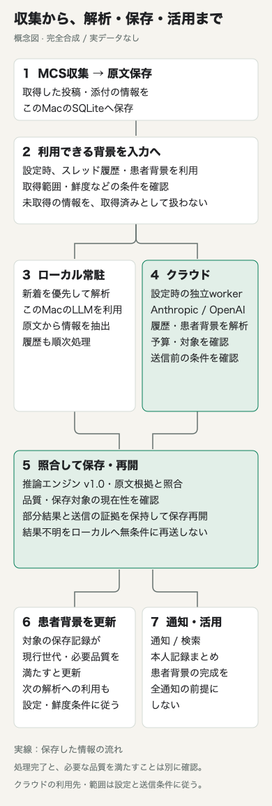

# hermes-mcs

### MCSの連絡を、探せる記録と次の確認へ。

**MedicalCareStation（MCS）の記録を、自分のMacで収集・整理・検索。**
<strong>Slack（推奨）</strong>の通知カードから、連絡の確認、担当の記録、タスクの作成までつなげます。
在宅医療・介護のチームで交わされた相談や経過を、あとからたどるためのローカルシステムです。
Slack・DiscordはHermes連携または独立接続、[LINE WORKS](docs/guides/LINEWORKS.md)は独立した独自アダプターを使います。
Hermesを入れない[スタンドアローンモード](docs/guides/STANDALONE.md)では、Slack・Discordの直接接続と共通の操作経路を選べます。接続先SDKと実機運用の受入は別に確認します。
LINE WORKSでは同じ要約・原文・添付をトークルームの連続投稿で配信します。
Slack・Discordでは、元の投稿をチャンネルのカードに、後から届いた返信を1件ずつのカードとして元の会話のスレッドに表示します。

[画面を見る](#demo) · [できること](#features) · [使い方を選ぶ](#use-cases) · [導入する](#quickstart) · [データの行き先](#data) · [最新の更新](#release)

> **AIエージェントへ:** このリポジトリのURLを渡されて導入・更新・復旧を頼まれたら、まず次で判断し、該当する手順書を最初から実行してください。
>
> | このMacの状態 | 従う手順書 |
> |---|---|
> | `~/.mcs/config.json` も `~/.mcs-recovery/repo_path` も無い（新規） | [SETUP_AGENT.md](docs/guides/SETUP_AGENT.md)（[raw](https://raw.githubusercontent.com/yusuketakuma/hermes-mcs/main/docs/guides/SETUP_AGENT.md)）。一時フォルダに取得した場合は [LOCAL_AGENT_INSTALL.md](docs/guides/LOCAL_AGENT_INSTALL.md) |
> | 設定ファイルはあるが初期設定が未完了 | 既存の checkout と導入状況を確認し、ソフトの準備が完了していれば [SETUP_AGENT.md](docs/guides/SETUP_AGENT.md) の初期設定から再開する。設定ファイルの存在だけで導入完了とは判断しない |
> | 既存環境の更新・復旧 | [UPGRADE_AGENT.md](docs/guides/UPGRADE_AGENT.md)（[raw](https://raw.githubusercontent.com/yusuketakuma/hermes-mcs/main/docs/guides/UPGRADE_AGENT.md)）。checkout は `repo_path` の場所（`--no-recovery` で導入して無い場合は [§1](docs/guides/UPGRADE_AGENT.md#1-対象と-python-の特定) の手順で特定）を使い、新しく clone しない |
> | 更新が途中で止まった・`mcs/ops/mcs_update.py status` の `applying` が `null` でない | [UPGRADE_AGENT.md §7 失敗時・巻戻し](docs/guides/UPGRADE_AGENT.md#7-失敗時巻戻し) |
>
> 秘密値はチャットに書かせず、ユーザーの端末で入力してもらいます。投稿の収集・通知・既読化・サービス起動は、依頼された範囲でだけ行います。

| 収集 | 保存・整理 | 通知・操作 |
|---|---|---|
| 24時間・既定10分間隔 | Mac上のSQLite + ローカル / クラウドAI | Slack（推奨） / Discord / LINE WORKS |

MCSサーバーの負荷対策として、自動取得の間隔を5分から10分へ変更しています。サーバーが混雑の応答（HTTP 429）を返した回は、指定の待ち時間を守り、2回受けたら残りの取得を次の定期実行へ回します。

このREADMEはmainの機能を説明します。[任意のローカル支援](#candidate)は機能ごとに適用条件があり、実機・外部の受入条件は分けて記載します。導入する版の変更・更新手順は[CHANGELOG](CHANGELOG.md)と[Releases](https://github.com/yusuketakuma/hermes-mcs/releases)で確認してください。
通知を有効にすると患者名・本文・送信対象の添付が設定先へ送られます。端末のロック画面にも患者名・投稿内容が表示され得るため、通知プレビュー設定と端末の閲覧権限を確認してください。[情報の行き先と安全境界](#data)を導入前に確認してください。

<a name="demo"></a>

## 画面イメージ — Slack

**通知先とカード操作はSlackを推奨します。** 要点の確認からタスクの確定・再確認候補まで、ギャラリーの9画面で紹介します。
掲載画像の名前・投稿・数値はすべて架空です。実データや実投稿の匿名化例は使用していません。現行実装に基づく説明図で、実画面のキャプチャではありません。
[導入前に資格情報なしで画面をたどる](docs/screenshots/slack-gallery/README.md#導入前に画面をたどる)案内では、原文・返信・添付・スタンプと、配送保留の文章シナリオを確認できます。


元の投稿のカードでは、要約と折りたたんだ原文を読み、押した人を含むスタンプを同じエリアで確認・送信できます。後から届いた返信は、1件ずつのカードとして元の会話のスレッドに届きます。元の投稿のカードには返信の件数だけを表示します。Slackの画像・PDFなどの添付は、元投稿でも返信でも、その投稿の原文より下にまとめて表示します。複数の添付を別々の投稿として流しません。Slackでは既存の会話に後から届く返信も、元投稿のスレッドに表示します。Discordでは既存カードの形式を維持し、`notify.reply_cards`を`false`にすると新規カードを従来の形式にできます。


解析の分担は[ローカル・クラウドと患者コンテキスト](#processing-flow)に図と本文でまとめています。

スマートフォンの通知には、患者名・発信者・所属・投稿時間・短い要約を含む通知文を送ります。要約が未完成なら原文の一部と処理状態を示し、取得できない項目は推測しません。実際の表示・省略は端末とアプリの通知プレビュー設定に従います。既存のDiscordカードとLINE WORKSのファイル通知では、同じプレビュー表示にならない場合があります。
画像を開くと拡大できます。画像内のボタンは説明用で、実際の操作はSlackの許可ユーザーが行います。

[確認・担当](#slack-card) · [操作メニュー](#slack-menu) · [タスク入力・確定](#slack-task) · [タスク一覧](#slack-tasks) · [患者の記録まとめ](#slack-summary)

<a name="slack-card"></a>

### 確認・担当を、カードから共有


`確認する`・`担当する`の結果を、カードの状態欄に名前で表示します。確認と担当はカードごとに記録し、返信のカードで選んだ操作は、その返信だけが対象です。
MCSのスタンプは、カードと未確認一覧に `スタンプ 👀2` のような絵文字と件数で表示します。
操作する本人とMCSアカウントを指定すると送信が既定で有効になり、そのカードに表示している投稿へスタンプを送れます。Slackはスタンプ表示と`スタンプを押す…`メニューを同じエリアにまとめ、メニューを開いて種類を選ぶ2段階です。自分の種類は`✓（取消）`、Discord・LINE WORKSは従来の直接ボタンで示します。`別の投稿`（メニューにまとめるカードでは`MCSスタンプ`）のフォームからは投稿・返信を選んで追加・変更・取消できます。画像・PDFは添付が属する投稿が対象です。`stamps.enabled=false`で無効にできます。[操作と設定](docs/specs/stamp-management.md)を確認してください。
押下者取得を有効にすると、Slackの新形式カード、DiscordやSlackの本文スレッド、LINE WORKSの投稿見出しに、スタンプの件数と押した人の氏名を1行で表示し、古い一覧・再取得失敗を区別します。投稿ごとの観測日時は、押した時刻ではありません。
**カードの確認済み表示やMCSの「完了」スタンプは、正式なタスク完了を意味しません。**

<a name="slack-menu"></a>

### 必要な操作を、メニューから選ぶ


Slack・Discord・LINE WORKSとも、`確認する`・`担当する`・`タスク作成`を含む通常操作を`操作を選ぶ…`にまとめています。スタンプと`別の投稿`はメニューを開かずに押せます。
`タスク一覧`などの表示は、カードの状態や設定で変わります。
`患者の記録まとめ`は本人だけに背景・療養情報の原記録抜粋を表示します。全患者の詳細情報を根拠付きで保存し、全文と以前の記載は[患者別の詳細読取り](docs/guides/USER_GUIDE.md#c-患者ごとのまとめrollup)から確認できます。

<a name="slack-task"></a>

### タスクは、入力してから内容を確認・確定

| ① 入力フォーム | ② 本人だけに表示される確認画面 |
|---|---|
| [](docs/screenshots/slack-gallery/04-task-form.png) | [](docs/screenshots/slack-gallery/05-task-preview.png) |
| 投稿に由来する下書きを確認し、担当者・期限・理由を入力して`確認へ`。 | 内容・担当・期限・理由を照合し、`確定する`を選ぶまで登録しません。 |

スタッフ一覧を取得できる場合は担当者を選択できます。その患者の部屋に投稿した職員を先頭に並べます。一覧がない場合は手入力になります。
期限と理由は任意で、理由が空なら「通知カードからタスク作成」を記録します。
タスク作成はMCSへの依頼投稿を自動化する機能ではありません。

<a name="slack-tasks"></a>

### スレッドのタスクを、対応中・完了へ


未完了タスクがあるカードの`タスク一覧`から、このスレッドの一覧を本人に表示します。
対象のタスクを選び、人が`対応中`・`完了`を記録します。本文からAIが抽出した「完了」とも区別します。

<a name="slack-summary"></a>

### 訪問前に、患者の記録まとめで記録をたどる


`患者の記録まとめ`から、取得済み投稿の薬・最新バイタル・次回予定・未完了タスク・履歴取得状況を本人に表示します。

住所・連絡先・キーパーソン・駐車場・家族構成・現病名など、保存された投稿の明示情報も背景としてたどれます。
各記録は原文の後ろに出典を短く添えます（例: 「残薬3日分。（10/03 薬剤師 #3）」）。Slack・Discordでは日付から患者のMCSチャットを開けます。Slackでは見出し・出典・区切り線を使ったBlock Kitで表示します。病名・既往など重要な分類が先頭に並び、関係者は冒頭の1行にまとまります。関係者・事業者は投稿者の職種・氏名・事業所から部屋ごとに一覧にします。利用中の契約や主担当は推定しません。訪問看護・介護・診療・薬局・リハ・栄養・歯科・相談員などの記録を共通の分類で扱い、職種を選ぶと表示順だけが変わります。

[患者コンテキスト作成](docs/guides/USER_GUIDE.md#患者コンテキスト作成既定は有効)は、過去の記録を24時間少しずつ点検し、保存済みの投稿と添付OCRが現行のローカルLLMで解析され、取得・根拠・品質の条件を満たした患者から患者コンテキストを作ります。クラウドを使う場合は、この患者コンテキストの作成・更新に限って使用します。本人向け画面で背景、前回からの変化、連絡・返答、訪問前の確認事項、経過、記載の食い違い、引継ぎ、退院前後の記録を原文付きでたどれます。生成・限定閲覧とも既定で有効です。既存環境も設定を省略して更新すると有効になり、明示した `false` は維持します。
患者の記録まとめを読み込めない場合は、その旨を示して基本のまとめを表示します。自分のタスク・未確認一覧・集計ではアーカイブ済み患者を末尾に示し、通常の解析もアクティブ患者を優先します。
**暫定集約であり、確定した処方一覧ではありません。未取得の記録も「無い」とは扱いません。**

[Slackの導入・接続・許可ユーザー設定](docs/guides/INSTALLATION.md) · [操作の詳しい使い方](docs/guides/USER_GUIDE.md) · [画面画像のソースと更新手順](docs/screenshots/slack-gallery/README.md)

### 該当スレッドで、対象と根拠を確認する


本人・家族・他者と、現在・過去・予定を原文から区別します。再確認候補と薬剤シグナルは元投稿の既存スレッドに追加し、原文根拠・投稿日・確認先を短く示します。解析状態は投稿カード上部の処理サービス欄に表示し、既存の投稿を更新します。

新しいカードは患者名の下に緊急度・投稿数・解析状態と処理サービスをまとめ、投稿ごとの要約を項目順に表示します。クラウド提供元のアイコンを省き、カード作成時点の患者コンテキスト進捗を`👤 73%`のように表示します。この数値だけを理由にカードを更新しません。薬剤の確認と辞書検索は押した本人だけに表示し、Slack・Discordでは同じスレッド、LINE WORKSでは1:1トークで確認します。辞書の検索は承認済み辞書が有効な場合だけ使えます。

<details>
<summary><strong>Discordを使う場合の画面例を開く</strong></summary>


Discordでも通知カードを利用できます。画像・PDFなどの添付は、対応する投稿の原文の下にまとめて表示します。

薬剤辞書が未設定の対話初期設定では、追加照合を既定「はい」で提案します。利用条件と採用方針の確認後に有効化し、既存辞書や非対話設定を自動変更しません。

詳細は[利用者ガイド](docs/guides/USER_GUIDE.md)を参照してください。

</details>

<details>
<summary><strong>LINE WORKSを使う場合の画面例を開く</strong></summary>

**要約・原文・添付を、トークルームへ連続投稿**


同じ要約・原文・送信対象の添付を、共有トークルームへ順に配信します。
表示の更新は新しい投稿になり、古いボタンと開いている確認画面は無効になります。

**タスクは、本人との1:1トークで入力・確認・確定**


許可ユーザーがカードから操作すると、入力や回答は本人との1:1トークへ届きます。`操作を選ぶ…`を押すと、確認・担当・タスク作成を含む操作が1:1トークに届きます。カードのボタンを押すと、LINE WORKSの仕様でボタン名がトークルームに投稿されます。
タスクは内容・担当・期限・理由を照合し、本人が`確定する`を選ぶまで登録しません。画像内のボタンは説明用です。

[LINE WORKSの導入・接続・許可範囲](docs/guides/LINEWORKS.md) · [画像のソースと更新手順](docs/screenshots/lineworks-gallery/README.md)

</details>

<a name="features"></a>

## できること

| したいこと | hermes-mcsでできること |
|---|---|
| 新しい連絡を確認する | 要約カードで通知。Slack・Discordは元の投稿と返信を1件ずつのカードで表示し、返信のカードは元の会話のスレッドへ。投稿ごとの原文の下に、その投稿の添付をまとめて表示。LINE WORKSは連続投稿で確認 |
| 過去のやり取りを探す | 履歴の保存・全文検索・患者ごとのタイムライン。全角・半角や英字の大小を揃えて検索し、途中で止まった履歴取得は再開 |
| 長い連絡の要点を読む | 薬・症状・依頼・バイタル・検査値などを抽出。新着・過去分・添付OCRの個別解析はローカルLLMのみ |
| 患者の記録をまとめて見る | 薬・最新バイタル・次回予定・未完了タスク・服薬管理の報告・MCS連携サマリーを暫定集約 |
| 処理状況と費用を確認する | 見出しに`👤 73%`のようにカード作成時点の患者コンテキスト進捗を表示。進捗だけでは既存カードを更新しない。個別投稿のローカル・Jevの利用状況と、クラウドの利用先・API別と合計の予算も確認 |
| 処理の失敗を調べる | `mcs jobs failed`で本文なしの理由診断。対策と人の確認を照合して対象ジョブの再試行を予約 |
| 患者情報と運用情報を分ける | Slackの患者情報と、稼働状況・エラー・復旧を送る`mcslog`を別チャンネルに分離。運用情報には患者の本文・添付・OCR結果を含めない |
| 次に確認する記録を見つける | 処方期間の候補の終了前・終了後や、後続の記録が見つからない状態などをアラートとして提示 |
| 確認・担当・依頼を共有する | カードの確認・担当を記録。タスクは内容と理由を確認してから確定 |
| 全体の傾向を把握する | 投稿量・職種別内訳・未解決依頼などの読み取り専用統計。任意の日次ダイジェスト |

Slack・Discordでは通知カードと操作メニューに加え、`/mcs`コマンドから閲覧・依頼管理・運用承認を行えます。
LINE WORKSではカードのボタンと本人との1:1トークの `mcs JSON` を使います。Hermesあり・なしで共通の機能と人承認条件を使い、LINE WORKSの接続はどちらも独立アダプターが所有します。
`全体の新着集計`から全体・施設・患者・記録上の担当で絞り込めます。Slackは`/mcs-summary`、Discordは`/mcs`の`summary`、LINE WORKSは本人DMの「サマリー」でも呼び出せます。元データは読取り専用スナップショットです。

要約の項目別の短い文字数・件数制限は外し、作成待ちと再試行上限に達した失敗を区別します。通知先の表示上限は維持し、長いカードはページに分け、単一投稿が上限を超える場合は省略して本文表示や原本へ案内します。抽出の保存後に表示を更新し、押下者取得を有効にした環境では取得完了後に氏名も反映します。

服薬管理のうち薬の保管状況・保管場所・管理者、疑義照会・処方提案の結果、重複・相互作用の確認は、原文の値を引用した1行でカードにも表示します。

原文の測定値・薬剤・確認や連絡の候補が欠けている場合は、既存の時間枠で一度だけ再確認します。初回に読み取れた内容を保持し、補完待ちや確認できなかった箇所は「要確認」と区別します。意味解析では取りこぼしを補完した後も再監査を行い、不完全な結果を公開しません。

履歴取得・抽出・統計の重複走査とメモリ使用を抑え、一時的な障害からの再試行を改善しています。抽出やカード配送の停滞は稼働状態へ記録します。記録が多い環境でも、モデル・取得間隔・任意機能の既定値は変えません。

収集エラーの警報は、18の原因分類ごとに何が起きたかと利用者の対処を示します。時間切れ・通信・取得未完了などの自然に回復しやすい異常は同じ異常が3回続いたときに通知し、ログイン切れ・保存できないなどの重い異常はすぐ通知します。health.jsonではDB本体の使用量・空きページ量、バックアップの種類別容量、日次・週次保守の経過時間も確認でき、日次保守が2日以上完了しないと警告します（[判定の説明図](docs/releases/v1.1.0/collection-alerts.png)）。

AIが緊急度を高と判定した投稿で元の本文を取得できていない場合は、「緊急度: 要確認」と表示し、本文で裏付けられない「高」の表示や緊急通知はしません。


薬剤辞書が未設定の対話初期設定では、追加照合を既定「はい」で提案します。利用条件と採用方針の確認後に有効化し、既存辞書や非対話設定を自動変更しません。

詳細は[利用者ガイド](docs/guides/USER_GUIDE.md)と[プラグインガイド](hermes_plugin/README.md)を参照してください。

**AIの抽出は候補です。患者サマリーは確定した処方一覧ではなく、カードの確認済み表示もタスク完了を意味しません。**

<a name="processing-flow"></a>

## ローカル・クラウドと患者コンテキスト



MCSの投稿・返信・添付情報をこのMacへ保存します。新着と過去のチャット、添付OCRの個別抽出・意味解析はローカルLLMで進めます。クラウドLLMは患者コンテキストの作成・更新に限って使用します。どちらも推論エンジンv1.0に従い、原文・処理対象・根拠・品質・結果の世代を照合して保存します。

| 処理 | 主に進める仕事 | 使用する条件と結果の扱い |
|---|---|---|
| ローカルの常駐処理 | 新着・対話を優先し、過去の投稿と添付OCRも端末内で個別解析 | クラウドの待機・予算・送信結果不明とは分けて、処理条件を満たす投稿を進める |
| クラウドLLM | 患者コンテキストの作成・更新と、その品質修復 | 取得済みの要約・チャット原文・添付OCR全文を、出典・版・区間を照合して分割入力する。Anthropic / OpenAIの設定、合計・API別予算、対象、送信前条件を確認する。個別投稿のクラウド再抽出は行わない |
| 共通の保存経路 | 根拠付きの部分結果を保持し、中断後は保存済み回答から再開 | LLM通信中は共有ロックを解放し、保存時に入力と証拠を再確認する。結果不明の送信をローカルへ自動でやり直さない |
| 患者コンテキスト | 背景、前回からの変化、連絡・返答、訪問前の確認事項をまとめる | 新しい情報や編集、遅れて完了したOCRを取得した都度更新する。同日でも更新し、入力が変わらなければ同じクラウド要求は繰り返さない。未取得・未解析の資料は未完了として扱う |

画面に載せる要点の件数・長さの上限と、推論に使う資料の範囲は別です。個別投稿を確認するJevの意味監査は継続し、生成クラウドLLMの用途制限とは分けて扱います。

通知は患者コンテキストの完成を待つ仕組みではありません。原文や投稿の処理状況を先に表示し、確認できた投稿の解析結果で更新します。`👤 73%`はカード作成時点の進捗で、その後は固定します。未完了・保留・送信結果不明は完了と区別し、割合は内容の正確さを示す数値として扱いません。

患者コンテキストの生成と本人向け限定閲覧は既定で有効ですが、以前の報告を抽出入力へ渡す `extract.patient_state_context` は別の設定で、既定offです。有効にした抽出でも、入力の取得範囲・鮮度・出典の条件を満たした情報だけを参考にし、抽出する値と引用は対象投稿の原文に基づきます。明示したOFFや閲覧権限は維持します。

添付OCR（1.1.2向け）は、画像・PDFの文章を投稿本文とは別の資料として保存します。
診療情報提供書、看護・薬剤管理等の報告書、PCAポンプの文字を出典付きで整理します。
文字起こし後の個別解析はローカルLLMで行います。クラウドを使う場合は、対象範囲・予算を守り、患者コンテキスト作成時の入力にOCR全文を含めます。
必要な解析が完了した原資料を患者コンテキストへ取り込み、チャットでは原文と分けて表示します。
既定は無効で、Yomitokuを専用環境へ導入してから有効にします。
[対象・利用条件・導入手順](docs/guides/ATTACHMENT_OCR.md)を確認してください。

[API選択・予算・外部送信の設定](docs/guides/ANTHROPIC.md) · [患者コンテキストの生成と入力利用](docs/guides/USER_GUIDE.md#患者コンテキスト作成既定は有効)

<a name="candidate"></a>

<a name="1013のローカル支援既定off実機受入は別途"></a>

### 任意のローカル支援と受入条件

次はmainにあるローカル支援の入口です。利用条件と有効化の手順は各行のガイド・仕様で確認してください。合成検証や固定版SDKの結果は、対象版の[受入記録](docs/releases/README.md)で追跡します。実APIの未読保持・権限、canonicalの人手評価と昇格、緊急再通知の実運用、鍵の保管と相手側の受入は別条件です。機能の自動有効化や外部GET・公開・配備の承認を意味しません。

| ローカルで確認できる支援 | 入口と適用条件 |
|---|---|
| 暗号化offsite・鍵escrow・別配置への復元 | `mcs_backup.py`。保存先・鍵・独立SHA receipt・保持のオーナー承認が必要。定期運用は明示opt-in、新端末の復元は同意待ちで停止。[バックアップ・端末喪失ガイド](docs/guides/BACKUP.md) |
| 構造化薬歴・観測値とチャット候補の別出典閲覧 | `project_metadata.py`（明示sync）と`mcs_view.py`のsnapshot読取り。表示は`--publication`で明示し、`include_chat`は既定off。同一項目・正本・対応完了を自動判定しません。GETはsession・未読保持・権限の実受入後に承認。[MCS連携データの条件](docs/roadmap/mcs-api-survey.md) |
| 薬剤の表層名とは独立した候補注釈・照会 | 私有辞書の出所・SHA・承認に束縛した成分・一般名処方・製品候補を併記し、`mcs drug`で照会・参考検索・更新差分を確認できます。別名の薬剤行を統合せず、総称や複数候補を成分に確定しません。公式master原本は[システム更新に同梱](resources/drug-master/README.md)し、`mcs drug install-bundled`で運用者の確認日・確認者を入力して私有辞書を作れます。辞書の承認・有効化は運用者が行います。[抽出の範囲と残条件](docs/roadmap/extraction.md) |
| 薬剤の変更経緯と記録の照合 | `mcs drug timeline/reconcile`で、商品名・一般名をまたぐ言及、開始・中止・増減・予定、構造化薬歴との違いを取得範囲・情報時点付きで確認します。本人・家族・過去・予定を区別し、服用中や処方の正本を自動確定しません。 |
| 規格・剤形・マスター更新の確認 | `mcs drug related/check-surface/master-impact`で名称候補、記載された規格・剤形・単位の差、公式マスターの名称・廃止・経過措置変更と採用辞書への影響を確認します。辞書の採用・有効化は別の人承認操作です。[薬剤ワークフロー仕様](docs/specs/DRUG_MASTER_WORKFLOWS.md) |
| 状態監視・遠隔支援（CSDC） | コードのみ同梱しています。1.1.0では有効にして提供せず、顧客への接続や遠隔での実行も行いません。新規導入では `sdc.enabled` が未設定のため専用ジョブは登録されません。既存の明示設定は更新で変更しません。登録案内を表示するかどうかは `mcs setup features` で選べます（既定は表示しない） |
| 導入・更新・ローカル診断の統一入口 | `sh scripts/mcs install`、導入後の`mcs setup`・`mcs update`・`mcs doctor`。診断結果やSDK版の取得は接続・更新後プロセスの受入証明ではありません。[更新時の確認](docs/guides/UPGRADE_AGENT.md) |

<a name="use-cases"></a>

## 使い方を選ぶ

<details>
<summary><strong>新着連絡を読み、チームで確認・担当を共有したい</strong></summary>

1. 通知カードの送信者・要約を読み、必要な本文や添付を確認します。Slack・Discordは投稿ごとの原文の下に添付をまとめ、LINE WORKSは同じトークルームへ連続投稿します。
2. `確認する`で今の表示内容を確認したことを記録し、必要なら`担当する`で担当を記録します。
3. 作業が必要ならタスクを作り、確認画面で内容・担当・期限・理由を確認して確定します。

確認状態はカードごとに記録します。確認記録と実作業の完了は別に扱います。
[カードの操作と表示条件](docs/guides/USER_GUIDE.md)

</details>

<details>
<summary><strong>訪問前に、患者の経過と過去の相談をたどりたい</strong></summary>

患者サマリーで暫定集約を確認し、検索やタイムラインで根拠となる投稿をたどれます。
薬の変更、症状、相談、判断、実施、再評価を、保存済みの記録から確認します。
まだ取得していない範囲は検索されません。履歴の取得状況も合わせて確認してください。
[患者サマリー・検索・タイムライン](docs/guides/USER_GUIDE.md)

</details>

<details>
<summary><strong>後続の記録や期限を、もう一度確認したい</strong></summary>

アラートは「記録上、確認するとよい状態」を提示します。
薬の期間表現や依頼・経過の記録を根拠に、原文を読み、人が確認・判断します。
日次ダイジェストを有効にすると、未完了タスクや滞留アラートなどもまとめて確認できます。
機械がMCSへ依頼を自動送信することはありません。
[アラートの意味・対象・限界](docs/guides/USER_GUIDE.md)

</details>

<details>
<summary><strong>MCSの記録から、どんな傾向を見られる？</strong></summary>

診療と診療の間の多職種コミュニケーションを、次の7分野で扱います。

| 分野 | 記録からたどれること |
|---|---|
| 患者経過 | 症状、バイタル、状態変化、入退院、問題の反復 |
| 薬物療法 | 開始、中止、増減量、期間表現、再評価 |
| 多職種連携 | 誰から誰への相談、回答、判断、実施 |
| 組織間連携 | 薬局・診療所・訪看・居宅のやり取り |
| 時系列 | 記録上の対応時間、変化点、再発間隔 |
| 業務 | 記録の集中、未解決依頼、長期滞留 |
| 確認支援 | 通常との差、フォロー記録が見つからない候補 |

投稿数は重症度を、薬剤名の記載は現在の服用を、記録上の前後関係は因果関係を証明しません。
多職種の多さは連携の質を保証せず、アラートがないことも患者の安全を保証しません。
未来を予測する機能ではありません。[データ一覧と解釈の限界](docs/guides/USER_GUIDE.md)

</details>

<a name="quickstart"></a>

## クイックスタート

**導入前提:** macOS 13以降、普段のユーザー（sudo不要）、Xcode Command Line Tools、Homebrew、空き約12GB、利用権限のあるMCSアカウント。Pythonはインストーラーが用意します。
今回の初回受入候補はmacOS・Apple silicon・Slackのstandaloneです。下の例はこの方式を明示します。正式対応・実機受入は別途確認し、既存環境の方式は維持します。
[能力・既定条件・確認済み範囲・残る受入](docs/guides/INSTALLATION.md#capabilities-acceptance)は導入ガイドの単一表で確認してください。

```bash
git clone https://github.com/yusuketakuma/hermes-mcs.git
cd hermes-mcs
./install.sh --mode standalone --preflight   # 読み取り専用の事前チェック
./install.sh --mode standalone               # 依存一式を導入。途中で止まったら修正して再実行
```

事前チェックの「要対処」に表示される`対処:`を確認し、`導入を妨げる問題 0件`になってから導入します。
方式を省略した初回の`./install.sh`は、Hermes経由かHermesなし（[スタンドアローン](docs/guides/STANDALONE.md)）かを尋ねます。Enterの既定は従来どおりHermesです。Hermes連携を選ぶ場合は、上の2コマンドを`--mode hermes`で実行します。
導入後は、そのまま初期設定へ進むか、後で行うかを選べます。後で行う場合は、完了画面に表示される設定コマンドを使います。
初期設定の推奨コースは必要な項目を順番に案内し、詳細コースでは全項目を確認できます。分からない必須情報は中止して確認できます。HermesモードのSlack/DiscordではHermesとの同期も行います。[初めての導入・更新・復旧](docs/guides/EASY_SETUP.md)に操作の流れをまとめています。
本体の初回設定後は、ブラウザーの準備など診断に残った項目を解消します。LINE WORKSの認証・Callback・常駐設定と再診断は[接続ガイド](docs/guides/LINEWORKS.md)で続けます。
既存環境を更新する場合は[更新エージェント手順](docs/guides/UPGRADE_AGENT.md)を使います。移行先版の更新コードで計画・バックアップ・適用を行い、再導入は必要な場合に明示指定します。

**AIに導入を任せる場合**は、リポジトリを開いたエージェントに次のように依頼できます。デスクトップ版のClaude・Codexが一時フォルダへ取得した場合は、`python3 scripts/install_local.py` で恒久的な置き場所へ導入します（[手順](docs/guides/LOCAL_AGENT_INSTALL.md)）。

```text
docs/guides/SETUP_AGENT.md に従って、このMacへhermes-mcsを導入してください。
既存設定と回答を再利用し、まず通知先を選んで進めてください。
認証情報は私が端末へ直接入力します。投稿の収集・通知・既読化は開始前に範囲を確認してください。
```

| 次に進む先 | 内容 |
|---|---|
| [standaloneのSlackを設定する](docs/guides/STANDALONE.md#slackとdiscordの接続準備) | Slack app・接続・許可範囲。Hermes連携は[導入ガイド](docs/guides/INSTALLATION.md)へ |
| [LINE WORKSを設定する](docs/guides/LINEWORKS.md) | 独自接続アダプター・秘密値入力・Callback・許可範囲の設定 |
| [Hermesなしで使う](docs/guides/STANDALONE.md) | `install.sh --mode standalone`・Slack/Discordの直接接続・切り替え |
| [導入ガイド](docs/guides/INSTALLATION.md) | 最短手順・成功の目安・通知先の設定・トラブル対応 |
| [AIエージェント向け導入手順](docs/guides/SETUP_AGENT.md) | エージェントに導入を任せるときの確認・実行手順 |
| [更新・バックアップ・復旧](docs/specs/lifecycle-spec.md) | 導入後の運用と更新時の確認 |

困ったときは、表示された同じインタープリターで`mcs_setup.py doctor`を実行します。
1.0.13の統一入口は`mcs doctor`です。既定はローカル診断で、LLM通信やサービス状態のprobeは明示指定します。診断が成功しても、SDKの通信・カード操作や配備済みworkerの反映まで検証したとは扱いません。

処理が進んでいるかを確認するときは、doctorで運用記録の鮮度、待ち件数、中断検出、日次バックアップの状態を確認できます。`--probe data` を付けると、収集エラーの原因分類と件数、未取得の本文の最長経過時間も表示します（[収集の診断](docs/guides/COLLECTION_DIAGNOSTICS.md)）。サポートへ状況を伝えるときは `doctor --share` で、患者件数・設定値・パスを含めない共有用のJSONを確認してから渡せます（自動送信はしません）。詳しい工程別の残数・実測速度・条件付きの見通しは、[処理の残数・停滞の確認](docs/guides/USER_GUIDE.md#cli--処理の残数停滞の確認)へ進んでください。未確認の値は0件と区別し、工程間の件数は合算しません。

<a name="data"></a>

## 仕組みと情報の行き先

全体の処理分担は[ローカル・クラウドと患者コンテキスト](#processing-flow)の図で確認できます。

収集した記録をMac上に保存し、通知・検索・統計・アラートとして提示します。整理にはローカルAIを使い、APIキーと設定に応じて外部AIも使用します。

| 経路 | 保存・送信される情報 | 条件 |
|---|---|---|
| このMac | 投稿・添付・患者情報と、ローカルAIによる整理結果 | 収集・保存・構造化抽出の基本経路 |
| MCSへのスタンプ操作 | 選択した投稿の識別子、スタンプの種類または取消。MCS収集アカウント名義で送信 | 本人IDと単独操作者を設定し、その操作者が操作した場合。結果不明は照合し、自動再送しない |
| Slack（推奨） / Discord / LINE WORKS | 患者名・本文・要約・送信対象の添付。タスク通知には内容・担当者名、押下者表示には氏名・職種も含む | 通知先・対話カード・関連機能を設定した場合。押下者取得は既定OFF |
| 公開医薬品情報の照会（PMDA添付文書・Mindsガイドライン） | 同梱の公開マスターと一致した薬品名、一般的な疾患のキーワード、公式URL。患者データ・私有辞書は送らない | `mcs drug info-lookup`・`info-guideline`・添付文書の改訂確認を使う場合。ローカルのTinyFishゲートウェイを使い、トークンがない場合は照会を停止。取得内容は医学的な評価を経ていない参考資料 |
| TypeSafe Jev API | 患者名を含み得る本文と必要なスレッド文脈。匿名化なし | MCSの `.env` にキーがありmode未指定ならassistで自動使用。再試行を含め1日10000要求まで。明示OFF・対象・低い上限は維持 |
| Anthropic / OpenAI API | 患者名を含み得る本文と患者文脈。匿名化なし | MCS専用 `.env` のキーと利用先の設定に応じ、患者コンテキストの作成・更新と、その品質修復だけに使用。個別投稿・添付OCRの抽出や意味解析はローカルLLMで処理。既定はAnthropic優先。合計上限とAPI別上限を同時に適用し、明示OFF・対象は維持。[設定・外部送信の確認](docs/guides/ANTHROPIC.md) |
| 知識ストア向けローカル出力 | 患者名・病名・要約・薬剤等を含むMarkdown。匿名化なし | 明示的にエクスポート。出力後の同期・LLM利用は別経路で管理 |

「ローカルLLM」は、システム全体が外部へ送信しないという意味ではありません。
送信先と閲覧権限、AIの使用箇所は[SECURITY.md](SECURITY.md)で確認してください。

### 人が確認して判断するための境界

- **記録がない ≠ 対応していない。** アラートは記録上の候補で、対応漏れを断定しません。
- **人承認を記録。** 依頼登録・更新、アラートの却下、閾値変更は所定の承認とreceiptの記録を伴います。MCSへの依頼送信を自動化しません。
- **保存完了後に既読化。** 患者単位の既読化は、取得完了・DBへのcommit・snapshot timestampを条件にします。本文を取得できていない親投稿がある患者は既読にせず、後続の収集で補完します。既読化を指定した定期収集（`--mark-read`）では、直近7日以内に保存した返信のスレッドを1回最大10件確認します。返信は未保存・抜粋のみの内容を先に補完します。ただし、保存済みの抜粋が取得の再試行上限に達した場合は、補完を諦めてスレッドの既読化を進めます。未保存の返信が残る場合は既読にしません。返信の既読化は収集時点に限定できないため、確認後に届いた返信も既読になる場合があります。読取り時に見つかった追加返信は取得ジョブへ登録します。
- **スタンプは観測情報。** 件数・本人反応・観測日時を本文と分けて保存し、未取得と0件を区別します。取得日時は押下時刻ではありません。スタンプだけで確認・担当・業務完了を変更しません。専用の再取得は既定で無効です。有効化すると直近30日活動スレッドの先頭・返信を対象に、活動時期に応じた間隔で最大8件/回を再取得します。押下者取得も既定で無効で、有効化すると直近7日活動スレッドの全投稿について氏名・所属・職種を取得し、氏名・職種をSlackの新形式カード、本文スレッド、LINE WORKSの投稿見出しに表示します。押下者ごとの最後の観測状態を無期限に保持し、取消を観測した時刻を残します。再押下時には取消状態を解除し、過去の全操作履歴は復元しません。未読保持の実証後に定期shadowを有効化できます。既定では反応値を通常表示へ反映せず、公開を別途有効化した場合だけ正常な取得値を表示へ反映します。本人の承知・完了を未応答候補の判定に使う設定も既定で無効で、正式タスクの完了とは別です。
- **スタンプ操作の権限。** 設定した1人の操作者だけが、MCS収集アカウント名義で追加・変更・取消を依頼できます。操作時点の投稿・本人の状態を再確認し、送信前の記録を保持します。結果不明の操作は自動では再送しません。
- **添付の送信範囲。** 通知で送るファイルはMCSのデータ保存先の`attachments`内に限定します。保存先の外を指すファイルは送信しません。
- **認証とログの境界。** no-redirect / no-proxy。定期実行のログへ本文・氏名を出しません。明示的な閲覧出力は別に扱います。
- **説明用の架空データだけをリポジトリへ。** 患者データ・秘密情報・実投稿の匿名化例を入れません。

<a name="faq"></a>

## よくある質問

<details>
<summary><strong>AIが処方や医療判断を確定する？</strong></summary>

抽出・要約・アラートは候補です。原文と取得範囲を確認して人が判断します。
投稿から抽出した「完了」と、人がタスク操作で確認した完了も区別します。

</details>

<details>
<summary><strong>添付画像やPDFも解析する？</strong></summary>

添付は保存・通知とメタ情報の管理までで、内容の意味解析は行いません。
長文の要約も全件完了を保証せず、入力上限を超える記録は要確認として扱います。
[解析の限界](SECURITY.md)

</details>

<details>
<summary><strong>バックアップがあれば端末故障にも対応できる？</strong></summary>

日次SQLiteバックアップは同じMac上の保存です。端末喪失時の復旧保証にはなりません。
1.0.13の暗号化backup・escrow-key drill・新規配置restoreはローカル支援であり、原本上書きや通知再開の許可ではありません。別媒体・鍵・独立SHA receipt・保持の承認と復元訓練は運用側で行います。[鍵・同意待ちの条件](docs/guides/BACKUP.md)と[復旧の限界](docs/specs/lifecycle-spec.md)を確認してください。

</details>

<a name="release"></a>

## 最新の更新

<!-- BEGIN GENERATED:release -->

**v1.1.2 · 2026-11-07** — **添付資料の文字起こしと通知先・クラウド経路の整理**

画像・PDFの添付をローカルで文字起こしし、出典付きで患者コンテキストへ統合できるようになりました。Slackは患者情報と運用ログを別の非公開チャンネルへ分け、DiscordとLINE WORKSの通知カードにも各投稿の原文と添付を表示するようにしました。個別投稿への新規クラウド送信を停止し、クラウド解析は患者コンテキストの作成・更新とその品質修復に限定しています。停止前に作られた予約と課金済み回答は従来の対象範囲で回収・保持します。DB世代12とOCR実行モデルの更新を含みます。


説明図は実画面や速度の測定結果ではありません。患者データ・実投稿は使用していません。クラウド利用には登録・有効設定・対象範囲・予算等の条件があります。[外部送信と費用の条件](https://github.com/yusuketakuma/hermes-mcs/blob/v1.1.2/docs/guides/ANTHROPIC.md)を確認してください。

| 変更 | 以前（1.1.1） | 今回（1.1.2） | 利用者への効果 |
|---|---|---|---|
| 添付の医療資料 | 投稿本文だけを解析 | 画像・PDFをローカルで文字起こしし、出典付きで保存して患者背景へ反映 | 紹介状・報告書の内容を原文と分けて確認できる |
| Slackの通知先 | 患者情報と運用通知が同じ宛先 | 非公開のmcs・mcslogへ分離し、テキスト専用でも準備できる | 運用のお知らせを患者情報に混ぜない |
| クラウド解析の範囲 | 履歴抽出と意味解析でも新規送信 | 新規送信は患者コンテキスト専用、個別はローカルで継続・旧予約は回収 | 外部送信を絞り、支払い済みの結果も失わない |

<details>
<summary>主な変更と更新時の注意を開く</summary>

- **新機能 · 添付資料を本文と分けて文字起こしし、医療項目を整理**
  画像・PDFをローカルで読み取り、投稿本文を変えずにページと出典を持つ資料として保存します。診療情報提供書、各種報告書、薬剤資料、PCAポンプの文字を医療項目ごとに整理し、紹介状に記載された経過は日付順のタイムラインでも読めます。

- **改善 · クラウド解析を患者コンテキストの作成・更新と品質修復に限定**
  個別投稿への新規クラウド送信を停止し、クラウド解析は患者コンテキストの作成・更新とその品質修復だけに限定します。停止前に作られた予約と課金済み回答は従来の対象範囲で回収・保持し、クラウド停止中もローカルの患者コンテキストを検証・表示します。閉じた経路は概算に数えず、残る待ちは患者コンテキストの見積もりへ反映します。

- **不具合修正 · 添付OCRから解析・通知・患者コンテキストまでの処理を接続**
  文字起こし後のローカル解析と、予約を持つページのクラウド結果回収を分けて保存し、未処理や保留を完了扱いにしません。OCRの表・解析状態・測定値・経過表示・誤り報告を接続し、修復結果の読取り拒否と削除済み投稿の添付を完了扱いする問題を修正します。OCRモデルは導入時と実行時で同じバージョンに固定し、開始時に保存ロックが使用中なら既存のジョブ制限内で解放を待ちます。 処理中の保存待機が拒否された場合は、最後に観測した固定の拒否理由を状態記録へ含めます。 認識済みの結果はジョブの残り予算内で保持して保存を待ち、実行失敗の固定理由を残します。 添付OCRの失敗記録から、モデルの読込み・推論・画像読込みのどこで止まったかを区別できるようにしました。表のセルが重なる出力も専用の理由で拒否します。

**更新時の注意**

- 収集・抽出・患者背景・クラウド回収の各workerと通知worker・アダプターを同じ候補へ更新し再起動してください。Hermes plugin利用時はgatewayの再起動、LINE WORKSは独立アダプターの再起動が必要です。コードの変更だけでは稼働中の処理へ反映されず、本番適用は別途判断・承認が必要です。更新にはdeployment/install/runtime.shを含む完全な配布版を使い、.prevとruntime世代を一体で保持して入口だけを巻き戻しません。

- 添付OCRは既定で無効です。非商用研究等の利用条件を確認のうえ、install.sh --with-yomitokuで専用Python 3.13環境とモデルを導入し、attachment_ocr.enabledと実行ファイルの絶対パスを設定してください。OCR導入済みの環境は通常のアップデーターでOCR用環境も更新します。旧形式・旧版のOCR結果は現行資料から除外し、原本が残る資料から順次再OCRします。原本を取得できない添付は取得不能として表示し、削除済みの原本は自動再取得しません。選択済み環境は更新時にも保持し、定期ジョブは6件から7件になります。

- 個別投稿への新規クラウド送信は停止しています。添付の文章はローカル解析を続け、停止前に予約されたページと課金済み回答は既存の患者範囲・予算・承認条件で証跡を照合して回収します。確認不能な結果を成功・失敗へ推測せず、ローカル結果へすり替えず、結果不明の自動再送は行いません。概算の表示から送信・課金・履歴範囲の承認は行いません。無効・設定上の対象外は表示対象に含めません。

- Slack通知先：アプリにgroups:write・groups:readを許可して再インストールし、招待する操作者をnotify.slack.allowed_user_idsへ指定してください（テキスト専用でも必要で、カードの利用は有効化しません）。新規作成はslack:newを指定した導入・更新と mcs setup slack-channels の明示操作が対象で、両チャンネル設定済みや作成・招待結果が不明な場合は自動で作成・再作成しません。interactive=offで運用通知先を明示済みなら既存のnotify_system_targetを使い、未設定・同一チャンネル・分離を確認できない指定は保留します。install.sh --no-services 後の初期設定は mcs setup を実行してください。

- 通知カード互換：旧形式で配信済みのカードは新版の面と互換がないため再利用せず新しいカードとして投稿します。Discordの添付は対応する本文と同じ要求で配信します。未送信・保留の本文は自動再送・自動再取得せず、配送証明または明示承認で再試行します。本文更新後に旧形式フォームのhashを検証できない場合は送信せず通知も抑止します。既に削除された送信計画の復元や過去の拒否配信結果の自動再取得は行いません。

- 患者背景の承認：ソース変更で候補の識別値が変わるため、旧候補の評価・承認を新候補へ自動で流用・有効化せず、既存手順で再評価・承認してください。承認記録は自動で書き換えません。既存の並び順・A・B・Cの6:3:1配分・会計・結果不明時の再送禁止は維持します。患者背景の読取り部品は呼出側の採用まで既存の処理を変えず、薬剤の進捗比較は対象の読取り処理で明示的に有効にした場合だけ使います。

- DB世代12を読むアダプターと表示コードを同じ候補へ更新してください。公開済みスナップショットだけを読取り専用で使い、未対応の世代13以降は拒否します。閲覧権限・人承認・送信条件は変更しません。

- その他の条件：監視警報の閾値・重複抑制・通知の30秒共有予算とカード2秒窓・既読化・スタンプの旧形式フォーム検証・snapshotの期限切れ時刻（設計余裕5秒・watchdogなし/commands-onlyは従来どおり）の条件は変更しません。通知整理の処理位置は端末内に保存し再起動後も続きから確認します。各診断コードの追加だけでは滞留や再発を解消しません。

- 追加設定は不要です。適用後の通常OCRから記録に反映されます。保存済み結果を削除せず、既存の失敗を強制再試行しません。

- 追加設定は不要です。適用後に新しく作成するカードへ反映します。既存カードの凍結済み進捗と、過去に観測できなかった表示は保持します。

</details>

[すべての変更と技術詳細](CHANGELOG.md) · [GitHub Releases](https://github.com/yusuketakuma/hermes-mcs/releases)

<!-- END GENERATED:release -->

<a name="docs"></a>

## ドキュメント

目的別の全体索引は[文書を探す](docs/README.md)を参照してください。現在の操作はガイド、開発手順は開発リファレンス、版ごとの受入はリリース記録で確認できます。

| 読む目的 | 文書 |
|---|---|
| 使い方・画面・データの読み方 | [利用者ガイド](docs/guides/USER_GUIDE.md) |
| 導入・接続・設定・トラブル対応 | [導入ガイド](docs/guides/INSTALLATION.md) · [LINE WORKS接続](docs/guides/LINEWORKS.md) · [スタンドアローン](docs/guides/STANDALONE.md) · [エージェント向け手順](docs/guides/SETUP_AGENT.md) |
| データ取扱い・安全境界・AI・復旧の限界 | [SECURITY](SECURITY.md) |
| 更新・バックアップ・復旧 | [更新ガイド](docs/guides/UPGRADE_AGENT.md) · [1.1.0のリリース資料](docs/releases/v1.1.0/README.md) · [1.0.24の受入票](docs/releases/v1.0.24/ACCEPTANCE_1.0.24.md) · [ライフサイクル仕様](docs/specs/lifecycle-spec.md) · [鍵escrow・端末喪失ガイド](docs/guides/BACKUP.md) · [配備資産](deployment/README.md) · [収集の診断](docs/guides/COLLECTION_DIAGNOSTICS.md) · [保存済み添付の点検](docs/guides/ATTACHMENT_RECOVERY.md) |
| 開発・コマンド・統計・アラート定義 | [開発リファレンス](docs/development/DEVELOPMENT.md) · [Hermesプラグイン](hermes_plugin/README.md) |
| エクスポート・意味解析の評価 | [外部出力契約](docs/specs/external-export-contract.md) · [意味解析の評価](docs/specs/semantic-evaluation.md) · [rollout](docs/specs/semantic-facts-v2-rollout.md) |
| 今後の計画 | [ロードマップ](docs/ROADMAP.md) |
| 候補の封印評価・昇格条件 | [候補評価仕様](docs/specs/SEALED_CANDIDATE_EVALUATION.md)。合成評価と実データの人手評価を分離し、候補指紋と独立承認receiptを照合します。 |
| リリースとREADMEの更新ルール | [リリースノート規則](docs/development/RELEASE_NOTES.md) · [README運用](docs/development/README_MAINTENANCE.md) |

[版ごとの計画・受入記録](docs/releases/README.md)と[開発記録](docs/dev-records/README.md)は当時の証跡です。[安定稼働版1.0.13の計画](docs/releases/v1.0.13/RELEASE_1.0.13.md)の受入条件も、その版の記録として保持します。現在の仕様・運用手順は上のガイドを参照してください。

## ライセンス

Proprietary — All Rights Reserved。
1.1.0からの外部利用は、リポジトリ管理者と個別契約した顧客を対象とします。利用者・導入先・用途・改変や再配布の可否は書面の個別契約に従います。このREADME自体は利用許諾ではありません（[LICENSE](LICENSE)）。

開発者向け: [責務別のコード配置・依存・移植範囲](docs/development/REPOSITORY_STRUCTURE.md)。
