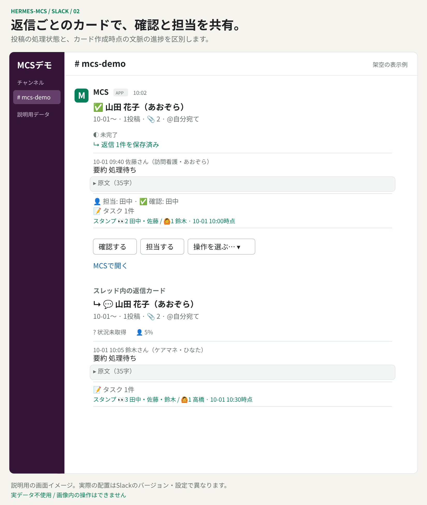
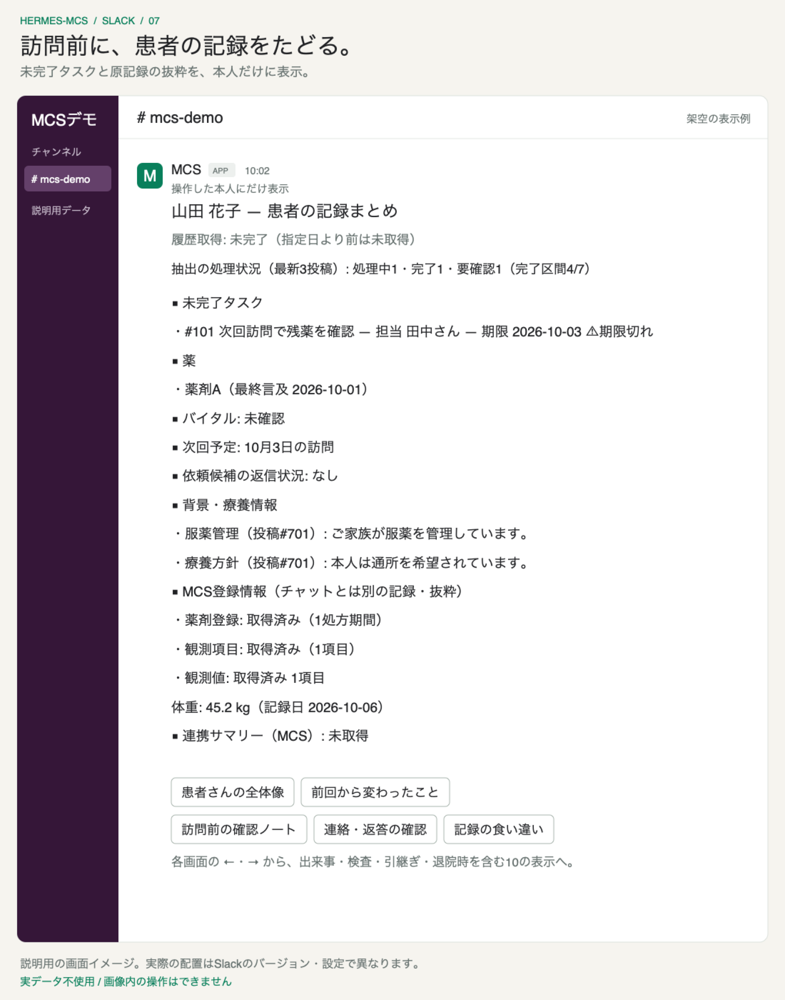
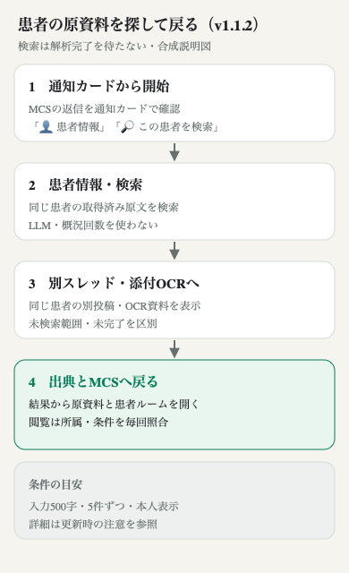
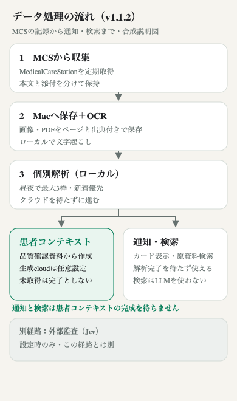
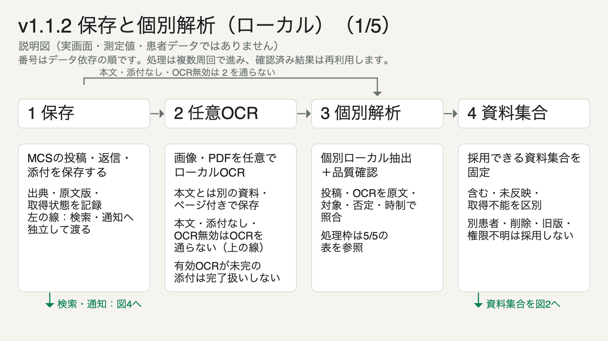
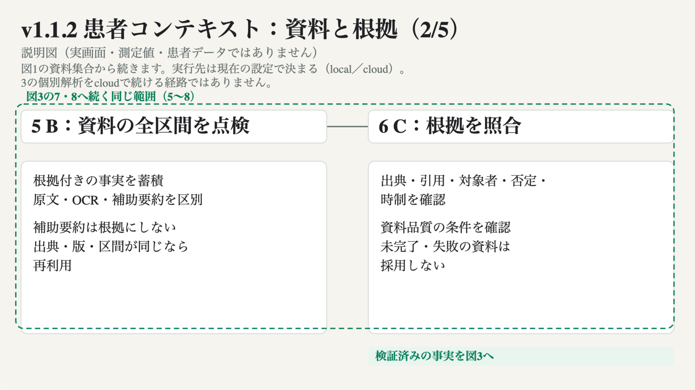
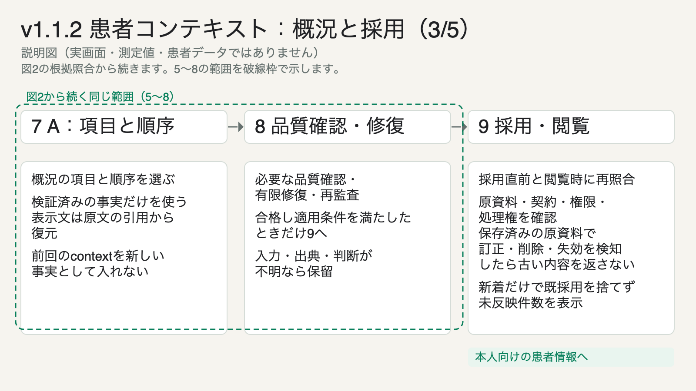
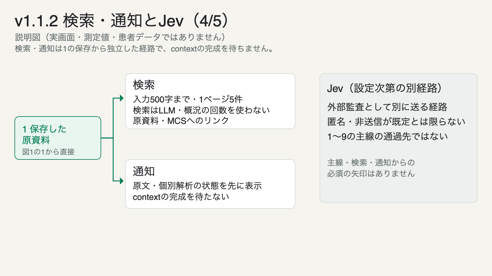
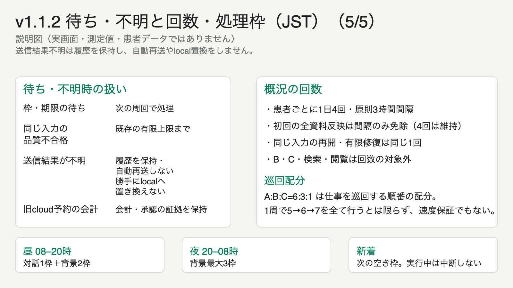

# hermes-mcs

### MCSの連絡を、探せる記録と次の確認へ。

**MedicalCareStation（MCS）の記録を、自分のMacで収集・整理・検索。**
<strong>Slack（推奨）</strong>の通知カードから、連絡の確認、担当の記録、タスクの作成までつなげます。
在宅医療・介護のチームで交わされた相談や経過を、あとからたどるためのローカルシステムです。
Slack・DiscordはHermes連携または独立接続、[LINE WORKS](docs/guides/LINEWORKS.md)は独立した独自アダプターを使います。
Hermesを入れない[スタンドアローンモード](docs/guides/STANDALONE.md)では、Slack・Discordの直接接続と共通の操作経路を選べます。接続先SDKと実機運用の受入は別に確認します。
LINE WORKSでは同じ要約・原文・添付をトークルームの連続投稿で配信します。
Slack・Discordでは、元の投稿をチャンネルのカードに、後から届いた返信を1件ずつのカードとして元の会話のスレッドに表示します。

[画面を見る](#demo) · [できること](#features) · [使い方を選ぶ](#use-cases) · [導入する](#quickstart) · [データの行き先](#data) · [最新の更新](#release)

> **AIエージェントへ:** このリポジトリのURLを渡されて導入・更新・復旧を頼まれたら、まず次で判断し、該当する手順書を最初から実行してください。
>
> | このMacの状態 | 従う手順書 |
> |---|---|
> | `~/.mcs/config.json` も `~/.mcs-recovery/repo_path` も無い（新規） | [SETUP_AGENT.md](docs/guides/SETUP_AGENT.md)（[raw](https://raw.githubusercontent.com/yusuketakuma/hermes-mcs/main/docs/guides/SETUP_AGENT.md)）。一時フォルダに取得した場合は [LOCAL_AGENT_INSTALL.md](docs/guides/LOCAL_AGENT_INSTALL.md) |
> | 設定ファイルはあるが初期設定が未完了 | 既存の checkout と導入状況を確認し、ソフトの準備が完了していれば [SETUP_AGENT.md](docs/guides/SETUP_AGENT.md) の初期設定から再開する。設定ファイルの存在だけで導入完了とは判断しない |
> | 既存環境の更新・復旧 | [UPGRADE_AGENT.md](docs/guides/UPGRADE_AGENT.md)（[raw](https://raw.githubusercontent.com/yusuketakuma/hermes-mcs/main/docs/guides/UPGRADE_AGENT.md)）。checkout は `repo_path` の場所（`--no-recovery` で導入して無い場合は [§1](docs/guides/UPGRADE_AGENT.md#1-対象と-python-の特定) の手順で特定）を使い、新しく clone しない |
> | 更新が途中で止まった・`mcs/ops/mcs_update.py status` の `applying` が `null` でない | [UPGRADE_AGENT.md §7 失敗時・巻戻し](docs/guides/UPGRADE_AGENT.md#7-失敗時巻戻し) |
>
> 「スタンドアローンで」と指定された新規導入は、`--mode standalone`を明示してHermesの導入手順を省きます。既存環境はcheckoutと設定を保持し、新しくcloneせず、更新か初期設定の再開として進めます。方式の切替が必要なら、先に影響と残る確認事項を説明します。
>
> 秘密値はチャットに書かせず、ユーザーの端末で入力してもらいます。投稿の収集・通知・既読化・サービス起動は、依頼された範囲でだけ行います。ソフトの準備、設定の保存、ブラウザーと通知先の接続、利用開始の確認を分けて報告してください。

| 収集 | 保存・整理 | 通知・操作 |
|---|---|---|
| 24時間・既定10分間隔 | Mac上のSQLite + ローカル / クラウドAI | Slack（推奨） / Discord / LINE WORKS |

MCSサーバーの負荷対策として、自動取得の間隔を5分から10分へ変更しています。サーバーが混雑の応答（HTTP 429）を返した回は、指定の待ち時間を守り、2回受けたら残りの取得を次の定期実行へ回します。

このREADMEはmainの機能を説明します。[任意のローカル支援](#candidate)は機能ごとに適用条件があり、実機・外部の受入条件は分けて記載します。導入する版の変更・更新手順は[CHANGELOG](CHANGELOG.md)と[Releases](https://github.com/yusuketakuma/hermes-mcs/releases)で確認してください。
通知を有効にすると患者名・本文・送信対象の添付が設定先へ送られます。端末のロック画面にも患者名・投稿内容が表示され得るため、通知プレビュー設定と端末の閲覧権限を確認してください。[情報の行き先と安全境界](#data)を導入前に確認してください。

<a name="demo"></a>

## 画面イメージ — Slack

**通知先とカード操作はSlackを推奨します。** 掲載画像の名前・投稿・数値はすべて架空の説明用データで、実画面のキャプチャではありません。[導入前に資格情報なしで画面をたどる](docs/screenshots/slack-gallery/README.md#導入前に画面をたどる)案内では、原文・返信・添付・スタンプと配送保留の文章シナリオを確認できます。


元の投稿のカードに要約と折りたたんだ原文、後から届いた返信は1件ずつのカードとして元の会話のスレッドに表示します。画像・PDFなどの添付は、その投稿の原文の下にまとめて表示します。スマートフォンの通知には患者名・発信者・所属・投稿時間・短い要約を含む通知文を送り、実際の表示は端末の通知プレビュー設定に従います。



[確認・担当](#slack-card) · [操作メニュー](#slack-menu) · [タスク入力・確定](#slack-task) · [タスク一覧](#slack-tasks) · [患者の記録まとめ](#slack-summary)

<a name="slack-card"></a>

### 確認・担当を、カードから共有



`確認する`・`担当する`の結果をカードの状態欄に名前で表示し、確認と担当はカードごとに記録します。返信のカードで選んだ操作はその返信だけが対象です。**カードの確認済み表示やMCSの「完了」スタンプは、正式なタスク完了を意味しません。** スタンプの種類・押下者・取消の条件は[操作と設定](docs/specs/stamp-management.md)を確認してください。

<a name="slack-menu"></a>

### 必要な操作を、メニューから選ぶ


Slack・Discord・LINE WORKSとも、よく使う`確認する`・`担当する`はボタンで、`タスク作成`などの通常操作は`操作を選ぶ…`にまとめています。`👤 患者情報`は本人だけに背景・療養情報の原記録抜粋を、`🔎 この患者を検索`では同じ患者の別スレッドと添付OCRを含む取得済み原文を探せます。

<a name="slack-task"></a>

### タスクは、入力してから内容を確認・確定

| ① 入力フォーム | ② 本人だけに表示される確認画面 |
|---|---|
| [](docs/screenshots/slack-gallery/04-task-form.png) | [](docs/screenshots/slack-gallery/05-task-preview.png) |
| 投稿に由来する下書きを確認し、担当者・期限・理由を入力して`確認へ`。 | 内容・担当・期限・理由を照合し、`確定する`を選ぶまで登録しません。 |

スタッフ一覧を取得できる場合は担当者を選択でき、一覧がない場合は手入力です。タスク作成はMCSへの依頼投稿を自動化する機能ではありません。

<a name="slack-tasks"></a>

### スレッドのタスクを、対応中・完了へ


未完了タスクがあるカードの`タスク一覧`から、このスレッドの一覧を本人に表示します。対象のタスクを選び、人が`対応中`・`完了`を記録します。本文からAIが抽出した「完了」とも区別します。

<a name="slack-summary"></a>

### 患者情報から、別スレッドの原資料をたどる





`👤 患者情報`から、取得済み投稿の薬・最新バイタル・次回予定・未完了タスク・履歴取得状況を本人に表示します。解析と必要な品質確認を終えた資料から概況を作り、未反映の資料を区別します。`🔎 この患者を検索`は同じ患者の取得済み投稿と添付OCRを新しい投稿順に探し、検索語は500文字まで・結果は5件ずつです。LLMの完了を待たず生成回数も消費せず、Slack・Discordは本人向けの非公開表示、LINE WORKSは本人DMです。**暫定集約であり、確定した処方一覧ではありません。未取得の記録も「無い」とは扱いません。**

住所・連絡先・キーパーソン・駐車場・家族構成・現病名など、保存された投稿の明示情報も背景としてたどれます。各記録は原文の後ろに出典を短く添えます。利用中の契約や主担当は推定しません。

[患者コンテキスト作成](docs/guides/USER_GUIDE.md#患者コンテキスト作成既定は有効)は、過去の記録を24時間少しずつ点検し、保存済みの投稿と添付OCRが現行のローカルLLMで解析され、取得・根拠・品質の条件を満たした患者から患者コンテキストを作ります。クラウドを使う場合は、患者コンテキストの作成・更新に使用します。個別投稿の再抽出・意味解析は、所有者が期限付きの再開期間と費用上限を設定した間だけクラウドへ送ります（[設定ガイド](docs/guides/ANTHROPIC.md)）。生成・限定閲覧とも既定で有効です。既存環境も設定を省略して更新すると有効になり、明示した `false` は維持します。

[Slackの導入・接続・許可ユーザー設定](docs/guides/INSTALLATION.md) · [操作の詳しい使い方](docs/guides/USER_GUIDE.md) · [検索の対象と条件](docs/specs/patient-search.md) · [画面画像のソースと更新手順](docs/screenshots/slack-gallery/README.md)

### 該当スレッドで、対象と根拠を確認する


本人・家族・他者と、現在・過去・予定を原文から区別します。再確認候補と薬剤シグナルは元投稿の既存スレッドに追加し、原文根拠・投稿日・確認先を短く示します。解析状態は投稿カード上部の処理サービス欄に表示し、既存の投稿を更新します。

新しいカードは患者名の下に緊急度・投稿数・解析状態と処理サービスをまとめ、投稿ごとの要約を項目順に表示します。クラウド提供元のアイコンを省き、カード作成時点の患者コンテキスト進捗を`👤 73%`のように表示します。この数値だけを理由にカードを更新しません。進捗の表示の段階と、確認できない場合の表示は[患者コンテキスト作成](docs/guides/USER_GUIDE.md#患者コンテキスト作成既定は有効)を参照してください。薬剤の確認と辞書検索は押した本人だけに表示し、Slack・Discordでは同じスレッド、LINE WORKSでは1:1トークで確認します。辞書の検索は承認済み辞書が有効な場合だけ使えます。

<details>
<summary><strong>Discordを使う場合の画面例を開く</strong></summary>


Discordでも通知カードを利用できます。画像・PDFなどの添付は、対応する投稿の原文の下にまとめて表示します。

薬剤辞書が未設定の対話初期設定では、追加照合を既定「はい」で提案します。利用条件と採用方針の確認後に有効化し、既存辞書や非対話設定を自動変更しません。

詳細は[利用者ガイド](docs/guides/USER_GUIDE.md)を参照してください。

</details>

<details>
<summary><strong>LINE WORKSを使う場合の画面例を開く</strong></summary>

**要約・原文・添付を、トークルームへ連続投稿**


同じ要約・原文・送信対象の添付を、共有トークルームへ順に配信します。
表示の更新は新しい投稿になり、古いボタンと開いている確認画面は無効になります。

**タスクは、本人との1:1トークで入力・確認・確定**


許可ユーザーがカードから操作すると、入力や回答は本人との1:1トークへ届きます。`確認する`・`担当する`はカードのボタンで、`操作を選ぶ…`を押すと、タスク作成などの操作が1:1トークに届きます。カードのボタンを押すと、LINE WORKSの仕様でボタン名がトークルームに投稿されます。
タスクは内容・担当・期限・理由を照合し、本人が`確定する`を選ぶまで登録しません。画像内のボタンは説明用です。

[LINE WORKSの導入・接続・許可範囲](docs/guides/LINEWORKS.md) · [画像のソースと更新手順](docs/screenshots/lineworks-gallery/README.md)

</details>

<a name="features"></a>

## できること

| したいこと | hermes-mcsでできること |
|---|---|
| 新しい連絡を確認する | 要約カードで通知。Slack・Discordは元の投稿と返信を1件ずつのカードで表示し、返信のカードは元の会話のスレッドへ。投稿ごとの原文の下に、その投稿の添付をまとめて表示。LINE WORKSは連続投稿で確認 |
| 過去のやり取りを探す | 履歴の保存・全文検索・患者ごとのタイムライン。全角・半角や英字の大小を揃えて検索し、途中で止まった履歴取得は再開 |
| 長い連絡の要点を読む | 薬・症状・依頼・バイタル・検査値などを抽出。新着・添付OCRの個別解析はローカルLLMのみ。過去分の再抽出・意味解析は、期限付きの再開期間と費用上限を設定した間だけクラウドへ送ることがある（[Anthropic設定](docs/guides/ANTHROPIC.md)） |
| 患者の記録をまとめて見る | 薬・最新バイタル・次回予定・未完了タスク・服薬管理の報告・MCS連携サマリーを暫定集約 |
| 処理状況と費用を確認する | 見出しに`👤 73%`のようにカード作成時点の患者コンテキスト進捗を表示。進捗だけでは既存カードを更新しない。表示の段階は[患者コンテキスト作成](docs/guides/USER_GUIDE.md#患者コンテキスト作成既定は有効)を参照。個別投稿のローカル・Jevの利用状況と、クラウドの利用先・API別と合計の予算も確認 |
| 処理の失敗を調べる | `mcs jobs failed`で本文なしの理由診断。対策と人の確認を照合して対象ジョブの再試行を予約 |
| 患者情報と運用情報を分ける | Slackの患者情報と、稼働状況・エラー・復旧を送る`mcslog`を別チャンネルに分離。運用情報には患者の本文・添付・OCR結果を含めない |
| 次に確認する記録を見つける | 処方期間の候補の終了前・終了後や、後続の記録が見つからない状態などをアラートとして提示 |
| 確認・担当・依頼を共有する | カードの確認・担当を記録。タスクは内容と理由を確認してから確定 |
| 全体の傾向を把握する | 投稿量・職種別内訳・未解決依頼などの読み取り専用統計。任意の日次ダイジェスト |

Slack・Discordでは通知カードと操作メニューに加え、`/mcs`コマンドから閲覧・依頼管理・運用承認を行えます。
LINE WORKSではカードのボタンと本人との1:1トークの `mcs JSON` を使います。Hermesあり・なしで共通の機能と人承認条件を使い、LINE WORKSの接続はどちらも独立アダプターが所有します。
`全体の新着集計`から全体・施設・患者・記録上の担当で絞り込めます。Slackは`/mcs-summary`、Discordは`/mcs`の`summary`、LINE WORKSは本人DMの「サマリー」でも呼び出せます。元データは読取り専用スナップショットです。

要約の項目別の短い文字数・件数制限は外し、作成待ちと再試行上限に達した失敗を区別します。通知先の表示上限は維持し、長いカードはページに分け、単一投稿が上限を超える場合は省略して本文表示や原本へ案内します。抽出の保存後に表示を更新し、押下者取得を有効にした環境では取得完了後に氏名も反映します。

服薬管理のうち薬の保管状況・保管場所・管理者、疑義照会・処方提案の結果、重複・相互作用の確認は、原文の値を引用した1行でカードにも表示します。

原文の測定値・薬剤・確認や連絡の候補が欠けている場合は、既存の時間枠で一度だけ再確認します。初回に読み取れた内容を保持し、補完待ちや確認できなかった箇所は「要確認」と区別します。意味解析では取りこぼしを補完した後も再監査を行い、不完全な結果を公開しません。

履歴取得・抽出・統計の重複走査とメモリ使用を抑え、一時的な障害からの再試行を改善しています。抽出やカード配送の停滞は稼働状態へ記録します。記録が多い環境でも、モデル・取得間隔・任意機能の既定値は変えません。

収集エラーの警報は、18の原因分類ごとに何が起きたかと利用者の対処を示します。時間切れ・通信・取得未完了などの自然に回復しやすい異常は同じ異常が3回続いたときに通知し、ログイン切れ・保存できないなどの重い異常はすぐ通知します。health.jsonではDB本体の使用量・空きページ量、バックアップの種類別容量、日次・週次保守の経過時間も確認でき、日次保守が2日以上完了しないと警告します（[判定の説明図](docs/releases/v1.1.0/collection-alerts.png)）。

AIが緊急度を高と判定した投稿で元の本文を取得できていない場合は、「緊急度: 要確認」と表示し、本文で裏付けられない「高」の表示や緊急通知はしません。


薬剤辞書が未設定の対話初期設定では、追加照合を既定「はい」で提案します。利用条件と採用方針の確認後に有効化し、既存辞書や非対話設定を自動変更しません。

詳細は[利用者ガイド](docs/guides/USER_GUIDE.md)と[プラグインガイド](hermes_plugin/README.md)を参照してください。

**AIの抽出は候補です。患者サマリーは確定した処方一覧ではなく、カードの確認済み表示もタスク完了を意味しません。**

<a name="candidate"></a>

<a name="1013のローカル支援既定off実機受入は別途"></a>

### 任意のローカル支援と受入条件

次はmainにあるローカル支援の入口です。利用条件と有効化の手順は各行のガイド・仕様で確認してください。合成検証や固定版SDKの結果は、対象版の[受入記録](docs/releases/README.md)で追跡します。実APIの未読保持・権限、canonicalの人手評価と昇格、緊急再通知の実運用、鍵の保管と相手側の受入は別条件です。機能の自動有効化や外部GET・公開・配備の承認を意味しません。

| ローカルで確認できる支援 | 入口と適用条件 |
|---|---|
| 日次ローカルbackupの一覧・完全検査・別配置への復元 | `mcs_local_backup.py`。鍵・policyは不要。復元は新しい私有ディレクトリへの配置だけで、同意待ちで停止し、採用は`mcs_restore.py`の承認、配送は保留のまま。[ローカル日次 backup の確認と復元](docs/guides/BACKUP.md#local) |
| 暗号化offsite・鍵escrow・別配置への復元 | `mcs_backup.py`。保存先・鍵・独立SHA receipt・保持のオーナー承認が必要。定期運用は明示opt-in、新端末の復元は同意待ちで停止。[バックアップ・端末喪失ガイド](docs/guides/BACKUP.md) |
| 構造化薬歴・観測値とチャット候補の別出典閲覧 | `project_metadata.py`（明示sync）と`mcs_view.py`のsnapshot読取り。表示は`--publication`で明示し、`include_chat`は既定off。同一項目・正本・対応完了を自動判定しません。GETはsession・未読保持・権限の実受入後に承認。[MCS連携データの条件](docs/roadmap/mcs-api-survey.md) |
| 薬剤の表層名とは独立した候補注釈・照会 | 私有辞書の出所・SHA・承認に束縛した成分・一般名処方・製品候補を併記し、`mcs drug`で照会・参考検索・更新差分を確認できます。別名の薬剤行を統合せず、総称や複数候補を成分に確定しません。公式master原本は[システム更新に同梱](resources/drug-master/README.md)し、`mcs drug install-bundled`で運用者の確認日・確認者を入力して私有辞書を作れます。辞書の承認・有効化は運用者が行います。[抽出の範囲と残条件](docs/roadmap/extraction.md) |
| 薬剤の変更経緯と記録の照合 | `mcs drug timeline/reconcile`で、商品名・一般名をまたぐ言及、開始・中止・増減・予定、構造化薬歴との違いを取得範囲・情報時点付きで確認します。本人・家族・過去・予定を区別し、服用中や処方の正本を自動確定しません。 |
| 規格・剤形・マスター更新の確認 | `mcs drug related/check-surface/master-impact`で名称候補、記載された規格・剤形・単位の差、公式マスターの名称・廃止・経過措置変更と採用辞書への影響を確認します。辞書の採用・有効化は別の人承認操作です。[薬剤ワークフロー仕様](docs/specs/DRUG_MASTER_WORKFLOWS.md) |
| 状態監視・遠隔支援（CSDC） | コードのみ同梱しています。顧客への接続や遠隔での実行は行いません。`sdc.enabled` を省略すると専用ジョブを登録します（明示した `false` は維持）。接続（`mcs connect`）・別の送信同意・`state_root` の設定がない限り、状態は送信しません。`state_root` を設定済みで `enabled` を省略している環境では、保存済みの同意の範囲で送信が始まる場合があります。登録案内を表示するかどうかは `mcs setup features` で選べます（既定は表示しない） |
| 患者別の時系列をMac内で閲覧 | `mcs/ops/mcs_local_chat.py`に公開スナップショットと患者の範囲を明示して起動します。患者一覧・投稿・返信・要約・スタンプ・添付の取得状態と、選択中の患者のコンテキストと根拠を、外部チャットを使わず確認できます。自動起動はせず、通知・送信・既読化の条件は変えません。 |
| 導入・更新・ローカル診断の統一入口 | `sh scripts/mcs install`、導入後の`mcs setup`・`mcs update`・`mcs doctor`。診断結果やSDK版の取得は接続・更新後プロセスの受入証明ではありません。[更新時の確認](docs/guides/UPGRADE_AGENT.md) |

<a name="use-cases"></a>

## 使い方を選ぶ

<details>
<summary><strong>新着連絡を読み、チームで確認・担当を共有したい</strong></summary>

1. 通知カードの送信者・要約を読み、必要な本文や添付を確認します。Slack・Discordは投稿ごとの原文の下に添付をまとめ、LINE WORKSは同じトークルームへ連続投稿します。
2. `確認する`で今の表示内容を確認したことを記録し、必要なら`担当する`で担当を記録します。
3. 作業が必要ならタスクを作り、確認画面で内容・担当・期限・理由を確認して確定します。

確認状態はカードごとに記録します。確認記録と実作業の完了は別に扱います。
[カードの操作と表示条件](docs/guides/USER_GUIDE.md)

</details>

<details>
<summary><strong>訪問前に、患者の経過と過去の相談をたどりたい</strong></summary>

患者サマリーで暫定集約を確認し、検索やタイムラインで根拠となる投稿をたどれます。
薬の変更、症状、相談、判断、実施、再評価を、保存済みの記録から確認します。
まだ取得していない範囲は検索されません。履歴の取得状況も合わせて確認してください。
[患者サマリー・検索・タイムライン](docs/guides/USER_GUIDE.md)

</details>

<details>
<summary><strong>後続の記録や期限を、もう一度確認したい</strong></summary>

アラートは「記録上、確認するとよい状態」を提示します。
薬の期間表現や依頼・経過の記録を根拠に、原文を読み、人が確認・判断します。
日次ダイジェストを有効にすると、未完了タスクや滞留アラートなどもまとめて確認できます。
機械がMCSへ依頼を自動送信することはありません。
[アラートの意味・対象・限界](docs/guides/USER_GUIDE.md)

</details>

<details>
<summary><strong>MCSの記録から、どんな傾向を見られる？</strong></summary>

診療と診療の間の多職種コミュニケーションを、次の7分野で扱います。

| 分野 | 記録からたどれること |
|---|---|
| 患者経過 | 症状、バイタル、状態変化、入退院、問題の反復 |
| 薬物療法 | 開始、中止、増減量、期間表現、再評価 |
| 多職種連携 | 誰から誰への相談、回答、判断、実施 |
| 組織間連携 | 薬局・診療所・訪看・居宅のやり取り |
| 時系列 | 記録上の対応時間、変化点、再発間隔 |
| 業務 | 記録の集中、未解決依頼、長期滞留 |
| 確認支援 | 通常との差、フォロー記録が見つからない候補 |

投稿数は重症度を、薬剤名の記載は現在の服用を、記録上の前後関係は因果関係を証明しません。
多職種の多さは連携の質を保証せず、アラートがないことも患者の安全を保証しません。
未来を予測する機能ではありません。[データ一覧と解釈の限界](docs/guides/USER_GUIDE.md)

</details>

<a name="quickstart"></a>

## クイックスタート

**導入前提:** macOS 13以降、普段のユーザー（sudo不要）、Xcode Command Line Tools、Homebrew、空き約12GB、利用権限のあるMCSアカウント。Pythonはインストーラーが用意します。
今回の初回受入候補はmacOS・Apple silicon・Slackのstandaloneです。下の例はこの方式を明示します。正式対応・実機受入は別途確認し、既存環境の方式は維持します。
[能力・既定条件・確認済み範囲・残る受入](docs/guides/INSTALLATION.md#capabilities-acceptance)は導入ガイドの単一表で確認してください。

```bash
git clone https://github.com/yusuketakuma/hermes-mcs.git
cd hermes-mcs
sh scripts/mcs install --mode standalone --preflight   # 読取り専用の事前チェック
sh scripts/mcs install --mode standalone               # 依存を導入し、初期設定へ進む
```


説明図は実画面ではありません。各段階の詳細と止まったときの再開は[導入ガイド](docs/guides/INSTALLATION.md)と[更新・復旧](docs/guides/UPGRADE_AGENT.md)に従います。

事前チェックの「要対処」に表示される`対処:`を確認し、`導入を妨げる問題 0件`になってから導入します。
共通入口の`sh scripts/mcs install`は既存の`install.sh`を実行します。方式を省略した初回はHermes経由かHermesなし（[スタンドアローン](docs/guides/STANDALONE.md)）かを尋ね、新規導入の推奨とEnterの既定はstandalone（MCS単独）です。既存の接続方法は維持します。Hermes連携を選ぶ場合は、上の2コマンドを`--mode hermes`で実行します。
導入後は、そのまま初期設定へ進むか、後で行うかを選べます。後で行う場合は、完了画面に表示される設定コマンドを使います。
初期設定の推奨コースは必要な項目を順番に案内し、詳細コースでは全項目を確認できます。分からない必須情報は中止して確認できます。HermesモードのSlack/DiscordではHermesとの同期も行います。[初めての導入・更新・復旧](docs/guides/EASY_SETUP.md)に操作の流れをまとめています。
本体の初回設定後は、`mcs setup browser`の案内に沿って専用ChromeでMCSへ本人がログインし、診断に残った項目を解消します。新規導入で外部AI（Anthropic・OpenAI・Jev）を使う場合は、施設の責任者が契約と患者への周知を確認し、`python3 mcs/ops/mcs_compliance.py acknowledge`で確認を記録すると、記録に含めたサービスにだけ送信が始まります。LINE WORKSの認証・Callback・常駐設定と再診断は[接続ガイド](docs/guides/LINEWORKS.md)で続けます。
既存環境を更新する場合は[更新エージェント手順](docs/guides/UPGRADE_AGENT.md)を使います。移行先版の更新コードで計画・バックアップ・適用を行い、再導入は必要な場合に明示指定します。

**AIに導入を任せる場合**は、リポジトリを開いたエージェントに次のように依頼できます。デスクトップ版のClaude・Codexが一時フォルダへ取得した場合は、`python3 scripts/install_local.py` で恒久的な置き場所へ導入します（[手順](docs/guides/LOCAL_AGENT_INSTALL.md)）。

```text
https://github.com/yusuketakuma/hermes-mcs を読んで、このMacへスタンドアローンで導入してください。
SETUP_AGENT.mdに従い、必要な依存ソフトから初期設定まで、1段階ずつ結果と次の操作を案内してください。
既存環境があれば新しくcloneせず、既存checkoutから更新または設定の再開として進めてください。
決まっている回答は再利用し、通知先・操作を許可する人・対象範囲の未決事項だけ確認してください。
認証情報は私が端末へ直接入力します。収集・通知・既読化・サービス起動は依頼した範囲で行ってください。
ソフトの準備と実際の接続・通知の確認を分け、未完了の項目と再開コマンドを報告してください。
```

| 次に進む先 | 内容 |
|---|---|
| [standaloneのSlackを設定する](docs/guides/STANDALONE.md#slackとdiscordの接続準備) | Slack app・接続・許可範囲。Hermes連携は[導入ガイド](docs/guides/INSTALLATION.md)へ |
| [LINE WORKSを設定する](docs/guides/LINEWORKS.md) | 独自接続アダプター・秘密値入力・Callback・許可範囲の設定 |
| [Hermesなしで使う](docs/guides/STANDALONE.md) | `install.sh --mode standalone`・Slack/Discordの直接接続・切り替え |
| [導入ガイド](docs/guides/INSTALLATION.md) | 最短手順・成功の目安・通知先の設定・トラブル対応 |
| [AIエージェント向け導入手順](docs/guides/SETUP_AGENT.md) | エージェントに導入を任せるときの確認・実行手順 |
| [更新・バックアップ・復旧](docs/specs/lifecycle-spec.md) | 導入後の運用と更新時の確認 |

困ったときは、表示された同じインタープリターで`mcs_setup.py doctor`を実行します。
1.0.13の統一入口は`mcs doctor`です。既定はローカル診断で、LLM通信やサービス状態のprobeは明示指定します。診断が成功しても、SDKの通信・カード操作や配備済みworkerの反映まで検証したとは扱いません。

処理が進んでいるかを確認するときは、doctorで運用記録の鮮度、待ち件数、中断検出、日次バックアップの状態を確認できます。`--probe data` を付けると、収集エラーの原因分類と件数、未取得の本文の最長経過時間も表示します（[収集の診断](docs/guides/COLLECTION_DIAGNOSTICS.md)）。サポートへ状況を伝えるときは `doctor --share` で、患者件数・設定値・パスを含めない共有用のJSONを確認してから渡せます（自動送信はしません）。詳しい工程別の残数・実測速度・条件付きの見通しは、[処理の残数・停滞の確認](docs/guides/USER_GUIDE.md#cli--処理の残数停滞の確認)へ進んでください。未確認の値は0件と区別し、工程間の件数は合算しません。

<a name="data"></a>

## 仕組みと情報の行き先

全体の処理分担は[ローカル・クラウドと患者コンテキスト](#processing-flow)の図で確認できます。

収集した記録をMac上に保存し、通知・検索・統計・アラートとして提示します。整理にはローカルAIを使い、APIキーと設定に応じて外部AIも使用します。

<a name="processing-flow"></a>




説明図は実画面や速度の測定結果ではありません。患者データ・実投稿は使用していません。

<details>
<summary>v1.1.2の患者コンテキスト作成と原資料検索の流れ（補足図・横長5枚）を開く</summary>











</details>

MCSの投稿・返信・添付情報をこのMacへ保存します。新着と過去のチャット、添付OCRの個別抽出・意味解析はローカルLLMで進めます。クラウドLLMは患者コンテキストの作成・更新に使用します。個別投稿の再抽出・意味解析は、所有者が期限付きの再開期間と費用上限を設定した間だけクラウドへ送ります（[設定ガイド](docs/guides/ANTHROPIC.md)）。どちらも推論エンジンv1.0に従い、原文・処理対象・根拠・品質・結果の世代を照合して保存します。

| 処理 | 主に進める仕事 | 使用する条件と結果の扱い |
|---|---|---|
| ローカルの常駐処理 | 新着・対話を優先し、過去の投稿と添付OCRも端末内で個別解析 | 日本時間08:00〜20:00は新着1枠＋背景2枠、20:00〜08:00は背景に最大3枠。夜間の新着は次の空き枠を優先し、実行中の処理は中断しない。クラウド待ちは別の子処理へ分ける |
| クラウドLLM | 患者コンテキストの作成・更新と、その品質修復 | 採用する資料の要約・チャット原文・添付OCR全文を、出典・版・区間を照合して分割入力する。Anthropic / OpenAIの設定、合計・API別予算、対象、送信前条件を確認する。個別投稿の再抽出・意味解析は、所有者が期限付きの再開期間（`cloud_llm.reextract_backlog_until`・`semantic_backlog_until`）と費用上限を設定した間だけクラウドへ送る。添付ページの解析は送らない |
| 共通の保存経路 | 根拠付きの部分結果を保持し、中断後は保存済み回答から再開 | LLM通信中は共有ロックを解放し、保存時に入力と証拠を再確認する。結果不明の送信をローカルへ自動でやり直さない |
| 患者コンテキスト | 背景、前回からの変化、連絡・返答、訪問前の確認事項をまとめる | 解析と必要な品質確認を終えた資料から部分作成する。新しい情報や訂正、遅れて完了したOCRを回数・間隔の条件内で反映し、未取得・未反映を全体完了として扱わない |

概況の新規作成は、患者ごとに日本時間の1日4回まで、原則3時間以上の間隔です。全資料の処理完了を初めて反映するときは間隔だけを省き、1日4回は超えません。同じ入力の回復と有限回の品質修復は同じ1回にまとめます。送信結果が不明な処理の記録と回数は残し、クラウドの費用・送信回数の上限も別に適用します。資料単位の解析・品質確認、検索、閲覧はこの回数制限の対象外です。

画面に載せる要点の件数・長さの上限と、推論に使う資料の範囲は別です。個別投稿を確認するJevの意味監査は継続し、生成クラウドLLMの用途制限とは分けて扱います。

通知は患者コンテキストの完成を待つ仕組みではありません。原文や投稿の処理状況を先に表示し、確認できた投稿の解析結果で更新します。`👤 73%`はカード作成時点の進捗で、その後は固定します。進捗の表示の段階と、確認できない場合の表示は[患者コンテキスト作成](docs/guides/USER_GUIDE.md#患者コンテキスト作成既定は有効)を参照してください。未完了・保留・送信結果不明は完了と区別し、割合は内容の正確さを示す数値として扱いません。

患者コンテキストの生成と本人向け限定閲覧は既定で有効ですが、以前の報告を抽出入力へ渡す `extract.patient_state_context` は別の設定で、既定offです。有効にした抽出でも、入力の取得範囲・鮮度・出典の条件を満たした情報だけを参考にし、抽出する値と引用は対象投稿の原文に基づきます。明示したOFFや閲覧権限は維持します。

添付OCR（1.1.2向け）は、画像・PDFの文章を投稿本文とは別の資料として保存します。
診療情報提供書、看護・薬剤管理等の報告書、PCAポンプの文字を出典付きで整理します。
文字起こし後の個別解析はローカルLLMで行います。クラウドを使う場合は、対象範囲・予算を守り、患者コンテキスト作成時の入力にOCR全文を含めます。
必要な解析が完了した原資料を患者コンテキストへ取り込み、チャットでは原文と分けて表示します。
既定は無効で、Yomitokuを専用環境へ導入してから有効にします。
[対象・利用条件・導入手順](docs/guides/ATTACHMENT_OCR.md)を確認してください。

[API選択・予算・外部送信の設定](docs/guides/ANTHROPIC.md) · [患者コンテキストの生成と入力利用](docs/guides/USER_GUIDE.md#患者コンテキスト作成既定は有効)

| 経路 | 保存・送信される情報 | 条件 |
|---|---|---|
| このMac | 投稿・添付・患者情報と、ローカルAIによる整理結果 | 収集・保存・構造化抽出の基本経路 |
| MCSへのスタンプ操作 | 選択した投稿の識別子、スタンプの種類または取消。MCS収集アカウント名義で送信 | 本人IDと単独操作者を設定し、その操作者が操作した場合。結果不明は照合し、自動再送しない |
| Slack（推奨） / Discord / LINE WORKS | 患者名・本文・要約・送信対象の添付。タスク通知には内容・担当者名、押下者表示には氏名・職種も含む | 通知先・対話カード・関連機能を設定した場合。押下者取得は既定OFF |
| 公開医薬品情報の照会（PMDA添付文書・Mindsガイドライン） | 同梱の公開マスターと一致した薬品名、一般的な疾患のキーワード、公式URL。患者データ・私有辞書は送らない | `mcs drug info-lookup`・`info-guideline`・添付文書の改訂確認を使う場合。ローカルのTinyFishゲートウェイを使い、トークンがない場合は照会を停止。取得内容は医学的な評価を経ていない参考資料 |
| TypeSafe Jev API | 患者名を含み得る本文と必要なスレッド文脈。匿名化なし | MCSの `.env` にキーがありmode未指定ならassistで自動使用。新規導入では施設の確認記録に含めた場合だけ使用。再試行を含め1日10000要求まで。明示OFF・対象・低い上限は維持 |
| Anthropic / OpenAI API | 患者名を含み得る本文と患者文脈。匿名化なし | MCS専用 `.env` のキーと利用先の設定に応じ、患者コンテキストの作成・更新と、その品質修復だけに使用。個別投稿・添付OCRの抽出や意味解析はローカルLLMで処理。既定はAnthropic優先。選んだ提供元が予算などで送れないときは待機し、別の提供元へは自動で切り替えない。Anthropicの既定モデルは、患者コンテキストと品質修復がSonnet 5.5。過去分の再抽出・意味解析の再開期間を開けた場合だけ、その送信にHaiku 5.5を使う。新規導入では施設の確認記録に含めたサービスだけへ送信。課金済みで回答のない失敗は、同じ内容への課金が初回を含めて最大3回になるまで再送するため追加課金がある。DBを復元すると送信を自動で止め、人の`cloud-llm resume`まで再開しない。合計上限とAPI別上限を同時に適用し、明示OFF・対象は維持。[設定・外部送信の確認](docs/guides/ANTHROPIC.md) |
| 知識ストア向けローカル出力 | 患者名・病名・要約・薬剤等を含むMarkdown。匿名化なし | 明示的にエクスポート。出力後の同期・LLM利用は別経路で管理 |

「ローカルLLM」は、システム全体が外部へ送信しないという意味ではありません。
送信先と閲覧権限、AIの使用箇所は[SECURITY.md](SECURITY.md)で確認してください。

### 人が確認して判断するための境界

- **記録がない ≠ 対応していない。** アラートは記録上の候補で、対応漏れを断定しません。
- **人承認を記録。** 依頼登録・更新、アラートの却下、閾値変更は所定の承認とreceiptの記録を伴います。MCSへの依頼送信を自動化しません。
- **保存完了後に既読化。** 患者単位の既読化は、取得完了・DBへのcommit・snapshot timestampを条件にします。本文を取得できていない親投稿がある患者は既読にせず、後続の収集で補完します。既読化を指定した定期収集（`--mark-read`）では、直近7日以内に保存した返信のスレッドを1回最大10件確認します。返信は未保存・抜粋のみの内容を先に補完します。ただし、保存済みの抜粋が取得の再試行上限に達した場合は、補完を諦めてスレッドの既読化を進めます。未保存の返信が残る場合は既読にしません。返信の既読化は収集時点に限定できないため、確認後に届いた返信も既読になる場合があります。読取り時に見つかった追加返信は取得ジョブへ登録します。
- **スタンプは観測情報。** 件数・本人反応・観測日時を本文と分けて保存し、未取得と0件を区別します。取得日時は押下時刻ではありません。スタンプだけで確認・担当・業務完了を変更しません。専用の再取得は既定で無効です。有効化すると直近30日活動スレッドの先頭・返信を対象に、活動時期に応じた間隔で最大8件/回を再取得します。押下者取得も既定で無効で、有効化すると直近7日活動スレッドの全投稿について氏名・所属・職種を取得し、氏名・職種をSlackの新形式カード、本文スレッド、LINE WORKSの投稿見出しに表示します。押下者ごとの最後の観測状態を無期限に保持し、取消を観測した時刻を残します。再押下時には取消状態を解除し、過去の全操作履歴は復元しません。未読保持の実証後に定期shadowを有効化できます。既定では反応値を通常表示へ反映せず、公開を別途有効化した場合だけ正常な取得値を表示へ反映します。本人の承知・完了を未応答候補の判定に使う設定も既定で無効で、正式タスクの完了とは別です。
- **スタンプ操作の権限。** 設定した1人の操作者だけが、MCS収集アカウント名義で追加・変更・取消を依頼できます。操作時点の投稿・本人の状態を再確認し、送信前の記録を保持します。結果不明の操作は自動では再送しません。
- **閲覧・操作の記録。** Slack・Discord・LINE WORKSの`/mcs`操作とサマリーは、操作者・操作・患者ID・結果を改ざんを検知できる記録として`data/access_log/`に残してから回答します。記録できない場合は、患者情報を含む回答を返しません。
- **添付の送信範囲。** 通知で送るファイルはMCSのデータ保存先の`attachments`内に限定します。保存先の外を指すファイルは送信しません。
- **認証とログの境界。** no-redirect / no-proxy。定期実行のログへ本文・氏名を出しません。明示的な閲覧出力は別に扱います。
- **説明用の架空データだけをリポジトリへ。** 患者データ・秘密情報・実投稿の匿名化例を入れません。

<a name="faq"></a>

## よくある質問

<details>
<summary><strong>AIが処方や医療判断を確定する？</strong></summary>

抽出・要約・アラートは候補です。原文と取得範囲を確認して人が判断します。
投稿から抽出した「完了」と、人がタスク操作で確認した完了も区別します。

</details>

<details>
<summary><strong>添付画像やPDFも解析する？</strong></summary>

添付は保存・通知とメタ情報の管理までで、内容の意味解析は行いません。
長文の要約も全件完了を保証せず、入力上限を超える記録は要確認として扱います。
[解析の限界](SECURITY.md)

</details>

<details>
<summary><strong>バックアップがあれば端末故障にも対応できる？</strong></summary>

日次SQLiteバックアップは同じMac上の保存です。端末喪失時の復旧保証にはなりません。
1.0.13の暗号化backup・escrow-key drill・新規配置restoreはローカル支援であり、原本上書きや通知再開の許可ではありません。別媒体・鍵・独立SHA receipt・保持の承認と復元訓練は運用側で行います。[鍵・同意待ちの条件](docs/guides/BACKUP.md)と[復旧の限界](docs/specs/lifecycle-spec.md)を確認してください。

</details>

<a name="release"></a>

## 最新の更新

<!-- BEGIN GENERATED:release -->

**v1.2.0 · 2026-11-21** — **通知カードを操作優先に整理し、クラウドAIを用途別のモデルと施設の確認記録で管理**

v1.2.0は、通知カードの確認・担当をボタンにし、処理状況は問題があるときだけ表示する版です。クラウドAIは用途ごとのモデルで送り、新規導入では施設の責任者が確認を記録したサービスにだけ送信します。DBへの自動追加、作り直しの範囲、再起動と手動操作が必要な条件は「更新時の注意」にまとめています。

> 更新前の確認：受付制御を有効にしていない場合（既定）は追加操作は不要です。有効にしている場合は、更新する前に config.json の local_llm.admission を false にし、環境変数 MCS_LLM_ADMISSION を外してください。有効なままだと更新後の検査（postcheck）が新しいエラー（new_env_error）として失敗し、更新は取り消されるか人の対応待ちで止まります。

<details>
<summary>主な変更と更新時の注意を開く</summary>

- **新機能 · 担当者宛ての訪問前メモ配送経路を追加**
  この変更だけでは訪問前メモは送信されません。将来、所有者承認と既定OFFの明示ゲートを満たした環境で、訪問日・担当者・原文の状態を夜間に固定し、JST 08:00以降の既存通知tickでLINE WORKSの明示した個人宛てに限り配送できる経路を追加します。共有カードや共有チャンネルへのフォールバックはありません。

- **改善 · クラウド移行済み抽出の採用判定を書込み取引の外へ前倒し**
  過去にクラウド課金で処理された記録をローカルで再抽出する際、採用直前の会計ガード評価（全期間の課金履歴スキャン）をデータベース書込みロック取得前へ移し、書込み取引内ではクラウド系artifactの件数・最新ID照合だけを行うようにしました。これまで1件あたり十数秒〜40秒級かかっていた書込みロック保持が短くなり、同じロックを使う収集・要約・他の抽出処理の待ち時間が減ります。判定の安全条件は変わりません。

- **不具合修正 · バックアップ棚卸しが正常な患者取得状態をotherに数える問題を修正**
  バックアップ証拠の棚卸しで、患者の取得状態 complete・incomplete・forbidden と通知の抑止 suppressed、および実在のジョブ種別が「不明（other）」と数えられなくなり、正常・取得途中・未知の値を区別できます。未知の値は従来どおりotherへ集約され、値そのものは記録されません。

- **動作・設定の変更 · AIの受付制御を有効にしていると診断がエラーになり、この版への更新が完了しない**
  AIの受付制御（config.json の local_llm.admission または環境変数 MCS_LLM_ADMISSION）を有効にしていると、`mcs_setup.py check` がエラーを出すようになります。この版には受付を再開する処理がなく、有効なままではAI処理がすべて待機し続けるためです。以前は受付停止の警告だけでした。有効のまま更新すると、更新後の検査がこのエラーで失敗し、更新は取り消されるか人の対応待ちで止まります。

**更新時の注意**

- 追加操作は不要です。これまでに作成した既存のバックアップも、集計方式を2世代で保持したため従来どおり検証・復元できます。

- 更新後の集計から適用されます。追加設定は不要です。新規inventoryは版2になります。旧形式のバックアップと復元待ちの記録は引き続き検証できます。版2を含むバックアップや復元待ちの記録は、コードを旧版へ戻すとbackup_inventory_mismatchまたはrestore_inventory_mismatchで検証・復元できません。

- 追加操作・設定・実宛先の登録は不要です。既定では機能はOFFで、既存の共有通知動作も変わりません。Issue #250の所有者判断が記録されるまで有効化せず、承認後も担当者・LINE WORKSアカウント範囲・受取人を人承認コマンドで登録してください。

- 確認記録（external_transfer.json）の無い既存環境は追加操作不要です。Hermesモードは gateway の再起動、LINE WORKS は独立アダプターの再起動で閲覧記録が有効になります。新規導入で外部AIを使う場合は、契約と患者への周知を確認してから python3 mcs/ops/mcs_compliance.py acknowledge --by 氏名 --reason 根拠 --services anthropic,jev --confirm-human を実行します。確認記録がある環境で、確認に含まれないサービスを mode の明示で使っていた場合は、更新後その送信が止まります。続けるには --services にそのサービスを含めて確認を記録し直します。

- 追加操作は不要です。Hermes 経由の Slack は gateway の再起動後、standalone の Slack・Discord は standalone の再起動後に反映されます。すでに結果不明として残っているカードは自動では変わらないため、従来どおり card_resolve で確認してください。

- Hermesゲートウェイの再起動で反映されます。設定変更は不要です。送信ロックによる単一送信者の保証、設定先workspaceの身元確認（team_idの一致）、配送結果の記録方法は変わりません。設定先workspaceのclientを確認できない場合、チャンネル作成の準備は実行されずに保留のまま残り、ログにsetup_unverifiedが出ます。

- 追加操作は不要です。通知の既定・対象・権限は変わりません。

- 受付制御を有効にしていない場合（既定）は追加操作は不要です。有効にしている場合は、更新する前に config.json の local_llm.admission を false にし、環境変数 MCS_LLM_ADMISSION を外してください。有効なままだと更新後の検査（postcheck）が新しいエラー（new_env_error）として失敗し、更新は取り消されるか人の対応待ちで止まります。

- 通常のアップデーターで適用されます。追加操作はありません。

- 追加操作は不要です。対象は health_write_failed と run_failed の2種で、既存の通知スロットル（6時間）も維持されます。抑制された障害は notify_outbox に suppressed として記録され、監査可能です。

- 追加操作は不要です。Anthropic を使う外部AI送信に適用され、反映には処理の再起動が必要です。上限に達した場合は、上限の解除を確認してから resume してください。

- 追加操作は不要です。Anthropic で cloud_llm.provider_profiles.anthropic を置いていない環境に適用されます。適用前に完了した同じ入力は、再抽出・意味解析ではクラウドへ再送されません。患者コンテキストと品質修復では、同じ入力の旧成功が確認できた場合に限り、新しいモデルで一度作り直され、その分の費用がかかります。結果不明の入力は再送されません。課金済みの失敗の再送は、同じ内容への課金が初回を含めて最大3回という上限に従います。以前の構成に戻したい場合は profile を明示してください。

- 追加操作は不要です。使うときは、Anthropic の提供元設定に profiles を置きます（一つの設定ファイルの形式では cloud_llm.provider_profiles.anthropic）。空の {} なら上の既定、用途ごとに haiku-medium か sonnet-high を指定できます。cloud_llm.profiles は従来どおり OpenAI 用です。

- 追加操作は不要です。Hermes の gateway 再起動後に反映されます。

- この版への更新で有効になります。追加の操作は要りません。

- 利用者の追加操作は不要です。記録が効くのは、記録に書いた更新前の版（現在は eb19abef9ea17f5c41e6935bd3b2e6c13fc30f4d）から入れたときだけです。別の版から入れたときや、記録を作り直していない更新では、これまでどおり添付の解析を一度やり直します。開発側は、本番へ入れる版を決めたあと、その版で python3 scripts/development/update_attachment_contract_witness.py --baseline 本番の commit SHA を実行し、差分を確認してから記録を commit します。

- 追加操作は不要です。保留中の添付同一性確認は従来どおり人の承認操作で行ってください。確認記録が失われた・改竄された場合は自動では昇格しません。

- 追加操作は不要です。既存の添付・解析結果・会計ジャーナルはそのまま利用できます。処理がrun.lock解放を待つ時間が最大60秒延びる場合がありますが、各呼出しの期限を超えて待つことはありません。

- 追加操作は不要です。OCRは毎分のcron（mcs_ocr.sh）で別プロセスとして動くため、gatewayの再起動は要りません。ページ解析の契約（attachment_inference.py）は変更していないので、保存済みページの再解析は起きません。旧版へ戻した直後は、旧版のOCRが状態ファイルを書き直すまで（最大1分程度）attachment_ocr_status_corrupt が一時的に出ることがあります。

- 追加操作は不要です。次回の収集から適用されます。常駐プロセス内で収集する構成では、そのプロセスの再起動後に適用されます。

- 追加操作は不要です。v3移行（別承認のbridge作業）が完了した端末でのみ有効になり、それ以前は従来どおり起動します。

- 追加操作は不要です。v3自動更新はAUTO_ELIGIBLE=falseのまま無効で、通常の更新・監視には影響しません。v3へ移行済みの環境で自動更新の同意を止めたい場合だけ `mcs update auto-disable` を実行してください。中央への撤回通知は本番wire配線後のtrusted経路が送信します。

- 追加操作は不要です。v3自動更新はAUTO_ELIGIBLE=falseのまま無効で、中央wire未配線の間はunavailableを返します。

- 追加操作は不要です。v3移行済み端末でのみ有効で、適格性が揃うまで自動更新は有効になりません。

- 追加操作は不要です。次回の通常更新で新しいコードが反映され、Hermes gatewayの再起動後にプラグインが正常に登録されます。v3移行済み環境の動作（Q lock保持・fence検査）は変わりません。

- 追加操作は不要です。v3自動更新はAUTO_ELIGIBLE=falseのまま無効です。

- 追加操作は不要です。AUTO_ELIGIBLE=falseのまま機能は無効です。

- 追加操作は不要です。v3自動更新は引き続き無効のままで、本修正は有効化前の内部配線の修正です。

- 更新後の追加操作は不要です。

- 設定を変更するまでは、既存の提供元・再開条件を維持します。期間予算を外す場合は先に必要な日額・月額上限を設定し、--period-usd none で明示的に解除してください。意味解析を再開する場合は、既存の対象範囲・同意・停止条件を確認して --semantic-backlog-until を設定します。設定の有効化と常駐処理への適用は別途行います。

- 独立保管鍵の訓練では、drillと--key-fdに加え、--independent-escrow --confirm-human --reasonを指定します。従来のFD入力による復元訓練は継続でき、履歴も保持します。独立保管の確認がない旧日時はstatusで未確認になります。

- この版への更新で有効になります。更新後の最初の日次バックアップの整理で、新しい順に4本目以降の日次バックアップ（ledger-YYYYMMDD.db）が削除されます。残したいものは更新前に別の場所へコピーしてください。

- 既定は無効です。オーナーが平文保持に同意し、既存の定期保存policyへperiodic_drillの周期・検査予算・証跡上限を設定した場合だけ動きます。本番DBへの復元、通知、鍵の登録は行いません。

- 追加操作は不要です。保存と backup_state.json への記録はこれまでどおり訓練より前に完了します。drills/ に Finder の .DS_Store など想定外のファイルがある場合の理由は、従来どおり backup_periodic_capacity です。

- 追加設定は不要です。バックアップの作成・検証・復元・人承認と保留の条件は変わりません。

- 性能測定時は表示される全3本を既存の手順で停止してください。スクリプト自身はサービスを停止・起動せず、通常運用の処理枠やモデル設定も変更しません。

- 追加操作は不要です。未指定の既存環境は従来と同じ動作です。使う場合は extract.upgrade_scope を設定します。設定ファイルは処理のたびに読み直すため、収集の定期処理と添付OCRは次の実行から、抽出の常駐処理（Hermesモードは ai.mcs.extract-drainer 系、独立動作は host）も次の選択から従います。この版自体で起きる一度だけの再処理は、検査値の判定変更の記録を参照してください。

- 設定やDB移行は不要です。この判定は抽出結果の検証・表示・患者の経過集計で常に使われるため、新しい抽出だけでなく保存済みの結果の表示と、次に経過を作り直す患者の検査値も新しい条件で判定されます。反映には抽出の常駐処理（Hermesモードは ai.mcs.extract-drainer 系、独立動作は host）と、通知・閲覧を作る処理（Hermes gateway、LINE WORKS 独立アダプター）の再起動が必要です。更新後に一度だけ起きる再処理は details を参照してください。

- 追加操作は不要です。反映には抽出・semantic/QC の常駐処理（Hermesモードは ai.mcs.extract-drainer 系、独立動作は host）の再起動が必要です。保存済みの品質確認と要約は作り直さず、更新後に行う確認・要約から新しい質問と名前を使います。判定項目の登録版（2026-09-20）は変わらないため、意味解析の実行世代も変わらず、完了済みの job の一斉再処理は起きません。

- 追加操作は不要です。

- 追加操作は不要です。抽出・検証を行う処理の再起動後に適用されます。

- 追加の設定変更やDB移行は不要です。通常のコード更新手順で適用します。承認しない限り、処理の動作は変わりません。

- 追加の設定変更やDB移行は不要です。通常のコード更新手順で適用します。

- 設定の変更は不要です。反映には Hermes gateway の再起動（Slack・Discord）と、LINE WORKS 独立アダプターの再起動が必要です。古い worker は新しい縁の色の指定を受け付けず、そのカードを保留します。既に配信したカードは、形式を保ったまま一斉には書き換えません。ボタンの配置は、各カードが次に更新されたときに反映します。カード形式6のカードを作った後は、カード形式5までの版へは更新ツールでロールバックできなくなります（既存のロールバック検査による）。

- 追加操作は不要です。反映には通知処理の再起動（Hermes gateway、LINE WORKS は独立アダプター）が必要です。設定・既定値の変更はありません。

- 追加操作は不要です。反映には通知処理（Hermes gateway または独立実行のジョブ）の再起動が必要です。宛先の決め方・既定値・送信先の範囲は変わりません。

- 追加操作は不要です。反映には通知処理（Hermes gateway または独立実行のサービス）の再起動が必要です。カード表示を off にしている間は、これまでどおり何も送りません。

- 追加操作は不要です。通知カードの文面が変わるため、Hermes の gateway（Slack・Discord）と独立アダプター（LINE WORKS）は再起動後に反映されます。

- 追加操作は不要です。gatewayの再起動後に反映されます。すでに保留が外れて再送対象に戻った通知は元に戻りません。

- 追加操作は不要です。Hermes の gateway（LINE WORKS は独立アダプター）を再起動した後の健康状態から反映されます。送信・受理・再送の条件は変わりません。

- 追加操作は不要です。canonical抽出が有効な環境でのみ対象となり、従来のローカル抽出経路は変更しません。

- 既存の更新手順で適用してください。名簿が未取得・失敗・古い場合や対応を確認できない場合は、所属・提供者を未確認のまま表示します。閲覧で新たなLLM呼出しや概況生成枠の消費はありません。

- 追加操作は不要です。LLMがcare_detailを返さない場合は従来どおりのイベント投影のみで、既存の記録形式は変わりません。文脈検証の置き換えにより、これまで単一文以外として未確認扱いだった複数文の引用は、周辺文脈が安全と確認できた場合に verified へ変わることがあります。

- 追加操作は不要です。表示された場合は、導入時の省略オプションを維持して install.sh を再実行してください。

- この版への更新だけで有効になります。check がこの問題を表示した場合は、案内された chmod go-w を実行してください。

- 追加操作は不要です。規則抽出は更新後の定期処理で順に作り直されます。vital_urgency を flag または high で使っている導入では、閾値超過の判定が測定値自身の節の対象人物・時点で行われるようになり、近くの「の際」「になりました」「不明」や前の文の語で抑止されていた本物の閾値超過がフラグになります。high では緊急度が上がる場合があります。家族・条件付き・過去の測定や、同じ節で測定できないと書かれた値は、これまでどおりフラグにしません。

- 追加操作は不要です。5xx・529 のときにクラウドの送信枠を待ちで占めなくなります。

- 追加操作は不要です。更新後に台帳を最初に開く処理が、課金記録の索引を作り、保存済みの課金記録を1回だけ点検します。記録の件数に応じて数十秒かかることがあります。反映には、常駐処理の再起動（gatewayの再起動）が必要です。

- 追加操作は不要です。クラウド背景ワーカーの再起動後から反映されます。

- 追加操作は不要です。稼働中のワーカーには、Hermes gateway または独立実行の再起動後に反映されます。429で残り時間内に収まる待機と再試行、401・402・403・その他4xxの扱い、クラウド回路の一時障害判定は変わりません。

- 追加操作は不要です。反映には処理の再起動が必要です。

- 追加操作は不要です。料金表の期限が近いときの予告の対象が、用途ごとの設定で使うモデルにも広がります。cloud-llm outstanding の出力に carried_unresolved_requests が加わります（消去をしていなければ0）。

- 追加操作は不要です。更新後に作られる記録から適用され、既存の記録は書き換えません。

- 追加操作は不要です。次の送信から有効です。

- この版への更新と、常駐の再抽出処理の再起動で有効になります。

- 追加操作は不要です。この修正より前に破棄と記録された単位は自動では戻りません。戻すには、既存の人の承認による解放の手順を使います。

- 追加の設定変更やDB移行は不要です。通常のコード更新手順で適用し、反映には抽出の常駐処理の再起動が必要です。

- 追加操作は不要です。更新版を適用したクラウド処理から記録します。

- 追加操作は不要です。通常の更新で反映され、常駐のクラウド処理が起動し直したあとの記録から値が入ります。

- 更新するだけで有効になり、追加操作は不要です。Hermes経由の導入ではgatewayの再起動後に反映されます。設定項目と既定値、送信先・認証・要求の出力上限・料金上限・承認条件は変わりません。既に停止している処理の自動再開や再送は行いません。対象はAnthropicとOpenAIへの送信だけで、ローカルLLM・Jev・薬剤情報の取得は従来の256KiBのままです。

- 追加設定は不要です。既存の更新手順で適用してください。クラウド側の状態が未解決のまま安全を確認できない場合は、これまでどおり延期のままです。

- 追加操作は不要です。既定の `cloud-llm outstanding` の動作と上限は変わりません。`--full` は最長で5分かかります。読取り専用で、収集や解析は止まりません。

- 追加操作は不要です。反映には常駐する抽出処理（レーン2）の再起動が必要です。送信の範囲・予算・モデル・既読化・人承認の条件は変わりません。再抽出を再開するときは、期間に加えて cloud_llm.routes に reextract を入れてください。

- 追加操作は不要です。料金表の期限（現行は 2026-12-15 JST）の前に更新してください。

- 更新するだけで有効になり、追加操作は不要です。新しい送信は、その日までに確認済みの料金表で予約・精算します。以前の版で予約した送信は、引き続き当時の料金表で精算します。claude-sonnet-5-5 の料金表は2026-11-15確認・2026-12-15期限のまま変わりません。

- 追加操作は不要です。Hermes・standalone ともプロセスの再起動後に反映されます。適用条件はクラウド LLM を使っている環境です。

- Anthropic 優先の構成では既存の OpenAI 結合 unit も次の送信から Anthropic で処理され、OpenAI の結果も世代が合えば再送なしに引き継がれます。患者コンテキストのスキャン結合も同じ規則です。選択中のプロバイダの API 予算を使い切ったときは、もう片方へは切り替わらず待機します。

- 追加操作は不要です。通常の更新で反映され、常駐のクラウド処理が起動し直したあとの周から働きます。

- 追加操作は不要です。利用上限で止まったクラウド送信を再開する場合は、従来どおり人の承認による resume 操作が必要です。

- 適用後、止まっていた課金済み失敗ユニット(repeat_failed)が予算内で再送され追加課金になります。同じ内容への課金は最初の送信を含めて最大3回までです。成功済み・未決着・結果不明の履歴は従来どおり拒否されます。更新前に記録された拒否応答は他の失敗と区別できないため、同じ内容を最大2回まで再送し追加課金することがあります。

- 追加操作は不要です。障害調査ログのcloud_history_read_errorへ、value_error時だけerror_reasonが追加されます。固定語彙以外の文字列は出力されません。

- 追加操作は不要です。クラウド送信（cloud_llm.mode=on）で semantic_backlog の route が開いているときだけ影響します。選択の対象・順位・送信条件は変わりません。

- 追加操作は不要です。ただし抽出・意味解析の候補指紋（candidate_fingerprint）の対象にこのモジュールを加えたため、指紋が変わります。semantic.fact_source を canonical にして承認済みの評価証拠を使っている環境では、更新後に証拠が一致しなくなり、意味解析は legacy・off に戻ります。その場合は現行の評価手順で再評価し、改めて承認してください。

- 追加操作は不要です。設定の読込みに失敗している環境で stop を再実行すると記録されます。

- 追加操作は不要です。反映には、常駐処理の再起動（gatewayの再起動）が必要です。

- 追加設定やDB移行は不要です。通常の更新後、処理側の新しいコードへの切替えが必要です。抽出の共通処理のソースが変わるため、意味チェックの指紋と添付抽出の入力識別子が変わり、既存の結果は通常の現在性・再評価条件に従います。保存済みの実行統計は書き換えません。

- 追加操作は不要です。Hermes経由の導入ではgatewayの再起動後に反映されます。profileを指定しない従来の契約の待ち時間は120秒のままです。名前付きprofileの待ち時間は300秒または600秒が上限です。

- 追加操作は不要です。索引は、日次の最適化（1日1回）が正常に終わって記録を保存したあとにだけ作られます。作れるまでは従来の読み方で動きます。保存の順番が取れない・時間が足りないときは作らずに次の日次の最適化を待つので、作成は1回で済まないことがあります。台帳を開く処理や更新ツールは索引を作りません。

- 追加操作は不要です。次の対話コマンドの取込から記録されます。

- 追加操作は不要です。延期時は出力の housekeeping_deferred フィールドに理由が記録されます。

- 追加操作は不要です。通常の更新で反映されます。

- 追加設定やDB移行は不要です。通常の更新で適用されます。設定が不正な場合は設定確認で修正してから再実行してください。

- 追加設定は不要です。警報は収集処理が書く監視記録（data/health.json）と監視処理（local.mcs-health / mcs-health.timer）から出るため、両方が新しいコードで動いてから有効になります。アクセスログの失敗の記録は閲覧の回答を作る処理が書くため、Hermesモードは gateway の再起動、LINE WORKS は独立アダプターの再起動、独立動作は host の再起動のあとに有効になります。外部AIを使わない設定（cloud_llm.mode・semantic.mode が off）では、確認待ちでも警報は出ません。ただし確認記録を読めない場合は設定にかかわらず警報が出ます。

- 追加操作は不要です。Hermesのpluginは通知基盤の再起動後に反映されます。更新前に発行した移動ボタンや再送用の記録で開く変化も、初回として直近7日で表示します。表示済みの前回位置は変わりません。

- 追加操作は不要です。Hermes gateway の再起動後に反映されます。runtime_mode=standalone では standalone の再起動後に反映されます。

- 追加操作は不要です。コンテキスト用の子プロセスの再起動後に有効になります。

- 追加操作は不要です。Hermes plugin ではなく常駐 worker とレーンの変更のため、反映には常駐処理の再起動が必要です。患者コンテキストの処理内容・順序・公開条件は変更していません。

- 追加操作は不要です。適用後、failed/error のパスイベントには登録済みコードや例外クラス名（例: cloud_result_discarded、ValueError、RuntimeError）が記録され、deferred ではこれまで unclassified に潰れていた世代クォータ・要約品質ロック等の既知理由も実名で記録されます。既存イベントの解釈は変わりません。

- 追加操作は不要です。常駐処理の再起動以降に反映されます。

- 追加操作は不要です。適用後、10分毎のヘルス観測の patient_context 節に quality オブジェクト（状態別件数のみ・患者識別情報なし）が含まれます。既存の lanes/published/抽出件数の形式は変わりません。

- 追加操作は不要です。すでに削除された利用記録は戻らないため、該当する患者は患者コンテキストの作り直しが必要です。利用記録への参照を持たないクラウド由来の行（旧形式など）は今回も残らず、62日後に患者コンテキストの作り直しが必要です。反映には配備と常駐処理の再起動が必要です。

- 追加操作は不要です。患者コンテキストの処理内容・順序・公開条件は変更していません。再試行間隔のみの変更です。

- 追加の設定操作は不要です。新しいコードは、稼働中の抽出処理を停止してから再起動すると反映されます（Hermesモードは gateway、standalone は抽出 worker）。抽出の検証コード（extract_validation.py・clinical_scope.py）のダイジェストが変わるため、自動保留中の投稿は保留が解けて再試行の対象になり、添付の推論契約と意味処理の候補承認（candidate_fingerprint）も再検証が必要になる場合があります。抽出の世代番号（EXTRACT_VERSION）は変えていません。

- この版への更新だけで有効になります。追加の操作は要りません。

- 追加操作は不要です。配送記録の上限は Hermes gateway の再起動後、LINE WORKS の一時ファイル削除は LINE WORKS アダプターの再起動後に有効になります。上限の90日を超えた決済済みの記録は、再起動後の最初の記録の切替え・圧縮で削除されます。DB 復元時の全件保留は、復元に使ったバックアップ（mcs_update の復元のようにパスが記録されるもの）の日付が復元時刻より90日以上前の場合だけ適用されます。パスが記録されない復元（mcs_backup の復元・手動の mark_restored）は対象外で従来どおりの照合になり、90日を超えた journal の根拠は残りません。

- 追加操作は不要です。辞書の承認・有効化は自動では行いません。未承認の辞書は、これまでどおり注釈に使いません。設定済みの辞書ファイルが無い環境では、更新後に drug_map のエラーが毎回記録されます。mcs drug install-bundled で辞書を作り直すか、設定を見直してください。辞書が無い間は、これまでどおり薬剤候補の注釈を表示しません。

- 同梱マスターから薬剤辞書を作っている場合は、`mcs drug status` で同梱版との違いを確認し、必要なら `mcs drug install-bundled` で作り直して、従来どおり `mcs_setup.py init --set 'drug_map=...'` で切り替えてください。旧版で作った辞書はそのまま使えますが、旧版用の私有pinでは新しい変換を行えません。作成時には基準日と次の見直し日も確認してください。候補の対象日が来ても作成済み辞書は自動更新されないため、必要な日に再作成・比較・明示切替を行います。基準日のない旧辞書は状態表示で確認を促します。

- 追加操作は不要です。通常のメッセージ編集の対象検証は従来どおり維持されます。

- 追加操作は不要です。既存DBには notification_render_parts.prior_remote_id 列が自動追加されます。この変更より前に承認・記録された復旧コマンドの検証も従来どおり動作します。prior_remote_id を持つ部品への remote_absent 解決は今後拒否されるため、そのような部品は別の証拠(no_journal_started / api_rejected / preflight)で解決してください。

- 追加設定は不要です。既存の更新手順で適用してください。監査を通っていない内容を公開しない条件、修正の回数制限（返金も再実行もしない）は維持します。

- 追加操作は不要です。表示された原因に従って対処し、再実行してください。

- 追加操作は不要です。更新後は、日次の最適化で解析結果の表の統計を正確に取り直さなくなります。

- 追加操作は不要です。health の counts に stale_staging が加わります。残った一時ファイルの削除は任意です。要約比較は、現行の抽出がないと baseline_stale になり、採用できません。

- 既存環境は追加操作不要です（external_transfer.json が無い環境は従来どおりで、確認は external_transfer_not_required として受け付けません）。新規導入では、セットアップと初回収集（run_check）の後に acknowledge を実行します。出力は command_id・outcome・error・actor・reason・services・acknowledged_at・file_check の1行JSONで、終了コードは 0 記録した、1 受け付けない・一致しない・結果不明（unknown）、3 ほかの保存処理中（busy）です。受付の保存後に止まった確認は、status・acknowledge が external_transfer_newer_unpublished と replay_command_id・replay_by・replay_reason・replay_services を出すので、その内容で再実行します。以前の CLI で記録した確認は有効なまま receipt が unreceipted です。

- 追加操作は不要です。評価資料と採点の追加であり、実モデルの品質を証明するものではありません。LLM抽出の世代11は未測定で、基準値はルール抽出の患者コンテキストだけです。

- 通常運用のモデル・分割サイズ・処理枠・課金設定は変わりません。評価時だけ--chunk-sizeで既存上限以下のサイズを指定できます。実モデルを使う評価は従来の明示操作で行い、任意の入力をモデルへ渡さない既存の合成資料制限を維持します。

- 通常処理の設定変更はありません。評価資料と採点の検証は、実モデルの攻撃耐性を証明するものではありません。

- 追加操作は不要です。更新後に起動した収集の実行から記録されます。

- 追加操作は不要です。上限は設定項目ではなくコードの定数（WALK_TICK_CAP=40）です。反映には更新後の収集の起動が必要です。

- 追加設定は不要です。抽出の採用条件、修復回数、モデル、課金と未確定処理の保護は変わりません。初回受理は臨床的な正解を保証する指標ではありません。

- 更新後の監視処理から適用されます。追加の設定操作は不要です。自動再起動とOCRの待機方法は変更しません。

- checkout外の復旧ツール ~/.mcs-recovery/mcs_recover.py は、更新ガイドの手順で同じ世代へ同期したときに有効になります。--no-recovery で同期を省略した環境では旧ツールのままです。

- 追加操作は不要です。Hermesモードで、data/gateway_restart.json に再起動要求（requested）が記録されてから11分以内だけ有効です。再起動の確認・失敗・不明の記録、記録なし、読めない記録では止めません。gatewayを強制再起動することはありません。カード操作の取込み（commands-only）は止めません。健康監視は続け、状態ファイル health_watch_status.json の gateway_restart_pause に止めている理由と終了予定時刻を記録します（警告は追加しません）。

- 追加操作は不要です。ヘルパーは data/gateway_restart_attempts/ に試行ごとのジャーナルを書き、data/gateway_restart_helper.lock で同時実行を1つに制限します。

- 追加設定は不要です。更新の適用後、監視処理（local.mcs-health / mcs-health.timer）と収集処理の両方が新しいコードで動いていることを確認してください。監視処理の停止は、最後の観測から30分（health.tick_interval_s × (health.max_missed_runs + 1) の既定値）を超えると検知し、20分の回復確認を経て送信します。同じ警報の再送は6時間に1回までです。

- 追加操作は不要です。Hermes plugin の変更はgateway再起動後に反映されます。独立実行モードはその再起動後に反映されます。

- 追加操作は不要です。この更新を適用したときに1回だけ、既存の保留がすべて解除されて再処理の対象になります。再処理が終わるまで、該当する患者は抽出未完了として扱われます。以後は、抽出結果を決める部分を変更した更新と、抽出世代・推論エンジン版を上げた更新でだけ保留が解除されます。

- 追加操作は不要です。未測定の警告は次回の収集で再確認され、記録時点の値は観測から30分を過ぎると未測定として扱われます。

- 追加操作は不要です。health.json の notify.incomplete_parts に、読み取り失敗時だけ observation 項目が増えます。読み手（health_watch）は従来どおり件数項目だけを使うため表示は変わりません。

- 追加操作は不要です。キーの形式確認はこれまでどおり他の認証情報と一緒に先に行います。設定の保存後にキーを保存できなかった場合は init が失敗を表示するので、mcs setup api-keys で登録を続けてください。MCSのパスワードとKeychainの保存順は変わりません。

- 追加操作は不要です。過去に --semantic-mode なしで --project-ids を指定して導入した場合、対象は保存されていません。semantic.project_ids を確認し、必要なら init --project-ids で指定し直してください。--semantic-mode を同時に指定した場合の動作は変わりません。

- 追加操作は不要です。Discordカードで、Slackへの文字通知も使う構成では、Discordを担当する設定名が notify.slack.profile と異なると従来どおり保存できません。その場合は認証情報を保存する前に原因を表示して止まります。

- 追加操作は不要です。この状態で止まっていた導入先は、この修正を含むコードで同じ install.sh を再実行してください。

- 追加操作は不要です。設定ファイルが無い場合や必須項目が足りない場合の案内はこれまでどおりです。この表示はトップレベル必須項目の有無だけを見ており、設定全体の検査は mcs_setup.py check で行います。Slack 専用チャンネルの自動準備など、表示以外の後続処理は変わりません。

- 追加操作は不要です。反映待ちの記録は data/.llama-reload-pending に保存されます。表示された手順（launchctl bootout と bootstrap）で手動で反映した場合は、同じ手順の最後の rm -f で記録も消えます。日次の再起動（kickstart）はこの記録を見ないため、反映は install.sh か表示された手順で行ってください。

- 追加操作は不要です。別のリポジトリの内側の空フォルダを --dest に指定した場合は、拒否せず新しいソースフォルダを作ります。

- 追加操作は不要です。対象は新しく導入するときの導入先の判定だけで、導入済みの環境には影響しません。Finder の付随ファイルは、配置したソースの .git/mcs-previous-directory に元のフォルダーごと保管します。

- 追加操作は不要です。この版の install.sh から有効になります。macOS 13・14 の実機での動作は確認していません。

- 追加操作は不要です。モデルを取得済みの環境や --no-llm の導入には影響しません。空き容量が足りない場合は、表示に従って空きを増やしてから install.sh を再実行してください。取得途中のファイルは保持され、再実行で再開します。

- 導入済みの環境では追加操作は不要です。この不具合で一度止まった新規導入の Mac は、設定ファイルと保留記録が残っているため再実行では先へ進みません。担当者が状態を確認してください。--with-yomitoku を付けない導入と更新ツールからの再導入の動作は変わりません。

- この版の install.sh から有効になります。旧形式の記録は削除しません。

- install.sh を再実行すると直ります（更新ツールでは --reinstall を指定したときに install.sh が動きます）。--no-recovery・--no-services を指定してもファイルのアクセス権は直します。リンク・複数リンク・他のユーザーが所有または書き込めるフォルダーやファイルはアクセス権を変えません。取消・不正入力・事前確認の失敗では権限を変更せず、--preflight と --dry-run でも ~/.mcs-recovery が 0755 のまま復旧用 Python の安全性を確認します。

- 追加操作は不要です。~/.mcs がリンクでない通常の環境と、config.json がある導入済みのリンク環境（親フォルダーが共有の /Users/Shared などでも）の動作は変わりません。

- 追加操作は不要です。導入済みの環境で実行環境を自動で作り直すことはこれまでどおり行いません。実行環境の Python が起動しない場合は、環境と記録を保持したまま担当者に復旧を依頼してください。

- 追加操作は不要です。設定ファイルの文字列を照合し、一致したときにLINE WORKSの接続手順を表示します。

- 既存のHermes環境を自動でstandaloneへ移行しません。Hermes連携を新規導入する場合は--mode hermesを指定してください。保存済みの導入選択は更新時も保持し、今回だけ追加した省略項目で保存内容を書き換えません。

- 通常のアップデーターで適用されます。適用直後から data/mcs.log に計測が残ります。

- 追加操作は不要です。Hermes プラグインは gateway 再起動後、standalone は再起動後に反映されます。

- 更新後の復元照合から適用されます。対象の添付グループは、Slackで宛先とファイルの集合を確認し、復旧コマンドで結果を記録してください。

- 追加操作は不要です。今後の患者コンテキスト消去から適用され、実行済みの消去には遡りません。

- 追加操作は不要です。更新後の収集から適用されます。送信後に一時的な通信エラーが起きると、その後の収集はセッションが回復するか資格情報の識別値が実際に変わるまで、待機時間のあいだ manual_required:backoff を返し、手動ログインの通知を従来どおり出します。

- 追加設定は不要です。更新後に新しく作る抽出結果から新しい規則を使い、既存の保存済み結果は作ったときの規則（meta の relation_rule が無ければ旧規則）で照合します。作り直し・一括再解析・送信は行いません。

- 追加操作は不要です。外部からの操作コマンドの16KiB上限は変わりません。

- 追加設定は不要です。変更適用後の保存処理から有効です。既存データの一括再解析や通知の再送は実行しません。取得範囲・課金・既読化・人承認・通知の許可条件は変更しません。

- 更新後に処理する保留中の警報から適用されます。適用には収集・通知を実行する常駐プロセスの更新・再起動が必要です。既に抑止済みの通知の再送や実データの変更はしません。

- 追加操作は不要です。分離保存の構成で init を使う場合だけが対象です。cloud_llm 全体を --set で置き換えたときは、新しい cloud_llm に provider_profiles が無ければ選択中のAnthropicのprofileを外します（OpenAIの profiles と同じ扱い）。選択していないproviderのprofileは変更しません。

- 更新後に送る要求から適用されます。常駐する収集・解析プロセスは、所有者の手順で更新・再起動してください。新しい設定、外部送信先、課金は追加しません。

- 追加操作は不要です。予約は満額のまま未解決として残り、日次の要求上限（daily_request_budget）は変わりません。

- 通常のアップデーターで適用されます。適用後、data/mcs.log の karte_tx_hold イベントに capture_s（解析時間）と fence_fresh（事前解析の採用可否）が併記され、短縮効果を確認できます。

- 追加操作は不要です。制御文字や前後の空白を含むパスワードを使っている場合は、MCSのパスワードを変更してから init を再実行してください。ASCII以外の文字を含むパスワードの扱いと、既にKeychainにある項目・本ツール以外で登録した項目の読み方は変わりません。

- 追加操作は不要です。更新後の照合と表示に反映されます。

- 追加操作は不要です。更新後に反映されます。

- 追加操作は不要です。実行中の処理が長く、30秒以内に旧処理の停止を確認できない場合は「終了後に自動で読み込み直します」と表示され、旧処理の終了後（最長で約1時間）に新しい設定で起動します。待機中に services を再実行しても問題ありません。待機処理が再登録できなかった場合は、独立モードの稼働監視が host 停止の警報を出します。その場合は mcs_setup.py services を実行してください。

- 追加操作は不要です。次に services（install.sh・更新の後処理を含む）を実行したときに適用されます。30秒待っても停止を確認できない場合や、状態を確認できない場合は、従来どおり設定を残して新しい処理を起動せずに止まります。その場合は処理の終了を待って mcs_setup.py services を再実行してください。

- 既存の更新手順で適用し、LINE WORKS独立アダプターを再起動してください。設定変更は不要です。

- 追加操作は不要です。入力を中止した場合は、あらためて mcs setup api-keys か lineworks_adapter credentials で登録してください。

- 設定変更は不要です。反映にはLINE WORKSの独立アダプター（lineworks_adapter run の常駐サービス）の再起動が必要です（docs/guides/LINEWORKS.md）。

- 追加操作は不要です。新しい警告は更新後の最初の収集から有効です。既に日次バックアップが2日以上古い環境では、更新直後に警告が出ます。復元コマンドは人が明示して実行したときだけ動き、定期処理には登録されません。

- 追加操作は不要です。反映には、抽出workerの再起動（gatewayの再起動）が必要です。

- 追加操作は不要です。ローカルLLMを使う抽出・意味解析の既定動作が変わるだけで、設定・モデル・取得範囲の変更はありません。

- 追加操作は不要です。実行中の worker は再起動後に反映されます。送信後の通信失敗は従来どおり plain として扱います。

- 追加操作は不要です。実行中の worker は再起動後に反映されます。送信しなかった失敗では待ちません。

- 追加操作は不要です。枠を割り当てる動作（独立の slot lock 経路）だけが対象で、実行中の worker は再起動後に反映されます。空いている枠が無ければ従来どおり締切まで待ち、送らずに保留します。

- 配備前に extract.patient_context.enabled=false と cloud-llm stop を済ませます。配備すると (1) 添付の解析結果は全件を1回ローカルで解析し直します。(2) 意味解析は local_llm.model が既定の Qwen3.5-9B なら失効せず、既定以外のモデルを設定している場合と semantic.fact_source が legacy 以外の場合は全件を1回作り直します（canonical は承認の取り直しも必要）。(3) 作り直しの順序は、意味解析の再処理 → 添付のローカル再解析 → 患者コンテキストの消去と作り直しです。(4) 公開記録に事実の文書の識別値がない要約は、次に同じ入力を処理するとき1回だけ監査し直します（使える候補がなければ要約も1回。有料のクラウド呼出しは要約がクラウド経路のときだけ）。

- 追加操作は不要です。設定のモデルを変えた後に投稿の再抽出は走りません。cloud-llm stop の停止中は患者コンテキストの品質確認が一時保留になるので、再開は cloud-llm resume で行います。意味解析本体の Jev 送信は今回変えていません（設計確認待ち）。

- 自動起動はしません。ローカルの操作者がmcs/ops/mcs_local_chat.pyへ公開スナップショットと明示的な患者範囲を指定して起動します。既存通知・送信・既読化・承認条件・収集範囲・モデル・設定の既定値は変更しません。

- 適用にはローカル推論を使う常駐処理の更新と再起動が必要です。

- 通常のアップデーターで適用されます。適用後の次回更新（または手動の更新適用）でローテーションが有効化されます。

- 追加操作は不要です。macOSだけが対象で、警告（WARN）の段階では待ちません。圧迫の段階を読み取れないときは、この判定では待たせず、従来の空きメモリの判定だけが働きます。待ちに入るときと解除されるときに、`memory_pressure_deferral`・`memory_pressure_cleared` の記録（理由 `memory_pressure_critical`）を処理のエラー出力に1回ずつ残します。

- 追加操作は不要です。古い run_failed 通知が残っている場合は notification_cancel の plan --action retire_operational_alert で計画を作り、apply --plan で適用できます。対象はテキスト経路・プロジェクト未指定・失敗状態かつ再送予定なし・送信結果不明の保留理由を持ち、カード配送の記録（intent batch・card・render・delivery attempt）が一切無い通知だけです。

- 追加操作は不要です。取消の前には、これまでどおり通知ワーカーを止めてください（Hermes モードは Hermes gateway、独立実行モードは独立実行のhost）。Slack・Discordで一度も配送ワーカーが起動していない導入では送信scope lockのファイルが無いため、従来どおり worker_stop_unverified で停止します。Hermes の起動記録が残っている場合は、記録されたプロセスが停止していることも引き続き確認します。

- 追加操作は不要です。取消の前に独立実行のhostを止める手順は変わりません。flags/notify.json が読めない、形式が壊れている、symlink である、または standalone を示さない場合は、これまでどおり起動記録も確認します。Hermes gateway が切替え前から動き続けていて送信scope lockを保持している場合は、引き続き worker_not_stopped で拒否します。

- 追加操作は不要です。復旧操作の人承認条件、配送状態、再送権限は変わりません。

- 対象ごとに既存のcard_part_tracking_planで計画を作り、確認した計画を人承認付きのcard_part_tracking_ackへ渡してください。既存の本文部品の追跡終了記録はそのまま有効です。現在の未配送や結果不明の記録は対象になりません。

- 既定で自動適用しません。ローカルのcard_part_tracking_planで計画を作り、actor・reasonを添えてcontrol card_part_tracking_ack --confirm-humanから承認してください。対象は1回20件まで。配送状態・再送権限・既存証跡は変更しません。

- 追加操作は不要です。反映には通常の更新と定期実行の再開が必要です。健康状態の記録では、前回の集計を使った項目の状態が「stale_measurement」になり、集計時刻（observed_at）と経過秒数（age_s）が付きます。

- 既存の更新手順で適用してください。必要な場合だけnotification_cancel.pyのapplyに--wait-seconds 600などを指定します。人承認・計画照合・バックアップ・操作記録は従来どおり必須です。

- 追加操作は不要です。health_watch（health.json の読み手）だけの変更で、書き手（health_report）は変わりません。新旧の読み手が混在する間は、同じ記録でも旧い読み手は status の無い旧形式を未測定と表示し続けます（誤った断定はしません）。

- 追加操作は不要です。healthへの反映は次回のhealth生成から、viewは新しいsnapshotから有効です。内訳は読み取り専用で、承認は従来どおり1件ずつの人承認コマンドです。

- 更新後に Hermes gateway と LINE WORKS 独立アダプターの再起動が必要です（未再起動の旧 worker は新しい表示指定を処理できません）。処理状況の表示は配信済みカードにも次の更新から適用しますが、それだけを理由に再送しません。更新前に作られて配信待ちの表示指定は従来どおりすべての欄を表示し、そのまま配信できます。新しいカードは表示形式7で作り、既存カードの形式は変えません。表示形式7のカードを作った後に、表示形式7を知らない版へ戻すことはできません。preview_privacy を設定しなければ従来どおり氏名を表示します。

- 追加設定は不要です。結果が確定するまで私有データ領域に計画を保持します。既に削除された計画は復元しません。

- 追加操作は不要です。反映には通知処理（Hermes gateway または独立実行）の再起動が必要です。新たに保留された通知は既存の要確認・復元保留の解除手順で扱います。

- 追加操作は不要です。既定値・設定項目は変わりません。この修正の前に黙って保存された投稿は、自動では通知されません。

- 追加操作は不要です。--emit で発行する場合、人の明示承認を証明するには --confirm-human を付けてください。

- 追加操作は不要です。scopeに要求項目を含む改竄・破損receiptは、今回の変更で復元段階でも拒否されるようになりました。正常なreceiptの動作は変わりません。

- 追加操作は不要です。判定は定期処理（mcs/notify/）の中で行われ、更新後に定期処理が新しいコードを読み込んだ回から適用されます。送信側の worker（Slack/Discord/LINE WORKS の接続処理）は変更していません。この修正より前に保留になった部品は、従来どおり保留部品の一覧で確認してください。

- 追加操作は不要です。Hermes gateway の再起動後に反映されます。既存の保存済み抽出結果は再抽出まで変わりません。

- 追加設定は不要です。確認済みの履歴も、新しい失敗や未確認の証拠も保持します。OCR本文の回復、臨床確認、未確定の課金・送信結果の解消は行いません。

- 追加操作は不要です。初回適用後、既存キャッシュを DATA/huggingface へ移すか scripts/setup_yomitoku.py を再実行してモデルを再取得してください。移行までは engine_load_failed が継続する場合があります。

- 追加設定は不要です。OCR有効時の既存ジョブで処理し、同時実行枠・期限・メモリー確認を維持します。既存の上限到達記録も対象です。通知の送信結果不明やクラウド課金の保留は解除しません。

- 追加操作は不要です。mcs_ocr.py --run（Hermes の定期ジョブ『MCS attachment OCR』と deployment/scripts/mcs_ocr.sh）の終了コードだけが変わります。attachment_ocr_status.json の内容・持ち越しの数え方・再試行・既読化・クラウド送信の判定は変わりません。反映には稼働中のcheckoutの更新が必要です。

- attachment_ocr.reject_uncertain=trueの場合に適用します。既定falseは維持します。旧失敗に証明を後付けせず、初期3回の試行間隔・その後の日次再処理・運用通知の受付条件は変更しません。設定をfalseへ戻すと除外を解除します。

- 追加操作は不要です。次回のOCR周期から、更新直後の一時保留は失敗警報ではなく保留表示になります。

- 設定変更は不要です。OCRは毎分の定期実行（mcs_ocr.sh）で別プロセスとして動くため、通常のコード更新で次回実行から反映されます。attachment_inference.py の変更により個別ページの解析契約が更新されるため、保存済みOCRページのローカル解析結果と途中保存は順次作り直されます（元のOCR文字起こしはやり直さず、課金済みの予約・会計記録は保持します）。状態ファイルの項目形式は変わらないため、既存の監視読取りとの互換性は維持されます。

- 追加操作は不要です。OCRは毎分のcron（mcs_ocr.sh）で別プロセスとして動くため、gatewayの再起動は要りません。ページ解析の契約（attachment_inference.py などのソースダイジェスト対象）は変更していないので、保存済みページの再解析・有償証拠の無効化は起きません。health_watch の案内は未特定の保留への表示追加に限り、既知の理由の案内は変えていません。書き手と読み手の版が混在する間は、新しい書き手（mcs_ocr）が local_llm_defer_reasons を記録した回を、項目を知らない旧い読み手（health_report の旧版）が未知の項目として attachment_ocr_status_corrupt（未確認）と表示します。新しい読み手はこの項目の無い旧記録をそのまま読めます。状態ファイルが読取り上限（4096 byte）を超える場合は、従来の内訳と同じく観測内訳も省いて書き出します。

- 既存の更新手順で適用してください。対象の失敗artifactを明示してocr_failure_ack.pyのplanを作り、内容を確認した後にapplyで--confirm-human・actor・reason・command-idを指定します。受付は文字回収や原本の臨床確認を意味しません。

- 追加設定やDB移行は不要です。通常の更新後、独立OCRアダプターの次の実行から適用されます。入力・取得履歴・方針・版が変われば通常の再試行判定へ戻り、次の予定に従って再評価します。設定変更直後の即時実行を保証するものではありません。

- 追加設定は不要です。適用後の失敗記録から有効になります。既存の実行失敗記録は変更せず、日次再処理と除外の条件も維持します。

- 追加設定は不要です。適用後に起動するOCR子プロセスから有効です。既存の失敗記録は保持し、通常の再処理で回復を確認します。

- 追加操作は不要です。反映には更新後の抽出処理の再起動が必要です。すでに3回失敗した添付は、最後の失敗から1日たつと自動で再試行します。

- 追加操作は不要です。OCR・ローカル解析の処理順、失敗時の理由区分（writer_blocked・config_invalid・disabled・busy・writer_busy・snapshot_deferred・local_processing_failed など）は従来どおりです。

- 追加設定は不要です。取得日時と親投稿の改訂を確認できる資料では開始時と保存時の一致を確認します。過去の失敗に証明を後付けせず、原資料と旧結果は保持します。

- 追加操作は不要です。次回の添付OCR処理から適用されます。既に未採用となった添付は、既存の再試行条件に従う場合だけ再処理されます。

- attachment_ocr.reject_uncertainは既定falseです。現在のOCR設定を維持したままtrueを指定すると、取得世代の証拠がある最新の表重複エラーだけを、初回の失敗から除外します。即時再処理はmcs_ocr.py --run --retry-errorsを使い、各添付1回・既存の実行枠と期限に従います。旧コードへ戻す前は設定キーを除去してください。

- 追加操作は不要です。新しく解析・表示される文書から適用され、保存済みの原文は変わりません。

- 追加設定は不要です。完了見込みを出すための件数・観測時間・鮮度・世代照合の条件は変わりません。患者コンテキストの進捗率へ別工程の速度を転用しません。

- 追加操作は不要です。Hermes経由の導入ではgatewayの再起動後に反映されます。一時ファイルの自動削除はしません。設定・予算・承認条件は変わりません。

- 追加操作は不要です。適用後、パス失敗の failure 欄には登録済みの実コード（例: cloud_result_discarded、patient_source_quality_incomplete、context_progress_limit）が記録され、未登録・自由文は従来どおり型名に畳まれます。既存 artifact の failure 値の解釈は変わりません。

- 追加操作は不要です。既存の config.json の extract.patient_context_nightly 設定はそのまま有効で、新しい extract.patient_context を書くとそちらが優先されます。保存済みの患者コンテキスト・予約・証明は旧識別子のまま読み続け、新しい記録から順に新名称へ移行します。処理契約の文字列 patient-context-nightly/1 は保存済み契約との一致照合に使うため維持します。

- 配備の前に `extract.patient_context.enabled=false` にし、`cloud-llm stop --confirm-human --reason "配備の手順"` で送信を止めます。更新後に Hermes gateway・抽出の常駐（drainer 3本とクラウドの子プロセス）・standalone のホストを再起動します。再開は `cloud-llm resume --confirm-human --reason "配備の手順"` を先に、`enabled=true` を後にします（逆順だと途中の単位が local_fallback に固定されます）。更新前の版が予約した走査の要求は引き継がれず、該当する資料は一度ローカルで処理して置き換わります。ローカルのレーン分けの変更と同じリリースでだけ配備してください。添付抽出が1回やり直されます。

- この版は単独で配備せず、P0 の各版と v2 をまとめて配備した後の1回の消去と作り直しで回収します。配備から作り直しまでは extract.patient_context.enabled=false と、人の確認つきの cloud-llm stop（--confirm-human・--reason）を保ってください。gateway の再起動が必要です。添付の抽出は、P0 の各版をまとめて配備した場合に1回だけ通常の処理で再実行されます。クラウドの再抽出も行う場合は、作り直しの前に cloud-llm resume で添付の抽出が落ち着くまで待ち、その後 cloud-llm stop・context-reset・cloud-llm resume・設定の有効化の順に進めます（停止中に有効化すると、資料がローカルの代替処理に固定されます）。意味解析の再処理の完了確認も1回やり直されます。

- 追加設定は不要です。既存の実行枠と費用上限に従います。保留中の品質判断や送信・課金結果不明は解除しません。旧記録に失敗日時がない場合は、保存済みの次回予定から24時間以上待ちます。

- 追加設定は不要です。既存の更新手順で適用してください。出典の品質確認、課金履歴の照合、概況生成の回数制限は維持します。

- 追加設定は不要です。既存の更新手順で適用してください。クラウドへの明示的な切替時に必要な走査や、課金履歴・品質の確認条件は維持します。

- P0-2a と同じく単独で配備せず、P0 の各版と v2 をまとめて配備した後の1回の消去と作り直しで回収します。配備から作り直しまでは extract.patient_context.enabled=false と、人の確認つきの cloud-llm stop（--confirm-human・--reason）を保ってください。gateway の再起動が必要です。この版は資料の署名と走査契約を変えるため、クラウドで作った分を含む全資料の走査が1回無効になります。mcs_queries.py の変更で添付の抽出の契約も1回変わり、同じ配備で添付の抽出が通常の処理で再実行されます。

- 既存の更新手順で適用してください。APIキーの新規登録や追加課金は不要です。外部監査の未実施を合格へ変更するものではありません。

- 追加操作は不要です。外部AIを使う患者コンテキストのworkerにだけ適用されます。

- 配備の前に `extract.patient_context.enabled=false` にし、`cloud-llm stop --confirm-human --reason "配備の手順"` で送信を止めます。更新後に Hermes gateway・抽出の常駐（drainer 3本とクラウドの子プロセス）・standalone のホストを再起動します。再開は `cloud-llm resume --confirm-human --reason "配備の手順"` を先に、`enabled=true` を後にします（逆順だと途中の単位が local_fallback に固定されます）。更新前の版が予約した走査の要求は引き継がれず、該当する資料は一度ローカルで処理して置き換わります。P0-6 の停止理由の分類と同じリリースでだけ配備してください。

- 追加操作は不要です。常駐の抽出 worker とクラウド backlog の子プロセスが再起動した後に反映されます。doctor の patient_context.counts に invalid（読めない記録の患者数、1以上で注意）、health.json の patient_context に invalid_rows（読めない最新行の数）が加わります。更新前に取った患者コンテキストのリセット preview は内容が変わるため、更新後に preview を取り直してください。

- 追加操作は不要です。部分公開は既存の検証済み範囲に限られ、全体が未完の間は 100% と表示しません。

- 追加操作は不要です。Anthropic の profile 未設定の環境は、別記録 anthropic-default-profiles のとおり出力上限が8192・16384・32768になり、要求の指紋が変わります。1600で予約済みの同じ入力は再送されず、ローカルへ回ります。

- 追加設定は不要です。attachment_ocr が有効な環境でのみ挙動が変わり、無効な環境では従来どおりOCRページは素材に含まれません。

- 追加操作は不要です。既存の公開済みコンテキストは履歴として保持され、次回以降の観測から現在値で表示が更新されます。

- P0-2a・P0-2b と同じく単独で配備せず、P0 の各版とまとめて配備した後の1回の消去と作り直しで回収します。配備から作り直しまでは extract.patient_context.enabled=false と、人の確認つきの cloud-llm stop（--confirm-human・--reason）を保ってください。gateway の再起動が必要です。semantic_candidate.py・semantic_usage_receipts.py・抽出の読込み元一覧の変更で、添付の抽出の契約が1回変わり、同じ配備で添付の抽出が通常の処理で再実行されます。候補指紋（candidate_fingerprint）も変わるため、それに結び付いた昇格の評価記録は使えなくなります。

- 追加操作は不要です。Hermes gateway（独立実行では各常駐処理）の再起動後に反映されます。時刻を決められない記録だけが残り、その後に何の記録も保存されない場合は、context-reset（消去と作り直し）で復旧します。context-reset は、読めない記録や未来の時刻の記録では拒否せず（会計記録の不備とも扱いません）、context-reset-plan に件数（generation_records）だけを表示して消します。拒否するのは、今も有効な処理権を持つ記録（generation_active）だけです。消去の後は全患者の1日の回数が0から数え直され、使った額は引き継がれます。

- 追加操作は不要です。実行する場合は、設定で extract.patient_context.enabled を false にし、cloud-llm stop で送信を止め、cloud-llm estimate で作り直しの見積りを取ってから context-reset-plan を実行し、表示された preview_hash を context-reset に渡してください。終わったら cloud-llm resume で再開してから enabled を戻します（逆の順だと、資料がローカルの代替処理に固定されます）。消去後は、結果が分からないまま残っていた患者コンテキストの送信と同じ内容を、作り直しで改めて送ることがあります（context-reset-plan の unsettled_reservations が件数です）。

- 追加設定は不要です。処理の順序・ロック・再試行・公開条件は変わりません。走査が正常に有限区切りで終わった場合は従来どおり中断として数えず、拒否理由の項目も出ません。

- 単独では配備せず、作り直し（消去）の計画どおり P0 の一連の変更と合わせて配備してください。追加の操作は不要ですが、配備後は添付の抽出と、患者コンテキストの調査・品質確認が作り直されるまで、患者コンテキストは表示されません。

- 追加設定は不要です。排他が取れない処理単位は patient_context_selection_busy として延期され、消費・試行・公開を行いません。排他ファイルはデータベースと同じ場所に残り、削除も再作成もされません。

- 追加操作は不要です。gateway の再起動後に🧾の表示へ反映されます。doctor の JSON の patient_context に states（取得できない場合は null）が加わり、lanes はどの場合も含まれます。

- 追加操作は不要です。分類が変わるだけで抽出の再開条件は変わりません。

- 追加操作は不要です。ローカルLLMが利用できる環境でのみ移行が進み、クラウド課金は発生しません。

- 追加操作は不要です。患者の要約は日付が変わると作り直されるため、過去日の次回予定とルール抽出の依頼の返信状況は次の再作成で反映されます。gateway（独立実行モードでは常駐処理）の再起動後に反映されます。スレッドに別の人の投稿がない依頼は、従来どおり「返答が見つからない」「記録なし」と表示します。

- 追加操作は不要です。既存の保存済み抽出finalが患者コンテキストの素材として正しく評価されるようになります。

- 追加操作は不要です。Hermes plugin の変更ではなく mcs 本体の変更で、次回の更新から適用されます。

- 追加操作は不要です。通知処理の次回起動から有効です。記録は1行のJSON（event=patient_context_view_fallback）で、例外の種類または登録済みのエラーコードと、開こうとした画面名だけを含みます。例外のメッセージ・患者・投稿の内容は記録しません。

- 追加設定は不要です。既存の更新手順で適用してください。記録の追加によって、推論・公開の条件や回数制限は変わりません。

- 単独では配備せず、P0 の一連の変更と合わせて配備してください。追加の操作は不要です。配備後、各患者の概況は作り直しが済むまで表示されないことがあります。

- 追加操作は不要です。進行中の監査・修復はそのまま継続します。修復の各永続化でrun.lock解放を最大全体60秒待つ場合があり、その間ワーカーの当該処理は滞在しますが、期限を超えて待つことはありません。

- 追加操作は不要です。次回のOCR解析から適用されます。

- 復旧操作を行う場合は従来どおり人の承認とworker停止の証拠が必要です。journalが失われた・圧縮済みで開始の有無を照合できないものは復旧できません。

- この版への更新だけで有効になります。

- 追加操作は不要です。既存のpatientsとpatients_at_leastの出力形式・閲覧記録・送信先・権限は変更しません。

- 追加操作は不要です。更新後に開始する原文の品質修復に適用されます。

- 追加操作は不要です。更新後に保存する概況修復に適用されます。

- 追加操作は不要です。復元の保留中は sync が held（restore_in_progress）を返して終了コード1になります。復元が完了または解除されたあとに再実行してください。view は影響を受けません。

- 追加の操作は不要です。保留の記録の内容が変わるため、同じ投稿の保留の記録が1回だけ新しく作られます。

- 追加操作は不要です。保護priorの記録を持たない旧来のpending/startedが、保護priorが存在する状態で再開される場合は、基準を証明できないため修復せず延期されます（証拠は削除されません）。同一priorでの再開・最終証明の履歴再生・従来のlegacy-local経路は従来どおり動作します。

- 追加操作は不要です。保護priorを持つ修復対象で原文側の参照が変化していた場合、従来は採用され得たものがprior_changedで拒否され、単回修復の受付条件へ戻ります。

- 通常の呼出しは既定値のままです。修復回数や品質条件は変更しません。採用経路の実装と検証が完了するまで、本番へ適用しないでください。

- 追加操作は不要です。保護prior参照を持つ修復はversion 2 proofを発行し、version 1の既存proof・再課金なし再生の動作は変わりません。保護priorが解決できない状態では修復が採用されず、従来どおり未解決として保持されます。

- 追加操作は不要です。新形式（version 2）の修復証明は従来どおり記録・証明・prior の3者一致を要求します。旧形式（version 1）の修復証明は保護 prior を根拠に含まないため、記録側の参照と現在の採用対象の参照が異なっていても再生を拒否しません。採用時の prior 照合は従来どおり有効です。

- この版への更新だけで使えます。保留の記録がない導入先には影響がありません。

- 追加操作は不要です。変更する用途の引数だけを指定してください。設定の保存経路と同意・課金条件は維持します。Anthropicのprofileを初めて設定すると、その提供元の用途別profileが有効になります。

- 追加操作は不要です。対象はこの版以降に実行する設定保存だけです。既に保存中の記録が残っている環境は自動では解除しません。次の場合は従来どおり記録を保持して保留し、担当者の確認が必要です: 端末を閉じた・kill（SIGTERM・SIGHUP）・電源断・強制終了で保存が止まった場合、保存中に別の書込みや置換を検知した場合、戻す処理自体が失敗した場合（標準エラーに provider_settings_rollback_failed を表示）。mcs setup init は戻した後も「config.jsonの保存結果を確認できません」と表示します。保存の確定後に最後の同期や読み直しが失敗した場合は、新しい設定が保存済みでも失敗と表示されることがあります。失敗の表示を見たら、現在の設定を読み直してから再実行してください。

- 追加操作は不要です。既存の回答・合格/不合格レシートはそのまま監査可能です。ソース品質PASSのcontentにlow_confidence欄が加わるため、本変更前に発行されたソースPASSは存在しないため互換上の問題はありません（発行実績0件）。summary目的のPASS形式は変更していません。

- 追加操作は不要です。品質ゲートの判定条件・閾値・公開条件は変更していません。ロック取得の待機方法のみの変更です。

- 復旧監視の側は、install.sh の再実行（更新の再導入を含む）で復旧ツールを入れ替えると有効になります。

- 追加操作は不要です。旧ログの取込みは従来どおり原本と退避コピーを残し、不確かな記録を取り込み直しません。取込みを確認できない回は、復旧結果の記録（data/recovery_report.json）に run_log_tail_unverified を書いてから復旧を続けます。後の記録で置き換わることがあります。常駐処理の設定（services）の段で同じ原因により失敗した場合は、「復旧できません（要手動対応）」として通知され、常駐処理は再開されます。

- 追加操作は不要です。対象は、新版の post-merge 処理が始まった後の更新記録で、HEAD が更新前の版に戻っている場合だけです。完了時の結果名は post_merge_reverted になります。独立復旧監視の変更は、この版で install.sh を再実行（更新の再導入を含む）して復旧ツールを入れ替えたときに反映されます。

- 追加操作は不要です。すでに巻戻し済みの更新が applied に残っている導入先は自動では直しません。必要なら次の更新で整合します。独立復旧監視の変更は、この版で install.sh を再実行（更新の再導入を含む）して復旧ツールを入れ替えたときに反映されます。

- 追加操作は不要です。一覧が空であることは「No scheduled jobs」の表示でだけ確認します。独立復旧監視の変更は、この版で install.sh を再実行（更新の再導入を含む）して復旧ツールを入れ替えたときに反映されます。

- 追加操作は不要です。対象は、この更新の適用中に失敗が記録された更新記録だけです。以前の失敗記録しかない同じ版の中断は、従来どおり再開します。独立復旧監視の変更は、この版で install.sh を再実行（更新の再導入を含む）して復旧ツールを入れ替えたときに反映されます。

- 導入済みの復旧監視は、更新を適用しただけでは変わりません。apply経路では、適用後に承認を得て、更新ガイド（UPGRADE_AGENT.md）§2の表に従い、保存済みのopt-outを付けて ./install.sh --no-services を再実行し、復旧ツール本体を再導入してください。reinstall経路では導入時に反映されます。再導入するまでは、mcs_setup.py check が「復旧ツールが配布版と異なります」と警告し、監視は従来どおり保留を続けます。

- 既定では何も変わりません。再開するときは `python3 mcs/ops/mcs_setup.py cloud-llm budget --period-usd 60 --reextract-backlog-until 2026-11-20` のように、期間予算と終了日を指定します。期間予算は患者コンテキストを含む期間内の利用額の合計に適用され、上限に達すると患者コンテキストのクラウド送信も止まります。終了するときは `--reextract-backlog-until none` を指定します。

- 追加設定やDB移行は不要です。通常の更新後、処理側の新しいコードへの切替えが必要です。失敗による既存の再試行待ちやheldは、この修正だけでは解除しません。

- リリース手順の変更はありません。build が版別詳細ファイルを自動生成します。

- リリース手順の変更はありません。export・同期はこれまでどおりのコマンドで行います。

- 追加操作は不要です。失敗時のstderr出力から元例外の詳細行が消えるため、過去のログと見比べる場合はエラーコードを手がかりにしてください。

- 追加操作は不要です。GitHub Actionsの id-token: write 権限と ACTIONS_ID_TOKEN_REQUEST_* 環境変数が従来どおり必要です。ローカル検証用の MCS_PUBLISH_OIDC_TOKEN はverify-registerの単発リクエストでのみ使われ、authorizeの複数リクエスト経路では参照されなくなりました。

- 追加操作は不要です。利用時は ffmpeg/ffprobe・macOS の say・sips が PATH に必要です。生成物 docs/screenshots/*.mp4 は git 管理外です。

- 追加操作は不要です。再抽出のクラウド再開（`cloud-llm budget --reextract-backlog-until`）を使う場合だけ影響します。再開を有効にする前にこの版へ更新してください。

- 追加操作は不要です。反映には常駐の抽出 worker の再起動が必要です。クラウド worker の子プロセスは cloud_llm.mode=on のときだけ動くので、空きメモリの判定と再起動間隔の変更もそのときだけ影響します。macOS の空きメモリの基準（総量の10%）は変わりません。Linux では親の判定も子と同じく max(1GiB, 総量の10%) を残すため、小さいホストでは起動する子の数が以前より少なくなることがあります。

- 追加操作は不要です。常駐の抽出workerを再起動すると反映されます。

- この版への更新だけで使えます。独立実行で、承認待ちの間にホストが再起動した場合の起動拒否（restore_in_progress）は変えていません。その場合は従来どおり担当者が確認してください。

- この修正を含む版へ既存の更新手順で更新すると反映されます。追加の操作は不要です。承認の条件（喪失レポートのreport_id・backupのsha256・schemaとの束縛、human_confirmed）と、承認以外のコマンドを保留する動作は変わりません。

- この修正を含む版へ既存の更新手順で更新すると反映されます。効くのは、この版より新しい版から巻き戻したときです。この版より前の版へ巻き戻す場合は旧版のコードが動くため、効きません。承認の条件（喪失レポートのreport_id・backupのsha256・schemaとの束縛、human_confirmed）は変わりません。

- 通知側の反映には gateway の再起動、常駐抽出の反映にはその再起動が必要です。実機の既存の保留は reason が変わらないため、保持期間外の復元は新しい版で照合し直したときから効きます。

- 収集プロセスと通知ワーカーを更新してください。Hermesプラグインではゲートウェイ、独立アダプターでは対象のアダプターを再起動すると反映されます。保留中の配送は従来の確認操作で解決できます。

- 追加操作は不要です。保留中の配送はこれまでどおり通知の確認操作で解決します。

- 追加操作は不要です。採用済みの導入先でスキーマ変更を伴う巻戻しが必要になった場合は、restore_marker_adopted として保留されます。手動の rollback は記録やファイルを変えずに失敗として終わり、自動巻戻し・復旧は常駐処理を止めたまま報告だけを残します。そのまま戻すかどうかは担当者が判断してください。独立復旧監視の変更は、この版で install.sh を再実行（更新の再導入を含む）して復旧ツールを入れ替えたときに反映されます。

- 追加操作は不要です。DBを復元したあとで外部AIの処理を続けるときは、提供元の利用明細を確認してから `python3 mcs/ops/mcs_setup.py cloud-llm resume --confirm-human --reason '確認理由'` を実行してください。外部AIの設定・APIキー・送信の記録がどれもない導入先は対象外です。

- 追加操作は不要です。収集プロセスを更新すると、次回のコマンド処理から適用されます。

- 追加操作は不要です。対象は抽出エンジンの内部経路で、保存済みの証明・checkpoint形式に変更はありません。再開時に再生不一致が検出された行は、有償dispatchへ進まず延期として記録されます。

- 追加操作は不要です。反映には通常の更新と抽出・患者コンテキストの常駐処理の再開が必要です。所有者の判断（2026-11-13）により既定で有効です。

- 追加操作は不要です。Hermes プラグイン・独立アダプターは再起動で反映されます。

- 追加操作は不要です。すでにこの状態で止まっている導入先は、更新の適用後に次の復旧（日次の確認、独立復旧監視、または mcs_update.py recover）で再開します。復元の承認待ちや復元マーカーが残っている巻戻しは、従来どおり復元の経路で扱います。独立復旧監視の変更は、この版で install.sh を再実行（更新の再導入を含む）して復旧ツールを入れ替えたときに反映されます。

- 追加操作は不要です。この表示が出たら、更新前の版のチェックアウトで ./install.sh --no-services を再実行してください。

- 追加操作は不要です。この更新以降に始めた巻戻しの記録だけが対象です。それより前の版が書いた巻戻しの記録、復元途中の保留・承認待ち・復元マーカーがある場合、巻戻しを始めた時点の版から HEAD が動いている場合、tree に変更がある場合は、従来どおり保留します。巻戻しは行われないため、必要なら巻戻しを再実行してください。独立復旧監視の変更は、この版で install.sh を再実行（更新の再導入を含む）して復旧ツールを入れ替えたときに反映されます。

- 追加操作は不要です。保存済みの確認位置はそのまま読み込みます。確認の時間枠・まとめの再作成条件・元データの検証は変わりません。

- 追加操作は不要です。次の収集から反映されます。

- 追加操作は不要です。更新後の定期収集から記録されます。集計の期限や処理順序は変わりません。

- 規則抽出の版（rule_version）が29から30に上がります。更新後の通常の収集処理で、保存済みのすべての投稿の規則抽出が新しい順に200件ずつ作り直され、カードの症状行・バイタル・次回予定が新しい判定に揃います。規則抽出そのものはローカル処理です。作り直した投稿の患者は患者概要（rollup）を作り直します。規則抽出の患者コンテキスト項目や要約の内容が変わった投稿だけ、その患者コンテキストの走査をやり直し、既存の経路（ローカルモデル、またはクラウド推論を有効にしている導入では予算・対象患者の設定の範囲）で処理します。作り直しが終わるまで、修復診断の stale_v1_messages に未更新の件数が出ます。あわせて規則抽出と臨床値のコードが変わるため、自動で保留されたLLM抽出が再試行され、添付の保存済み抽出結果も作り直しの対象になります。添付のクラウド再抽出を有効にしている導入では、既存の予算・対象患者の設定の範囲で再送されることがあります。常駐している抽出workerは再起動後に新しい判定を使います。旧版へ戻すと再抽出がもう一度起こります。

- 追加操作は不要です。定期チェックの再起動後に反映されます。常駐処理の待機上限は従来どおり30秒で、競合時は延期して再試行する動作も変わりません。

- 追加操作は不要です。lock_hold はログ出力のみで、保存済みの semantic_drain_run 記録や抽出側の計測レコードには含まれません。

- 設定変更は不要です。更新後に始まった実行から記録され、それ以前の中断は「原因を特定できません」のままです。監視による打ち切り時のトレースは data/run_interrupt/ に保存され、次の実行で mcs.log へ1回だけ転記されます（打ち切り直後の mcs.log には出ません）。どの実行の記録か照合できないトレースも「unmatched」として転記します。

- この版への更新だけで有効になります。OCRが1件を処理している最中（ロック外）に更新が始まった場合は、その1件が終わるまで子プロセスが残るため、従来どおり中止になることがあります。

- この版への更新だけで有効になります。常駐サービスを読み込み直すと、新しい世代に切り替わります。

- この版の install.sh（更新の再導入を含む）でログ処理プログラムを配置し直すと有効になります。

- 通常は追加操作は不要です。install.sh や更新・復旧が run_log_legacy_missing または run_log_legacy_changed で止まる場合は、旧ログの原本を確認してから python3 -I "$MCS_ROOT/mcs/core/run_log.py" retire-drifted --data-dir "$MCS_ROOT/data" を実行し、表示された名前を確認してから install.sh・mcs update・mcs recover のいずれかをやり直してください。ツリーが修正前の版のままなら、取得済みの修正版タグから mcs/core/run_log.py を取り出して同じコマンドを実行します。導入済みのログ処理を入れ替える必要はありません。

- 追加操作は不要です。更新後に初めて失敗した収集から表示されます。更新前に記録された失敗や送信待ちの通知は従来の文面のままです。Hermesモードでは通知文の変更はgatewayの再起動後に反映されます。

- 追加操作は不要です。エラー出力の形式（JSONのerrorフィールド）は変わりませんが、これまでコード風の文字列をそのまま返していた一部のエラーは型名（例: ValueError）に変わる場合があります。登録済みの固定コードは従来どおり返ります。

- 追加操作は不要です。走査がrepair失敗や形式不正で止まっていたソースは、次回の走査単位から自動で細かい塊に分割されて処理が再開されます。検証条件・公開条件・会計の扱いは変更していません。

- 追加操作は不要です。専用ジョブを登録しない場合はconfig.sdc.enabledにfalseを設定してください。明示的なfalseは保持されます。state_rootが未設定の環境では送信は開始されません。state_root設定済みでenabledを省略している環境では、保存済みの同意の範囲で送信が開始される場合があります。

- 追加操作は不要です。利用する場合は mcs telemetry enable で項目を選んで許可し、mcs telemetry status で状態を確認、停止は mcs telemetry disable です。中央側でテレメトリ受信が有効でない環境では送信は受理されません。

- 追加操作は不要です。次回 install.sh または通常の更新実行時に、pin との差分検出で SDK 一式が同じ内容に揃え直されます。

- 追加操作は不要です。試行回数・課金・Jev要求数の扱いは変わりません。投稿の追加や編集などで同じスレッドが再投入されると、待ち時間に関係なく直ちに再評価します。ポリシーの設定だけを変えた場合は、該当する保留の再評価が最大1時間遅れます。

- 追加操作は不要です。外部から参照する _semantic_source_generation(project_id, root) は従来どおり単一スレッドを返し、内部で一括版へ委譲するため呼出側の挙動は変わりません。

- 更新後の追加操作は不要です。保留の解除には従来の手順と確認条件を使用してください。

- 追加操作は不要です。設定・既定値・通知・既読化・承認条件は変わりません。

- 追加操作は不要です。適用後の送信判定から有効です。

- 追加操作は不要です。抽出workerと定期処理が次に起動したときから適用されます。GPU使用中以外の理由（受付の保留、接続の拒否など）でLLMへ送れず、同じ処理でJevへ問い合わせていた場合は、従来どおり1時間待ちます。試行回数を消費しない扱い、Jevとクラウドの予算・範囲・モデルは変わりません。

- 追加操作は不要です。更新後、止まっていた保留の解除は次の実行から進みます。

- 追加操作は不要です。Hermes経由の導入ではgatewayの再起動後に反映されます。上限は送信の出力上限から決める読取り上限（長いクラウド回答の読取りの変更記録と同じ）で、それを超える回答は従来どおりその送信単位だけ保留されます。この更新の前に証拠なしで保存された修正は自動では作り直さず、止まったままです。

- 追加操作は不要です。常駐の抽出worker（背景レーン）と定期実行の再起動後に適用されます。選ぶ対象の範囲・試行回数・クラウド送信の条件は変わりません。ほかの意味処理ジョブが続く間は、再処理ジョブは処理されず待ち行列に残ります。

- 追加操作は不要です。対象は「実行契約version 1（整数の1のみ）・実行世代が64桁のハッシュとして確実に不一致」の保留中ジョブに限定され、保存済みの対象メッセージ・通知由来・試行履歴の契約は従来の再処理経路と同一です。世代情報が欠落・不正なジョブや、契約マーカーが整数の1でない・世代マーカーだけが存在する等の検証不能なジョブは、世代が現行と一致していても修復も処理もされず、保留カーソルで安全側に滞留します。

- 追加操作は不要です。件数は収集が新しいコードで動いた時点から、ロック待ちの割合は抽出の常駐処理（extract-drainer）が新しいコードで起動して記録が貯まってから表示されます。記録がない・読めない値は表示しません。

- 追加操作は不要です。Hermes経由の導入ではgatewayの再起動後に反映されます。既に検査待ちで止まっている要約は次の処理で再検査され、否定的な回答が記録されている要約は残りの主張の検査後に「要確認」になります。修正は1回までのまま、要約の再生成と2回目の修正はしません。直す前の要約・検査結果が置き換わった場合と、記録が書き換えられた・失われた・確かめられない場合は従来どおり保留します。外部の検査（Jev）が無効・予算切れなどで飛ばされている間は、未回答の主張が残る要約や対応を確かめられない合格を公開せず検査待ちのままにし、検査が再開してから判断します。

- 更新後に適用されます。Hermesモードではgatewayの再起動が必要です。

- 追加操作は不要です。注意が表示されたら、意図した停止かどうかを確認し、必要なら Hermes 側で再開してください。services の終了コードと管理記録への記録は変わりません。mcs_setup.py check は定期処理の一覧を読まないため、この注意は services の実行時だけ表示されます。

- 追加操作は不要です。config_unverified が表示された場合は、config.json を本人所有・権限600・ハードリンクなしにしてから再実行してください。

- 追加操作は不要です。ログインし直す必要があるときは、端末で `~/.local/bin/mcs setup browser` を実行します。ログイン欄の自動入力は行わず、本人がChromeでログインします。他にログインできるOSアカウントがあるMacでは、従来の自動再ログインと同じ条件でChromeを開かずに止まります。

- 通常の運用への影響はありません。独自に作ったケースで評価する場合は --jev を付けずにこのMacのモデルだけで実行します（従来どおり実行できます）。--jev は同梱のケース（例: evaluation/semantic_completeness_cases.json）をそのまま使ってください。

- 追加設定は不要です。更新後、全検出器が一度評価を終えるまで pipeline_last_run_at は null です。期限による打切りが続く環境では、一巡するまで数回の実行がかかります。表記の違う同じ薬剤の候補は、1件にまとまるか解消されます。根拠の投稿IDの並びが投稿時刻順に変わっても、却下済みの候補は再び開かず、開いている候補にも superseded の行を追加しません。

- 追加操作は不要です。常駐処理の再起動後に反映されます。

- 追加操作は不要です。Slackで通知している導入先だけが対象です。Hermesモードではgatewayの再起動後に反映されます。

- 追加操作は不要です。Slack 接続の再起動後に有効になります。表示直前の再確認は、確認要求を出してから5秒以内に処理された結果だけを使います。再確認の結果を画面へ出すまでの上限は、確認要求から30秒（従来は処理から5秒）に変わります。

- 追加操作は不要です。file_groupの復旧承認を再試行する場合は、修正版の適用後に同じ承認手順を使ってください。リモート側の実在確認は従来どおりfiles.infoで行い、証明できないファイルは従来どおり保留のままです。

- 追加操作は不要です。対象はmimetypeがimage/・video/・audio/で始まるファイルに限られ、名前・ハッシュ・ホスト・外部・編集可否の確認は従来どおりです。

- この版への更新だけで使えます。保留の記録が残っていない導入先には影響がありません。

- 追加操作は不要です。対象は ~/.mcs がシンボリックリンクで、Hermesモードかつ通知先が slack: の環境です。通常のディレクトリの環境は変わりません。data がリンクの場合、本人以外が書込み可能な場合は従来どおり停止します。送信待ちに残った通知は、更新後に通常の再試行で送られます。

- 設定変更やDB移行は不要です。通常のコード更新後、通知を担当する常駐処理の再起動で適用されます。現行の通知計画で長さの理由により確定未送信になった部品だけが、既存の再計画の条件に従って新しい分割の対象になります。

- 追加操作は不要です。Exaへの送信は元から行われていません。次の状態集計から、対象範囲が壊れた公開済み文脈が無効行になります。保存前確認は再抽出・意味解析の送信期間が開いていれば、その期限を表示します。

- 追加操作は不要です。設定項目は追加していません。収集とコマンド処理の次の起動から反映され、常駐サービスの再起動は要りません。戻すときはこのcommitを取り消します。外部連携のauthで max_snapshot_age_s を約1900秒より短くしている場合は、背景の更新だけが続く時間帯にも snapshot_stale で送付を拒否される回が増えます。

- 追加操作は不要です。ゲート経路（収集実行が実行ロックを保持したままスナップショットを公開する経路）では残り 450 秒未満、通常経路（commands ワーカー等）では残り 300 秒未満でコピーを開始せず deferred となり、次に窓が足りる実行で公開されます。窓不足の延期記録（defer_reason=window_insufficient）に gate=true/false を同報し、どちらの経路で延期されたか判別できます。

- 追加操作は不要です。残り時間が 300 秒未満の実行ではスナップショットが deferred となり、次に窓が足りる実行で公開されます。deadline を渡さない呼出しは従来どおりです。

- 追加操作は不要です。設定項目は追加していません。戻すときは mcs/core/maintenance.py の SNAPSHOT_MIN_INTERVAL_S を 0 にするか、このcommitを取り消します。外部連携のauthで max_snapshot_age_s を約1900秒より短くしている場合は、新着だけが続く時間帯に snapshot_stale で送付を拒否される回が増えます。

- 追加操作は不要です。実機での速度効果は未測定です。

- 検証窓は実行期限から再取得予約（ゲート経路は 180 秒、通常経路は従来の 30 秒）を引いた位置までに制限されるようになり、検証が期限に食い込む場合はロックを解放する前に通常の検証失敗として扱われ、稼働状態の書込みは続きます。台帳が大きい環境で health.json が古いまま止まる症状が解消されます。

- 追加操作は不要です。延期の発生条件・戻り値・タイミング記録は従来どおりで、観測イベントが追加されるだけです。

- 追加設定は不要です。既存の更新手順で適用してください。監査状態 quality_state の unavailable 系の値が unavailable:種別 の形で記録され、観測イベントの reason は source_quality_unavailable・summary_quality_unavailable などの固定分類に揃います。held・failed・pending・skipped の判定には影響しません。

- 追加操作は不要です。適用後の次回監査サイクルで、修復証拠が不十分なまま延期され続けていたソースは自動的にheldへ移行し、監査レーンの再試行対象から外れます。抽出や設定が変われば従来どおり監査が再開されます。

- 追加操作は不要です。適用後、容量超過や分割不能で修復走査が必ず失敗するソースは held へ移行し、修復の有料再試行が止まります。ソース本文・設定・判定方針が変われば自動的に監査が再開されます。

- 追加操作は不要です。既存のSQLite ledgerは、次回のスキーマ初期化時に部分インデックスを自動作成します。

- 通常のアップデーターで適用されます。

- 追加操作は不要です。再取得が有効な環境で次の更新から反映されます。反応自体の不正や取得失敗は従来どおりcaptureを更新しません。

- 追加操作は不要です。変更は runner 側だけで、通常の更新手順で反映されます（standalone の常駐 host は再起動後）。試行記録に終了時の理由の欄を追加しましたが、既存の記録はそのまま読めます。理由の欄がない古い拒否記録は「MCSが受け付けなかった」として扱います（拒否の記録を書くのはその経路だけです）。Discord ではボタン押下の後続を待たない作りのため、最終結果の返答は従来どおり届きません。

- 追加操作は不要です。独立実行モード（runtime_mode=standalone）だけが対象です。警告だけを行い、自動再起動は行いません。

- 追加操作は不要です。入力を中止するときは Ctrl+C を使ってください。

- 既存の更新手順で反映されます。反映には独立実行ホスト（ai.mcs.standalone）の再起動が必要です。Hermes連携（runtime_mode未指定）の動作は変わりません。保留中にホストを再起動すると、従来どおり restore_in_progress で起動しません。承認の条件（喪失レポートとbackupへの束縛、human_confirmed）は変わりません。

- 追加操作は不要です。次に services（install.sh・更新の後処理を含む）を実行したときに適用されます。停止を確認できない処理があれば、従来の切替と同じく設定を残して新しい処理を起動せずに止まります。ローカルAI・復旧監視・SDC・LINE WORKS の常駐処理は対象外です。管理記録が読めない場合のHermes定期処理（cron）の扱いは変わりません。

- 追加操作は不要です。次回のstandalone再起動から適用されます。--rootを指定しない起動は従来どおりです。

- 追加操作は不要です。確認できない原因（gateway停止など）を直して services を再実行してください。Hermesを先に削除して一覧を確認できない環境は、従来どおり切替が完了しません。この場合の扱いは未決定です。

- この版への更新だけで有効になります。この理由で止まった場合は、管理記録のファイルを確認し、担当者に相談してください。

- 追加操作は不要です。更新途中の services は新しい版のコードで実行されるため、この版への更新から有効です。対象は runtime_mode=standalone の環境です。更新markerがない時に手動で services を実行した場合は、従来どおりhostを再起動します。

- 通常の更新ツール側の修正は、この版への更新から有効になります（post-merge は新しい版のコードで照合します）。release-owner の経路は適用前の照合を現在のチェックアウトの .gitignore で行うため、この版が入った後の更新から有効になります。それまでに独立実行の標準配置で release-owner の適用を行うと、従来どおり保留になります。先に通常の更新でこの版へ上げてください。独立監視（~/.mcs-recovery/mcs_recover.py）側の修正は、install.sh を再実行して復旧ツールを入れ替えるまで有効になりません。それまでは「復旧ツールが配布版と異なります」の警告が出ます。Hermes モードの導入先には影響がありません。

- 操作は不要です。次の更新から適用されます。

- 追加操作は不要です。既定で有効で、設定項目はありません。反映には10分チェックの次回起動から新しいコードが使われる必要があります。

- 自動マージはAUTOMATION_ENABLEDとAUTO_MERGE_ENABLEDが両方trueの場合だけ動きます。現在値は未確認で、この変更は設定を有効化しません。所有者が保護設定と権限を確認してから有効にしてください。AUTOMATION_ENABLEDを切るとCI再試行も停止し、AUTO_MERGE_ENABLEDだけを切るとmergeだけ停止します。Allow auto-mergeの有効化は不要です。

- 保存済みの値は更新時に書き換えません。旧版の予算コマンドで保存した日時や手入力した日時を、再導入時の Python 3.9・3.10 が読めない場合は、新版の予算コマンドで同じ日時を保存し直してください。手入力で直す場合は、時差と秒までを含む標準形（例 2026-12-31T23:59:59+09:00）を使い、小数秒があれば6桁で記入します。

- 追加操作は不要です。保存済みの値は書き換えません。時差付きの書式（例 +09:00）はこれまでどおり使えます。

- 追加操作は不要です。既存の受付記録はそのまま読み、日時は書き換えません。時計が正しく進んでいた環境では、採用する承認と取消しの結果は変わりません。

- 追加操作は不要です。自動更新を使う場合は update.auto_delay_h を0以上の数値（時間）にしてください。値が正しくない間は、チャットからの承認による更新だけが動きます。

- 追加操作は不要です。すでにこの経路で更新し、「gatewayの再起動要求を保存・起動できません」の通知が届いた導入先では、Hermes gateway を手動で再起動してください。

- 追加設定は不要です。既存の更新手順で適用してください。更新の承認条件、復旧手順、失敗時に停止する動作は変わりません。

- 追加設定やDB移行は不要です。入口側の待機は修正されたmcs_upgrade.pyを使う更新から有効です。導入済みの古い入口でこの版を適用する操作自体は、古い入口の挙動に従います。

- 追加操作は不要です。通知の文面と送信先は変わりません。

- 追加操作は不要です。mcs update plan の終了コードを判定に使っている手順は、blockers がある noop を失敗として扱うようになります。

- 追加操作は不要です。この中止が出た導入先では、提供元別設定へ移行する橋渡し版を先に適用してから、目的の版へ更新してください。提供元別設定へ移行済みの導入先と release 経路の更新には影響しません。

- 追加操作は不要です。端末から更新ツールを実行する場合など、PATH に Homebrew が既にあるときは変わりません。

- 追加操作は不要です。復元を完了すると、次の日次の確認から通常どおり更新を処理します。

- 追加操作は不要です。この通知が届いたら、mcs_update.py status と data/recovery_report.json を確認し、次の復旧処理（mcs recover または日次の確認）の結果を待つか管理者に連絡してください。

- 追加操作は不要です。すでにこの凍結状態にある導入先は、この変更では解除されません。

- 追加操作は不要です。この理由で中止・保留された導入先では、新しい版のまま復旧するか（mcs recover）、旧版へ戻す必要がある場合は旧版の install.sh を同じ省略オプションで実行して接続SDKを入れ直す手順を管理者と確認してください。Hermes 連携の導入先は対象外です。

- この版への更新だけで有効になります。docs/specs/lifecycle-spec.md の「失敗 tag は自動再試行しない」に例外を追記しました。

- 追加操作は不要です。更新が source_untracked_files で中止された場合は、表示されたファイルをソース配下の外へ移動するか削除してから、更新をやり直してください。ソース配下で許される追跡外ファイルは __pycache__ 内の .pyc だけで、この条件は変えていません。

- 追加操作は不要です。版を明示しない mcs update は、起動時に origin の公開版一覧（git ls-remote）も取得します。--no-fetch を付けた場合は従来どおりローカルのタグから選びます。

- この版への更新だけで有効になります。plan の終了コードを確認している手順では、1のときは計画の blockers を確認してから進めてください。

- 追加操作は不要です。v3移行が済んでいない環境では v3.state は uninitialized になります。

- 追加操作は不要です。復旧closureの点検が必要な場合のみ `python -m mcs.ops.release_auto_recovery verify --generation-dir DIR` を実行してください。通常運用では呼ばれません。

- 追加操作は不要です。v3移行が済んだ環境のみ挙動が変わります。人間が承認した個別のupdate_applyは従来どおり実行できます。

- 追加操作は不要です。対象は `mcs_view qc` の件数、`mcs_view status` の karte_summary_at・karte_summary_empty、ローカル測定値参照の cursor 理由の3点です。収集・抽出・通知・既読化の挙動は変わりません。

- 追加操作は不要です。次回の測定一覧の生成から反映されます。

- 追加操作は不要です。次回のreconcileステージ実行時に、取得証拠が揃った既存患者へ自動でfetch_state='complete'が打刻されます。人間の承認や手動のDB変更は不要です。

- 追加操作は不要です。警告が出たらgatewayを再起動してください。コードの更新から20分を過ぎても再起動されていないときだけ警告します。独立実行モードとLINE WORKSアダプターは対象外です。

- OCRを導入済みの場合は、通常のアップデーターでOCR用環境も更新してください。旧版のOCR結果は履歴として残し、保存されている原本から順次読み直します。原本を取得できない添付は取得不能として表示します。

</details>

[すべての変更と技術詳細](CHANGELOG.md) · [GitHub Releases](https://github.com/yusuketakuma/hermes-mcs/releases)

<!-- END GENERATED:release -->

<a name="docs"></a>

## ドキュメント

目的別の全体索引は[文書を探す](docs/README.md)を参照してください。現在の操作はガイド、開発手順は開発リファレンス、版ごとの受入はリリース記録で確認できます。

| 読む目的 | 文書 |
|---|---|
| 使い方・画面・データの読み方 | [利用者ガイド](docs/guides/USER_GUIDE.md) |
| Mac内の患者別チャット閲覧 | [ローカル患者タイムライン](docs/guides/LOCAL_CHAT.md)（明示起動・公開スナップショット専用） |
| 導入・接続・設定・トラブル対応 | [導入ガイド](docs/guides/INSTALLATION.md) · [LINE WORKS接続](docs/guides/LINEWORKS.md) · [スタンドアローン](docs/guides/STANDALONE.md) · [エージェント向け手順](docs/guides/SETUP_AGENT.md) |
| データ取扱い・安全境界・AI・復旧の限界 | [SECURITY](SECURITY.md) |
| 更新・バックアップ・復旧 | [更新ガイド](docs/guides/UPGRADE_AGENT.md) · [1.1.0のリリース資料](docs/releases/v1.1.0/README.md) · [1.0.24の受入票](docs/releases/v1.0.24/ACCEPTANCE_1.0.24.md) · [ライフサイクル仕様](docs/specs/lifecycle-spec.md) · [鍵escrow・端末喪失ガイド](docs/guides/BACKUP.md) · [配備資産](deployment/README.md) · [収集の診断](docs/guides/COLLECTION_DIAGNOSTICS.md) · [保存済み添付の点検](docs/guides/ATTACHMENT_RECOVERY.md) |
| 開発・コマンド・統計・アラート定義 | [開発リファレンス](docs/development/DEVELOPMENT.md) · [Hermesプラグイン](hermes_plugin/README.md) |
| エクスポート・意味解析の評価 | [外部出力契約](docs/specs/external-export-contract.md) · [意味解析の評価](docs/specs/semantic-evaluation.md) · [rollout](docs/specs/semantic-facts-v2-rollout.md) |
| 今後の計画 | [ロードマップ](docs/ROADMAP.md) |
| 候補の封印評価・昇格条件 | [候補評価仕様](docs/specs/SEALED_CANDIDATE_EVALUATION.md)。合成評価と実データの人手評価を分離し、候補指紋と独立承認receiptを照合します。 |
| リリースとREADMEの更新ルール | [リリースノート規則](docs/development/RELEASE_NOTES.md) · [README運用](docs/development/README_MAINTENANCE.md) |

[版ごとの計画・受入記録](docs/releases/README.md)と[開発記録](docs/dev-records/README.md)は当時の証跡です。[安定稼働版1.0.13の計画](docs/releases/v1.0.13/RELEASE_1.0.13.md)の受入条件も、その版の記録として保持します。現在の仕様・運用手順は上のガイドを参照してください。

## ライセンス

Proprietary — All Rights Reserved。
1.1.0からの外部利用は、リポジトリ管理者と個別契約した顧客を対象とします。利用者・導入先・用途・改変や再配布の可否は書面の個別契約に従います。このREADME自体は利用許諾ではありません（[LICENSE](LICENSE)）。

開発者向け: [責務別のコード配置・依存・移植範囲](docs/development/REPOSITORY_STRUCTURE.md)。
