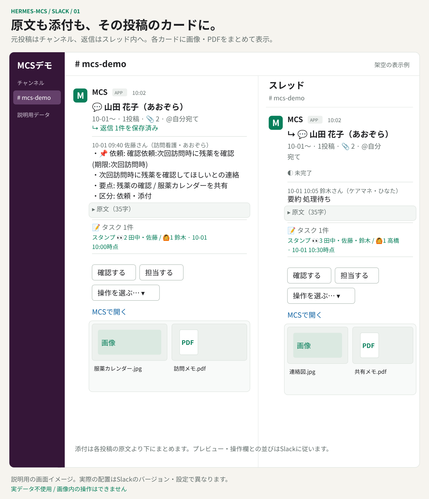
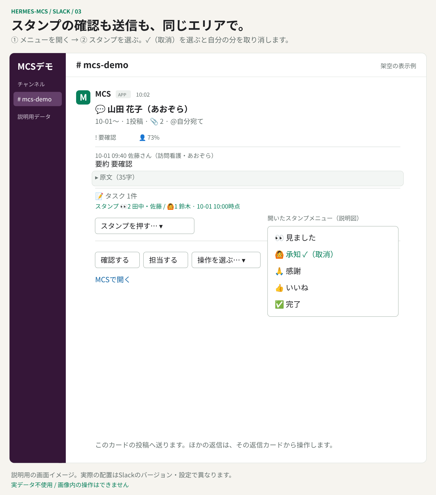
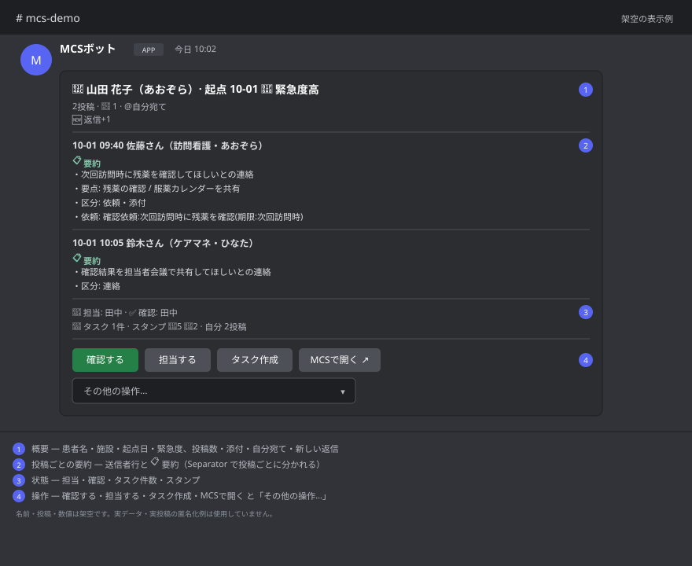

# hermes-mcs

### MCSの連絡を、探せる記録と次の確認へ。

**MedicalCareStation（MCS）の記録を、自分のMacで収集・整理・検索。**
**Slack（推奨）**の通知カードから、連絡の確認、担当の記録、タスクの作成までつなげます。
在宅医療・介護のチームで交わされた相談や経過を、あとからたどるためのローカルシステムです。
Slack・DiscordはHermes公式接続、[LINE WORKS](docs/guides/LINEWORKS.md)は独立した独自アダプターを使います。
Hermesを入れない[スタンドアローンモード](docs/guides/STANDALONE.md)では、Slack・Discordの直接接続と共通の操作経路を選べます。接続先SDKと実機運用の受入は別に確認します。
LINE WORKSでは同じ要約・原文・添付をトークルームの連続投稿で配信します。

[画面を見る](#demo) · [できること](#features) · [使い方を選ぶ](#use-cases) · [導入する](#quickstart) · [データの行き先](#data) · [最新の更新](#release)

| 収集 | 保存・整理 | 通知・操作 |
|---|---|---|
| 24時間・既定10分間隔 | Mac上のSQLite + ローカルLLM | Slack（推奨） / Discord / LINE WORKS |

MCSサーバーの負荷対策として、自動取得の間隔を5分から10分へ変更しています。

このREADMEはmainの機能を説明します。[1.0.13のローカル支援](#candidate)は既定offで、実機・外部の受入条件は分けて記載します。導入する版の変更・更新手順は[CHANGELOG](CHANGELOG.md)と[Releases](https://github.com/yusuketakuma/hermes-mcs/releases)で確認してください。
通知を有効にすると患者名・本文・送信対象の添付が設定先へ送られます。端末のロック画面にも患者名・投稿内容が表示され得るため、通知プレビュー設定と端末の閲覧権限を確認してください。[情報の行き先と安全境界](#data)を導入前に確認してください。

<a name="demo"></a>

## 画面イメージ — Slack

**通知先とカード操作はSlackを推奨します。** 要点の確認からタスクの確定・再確認候補まで、8画面で紹介します。
掲載画像の名前・投稿・数値はすべて架空です。実データや実投稿の匿名化例は使用していません。現行実装に基づく説明図で、実画面のキャプチャではありません。



カードで要点を読み、スレッドで原文と添付を確認します。



スマートフォンの通知には、患者名・発信者・所属・投稿時間・短い要約を含む通知文を送ります。要約が未完成なら原文の一部と処理状態を示し、取得できない項目は推測しません。実際の表示・省略は端末とアプリの通知プレビュー設定に従います。既存のDiscordカードとLINE WORKSのファイル通知では、同じプレビュー表示にならない場合があります。
画像を開くと拡大できます。画像内のボタンは説明用で、実際の操作はSlackの許可ユーザーが行います。

[確認・担当](#slack-card) · [操作メニュー](#slack-menu) · [タスク入力・確定](#slack-task) · [タスク一覧](#slack-tasks) · [患者の記録まとめ](#slack-summary)

<a name="slack-card"></a>

### 確認・担当を、カードから共有


`確認する`・`担当する`の結果を、カードの状態欄に名前で表示します。新しい返信で表示内容が変わると、確認状態も更新されます。
MCSのスタンプは、カードと未確認一覧に `スタンプ 👀2` のような絵文字と件数で表示します。
押下者取得を有効にすると、Slack・Discordのスレッドの各投稿に、スタンプの件数と押した人の氏名を1行で表示し、古い一覧・再取得失敗を区別します。投稿ごとの観測日時は、押した時刻ではありません。
**カードの確認済み表示やMCSの「完了」スタンプは、正式なタスク完了を意味しません。**

<a name="slack-menu"></a>

### 必要な操作を、メニューから選ぶ



`確認する`・`担当する`・`タスク作成`以外の操作（患者の記録まとめ、誤りを報告、タスク一覧、自分のタスク、未確認一覧、この患者を検索、全体の新着集計）を`操作を選ぶ…`にまとめています。
`タスク一覧`などの表示は、カードの状態や設定で変わります。
`患者の記録まとめ`は本人だけに背景・療養情報の原記録抜粋を表示します。全患者の詳細情報を根拠付きで保存し、全文と以前の記載は[患者別の詳細読取り](docs/guides/USER_GUIDE.md#c-患者ごとのまとめrollup)から確認できます。

<a name="slack-task"></a>

### タスクは、入力してから内容を確認・確定

| ① 入力フォーム | ② 本人だけに表示される確認画面 |
|---|---|
| [](docs/screenshots/slack-gallery/04-task-form.png) | [](docs/screenshots/slack-gallery/05-task-preview.png) |
| 投稿に由来する下書きを確認し、担当者・期限・理由を入力して`確認へ`。 | 内容・担当・期限・理由を照合し、`確定する`を選ぶまで登録しません。 |

スタッフ一覧を取得できる場合は担当者を選択できます。一覧がない場合は手入力になります。
期限と理由は任意で、理由が空なら「通知カードからタスク作成」を記録します。
タスク作成はMCSへの依頼投稿を自動化する機能ではありません。

<a name="slack-tasks"></a>

### スレッドのタスクを、対応中・完了へ


未完了タスクがあるカードの`タスク一覧`から、このスレッドの一覧を本人に表示します。
対象のタスクを選び、人が`対応中`・`完了`を記録します。本文からAIが抽出した「完了」とも区別します。

<a name="slack-summary"></a>

### 訪問前に、患者の記録まとめで記録をたどる


`患者の記録まとめ`から、取得済み投稿の薬・最新バイタル・次回予定・未完了タスク・履歴取得状況を本人に表示します。
**暫定集約であり、確定した処方一覧ではありません。未取得の記録も「無い」とは扱いません。**

[Slackの導入・接続・許可ユーザー設定](docs/guides/INSTALLATION.md) · [操作の詳しい使い方](docs/guides/USER_GUIDE.md) · [画面画像のソースと更新手順](docs/screenshots/slack-gallery/README.md)

### 該当スレッドで、対象と根拠を確認する


本人・家族・他者と、現在・過去・予定を原文から区別します。再確認候補と薬剤シグナルは元投稿の既存スレッドに追加し、原文根拠・投稿日・確認先を短く示します。解析が続いている投稿には「解析更新中」を表示し、既存の投稿を更新します。

新しいカードは患者名の下に緊急度・投稿数・解析中の件数をまとめ、投稿ごとの要約を項目順に表示します。薬剤の確認と辞書検索は押した本人だけに表示し、Slack・Discordでは同じスレッド、LINE WORKSでは1:1トークで確認します。辞書の検索は承認済み辞書が有効な場合だけ使えます。

<details>
<summary><strong>Discordを使う場合の画面例を開く</strong></summary>



Discordでも通知カードと本文・添付のスレッドを利用できます。
詳細は[利用者ガイド](docs/guides/USER_GUIDE.md)を参照してください。

</details>

<details>
<summary><strong>LINE WORKSを使う場合の画面例を開く</strong></summary>

**要約・原文・添付を、トークルームへ連続投稿**


同じ要約・原文・送信対象の添付を、共有トークルームへ順に配信します。
表示の更新は新しい投稿になり、古いボタンと開いている確認画面は無効になります。

**タスクは、本人との1:1トークで入力・確認・確定**


許可ユーザーがカードから操作すると、入力や回答は本人との1:1トークへ届きます。`その他の操作`を押すと、残りの操作が1:1トークに届きます。カードのボタンを押すと、LINE WORKSの仕様でボタン名がトークルームに投稿されます。
タスクは内容・担当・期限・理由を照合し、本人が`確定する`を選ぶまで登録しません。画像内のボタンは説明用です。

[LINE WORKSの導入・接続・許可範囲](docs/guides/LINEWORKS.md) · [画像のソースと更新手順](docs/screenshots/lineworks-gallery/README.md)

</details>

<a name="features"></a>

## できること

| したいこと | hermes-mcsでできること |
|---|---|
| 新しい連絡を確認する | 新着投稿を構造化要約カードで通知。本文・添付はSlack/Discordのスレッド、LINE WORKSの連続投稿で確認 |
| 過去のやり取りを探す | 履歴の保存・全文検索・患者ごとのタイムライン。全角・半角や英字の大小を揃えて検索し、途中で止まった履歴取得は再開 |
| 長い連絡の要点を読む | 薬・症状・依頼・バイタル・検査値などをローカルLLMとルールで抽出 |
| 患者の記録をまとめて見る | 薬・最新バイタル・次回予定・未完了タスク・MCS連携サマリーを暫定集約 |
| 次に確認する記録を見つける | 処方期間の候補の終了前・終了後や、後続の記録が見つからない状態などをアラートとして提示 |
| 確認・担当・依頼を共有する | カードの確認・担当を記録。タスクは内容と理由を確認してから確定 |
| 全体の傾向を把握する | 投稿量・職種別内訳・未解決依頼などの読み取り専用統計。任意の日次ダイジェスト |

Slack・Discordでは通知カードと操作メニューに加え、`/mcs`コマンドから閲覧・依頼管理・運用承認を行えます。
LINE WORKSではカードのボタンと本人との1:1トークの `mcs JSON` を使います。Hermesあり・なしで共通の機能と人承認条件を使い、LINE WORKSの接続はどちらも独立アダプターが所有します。
`全体の新着集計`から全体・施設・患者・記録上の担当で絞り込めます。Slackは`/mcs-summary`、Discordは`/mcs`の`summary`、LINE WORKSは本人DMの「サマリー」でも呼び出せます。元データは読取り専用スナップショットです。

要約の項目別の短い文字数・件数制限は外し、作成待ちと再試行上限に達した失敗を区別します。通知先の表示上限は維持し、長いカードはページに分け、単一投稿が上限を超える場合は省略して本文表示や原本へ案内します。抽出の保存後に表示を更新し、押下者取得を有効にした環境では取得完了後に氏名も反映します。

履歴取得・抽出・統計の重複走査とメモリ使用を抑え、一時的な障害からの再試行を改善しています。抽出やカード配送の停滞は稼働状態へ記録します。記録が多い環境でも、モデル・取得間隔・任意機能の既定値は変えません。

詳細は[利用者ガイド](docs/guides/USER_GUIDE.md)と[プラグインガイド](hermes_plugin/README.md)を参照してください。

**AIの抽出は候補です。患者サマリーは確定した処方一覧ではなく、カードの確認済み表示もタスク完了を意味しません。**

<a name="candidate"></a>

### 1.0.13のローカル支援（既定off・実機受入は別途）

次はmainで実装された任意の入口です。合成データの全体検証、固定版SDKとの境界、隔離した配布物の検証は完了しています。実APIの未読保持・権限、canonicalの人手評価と昇格、緊急再通知の実運用、鍵の保管と相手側の受入は別条件です。機能の自動有効化や外部GET・公開・配備の承認を意味しません。

| ローカルで確認できる支援 | 入口と適用条件 |
|---|---|
| 暗号化offsite・鍵escrow・別配置への復元 | `mcs_backup.py`。保存先・鍵・独立SHA receipt・保持のオーナー承認が必要。定期運用は明示opt-in、新端末の復元は同意待ちで停止。[バックアップ・端末喪失ガイド](docs/guides/BACKUP.md) |
| 構造化薬歴・観測値とチャット候補の別出典閲覧 | `project_metadata.py`（明示sync）と`mcs_view.py`のsnapshot読取り。表示は`--publication`で明示し、`include_chat`は既定off。同一項目・正本・対応完了を自動判定しません。GETはsession・未読保持・権限の実受入後に承認。[MCS連携データの条件](docs/roadmap/mcs-api-survey.md) |
| 薬剤の表層名とは独立した候補注釈・照会 | 私有辞書の出所・SHA・承認に束縛した成分・一般名処方・製品候補を併記し、`mcs drug`で照会・参考検索・更新差分を確認できます。別名の薬剤行を統合せず、総称や複数候補を成分に確定しません。公式master原本は[システム更新に同梱](resources/drug-master/README.md)し、`mcs drug install-bundled`で運用者の確認日・確認者を入力して私有辞書を作れます。辞書の承認・有効化は運用者が行います。[抽出の範囲と残条件](docs/roadmap/extraction.md) |
| 導入・更新・ローカル診断の統一入口 | `sh scripts/mcs install`、導入後の`mcs setup`・`mcs update`・`mcs doctor`。診断結果やSDK版の取得は接続・更新後プロセスの受入証明ではありません。[更新時の確認](docs/guides/UPGRADE_AGENT.md) |

<a name="use-cases"></a>

## 使い方を選ぶ

<details>
<summary><strong>新着連絡を読み、チームで確認・担当を共有したい</strong></summary>

1. 通知カードの送信者・要約を読み、必要な本文や添付を確認します。Slack/Discordはスレッド、LINE WORKSは同じトークルームの連続投稿です。
2. `確認する`で今の表示内容を確認したことを記録し、必要なら`担当する`で担当を記録します。
3. 作業が必要ならタスクを作り、確認画面で内容・担当・期限・理由を確認して確定します。

新しい返信で表示内容が変わると、確認状態も更新されます。確認記録と実作業の完了は別に扱います。
[カードの操作と表示条件](docs/guides/USER_GUIDE.md)

</details>

<details>
<summary><strong>訪問前に、患者の経過と過去の相談をたどりたい</strong></summary>

患者サマリーで暫定集約を確認し、検索やタイムラインで根拠となる投稿をたどれます。
薬の変更、症状、相談、判断、実施、再評価を、保存済みの記録から確認します。
まだ取得していない範囲は検索されません。履歴の取得状況も合わせて確認してください。
[患者サマリー・検索・タイムライン](docs/guides/USER_GUIDE.md)

</details>

<details>
<summary><strong>後続の記録や期限を、もう一度確認したい</strong></summary>

アラートは「記録上、確認するとよい状態」を提示します。
薬の期間表現や依頼・経過の記録を根拠に、原文を読み、人が確認・判断します。
日次ダイジェストを有効にすると、未完了タスクや滞留アラートなどもまとめて確認できます。
機械がMCSへ依頼を自動送信することはありません。
[アラートの意味・対象・限界](docs/guides/USER_GUIDE.md)

</details>

<details>
<summary><strong>MCSの記録から、どんな傾向を見られる？</strong></summary>

診療と診療の間の多職種コミュニケーションを、次の7分野で扱います。

| 分野 | 記録からたどれること |
|---|---|
| 患者経過 | 症状、バイタル、状態変化、入退院、問題の反復 |
| 薬物療法 | 開始、中止、増減量、期間表現、再評価 |
| 多職種連携 | 誰から誰への相談、回答、判断、実施 |
| 組織間連携 | 薬局・診療所・訪看・居宅のやり取り |
| 時系列 | 記録上の対応時間、変化点、再発間隔 |
| 業務 | 記録の集中、未解決依頼、長期滞留 |
| 確認支援 | 通常との差、フォロー記録が見つからない候補 |

投稿数は重症度を、薬剤名の記載は現在の服用を、記録上の前後関係は因果関係を証明しません。
多職種の多さは連携の質を保証せず、アラートがないことも患者の安全を保証しません。
未来を予測する機能ではありません。[データ一覧と解釈の限界](docs/guides/USER_GUIDE.md)

</details>

<a name="quickstart"></a>

## クイックスタート

**導入前提:** macOS 13以降、普段のユーザー（sudo不要）、Xcode Command Line Tools、Homebrew、空き約12GB、利用権限のあるMCSアカウント。Pythonはインストーラーが用意します。

```bash
git clone https://github.com/yusuketakuma/hermes-mcs.git
cd hermes-mcs
./install.sh --preflight   # 読み取り専用の事前チェック
./install.sh               # 依存一式を導入。途中で止まったら修正して再実行
```

事前チェックのNG行に表示される`fix:`を確認し、`0 blocker(s)`になってから導入します。
初回の`./install.sh`は、Hermes経由かHermesなし（[スタンドアローン](docs/guides/STANDALONE.md)）かを尋ねます。`--mode standalone`で直接指定もできます。
最後の`Installed. Summary:`に表示される初回設定コマンドを、そのままコピーして実行してください。
設定ウィザードが通知先・本体の設定・最終チェックまで案内します。HermesモードのSlack/DiscordではHermesとの同期も行います。
本体の初回設定後は、ブラウザーの準備など診断に残った項目を解消します。LINE WORKSの認証・Callback・常駐設定と再診断は[接続ガイド](docs/guides/LINEWORKS.md)で続けます。
既存環境を更新する場合は[更新エージェント手順](docs/guides/UPGRADE_AGENT.md)を使います。移行先版の更新コードで計画・バックアップ・適用を行い、再導入は必要な場合に明示指定します。

**AIに導入を任せる場合**は、リポジトリを開いたエージェントに次のように依頼できます。デスクトップ版のClaude・Codexが一時フォルダへ取得した場合は、`python3 scripts/install_local.py` で恒久的な置き場所へ導入します（[手順](docs/guides/LOCAL_AGENT_INSTALL.md)）。

```text
docs/guides/SETUP_AGENT.md に従って、このMacへhermes-mcsを導入してください。
既存設定と回答を再利用し、まず通知先を選んで進めてください。
認証情報は私が端末へ直接入力します。投稿の収集・通知・既読化は開始前に範囲を確認してください。
```

| 次に進む先 | 内容 |
|---|---|
| [Slackを設定する（推奨）](docs/guides/INSTALLATION.md) | Slack app・接続・カード操作・許可ユーザーの設定 |
| [LINE WORKSを設定する](docs/guides/LINEWORKS.md) | 独自接続アダプター・秘密値入力・Callback・許可範囲の設定 |
| [Hermesなしで使う](docs/guides/STANDALONE.md) | `install.sh --mode standalone`・Slack/Discordの直接接続・切り替え |
| [導入ガイド](docs/guides/INSTALLATION.md) | 最短手順・成功の目安・通知先の設定・トラブル対応 |
| [AIエージェント向け導入手順](docs/guides/SETUP_AGENT.md) | エージェントに導入を任せるときの確認・実行手順 |
| [更新・バックアップ・復旧](docs/specs/lifecycle-spec.md) | 導入後の運用と更新時の確認 |

困ったときは、表示された同じインタープリターで`mcs_setup.py doctor`を実行します。
1.0.13の統一入口は`mcs doctor`です。既定はローカル診断で、LLM通信やサービス状態のprobeは明示指定します。診断が成功しても、SDKの通信・カード操作や配備済みworkerの反映まで検証したとは扱いません。

<a name="data"></a>

## 仕組みと情報の行き先


収集した記録をMac上に保存し、ローカルで整理して、通知・検索・統計・アラートとして提示します。

| 経路 | 保存・送信される情報 | 条件 |
|---|---|---|
| このMac | 投稿・添付・患者情報と、ローカルAIによる整理結果 | 収集・保存・構造化抽出の基本経路 |
| Slack（推奨） / Discord / LINE WORKS | 患者名・本文・要約・送信対象の添付。タスク通知には内容・担当者名、押下者表示には氏名・職種も含む | 通知先・対話カード・関連機能を設定した場合。押下者取得は既定OFF |
| TypeSafe Jev API | 本文と必要なスレッド文脈。匿名化なし | 任意・既定OFFの意味チェック／抽出監査を有効にした場合 |
| 知識ストア向けローカル出力 | 患者名・病名・要約・薬剤等を含むMarkdown。匿名化なし | 明示的にエクスポート。出力後の同期・LLM利用は別経路で管理 |

「ローカルLLM」は、システム全体が外部へ送信しないという意味ではありません。
送信先と閲覧権限、AIの使用箇所は[SECURITY.md](SECURITY.md)で確認してください。

### 人が確認して判断するための境界

- **記録がない ≠ 対応していない。** アラートは記録上の候補で、対応漏れを断定しません。
- **人承認を記録。** 依頼登録・更新、アラートの却下、閾値変更は所定の承認とreceiptの記録を伴います。MCSへの依頼送信を自動化しません。
- **保存完了後に既読化。** 患者単位の既読化は、取得完了・DBへのcommit・snapshot timestampを条件にします。既読化を指定した定期収集（`--mark-read`）では、直近7日以内に保存した返信のスレッドを1回最大10件確認します。返信は未保存・抜粋のみの内容を先に補完します。ただし、保存済みの抜粋が取得の再試行上限に達した場合は、補完を諦めてスレッドの既読化を進めます。未保存の返信が残る場合は既読にしません。返信の既読化は収集時点に限定できないため、確認後に届いた返信も既読になる場合があります。読取り時に見つかった追加返信は取得ジョブへ登録します。
- **スタンプは観測情報。** 件数・本人反応・観測日時を本文と分けて保存し、未取得と0件を区別します。取得日時は押下時刻ではありません。スタンプだけで確認・担当・業務完了を変更しません。専用の再取得は既定で無効です。有効化すると直近30日活動スレッドの先頭・返信を対象に、活動時期に応じた間隔で最大8件/回を再取得します。押下者取得も既定で無効で、有効化すると直近7日活動スレッドの全投稿について氏名・所属・職種を取得し、氏名・職種をスレッドに表示します。押下者ごとの最後の観測状態を無期限に保持し、取消を観測した時刻を残します。再押下時には取消状態を解除し、過去の全操作履歴は復元しません。未読保持の実証後に定期shadowを有効化できます。既定では反応値を通常表示へ反映せず、公開を別途有効化した場合だけ正常な取得値を表示へ反映します。本人の承知・完了を未応答候補の判定に使う設定も既定で無効で、正式タスクの完了とは別です。
- **添付の送信範囲。** 通知で送るファイルはMCSのデータ保存先の`attachments`内に限定します。保存先の外を指すファイルは送信しません。
- **認証とログの境界。** no-redirect / no-proxy。定期実行のログへ本文・氏名を出しません。明示的な閲覧出力は別に扱います。
- **説明用の架空データだけをリポジトリへ。** 患者データ・秘密情報・実投稿の匿名化例を入れません。

<a name="faq"></a>

## よくある質問

<details>
<summary><strong>AIが処方や医療判断を確定する？</strong></summary>

抽出・要約・アラートは候補です。原文と取得範囲を確認して人が判断します。
投稿から抽出した「完了」と、人がタスク操作で確認した完了も区別します。

</details>

<details>
<summary><strong>添付画像やPDFも解析する？</strong></summary>

添付は保存・通知とメタ情報の管理までで、内容の意味解析は行いません。
長文の要約も全件完了を保証せず、入力上限を超える記録は要確認として扱います。
[解析の限界](SECURITY.md)

</details>

<details>
<summary><strong>バックアップがあれば端末故障にも対応できる？</strong></summary>

日次SQLiteバックアップは同じMac上の保存です。端末喪失時の復旧保証にはなりません。
1.0.13の暗号化backup・escrow-key drill・新規配置restoreはローカル支援であり、原本上書きや通知再開の許可ではありません。別媒体・鍵・独立SHA receipt・保持の承認と復元訓練は運用側で行います。[鍵・同意待ちの条件](docs/guides/BACKUP.md)と[復旧の限界](docs/specs/lifecycle-spec.md)を確認してください。

</details>

<a name="release"></a>

## 最新の更新

<!-- BEGIN GENERATED:release -->

**v1.0.20 · 2026-10-12** — **収集・通知・解析と更新の安定性を改善**

独立実行の監視と日次保守を追加し、通知の再試行、解析の待ち順序、更新失敗時の復旧を改善します。設定・人承認の条件は維持します。

> 更新前の確認：追加操作は不要です。macOS の標準構成（専用プロファイルの Chrome を自動起動）ではこれまでどおり自動再ログインします。Chrome を専用プロファイル以外で CDP ポートに起動している場合や、lsof が無い環境（Linux の候補構成など）では自動再ログインが常に失敗するため、手動でログインしてください。

| 変更 | 以前 | 今回 | 利用者のメリット |
|---|---|---|---|
| 独立実行の監視 | hostが停止すると内部状態の更新も止まる | hostの外から停止・接続障害を監視 | 収集や通知の停止に気付ける |
| 新着と再解析の待ち順 | 過去分の再解析で新着が後回しになる場合がある | 新着を先に選び、長い評価はバックログで処理 | 新着の確認を先に進められる |
| 通知の送信判断 | 待機中の取消や状態変更が送信に間に合わない場合がある | 送信直前に現在の許可・依頼状態を再確認 | 取消済みの通知やリマインドを抑えられる |

<details>
<summary>主な変更と更新時の注意を開く</summary>

- **新機能 · 独立実行でも、停止と接続障害を外から監視**
  hostの停止や子処理の連続異常終了、Slack・Discord接続の未回復、更新待ちや収集の停滞を通知先へ警報します。接続が失敗しても収集・抽出は継続し、接続だけを再試行します。

- **改善 · 新着の解析を先に進める**
  抽出対象の条件を保ち、新着を再抽出・再試行より先に選びます。長い出力が必要な評価はバックログへ回し、進行状況には概算の残数も表示します。

- **不具合修正 · 通知の取消・対象変更を送信直前にも確認**
  取消済みカードの残りの本文・添付や、完了・取消・期限変更済みのリマインドを抑止します。Slackの送信制限待ちの後にも現在の送信許可を確認します。開始済み通信を即時停止する保証はありません。

**更新時の注意**

- 設定変更・DB移行・追加操作は不要です。

- 設定変更・DB移行は不要です。Hermesモードでは他の更新と同様、gateway再起動で反映されます。

- 設定変更・DB移行は不要です。通常の更新と同じく、Hermes gateway の再起動で反映されます。

- 設定変更・DB移行・定期実行の変更・追加操作は不要です。

- 設定変更・DB移行は不要です。Hermesモードではgateway再起動、独立実行（standalone）とLINE WORKSは各プロセスの再起動で反映されます。

- 設定変更・DB移行は不要です。独自スクリプトで mcs_standalone.slack_runtime・mcs_standalone.discord_runtime を直接importしている場合は、adapters.slack.standalone・adapters.discord.standalone へ書き換えてください。独立モードは常駐プロセスの再起動で反映されます。

- 設定変更・DB移行は不要です。独自スクリプトで lineworks_adapter から LineWorksClient などをimportしている場合は adapters.lineworks から読み込んでください。

- 設定変更・DB移行は不要ですが、Hermes gateway の再起動が必要です。起動中の旧 gateway は、再接続時に削除済みの別名を読み込もうとする場合があるためです。mcs update で更新した場合は再起動が自動で予約されます。git pull などで手動更新した場合は hermes gateway restart を実行してください。旧版へ戻す場合は旧ファイル一式がそのまま戻るため、同じく再起動すれば安全に戻せます。

- 定期処理・設定・DBの変更は不要です。評価用CLIを直接実行する場合のパスが変わります: `mcs/semantic/semantic_{bench,blind,lifecycle,evaluation}.py` → `mcs/semantic/eval/`、`mcs/extract/v4/extract_bench.py` → `mcs/extract/eval/extract_bench.py`、`mcs/semantic/semantic_observe.py` → `mcs/ops/semantic_observe.py`。

- 設定変更・DB移行は不要です。Hermes接続ではgateway再起動、独立実行（standalone）とLINE WORKSアダプターではプロセスの再起動で反映されます。ログを文字列一致で集計している場合は新しいJSON形式に合わせてください。

- 追加操作は不要です。時間不足で見送られた状態が続き、最新のバックアップが1日より古くなると health.json に backup_deferred_deadline が出ます（ディスク不足の disk_low とは区別されます）。ログは従来どおり5MBを超えるとコピーしてから切り詰め（.1 に1世代）、シンボリックリンクはたどりません。

- 追加操作は不要です。初回の定期実行で整理が行われます。投稿本文、編集履歴（message_revisions）、通知の重複防止に使う記録、取得ジョブ、意味チェックの結果・キャッシュは削除しません。参照されているシステム通知や各状態の最新の実行記録も残します。WALファイルは64MiBを上限に切り詰められます。

- 追加操作は不要です。停滞の開始時刻は health.json の stall_marks に引き継がれます。LLMの稼働記録がない環境では、回路遮断器の失敗が処理待ちのまま6時間続いたときに llm_endpoint_down を出します。

- 追加操作は不要です。待機中も手動ログインを求める通知（session_expired）は従来どおり送られ、詳細は auto_login=manual_required:backoff と表示されます。ブラウザに残ったセッションでの復旧（フォームを使わない処理）は毎回続けます。ログインに成功すると記録は消えます。

- 追加操作は不要です。読取り側（閲覧・集計）が見るスナップショットは、新着の保存や通知状態の変化があれば従来どおり同じ実行で更新され、それ以外の変化（既存行の更新のみ）も最長1時間で反映されます。検査の上限時間は30秒を基準に、ファイルの大きさに応じて最大150秒まで延びます。

- MCS_LLM_ADMISSION を有効にしている場合だけ影響します(既定は無効)。追加操作は不要です。

- 追加操作は不要です。保存できなかった回数は意味評価の実行結果に long_mark_unsaved として出ます。

- 追加操作は不要です。停止と応答の時刻はデータフォルダの llm_health.json に保存されます。停止を通知する仕組みは別の変更で追加されます。

- 追加操作は不要です。抽出の対象条件・試行回数の上限・抽出の版は変わりません。

- 追加操作は不要です。予算不足の延期が上限を超えたジョブは試行回数を消費し、上限に達すると失敗として表示されます(夜間の自動再試行の対象です)。

- 追加操作は不要です。LINE WORKSアダプターを常駐させている場合は、反映のためにアダプターを再起動してください。

- 追加操作は不要です。更新前にこの理由で保留になった通知は自動では再送されないため、必要なら従来どおり保留解除の手順で再送してください。

- 独立モードでは更新後に mcs_setup.py services を1回実行してhostを新しいコードで再起動してください。Hermesモードでは操作は不要です。

- 独立モードでは更新後に mcs_setup.py services を1回実行してください。Hermesモードでは操作は不要です。

- 独立モードでは更新後に mcs_setup.py services を1回実行してください。監視エージェント（Linuxはsystemd user timer）が配置され、以後 doctor が配置・稼働を確認します。実行するまで doctor は standalone health watch not installed を警告します。Hermesモードでは操作は不要です。

- 独立モードでは更新後に mcs_setup.py services を1回実行してください。deployment/launchagents/ai.mcs.standalone.plist を手動で配置している場合は配置し直してください。Hermesモードでは操作は不要です。

- 独立モードでは更新後に mcs_setup.py services を1回実行してください。初回起動時は過去の時刻をさかのぼって実行しません。Hermesモードでは操作は不要です。

- 追加操作は不要です。

- 独立モードでは更新後に mcs_setup.py services を1回実行してください。Linuxで更新記録が残って止まった場合は警報に従い mcs_update.py recover を実行してください。Hermesモードでは操作は不要です。

- 追加操作は不要です。同梱の抽出処理は待ち時間0を渡すため、通常の運用で動作は変わりません。

- 追加操作は不要です。更新前に HTTP 425 で失敗扱いになった添付は、従来どおり新しい署名付きURLで再保存されたときに再取得されます。

- 追加操作は不要です。既存の key_escrow.json には理由が記録されていないため、そのまま残ります。

- C1 を使っていない場合は操作不要です。以前の実行で作られた状態ディレクトリや配送先が他のユーザーも読める権限のままの場合は、自動では変更しないため、中身を確認したうえで chmod 700 を実行してください。

- 追加操作は不要です。log_rotate のエラーが表示された場合は、該当ログの .1 が symlink になっている理由を確認し、不要なら削除してください。

- 追加操作は不要です。中断したバックアップは残さず、次回の定期実行で改めて作成します。

- 追加操作は不要です。ロールで許可している利用者は、遅れた結果を届ける直前に1回だけ Discord 側でメンバー情報を取得し直します（結果を待っている間は確認しません）。

- 追加操作は不要です。Hermes のカード worker 設定（plugin settings）で guild_id を省略している場合は、runner 側 notify.discord.guild_id と同じ値を設定してください。省略すると、待機後に届ける結果は認可できずに破棄されます。

- 追加操作は不要です。更新後に抽出の常駐処理が再起動されると反映されます。

- 追加操作は不要です。次回の brain_export から反映されます。

- 追加操作は不要です。更新後に新しく保存される抽出結果から反映され、保存済みの結果は書き換えません。

- 追加操作は不要です。macOS の標準構成（専用プロファイルの Chrome を自動起動）ではこれまでどおり自動再ログインします。Chrome を専用プロファイル以外で CDP ポートに起動している場合や、lsof が無い環境（Linux の候補構成など）では自動再ログインが常に失敗するため、手動でログインしてください。

- 追加操作は不要です。すでに failed になった履歴取込ジョブは自動では戻らないため、必要な患者は従来どおり取込の依頼で再開してください。

- 追加操作は不要です。実行記録・health のエラー文字列を完全一致で監視している場合は、末尾に例外の種類が付く点に合わせてください。

- 通常の構成では追加操作は不要です。config.json をシンボリックリンクにしている場合は、通常ファイルへ置き換えてから install.sh を再実行してください。

- MCS_ROOT を空または標準と異なる場所に設定している場合は、導入前に unset MCS_ROOT を実行してください。--dest は引き続きソースの配置先を指定できます。通常運用で明示した MCS_ROOT の機能は変更しません。

- 追加操作は不要です。表示される案内文だけの変更です。

- 追加操作は不要です。すでに「不明」になっている患者は、次に連携サマリーを再取得したときに自動で解消します。

- 追加操作は不要です。解析に失敗した投稿は従来どおり失敗として数え、再試行の上限も変わりません。

- 追加操作は不要です。ローカルLLMのURLのポートに誤りがある場合は設定確認で拒否されるため、正しいポートに直してください。.env は UTF-8 で保存してください。

- 追加操作は不要です。更新後の取得から反映されます。保存済みの記録は書き換えません。

- 追加操作は不要です。モデルを導入済みの環境では再取得も照合も行いません。MCS_MODEL_SHA256 を設定している場合は従来どおりその値で照合します。

- 追加操作は不要です。配信済みのスレッド投稿は、次にそのカードが更新されたときに新しい表示になります。

- 追加操作は不要です。observe の出力を記録して比較している場合、更新後に残数と経過時間が下がることがありますが、数え方の修正によるものです。

- 追加操作は不要です。更新後の最初の定期処理で、1日以上前の作業コピー（data/backups/*.db.tmp と data/snapshots/.snapshot.*.tmp）が削除されます。既存の .1 ログは次回のローテーション時に本人だけが読める権限へ変わります。

- MCS_ROOT を設定していない場合は追加操作は不要です。MCS_ROOT を設定していて、以前に引数を省略して mcs_refstats capture を実行した場合、その保留ファイルは ~/.mcs/data/refstats/pending に残っており、新しい既定の場所からは見えません。必要なら MCS_ROOT 側で capture をやり直してください。--snapshot・--data-dir・--cmd-dir を明示している場合は動作は変わりません。

- 追加操作は不要です。プレリリース版を承認で適用するには、従来どおり update.include_prerelease を true にします。自動適用の対象と条件は変わりません。

- 独立 watchdog（checkout 外の復旧本体）へ反映するには、`./install.sh` に導入時と同じ opt-out と `--no-services` を付けて再実行し、同期してください。それ以外の追加操作は不要です。

- 追加操作は不要です。修復計画で static_snapshot_required が出た場合は、バックアップと同じく付随ファイルのない静的スナップショットを指定してください。

- 追加操作は不要です。修正前に実行した再試行の受領記録には理由が残っていないため、後から補完されません。

- 更新ツール側は追加操作は不要です。独立 watchdog（checkout 外の復旧本体）へ反映するには、`./install.sh` に導入時と同じ opt-out と `--no-services` を付けて再実行し、同期してください。同期するまでは旧 watchdog が従来どおり処理を再開するため、この停止の維持は更新ツールの recover だけに効きます。復元に必要な人の承認条件は変わりません。

- 追加操作は不要です。更新後最初の定期処理で全患者の患者要約（patient_rollup）を1回ずつ再構築するため、その回の処理時間がいつもより長くなります。再構築が終わるまでの間も、旧キーの要約は新しい名称として読み取られます。

- 追加操作は不要です。独立実行の定期処理への反映は通常の更新時のホスト再起動後です。設定・保存データ・人承認条件は変更しません。

- 追加操作は不要です。self_posts を有効にしている場合だけ動作が変わります。更新前に通知されずに保存された投稿は、さかのぼって通知されません。

- 追加操作は不要です。受付制御を有効にしていない場合、動作は変わりません。

- 追加操作は不要です。スケジュールの扱い（待機・再試行・停止）は変わりません。過去の記録は書き換えません。

- 追加操作は不要です。更新前に失われた結果は自動では復元されず、次回の処理で通常どおり再評価されます。

- 追加操作は不要です。期限内に終わる通常の投稿では結果は変わりません。期限で止まった抽出は、保存済みのチャンクを使って次の回に関係づけからやり直します。修復後の関係づけが期限で止まった場合だけは、その世代を公開せず人による確認待ちにします。

- 追加操作は不要です。過去に保存した事実文書は書き換えません。次に修復が行われた事実文書から新しい統合規則が適用されます。

- 追加操作は不要です。check で project_ids の件数超過の警告が出た場合は、表示・集計が先頭 1000 件に限られるため、project_ids_auto=true への切替を検討してください。

- 追加操作は不要です。更新直後の check で再起動の警告が出た場合は hermes gateway restart を実行してください。

- 追加操作は不要です。services が「stop unverifiable」で失敗した場合は、launchd が応答する状態で services を再実行してください。

- 追加操作は不要です。services が「notify flags publish failed」や「gateway restart deferred」を表示した場合は、原因（書込み権限・空き容量など）を直して services を再実行してください。

- 独立実行のSlackを使っている場合は、更新後にホスト（mcs_standalone）が再起動されて反映されます。設定の変更は不要です。

- 追加操作は不要です。記録するのは固定のコード・ファイル名・状態値・数値・真偽値だけで、本文や個人を特定できる情報は従来どおり記録しません。

- 追加操作は不要です。更新後のホスト再起動から有効になります。

- 独立モードを使っている場合は、更新後に mcs_setup.py services を1回実行してください。サービス定義を書き換えてホストを1回再起動します（処理中のLLM抽出は中断されます）。実行するまで check はサービス定義の差分を報告します。既存のファイルの権限は変わらないため、data/standalone.log は chmod 600 を手動で実行してください。Hermesモードでは操作は不要です。

- 追加操作は不要です。外部出力の形式も変わりません。

- 追加操作は不要です。更新後に作られる表示から反映されます。

- 追加操作は不要です。この状態になった場合は `mcs_update.py status` の更新レポートで確認し、バックアップを確かめてから復旧してください。

- 更新処理が読み込む新しいコードから適用されます。共通処理を変更した更新では、Hermes gateway または独立ホストの再起動が必要です。LINE WORKS の独立アダプターは従来どおり更新後に再起動します。停止確認に失敗した場合は、更新記録を確認して復旧してください。復元に必要な人の承認条件は変わりません。

- 追加操作は不要です。更新後の表示から反映されます。

</details>

[すべての変更と技術詳細](CHANGELOG.md) · [GitHub Releases](https://github.com/yusuketakuma/hermes-mcs/releases)

<!-- END GENERATED:release -->

<a name="docs"></a>

## ドキュメント

[安定稼働版1.0.13の計画](docs/development/plans/RELEASE_1.0.13.md)は、
旧1.0.13〜1.0.15・追加提案・バグ修正・4つの統一コマンドを集約しました。
ローカル実装と合成検証は完了し、実機・実API・人手・相手側の受入条件は同計画の§6で追跡します。

| 読む目的 | 文書 |
|---|---|
| 使い方・画面・データの読み方 | [利用者ガイド](docs/guides/USER_GUIDE.md) |
| 導入・接続・設定・トラブル対応 | [導入ガイド](docs/guides/INSTALLATION.md) · [LINE WORKS接続](docs/guides/LINEWORKS.md) · [スタンドアローン](docs/guides/STANDALONE.md) · [エージェント向け手順](docs/guides/SETUP_AGENT.md) |
| データ取扱い・安全境界・AI・復旧の限界 | [SECURITY](SECURITY.md) |
| 更新・バックアップ・復旧 | [更新ガイド](docs/guides/UPGRADE_AGENT.md) · [1.0.20候補の受入票](docs/development/acceptance/ACCEPTANCE_1.0.20.md) · [ライフサイクル仕様](docs/specs/lifecycle-spec.md) · [鍵escrow・端末喪失ガイド](docs/guides/BACKUP.md) · [配備資産](deployment/README.md) |
| 開発・コマンド・統計・アラート定義 | [開発リファレンス](docs/development/DEVELOPMENT.md) · [Hermesプラグイン](hermes_plugin/README.md) |
| エクスポート・意味解析の評価 | [外部出力契約](docs/specs/external-export-contract.md) · [意味解析の評価](docs/specs/semantic-evaluation.md) · [rollout](docs/specs/semantic-facts-v2-rollout.md) |
| 今後の計画 | [ロードマップ](docs/ROADMAP.md) |
| リリースとREADMEの更新ルール | [リリースノート規則](docs/development/RELEASE_NOTES.md) · [README運用](docs/development/README_MAINTENANCE.md) |

## ライセンス

Proprietary — All Rights Reserved。
利用・改変はリポジトリ管理者の明示許可に従ってください（[LICENSE](LICENSE)）。
