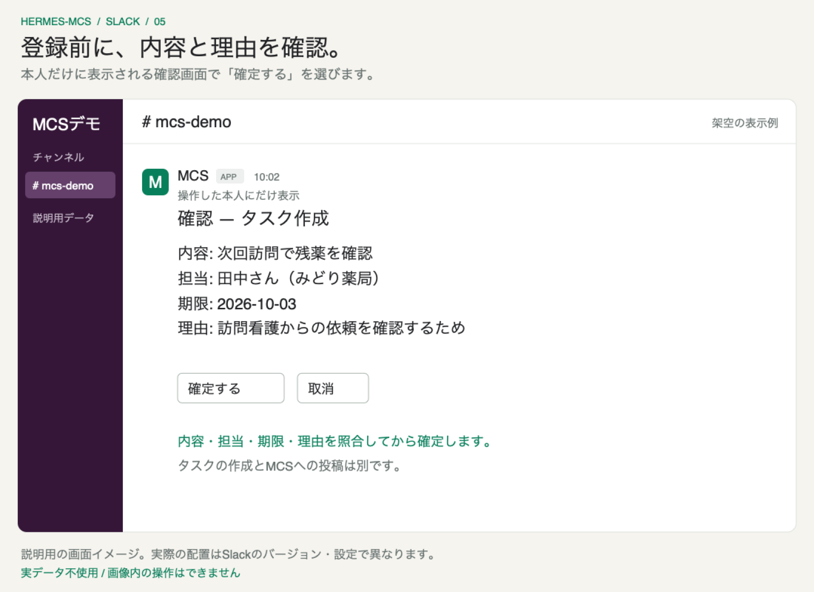
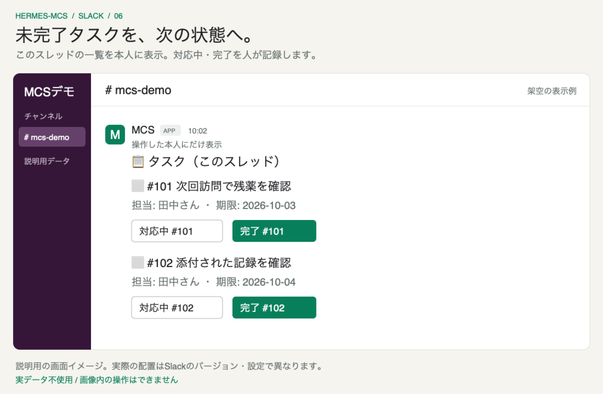
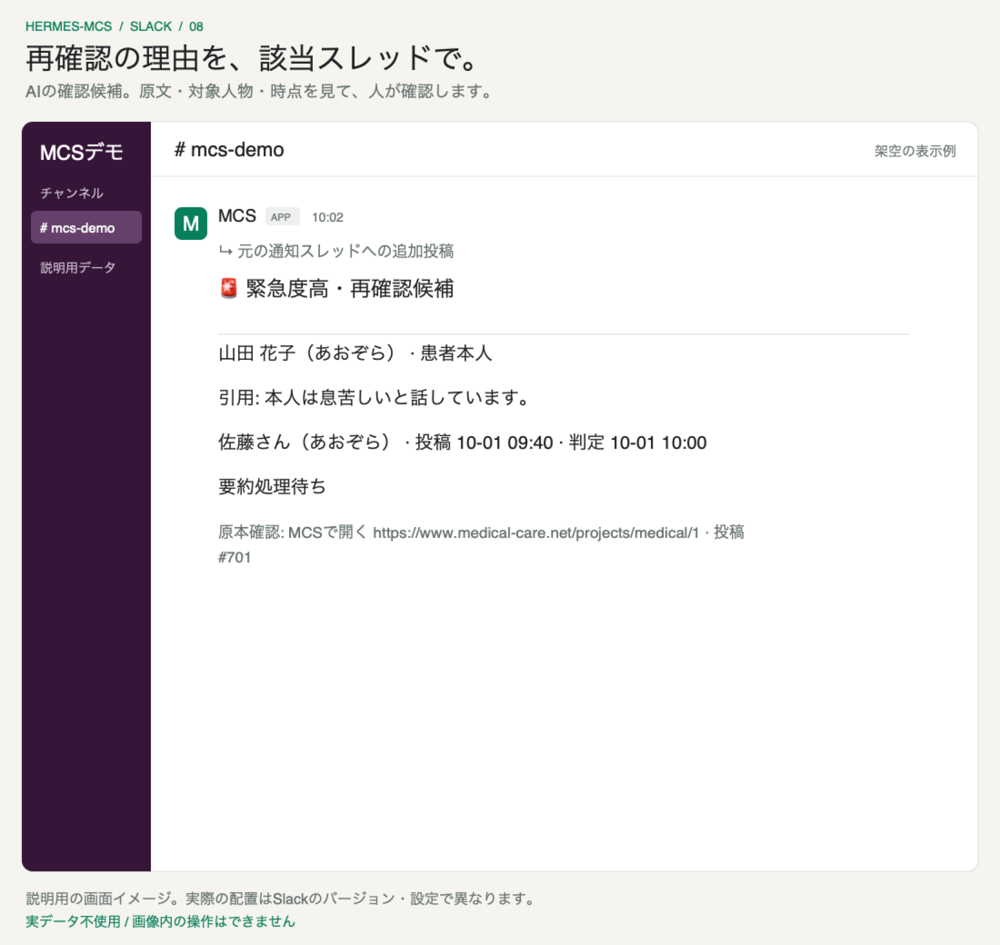
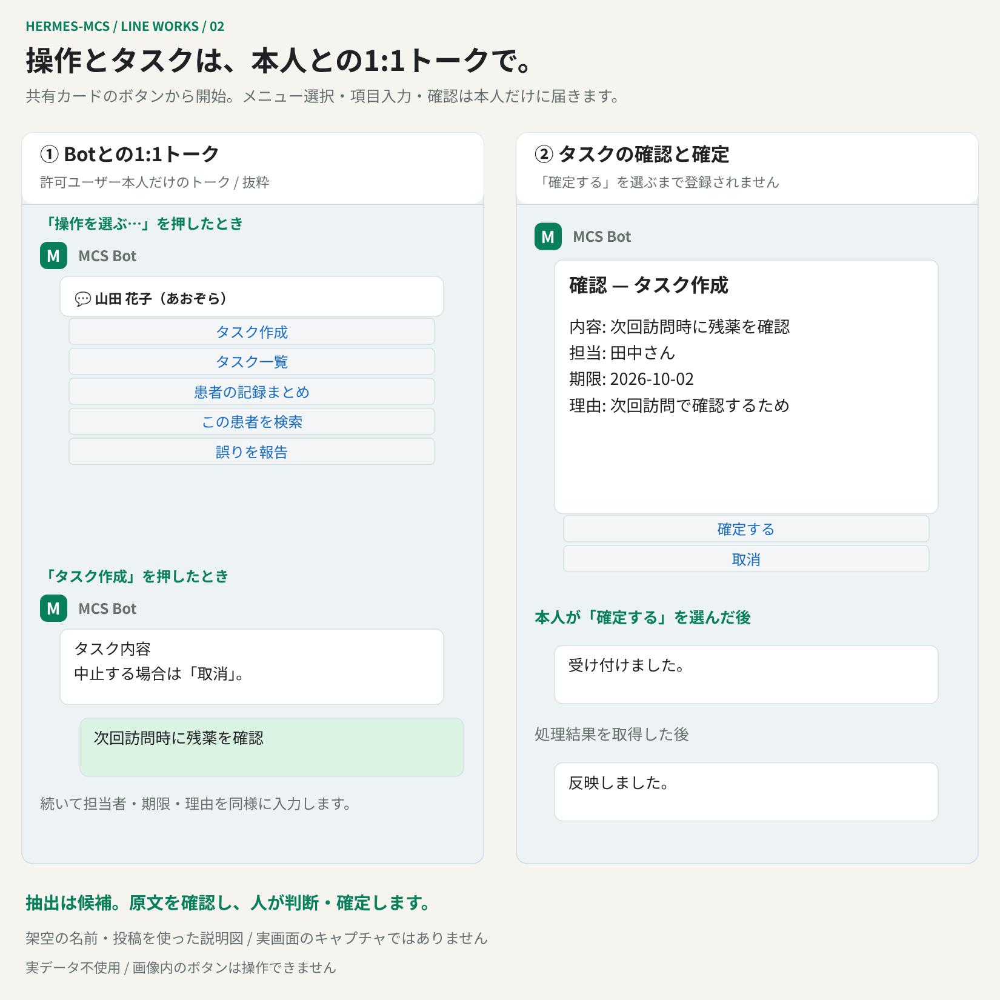

# hermes-mcs

### MCSの連絡を、探せる記録と次の確認へ。

**MedicalCareStation（MCS）の記録を、自分のMacで収集・整理・検索。**
**Slack（推奨）**の通知カードから、連絡の確認、担当の記録、タスクの作成までつなげます。
在宅医療・介護のチームで交わされた相談や経過を、あとからたどるためのローカルシステムです。
Slack・DiscordはHermes公式接続、[LINE WORKS](docs/guides/LINEWORKS.md)は独立した独自アダプターを使います。
Hermesを入れない[スタンドアローンモード](docs/guides/STANDALONE.md)では、Slack・Discordの直接接続と共通の操作経路を選べます。接続先SDKと実機運用の受入は別に確認します。
LINE WORKSでは同じ要約・原文・添付をトークルームの連続投稿で配信します。

[画面を見る](#demo) · [できること](#features) · [使い方を選ぶ](#use-cases) · [導入する](#quickstart) · [データの行き先](#data) · [最新の更新](#release)

> **AIエージェントへ:** このリポジトリのURLを渡されて導入・更新・復旧を頼まれたら、まず次で判断し、該当する手順書を最初から実行してください。
>
> | このMacの状態 | 従う手順書 |
> |---|---|
> | `~/.mcs/config.json` も `~/.mcs-recovery/repo_path` も無い（新規） | [SETUP_AGENT.md](docs/guides/SETUP_AGENT.md)（[raw](https://raw.githubusercontent.com/yusuketakuma/hermes-mcs/main/docs/guides/SETUP_AGENT.md)）。一時フォルダに取得した場合は [LOCAL_AGENT_INSTALL.md](docs/guides/LOCAL_AGENT_INSTALL.md) |
> | どちらかがある（導入済み） | [UPGRADE_AGENT.md](docs/guides/UPGRADE_AGENT.md)（[raw](https://raw.githubusercontent.com/yusuketakuma/hermes-mcs/main/docs/guides/UPGRADE_AGENT.md)）。checkout は `repo_path` の場所（`--no-recovery` で導入して無い場合は [§1](docs/guides/UPGRADE_AGENT.md#1-対象と-python-の特定) の手順で特定）を使い、新しく clone しない |
> | 更新が途中で止まった・`mcs/ops/mcs_update.py status` の `applying` が `null` でない | [UPGRADE_AGENT.md §7 失敗時・巻戻し](docs/guides/UPGRADE_AGENT.md#7-失敗時巻戻し) |
>
> 秘密値はチャットに書かせず、ユーザーの端末で入力してもらいます。投稿の収集・通知・既読化・サービス起動は、依頼された範囲でだけ行います。

| 収集 | 保存・整理 | 通知・操作 |
|---|---|---|
| 24時間・既定10分間隔 | Mac上のSQLite + ローカルLLM | Slack（推奨） / Discord / LINE WORKS |

MCSサーバーの負荷対策として、自動取得の間隔を5分から10分へ変更しています。

このREADMEはmainの機能を説明します。[1.0.13のローカル支援](#candidate)は既定offで、実機・外部の受入条件は分けて記載します。導入する版の変更・更新手順は[CHANGELOG](CHANGELOG.md)と[Releases](https://github.com/yusuketakuma/hermes-mcs/releases)で確認してください。
通知を有効にすると患者名・本文・送信対象の添付が設定先へ送られます。端末のロック画面にも患者名・投稿内容が表示され得るため、通知プレビュー設定と端末の閲覧権限を確認してください。[情報の行き先と安全境界](#data)を導入前に確認してください。

<a name="demo"></a>

## 画面イメージ — Slack

**通知先とカード操作はSlackを推奨します。** 要点の確認からタスクの確定・再確認候補まで、8画面で紹介します。
掲載画像の名前・投稿・数値はすべて架空です。実データや実投稿の匿名化例は使用していません。現行実装に基づく説明図で、実画面のキャプチャではありません。


新形式カードで投稿ごとの要約・押した人を含むスタンプ・折りたたみの原文を読み、返信も同じ順で続きます。画像やPDFの添付、後から届いた返信の新着案内、カードに収まらない投稿から先の本文はスレッドに届きます。旧形式カードの配置は維持します。


スマートフォンの通知には、患者名・発信者・所属・投稿時間・短い要約を含む通知文を送ります。要約が未完成なら原文の一部と処理状態を示し、取得できない項目は推測しません。実際の表示・省略は端末とアプリの通知プレビュー設定に従います。既存のDiscordカードとLINE WORKSのファイル通知では、同じプレビュー表示にならない場合があります。
画像を開くと拡大できます。画像内のボタンは説明用で、実際の操作はSlackの許可ユーザーが行います。

[確認・担当](#slack-card) · [操作メニュー](#slack-menu) · [タスク入力・確定](#slack-task) · [タスク一覧](#slack-tasks) · [患者の記録まとめ](#slack-summary)

<a name="slack-card"></a>

### 確認・担当を、カードから共有


`確認する`・`担当する`の結果を、カードの状態欄に名前で表示します。新しい返信で表示内容が変わると、確認状態も更新されます。
MCSのスタンプは、カードと未確認一覧に `スタンプ 👀2` のような絵文字と件数で表示します。
押下者取得を有効にすると、Slackの新形式カード、DiscordやSlackの本文スレッド、LINE WORKSの投稿見出しに、スタンプの件数と押した人の氏名を1行で表示し、古い一覧・再取得失敗を区別します。投稿ごとの観測日時は、押した時刻ではありません。
**カードの確認済み表示やMCSの「完了」スタンプは、正式なタスク完了を意味しません。**

<a name="slack-menu"></a>

### 必要な操作を、メニューから選ぶ


`確認する`・`担当する`・`タスク作成`以外の操作（患者の記録まとめ、誤りを報告、タスク一覧、自分のタスク、未確認一覧、この患者を検索、全体の新着集計）を`操作を選ぶ…`にまとめています。
`タスク一覧`などの表示は、カードの状態や設定で変わります。
`患者の記録まとめ`は本人だけに背景・療養情報の原記録抜粋を表示します。全患者の詳細情報を根拠付きで保存し、全文と以前の記載は[患者別の詳細読取り](docs/guides/USER_GUIDE.md#c-患者ごとのまとめrollup)から確認できます。

<a name="slack-task"></a>

### タスクは、入力してから内容を確認・確定

| ① 入力フォーム | ② 本人だけに表示される確認画面 |
|---|---|
| [](docs/screenshots/slack-gallery/04-task-form.png) | [](docs/screenshots/slack-gallery/05-task-preview.png) |
| 投稿に由来する下書きを確認し、担当者・期限・理由を入力して`確認へ`。 | 内容・担当・期限・理由を照合し、`確定する`を選ぶまで登録しません。 |

スタッフ一覧を取得できる場合は担当者を選択できます。その患者の部屋に投稿した職員を先頭に並べます。一覧がない場合は手入力になります。
期限と理由は任意で、理由が空なら「通知カードからタスク作成」を記録します。
タスク作成はMCSへの依頼投稿を自動化する機能ではありません。

<a name="slack-tasks"></a>

### スレッドのタスクを、対応中・完了へ



未完了タスクがあるカードの`タスク一覧`から、このスレッドの一覧を本人に表示します。
対象のタスクを選び、人が`対応中`・`完了`を記録します。本文からAIが抽出した「完了」とも区別します。

<a name="slack-summary"></a>

### 訪問前に、患者の記録まとめで記録をたどる


`患者の記録まとめ`から、取得済み投稿の薬・最新バイタル・次回予定・未完了タスク・履歴取得状況を本人に表示します。

住所・連絡先・キーパーソン・駐車場・家族構成・現病名など、保存された投稿の明示情報も背景としてたどれます。
各記録は原文の後ろに出典を短く添えます（例: 「残薬3日分。（10/03 薬剤師 #3）」）。Slack・Discordでは日付から患者のMCSチャットを開けます。Slackでは見出し・出典・区切り線を使ったBlock Kitで表示します。病名・既往など重要な分類が先頭に並び、関係者は冒頭の1行にまとまります。関係者・事業者は投稿者の職種・氏名・事業所から部屋ごとに一覧にします。利用中の契約や主担当は推定しません。訪問看護・介護・診療・薬局・リハ・栄養・歯科・相談員などの記録を共通の分類で扱い、職種を選ぶと表示順だけが変わります。

[夜間の患者まとめ](docs/guides/USER_GUIDE.md#夜間の患者まとめ既定は有効)は、23:00〜翌03:30の空き時間に過去の記録を少しずつ点検します。本人向け画面で背景、前回からの変化、連絡・返答、訪問前の確認事項、経過、記載の食い違い、引継ぎ、退院前後の記録を原文付きでたどれます。生成・限定閲覧とも既定で有効です。既存環境も設定を省略して更新すると有効になり、明示した `false` は維持します。
患者の記録まとめを読み込めない場合は、その旨を示して基本のまとめを表示します。自分のタスク・未確認一覧・集計ではアーカイブ済み患者を末尾に示し、通常の解析もアクティブ患者を優先します。
**暫定集約であり、確定した処方一覧ではありません。未取得の記録も「無い」とは扱いません。**

[Slackの導入・接続・許可ユーザー設定](docs/guides/INSTALLATION.md) · [操作の詳しい使い方](docs/guides/USER_GUIDE.md) · [画面画像のソースと更新手順](docs/screenshots/slack-gallery/README.md)

### 該当スレッドで、対象と根拠を確認する



本人・家族・他者と、現在・過去・予定を原文から区別します。再確認候補と薬剤シグナルは元投稿の既存スレッドに追加し、原文根拠・投稿日・確認先を短く示します。解析が続いている投稿には「解析更新中」を表示し、既存の投稿を更新します。

新しいカードは患者名の下に緊急度・投稿数・解析中の件数をまとめ、投稿ごとの要約を項目順に表示します。薬剤の確認と辞書検索は押した本人だけに表示し、Slack・Discordでは同じスレッド、LINE WORKSでは1:1トークで確認します。辞書の検索は承認済み辞書が有効な場合だけ使えます。

<details>
<summary><strong>Discordを使う場合の画面例を開く</strong></summary>


Discordでも通知カードと本文・添付のスレッドを利用できます。
詳細は[利用者ガイド](docs/guides/USER_GUIDE.md)を参照してください。

</details>

<details>
<summary><strong>LINE WORKSを使う場合の画面例を開く</strong></summary>

**要約・原文・添付を、トークルームへ連続投稿**


同じ要約・原文・送信対象の添付を、共有トークルームへ順に配信します。
表示の更新は新しい投稿になり、古いボタンと開いている確認画面は無効になります。

**タスクは、本人との1:1トークで入力・確認・確定**



許可ユーザーがカードから操作すると、入力や回答は本人との1:1トークへ届きます。`その他の操作`を押すと、残りの操作が1:1トークに届きます。カードのボタンを押すと、LINE WORKSの仕様でボタン名がトークルームに投稿されます。
タスクは内容・担当・期限・理由を照合し、本人が`確定する`を選ぶまで登録しません。画像内のボタンは説明用です。

[LINE WORKSの導入・接続・許可範囲](docs/guides/LINEWORKS.md) · [画像のソースと更新手順](docs/screenshots/lineworks-gallery/README.md)

</details>

<a name="features"></a>

## できること

| したいこと | hermes-mcsでできること |
|---|---|
| 新しい連絡を確認する | 要約カードで通知。Slackの新形式カードは原文を折りたたみ、添付・新着案内・収まらない本文はスレッドへ。Discordは本文・添付をスレッド、LINE WORKSは連続投稿で確認 |
| 過去のやり取りを探す | 履歴の保存・全文検索・患者ごとのタイムライン。全角・半角や英字の大小を揃えて検索し、途中で止まった履歴取得は再開 |
| 長い連絡の要点を読む | 薬・症状・依頼・バイタル・検査値などをローカルLLMとルールで抽出 |
| 患者の記録をまとめて見る | 薬・最新バイタル・次回予定・未完了タスク・服薬管理の報告・MCS連携サマリーを暫定集約 |
| 次に確認する記録を見つける | 処方期間の候補の終了前・終了後や、後続の記録が見つからない状態などをアラートとして提示 |
| 確認・担当・依頼を共有する | カードの確認・担当を記録。タスクは内容と理由を確認してから確定 |
| 全体の傾向を把握する | 投稿量・職種別内訳・未解決依頼などの読み取り専用統計。任意の日次ダイジェスト |

Slack・Discordでは通知カードと操作メニューに加え、`/mcs`コマンドから閲覧・依頼管理・運用承認を行えます。
LINE WORKSではカードのボタンと本人との1:1トークの `mcs JSON` を使います。Hermesあり・なしで共通の機能と人承認条件を使い、LINE WORKSの接続はどちらも独立アダプターが所有します。
`全体の新着集計`から全体・施設・患者・記録上の担当で絞り込めます。Slackは`/mcs-summary`、Discordは`/mcs`の`summary`、LINE WORKSは本人DMの「サマリー」でも呼び出せます。元データは読取り専用スナップショットです。

要約の項目別の短い文字数・件数制限は外し、作成待ちと再試行上限に達した失敗を区別します。通知先の表示上限は維持し、長いカードはページに分け、単一投稿が上限を超える場合は省略して本文表示や原本へ案内します。抽出の保存後に表示を更新し、押下者取得を有効にした環境では取得完了後に氏名も反映します。

服薬管理のうち薬の保管状況・保管場所・管理者、疑義照会・処方提案の結果、重複・相互作用の確認は、原文の値を引用した1行でカードにも表示します。以前の報告を抽出の参考にする設定（`extract.patient_state_context`）は既定offです。

原文の測定値・薬剤・確認や連絡の候補が欠けている場合は、既存の時間枠で一度だけ再確認します。初回に読み取れた内容を保持し、補完待ちや確認できなかった箇所は「要確認」と区別します。意味解析では取りこぼしを補完した後も再監査を行い、不完全な結果を公開しません。

履歴取得・抽出・統計の重複走査とメモリ使用を抑え、一時的な障害からの再試行を改善しています。抽出やカード配送の停滞は稼働状態へ記録します。記録が多い環境でも、モデル・取得間隔・任意機能の既定値は変えません。

詳細は[利用者ガイド](docs/guides/USER_GUIDE.md)と[プラグインガイド](hermes_plugin/README.md)を参照してください。

**AIの抽出は候補です。患者サマリーは確定した処方一覧ではなく、カードの確認済み表示もタスク完了を意味しません。**

<a name="candidate"></a>

### 1.0.13のローカル支援（既定off・実機受入は別途）

次はmainで実装された任意の入口です。合成データの全体検証、固定版SDKとの境界、隔離した配布物の検証は完了しています。実APIの未読保持・権限、canonicalの人手評価と昇格、緊急再通知の実運用、鍵の保管と相手側の受入は別条件です。機能の自動有効化や外部GET・公開・配備の承認を意味しません。

| ローカルで確認できる支援 | 入口と適用条件 |
|---|---|
| 暗号化offsite・鍵escrow・別配置への復元 | `mcs_backup.py`。保存先・鍵・独立SHA receipt・保持のオーナー承認が必要。定期運用は明示opt-in、新端末の復元は同意待ちで停止。[バックアップ・端末喪失ガイド](docs/guides/BACKUP.md) |
| 構造化薬歴・観測値とチャット候補の別出典閲覧 | `project_metadata.py`（明示sync）と`mcs_view.py`のsnapshot読取り。表示は`--publication`で明示し、`include_chat`は既定off。同一項目・正本・対応完了を自動判定しません。GETはsession・未読保持・権限の実受入後に承認。[MCS連携データの条件](docs/roadmap/mcs-api-survey.md) |
| 薬剤の表層名とは独立した候補注釈・照会 | 私有辞書の出所・SHA・承認に束縛した成分・一般名処方・製品候補を併記し、`mcs drug`で照会・参考検索・更新差分を確認できます。別名の薬剤行を統合せず、総称や複数候補を成分に確定しません。公式master原本は[システム更新に同梱](resources/drug-master/README.md)し、`mcs drug install-bundled`で運用者の確認日・確認者を入力して私有辞書を作れます。辞書の承認・有効化は運用者が行います。[抽出の範囲と残条件](docs/roadmap/extraction.md) |
| 薬剤の変更経緯と記録の照合 | `mcs drug timeline/reconcile`で、商品名・一般名をまたぐ言及、開始・中止・増減・予定、構造化薬歴との違いを取得範囲・情報時点付きで確認します。本人・家族・過去・予定を区別し、服用中や処方の正本を自動確定しません。 |
| 規格・剤形・マスター更新の確認 | `mcs drug related/check-surface/master-impact`で名称候補、記載された規格・剤形・単位の差、公式マスターの名称・廃止・経過措置変更と採用辞書への影響を確認します。辞書の採用・有効化は別の人承認操作です。[薬剤ワークフロー仕様](docs/specs/DRUG_MASTER_WORKFLOWS.md) |

| 導入・更新・ローカル診断の統一入口 | `sh scripts/mcs install`、導入後の`mcs setup`・`mcs update`・`mcs doctor`。診断結果やSDK版の取得は接続・更新後プロセスの受入証明ではありません。[更新時の確認](docs/guides/UPGRADE_AGENT.md) |

<a name="use-cases"></a>

## 使い方を選ぶ

<details>
<summary><strong>新着連絡を読み、チームで確認・担当を共有したい</strong></summary>

1. 通知カードの送信者・要約を読み、必要な本文や添付を確認します。Slack/Discordはスレッド、LINE WORKSは同じトークルームの連続投稿です。
2. `確認する`で今の表示内容を確認したことを記録し、必要なら`担当する`で担当を記録します。
3. 作業が必要ならタスクを作り、確認画面で内容・担当・期限・理由を確認して確定します。

新しい返信で表示内容が変わると、確認状態も更新されます。確認記録と実作業の完了は別に扱います。
[カードの操作と表示条件](docs/guides/USER_GUIDE.md)

</details>

<details>
<summary><strong>訪問前に、患者の経過と過去の相談をたどりたい</strong></summary>

患者サマリーで暫定集約を確認し、検索やタイムラインで根拠となる投稿をたどれます。
薬の変更、症状、相談、判断、実施、再評価を、保存済みの記録から確認します。
まだ取得していない範囲は検索されません。履歴の取得状況も合わせて確認してください。
[患者サマリー・検索・タイムライン](docs/guides/USER_GUIDE.md)

</details>

<details>
<summary><strong>後続の記録や期限を、もう一度確認したい</strong></summary>

アラートは「記録上、確認するとよい状態」を提示します。
薬の期間表現や依頼・経過の記録を根拠に、原文を読み、人が確認・判断します。
日次ダイジェストを有効にすると、未完了タスクや滞留アラートなどもまとめて確認できます。
機械がMCSへ依頼を自動送信することはありません。
[アラートの意味・対象・限界](docs/guides/USER_GUIDE.md)

</details>

<details>
<summary><strong>MCSの記録から、どんな傾向を見られる？</strong></summary>

診療と診療の間の多職種コミュニケーションを、次の7分野で扱います。

| 分野 | 記録からたどれること |
|---|---|
| 患者経過 | 症状、バイタル、状態変化、入退院、問題の反復 |
| 薬物療法 | 開始、中止、増減量、期間表現、再評価 |
| 多職種連携 | 誰から誰への相談、回答、判断、実施 |
| 組織間連携 | 薬局・診療所・訪看・居宅のやり取り |
| 時系列 | 記録上の対応時間、変化点、再発間隔 |
| 業務 | 記録の集中、未解決依頼、長期滞留 |
| 確認支援 | 通常との差、フォロー記録が見つからない候補 |

投稿数は重症度を、薬剤名の記載は現在の服用を、記録上の前後関係は因果関係を証明しません。
多職種の多さは連携の質を保証せず、アラートがないことも患者の安全を保証しません。
未来を予測する機能ではありません。[データ一覧と解釈の限界](docs/guides/USER_GUIDE.md)

</details>

<a name="quickstart"></a>

## クイックスタート

**導入前提:** macOS 13以降、普段のユーザー（sudo不要）、Xcode Command Line Tools、Homebrew、空き約12GB、利用権限のあるMCSアカウント。Pythonはインストーラーが用意します。

```bash
git clone https://github.com/yusuketakuma/hermes-mcs.git
cd hermes-mcs
./install.sh --preflight   # 読み取り専用の事前チェック
./install.sh               # 依存一式を導入。途中で止まったら修正して再実行
```

事前チェックの「要対処」に表示される`対処:`を確認し、`導入を妨げる問題 0件`になってから導入します。
初回の`./install.sh`は、Hermes経由かHermesなし（[スタンドアローン](docs/guides/STANDALONE.md)）かを尋ね、導入内容を確認してから進みます。`--mode standalone`で直接指定もできます。
導入後は、そのまま初期設定へ進むか、後で行うかを選べます。後で行う場合は、完了画面に表示される設定コマンドを使います。
初期設定の推奨コースは必要な項目を順番に案内し、詳細コースでは全項目を確認できます。分からない必須情報は中止して確認できます。HermesモードのSlack/DiscordではHermesとの同期も行います。[初めての導入・更新・復旧](docs/guides/EASY_SETUP.md)に操作の流れをまとめています。
本体の初回設定後は、ブラウザーの準備など診断に残った項目を解消します。LINE WORKSの認証・Callback・常駐設定と再診断は[接続ガイド](docs/guides/LINEWORKS.md)で続けます。
既存環境を更新する場合は[更新エージェント手順](docs/guides/UPGRADE_AGENT.md)を使います。移行先版の更新コードで計画・バックアップ・適用を行い、再導入は必要な場合に明示指定します。

**AIに導入を任せる場合**は、リポジトリを開いたエージェントに次のように依頼できます。デスクトップ版のClaude・Codexが一時フォルダへ取得した場合は、`python3 scripts/install_local.py` で恒久的な置き場所へ導入します（[手順](docs/guides/LOCAL_AGENT_INSTALL.md)）。

```text
docs/guides/SETUP_AGENT.md に従って、このMacへhermes-mcsを導入してください。
既存設定と回答を再利用し、まず通知先を選んで進めてください。
認証情報は私が端末へ直接入力します。投稿の収集・通知・既読化は開始前に範囲を確認してください。
```

| 次に進む先 | 内容 |
|---|---|
| [Slackを設定する（推奨）](docs/guides/INSTALLATION.md) | Slack app・接続・カード操作・許可ユーザーの設定 |
| [LINE WORKSを設定する](docs/guides/LINEWORKS.md) | 独自接続アダプター・秘密値入力・Callback・許可範囲の設定 |
| [Hermesなしで使う](docs/guides/STANDALONE.md) | `install.sh --mode standalone`・Slack/Discordの直接接続・切り替え |
| [導入ガイド](docs/guides/INSTALLATION.md) | 最短手順・成功の目安・通知先の設定・トラブル対応 |
| [AIエージェント向け導入手順](docs/guides/SETUP_AGENT.md) | エージェントに導入を任せるときの確認・実行手順 |
| [更新・バックアップ・復旧](docs/specs/lifecycle-spec.md) | 導入後の運用と更新時の確認 |

困ったときは、表示された同じインタープリターで`mcs_setup.py doctor`を実行します。
1.0.13の統一入口は`mcs doctor`です。既定はローカル診断で、LLM通信やサービス状態のprobeは明示指定します。診断が成功しても、SDKの通信・カード操作や配備済みworkerの反映まで検証したとは扱いません。

処理が進んでいるかを確認するときは、doctorで運用記録の鮮度、待ち件数、中断検出、日次バックアップの状態を確認できます。詳しい工程別の残数・実測速度・条件付きの見通しは、[処理の残数・停滞の確認](docs/guides/USER_GUIDE.md#cli--処理の残数停滞の確認)へ進んでください。未確認の値は0件と区別し、工程間の件数は合算しません。

<a name="data"></a>

## 仕組みと情報の行き先


収集した記録をMac上に保存し、ローカルで整理して、通知・検索・統計・アラートとして提示します。

| 経路 | 保存・送信される情報 | 条件 |
|---|---|---|
| このMac | 投稿・添付・患者情報と、ローカルAIによる整理結果 | 収集・保存・構造化抽出の基本経路 |
| Slack（推奨） / Discord / LINE WORKS | 患者名・本文・要約・送信対象の添付。タスク通知には内容・担当者名、押下者表示には氏名・職種も含む | 通知先・対話カード・関連機能を設定した場合。押下者取得は既定OFF |
| TypeSafe Jev API | 本文と必要なスレッド文脈。匿名化なし | 任意・既定OFFの意味チェック／抽出監査を有効にした場合 |
| 知識ストア向けローカル出力 | 患者名・病名・要約・薬剤等を含むMarkdown。匿名化なし | 明示的にエクスポート。出力後の同期・LLM利用は別経路で管理 |

「ローカルLLM」は、システム全体が外部へ送信しないという意味ではありません。
送信先と閲覧権限、AIの使用箇所は[SECURITY.md](SECURITY.md)で確認してください。

### 人が確認して判断するための境界

- **記録がない ≠ 対応していない。** アラートは記録上の候補で、対応漏れを断定しません。
- **人承認を記録。** 依頼登録・更新、アラートの却下、閾値変更は所定の承認とreceiptの記録を伴います。MCSへの依頼送信を自動化しません。
- **保存完了後に既読化。** 患者単位の既読化は、取得完了・DBへのcommit・snapshot timestampを条件にします。既読化を指定した定期収集（`--mark-read`）では、直近7日以内に保存した返信のスレッドを1回最大10件確認します。返信は未保存・抜粋のみの内容を先に補完します。ただし、保存済みの抜粋が取得の再試行上限に達した場合は、補完を諦めてスレッドの既読化を進めます。未保存の返信が残る場合は既読にしません。返信の既読化は収集時点に限定できないため、確認後に届いた返信も既読になる場合があります。読取り時に見つかった追加返信は取得ジョブへ登録します。
- **スタンプは観測情報。** 件数・本人反応・観測日時を本文と分けて保存し、未取得と0件を区別します。取得日時は押下時刻ではありません。スタンプだけで確認・担当・業務完了を変更しません。専用の再取得は既定で無効です。有効化すると直近30日活動スレッドの先頭・返信を対象に、活動時期に応じた間隔で最大8件/回を再取得します。押下者取得も既定で無効で、有効化すると直近7日活動スレッドの全投稿について氏名・所属・職種を取得し、氏名・職種をSlackの新形式カード、本文スレッド、LINE WORKSの投稿見出しに表示します。押下者ごとの最後の観測状態を無期限に保持し、取消を観測した時刻を残します。再押下時には取消状態を解除し、過去の全操作履歴は復元しません。未読保持の実証後に定期shadowを有効化できます。既定では反応値を通常表示へ反映せず、公開を別途有効化した場合だけ正常な取得値を表示へ反映します。本人の承知・完了を未応答候補の判定に使う設定も既定で無効で、正式タスクの完了とは別です。
- **添付の送信範囲。** 通知で送るファイルはMCSのデータ保存先の`attachments`内に限定します。保存先の外を指すファイルは送信しません。
- **認証とログの境界。** no-redirect / no-proxy。定期実行のログへ本文・氏名を出しません。明示的な閲覧出力は別に扱います。
- **説明用の架空データだけをリポジトリへ。** 患者データ・秘密情報・実投稿の匿名化例を入れません。

<a name="faq"></a>

## よくある質問

<details>
<summary><strong>AIが処方や医療判断を確定する？</strong></summary>

抽出・要約・アラートは候補です。原文と取得範囲を確認して人が判断します。
投稿から抽出した「完了」と、人がタスク操作で確認した完了も区別します。

</details>

<details>
<summary><strong>添付画像やPDFも解析する？</strong></summary>

添付は保存・通知とメタ情報の管理までで、内容の意味解析は行いません。
長文の要約も全件完了を保証せず、入力上限を超える記録は要確認として扱います。
[解析の限界](SECURITY.md)

</details>

<details>
<summary><strong>バックアップがあれば端末故障にも対応できる？</strong></summary>

日次SQLiteバックアップは同じMac上の保存です。端末喪失時の復旧保証にはなりません。
1.0.13の暗号化backup・escrow-key drill・新規配置restoreはローカル支援であり、原本上書きや通知再開の許可ではありません。別媒体・鍵・独立SHA receipt・保持の承認と復元訓練は運用側で行います。[鍵・同意待ちの条件](docs/guides/BACKUP.md)と[復旧の限界](docs/specs/lifecycle-spec.md)を確認してください。

</details>

<a name="release"></a>

## 最新の更新

<!-- BEGIN GENERATED:release -->

**v1.0.26 · 2026-10-18** — **患者の記録を読みやすく、Slackの原文表示と通知を改善**

患者の記録まとめが空になる不具合を修正し、Slackでは要約・スタンプ・折りたたんだ原文を同じカードで確認できます。確認操作と更新・復旧の安全性も改善します。

> 更新後は、使用中のHermes gatewayまたは独立したMCS常駐プロセスと通知アダプター、解析workerへ新しいコードを反映してください。復旧監視を導入済みの場合は、checkout外の復旧ツール本体の同期も必要です。

| 変更 | 以前 | 今回 | 利用者のメリット |
|---|---|---|---|
| 患者の記録まとめ | 記録があっても範囲判定で空になる場合があった | 許可された患者範囲の全8画面を表示し出典と分類を整理 | 訪問前や引継ぎに必要な原文へ進みやすい |
| Slackの原文 | 新形式カードでも原文は別のスレッド投稿 | カード内で要約・スタンプ・原文を順に確認し、収まらない投稿からスレッドへ | 同じ投稿の要約と原文を確認しやすい |
| 確定前の確認 | 長い確認内容の後半が欠け、患者・投稿の表示もなかった | 患者・投稿と全文を確認して最後のボタンで確定 | 記録する対象と内容を確かめられる |

<details>
<summary>主な変更と更新時の注意を開く</summary>

- **新機能 · 不要になったSlack通知を、送らずに取り消す**
  まだ配送へ発行していない更新通知と、未送信が確定して再送上限に達した集計通知を、運用者が対象を確認して取り消せます。通知ワーカーの停止、人による承認・理由・操作IDが必要です。発行済み・部分送信・送信結果不明の通知は対象外です。

- **改善 · Slackで要約・スタンプ・原文を続けて確認**
  新形式のカードに、投稿ごとの要約・スタンプと折りたたんだ原文を表示します。添付、新しい返信の案内、カードに収まらない投稿とそれ以降の本文はスレッドへ表示します。Discord・LINE WORKSと旧形式Slackカードの配置は維持します。

- **不具合修正 · 患者の記録まとめを、許可された範囲で正しく表示**
  1.0.25で記録があっても空になる問題を全8画面で修正し、分類・出典・関係者・ページ案内を整理します。読取りに失敗した場合はその旨を示して基本のまとめを表示し、内部エラーは露出しません。

- **動作・設定の変更 · アクティブ患者を先に表示・解析**
  アーカイブ済み患者の一覧は末尾に印付きで表示し、通常解析は残りの処理枠で進めます。集計の対象人数・本人スタンプ件数はアクティブ患者だけを数えます。アーカイブ済み記録の意味チェックでは通知を出さず、夜間まとめとスタンプ取得は引き続きアクティブ患者だけが対象です。

**更新時の注意**

- [通常の更新手順](docs/guides/UPGRADE_AGENT.md)で更新します。Hermes接続では使用中profileのgateway、独立接続ではMCS常駐プロセスと使用中の通知アダプター、解析workerを更新・再起動してください。旧workerは新しい投稿別の通知指定を理解できず保留するため、起動した版を確認します。

- 復旧監視を導入済みの場合は、更新計画の`recovery_tool_changed`を確認し、checkout外の復旧ツール本体も更新ガイドに従って同期してください。前回の省略オプション・復旧用Python・退避と復元承認を維持し、サービスの再設定だけで本体更新が済んだとしません。Gitの変更確認を省く設定（`assume-unchanged`・`skip-worktree`）や手編集を検出して停止した場合は、対象を確認・退避してから再計画し、手編集や実行環境の退避を破棄して進めないでください。

- ルール抽出は世代24になり、既存投稿は通常処理で順次再解析します。夜間まとめも再走査するため、一時的に待機が増える場合があります。LLM抽出世代9・夜間時間帯・処理枠・モデルとDB schema9は維持し、履歴削除や手動の全件投入は不要です。

- Slackの配信済み新形式カード（layout3以降）は次の更新時に新配置へ変わり、スレッドの旧本文は「集約済み」へ置き換わります。この置換だけで投稿は増えず、旧形式カードは保持します。確定前の患者・投稿の表示は、更新後に生成されたカードから有効です。長い確認内容は複数の本人向けメッセージになり、最後に確定ボタンを表示します。

- アーカイブ済み患者は残り枠で処理するため、アクティブ患者の処理が続く間は遅れる場合があります。新着・過去記録の交互順は患者区分ごとに保存し、アクティブ患者の従来の順番を保持します。アーカイブ済み患者の交互順は、更新後の最初の競合から独立して記録します。過去投稿の意味チェックへの一括投入はせず、夜間まとめとスタンプ取得はアクティブ患者だけが対象です。

- 1.0.24以前から更新する場合は、間の版の更新注意も対象です。Hermes固定版への再導入とuv、夜間まとめの生成・限定閲覧が設定省略時に有効になることなど、1.0.25で変わった条件も確認してください。明示した無効設定は維持します。

- 送信結果不明・再送上限・復元保留と人承認は、更新で解除しません。通知の取消も自動では行わず、[通知の個別復旧手順](docs/guides/NOTIFICATION_RECOVERY.md)で対象と未送信の確定を確認します。

- 公式医薬品マスターは公開原本の同梱です。私有辞書への採用・利用条件確認・有効化は運用者の承認が必要で、自動では行いません。実データでの臨床精度、実機性能、実チャットへの配信結果は合成検証と区別します。

</details>

[すべての変更と技術詳細](CHANGELOG.md) · [GitHub Releases](https://github.com/yusuketakuma/hermes-mcs/releases)

<!-- END GENERATED:release -->

<a name="docs"></a>

## ドキュメント

[安定稼働版1.0.13の計画](docs/releases/v1.0.13/RELEASE_1.0.13.md)は、
旧1.0.13〜1.0.15・追加提案・バグ修正・4つの統一コマンドを集約しました。
ローカル実装と合成検証は完了し、実機・実API・人手・相手側の受入条件は同計画の§6で追跡します。

| 読む目的 | 文書 |
|---|---|
| 使い方・画面・データの読み方 | [利用者ガイド](docs/guides/USER_GUIDE.md) |
| 導入・接続・設定・トラブル対応 | [導入ガイド](docs/guides/INSTALLATION.md) · [LINE WORKS接続](docs/guides/LINEWORKS.md) · [スタンドアローン](docs/guides/STANDALONE.md) · [エージェント向け手順](docs/guides/SETUP_AGENT.md) |
| データ取扱い・安全境界・AI・復旧の限界 | [SECURITY](SECURITY.md) |
| 更新・バックアップ・復旧 | [更新ガイド](docs/guides/UPGRADE_AGENT.md) · [1.0.24の受入票](docs/releases/v1.0.24/ACCEPTANCE_1.0.24.md) · [ライフサイクル仕様](docs/specs/lifecycle-spec.md) · [鍵escrow・端末喪失ガイド](docs/guides/BACKUP.md) · [配備資産](deployment/README.md) |
| 開発・コマンド・統計・アラート定義 | [開発リファレンス](docs/development/DEVELOPMENT.md) · [Hermesプラグイン](hermes_plugin/README.md) |
| エクスポート・意味解析の評価 | [外部出力契約](docs/specs/external-export-contract.md) · [意味解析の評価](docs/specs/semantic-evaluation.md) · [rollout](docs/specs/semantic-facts-v2-rollout.md) |
| 今後の計画 | [ロードマップ](docs/ROADMAP.md) |
| 候補の封印評価・昇格条件 | [候補評価仕様](docs/specs/SEALED_CANDIDATE_EVALUATION.md)。合成評価と実データの人手評価を分離し、候補指紋と独立承認receiptを照合します。 |
| リリースとREADMEの更新ルール | [リリースノート規則](docs/development/RELEASE_NOTES.md) · [README運用](docs/development/README_MAINTENANCE.md) |

## ライセンス

Proprietary — All Rights Reserved。
利用・改変はリポジトリ管理者の明示許可に従ってください（[LICENSE](LICENSE)）。
