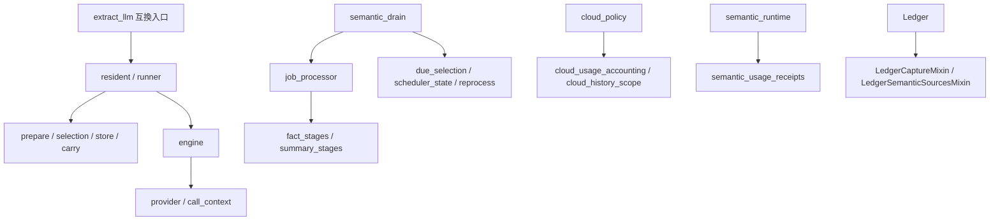

# 推論・保存・更新処理の責務分離

この文書は2026-11-05の開発候補の配置と互換条件を説明します。公開・本番適用の記録ではありません。全体の配置は[リポジトリ構成](REPOSITORY_STRUCTURE.md)、生成されたモジュール一覧は[開発リファレンス](DEVELOPMENT.md)を参照してください。

## 分離の単位と依存方向

処理の段階、保存の責任、共有状態の所有者で分けています。関数を行数で切り分けたり、旧モジュールのglobalsを共有する代理モジュールを作ったりはしていません。公開入口は従来名を残し、実装は下位モジュールを明示的にimportします。

| 領域 | 入口と実装の所有先 | 維持する境界 |
|---|---|---|
| 台帳 | `ledger.Ledger`、`ledger_capture`、`ledger_semantic_sources` | 接続とtransactionは`Ledger`が所有。2つのMixinは借用接続上で取得データと解析入力の世代を更新する |
| ローカル・クラウド抽出 | `extract_llm`を入口とし、`extract_llm_resident`、`runner`、`prepare`、`engine`、`provider`など17補助モジュールへ分離 | 選択・claim・推論・保存・carry・再試行を分けても、原文世代、期限、送信結果、課金済み応答の照合を維持する |
| 意味解析 | `semantic_drain`と`semantic_job_processor`、`fact_stages`、`summary_stages`、`due_selection`、`reprocess`、`scheduler_state`、`drain_accounting` | `run_due`が実行窓とrun lockを統括。段階ごとの採用と公開条件は既存契約を維持する |
| 会計と承認済み履歴 | `cloud_policy`、`cloud_usage_accounting`、`cloud_history_scope` | 設定・実行許可、費用計算、元投稿の承認範囲を分ける。scopeや不明な課金結果を推測で広げない |
| Jev実行と証拠 | `semantic_runtime`、`semantic_usage_receipts` | 実行guard・予算予約と、保存済み予約・回答・PASS証拠の検証を分ける。`JevReservation`は同じ型を再公開する |
| 患者コンテキスト | `patient_context_refresh`と`patient_context_refresh_state`、`quality_receipts`、`refresh_sources`、`refresh_readiness`、`quality_controller`、`rollup_builder` | 原典集合、公開条件、品質確認、集約を分ける。同じ原文と保存証拠を使い、過去の生成文を原文に混ぜない |
| 通知 | `notify_cards`、`notify_card_state`、`notify_card_threads`、`notify_card_renders`、`notify_render_layout` | 状態、親子関係、表示計画を分離。保存transactionの確定後にspecを公開し、不明な送信結果を自動再送しない |
| 収集と導入 | `mcs_adapter`と`mcs_authentication`、`mcs_setup`と`setup_config_snapshot`・`setup_integration` | 認証・設定読取・連携設定を分離。既存の認可、秘密情報の保存先、対話・人承認条件を維持する |
| 更新 | `mcs_update`と`update_apply`、`update_cli`、`update_execution`、`update_lifecycle_context`、`update_planning`、`update_preflight`、`update_recovery`、`update_repository`、`update_restore`、`update_runtime_migration`、`update_services` | journal・停止確認・バックアップ・復元同意を維持する。`release_apply_checks`は既存のrelease ownerから検証を分離する |

表の抽出・意味解析・患者コンテキスト欄で省略した名前には、それぞれ`extract_llm_`、`semantic_`、`patient_context_`が付きます。

主な依存は次の向きです。補助モジュールはこの処理系の公開入口へ戻るためのglobals代理を使いません。

## 共有状態と移動後の互換性

`extract_llm_call_context`が1つの`_CALL_NOTES`と`_SLOT_OVERRIDE`を所有します。形式probeの状態は`extract_llm_provider`、選択の一時cacheは`extract_llm_selection`、常駐workerの状態は`extract_llm_resident`が所有します。`semantic_due_selection`は選択cursorと順番、`update_runtime_migration`は`_SERVICES_PYTHON`を所有します。再束縛される値を別モジュールへ値importして更新を見失わないよう、実際の所有先から読みます。

公開CLI、flat import名、実際の呼出元が使う再exportを維持します。`ledger.SCHEMA_VERSION`と`notify_cards.CARD_LAYOUT`の数値literalも残します。内部の配置変更によって、schema、モデル、予算、原文の取得範囲、人承認、送信結果不明の扱いは変更しません。

テストは検証対象ごとに分け、共有fixtureを収集対象外のtestkitへ置きます。移動した関数・decorator・assert・parameterと旧新node IDを照合します。private関数の差替えは定義先だけでなく実際の呼出元へ追従し、同じ差替え済みobjectを渡します。歴史fixtureの`tests/meta/fixtures/mcs_recover_v1_0_29.py.txt`は過去版の互換検証用に保持し、現行実行コードの分割対象には含めません。

## 臨床処理の変更検知

抽出17、意味解析7、患者コンテキスト6、クラウド会計・履歴2、Jev証拠1の計33補助モジュールを、読み込んだコードのdigestと候補IDの変更検知に含めます。関数コードと臨床定数を保持し、実行時のpath、slot、lock、cache、threadlocal、writer世代などは実際の所有先と借用先ごとに明示して除外します。

`_CHUNK_SIZE`、`MAX_TOKENS`、`_CLOUD_SELECTION_PAGE`、固定の形式降格表`_NEXT_FMT`などは除外しません。`_LOADED_SOURCE_DIGESTS`は定数一覧から除外しても、候補IDの`loaded_extract`に含めます。補助モジュールのコードやdigestの変更を見失わないためです。配置変更に伴う再照合も従来の採用・課金済み応答の復旧契約を通します。

## 導入物と独立復旧

`install.sh`は`deployment/install/runtime.sh`を同梱する配布版から実行します。実導入では補助スクリプトを私有コピーへ固定してhashを確認してから読み込みます。入口だけを取り出して導入物として配布しません。

独立復旧は`deployment/recovery/mcs_recover.py`と`mcs_recovery_gateway.py`、`mcs_recovery_core.py`、`mcs_recovery_services.py`、`mcs_recovery_database.py`の1世代で構成します。`prepare_recovery.py`が対応する補助4ファイルを先に配置し、検証に使った同じ入口のbytesを公開します。導入先の`.prev`と、その入口が指す`runtime-<世代hash>`を一体で保持します。旧入口の復旧に必要な世代を、不要ファイルと判断して削除しません。

受入では入口のhash一致に加え、記録済みの安全な復旧Pythonで`--help`を正常終了させ、pinされた補助4ファイルを全て読み込めることを確認します。入口の一致、補助ファイルの検証、watchdogの読込状態は別々に確認します。実機の更新手順は[更新ガイド](../guides/UPGRADE_AGENT.md)に従います。

## 局所測定の範囲

保存済みPASS receiptのmetaを、同じ検証内で4回decodeしていた箇所を1回にしました。同じ一時SQLiteと完全合成receiptを使い、下位の原典証明を両版で同じstubにした測定では、各3000回を7標本、前後の実行順を交互に測定しました。中央値は0.04433秒から0.02591秒となり、この処理では約1.71倍でした。

この値はreceipt末端の検証だけの測定です。OCR、ローカル・クラウドLLM、患者全体の処理時間や本番環境の速度を測ったものではありません。読みやすさのための分離全体に、同じ性能効果があるとは扱いません。
