# 利用者ガイド — hermes-mcs

利用者・責任者向けの詳細ガイド（画面イメージ・できること・仕組み・MCS データで何が追えるのか）。
README.md の概要に続き、表示・操作の条件と記録の読み方を説明する。
導入・運用は [INSTALLATION.md](INSTALLATION.md)、開発・運用リファレンスは
[DEVELOPMENT.md](../development/DEVELOPMENT.md)、データの行き先と限界は [SECURITY.md](../../SECURITY.md) を参照。

## 画面イメージ

[導入前に画面をたどる案内](../screenshots/slack-gallery/README.md#導入前に画面をたどる)は、資格情報・MCS接続なしで読めます。既存の合成画像と配送保留の文章シナリオで、原文・返信・添付・スタンプの関係を確認します。画像内の操作はできません。

通知は **Slack / Discord / LINE WORKS** へ、同じ要約・原文・送信対象の添付を配信します。
スマートフォンの通知文は、**患者名・要約を先に、発信者（所属）・投稿時間を続けて**表示します。
要約が処理待ち・失敗の場合は原文の短い抜粋と状態を表示し、取得できない所属などは推測しません。
端末・アプリの通知プレビュー設定や表示上限により、省略される場合があります。
iPhoneで本文が隠れる場合は「設定 → 通知 → Slack → プレビューを表示」を確認してください。
既存のDiscord Components V2カードの更新と、LINE WORKSのファイル単体の通知は、サービス仕様により独自の通知本文を追加できません。
Slack・Discordは標準のHermes接続、またはMCS単独の独立接続を使います。LINE WORKSは専用アダプターを使います。
導入方式の選択は[はじめての導入ガイド](EASY_SETUP.md)、独立接続の管理は[独立実行ガイド](STANDALONE.md)を参照してください。

### 元投稿・返信とカードの関係

Slack・Discordの新規カードは、元投稿と各返信を**1投稿につき1カード**で表示します。
`notify.card_thread=true`（初期設定の既定）でスレッドを使い、`notify.reply_cards`を省略または`true`にした場合の形式です。
元投稿のカードをチャンネルへ送り、返信カードはその元投稿のスレッドへ送ります。返信ごとに別のスレッドは作りません。
確認・担当・タスク作成／一覧・薬剤詳細・誤り報告・スタンプは、操作したカードの投稿が対象です。患者の記録まとめ・検索は、患者の取得済み記録を対象にします。
親カードの「返信 N件を保存済み」は保存済みの件数であり、通知の配送完了件数ではありません。
親スレッドの配送が未確認なら返信を保留し、時間が経ってもチャンネルへ独立投稿しません。親が再作成されて既存返信との対応が変わった場合も、配送記録を保って管理者の確認を待ちます。

既存カードは保存された形式を維持します。複数投稿をまとめた従来形式を、この設定だけで1投稿1カードへ分割・一括再送しません。
`notify.reply_cards=false`、またはスレッドを使わない設定で新しく作るカードも従来のまとめ形式です。設定をオフにしても、作成済みの1投稿1カード形式は維持します。
LINE WORKSは実スレッドがないため、同じトークルームへの連続投稿を使います。

### 新しく認識した患者の履歴

新しく認識した患者については、それ以前の履歴を患者ごとのまとめ通知にします。
Slack・Discordは同じカードの進捗を更新し、LINE WORKSは開始・完了の2通にまとめます。
保存済み・解析済み・処理待ち・保留の件数を分け、添付は件数とMCSへの案内を表示します。
履歴本文や添付を個別に一斉配信することはありません。取得・保存・解析の範囲は減らしません。
初回認識後の新着・返信は、従来の通知条件で1投稿1カードにします。

初回取得では、先頭から末尾までの一覧を2回走査し、観測した投稿の並びが一致することを確かめます。
途中で並びの変化を検知したら、保存済みの投稿を保持して先頭から再確認します。
本文の一部しか取れていない投稿や未取得の返信、失敗した取得処理が残る間は完了と表示しません。
一覧で本文が提供されない親投稿は「本文未提供・解析対象外」として件数を分け、解析済みには加えません。
後から本文を取得できれば通常の解析対象に戻します。LINE WORKSで完了通知を配達済みの場合は、
後日の本文提供だけで3通目を追加しません。配達済みの件数は、その通知を作成した時点の観測です。
これは取得できた一覧の照合であり、走査中に移動・削除され一度も取得できなかった投稿まで保証するものではありません。

一覧の不一致が8回に達すると、保存済みの投稿を残し、`window_stalled`として自動取得を停止します。
一覧の末尾まで確認できても本文の一部が未取得なら、同じ理由で停止します。
返信の取得が進行中なら`waiting_replies`、失敗した場合は`replies_missing`と区別します。
この場合は「初回履歴の取込みを確認中」のままで、完了とは表示しません。
管理者は`python3 mcs/ops/mcs_setup.py doctor --probe data`で取得未完了の案内を確認し、
MCSの画面で対象の履歴と本文を確認してください。取得できない状態の原因を解消してから、既存の履歴取得操作
（人承認付きの`ops.scan`または管理者用の`data/cmd`の`import`依頼）で再開できます。
初回履歴の範囲と保存済み投稿を保持し、先頭から2回の一致を改めて確認します。明示的な初回履歴の再開では、試行回数も初期化します。
通常の履歴取得が失敗していた場合は、新しい依頼で指定した日数・ページ数から取得し直します。
DBの状態や取得済み範囲を手作業で書き換えないでください。停止時の診断が古い場合は、
現在の障害と断定せず、管理者が用意した読取り専用snapshotを
`python3 mcs/ops/mcs_repair.py plan --snapshot PATH`で確認します。
`PATH`はそのsnapshotのパスです。出力の`job_kind_state_reasons`にある
`history/failed/window_stalled`を確認してください。[復旧計画の手順](../roadmap/acquisition.md)も参照できます。

緊急度が高い履歴もまとめ通知の件数に含め、過去の投稿を新着として個別通知しません。
この件数は初回履歴の解析結果で、患者の現在の緊急状態を示すものではありません。
既存のアラート検知は従来の条件で続けます。
既存患者や、更新前に作成済みの通知は、この形式へ一括変換・再送しません。

### カードに表示する内容

カードは上から「概要」「投稿ごとの要約」「状態」「操作」の順に並び、区切り線で分かれます。
（2026-10-08以前に作られたカードは、見出しに `· 起点 10-01` と緊急度を並べ、要約に `📋 要約` の見出しを付ける従来の表示のままです。）

| 区画 | 表示 | 例 |
|---|---|---|
| 概要（見出し） | 患者名・施設。同名の患者がいれば識別番号の末尾 | `💬 山田 花子（あおぞら）` |
| 概要（見出しの下） | 緊急度（抽出の判定＝`🚨 緊急度高`／緊急語の機械照合＝`🚨`）・開始日・投稿数・未取得の返信・添付件数・自分宛て・ページ位置（あるものだけ） | `🚨 緊急度高 · 10-01〜 · 3投稿 · 📎 2 · 2/2ページ` |
| 概要 | カード作成後に増えた返信、LINE WORKSの更新版 | `🆕 返信+2 · 🔄 更新版` |
| 要約 | 投稿ごとの日時・送信者の行（Slackは小さな補足表示、Discordは小さな文字）と、その下に抽出した要約の全項目。抽出前は `要約 処理待ち`、再試行の上限に達したら `要約 作成失敗` | `10-01 09:40 佐藤さん（訪問看護・あおぞら）` |
| 状態 | 担当・確認、タスク件数（期限切れ件数）、スタンプ、誤り報告・履歴取得の失敗・取り下げ | `👤 担当: 田中 · ✅ 確認: 田中` |
| 操作 | `確認する` `担当する` `タスク作成` などの操作、スタンプ、`MCSで開く` | 通常操作はメニューに集約 |

Slack・Discord・LINE WORKSとも、`確認する`・`担当する`・`タスク作成`を含む操作を「操作を選ぶ…」にまとめ、スタンプと`MCSで開く`を表示します。`別の投稿`は複数投稿をまとめた従来形式の操作です。
Discordのカードには送信者行と要約だけを載せ、本文全文と添付ファイル
（画像・PDF 等）はカードのコンパニオンスレッドへ配送します。
Slackのカードは対象投稿の要約・スタンプ・`原文（N字）`の折りたたみを載せます。添付ファイル・カードに収まらない本文は元投稿のスレッドへ配送します。従来のまとめ形式では、後から届いた返信の新着案内もスレッドへ送ります。

以下の画面例には、複数投稿をまとめた従来形式も含まれます。新規カードの投稿単位と操作対象は上記の説明に従います。

**Discord — 通知カード（送信者行・要約・操作ボタン）**

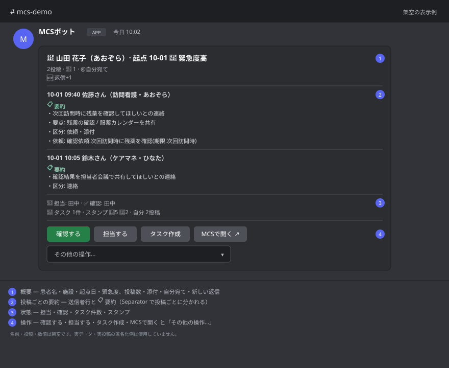

**Discord — 本文・添付はコンパニオンスレッドへ配送**

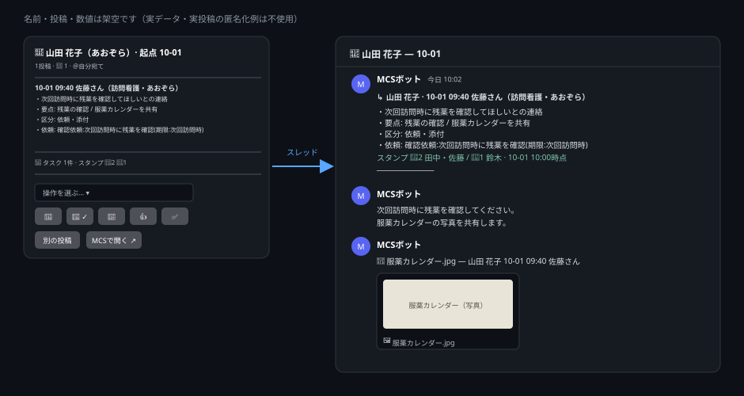

**Slack — 通知カード（要約・スタンプ・原文の折りたたみ・操作ボタン）と添付のスレッド**

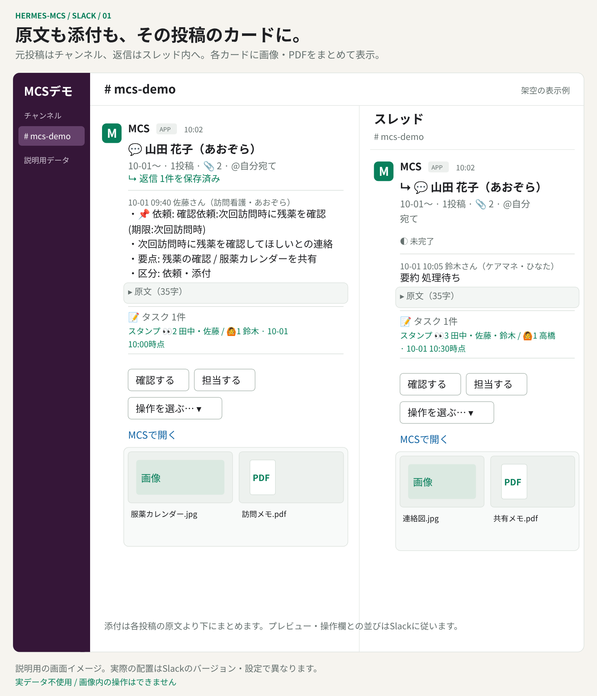

**LINE WORKS — 共有トークルームへ連続投稿、入力・確認は本人との1:1トーク**

要約カード・原文・添付を同じトークルームへ順に配信します。
許可ユーザーがボタンを押すと、操作の入力・確認・回答は本人との1:1トークへ届きます。
タスクは内容・担当・期限・理由を確認して`確定する`を選ぶまで登録しません。
表示の更新は新しい投稿になり、古いボタンと開いている確認画面は無効になります。
独立アダプターの起動・公開HTTPS Callback・許可範囲の設定は
[LINE WORKS接続ガイド](LINEWORKS.md)、完全合成の画面例は
[LINE WORKSギャラリー](../screenshots/lineworks-gallery/README.md)を参照してください。

`📋 要約` ブロックはローカルLLMの抽出（要約・要点・区分・バイタル・
検査・症状・薬剤・依頼・所見）を提示する「候補」です。項目ごとの短い制限は外しましたが、通知先の表示上限は維持します。長い内容はページへ分け、単一投稿が上限を超える場合は省略して本文表示や原本へ案内します。
薬剤・症状・検査値・バイタルと閾値表示は、原文全体の人物・時点と照合します。
家族の見出しが引用の外にあっても本人の現在値として表示せず、登録済み患者名で書かれた本人の測定値は保持します。
対象が不明な検査や家族の所見は対象・確認状態を区別し、原文と履歴を保持します。
服薬管理のうち、薬の保管状況・保管場所・管理者、疑義照会や処方提案の結果、重複・相互作用の確認だけは
`服薬管理（保管状況）: 「冷蔵保管」` のように原文の値を短く引用した1行で表示し、本人以外の記載は `(対象:家族)` などを付けます。
それ以外の患者情報（基本情報・連絡先・服薬支援など）は共有カードに載せず、本人向けの患者まとめと詳細表示で確認します。
疑義照会・処方提案の記載がある投稿は区分に `処方の照会・提案の記載` と表示しますが、照会が済んだことや結果の確定は意味しません。
Slack・Discordでは、`notify.card_thread` がオンの場合（`init` の既定はオン）、
元投稿のカードに専用スレッド（`💬 患者名 — MM-DD`）を使います。
Slackは**要約・スタンプ（押した人を含む1行）・`原文（N字）`の折りたたみ**をカード内へ表示します。1投稿1カード形式では、それぞれのカードにその投稿だけを表示します。従来のまとめ形式では返信も同じ順で続けます。画像やPDFなどの添付は元投稿のスレッドへ投稿します。カードに収まらない投稿と、それ以降の投稿はスレッドへ本文を表示します。原文の折りたたみに対応した配信済みカードは次の更新時にこの配置へ書き換え、スレッドの旧本文は集約済みの表示に置き換えます。
Discordと、Slackで本文をスレッドへ表示する場合は、`↳ 日時 投稿者`の見出しに続いて**要約・スタンプ・本文**を表示し、スタンプと本文の間に区切り線を入れます。返信も同じ順です。要約が未完成なら処理待ち・作成失敗などの状態を示します。旧形式のカードでは要約と本文の見出しを保持します。
要約と解析進捗は対象投稿のカードにも表示します。添付の見出しには要約を重ねません。
本人向けの`本文表示`とテキスト通知は、要約と本文の2パートです。
LINE WORKSの新形式カードでは、カードに続いて見出し・要約・スタンプを一つの投稿で送り、その次の別投稿に原文を送ります。既存の旧形式カードは従来の表示を維持します。
添付には `📎 ファイル名 — 患者名 日時 投稿者`、取得できなかった添付は
`📎 ファイル名 — 取得失敗` を表示します。配送は
ジャーナル化された parts（card→thread→本文chunk→添付）で、worker
再起動後は配送記録を照合し、未送信と確認できたpartから再開します。送信結果が不明なpartは
保留し、自動再送しません。要約の抽出結果や解析進捗が後から届くと対象投稿のカードを更新します。
Slack・Discordでは要約・原文・スタンプの変更時に、同じカードまたは投稿を書き換えます（書き換えでは通知は鳴りません）。
Slackの従来のまとめ形式で後から返信が届くと、元のメイン投稿のスレッドへ新着の案内を投稿し、チャンネルにも新着表示します。原文をカード内に表示する場合も同じです。配信済みの投稿の編集や再試行では再通知しません。
本文をスレッドへ表示する形式では、要約・スタンプのヘッダを本文から分け、スタンプだけの変化で長い本文を送り直さないようにします。古い形式（layout1/2）は表示版だけで一斉編集・再送せず、元の形式を維持します。
LINE WORKSでは初回の要約を最大120秒待ち、緊急通知は待機を省きます。初回のヘッダ・本文に加え、投稿ごとの改訂は上限案内を含め最大3件です。古い形式で実内容が変わる場合は旧部品構成のまま要約等を含む本文を追加投稿する場合があります。送信済みの内容は編集・撤回できません。更新量は `data/health.json` の `cards.layout_inventory` のカードlayout集計と結果不明部品の診断で確認し、停止中のカードを自動解除しません。
投稿単位に分かれる前の旧形式で、配送IDと投稿の対応を確定できない本文は凍結したまま保持します。過去の全投稿を一括再送する機能ではありません。
長文の短縮で余った区画には本文への案内を表示します。編集結果が不明、または更新区画が投稿上限に収まらない場合は保留し、追加投稿やファイルの再アップロードで代替しません。
旧形式の凍結投稿は、この更新による一括編集の対象外です。
Slackで既存返信の履歴を確認できない場合は追加投稿を止め、配送結果を不明として記録します。
管理者が通知先の投稿と配送記録を確認して解決します。
`notify_all_replies`（既定オフ）をオンにすると、リアルタイム経路で新しく
保存した返信も未読・経過時間の条件なしですべて通知対象になります。スレッドを持てない
カード（オフ・作成失敗・削除済み）では `本文表示` が残り、押した
本人のみに全文を ephemeral 表示します。

#### スタンプを押す

スタンプ送信を設定している場合、カードに対象投稿への5種類をMCSと同じ順に表示します。1投稿1カード形式ではそのカードの投稿だけが対象です。ほかの返信へは、その返信カードから操作してください。従来のまとめ形式では、表示中の最新投稿が対象です。
Slackではカード下部に、他職種からのスタンプの件数・押した人、自分のスタンプ、送信用メニューをまとめます。`スタンプを押す…`を開き、`👀見ました`・`🙆承知`・`🙏感謝`・`👍いいね`・`✅完了`から選ぶ2段階です。自分が押した種類は`✓（取消）`になり、選ぶと取り消します。従来のまとめ形式にある`🗂 別の投稿`は対象を選ぶフォームへの入口で、スタンプの種類ではありません。DiscordとLINE WORKSでは絵文字5個を直接押します。押せるのは設定した操作者だけです。
押すとその場で受け付け、次回以降の収集で処理します。収集は通常10分間隔ですが、遅れる場合があります。押してから20分を過ぎた操作は送信しません。MCSで反映を確認するとカードの表示が変わります。
自分が押しているスタンプには `✓` が付きます。そのスタンプをもう一度押すと取消になります。
従来のまとめ形式でほかの投稿へ操作する場合は`別の投稿`から選びます。スタンプ5種がそろわないカードや旧形式のカードでは、操作メニューに`MCSスタンプ`があれば使えます。Slackのメニューは、新規カードとカードの次回更新から反映します。メニューを開いただけでは送信しません。

#### スタンプと押した人

カードと未確認一覧では `スタンプ 👀2 🙆1` のように、表示中の投稿の件数をまとめます。
同じ人が複数の投稿に押した場合も投稿ごとに数えるため、合計は人数ではありません。
自分の投稿では他者の件数を表示し、`自分 2投稿` は自分がスタンプを押した投稿の数です。

Slackのカード下部のスタンプエリア（収まらない投稿はスレッド）、Discordのスレッド、LINE WORKSの投稿見出しには、件数と押した人を1行で表示します
（例: `スタンプ 👀2 田中・佐藤 / 🙆1 鈴木 · 10-01 10:00時点`）。
押下者取得が無効または未取得なら件数だけを表示します。スタンプが1件もないと確認できた投稿ではこの行を出しません（未取得・再取得失敗は表示します）。自分の投稿では他者の件数と氏名だけを数えます。
他者の投稿では、自分のスタンプも件数と押した人に含めます。「自分 👀」のように自分のスタンプを分けて示すことはせず、押したかどうかはスタンプのメニュー（Slackは選択済みの項目、Discord・LINE WORKSは✓の付いたボタン）で確認します。
自分の投稿に自分だけが押したときは、この行を出しません。氏名が分からない人は「氏名不明」、多い一覧は
`他N名` で省略します。氏名は確認・担当ボタンを押した人とは別の、MCSのスタンプの情報です。

後から氏名や取得状態が変わったとき、Slack・Discordは該当するカードまたはスレッドの表示を更新します。
LINE WORKSは送信済み本文を編集できないため、要約・スタンプ件数・押下者・取得状態・本文などが変わると更新版を追加投稿します。同じ内容は再投稿しません。観測時刻だけで投稿が増えないよう、LINE WORKSのスタンプ行は時刻を省き、未取得・古い・取得失敗の状態を残します。以前の投稿も残るため、最新の更新版を確認します。

| 表示 | MCSのスタンプの種類 |
|---|---|
| 👀 | 見ました |
| 🙆 | 承知 |
| 🙏 | 感謝 |
| 👍 | いいね |
| ✅ | 完了 |

未取得は「誰も押していない」という意味ではありません。古い一覧や再取得失敗では、
最後に完全取得した一覧とその時点を示します。観測日時は取得した時点で、押した時刻ではありません。
スタンプの「完了」も正式なタスク完了の記録にはしません。

従来のまとめ形式では、管理者がスタンプ送信を有効にすると、`別の投稿`、またはカードの操作メニューの`MCSスタンプ`からフォームを開けます。
フォームでは対象の投稿とスタンプを選び、理由を入力して、確認画面で`確定する`を押します。
根元の投稿も返信も対象です。画像・PDFなどは、添付が属する投稿を選びます。
別ページの投稿はカードの前後の操作（Slackではメニュー内）で表示してから操作してください。

`見ました`・`承知`・`感謝`・`いいね`・`完了`を選べます。自分が付けたものと同じスタンプを押すと取消になります。フォームでも、自分が付けたものと同じスタンプを選ぶと取消になります。
取消は、現在の自分のスタンプが分かる場合だけ受け付けます。確認中・取得できていない状態では送信しません。
受付済みとMCSでの反映確認は別です。結果が不明な場合は自動で再送せず、次の収集で照合します。
結果の通知が期限内に届かなければ、元のカードから開き直して状態を確認してください。

MCS本人IDと1人の操作者を設定すると、`stamps.enabled`を省略した場合も送信が有効になります。無効にする場合は`stamps.enabled=false`を設定してください。設定した操作者からの操作で、MCS収集アカウントの本人IDが一致する場合だけ送信します。
チャットの絵文字をMCSへ自動転送する機能ではありません。[設定と復元時の注意](../specs/stamp-management.md)を参照してください。

押した人の取得は既定OFFです。管理者が氏名の保存・通知先の閲覧範囲と未読保持を確認し、
`metadata_shadow=true` と `metadata_actors=true` の両方を設定した場合に取得します。
1回の予算内で最大4投稿を扱うため、有効化直後に全投稿の氏名が揃うとは限りません。
設定と保持範囲は[導入ガイドのメタデータ設定](INSTALLATION.md)を参照してください。

#### カードの操作（Slack / Discord / LINE WORKS）

ボタンの名前は状態によって変わりません。誰が確認・担当したかは状態欄に
名前で表示されます（Discord はメンション表示で通知は鳴りません。
Slack は表示名の文字列で、取得できない場合は「メンバー」と表示されます。
LINE WORKS は `notify.lineworks.user_names` に設定した名前で、未設定なら「メンバー」です）。
確認・担当済みかどうかは、どのチャットでも状態欄で確認します。

以下の「ボタン」は、通知カードでは「操作を選ぶ…」の項目です（LINE WORKSは押した本人との1:1トークに届く項目）。

| 場所 | ボタン | 動き |
|---|---|---|
| ボタン | `確認する` | 今表示している内容を確認した記録を付け、状態欄に `✅ 確認: <名前>` が並びます。確認済みの本人がもう一度押すと自分の確認を取り消します（記録は取消として残ります）。新しい返信が来るなど内容が変わると確認は外れます。まとめカードでは `このページを確認する` |
| ボタン | `担当する` | 押した人が担当になり、状態欄に `👤 担当: <名前>`。担当中の本人が押すと担当を外し、別の人が押すと担当を引き継ぎます（押した表示の後に担当者が変わっていた場合は引き継がず、最新の表示でやり直すよう案内します） |
| ボタン | `タスク作成` | この投稿を起点に薬局内タスクを作ります。入力欄は「タスク内容」（投稿から抽出した依頼があれば下書きとして入っています）・「担当者」（MCS から取得した自局スタッフ一覧から選択、または手入力）・「期限」（YYYY-MM-DD、任意）・「理由」（任意。空なら「通知カードからタスク作成」を記録）。確認画面には理由も表示され、「確定する」を押すまで登録されません。登録後、状態欄に `📝 タスク N件（期限切れ M）` が表示されます |
| リンク | `MCSで開く` | その患者の MCS の画面を開くリンク |
| メニュー | `本文表示` | スレッドを持てないカードだけ。本文全文を押した本人にだけ表示 |
| メニュー | `タスク一覧` | 対象投稿に未完了タスクがあるときだけ表示（従来のまとめ形式ではスレッド内が対象）。押した本人にタスクごとの内容と操作が並び、各タスクを「対応中」「完了」に進められます |
| メニュー | `患者の記録まとめ` | 押した本人にだけ、取得済み投稿からの**暫定集約**（抽出された服用中の薬と処方期間の候補・最新バイタル・次回予定・未完了タスク・背景／療養情報の原記録抜粋・服薬管理の報告・履歴の取得状況）を表示します。処方期間の候補・次回予定は投稿から規則で抽出した表現で、どの薬の期間かは特定しておらず、確定した処方ではありません。取れていない記録は「無い」ではありません |
| メニュー | `この患者を検索` | キーワード（空白区切りで AND）を入力すると、その患者の取得済み投稿から一致したものを新しい順に10件まで、日時・職種・前後の抜粋付きで押した本人にだけ表示。対象は取得済みの投稿だけで、見出しの「取得済み投稿」と履歴の取得状況の行で範囲を示します |
| メニュー | `誤りを報告` | 構造化抽出の誤りを報告します（箇所: 要約/緊急度/薬/症状/依頼/バイタル/患者情報/検査値/出来事/その他 ＋ 任意メモ。`🚨 緊急度高` などの緊急度表示が実態と違うときは「緊急度」を選びます）。確認画面で確定すると、その投稿の抽出を1回だけ再実行し、再抽出されるまでカードに `⚠ 誤り報告あり` と表示されます |
| メニュー | `薬剤を確認` | このカードの投稿から抽出した薬剤があるときだけ表示。押した本人にだけ、薬剤ごとに名前・用量・開始/中止・予定と、医薬品辞書の候補（候補あり／複数の候補／総称／一致なし）を縦に並べて表示します。家族・過去・否定の記載は含めません。**辞書候補は名称が一致した参考情報で、処方・成分・同等性を確定しません**。辞書が有効化されていなければ候補欄にその旨を表示します |
| メニュー | `薬剤を検索` | 医薬品辞書が有効なときだけ表示。薬名（一般名・製品名・コードの一部）を入力すると、辞書の名称・別名・コードの部分一致を10件まで、種別（成分／一般名処方／製品）と一致した別名付きで押した本人にだけ表示。参照用の検索で、投稿の照合結果や辞書は変わりません |
| メニュー | `却下` | アラートカードのみ。却下理由を一覧（誤検知 / 対応済み / 重複 / 対象外 / その他）から選び、任意でメモを添えて却下。確認画面で確定するまで記録されません |
| メニュー | `◀ 前` `次 ▶` | 複数ページのカードのみ |
| 集計カードのメニュー | `全体の新着集計` | 押した本人にだけ、要約サマリーをカード形式で表示（Slack は Block Kit、Discord は見出し付き、LINE WORKS は DM）。入力欄で対象を絞り込めます: `all`（全患者・既定）/ `mine`（担当名が一致する未完了タスクのある患者・記録上）/ `station:施設名`（MCS のステーション名に部分一致）/ `project:ID,ID` / `days:1-7`（集計期間・既定1日）。空白区切りで組み合わせると AND。患者名を表示します。プロジェクト範囲外の患者は出しません |
| 集計カードのメニュー | `自分のタスク` | 押した本人にだけ、自分が担当の未完了タスク（未着手・対応中）を全患者分表示。アーカイブ済み患者の分は末尾に「（アーカイブ済み）」付きでまとめ、それぞれの中で期限切れを先頭に、期限の早い順。担当者欄が Discord の表示名（または `タスク作成` のスタッフ一覧で選んだ「氏名（事業所）」）と一致するものだけが対象です（下の注意） |
| 集計カードのメニュー | `未確認一覧` | 押した本人にだけ、直近7日に更新されたカードのうち今の内容に `✅ 確認` が付いていないもの（担当中で未確認のものは `担当中` 付き）を患者ごと・古い順に表示（アーカイブ済み患者は末尾に「（アーカイブ済み）」付き）。MCS とカードへのリンク付き、15件を超える分は「他N件」。**確認ボタンの記録の有無であり、作業が済んだかどうかではありません** |

患者ごとの投稿・アラートカードには、その患者の記録まとめ・検索・薬剤・タスクなどの操作をまとめます。
`この患者を検索`は患者カードのメニューから選べます。
`全体の新着集計`・`自分のタスク`・`未確認一覧`は全体の集計カードのメニューだけに表示し、
カードの部品数が上限（40）に近いときは入る分だけ表示します。
Slack・Discordは選択メニュー、LINE WORKSは`操作を選ぶ…`から本人との1:1トークへ進みます。
Slackの`MCSで開く`はカード下のテキストリンクです。

#### 患者コンテキストを本人向けに確認する

患者コンテキスト作成は生成・限定閲覧とも既定でオンです。
`extract.patient_context_nightly.enabled` と `publication` を省略した既存環境も更新後は有効になり、
🧾 `患者の記録まとめ` から次の表示を開けます。どちらかを明示的に `false` にすると従来のまとめ画面を維持します。
Slack・Discordでは押した本人だけへの表示、LINE WORKSでは本人との1:1トークで確認します。
共有チャンネルへ患者の背景を自動配信する機能ではありません。

| 表示 | 確認できる内容 |
|---|---|
| 患者さんの全体像 | 患者コンテキストと、分類別の背景情報・出典 |
| 前回から変わったこと | 新しい報告、訂正・削除、後から取得した記録、過去記録からの追加発見 |
| 連絡・返答の確認 | 記録上の依頼と返答。返信が見つからない場合も未対応とは断定しません |
| 訪問前の確認ノート | 最近の記録、原文に書かれた確認事項、職種別の介入予定と対象・日付・担当が未確認の予定に関する記載 |
| 経過タイムライン | 投稿時刻と、原文に書かれた出来事の日付 |
| 出来事の記録 | 入退院・移動・転倒・訪問・受診・検査など、原文を確認できた出来事 |
| 検査・観測の記録 | 原文で本人・項目・値・単位・日付を確認できる記載を項目ごとに表示 |
| 記録の食い違い | 異なる記載と出典。正誤を自動で決めず、時点の違いも示します |
| 引継ぎ用の記録 | 確認範囲、原文の確認事項、返答が見つからない記録 |
| 退院・移行時の経過 | 入退院・移行の記録と前後14日の記載、この範囲で記載がない分類 |

最初の画面には`患者さんの全体像`・`前回から変わったこと`・`訪問前の確認ノート`・`連絡・返答の確認`・`記録の食い違い`の5つを表示します。
各画面の`←`・`→`で10の表示へ移動できます。9件以上ある場合は`前の8件`・`次の8件`で読み進めます。
「患者さんの全体像」の `表示順` は、押すたびに次の順で切り替わります（「」内が1つの選択肢です）。
「標準」→「看護」→「医師」→「薬局」→「ケアマネ・介護」→「訪問介護」→「施設・通所」→「リハビリ」→「栄養」→「歯科」→「相談員・連携」→「標準」。
標準表示では、この患者の部屋に投稿した人の職種から表示順の候補を1行示します（自動では切り替えません）。
変わるのは背景情報の並び順だけで、閲覧権限や対象患者は変わりません。
それ以外の表示にある `原文を検索` は、既存の患者別検索を開きます。
キーワードを空白で区切るとすべてを含む取得済み投稿を検索します。

「訪問前の確認ノート」の職種別介入は、原文に職種・対象・日付表現・行為が明記された定型の記載を示します。「明日」や年のない日付は、原文を残して日付未確認の予定として表示します。投稿日時から介入日を推測せず、確定日順の予定や取消との照合には含めません。別投稿による取消や訂正との対応は照合していません。内容を特定できない候補は元投稿を確認してください。

「介入の履歴を見る」では、投稿番号の降順に一度に最大200投稿を確認し、表示中の記録を最後まで進めると、さらに古い投稿を開けます。日付順はその範囲内の表示順です。各ページで原文と患者の対象範囲を確認しますが、ページ間に起きた変更や履歴の取得完了は未確認です。

「出来事の記録」は、保存済みの投稿から投稿番号の降順に最大200件を確認し、抽出結果と原文を照合して表示します。出来事の日付と投稿日時を分け、日付を確認できない記録は後に表示します。別の投稿との関係や訂正・変更の対応は照合していません。未取得・未解析の投稿や添付がある場合、または対象を制限した場合は、全履歴の確認は未完了です。ページを移動しても古い投稿の確認へは進まず、さらに古い投稿へ続けて確認する機能はありません。コマンドラインでは `python3 mcs/views/mcs_view.py patient_context --project <患者のプロジェクトID> --view care_events` で同じ記録を確認できます。

「検査・観測の記録」は患者コンテキストに含まれる記載を対象とし、測定日・観察日と投稿日時を分け、項目ごとに投稿順で表示します。原文の照合は最新側から1回最大50投稿です。照合範囲外や主体・単位を特定できない記録は対応未確認として残します。条件の記載がない値は投稿ごとに分け、同じ条件だったとは判断しません。再表示しても照合範囲は自動的に進みません。体温・SpO2・脈拍・呼吸数も表示対象ですが、血圧の上下値は対応未確認です。独立した検査・バイタル抽出結果の全件を示す画面ではありません。

各表示は次の形でまとめます。

- 冒頭: 患者名と表示名（複数ページのときは「1/2ページ」）。「患者さんの全体像」だけは続けて関係者（投稿者の職種と氏名、5人目以降は「他N名」）と表示順も示します。
- 記録: 分類の見出しの下に原文を載せ、最後の行に出典を短く添えます（例: 「お薬カレンダーで管理、残薬3日分。（10/03 薬剤師 #3）」）。同じ投稿の同じ分類は出典を1回にまとめます。原文の先頭が見出しと同じ語（「服薬管理：」など）のときは省きます。
- 出典の日付: 今年の記録は「月/日」、それ以前は年から表示します。Slack・Discordでは日付が患者のMCSチャット（部屋）へのリンクです。投稿そのものへ直接移動するリンクではないため、部屋で `#投稿番号` の日時を目安に探します。
- 末尾: 履歴の取得状況と患者コンテキスト作成の点検件数。
- Slack: 見出し・出典・区切り線を使ったBlock Kitで表示し、移動ボタンも同じメッセージに付きます。1件に収まらない場合は従来の文字表示になります。

「前回から変わったこと」の基準は、同じ利用者・通知先でこの患者のまとめを開くよう依頼した時刻です。
画面には **前回の表示依頼** と示します。初回は比較の開始時刻がないため、取得済みの全範囲を対象にします。
同じ画面で表示やページを切り替えても、この比較基準は保持されます。
この時刻は表示依頼を処理した記録であり、通知先への配送成功、本人が読んだこと、
`確認する` ボタンの記録、診療・対応の完了を示すものではありません。

患者コンテキストには反映時点を示し、その後の未反映件数、取込済み・点検済み・未点検・本文不完全の件数、
原文に対応する引用の件数を分けて表示します。点検件数は患者の状態を理解した割合や要約の正確率ではありません。
原文が訂正・削除されるなど根拠が現在の記録と一致しない患者コンテキストは表示せず、
現在参照できる既存の抽出情報で確認します。第二入力源の追加は今後の対応です。

- **`自分のタスク` の対応づけ**: 押した人の表示名（Discord はサーバーでの
  表示名、Slack はプロフィールの表示名・無ければ氏名。取得できない
  ときだけユーザー名）とタスクの担当者欄を、空白の違いを無視して
  照合します。担当者欄が「氏名（事業所）」の形なら氏名部分で照合します。
  手入力の略称・旧姓・別表記、表示名が MCS の氏名と違う場合は一致しません。
  表示名は本人が変えられるため、本人確認の仕組みではありません
  （タスクはもともとチャンネルの許可メンバー全員が見られる情報です）。

- **コマンドで要約サマリー（本人専用）**: Discord は `/mcs {"op":"summary","scope":"mine name:山田 days:3"}`、
  Slack は `/mcs-summary station:みどり days:2`（アプリ設定が必要。導入ガイド参照）、LINE WORKS は Bot の DM に
  「サマリー all」のように送ります。絞込みは 📊 と同じで、`mine` には `name:名前`（Slack は表示名で補完）を付けます。
  元データは定期的に更新される公開スナップショットで、6時間以上古いと注記が付きます。
- **朝の日次サマリー**（`daily_digest.enabled`、既定オフ）: 毎朝
  `daily_digest.hour_jst` 時（既定8時・JST）以降の最初の実行で1通、
  `notify_target`（カード通知が有効なときはカード用の配送先へカード形式）に送ります。先頭に件数の要約、続いて「要対応」（緊急度高・期限切れ/本日期限タスク・
  滞留アラート）、患者別の新着、連携サマリー更新、取得状況の順で、空の節は省きます。
  `daily_digest.scope` で対象を絞れます（`station:`・`project:`・`days:`。`mine` は `📊` でだけ使えます）。
  集計内容は前回以降の新着件数（職種別）、
  緊急度が高い投稿の ID（project / message。本文は出しません。患者名は
  `daily_digest.include_names` をオンにしたときだけ ID に添えます）、
  取得未完了として記録されたルームと理由コード（0件でも欄を出します）、
  open（未解決）のアラートの型別件数と、openのまま3日超かつカードで
  一度も確認されていない滞留アラートの件数（`signals.notify` がオンのときだけ。
  型別件数は依頼・期限系の4型を除外）、未完了・期限切れタスク数です。件数は取得済みの
  記録から数えたもので、記録がないことは対応がなかったことを意味しません。
- **期限リマインド**: 通知カードがまだ有効な投稿に
  紐づく未完了タスク（カードの `📝` で作ったもの・`/mcs` で登録したものの
  どちらも）に期限があると、期限当日に1回 `⏰ 期限リマインド`、期限を
  過ぎても未完了なら1回 `⚠ 期限切れ` を通知先（`notify_target`）に投稿
  します（8〜21時のみ、1回の実行で最大3件ずつ）。投稿には**患者名・
  タスク内容・担当者名**が含まれます。期限を変更すると新しい期限で
  もう一度リマインドされます。機能が初めて有効になった時点で既に期限を
  過ぎていたタスクはまとめて投稿せず、記録だけします（以後に期限を
  迎えたものだけを通知）。カードのフッターでも期限切れのタスクに
  `⚠ 期限切れ` が付きます。
- **緊急度の表示**: 投稿ごとの要約の先頭に、ローカルLLM抽出が緊急と判定した
  投稿は `🚨 緊急度高`、ルール照合だけが緊急語を見つけた投稿は
  `🚨`（緊急語の機械照合）と区別して表示します。抽出が
  緊急ではないと判定した投稿には機械照合の `🚨` も付きません。ルール照合は
  原文の人物・時点・否定も確認し、家族・他者の状態や過去・予定・条件付きの記載を本人の現在の急変へ昇格させません。
  AIの緊急判定は判定の根拠となった本文の引用を `— 根拠:「…」` として併記します。
  根拠を本文で確認できない「高」は自動的に「判断保留」に降格され、AI高バッジも
  再確認通知の対象にもなりません（機械照合の網には残ります）。QC監査が抽出の
  緊急度と別の判定をした場合は `（監査では通常判定）` / `（監査では判断保留）`
  が表示され、その不一致がある間は緊急度の再確認通知は出ません。
- **該当スレッドのアラート**: 緊急度の再確認候補と薬剤シグナルは、配送を確認できた元投稿の既存スレッドへ追加します。対象人物・原文の短い引用・投稿日時・判定時刻・原本確認先を示します。原スレッドが未確定なら最長6時間保留し、それでも確定しない患者別アラートはチャンネルへ配送します（別スレッドへは流しません）。`notify.card_thread` がオフの環境では待たずにチャンネルへ配送し、配送後に元スレッドが削除された患者別アラートも保留上限の後にチャンネルへ再投稿します。緊急度の再確認通知はスレッド限定のため、スレッドが現れないまま6時間たつと取り下げます。至急返信・確認などの依頼は、本人の臨床的な急変と別の表示にします。日次一覧とシステム運用通知は従来の指定先へ送ります。LINE WORKSの患者別アラートは設定先トークルームへ配送します。スレッド限定の緊急度再確認通知はネイティブなスレッド参照が未対応のため、保留・診断対象です。
  配送済みシグナルの取り下げは、元投稿が削除・変更された後も、記録済みの投稿先と投稿IDを使って実行します。元の本文を再投稿せず、既に削除済みなら取り下げ完了として記録します。新規投稿・上書き更新は引き続き現在の元投稿とスレッドを検証します。
- **遅延した解析の更新**: 既存の投稿IDを維持して要約を更新し、処理途中は「解析更新中」と完了区間数を表示します。完了すると表示を外し、確認が必要な状態は「解析要確認」と区別します。部分的な抽出結果は公開しません。進捗だけの更新では投稿に対する確認を取り消しません。送信中・成否未確認・復旧保留中は新しい送信を競合させず、既存の配送記録が確定してから続きを更新します。
- **稼働監視の通知**: 「🟠 MCS監視: 一部に異常があります」のような状態の1行、「影響:」の1文、「原因と対処:」（理由ごとに何が起きたかと次に何をするか）、最終正常・最新記録の時刻（JST）、検索用のコード行の順で届きます。TypeSafe Jev の支払い未了（HTTP 402）・APIキー未設定・1日の上限などは、意味チェックの停滞ではなく原因の名前で表示します。正常時と正常復帰時は監視警報を送りません。正常な状態の「通知の送信待ち」も警報として送りません。停止・遅延・状態の欠落や破損・ディスク低容量などの異常は引き続き通知し、状態の観測記録は正常時も更新します。
- **押せる人**: 管理者が許可したユーザー（Discord はユーザーID またはロール、
  Slack はユーザーID）だけが操作できます。許可されていない人が押すと
  本人にだけ「権限がありません。」と表示されます。
- 以前のカードに残っている `⏸ 保留` / `📋 タスク` ボタンも押せます
  （保留は廃止済みの案内を表示してカードを最新のボタンに更新、
  タスクは一覧を表示）。

**CLI — 取込状況・タイムライン（`mcs_view.py status` / `timeline`）**

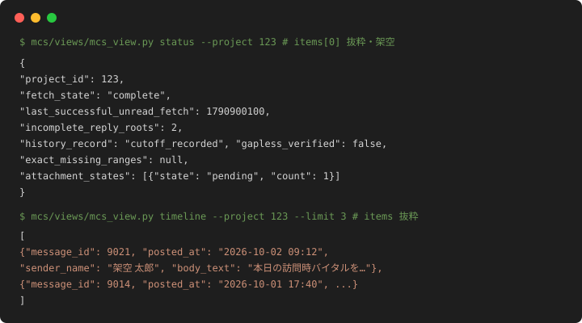

<a name="cli--処理の残数停滞の確認"></a>

**CLI — 処理の残数・停滞の確認**

```bash
python3 mcs/ops/mcs_setup.py doctor
python3 mcs/ops/semantic_observe.py
python3 mcs/ops/semantic_observe.py --json
```

doctorの運用表示は保存済みの状態を使い、集計の古さや未確認値を区別します。
詳細診断はDBを読み取り専用で集計し、新着・履歴・抽出品質チェックの待ち件数、
再試行時刻待ち、保存されている失敗の件数を分けて示します。失敗件数だけで現在も障害が続いているとは判断しません。
工程間では同じ投稿が重なるため、件数を合算しません。
旧抽出経路の対象候補数は、実行許可・他workerの処理中・再試行時刻を反映した実行可能数とは別です。

速度は、現在の設定とジョブ世代に一致する重複のない完了記録を、実際の経過時間で割って求めます。
直近1時間のうち同じ設定が続く記録を使い、設定変更をまたいだ処理や旧形式の実績は使いません。
見通しは5分以上・3件以上の完了実績があり、再試行待ち・保持された失敗・不明がない場合に限る条件付きの値です。
新しい仕事が増えず、設定・処理能力・観測速度が続くことを前提とします。新着が流入する工程の完了時刻は予測しません。

履歴収集の遅延は、失敗、長時間進展なし、再試行時刻待ち、直近に進展記録あり、記録不足を区別します。
遅延の記録がないことだけで全履歴の取得完了とは判断しません。詳細診断は通常10秒を上限として
SQLと集計の途中で期限を確認し、読取り量にも上限を設けています。超過は確認不能として終了コード2を返し、
途中の集計を0件や完了扱いにしません。OSのディスクI/Oや単一の解析処理は即時中断できない場合があります。
保持された完了・失敗ジョブも集計対象です。対象の本文を含む読取り総量が64MiB上限を超えると、
保持量が同じ間は再実行しても確認不能になります。最後に集計する現行監査の充足率だけが期限・読取り量の
上限を超えた場合は、他の集計を表示したうえで`--json`の`observation.status`を`partial`、
`current_quality.reason`を`observation_size_exceeded`などとし、終了コード2を返します。それ以外の集計で
上限を超えた場合は、全体が確認不能となり、`--json`の`reason`に理由が入ります。
通常のdoctorは保存済み状態から独立して確認できます。診断を通すために履歴を削除したり、欠測を0件と扱ったりしないでください。

通知の監視警告には、保存された待ち理由の内訳を表示します。doctorは通知の待ち件数を表示します。
予定時刻が先の通常シグナルも待ち件数に含みます。予定前のダイジェストは除外します。
1.0.21で数え漏れを修正したため、件数が増えて警告が出る場合がありますが、送信時刻・再送条件は変わりません。
通知カードの更新が待っている場合、前回の本文・添付の配送完了待ちと、配送結果が不明で照合待ちの状態を分けます。
結果不明の通知を自動再送する条件は変わりません。日次ローカルバックアップの「検証記録と一致」は、
保存ファイルと既存の検証記録の一致を示します。その場での再検証や端末外のバックアップ成功を意味しません。

**CLI — アラートシグナル（`mcs_view.py signals`）**

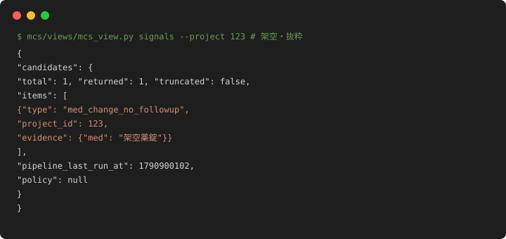

## このシステムが助けること

医療・介護の現場で起きがちな問題に対応します:

- **見逃しを減らす** — MCS を開いて巡回しなくても、新しい連絡が
  通常10分以内に Discord / Slack に届きます
- **「あの話はいつだっけ」をすぐ探せる** — 患者ごとの全履歴を保存
  するので、薬の話題が出た時期や経緯を全文検索・タイムラインで
  辿れます
- **フォローの抜けに気づく** — 「薬が変わったのに様子の記録が
  見つからない」「退院・転院の記録の前後で薬の変更が重なっている」
  など、目視では拾いきれないアラートを機械が列挙します
- **判断は人が行う** — 機械の整理結果は「候補」の提示まで。
  登録・確定は必ず人の確認を経ます

## できること一覧

| できること | 内容 |
|---|---|
| 新着連絡の通知 | 10分ごとにMCSを確認し、新しい投稿をSlack / Discord / LINE WORKSに転送。本文・添付はSlack/Discordのスレッド、LINE WORKSの連続投稿で確認 |
| 全履歴の保存 | 過去の投稿を遡って全件保存。途中で止まっても続きから再開 |
| 検索・タイムライン | 患者ごとの時系列表示と全文検索（日本語の表記ゆれに対応） |
| 内容の自動整理 | 薬・症状・依頼・バイタル値・検査値などを機械が拾って構造化 |
| 患者ごとの一覧 | 患者単位で「現在の薬・最新のバイタル・未解決の依頼・次回予定」をまとめて表示 |
| 統計 | 投稿量・職種別の内訳・薬剤関連の集計（元の記録を一切変更しない読み取り専用） |
| アラートの提示 | 「後続の記録が見つからない」等の候補を列挙（対応漏れの断定ではない） |
| 依頼の台帳 | 人が確認した内容だけを台帳に登録。MCSへ自動で送信することはない |
| チャットからの操作 | 確認・担当・タスク作成・患者の記録まとめ・検索など。Slack/DiscordはHermes addon経由、LINE WORKSは独自アダプター経由。Discordは `/mcs` コマンドにも対応 |


## 仕組み

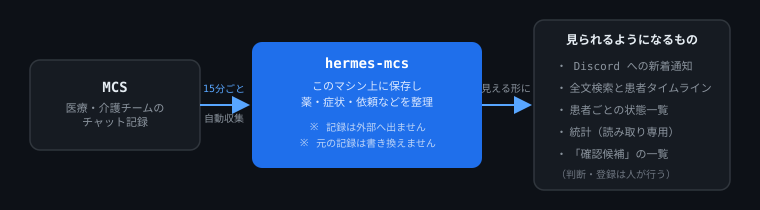

MCSサーバーの負荷対策として、自動取得を5分から10分間隔へ変更しています。

1. **収集** — 10分ごとに MCS を確認し、新しい記録をマシン上の
   データベースに保存します
2. **整理** — 保存した記録から、薬・症状・依頼・バイタル値・検査値などを
   機械が拾って構造化します（間違えることもあるため「候補」扱い）
3. **提示** — Slack / Discord / LINE WORKS 通知・検索・統計・アラートとして、人が
   見られる形にします

収集した記録の保存と構造化抽出はローカルで行います。通知を設定した
場合は本文・要約と送信対象の添付を Slack / Discord / LINE WORKS の設定先へ送ります。
任意の意味チェック・抽出監査を有効化した場合は、本文と必要なスレッド
文脈を TypeSafe Jev API へ送ります。「ローカルLLM」はシステム全体の
外部送信禁止を意味しません。

**実際に稼働している構成**

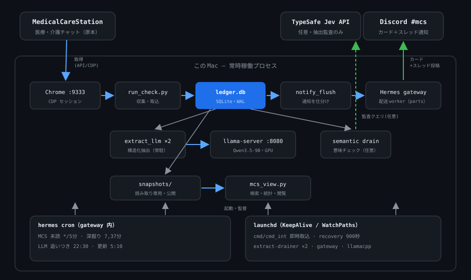

情報の行き先（AI の使用箇所・外部送信の有無）の詳細と現在の機能・運用上の制約は
[SECURITY.md](../../SECURITY.md)「人工知能（AI）の使用箇所と情報の行き先」「復旧と解析の限界」、
技術的な構成は[責務と依存](../development/REPOSITORY_STRUCTURE.md)、推論の処理経路は
[推論経路と処理結果の所有者](../development/LLM_RUNTIME.md)を参照。

## MCS データで何が追えるのか

### なぜ MCS データか — 既存データ源との補完関係

医療データ源はそれぞれ「見えるもの」が違う。MCS は診療行為の記録ではなく、
**診療と診療の間の多職種コミュニケーション**を残す:

| データ源 | 得意なこと | 見えにくいこと |
|---|---|---|
| レセプト | 診療行為・処方・算定・患者数 | 判断に至る過程 |
| 調剤・処方 | 何が処方・調剤されたか | なぜ変更されたか |
| 電子カルテ | 診療記録・検査・処方 | 施設横断の日常的連携 |
| 訪問記録 | 訪問時の評価 | 訪問と訪問の間 |
| **MCS** | **症状→共有→相談→判断→実施→再評価の流れ** | MCS 外の電話・診療等 |

優劣ではなく補完関係。MCS は「地域包括ケア・多職種連携のための
コミュニケーションツール」として設計されており、患者ごとの情報が
時系列で残り、施設・地域を越えて多職種が共有する点が特徴。

### メディカルチャットから縦断データへ


### 測定できること

7つの分野でデータが取れます。各項目を開くと、「何がわかるか」
「どんな場面で役立つか」が確認できます。

| 分野 | 得られるデータ例 |
|---|---|
| 🧑‍⚕️ 患者経過 | 症状、バイタル、状態変化、入退院、問題の反復 |
| 💊 薬物療法 | 開始、中止、増減量、期間表現、再評価 |
| 💬 多職種連携 | 誰→誰への相談、回答、判断、実施 |
| 🏥 組織間連携 | 薬局・診療所・訪看・居宅間のやり取り |
| ⏱ 時系列 | 対応時間、変化点、再発間隔 |
| 📊 業務 | 記録の集中、未解決依頼、長期滞留 |
| 🔎 確認支援 | 通常との差、フォロー記録不足候補 |

<details>
<summary>🧑‍⚕️ 患者経過 — 何がわかるか</summary>

**わかること**

- 症状の経過 — 「新しく出た」「続いている」「治った」「過去のもの」を
  区別して記録。「発熱なし」のような否定も症状ありと混同しない
- バイタルの値 — 体温・脈拍・呼吸数・血圧・SpO2・血糖の数値と
  その変化
- 出来事 — 訪問・検査・入院・退院・転院・転倒・終末期・ケア・
  家族連絡の10種に分類。「退院できません」は退院として誤計上しない
- 投稿の要点 — 各投稿の50字要約と「次に知るべき要点」最大3件
- 至急度 — 緊急を要する投稿か通常の投稿か
- 根拠の確認 — 各項目に本文中の根拠箇所が記録されるので、
  「どこを読んでそう判断したか」を原文で確かめられる

**役立つ場面**: 「あの患者の発熱、いつからだっけ」「退院の話はいつ
出たっけ」を遡って確認したいとき、長いスレッドを全部読まずに
要点だけ追いたいとき。
</details>

<details>
<summary>💊 薬物療法 — 何がわかるか</summary>

**わかること**

- 薬ごとの操作 — 開始・中止・増量・減量・変更の言及を薬剤名と
  用量つきで記録
- いつの話か — 現在飲んでいる・過去のもの・これから検討中、を区別
- 誰の薬か — 本人の処方か、家族の薬か、を区別（家族の薬が本人の
  処方として集計に混ざらない）
- 否定の言及 — 「もう使っていない」は中止として処理し、
  服用中として数えない
- 期間表現 — 「9/1-9/21」型の期間が書かれた処方の終了間近を検出
- 残薬・飲み忘れの兆候

**役立つ場面**: 処方変更の後に経過観察の記録があるか確認したいとき、
退院・転院の前後で薬の変更が重なっているか確認したいとき。
「ロキソニン」と「ロキソプロフェン」のような表記ゆれの統合は
まだできません（表記のまま集計されます）。
</details>

<details>
<summary>💬 多職種連携 — 何がわかるか</summary>

**わかること**

- 誰が誰に依頼したか — 依頼者・宛先・内容・期限を記録
- 職種ごとの関与 — 投稿者の職種（医師・看護師・薬剤師・ケアマネ等）と
  所属組織
- 会話の流れ — どの投稿がどの投稿への返信か、誰が話に登場したか
  （家族の発言・患者本人の声を区別）

**役立つ場面**: 「あの依頼、誰に出したっけ」「返事は来ていたか」を
確認したいとき、連携が特定の人に偏っていないか見たいとき。

**設計上の慎重さ**: 同じ患者のチャットルームに投稿しただけでは「直接
やり取りした」とは判定しません — 依頼・返信・記録された出来事の
つながりを証跡として扱います。
</details>

<details>
<summary>🏥 組織間連携 — 何がわかるか</summary>

**わかること**

- 施設をまたいだやり取り — 薬局・診療所・訪問看護・居宅・病院の
  間で交わされた投稿と返信の組み合わせ

**役立つ場面**: 「どの施設とどの施設が実際に連携しているか」
「紹介後に情報が届いているか」を記録から確かめたいとき。
</details>

<details>
<summary>⏱ 時系列 — 何がわかるか</summary>

**わかること**

- 投稿日時が確認できる記録を使い、以下を後から計算できる
  （日時不明の記録は区別して扱う）:
  - 相談から回答までの時間
  - 症状報告から対応までの時間
  - 同じ問題が繰り返し起きる間隔
  - 記録が集中した期間・変化が起きた時点

**役立つ場面**: 「連絡してから対応までにどのくらいかかっているか」
を振り返りたいとき、報告書・研究用に経過を時系列で整理したいとき。
</details>

<details>
<summary>📊 業務 — 何がわかるか</summary>

**わかること**

- 記録の集中 — 直近72時間で記録が急増しているチャットルームの検出
- 依頼の滞留 — 未完了のまま期限を過ぎた依頼、長期間未完の依頼
- 曜日・時間帯の分布 — 夜間や休日に連絡が集中していないか
- 投稿の偏り — 記録が特定の人に集中していないか

**役立つ場面**: 「見落としそうな依頼はないか」「夜間の連絡負担は
どのくらいか」を把握したいとき、業務量の偏りを見直したいとき。
</details>

<details>
<summary>🔎 確認支援 — 何がわかるか</summary>

**わかること** — 「確認した方がよいかもしれない」アラートを提示:

- 期限を過ぎた・長期間未完の依頼
- 薬の変更言及後に後続の記録が見つからない件
- 直近で記録が集中しているチャットルーム
- 期間表現の終了が近い処方
- 退院・転院の前後で薬の変更が重なる件

各アラートには「検出中→条件解消」の状態管理と、人による却下・
閾値変更（理由と操作記録つき）が付きます。

**役立つ場面**: すべての記録を読み返さなくても、確認が必要そうな
ところに絞って目を通したいとき。アラートは断定ではなく、必ず原記録の
確認を求める設計です。
</details>

### 蓄積・集計できるデータの全体像

このシステムにたまる情報を、性質ごとに分けた一覧です。
「記録されている」「機械が抽出した」「集計できる」「アラートとして表示する」
「人が承認した」は別物として区別して扱います。

#### A. 記録そのもの（元データ）

| データ | 内容 |
|---|---|
| 投稿メタ情報 | 投稿日時・投稿者名・職種・所属組織・どの患者のチャットルームか |
| 本文 | 全文。スレッドの親子関係（どの投稿への返信か）付き |
| 添付ファイル | ファイル名・サイズ・hash・取得状態。内部台帳には再取得用URLとローカル保存先も保持するため、閲覧権限を管理する |
| 取得状態 | 本文を取得済みか・一部だけか、内容hash（編集されたかの検知用）、最初に見つけた日時・最後に更新を確認した日時 |

#### B. 機械が自動で整理する項目（2レーン）

**スピードレーン・ルール抽出（全投稿・常時実行）** — 決まった文字パターンで拾う。
即時解析で通知・シグナルがLLM待ちにならない:

| 項目 | 内容 |
|---|---|
| イベント・日付 | イベント種別、訪問日、次回予定日 |
| 薬 | 薬剤名＋用量、開始/中止/増減量/変更、「9/1-9/21」型の期間表現 |
| バイタル | 血圧・体温・脈拍・呼吸数・SpO2・血糖 |
| 症状・服薬 | 症状の語、残薬・飲み忘れ等の兆候 |
| 依頼・登場者 | 依頼（宛先・内容）、家族の発言・患者本人の声・対話の有無 |
| 記録の形 | SOAP の各要素の有無、緊急度フラグ |

**品質レーン・ローカルLLM 抽出 v4（差分のみ・このマシン上で実行）** —
文脈を読んで整理。ルール抽出結果を候補としてプロンプトに載せ、
同じパスで `extract_v1` artifact も保証する（v1 の処理を v4 が兼務）:

| 項目 | 内容 |
|---|---|
| 薬 `meds` | 薬剤名・用量・操作（開始/中止/増減量/変更等）・**現在/過去/予定**・**本人の薬か家族の薬か**・投与経路（内服/外用/注射/点滴/吸入/経管）・頻度・頓服かどうか・否定（「使っていない」）・根拠箇所 |
| 症状 `symptoms` | 症状名・新規/継続/治った/過去・重症度（軽度/中等度/重度）・発症時期・期間・誰の症状か（本人/家族/その他）・否定・根拠箇所 |
| イベント `events` | 10種に分類（訪問・検査・入院・退院・転院・転倒・終末期・ケア・家族連絡・その他） |
| 依頼 `requests` | 誰へ・誰から・種別（依頼/確認/自分の予定）・内容・発動条件・期限（解釈した日付と本文表現の両方）・根拠箇所 |
| バイタル `vitals` | BT/HR/RR/SBP/DBP/SpO2/BS の数値 |
| 検査 `labs` | 本文に結果が明記された検査値（項目名・値・単位・基準外と明記された場合のみ高/低フラグ）。基準値の推測判定はしない |
| 返信 `reply` | スレッド返信の種別（承知/対応意思/進捗報告/回答/完了報告/取消）。親投稿や要約だけを見た投稿には付けない |
| 要約 `summary`/`points` | 50字以内の要約、次に知るべき要点（最大3件） |
| 緊急度 `urgency` | 至急（high）・通常（routine）・判断保留（unclear）の3値。high は本文引用の根拠 `urgency_evidence` が必須で、根拠が定位しない high は unclear に降格 |
| 根拠 `evidence` | 全項目に本文中の根拠箇所（完全一致引用）を記録 — 後から「どこを読んでそう判断したか」を確認できる |
| QC 注記（任意・既定OFF） | 本文の裏付けを別途判定。裏付け不足等は後続のローカル再抽出を1回行い、成功時に抽出結果を置換 |

**詳細な患者情報（新規・既存の全患者）** — 既存のルール／ローカルLLM抽出に、基本情報、診断、既往、経過、ADL、生活環境、介護度・サービス・担当者、連絡先、アレルギー、医療機器、療養意向、服薬管理、栄養、認知、副作用経過、検査・観測、フォローに加え、実施したケア・訪問、事故、排泄、皮膚・褥瘡、口腔、計画・目標・会議、指示・連携文書の26分類を扱います。明示された見出しの複数行は全文を保存し、見出しのない文章はローカルLLMが引用できる情報を追加します。長文の分割結果も統合します。

**情報の多い投稿の処理** — 見出し・段落などのまとまりと情報密度を使って、解析前に処理単位を分けます。短い投稿でも薬剤や検査値が多数あれば分割し、情報が少ない短文はまとめて処理します。原文は全て保持し、時間内に終わらない場合は完了した区間を再利用して続きを処理します。押した本人だけに表示する「患者の記録まとめ」で処理中・完了・要確認を確認できます。ここでの完了は機械による抽出処理の完了であり、医療情報の正しさや臨床対応の完了を意味しません。

各項目に原文値・根拠引用・出典を保持します。さらに実際の服薬・残薬／飲み忘れ・他院／市販薬／サプリ、副作用の薬剤・症状・時期・対応・転帰、検査値の日時・単位・条件、嚥下・自己管理・支援者／方法、変更後の経過・次回確認／担当／期限、薬の保管状況・保管場所・管理者、疑義照会・処方提案の結果、重複・相互作用の確認に加え、指示・認定・計画の期間、部位、食形態・とろみを35の原文属性で保存します。観測日・最終確認日・確認者・確認状態も記載がある場合だけ保持します。「なし」「未確認」「過去」「予定」などは原文のまま残し、現在の確定情報には読み替えません。患者の記録まとめは押した本人だけに背景情報の抜粋を表示し、基本情報・連絡先の分類はこの抜粋に追加しません。全文と以前の記載は既存の患者スコープの `mcs view timeline --project <ID>` / `mcs view evidence --project <ID> --message-id <ID>`、機械読取りは `mcs view read_model --scope detail --project <ID>` から参照できます。`aggregate` には分類・件数・取得状態だけを返します。分類と属性の正本・職種別語彙・未確認の範囲は[構造化契約](../specs/patient-context.md)にまとめています。取得・抽出できていないことは情報が無いことを意味しません。

**服薬管理の報告** — 患者の記録まとめの「服薬管理の報告」には、残薬・飲み忘れ・服薬支援・保管・管理者・照会結果・相互作用確認・次回確認の報告を、新しい投稿から最大8件（残りは件数）表示します。各行は値と元の文、対象者、投稿日（MM-DD）、投稿番号を示し、複数の薬が並ぶ報告の値を1剤に割り振りません。集約は最新100報告までで、最新の報告は現在の確定状態ではありません。本文や抽出が変わった報告は表示しません。

**以前の報告を抽出の参考に使う設定（既定off）** — `config.json` の `extract.patient_state_context` を `true` にした環境だけ、同じ患者の対象投稿より前の最大200投稿から、品質確認済みで本人についての曖昧でない報告を最大600文字の参考情報として抽出に渡します。参考情報は推論前に保存し、中断後の再開でも同じ内容を使います。抽出結果の値と引用は対象投稿の本文だけから取り、「前回と同じ」などの参照は参照先の番号として保存します。詳細表示・患者の記録まとめ・許可された薬剤項目のカード行では、参照元が変わっていなければ `（参照: 10-01「家族管理」）` のように元の値と日付を、変わっていれば `（参照先は更新済み）` を表示し、別の値に差し替えません。この設定は自動で有効にならず、実際のモデルでの効果は確認中です。

#### 患者コンテキスト作成（既定は有効）

保存済みの記録を少しずつ点検し、患者さんの背景や前回からの変化を原文根拠とともに整理します。新規導入・既存環境の更新とも、設定を省略した場合は生成と限定閲覧が有効になります。明示した `false` は変更しません。`config.json` の `extract` 内に次の設定を置きます。設定項目名 `patient_context_nightly` は旧名称（夜間の患者まとめ）のまま変わりません。値は文字列や数字ではなく、JSONの `true` / `false` で指定します。省略時はいずれも `true` です。不正な型や未対応の設定項目がある場合は両方を無効と扱い、設定診断で問題を示します。

```json
"patient_context_nightly": {
  "enabled": true,
  "publication": true
}
```

`enabled` は生成、`publication` は生成結果の限定閲覧を許可する設定です。生成だけを評価したい場合は `publication=false` を明示します。生成も止める場合は `enabled=false` を明示してください。閲覧を許可する場合も、既存の患者・原文への閲覧権限が必要です。共有チャットへの自動配信は行いません。新着抽出へ過去の情報を渡す `extract.patient_state_context` は別の設定で、既定の `false` を維持します。

処理は24時間行います。過去分を処理するLLMレーン3が各周回の最初に患者コンテキスト作成を進め、進める対象がなければ通常抽出・semantic/QCへ移ります。対象は、保存済みの投稿がすべて現行のLLM抽出世代で解析済みの患者だけです。未解析の投稿が残る患者は、その抽出が終わってから対象になります。A:差分反映、B:過去の記録の追加調査、C:根拠の再点検を60:30:10の暫定配分で巡回しますが、時間や完了件数の保証ではありません。更新中、モデル応答の障害検知中、設定変更後、メモリ・ディスクの不足時は新しい推論を始めず、途中の文章は公開しません。処理日の区切りは引き続き03:30（日本時間）です。初回に全患者を1日で終える保証はありません。

進捗と再試行までの待ち時間を保存し、中断した場合は次の周回で再開します。全範囲を点検済みで再点検理由がなければ、同じ文章を再生成しません。新しく見つかった過去の報告は、新しい患者状態の変化と区別します。削除・訂正・権限失効がある元記録に依存する文章を、現行の根拠として使い続けません。

確認には `python3 mcs/ops/mcs_setup.py doctor --probe data` を使います。初回未生成、差分待ち、過去走査待ち、根拠点検待ち、失敗、完了の件数を表示します。通常の `doctor` はDBを開かず「未確認」と表示します。診断できない場合も0件とは表示しません。解析済み割合は取得済み記録の点検範囲であり、患者状態の理解度や医療上の正確率ではありません。引用があるだけで意味の正しさが保証されるわけではなく、精度は独立した人手評価で確かめます。

第2入力源（LINE WORKS等）からの取得・患者統合は1.0.25では実装しません。将来、正式接続と閲覧権限、患者リンクの人確認、転載の重複抑制を整えてから追加します。既存の通知先としての対応とは別です。

#### C. 患者ごとのまとめ（rollup）

患者単位で再構築した現在の姿: 最新バイタル・処方期間の候補（規則抽出・未確認）・薬剤一覧・
直近の症状（「なし」の統合済み）・未解決の依頼（種別・条件・期限付き。
スレッドの返信状態 `reply_state` — 進捗・完了・取消の最新と矛盾フラグ）・
次回予定・MCS 連携サマリー（下記）・最終活動日時・投稿者の内訳・
他の投稿は更新確認されているのに一定期間（21日）更新確認されていない投稿のID
（`unrefreshed_message_ids`。削除の証拠ではありません。削除済みの件数は
`coverage.collection.deleted`）。

**連携サマリー（MCS カルテのサマリー、読み取り専用）** — 新着投稿を
保存した患者について、MCS 側の患者連携サマリーを GET で取得し
`karte_summary` artifact として保持します（1回の実行で最大12件・
POST・既読化は一切なし・失敗しても収集は止まりません）。対象投稿より
新しいサマリーは抽出の参照に使いません。未取得・最終取得から24時間以上のサマリーはdeep runでも再取得します（背景対象は合わせて最大10患者、段全体の上限12件・終了前60秒の余裕・失敗後6時間の待機は維持）。失敗時は最後の成功内容を保持します。`患者の記録まとめ`の行と
日次ダイジェストの更新件数にも反映されます。

**登録薬剤・検査／観測値の巡回取得** — `mcs setup init --yes --set clinical_metadata=true` で有効化します（既定false）。キャッシュ済みsessionで既存deep runからGETのみを行い、1回12GET／25秒・終了前60秒の余裕を維持します。本文抽出と別の出典で日時・単位・定義・取得状態・過去成功データを保存し、本人限定の患者まとめに取得状態と値の抜粋を表示します。詳しい原文・属性・履歴は `read_model --scope detail` に残ります。未完・未取得をデータ無しとは扱いません。

抽出世代が更新された場合は、現行世代の通常workerが対象の保管済み本文を順次再抽出します。対象・世代は各版の[変更履歴](../../CHANGELOG.md)を確認してください。見出しのない記載も対象とし、出力がlengthで打ち切られた場合はcheckpointを保存して細分化・再開します。token数・稼働枠は増やさないため、一度に全履歴の再解析が完了する意味ではありません。

#### D. アラートシグナル（12種）

記録から「確認した方がよいかもしれない」アラートを提示。対応漏れの断定ではなく、
各アラートは open→resolved（評価した検出条件の解消）の状態管理付き。
resolvedは人が確認・対応した証拠ではなく、カードの確認操作とも別です。

| アラート | 内容 |
|---|---|
| `request_overdue` | 期限を過ぎた未完了の依頼 |
| `request_aging` | 登録から長期間（既定30日超）未完の依頼 |
| `med_change_no_followup` | 薬の変更言及後、一定期間内に後続の記録が見つからない件（チャットルーム×薬） |
| `pharmacist_request_unanswered` | 薬剤師宛の依頼言及の後に、応答の記録が見つからない件 |
| `rx_request_visibility` | 他職種宛の処方関連依頼の言及を、先に把握するための情報 |
| `adherence_concern` | 飲み忘れ・残薬など、服薬管理の困難を示す言及 |
| `discharge_notice` | 薬の変更との重なりがない退院・転院の言及 |
| `symptom_after_med_change` | 同じ投稿に薬の変更と新規・継続症状が記録された件（因果関係は未確定） |
| `comm_concentration` | 直近72時間で記録が集中しているチャットルーム |
| `rx_period_expiry` | 「9/1-9/21」型の期間表現の終了が近い件 |
| `rx_period_lapsed` | 期間表現の終了日を過ぎても新しい期間表現の記録がない件（内服切れの可能性。終了後14日まで） |
| `transition_reconciliation` | 退院・転院の前後に薬の変更言及が重なる件（照合したかは人が判断） |

#### E. 依頼台帳（人の承認でのみ登録）

件名・担当者・期限・状態（未着手/対応中/完了/取消）・版・元記録へのリンク・
操作記録（誰が・いつ・理由）。機械が勝手に登録・変更することはない。

#### F. 集計統計（一覧は [DEVELOPMENT.md](../development/DEVELOPMENT.md)「統計（読み取り専用）」参照）

投稿量・職種内訳・曜日×時間帯の分布・投稿の集中度・薬剤の月別言及・
後続記録が確認できない件数・依頼の滞留・退院前後の薬変更の重なり 等。

#### G. 閲覧・検索の切り口

本文の全文検索（日本語対応）・患者タイムライン・スレッドの時系列・
添付一覧・抽出候補の一覧・open-loop 候補 — すべて読み取り専用で、
原本への書き戻しはしない。

#### H. 運用・監査の記録

収集の実行履歴・履歴取込の進捗（どこまで読んだか）・既読化の記録・
操作 receipt・通知の送信キュー・Jev 呼出量（日次上限の内訳）。

既読化を指定した定期収集では、直近7日以内に保存した返信のスレッドを最大10件確認し、
未保存・抜粋のみの返信を先に取得します。ただし、保存済みの抜粋が取得の再試行上限に
達した場合は補完を諦めて既読化を進め、未保存の返信が残る場合は既読にしません。
返信の既読化は収集時点に
限定できないため、確認後に届いた返信も既読になる場合があります。読取り時に
見つかった追加返信は取得ジョブへ登録します。患者単位の既読化は保存完了と
snapshot timestampの条件を維持します。

### 医薬品マスターによる薬剤候補の確認

薬剤名の原文と、承認・固定した辞書からの候補を分けて表示します。
カードと専用スレッドの自動要約には薬名・用量・変更内容を表示し、長い辞書候補の説明は追加しません。
詳細は「薬剤を確認」「薬剤を検索」を押した本人だけに展開します。Slackは配送が確認できたカードのチャンネルで本人だけに開き、本文がスレッドに続くカードと元のスレッドへの返信カードではそのスレッド内に開きます。Discordは対象投稿の本文に付いた薬剤ボタンから開きます。
1投稿1カード形式の「薬剤を確認」は、そのカードの投稿の薬剤記載だけを開きます。従来のまとめ形式では最初に最新の薬剤記載を開き、「古い投稿」「新しい投稿」で同じスレッドの薬剤記載を選べます。選択中の投稿の日付・時刻・職種を表示し、複数投稿がある場合は投稿位置も表示します。別スレッドの投稿へは移りません。
薬剤は1ページ最大5件。「次の5件」「前の5件」で全件を確認でき、現在のページと総件数を表示します。移動ボタンも本人だけに表示し、共有のカード・本文は増やしません。
Slackのスレッドを無効にした場合や作成失敗・削除が記録された場合は薬剤ボタンを表示しません。本文の配送がまだ確認できない場合は待機・管理者への確認を案内し、詳細をチャンネル直下へ流しません。
スレッドに返信があるカードでは、Slackのカード面で投稿ごとの 💊 を押した回答はスレッド内に表示され、チャンネル側には「結果をこのカードのスレッドに表示しました」の案内だけが本人に出ます。スレッドに返信がないカードでは、Slackがスレッド内の本人向け表示を出さないため、回答をチャンネルの最新位置に本人だけへ表示します。Discordでスレッドを無効にした場合は、薬剤の記載がある投稿ごとの 💊 ボタンがカードの操作行に並びます（投稿が複数なら投稿時刻がラベル）。
LINE WORKSには実スレッドがないため、従来どおりBotとの1:1トークで表示します。
患者の記録まとめと読取り専用の詳細出力には現行の候補を併記し、導出処理が辞書切替・無効化をDBに記録した後、または進捗記録が不正な場合は、古い候補を表示しません。読取り専用の出力はそのsnapshot内の世代に従うため、実運用の変更を反映するには新しいsnapshotが必要です。
成分・一般名処方・製品は別の候補です。同じ成分の薬や確定した処方へ自動統合しません。

ローカルの共通CLIで次を確認できます。辞書未設定なら設定済みの私有辞書か、明示した絶対パスとSHA256が必要です。

```bash
mcs drug lookup "架空薬A錠5mg" --dictionary /private/path/master.json --sha256 DICTIONARY_SHA256
mcs drug search "架空薬A" --dictionary /private/path/master.json --sha256 DICTIONARY_SHA256 --limit 20
mcs drug compare --before /private/path/old.json --before-sha256 OLD_SHA256 --after /private/path/new.json --after-sha256 NEW_SHA256
mcs drug impact --before /private/path/old.json --before-sha256 OLD_SHA256 --after /private/path/new.json --after-sha256 NEW_SHA256
```

`lookup`は一致候補と出所を表示します。`search`は名称・別名・識別子の参照検索で、規格・剤形が未指定でも候補を確認できますが、照合済みと扱いません。
`compare`は追加・削除・名称・別名と新しく生じた複数候補を示し、更新を承認・適用しません。
`impact`は公開snapshotにある現行の薬剤名を更新前後の辞書で照合し直し、「新たに候補あり」「候補なしに変化」「複数候補に変化」などの件数と、件数の多い薬剤名を示します。投稿や患者は表示せず、未抽出・形式不正の投稿は未評価として別に数えます。件数は辞書照合の変化であり、診療上の問題件数ではありません。`--snapshot`省略時は既定の公開snapshotを読み、DB・辞書・設定は変更しません。
`--json`は構造化出力、`--limit 0`は件数中心の確認です。表示上限は0〜200件で、候補や差分を省略しても全件数を示します。
未承認の辞書も照会では参考として表示しますが、自動の薬剤注釈には採用しません。

薬剤統計には成分・一般名処方・製品の候補別言及を併記します。未照合・複数候補の薬名は辞書の確認対象としてまとめ、辞書未設定・無効・未導出・破損は別に示します。
候補は言及の集計であり、服用数・処方数・臨床的同等性を示しません。新しい項目をC1出力へ追加しません。
公式医薬品マスター原本は[配布資産](../../resources/drug-master/README.md)としてシステム更新とともに同梱します。毎回のリリース準備で公式版を確認し、更新があれば同じリリースへ取り込みます。同梱だけでは私有辞書を有効化しません。

##### 同梱マスターを辞書として使う

同梱の公式医薬品マスターから、上記の照会・検索・薬剤候補に使う私有辞書を作れます。通信は行いません。

```bash
mcs drug install-bundled --terms-checked-on 2026-10-11 --confirmed-by 担当者名 --approved-by 承認者名
mcs drug status
```

1. `--terms-checked-on` には、運用者が[厚労省の利用条件](https://www.mhlw.go.jp/chosakuken/index.html)を確認した日を入れます。同梱物の記録から自動では埋めません。
2. `--confirmed-by` には、変更区分（0=変更なし・3=新規・5=変更を候補にし、1=抹消・9=廃止は除外）と日付の番兵（99999999=廃止なし、0=期限なし）の扱いを[R08rec1](https://shinryohoshu.mhlw.go.jp/shinryohoshu/file/spec/R08rec1.pdf)で確認した運用者を入れます。
3. `--approved-by` を付けると、カードの「薬剤を確認」「薬剤を検索」と自動の薬剤候補注釈に使える承認済み辞書になります。省略すると照会・参考検索だけに使う未承認辞書です。
4. 辞書は `data/drug-map/` に所有者だけが読める新規ファイルとして作られます。同じ入力で再実行しても上書きせず、既存の同じ辞書を示します。作成基準日・次の見直し日・将来の候補開始/終了行数も確認してください。候補の対象日が来ても作成済み辞書は自動更新されません。最終使用日は当日を含み、翌日から候補対象外になります。
5. 設定・DB・稼働中のサービスは変更しません。表示された `mcs_setup.py init --set 'drug_map=...'` を実行すると、保存前に辞書の実体とSHAを照合します。不在・不一致なら既存設定を保持して拒否します。正しい設定への切替後は、次回の定期処理から既存の投稿の薬剤名を順に照合し直します。切り替え前に `mcs drug compare` / `mcs drug impact` で現在の辞書との差を確認できます。

`mcs drug status` は、同梱されている版と設定中の辞書を比べ、未設定・同梱版と異なる原本・未承認（参考のみ）・承認済みを表示します。同じ原本でも見直し日に達した場合は再作成を案内し、作成基準日がない旧辞書や未来の日付は確認が必要と表示します。必要な日に`install-bundled`で作り直し、差分を確認してから設定を切り替えます。旧辞書とpath/SHAの組は保持し、戻す場合はその組を再設定します。読取り障害では古い候補を抑制して原薬剤名を保ち、復旧後の定期処理で再照合します。
実masterの採用・更新担当・承認・有効化手順は[出所と変換境界](../specs/official-drug-master.md)で確認してください。

##### 公開医薬品情報の照会（添付文書・ガイドライン）

同梱マスターの品名を起点に、PMDAの添付文書とMindsの診療ガイドラインを照会できます。通常はこのMacのローカルTinyFish無料ゲートウェイ（`127.0.0.1:3149`、そのローカルトークン）を使います。トークンファイルが存在しない場合に限り、認証不要の無料Exa MCP（`https://mcp.exa.ai/mcp`）へ切り替えます。どちらもプロキシ・リダイレクトを使わず、大きさと時間に上限があります。不正なトークン・認証拒否・無料枠上限・一時通信障害では切り替えません。取得できない場合は照会失敗であり、「該当なし」ではありません。

Exa経路は合成応答に加え、公開マスターの1品名でPMDA添付文書の本文取得、一般疾患名1件でMinds検索を限定確認しています。取得内容の医学的な正確性や全品目での取得を確認したものではありません。取得日時・cache状態は不明として扱い、強制再取得やETag確認を必要とする定期更新確認は `web_freshness_unavailable` で未取得にします。更新なしとは扱わず、PMDA・Mindsの原典を別途確認してください。

```bash
mcs drug info-lookup 'アムロジピンOD錠2.5mg「トーワ」'
mcs drug info-guideline 高血圧
mcs drug info-master
mcs drug formulary-add --list 採用薬.txt
mcs drug formulary-list
mcs drug formulary-ack 'アムロジピンOD錠2.5mg「トーワ」' --sha256 <確認した本文のSHA256>
```

1. 送信するのは、同梱マスターの販売名か一般名の標準記載と完全に一致し、1品目に決まる名前だけです。一致しない・複数品目に当たる名前は送信せず、手元でマスターから候補を示します。患者の投稿・属性・台帳・私有辞書は読まず、送りません。投稿をきっかけに自動で照会しません。
2. `info-lookup` はPMDAを1回検索し、添付文書PDFを最大3件まで順に取得して、マスターの販売名が本文にある文書だけを「found」とします。どれにも名前がなければ「unconfirmed」で、使えません。結果は改訂版・本文のSHA256・一部の抜粋（禁忌・相互作用・用法及び用量・重要な基本的注意）です。抜粋は節の全体ではなく、臨床上の指示でもありません。必ず原典を読んでください。
3. `info-guideline` は一般の疾患名だけを受け付けます（数字・ID・日付・アドレスは拒否）。文字の検査では私的な内容を見分けられないため、患者の文や氏名を入れないでください。結果は検索結果の一覧で、ガイドライン本体を読んでから使います。
4. `formulary-add` は採用薬の一覧（1行1品名）を、送信前にすべて手元で照合します。1回の処理件数に上限があり、登録済みは飛ばし、無料枠・認証の問題で止まります。複数の規格が同じ添付文書の場合、既存の登録を置き換えません。登録は `data/drug-info/` に所有者だけが読めるファイルとして保存します。
5. 毎日の更新確認（`mcs_update check`）で、公式医薬品マスターの公開一覧と同梱版を比べ、登録した添付文書を古い順に最大3件確認します（ETagが使えるサイトは変化がなければ本文を受け取りません）。新しいマスター版・不一致・添付文書の本文の変化は、更新通知と同じ経路で1回だけ通知します。確認できなかった場合は通知せず、`formulary-list` に結果を残します。確認できないことを「更新なし」とは扱いません。本文の変化は内容が誤りになったという意味ではないため、読み直してから `formulary-ack` で受け入れます。受け入れるまで同じ変化を報告します。中断した更新の復旧や承認済みの適用・ロールバックを行う回は、その処理を遅らせないよう照会を飛ばし、次の回に確認します。
6. 公開一覧の比較は早期の合図です。リリース時の公式原本ZIPの照合（release-mcs）の代わりにしません。定期確認を止める場合は設定に `drug_info_watch: false` を追加します。

#### まだ取れないもの（「取れない」と「ゼロ」を区別）

| 項目 | 状態 |
|---|---|
| アドヒアランス問題の極性つき集計 | 材料（`valid_facts`）未整備 → 統計は `unavailable` を返す |
| 薬剤名の成分レベル正規化 | 表記を保持し、辞書の成分・一般名処方・製品候補を別々に併記する。照会・参照検索・更新差分は上記CLIで確認できるが、服用・治療上の同等性は推定しない。辞書未設定時は表記のまま集計 |
| 本文由来の依頼滞留の経過日数 | 紐付け（`interaction_links`）未整備 → 正式依頼のみ集計 |

「対象なし（0件）」と「情報不足で判定不能」は別の結果として表示します。

### メッセージではなく症例経過


hermes-mcs はこの流れを単なる6投稿としてではなく、
**症状 → 評価 → 提案 → 判断 → 実施 → 再評価** という一つの症例経過として
扱う。型付きイベントと薬剤アクションの共起解析
（`transition_reconciliation` 等）がこの復元を支える。

### 多職種連携の解析

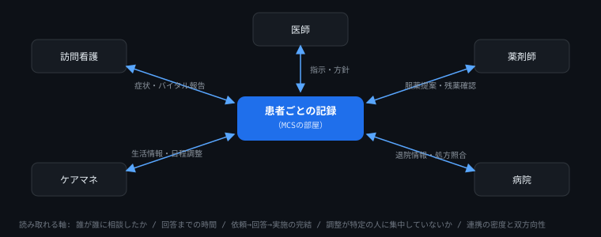

すべての職種が同じ患者の記録に書き込むため、「誰が誰に相談したか」
「相談から回答までの時間」「依頼が回答・実施まで完結したか」
「調整役が特定の人に集中していないか」といった連携の形を記録から
読み取れます。

> **注意**: この図はつながりの模式図です。実際の解析では
> 「同じ患者のチャットルームに投稿しただけ」では直接のやり取りと判定
> しません — 依頼・返信・記録されたイベントのつながりを使います。

### 縦断症例解析

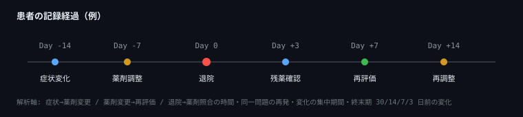

解析可能な軸: 症状→薬剤変更までの時間、薬剤変更→再評価までの時間、
退院→薬剤照合までの時間、同一問題の再発、薬剤変更・多職種連携が
集中する期間、終末期 30/14/7/3 日前の変化。

### 予見シグナル — 進行中の記録から「要確認」を自動で拾う

新しい記録が入るたびに、あらかじめ決められた条件に合うものを
**「確認した方がよいかもしれない」アラートとして一覧に挙げる**機能です。
すべての記録を読み返さなくても、確認が必要そうな箇所に絞って
目を通せます。

| 拾うもの | どんな条件か |
|---|---|
| 期限切れの依頼 | 依頼台帳で期限を過ぎたまま未完了のもの |
| 滞留した依頼 | 登録から30日超（変更可）経っても未完のもの |
| 薬変更の後続なし | 薬の変更言及から7日以内に後続の記録が見つからない |
| 記録の急増 | 直近72時間で投稿が閾値を超えたチャットルーム |
| 期間終了間近 | 「9/1-9/21」型の期間表現が3日以内に終了するもの |
| 期間終了後の更新なし | 期間表現の終了日を過ぎても新しい期間表現の記録がないもの（内服切れの可能性） |
| 退院前後の薬変更 | 退院・転院の±14日に薬の変更言及が重なるもの |

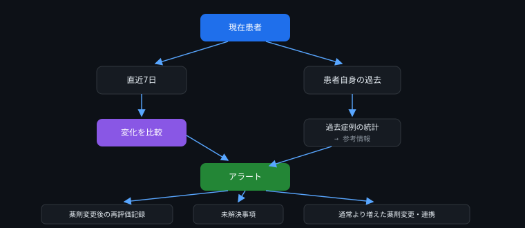

**「未来を予測する」機能ではありません。** 過去の統計から条件を
学習する仕組みはなく、条件は固定値または人が承認した変更のみ
です（`signal_policy` コマンド + 理由 + 操作記録が必須）。
「後続の記録が見つからない」はその通りに報告するだけで、
「対応がなかった」とは断定しません — アラートは必ず原記録での
確認を求める設計です。

### 出力イメージ


*Synthetic example — 架空データ。実患者データではない。*

### データが意味しないこと

- **MCS に記録がない ≠ 実際に行われていない**
- 投稿数が多い ≠ 患者が重症
- 薬剤名が記録された ≠ 現在服用中
- 薬剤変更後に改善した ≠ 変更が改善の原因
- 多職種が多い ≠ 良い/悪い連携
- warning なし ≠ 患者が安全

hermes-mcs は記録から確認できる事実・経過を構造化するシステムであり、
MCS 外の診療事実を自動補完しない。
