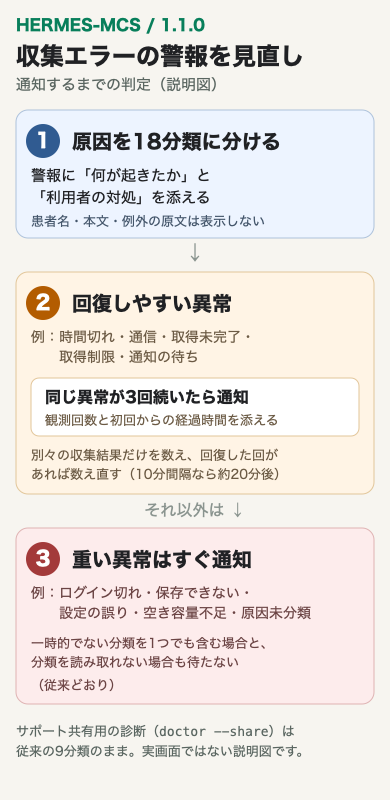

## [1.1.0] — 2026-10-26

**収集エラーの細かい分類と一時的な警報の抑制、DB容量・稼働状況の確認を追加し、返信カードと独立実行の不具合を修正**

この版では、収集エラーを原因ごとに分類して対処を示し、自然に回復しやすい異常は3回続いたときだけ通知するようにしました。DB容量・バックアップの内訳や稼働状況を確認できるようにし、Slack・Discordの返信カード、独立実行の停止・再接続、初期設定と更新・復旧の安全性も見直しています。状態監視・遠隔支援（CSDC）のコードは同梱しますが、新規導入では既定で無効で、この版では接続しません。

> 更新前の確認：Hermes gateway、使用中の独立実行のhost・worker・LINE WORKSアダプター、抽出workerの再起動が必要です。すでに `sdc.enabled=true` を設定している環境は、この更新で停止・変更されません。公開医薬品情報の照会は、TinyFishのトークンファイルがない環境では外部のExa MCPへ薬品名などを送るようになります（患者情報は送りません）。

| 場面 | これまで | この版 |
|---|---|---|
| 収集エラーの警報が出た | 原因の分類は9種で対処の案内がなく、すぐ回復する時間切れや通信の失敗でも1回で警報が出る | 18分類ごとに何が起きたかと対処を表示し、自然に回復しやすい異常は同じ異常が3回続いたときに通知 |
| DBやバックアップの容量が気になる | health.jsonでは容量の内訳と保守の遅れが分からない | DB本体の使用量・空きページ量、バックアップの種類別容量、日次・週次保守の経過時間を確認でき、日次保守が2日以上完了しないと警告 |
| 返信カードの本文・操作を使う | 同じ内容の返信が別の投稿の本文を再利用することがある | 本文・薬剤詳細・タスク・スタンプなどを、そのカードの投稿に合わせる |

### 新機能

- **DB容量とバックアップの内訳、保守の遅れを確認**
  health.jsonの早期警告に、DB本体の使用量と空きページ量、バックアップの種類別容量、日次・週次保守の経過時間を追加しました。日次保守が2日以上完了していない場合は `db_maintenance_overdue` を表示します。表示を追加しただけで、削除・保持期間・VACUUM・全体の判定は変わりません。

- **稼働状況の書き出しと、共有用の診断表示**
  `mcs/ops/status_snapshot.py` が、MCSの稼働状況（全体状態・収集・通知・AI解析・バックアップ・ディスク）と、このMacのCPU負荷・メモリー・スワップ・ディスク・起動時間・ローカルAIの応答・ネットワーク・MCS/Hermesのジョブを、数値と状態コードだけのJSONにまとめます。ローカルAIを別のポートで動かしている環境では設定した接続先を確認し、制限時間を超えた秒数は小数のまま記録します。書き出しには患者情報・本文・ホスト名・IPアドレスを含めず、送信もしません。`mcs_setup.py doctor --share` では、状態・固定分類のエラー数・実行方式と環境の版・配置済みと読込み中のコミットID・作業ツリーの変更有無・収集の観測時刻などを、サポートへ共有する前にJSONで確認できます。患者件数・投稿時刻・任意の設定値・プロセスID・パス・例外の原文は含めず、自動送信やクリップボードへの書込みはしません。

- **TinyFishがない環境でも公開医薬品情報を照会**
  TinyFishのローカルトークンファイルがない環境では、無料・認証不要のExa MCPでPMDAの添付文書とMindsのガイドラインを照会します。送るのは同梱の公開マスターと一致した薬品名・一般的な疾患のキーワード・公式URLだけで、患者のデータや私有辞書は読みません。取得できない本文を要約で代用せず、照会の失敗と該当なしを区別します。取得した内容の医学的な正確性は評価していないため、人が原典を確認する前提は変わりません。

- **初期設定の保存前に、送信先と保存内容を確認**
  対話での初期設定では、通知先・送る情報・追加解析・認証情報の保存操作を確認してから保存します。この確認で空欄・拒否・中止を選んだ場合、今回の設定・認証情報・辞書は保存しません。`--yes` での質問なしの実行は変わりません。

### 改善

- **通知の復旧を複数の添付でまとめて行う**
  Slackの添付説明を更新する前に止まった記録が複数ある場合も、全対象の証拠が揃えば、まとめて未送信と確定し、現在の内容への編集計画を作れます。いずれかの照合に失敗した場合は全件を保留します。人が配送先と証拠を確認したカード本体の復旧も、SlackとLINE WORKSで版の不一致により拒否されなくなりました。自動の解除・再送はせず、人の承認付きの既存の復旧コマンドで行います。

- **内部処理の整理と読取りの削減**
  収集・抽出・意味チェック・通知・閲覧・統計・更新・復旧・バックアップ・独立実行で重複していた判定や読取りを共通化し、使われていなかった処理を削除しました。結果・表示・エラーの種類・保存形式・既定値は変わりません。ただし次の点は動作が変わります。連携サマリーは取得予定の解除と同時に保存し、余分な再取得をなくしました。照合値（sha256）が壊れた添付の記録は、内部エラーではなく「未検証」として送信しません。独立接続の添付は、ファイルを読む時点でも保存先の中にあるかを確認します。緊急度を「通常」と判定済みの投稿は、追加の読取りをせずに判定を終えます。

- **版番号の付け方**
  今後は「メジャー.機能アップデート.バグフィックス」の順に採番し、機能の追加は2桁目、互換性のある不具合修正は3桁目を上げます。既存の公開版・タグは変更しません。

### 不具合修正

- **返信カードの本文・操作・配送先を投稿ごとにそろえる**
  Slack・Discordで、同じ内容の返信が別の投稿の本文を再利用する問題を直しました。Slackの返信カードの薬剤詳細・返信の保存済み件数・タスク一覧・誤りの報告・スタンプメニューも、そのカードの投稿に合わせます。Slackの返信履歴に別のスレッドが記録されている場合や、添付サイズが整数でない場合は、配送済みとの照合や更新に使わず保留します。投稿別カードの更新先が確認後に消えた場合も、配送完了とは記録しません。

- **Slackの長い本文を送信時の容量も考慮して分割**
  日本語や記号を含む長い本文を、送信時の文字変換後の容量も考慮して分割します。原文を切り捨てず、上限を超える古い計画は送信前に止めます。

- **独立実行の停止・再接続・再起動で処理を取りこぼさない**
  Slack・Discordの独立実行で、停止や再起動の予約中は新しい操作・配送を受け付けず、すでに始まった操作と配送が実際に終わるまで待ってから接続を閉じます。受付が閉じる途中に完成した閲覧操作の回答も送ります。前のホストが残した処理を識別できない間は、その処理を重複して起動しません。

- **導入・更新・復旧の失敗を正しく扱う**
  導入済みのMCS管理のAIモデルも固定のSHA256と照合し、空や破損のファイルを取得済みとして扱いません。更新が中断して旧コードが削除された後も復旧を続けられ、復元の承認がすでにある場合は `restore_approval_exists` と表示します。更新前のタグ確認で通信に失敗した場合は、「タグが変わった」ではなく通信の失敗として報告します。Hermes経由のSlack・Discordの初期設定では、通知先の設定を準備してから接続サービスを起動します。導入先のパスに空白を含む場合も、ローカルAIの日次再起動スクリプトが正しい場所にログを書きます。

- **検査値の統合と添付文書の変更通知**
  長文を分けて解析したとき、同じ検査名・測定日でも値・単位・根拠が異なる結果を上書きしません。日付で順序を決められない複数の値は残し、最新値として1つに断定しません。添付文書の変更通知の取込みに失敗した場合は、次回の再取得の対象から外れていても再び提示します。

- **開発者向け：検証と比較で不完全な結果を合格にしない**
  固定版Hermesを使うローカル検証は、依存環境以外に未コミットのソースがあると停止します。推論比較では出力上限で中断した応答を有効な件数に含めません。

### 動作・設定の変更

- **収集エラーを細かく分類し、一時的な異常は3回続いたときに通知**
  監視の警報では、ログイン・認証、時間切れ、通信、保存など18の分類ごとに、何が起きたかと利用者の対処を表示します。時間切れ・通信・取得未完了・取得制限・通知の待ちなど自然に回復しやすい異常は、別々の収集結果で同じ異常が3回続いたときに通知し、観測回数と初回からの経過時間を添えます。収集は通常10分ごとなので、通知は初回からおよそ20分後になります。ログイン切れ・保存できない・設定の誤り・空き容量不足などの重い異常と、一時的でない分類を含む場合は、従来どおりすぐ通知します。分類ごとの対処は[収集の診断](https://github.com/yusuketakuma/hermes-mcs/blob/v1.1.0/docs/guides/COLLECTION_DIAGNOSTICS.md)にまとめています。

  

  警報を出すまでの判定を示す説明図です（実画面ではありません）。

- **本文が読めない投稿の「緊急度: 高」は要確認として表示**
  AIが緊急度を高と判定した投稿で、元の投稿の本文を取得できていない場合は、「緊急度: 要確認」として保留表示します。以前はこの行を表示していませんでした。本文で裏付けられない判定を「高」として表示したり、新しい緊急通知を送ったりはしません。

- **親のスレッドを確認できない返信カードはチャンネルへ投稿しない**
  返信カードの元のスレッドを確認できない場合、6時間待った後もチャンネルへ独立して投稿せず、保留します。親が作り直されて既存の返信と対応しなくなった場合も、送信記録を残して保留します。

- **状態監視・遠隔支援（CSDC）はコードのみ同梱し、新規導入では無効**
  1.1.0では、状態監視・診断の送信・遠隔支援・遠隔再起動（CSDC）を有効にして提供せず、顧客への接続も行いません。コードは同梱しますが、新規導入では `sdc.enabled` が未設定のため専用ジョブは登録されません。現在の設定でCSDCが無効・未設定、または保存先が一致しない場合は、残っているジョブからも新しい送信を始めません。初期設定の最後に出していたCSDCの登録案内も既定で表示せず、`mcs setup features` で表示するかどうかを選べます。この選択は案内の表示だけを決め、登録・同意・送信は行いません。

### 更新時の注意

- 通常の更新手順（[更新ガイド](https://github.com/yusuketakuma/hermes-mcs/blob/v1.1.0/docs/guides/UPGRADE_AGENT.md)）で、Hermes gateway、使用中の独立実行のhost・worker・LINE WORKSアダプター、抽出workerを再起動してください。返信カードの新しい配送の取り決めは、旧workerでは保留されます。Gitの差分だけを直接反映した場合は、これらを再起動するまで旧コードが動きます。`deployment/` 配下（ローカルAIの日次再起動スクリプト・復旧ツール）は、更新手順でサービス定義や復旧ツールが配置し直されたときに反映されます。

- 抽出・意味チェックのコードが変わるため、候補識別値と抽出の更新契約が1回変わります。以前の候補の承認・保留の記録は現行の候補との再照合が必要になる場合があり、旧契約で保留された記録は更新後に1回再試行されます。保存済みの抽出・判定の結果を書き換えたり、全投稿を再解析したりはしません。設定・臨床閾値・抽出世代は変わりません。

- 更新の直後は回数を数え直すため、一時的な異常の最初の通知は更新後に3回観測されてからになります。

- CSDCについて：すでに `sdc.enabled=true` を設定している環境を、この更新が自動で停止・変更することはありません（停止は別の明示操作です）。`optional_features.csdc` は案内の表示だけを決める設定で、通信を止める設定ではありません。すでに送信を始めたHTTP要求をすぐに回収できるとは限りません。登録案内を表示したい場合は、更新後に `mcs setup features`（PATHが未設定なら `~/.local/bin/mcs setup features`）で「案内を表示する」を選んでください。

- 公開医薬品情報の照会でExaへ接続するのは、TinyFishのトークンファイルがない場合だけです。トークンが不正・権限不足・認証拒否・無料枠の上限・一時的な通信障害の場合はExaへ切り替えません。Exaでは強制再取得とETagの確認ができないため、添付文書の定期的な更新確認は未取得として止まります。定期確認は従来どおり `drug_info_watch: false` で止められます。

- 導入済みのAIモデルが固定版と一致しない場合、導入・更新は既存のモデル・取得途中のファイル・起動設定を残して停止します。出典と内容を確認し、固定版のモデルを準備して再実行してください。自動の削除・上書き・再取得はしません。自分で管理するAIサーバーは従来どおり `--no-llm` を指定します。

- 対話での初期設定では、保存の確認に「はい」または1を選んでください。通知先の準備に失敗した場合は、保存済みの設定を残して接続サービスの起動に進まずに止まります。保存先の権限と空き容量を確認して `mcs setup` を再実行してください。

- Slackの長い本文は、最新の計画で長さの超過が確定し、新しい上限も超えると保存記録から確認できる本文だけを通常の巡回で計画し直します。本文の分割数が増える場合があります。他の部品に送信結果不明が残るカードは、その確認が済むまで保留します。結果不明の配送の自動再送や、過去の投稿の一括再配信はしません。

- 独立実行では、前のホストが残した処理を識別できない間はその処理の再起動を保留し、同期処理が戻らない場合は安全のため停止待ちを続けます。Hermes経由の動作は変わりません。

- 推論比較の過去の結果に正常終了以外の応答が含まれる場合は、変更後の集計条件で確認してください。

### 技術詳細

技術詳細・根拠を表示

#### 複数添付の未送信をまとめて確認して復旧する

- 同一カードの最新計画にある未確定集合と、主plan・related_plansの完全一致を必須にする。各添付について独立した送信前拒否のjournal証拠と一意な既存送信先を照合する。
- 同一transactionで全件を確定し、既存投稿への編集専用計画を一つだけ作る。途中失敗時は全件を戻し、新規投稿やファイル再アップロードへ切り替えない。
- 人承認、worker停止、患者・送信先境界、既存コマンドの16KB上限を維持する。card_part_plan --include-relatedは識別情報だけを取得し、状態を変更しない。
- 根拠: mcs/notify/notify_recovery.py、mcs/views/mcs_view.py、docs/guides/NOTIFICATION_RECOVERY.md、tests/notify/test_card_part_resolve_batch.py

#### 収集エラーを細かく分類し、一時的な異常は3回続いたときに通知

- エラーは、ログイン・認証、閲覧権限、ブラウザ接続の準備、取得制限、時間切れ、時間内に終わらず先送り、通信、MCS側の応答異常、応答形式、保存、取得未完了、添付の取得、補助情報の取得、操作の取込み、設定、収集後の処理、実行基盤、その他・原因未分類に分けます。分類ごとの対処は docs/guides/COLLECTION_DIAGNOSTICS.md にまとめました。
- 3回は別々の収集結果を数えます。同じ結果を読み直しても数は増えず、異常が消えた回があれば数え直します。収集は通常10分ごとなので、通知は初回からおよそ20分後になり、通知には観測回数と初回からの経過時間を添えます。
- 収集の一部のエラーでも、ログイン・認証、閲覧権限、応答形式、保存、操作の取込み、設定、実行基盤、その他のような一時的でない分類を含む場合や、分類を読み取れない場合は、待たずにすぐ通知します。
- 回数の記録が壊れている・読めない場合は待ちません。記録を保存できなかった回は待たずに警報文を出力しますが、チャットへは送らず配送失敗として記録します（従来どおりの動作です）。
- サポートへ共有する診断（doctor --share）は従来どおりの9分類のままで、形式は変わりません。患者名・投稿本文・例外の原文は表示・共有しません。
- 根拠: mcs/ingest/collection_diagnostics.py、mcs/ingest/health_watch.py、mcs/ops/mcs_setup.py、docs/guides/COLLECTION_DIAGNOSTICS.md

#### 更新中断後の旧コード削除をまたぐ復旧を修正

- 復旧入口の制御関数とそのコード世代を事前に保持します。初回読込みができない場合も診断入口を維持し、更新・復旧操作は従来どおり停止します。
- 根拠: mcs/ops/mcs_update.py、tests/ops/test_update_loaded_rollback_closure.py

#### health.jsonでDB容量とバックアップの内訳、日次保守の延期を確認可能に

- バックアップは名前と通常ファイルのstatだけで、日次・検証marker・更新前・作業中・手動コピーに分けて合計します。DBを開かず、ファイルも削除しません。走査が件数・時間の上限を超えた場合（最後の確認で時間を超えた場合を含む）や読めない場合は不明（null）にします。既存の manual_backup_bytes は同じ走査から求めます。
- DBの使用量と空きページ量は、healthが既に使っている接続でSQLiteのページ数を読むだけで求めます。空きページ量はVACUUMで戻りうる量で、ディスク上の割当て量とは別の値です。
- 日次・週次保守の経過時間は、成功したときだけ更新される保守記録から読みます。負・未来・数値以外の時刻は不明（null）とします。記録が壊れている・リンク・大きすぎる場合は db_maintenance_unknown とします。記録が無い場合は警告せず不明とするため、成功記録が一度も作られないまま延期が続く状態は検知しません。一度でも成功した後に期限や読取り中の処理で延期され続けた場合は、これで分かるようになります。
- パス・ファイル名・本文・識別子はhealthへ追加しません。
- 根拠: mcs/ingest/health_report.py、mcs/core/maintenance.py

#### 収集処理の時間上限の説明と内部の説明文を現在のコードに合わせる（動作は変更なし）

- 根拠: docs/roadmap/acquisition.md、mcs/core/bounded_http.py、mcs/semantic/semantic_drain.py

#### TinyFish未設定の環境でも公開医薬品情報を照会

- 送信対象は同梱公開マスターで照合した薬品名・一般疾患キーワード・公式URLに限定し、患者DBや私有辞書を読みません。
- APIキー・OAuth・有料ツール・他プロバイダーへの再切替は使いません。通信はプロキシ・リダイレクトを拒否し、時間・応答サイズ・結果件数を制限します。
- 添付文書の商品名確認・改訂情報・本文hashの照合と、人による内容確認の前提を維持します。
- 完全合成の回帰に加え、所有者が許可した非本番の限定実接続で公開薬品名1件のPMDA本文取得と一般疾患名1件のMinds検索を確認しました。取得内容の医学的な正確性や全品目への適合は未評価で、人による原典確認を維持します。
- 根拠: mcs/ops/drug_info.py、tests/ops/test_drug_web_fallback.py

#### 導入済みのMCS管理AIモデルも整合性を確認

- モデル検査に失敗した場合、AI起動設定の変更・起動と、その後の常駐サービス設定へ進みません。
- --no-llm、既存Hermes管理AI、応答する外部サーバーを保持する選択は変更しません。
- モデルhashの明示的上書きには従来どおり2つの環境変数による指定が必要です。新規取得の.part再開・hash検査・renameは維持します。
- 根拠: install.sh、tests/meta/test_install_sh.py

#### 復元の承認がすでにあるときの失敗理由を明示する

- 承認の直後に復元先の中身が変わって承認が失敗し、承認の記録が残った場合も、続けて承認しようとすると restore_approval_exists になります。残った記録は、これまでどおり resume では使えません（安全側で止まります）。
- 根拠: mcs/ops/mcs_restore.py

#### 更新時の通信失敗を「タグが変わった」と誤って報告しない

- 失敗時の報告は git_failed: ls-remote（終了コード付き）になります。配布元にタグがない場合は、これまでどおり「タグが変わった」として止まります。
- 現在の版の近くにリリースの形でないタグ（作業用のタグなど）があっても、更新時の注意を表示する範囲がずれないようにしました。有効なリリースがまったくない場合は版を「不明」として扱い、注意を省略せずに表示します。
- 根拠: mcs/ops/update_discovery.py

#### 通知形式の診断集計で同じ配送履歴を繰り返し調べる処理を修正

- 同じカードに結果不明の部品や過去renderが複数あっても、unknown_partsは従来どおりカード単位の1件として数えます。最新renderだけに限定しません。
- 完全合成の結果一致とSQLite VM操作数の増加を検証する回帰を追加しました。実機の所要時間や今回の遅延原因を確定した記録ではありません。
- 根拠: mcs/notify/notify_scope.py、tests/notify/test_health_layout_count_scaling.py

#### 初期設定・更新に任意機能（CSDC）のセットアップ案内の選択を追加し、既定は省略

- 「既定に従う」（未選択を含む）は、将来の版でCSDCの機能が整い既定が「表示」に変わったとき、その既定に従います。明示した選択は版が変わっても保持します。
- 案内を省略しても、既に登録済みのCSDCの登録や送信は止まりません。登録・稼働の状態はCSDCの手順と診断で確認します。
- この任意項目は端末から実行したときだけ質問します。端末以外では質問せず選択も変えません（--yes ではこの項目自体を表示しません）。初期設定のほかの設定は従来どおり保存されます。
- この版が対応する機能名（現在は csdc）の値が true/false 以外の場合は設定エラーです。この版にない機能名は値にかかわらず警告にとどめて無効として扱い、新しい版から戻した場合も止まりません。
- mcs setup features は、質問の途中や保存の確認を待つ間に config.json が変わった・消えた・作られた場合、上書きせずに中止します。もう一度実行してください。
- 根拠: mcs/core/mcs_config.py、mcs/ops/setup_wizard.py、mcs/ops/mcs_setup.py、docs/guides/SETUP_AGENT.md、docs/guides/UPGRADE_AGENT.md、docs/guides/EASY_SETUP.md

#### SlackとLINE WORKSのカード本体復旧をCLIから受け付ける

- カード本体だけ、共有の接続先と版の対応表を使います。未知または文字列でない接続先、入力JSONへの版の注入は拒否します。
- 復元でrenderが失われた経路を保持し、受付時にrenderの存在を追加条件にしません。scope・attempt・復元保留・journalは既存の適用処理が再検証します。
- 配送結果の保留理由と、管理者が対象IDを確認する既存の入口をガイドへ追記しました。
- 根拠: mcs/views/mcs_view.py、tests/views/test_card_part_cli.py、docs/guides/NOTIFICATION_RECOVERY.md

#### バックアップ処理の重複計算と未使用の引数・別名を整理（挙動は変更なし）

- コマンドの preflight は従来どおり plan と同じ読取り専用の確認を行います（内部の別名の削除だけで、コマンドの指定方法は変わりません）。
- 根拠: mcs/ops/mcs_backup.py、mcs/ops/backup_evidence.py

#### 外部送付用の分割データの検証で同じ集計を繰り返さない整理（判定は変更なし）

- 一式の検証は従来どおり、すべての分割を先に検証してから、既存の完全性の証跡（current_set）との照合と分割どうしの照合を行います。2番目の分割が不正な場合は、その分割のエラーが先に返ります。
- 根拠: mcs/export/c1_envelopes.py

#### Slack・Discord の操作確定と Slack のコマンド判定の重複を整理

- スラッシュコマンドの受付範囲（ワークスペース・アプリ・利用者・チャンネル）と、回答のたびの権限の再確認は、従来と同じ時点で毎回行い、結果を使い回しません。
- Discord の独立実行は、従来どおり固定の版（2.7.1）以外の SDK では起動しません。
- 根拠: adapters/common/commands.py、adapters/slack/actions.py、adapters/discord/actions.py、adapters/discord/standalone.py

#### Slack・Discord の配信で投稿単位の判定とヘッダー判定を共通化

- 投稿に紐づく配信で、以前の返信が見つからない・確認できない場合は、従来どおり完了とは扱わずに確認待ちのまま残します。
- Slack の独立実行の添付は、従来どおり data/attachments の中の、名前・大きさ・hash が一致するファイルだけを送り、外のファイルは添付不正、内容の不一致は添付不一致として拒否します。data ディレクトリ自体が別の場所への symlink の場合は、MCS 本体の独立実行と同じく symlink の先の data/attachments を基準にします。
- Slack の独立実行での設定変更の監視は、この変更に含めていません。
- 根拠: adapters/common/spec.py、adapters/slack/delivery.py、adapters/discord/delivery.py、adapters/slack/presentation.py、adapters/slack/standalone.py

#### 収集・抽出・通知・LINE WORKS・導入スクリプトの重複を整理（挙動は変更なし）

- 連携サマリーの取得上限や終了時刻の余裕に達して先送りする際、既に取得予定（due）の患者は記録を書き直さず、深い巡回で追加した未取得・古い患者だけを次回の取得予定にします。取得上限・余裕・優先順・取得方針は変えていません。
- 添付ダウンロードの401/403でセッションを確認する処理は、MCS接続の既存の確認関数を直接呼びます。
- 複数片の抽出結果を統合する際の緊急度の根拠引用（最大2件・重複なし）の追加を1つの関数にまとめました。根拠がない場合に空の項目を作らない点と順序は同じです。
- 通知コマンドの版番号と接続先の対応を、接続先の版定義から読むようにしました。版1・2・3の扱いと、真偽値を版番号として受け付けない検査は同じです。
- LINE WORKS の送信で、宛先がちょうど1つかの確認だけを先に行い、本文の検査は既存の内容検査に任せます。送信本文の上限（262144バイト）は専用の定数にしました。値・エラー・通信方式は変えていません。
- 抽出監査の内部行から使われていない本文の写しを除きました。統計・出力のdigestは変わりません。
- install.sh の復旧ツール導入の要否と、独自の HERMES_HOME で常駐サービスを登録できない条件を、それぞれ1つの判定関数にまとめました。表示・終了コード・確認の順序は変えていません。
- 根拠: mcs/ingest/collection_stages.py、mcs/extract/llm/extract_validation.py、mcs/notify/notify_cmds.py、adapters/lineworks/client.py、mcs/views/extraction_audit.py、install.sh

#### 添付ダウンロードの URL 許可判定を1か所にまとめる整理（判定は変更なし）

- 保存済みの URL が解析できない場合は従来どおり unparseable、許可外の場合は download origin invalid として扱います。解析できないリダイレクト先は従来どおりたどりません。
- 根拠: mcs/ingest/mcs_download.py

#### 公開医薬品情報の照会と同梱マスターの読取りの重複を整理

- info-master が検証するのは同梱 manifest の形だけになり、同梱 archive の hash や CSV の中身はこの確認では検証しません。辞書への変換・名前の照会・formulary の操作は、従来どおり archive の hash と CSV を検証してから使います。
- 壊れた manifest は、info-master でも従来どおり照会できないとして拒否します。
- 同梱版の基準日は呼出し元ごとに従来のまま（照会は当日と版の日付の遅い方、辞書の変換は当日）で、規約確認や承認の入力を推定しません。
- 外部応答の重複キー・NaN・無限大・桁あふれは、従来どおり応答不正として扱います。
- 根拠: mcs/ops/mcs_drug.py、mcs/ops/drug_info.py、mcs/ops/import_drug_master.py

#### 外部連携の送信・受信の検証と記録読取りの重複を整理

- 送信先へ渡した後の照合では、意図ハッシュを従来どおり改めて計算します。送信記録は従来どおりロック中に読み直します。
- 壊れた送信記録や想定外の状態は、従来どおり記録なしや成功とは扱わずに保留します。
- 受信側の状態検証では、意図ハッシュの計算が同じ封筒を先に検証するため、その直前の同じ検証だけを省きました。受信処理そのものは変わりません。
- 使われていなかった監査記録の読取り関数を削除し、テストでの確認はテスト側で行います。
- 根拠: mcs/export/export_delivery.py、mcs/export/c1_receiver.py、mcs/export/export_contract.py

#### 抽出処理の重複と無駄な読取りを整理（判定結果は変更なし）

- 緊急度判定は、routineの判定を受けた時点で結果を返します。ルール抽出がhighでも、routineの結果は従来どおり変わりません。
- 緊急度判定に、読取り済みの事実・ルール抽出・元投稿を渡せる省略可能な引数を追加しました。省略時は従来どおり読み取り、明示したNoneは「該当なし」として扱います。既存の呼出し元は変えていません。
- 常に成り立つ条件（対象者の既定値が常に患者である箇所）を削除しました。元投稿を読めない場合に高い緊急度を確認待ちにする処理は残しています。
- ルール抽出と患者バイタルの照合で、同じバイタル値の読取り処理と血圧の左右語の判定を共通化しました。
- 品質判定が参照する変更アクションの上限・文脈幅と否定語の一覧を、ルール抽出側の定数と1か所の定義から読むようにしました。値は変えていません。
- 評価用コホートのpin保存を共通の原子的書込みに置き換え、保存先ディレクトリのfsyncも行うようにしました。置換前の失敗では従来どおり旧pinが残ります。置換後のディレクトリfsyncに失敗した場合は、新pinが見えていても保存の確定を確認できないため、pin_not_durable のエラーで終了します。いずれの場合もpinを作り直してください。保持率の基準値（0.8）は1か所の定義から判定と出力の両方に使います。
- 根拠: mcs/extract/clinical/clinical_urgency.py、mcs/extract/clinical/clinical_values.py、mcs/extract/rules/extract.py、mcs/extract/llm/extract_quality.py、mcs/extract/eval/audit_cohort.py

#### 保守用の共通処理を整理（利用者向けの挙動は変更なし）

- エラーコードの取り出し、JSONの重複キーと非数値の拒否、文字列のSHA-256を共通の補助処理として追加しました。既存の各所と同じ判定・同じエラーコードで、呼出し元の置換は後続の整理で行います。
- 確認操作の照合処理を整理しました。照合の順序とエラーコード（bad_confirmation / origin_mismatch / payload_hash_mismatch / actor_mismatch）は変えていません。
- テストの共通準備処理を一つにまとめました。テストの確認内容は変えていません。
- 根拠: mcs/core/mcs_util.py、adapters/common/human_commands.py

#### MCS取得処理の重複を整理（利用者向けの挙動は変更なし）

- MCSのブラウザタブかどうかの判定は、接続先の定義から求めたホスト名で行います。判定の内容は変わりません。
- 健康状態の判定から、LLMの状態記録がない場合にだけ使う予備の判定（llm_endpoint_down）を削除しました。状態記録は常にあるため、この判定は使われていませんでした。以前の健康状態ファイルにこの理由が残っていても、表示はこれまでどおりです。
- 互換用の取得メソッドは残しています。
- 根拠: mcs/ingest/mcs_adapter.py、mcs/ingest/mcs_payload.py、mcs/ingest/project_metadata.py、mcs/ingest/health_report.py

#### 連携サマリーの保存を取得予定の解除と同時に確定し、台帳の重複処理を整理

- 保存に成功した場合は、従来どおりこの処理の最後で確定します（呼出し元が書込み中のトランザクションを持っている場合は、その書込みも一緒に確定します）。
- 呼出し元が書込み中のトランザクションを持っている状態で保存に失敗した場合、この保存だけの取り消しが成功すれば呼出し元の書込みは残ります。SQLite 自身がトランザクション全体を取り消した場合や、この保存だけの取り消しができない場合は、呼出し元の未確定の書込みも含めてトランザクション全体が失われます（保存されたとは扱いません）。
- トランザクション全体の取り消しもできない場合は、半端な状態が後から確定しないよう台帳の接続を閉じ、元のエラーを返します。接続を閉じる処理自体が失敗した場合は、その失敗も送出します。この場合、その回の状態診断の一部は取得できません。
- 根拠: mcs/core/ledger.py

#### 台帳のスキーマ版の更新を移行処理だけに一本化（形式は変更なし）

- 根拠: mcs/core/ledger_schema.py

#### 常駐処理の確認と独立実行の監督処理の重複を整理（判定は変更なし）

- SQLite の確認では、常駐処理の Python は SQLite の版を出力するだけになり（MCS のコードは読み込みません）、安全かどうかの判定は共通の規則で行います。版を読み取れない・形式が違う・確認処理が失敗した場合は、従来どおり安全な修正がないものとして扱います。これは内部の確認手順の変更で、コマンドの出力や JSON の形式は変わりません。
- git の確認が時間切れになった場合や git を起動できない場合は、従来どおり版を「不明」として扱います。
- 根拠: mcs/ops/runtime_inspection.py、mcs/ops/environment_diagnostics.py、mcs/ops/service_management.py、mcs_standalone/runtime.py

#### LINE WORKS 接続の重複した判定と保存先の指定を整理（挙動は変更なし）

- 状態フォルダは従来どおりデータの lineworks_state です。
- 受信した通知に同じキーが重なっていれば、従来どおり受け付けません（400）。
- 根拠: adapters/lineworks/delivery.py、adapters/lineworks/__main__.py、adapters/lineworks/server.py

#### LLM の受付・可用性判定、確認候補の判定、スタンプ表示の未使用部分と重複を整理

- 遮断の解除時刻が負の値・無限大・数値でない場合は、従来どおり遮断していないものとして扱います。
- 確認候補の一覧では、閾値と承認記録の表示を同じ1回の読取りから作るため、読取りの途中で閾値が承認された場合でも両者が食い違いません。
- 退院・転院の言及は、処方変更と同時に出ている投稿（別の確認候補が扱うもの）を先に除外します。検出される候補は変わりません。
- スタンプ表示のテストは、実際の表示に使っている関数で、未取得・観測0件・自分の投稿・再取得失敗・観測時刻を確かめます。
- 根拠: mcs/llm/llm_admission.py、mcs/llm/local_llm.py、mcs/llm/llm_availability.py、mcs/signals/mcs_signals.py、mcs/signals/signal_policy.py、mcs/stamps/stamp_format.py

#### 薬剤言及履歴・照合・辞書参照の重複した読取りを整理

- 薬剤言及履歴の未抽出件数は従来どおり保存済み本文の全体で数え、まだ現行の抽出がない投稿も、ページ表示で読み直さずに未抽出として扱います。読んだ抽出結果は表示するページの投稿の分だけを保持し、長い履歴でも一時的な保持量はページの件数に、最後に読んだ1件を加えた範囲に収まります。
- 患者集約での辞書の注記の確認は、読取り中の辞書の世代の変化を投稿ごとに捉えるため、従来どおり投稿ごとに辞書の世代を読みます。
- 別名ファイルの読取りは、権限の不備・初めから大きすぎる場合と読取り中に増えた場合でエラーを区別しているため、共通の読取り関数へは置き換えずに残しています。
- 薬剤言及履歴の要求の検査（患者の有無・件数・ページ位置）は、投稿の抽出結果を読む前に行います。要求の誤りと抽出結果の読取り失敗が同時に起きた場合は、要求の誤りを先に返します。
- 使われていなかった集約の再作成対象の絞り込み引数を削除しました。
- 根拠: mcs/medications/drug_timeline.py、mcs/medications/drug_reconciliation.py、mcs/medications/drug_map.py、mcs/medications/drug_alias.py、mcs/medications/drug_master_compare.py、mcs/patients/rollup.py

#### 通知カードの組み立て処理の重複を整理（利用者向けの挙動は変更なし）

- 配信指示ファイルの公開は、従来どおり記録の確定後に行います。
- 送信先の設定が変わった未送信の通知は、従来どおり取り消して現在の送信先で作り直します。
- テストだけが参照していた、カード形式の名前の重複定義を削除しました。外部へ渡す形式の値は変わりません。
- 根拠: mcs/notify/notify_cards.py、mcs/notify/notify_parts.py

#### 通知の送信・まとめ処理の重複を整理（利用者向けの挙動は変更なし）

- 送信記録（progress）や内容（payload）を読めない場合は、従来どおり保留または progress_invalid として扱います。
- カードで届ける通知（対話型・緊急・シグナル・後から届いた添付）は、従来どおり送信用の実行ファイルやテキストの送信先がなくても配信されます。
- 添付ファイルの照合値（sha256）が確認できない場合、直接送信は従来どおり送らずに失敗として扱います。照合値が文字列でない壊れた記録も、内部エラーではなくこの扱いになります。
- 根拠: mcs/notify/notify_flush.py、mcs/notify/notify_digest.py、mcs/notify/notify_urgent.py、mcs/notify/notify_sender.py、mcs/notify/presentation/present_lineworks.py

#### 通知カードと患者まとめの描画で同じ読取りの繰り返しを削減

- フッターの結果は1回のカード描画の中だけで再利用し、描画をまたいで保持しません。
- 患者名の表示ラベル（30文字までの患者名、名前がなければ project 番号）を作る処理を1か所にまとめました。表示は変わりません。
- メンションの置き換えに、既存の共通パターンを使うようにしました。
- 根拠: mcs/notify/notify_render.py、mcs/notify/notify_views.py

#### 通知の配送・受領処理の重複を整理（利用者向けの挙動は変更なし）

- 配信指示ファイルの公開は、従来どおり記録の確定後に行います。公開するものがないときは、保存先ディレクトリの確認も省くようにしました。
- 操作受付の重複防止の確認は、従来どおり書込みトランザクションの中で行います。
- LINE WORKSで相手側に届いていないと操作者が申告した場合の注記文と、カードの最新配送の読取りを1か所の定義にしました。
- 根拠: mcs/notify/notify_spool.py、mcs/ops/mcs_requests.py、mcs/notify/notify_recovery.py

#### 運用コマンドのエラー表示と JSON 検査を共通処理にそろえる整理（挙動は変更なし）

- 運用操作モジュール（mcs_operations）からの paused の再公開をやめました。参照は共通の読取り（mcs_queries.paused）を使います。リポジトリ内の利用はテストだけでした。
- 外部受信の領収書の保存（ext_contract）は、共通処理とはディレクトリ同期で開くときのフラグ（ディレクトリ限定にしない）、テキストでの書込み、一時ファイルの名前、既存の宛先を契約エラー（receipts_out_exists）に変える扱いが異なるため、今回は変更していません。
- 根拠: mcs/ops/brain_export.py、mcs/ops/mcs_refstats.py、mcs/ops/mcs_operations.py、mcs/ops/mcs_repair.py

#### 患者文脈・夜間要約の処理の重複を整理

- 見出しの分類は、大文字・小文字の違いを含めて、これまでと同じく一覧で先に現れる見出しを採用します。
- 夜間要約の作業件数の集計では、稼働中のデータベースを読むため、初回か差分かの判定は従来どおりその場で読み直します。
- 参照ハッシュの検証関数は、意味チェック候補の対象として患者文脈側に残しています。
- 根拠: mcs/patients/patient_context.py、mcs/patients/patient_state_context.py、mcs/patients/patient_nightly.py

#### 照会処理の重複を整理（利用者向けの挙動は変更なし）

- 抽出・事実の種別一覧をSQLへ差し込む定数を共通化しました。対象の種別、bindパラメータ、照会順序は変えていません。
- 患者文脈の読取りで使う前処理（本文状態の確認、抽出結果の読取り、本文の補完）を共通の内部関数にまとめました。結果の順序と戻り値は変えていません。
- 関数内で重複していたimportを削除しました。
- テストの共通準備処理を整理し、より強い同等テストがある重複テストを削除しました。
- 根拠: mcs/core/mcs_queries.py

#### 患者文脈の根拠一覧で不要な読取りを省く整理（表示内容は変更なし）

- 読取りモデルの出力は変えていません。投稿ごとの記録と集計の作成を内部の1つの関数にまとめ、読取りモデルと根拠一覧の両方で使います。
- 投稿ごとの患者文脈の入力（抽出結果の行・本文）の読取りを、共通の読取り関数にそろえ、同じ定数の重複定義を除きました。削除済み・本文が空・旧形式の記録の扱いは同じです。
- 根拠一覧は登録データと患者メタデータを読まなくなったため、それらの読取りだけが失敗する場合でも根拠一覧は表示されます。
- 根拠: mcs/views/read_model.py、mcs/views/patient_context_view.py

#### 閲覧・統計処理の重複を整理

- 存在しない投稿を指定したときは、詳細・スレッド・添付・意味チェック・比較のどの経路でも、従来どおり message_not_found になります。
- 本人IDが名簿にある場合・プロフィールにだけある場合・名簿で曖昧な場合のいずれも、本人判定の結果は従来と同じです。読み直しをまとめたのは1回の表示の中だけで、表示をまたいだ保持はしません。
- 統計の一覧（--list）と生成される統計表は変わりません。抽出監査の統計は、従来どおり監査結果からまとめて返します。
- 根拠: mcs/views/mcs_view.py、mcs/core/self_identity.py、mcs/views/message_metadata.py、mcs/core/message_observations.py、mcs/views/mcs_stats.py、mcs/views/summary_review.py

#### 保守用の共通処理とテスト補助を追加整理（利用者向けの挙動は変更なし）

- 重複キーと非有限数（NaN・Infinity・桁あふれする数値）を拒否するJSON読取りを共通処理として追加しました。エラーコード（duplicate_json_key / nonfinite_json_number）は既存の意味チェック側と同じで、意味チェック側の定義はそのまま残しています。呼出し元の置換は後続の整理で行います。
- 薬剤辞書テストと意味チェックの通信テストの共通準備処理を一つにまとめました。テストの確認内容は変えていません。
- 根拠: mcs/core/mcs_util.py

#### 独立実行用の使われていない設定変化の検出処理を削除（動作は変更なし）

- 根拠: adapters/common/paths.py

#### 返信の取り直しで使われていない取得方法の分岐を削除（動作は変更なし）

- 根拠: mcs/ingest/job_ops.py

#### 依頼ループの関連依頼を患者ごとに1回で読むように整理（表示内容は変更なし）

- 関連依頼の振り分けには、1件ずつ読む場合と同じ SQLite の判定値（loop_artifact_id）を使います。壊れた記録や型の違う参照は従来どおり含めません。同じ患者の、一覧に含まれない過去・無関係のループの関連依頼は、データベース側で除いてから読み取ります。
- 候補の内容とメタ情報の読み取りを共通の JSON 読取り関数にそろえました。読めない場合の扱いは同じです。
- 根拠: mcs/ops/request_loops.py

#### 通知の対象患者範囲の設定チェックを1か所にまとめる（判定は変更なし）

- 根拠: mcs/core/mcs_config.py、mcs/core/health_policy.py

#### バックアップ処理の import の重複を整理（動作は変更なし）

- 根拠: mcs/core/maintenance.py

#### 復旧処理が1つの判断の中で実行モードを読み直さないようにする（動作は変更なし）

- 根拠: deployment/recovery/mcs_recover.py

#### 更新処理の重複した確認を共通の処理にまとめる（動作は変更なし）

- 根拠: mcs/ops/mcs_update.py

#### 更新の入口と更新確認の重複した処理をまとめる（動作は変更なし）

- 根拠: scripts/mcs_upgrade.py、mcs/ops/mcs_update.py

#### 更新処理の繰り返し処理を共通の処理にまとめる（動作は変更なし）

- 根拠: mcs/ops/mcs_update.py

#### llama.cpp の再起動スクリプトが空白を含む導入先でもログを正しい場所に書く

- 根拠: deployment/scripts/llamacpp_restart_if_idle.sh、adapters/common/access.py、hermes_plugin/card_workers.py

#### 意味チェックの評価・候補判定の重複を整理

- 昇格判定と評価用スナップショットの64桁ハッシュ検査を共通の検査に置き換えました。文字列でない値（64桁の数字だけの整数など）は、これまでと同じエラー区分（sealed_local_run_required / sealed_holdout_required / report_not_metrics_only / authorization_receipt_required）で拒否されるようになりました。
- 盲検評価用の作業票と候補のハッシュ計算を共通のハッシュ関数に統一しました。値は従来と同じです。作業票に非有限数が含まれる場合は、従来どおり worksheet_changed として扱います。
- 評価器の重複した検証と、同じ働きの識別子取得・重複検出の関数を1つにまとめました。検証の順序とエラー区分は変えていません。
- 候補fingerprintの計算で効果のなかった重複処理を削除しました。fingerprintの値は変わりません。
- 厳格なJSON読取り（strict_json）は意味チェック側の定義をそのまま残しています。
- 根拠: mcs/semantic/semantic_candidate.py、mcs/semantic/eval/semantic_snapshot.py、mcs/semantic/eval/semantic_blind.py、mcs/semantic/eval/semantic_evaluation.py

#### 意味チェックの薬剤詳細判定で履歴の読み直しを削減

- 薬剤詳細の判定履歴を1回だけ読み、事実と観点の組ごとに最も新しい有効な行を選ぶようにしました。有効な行が残っているときは、Jevを呼びません。
- 監査状態の判定で、先の分岐で必ず先に処理されるため一致し得なかった項目（input_oversize）を一覧から外しました。結果は変わりません。
- 意味チェックのジョブ選択で、同じSQL条件（患者区分・除外ジョブ・到着由来ジョブ）を共通の定義から作るようにしました。SQLの内容は変えていません。
- 意味チェックのCLIと評価ベンチは、DBと設定ファイルのパスを共通定義から読むようにしました。値は同じです。
- 観測コマンドの内部関数から、常に同じ値で呼ばれていた引数を削除しました。出力は変わりません。
- 根拠: mcs/semantic/semantic_assessment.py、mcs/semantic/semantic_audit.py、mcs/semantic/semantic_drain.py、mcs/semantic/semantic.py、mcs/semantic/eval/semantic_bench.py、mcs/ops/semantic_observe.py

#### 意味チェックの抽出経路で設定・候補・正規化の読み直しを削減

- 1回の抽出処理の中では、ローカルモデル名を最初に1回だけ解決し、目次（manifest）、キャッシュ世代、各チャンクの記録に同じ値を使います。処理の途中で設定を書き換えた場合、その処理は開始時のモデル名で一貫して記録されます。
- 通知・送信判定・再解釈の各走査では、スレッドの指紋に使うモデル名を走査ごとに1回だけ解決します。
- Loop候補の更新では、スレッドの候補を1回だけ読み、対象投稿ごとに分けて使います。各投稿の処理が書き換えるのはその投稿の候補だけのため、結果は従来と同じです。
- 事実どうしの関係判定では、1組ごとの文の正規化を1回にしました。判定の順序・種類・件数・期限切れ時の未処理件数は変わりません。
- 使われていなかった処理段階の一覧と、どこからも渡されていなかった引数を削除しました。
- 根拠: mcs/semantic/semantic_extraction.py、mcs/semantic/semantic_notice.py、mcs/semantic/semantic_send_gate.py、mcs/semantic/semantic_v4.py、mcs/semantic/semantic_loops.py、mcs/semantic/semantic_relations.py

#### 意味チェックの品質確認（QC）・判定接続・要約の定型文の重複を整理（挙動は変更なし）

- 品質確認の結果（評価済み・評価不能）の保存は、古い結果の置換、保存、ジョブの状態更新を同じトランザクションで行う1つの処理にまとめました。評価不能の記録は従来どおり確認後に保存し、状態更新の競合時の扱いも変えていません。
- 判定接続の応答には使用量が常に含まれるため、その有無の確認を除きました。
- 要約を生成できなかったときの定型文を1か所で定義し、表示側も同じ定義を使います。文言は同じです。
- 根拠: mcs/semantic/semantic_qc.py、mcs/semantic/semantic_jev.py、mcs/semantic/semantic_llm.py、mcs/semantic/semantic_render.py

#### 設定コマンドのヘルプ処理と設定項目の初期化の重複を整理（表示は変更なし）

- 根拠: mcs/ops/mcs_setup.py、mcs/ops/setup_wizard.py

#### スタンプ送信の確認処理と一時ファイル名の定義を整理（承認・判定は変更なし）

- 許可の確認（送信が無効、または MCS アカウントが一致しない場合は送らない）と復元中の保留の確認は、送信直前と照合時の両方で、従来どおり意図の経過時間の確認より先に行います。
- 送信結果が拒否で再選択のカードが出る場合はカードを再表示せず、確定・不明の場合と再選択のない拒否の場合だけ再表示する扱いは同じです。
- 安全な書込みの一時ファイル名（.atomic.・.alias- と .tmp）は値を変えずに定数化し、スタンプ照合で書きかけの一時ファイルを送信の試行に数えない判定も同じ定数を使います。
- 根拠: mcs/stamps/stamp_write.py、mcs/core/safe_io.py

#### 独立接続の添付送信で読取り時にも保存先を確認

- 添付の名前・サイズ・内容の確認、送信前にすべての添付を確認する順序は変わりません。
- LINE WORKS の初期設定（init）の保存処理は変えていません。共通の安全な書込み処理は一時ファイルの削除失敗を無視するため、削除に失敗したら init を失敗として扱う現在の挙動を保つよう、これまでの処理のまま残しています。
- 根拠: adapters/slack/standalone.py、adapters/discord/standalone.py、adapters/lineworks/__main__.py

#### 独立実行の初期設定・封入添付・設定変更の検知を共通処理に整理

- 認証情報の初期保存は従来の処理のままです。本人だけが読み書きできる権限（0600）で、既存のファイルを上書きしません。途中のファイルの削除に失敗した場合は、成功と表示せずにエラーとして返します。
- 封入添付は、従来どおり data/attachments の中の、名前・大きさ・hash が一致するファイルだけを受け付けます。data ディレクトリ自体が別の場所への symlink の場合は、Slack・Discord の送信と同じく、symlink の先の data/attachments を基準にします。
- 接続設定の受付で、独立実行が扱わない LINE WORKS は最初の検査で拒否します（LINE WORKS は独立したアダプターが扱います）。
- 変化の検知は、ファイルの中身を読まずに属性だけを比べます。読めない状態は「変化なし」とは扱わず、呼出し側に従来どおりの完全な検証を求めます。
- 根拠: mcs_standalone/__main__.py、mcs_standalone/config.py、adapters/common/paths.py

#### 投稿の構造化表示で元投稿の読取りを1回にまとめる整理（表示は変更なし）

- 元投稿が読めない・全文でない・グループの部屋の場合に高い緊急度を要確認として扱う保護は同じです。
- 患者の表が無い旧形式のデータベースでは、従来どおり緊急度の確認が自分で元投稿を読み、同じエラーになります。
- 根拠: mcs/views/structured_view.py

#### Slack・Discord 接続の終了処理と配信の判定の重複を整理（挙動は変更なし）

- 接続ごとに終了処理を1回だけ登録し、同じ範囲の新しい配信担当がいれば古い担当は止めない扱いは同じです。
- 元投稿に結び付く部品と返信カードの判定は、配信仕様の共通判定（post_scoped）を使います。
- 根拠: adapters/common/worker.py、adapters/slack/tasks.py、adapters/discord/tasks.py

#### 返信カードの本文・操作・配送先を投稿ごとにそろえる

- layout 4の本文と添付の再利用は、所属カードの配送記録が示すremote IDに限定する。同文だけで別カードの投稿を流用しない。
- 旧記録で別カードが同じ本文・添付の送信先を所有している場合は更新せず結果不明として保留する。
- 親未配送時の返信は保留し、配送先を送信許可の直前にも照合する。親の配送後は既存通知の再確認で未発行の返信を再開する。
- 返信件数は保存済み件数として表示し、Slack・Discordへの配送完了と区別する。
- DB schema、既読化、操作者・患者範囲、人承認、送信結果不明の自動再送禁止を維持する。既存の旧形式カードは元の表示範囲を維持する。
- 根拠: adapters/common/spec.py、adapters/common/worker.py、adapters/slack/delivery.py、adapters/discord/delivery.py、mcs/notify/notify_cards.py、mcs/notify/notify_transport.py、mcs/notify/notify_render.py、mcs/notify/notify_actions.py

#### 状態監視の同意を保存して管理者承認後に接続

- 同意を私有領域・送信先・claim・端末・鍵・所属・環境・別名・範囲・同意版・期限に束縛し、保存後だけconfirmと専用ジョブ導入へ進む。
- 登録の応答喪失は同じclaimと鍵で回収し、confirm開始記録がある場合だけ期限後のactive状態を照合する。新規confirmは期限を越えて開始しない。
- 401/403/409、識別不一致、明示停止や鍵交換の保留を自動解除しない。本体設定と既存の6定期ジョブは維持する。
- 既存の自社用credentialは移行せず、初回の顧客登録は既存Keychain経路を明示選択する。
- 初回設定保存失敗は、同意前に保存した導入intentと設定ファイルの世代を照合し、本人の再同意で回収する。SDC設定writerの私有lockで停止と直列化し、設定変更後の再開は拒否する。
- 根拠: adapters/sdc/connector.py、adapters/sdc/storage.py、mcs/ops/sdc_cli.py、mcs/ops/setup_wizard.py

#### 顧客の状態監視をKeychainと別の私有領域で登録できるようにする

- 0600のv2保存方式markerをrootのpath/owner/device/inodeと承認済みendpoint hashへ束縛し、Keychain前に毎回検証する。コピー・移設・接続先変更・旧v1は自動移行せず元鍵を保持して拒否する。
- 保存方式markerが不正・欠落した顧客状態を平文方式へ戻さない。削除後もmarkerと監査に必要なローカル状態を保持する。
- 顧客の登録・状態照会・確認は sdc-customer-monitoring-v1 と version-process-status-only を照合し、既存の自社用wire契約を維持する。
- 接続確認・停止・鍵交換は現在のcfg.sdc.state_rootを使用し、既存サービス管理の単独ジョブと選択済みPythonを再利用する。
- 根拠: adapters/sdc/storage.py、adapters/sdc/connector.py、adapters/sdc/protocol.py、mcs/ops/sdc_cli.py

#### 設定が無効なら残ったCSDCジョブからも新しい送信を開始しない

- 現在の設定でenabledが厳密にtrueであり、同じ保存先であることを確認してから進みます。壊れた設定や不正な設定は送信を開始しません。
- 未設定・無効・保存先不一致、処理途中の無効化と、明示的に有効な既存経路を完全合成データで確認します。実接続・実鍵・本番有効化の受入ではありません。
- 根拠: mcs/ops/sdc_cli.py、tests/adapters/sdc/test_sdc_transport_cli.py

#### 固定診断コードを別同意で送信・停止

- 通常監視の本文・周期・予算と遠隔支援の許可を拡張せず、既存tickの元60秒または呼出元の短い期限を共有します。構成情報単独の失敗と監視全体の期限超過を区別し、全体の期限超過後は次の通信へ進めません。
- 診断は1tick最大1通信です。同じ生存処理で現在の中央同意を観測した後だけ固定providerを呼び、次tick以降に保存済みの同じID・本文を送ります。
- 結果不明は先にstatusで照合し、初回を含め4回までの予約済み試行を再open・取消・期限切れで巻き戻しません。遅延ACKは証拠として保持しても再有効化しません。
- 端末spoolは1000行・1MiB・7日までとし、固定済み本文を部分改変しません。実装が観測していない情報源は採取不足として保持し、8領域すべての観測完了や患者・障害の総数を報告しません。
- 送信前の各境界で現在の配布Bundle・端末・実使用鍵を確認し、raw秘密は閉じた処理内に限定します。Bundleのhashはローカル同意に束縛し、中央wireには追加しません。
- statusとdisableは鍵・通信・診断採取なしで動きます。取消や期限切れの後は、明示した同じ対象のrenewだけが新しいローカル許可を作り、以前のreceiptや結果不明を保持します。
- 根拠: adapters/sdc/diagnostic_state.py、adapters/sdc/diagnostic_sender.py、mcs/ops/sdc_diagnostic_cli.py、mcs/ops/sdc_diagnostic_events.py、mcs/ops/sdc_cli.py、docs/guides/SDC_SELF_MONITORING.md

#### mcsコマンドからdiagnosticsを実行できるように修正

- 入口は操作名と引数をそのまま固定のPythonへ渡すだけで、診断の採取・送信・鍵の読取りは行いません。
- 根拠: scripts/mcs、mcs/ops/mcs_cli.py

#### 初回の監視設定を本人確認付きで取り込み

- 既存・空の既存領域・復元された領域を、新規導入として自動初期化しません。保存が不明な場合も、同じ記録とIDを保持します。
- 公開設定そのものを、配布元の真正性や現在の操作許可の証拠にはしません。受領のACKと登録の成功を別々に確認します。
- ACKの送信は同じIDと本文で初回に加えて最大3回、すべて元のimport期限までとします。期限後の受付結果はstatusだけで照合し、拒否や結果不明から新しいIDを作りません。試行上限には送信前の保存済み予約も含み、クラッシュや期限切れで予約を巻き戻しません。
- ACKの401・429は結果不明として保持し、原因確認後の本人操作で残りの回数・元の期限内だけ再送できます。その他の4xxと失効状態は拒否を維持します。末尾ドット付き数値hostは、中央で受理できる場合も製品側で拒否します。
- 今回は監視用profileだけを扱います。支援・再起動用の公開鍵と通常のKeychain呼出しの終了管理、実機での受入は未完了です。
- 根拠: adapters/sdc/provision.py、mcs/ops/sdc_provision_cli.py、docs/guides/SDC_SELF_MONITORING.md

#### 公開構成情報の送信を通常監視とは別の同意で利用可能に

- 採取は6時間ごと。コード版・runtime・Python版の既知の変更は未完了転送の終了後に前倒し採取する。1ページ16KiB・最大32ページで、選択済みPythonだけを使い、任意パスやURLを入力しない。
- ACKを確認できない場合は、私有領域に保存した同じsnapshot_idと同じbytesを再送し、内容を作り直さない。拒否・衝突は停止し、混雑・一時障害は専用backoffを使う。
- ローカルの許可は対象deviceと既存接続先に固定し、取消・未接続・時計未確認・中央停止では採取も通信も行わない。
- 根拠: adapters/sdc/inventory_sender.py、mcs/ops/sdc_inventory_cli.py、mcs/ops/sdc_cli.py

#### 公開依存関係だけを採取する防御センター向け構成情報を追加

- パッケージをimportせずimportlib.metadataを使い、取得失敗や除外は件数だけを記録する。
- 構成の取得時刻、runtime、コード版、完全性、SHA-256を保持し、lockと導入実態の差を別項目で示す。
- 転送用JSONは1ページ16KiB以下、公開パッケージとlock差異を合わせて100件以下に分割する。
- 私有buildのlocal suffixや任意文字列版は採取・lock照合・保存snapshotから転送せず、除外件数と不完全状態を残す。版を削って公開版に置換しない。公開version文法は配布元の真正性を証明しない。
- 根拠: adapters/sdc/inventory.py、tests/adapters/sdc/test_sdc_inventory.py

#### 資格情報読取りの子の終了確認を失った場合の無限待機を修正

- 終了確認の所有を失った場合はpipeを閉じ、確定済みの起動workerを終了して呼出元へ戻る。子の記録・失敗・回収不明状態を残し、closedを成功にせず、Storeのroot fdを保持する。所有を失ったPIDへ終了signalを送らない。
- 未確定の起動や実際に生存中の所有する子は、従来どおり起動完了とTERM・KILL・実際の終了確認を待つ。OSの処理が必ず固定時間内に完了するとは保証しない。
- 親の期限によるTimeoutErrorを、読取り・起動結果の受取り・終了確認・signal・pipe閉鎖で別の固定エラーへ変えたり無視したりしない。起動結果の受取りが中断された場合もFutureの所有を残し、終了処理で子とpipeを再採用する。
- 最初の取消・TimeoutErrorを終了処理の後発エラーで置き換えず、Store本体で発生した元の取消・TimeoutErrorも維持する。通常OSErrorの既存分類と内部の読取り期限エラーは維持し、回収不明のownerで新たな読取りや再試行を許可しない。
- 根拠: adapters/sdc/keychain_owner.py、tests/adapters/sdc/test_sdc_keychain_reader.py

#### 顧客Keychainの書込み・削除を記録付きの1回操作に変更

- 記録はsdc.credential-store.v3の単一markerに、pending→verified→completeの順で保存します。verifiedは子プロセスが全native処理と読戻し・後処理を終えた後にだけ書き、その後native呼出しはありません。
- 未完了の記録がある間は、その私有領域で資格情報の読取り・送信・新しい鍵や登録IDの生成を止めます。状態表示と停止は鍵なしで使えます。
- 結果不明の操作は同じStoreで再実行しません。verifiedの記録だけを、本人が明示した照合で現在の値・識別情報・停止条件と一致した場合に完了させます。値の一致だけからpendingを完了扱いにしません。
- 通常の読取りでも、最後に完了した操作の資格情報全体のhashと現在値を照合し、不一致なら保留します。読取りだけで記録や状態を修復しません。
- 旧v2の記録は読取り互換のまま残し、最初の明示的な変更でv3へ移行します。
- 照合は connect・rotate-key・disconnect の --reconcile-credential だけで行い、本人の理由を記録へ先に保存してから現在値を一度だけ確認します。照合だけで終了し、新しい鍵の操作・通信・送信の再開はしません。
- 監視・登録・構成情報・診断・遠隔支援・再起動・配布受領の各送信は、送信直前にも未完了の記録を確認して止めます。
- 根拠: adapters/sdc/storage.py、adapters/sdc/connector.py、adapters/sdc/credential_mutation.py、adapters/sdc/keychain_owner.py、mcs/ops/sdc_keychain.py、mcs/ops/sdc_cli.py、mcs/ops/sdc_provision_cli.py、mcs/ops/setup_wizard.py、docs/guides/SDC_SELF_MONITORING.md

#### 顧客用資格情報の通常読取りと終了処理を追跡

- 通常読取りの結果採用期限は元の呼出期限と5秒の短い方とし、起動、応答の上限・形式・hash、EOFと終了を確認する。timeoutや取消だけを子の終了扱いにせず、所有する起動処理・子・pipeを回収する。OSの起動や回収が必ず固定秒数で完了する保証はしない。
- 資格情報をargv・環境変数・通常出力へ載せず、現在の私有領域とアカウントに拘束する。秘密値のキャッシュや平文へのfallbackを追加せず、読取り中の保存先やmarker変更を拒否する。
- Storeは借用中の子処理の終了が確認された場合だけディレクトリのfdを閉じる。処理中の元の例外や取消は、終了処理の別の例外で置き換えない。終了が不明な資源は保持する。
- 明示注入した合成providerは維持し、通常テストから実読取用の子を起動する経路は拒否する。実機の権限や遠隔操作を有効化する変更ではない。
- 根拠: adapters/sdc/keychain_owner.py、mcs/ops/sdc_keychain.py、adapters/sdc/storage.py

#### 顧客向け防御センター資格情報のKeychain保存基盤を追加

- 標準ライブラリのctypesで固定されたOS標準Security/CoreFoundation frameworksを必要時だけ読み込み、秘密を子プロセスの引数・環境・標準出力へ渡さない。
- 汎用Python向けにfile-based Keychainを使う。操作中だけプロセスの認証UI許可を抑止して元へ戻し、unlockやACL変更は行わない。
- JSON blobは4KiB以下。初回追加と同一項目の更新を区別し、他サービスの項目や任意のアカウント名を扱わない。
- 根拠: adapters/sdc/keychain.py、tests/adapters/sdc/test_sdc_keychain.py

#### 再起動準備で現在の管理済み接続先を照合

- 準備中のmetadata読取りでもStoreの管理済み設定を使用し、旧ファイルとの併存と接続先の変更を保留します。資格情報・供給関数・通信を必要としない読取りの契約を維持します。
- 従来設定、管理済み設定、旧設定との競合、現在設定の変更を完全合成データで確認します。臨床判断・設定の既定値・署名や同意の条件は変更しません。
- 根拠: adapters/sdc/restart_planning.py

#### 管理された再起動配布と実行元の照合を修正

- 実行要求側のprofile値を信頼せず、現在の管理配布から対象scope、送信先、公開鍵、保存先と束縛を独立に照合します。
- 従来の未管理経路にprofileを混在させず、管理配布が失われた場合も従来経路へ切り替えません。
- 現在の認証情報を毎回一度だけ再読し、最終読取りの終了確認、元の期限、同じ実行元の予約と開始直前の停止確認を維持します。通信本文へprofileは追加しません。
- 根拠: mcs_standalone/restart_owner.py、tests/adapters/standalone/test_runtime_restart_execution.py

#### 個別配布した支援・再起動設定を同じ端末で利用

- 各profileの原bytes・hash・対象・期限・用途別公開pin・受領receiptを独立して保存し、利用時は現在のBundleと案件の束縛を確認します。同じ送信先・pinでもBundleが変われば旧同意を継続しません。
- 配布のstatus/ACKは既存の監視ingest先とaudienceを使用し、支援・再起動の通常要求はそれぞれの固定送信先・用途別pinを使います。監視R1の本文・送信周期・同意条件を広げません。
- 初回の空の支援状態は、明示配布を保存した同じ生存処理で一度だけ作成します。再承認・再openで許可を作り直さず、未完の支援設定だけを理由に既存監視を停止しません。
- CLIとstandaloneの計画応答は現在のmanaged設定を既存の所有者へ渡します。metadata確認は公開鍵の形式を検査しますが、Keychain・署名検証・HTTPやサービス操作を開始しません。
- 待ち時間切れは元の例外を維持し、保存や送信結果が不明な記録を成功・未送信へ置き換えません。
- 根拠: adapters/sdc/provision.py、adapters/sdc/storage.py、adapters/sdc/support_client.py、adapters/sdc/restart_client.py、mcs/ops/sdc_provision_cli.py、mcs/ops/sdc_support_cli.py、mcs_standalone/runtime.py、docs/guides/SDC_SELF_MONITORING.md

#### 受動診断の読取り範囲と締切を維持

- rootとdataのディレクトリをnofollowで開いて保持し、固定の状態ファイルだけを上限付きで読みます。成功・失敗・制限時間超過で所有するfdを閉じ、共通readerへ借用したディレクトリのfdを閉じる責任は呼出元に残します。
- 既存のPID・世代・鮮度・私有ファイルの検査と受動読取りを維持します。ネットワーク・患者DB・設定全体・秘密値の採取を追加しません。
- 根拠: mcs/core/safe_io.py、mcs_standalone/service.py、mcs/ops/sdc_support_diagnostics.py

#### 初回接続設定と診断イベントの受入項目を固定

- 中央の公開設定・診断イベントのスキーマと完全合成の正常・拒否例を、hashで照合した固定コピーとして保持します。
- 設定の構文検査だけで、接続先・公開鍵・現在の権限が真正と判断することはありません。
- 診断の項目は固定コードと時刻・件数に限定し、期限切れの履歴と結果不明を再送や新しい許可へ置き換えません。
- 根拠: adapters/sdc/provision_contract.py、adapters/sdc/diagnostic_contract.py、adapters/sdc/contracts/README.md

#### 再起動準備の未導入時処理と配布照合の時間切れ案内を改善

- 管理済み設定を使うRuntimeの入口で、配布記録と再起動準備記録の固定leafが通常ファイルであることをシンボリックリンクを辿らず確認する。記録が存在する場合の後段検証は維持する。
- 配布操作のTimeoutで保存済みの要求・ID・試行回数を作り直さず、終了コード1と秘密を含まない固定案内を返す。準備・取り込みのTimeoutからACK送信済みとは断定しない。
- 根拠: mcs_standalone/runtime.py、mcs/ops/sdc_provision_cli.py

#### 遠隔更新の契約検査と固定依存の導入部品を追加

- 同じsequenceへの異なる版の割当て、署名purposeの交差、期限切れや未知fieldを拒否します。
- 公開された完全合成vectorを契約互換性試験に使います。
- package変更前に未完了記録を保存し、選択したPythonの現在の版をSDKをimportせず照合してから完了を記録します。
- 通常の更新は依存lockやwheelの変更を拒否します。試験は完全合成wheelと隔離した実行環境だけを使います。
- 現在のcommit・手編集・依存profile・runtime・schemaを読取り観測し、途中変更や未観測を停止する部品を追加します。観測結果だけから計画や実行許可は作りません。
- 同じprocessの登録済みRAM capabilityだけを一回消費する境界を追加します。製品内の発行経路と適用coreは未接続であり、通常の更新・復旧へ保存tokenやFDで進む入口は追加しません。
- 根拠: adapters/sdc/release_contract.py、adapters/sdc/release_apply_contract.py、mcs/ops/sdc_support_signatures.py、mcs/ops/release_dependency_lock.py、deployment/sdc-release-lock.schema.json、scripts/development/build_release_lock.py

#### 再起動候補の純粋な契約検証部品を追加

- 再起動専用3署名用途、8種類の要求、個別承認・確認済preview・ローカル変更receipt・保存ACK・独立した対象設定・登録・15秒以内のowner情報を照合します。既存の診断R4a契約は変更しません。
- 受理済previewの履歴照合は5分経過後も可能ですが、個別承認・同意・grantの期限を延長しません。grantの開始窓は最大30秒、追跡期限は初回受理から900000msへ固定します。
- 結果の因果証拠が欠ける場合は成功へ補完せずunknownを保持します。構造照合はowner証拠の真正性を証明しません。
- 純粋な整形・検証部品のみで、署名認証・現在権限・本人同意の成立、永続保存、通信、runtime接続、再起動、有効化は未完です。grant_request_idの独立要求照合と同一生存ownerの実開始は後続callerの責務です。
- 根拠: adapters/sdc/restart_contract.py、adapters/sdc/contracts/support/restart-wire.schema.json

#### 再起動支援8ルートの純粋な要求・応答検証を追加

- 端末用8ルートだけを扱い、署名envelopeの用途・型・ハッシュ、要求に対応するIDを検査します。署名認証、現在権限、本人同意、owner真正性、実行成功の証明は別工程です。管理者ルートや汎用JSON Schema実行器は追加しません。
- 保存済み同一ID・同一raw要求の履歴照合は明示オプションとし、経過したpreflight鮮度を新規要求の既定検査へ混ぜません。未来の観測は拒否し、現在の署名付きpreview・operation・grantの窓は検査します。保存済ACKと登録の期限切れ構造検査は現在許可へ昇格しません。
- pollはoperation・個別承認・保存ACK・登録が全てnull又は全て存在する場合だけ受理します。statusのreport=nullやbody_hashはmetadataとして保持し、未開始・失敗・再実行可へ変換しません。
- HTTP request_idは追跡IDとして保持し、保存ACKへは除去して既存の専用validatorを使います。要求の構文検査だけでは、中央handlerの現在権限・冪等性・failed/null等の業務条件が成立したとは扱いません。runtime・保存・transportへの接続は未完です。
- 根拠: adapters/sdc/restart_control.py、adapters/sdc/contracts/support/restart-api.schema.json

#### 再起動の受付と一度の開始判断を生存中の担当へ固定

- admitと元のgrant requestのID・正確な本文・hashを送信前にfsyncし、grant本文や認証鍵を保存しない。借用StoreとRAMだけのopaque能力を固定し、保存されたowner文字列で継続を作らない。
- 停止と同じ短いstate lockから監視lockの順に保持し、消費記録のfsync、現在同意・資格情報・一次ACK・全束縛・期限の再検査、同期開始callbackを直列化する。この区間にHTTP・await・人入力を置かない。
- 消費記録を書き始める前にRAMの再試行能力を失効する。初回の空予約作成後に完全保存が失敗した場合も予約記録を保留として残し、保存不明・破損・既存phaseを別processで実行再開しない。空予約自体の作成失敗や保存領域全体の削除・巻戻しを耐久記録で証明する保証ではない。
- 開始した時刻はcallbackの実観測後だけ保存する。SPENTや開始は実drain・旧processの実exit・後継起動・readinessの成功証拠ではなく、結果はunknownとして保持する。後続の送信準備は既知のREPORT/STATUS metadataに限定する。
- 根拠: adapters/sdc/restart_execution.py、adapters/sdc/storage.py

#### 遠隔再起動の鍵確認を専用プロセスで追跡

- 読取り専用の固定子プロセスと匿名パイプを、一つの実行中の試行だけが所有します。鍵を引数・環境変数・標準出力・ログへ書きません。
- 再使用禁止の記録を保存した後も新しい鍵読取りを行います。ローカル期限内の有界な待機と、終了までの非同期回収を分けます。
- 取消や時間切れ後は、実際の子プロセス終了とパイプ回収まで予約・保存領域の所有を保持します。借用した保存領域の読取り方法を差し替えません。
- 外部のKeychain更新と再起動開始を原子的にする保証は追加しません。中央の取消確定点と最大30秒の実行中猶予、元の期限・結果不明の保持は維持します。
- 根拠: mcs_standalone/restart_owner.py、mcs_standalone/restart_credential.py、mcs/ops/sdc_restart_credential.py、adapters/sdc/storage.py

#### 再起動専用の変更同意と受付証拠をローカルに固定

- 呼出元が確認したrestart専用署名previewと独立した期待値を受け取り、本人確認後にreceipt IDとaccept IDを同時に固定する。署名検証や本人行為をこの保存部品が証明したとは扱わない。
- 最初のaccept送信入場を耐久記録し、結果不明時は同じID・canonical本文・hashだけを返す。primary ACKのaccepted_atとexpires_atを含む全項目は不変で、HTTP追跡request_idだけを切り離す。
- 停止と状態読取りは監視lock・Keychain・endpoint・HTTPに依存しない。停止後も一致する既入場要求のACKは保存できるが、同意を再有効化しない。
- 専用stateから監視lockの順に短く取得し、現在のroot・endpoint・restart pin・実使用鍵hashを再照合する。書込みまたはfsync失敗は借用Storeに結果不明を保持し、その継続から新たな入場を行わない。
- 一件の記録を保持し、未知の履歴の削除・置換・期限延長を行わない。容量は固定wire上限とJSON escapeから計算し、停止時に履歴を増やす必要がない。完全な保存領域の巻戻し検出や別processでの実行権限復元は提供しない。
- 根拠: adapters/sdc/restart_state.py、adapters/sdc/storage.py

#### 再起動準備と個別変更同意を前景CLIへ接続

- R4a案件の現在同意・一次ACK・元pinsと、独立したrestart bindingを再検査する。一件の準備記録に本人同意、初回READの同じ本文と合計4送信上限、登録、実ownerの世代、inspection、previewを固定し、欠落・破損・停止をfreshとみなさない。READのHTTPエラーは500〜599だけを再試行対象とし、404を含む他statusとredirect拒否は終端として保持する。
- Runtime観測と未回答のCLI待機は私有metadataだけを照合し、Keychain・provision provider・署名検証・HTTPを呼ばない。送信admission、結果の採用、変更同意確定では実資格情報とpinsを再確認する。
- support→restart→tickの短いlock順を守り、人入力・HTTP・署名検証・owner採取をlock外で行う。受信済み応答の保存とmetadata読取りのlock競合だけを元の期限内で短く待ち、HTTP・署名検証・人入力・保存失敗は再実行しない。各観測は元の前景期限内の一件に限定し、同意後の再採取で世代を置き換えない。
- scope・世代を応答やpreviewで移行せず、初回revisionとRuntime自身の世代だけを別の基線から組み立てる。秘密鍵・pins本文・署名header・grant・実行能力は準備記録へ保存しない。
- statusはローカル証拠だけを表示し、stopは親同意を先に停止する。送信後の不明状態や遅延ACKを実行成功へ昇格せず、inspection/previewは新IDで再送しない。
- 根拠: adapters/sdc/restart_planning.py、adapters/sdc/restart_client.py、mcs/ops/sdc_support_cli.py

#### 再起動の準備確認で稼働中Runtimeの状態を照合

- 既存の単一Runtime loopから私有領域の一件の明示planning要求だけを処理し、新しいservice・thread・schedulerは追加しない。
- 実ownerの世代・設定・受付・停止・更新状態を受動的に確認し、markerの掃除や再起動予約を行わない。
- Runtimeのmetadata応答では初期provision provider・資格情報・Keychain・署名検証・HTTPを呼び出さず、私有pendingと親状態の照合だけを行う。送信前の現在権限の照合はCLIが維持する。
- 保存metadataは観測時点の情報であり、grantや実行権限、旧ownerの終了や後継起動の成功証拠にはしない。
- 既存の実行carrier、本人の変更同意、SPENT、既存restart通信契約は維持する。
- 根拠: mcs_standalone/runtime.py、mcs_standalone/__main__.py

#### 再起動の初回登録情報を取得する契約を追加

- 中央の登録読取りschemaと完全合成vectorを同じbytesで固定し、既存14 JSON・再起動8経路・R1と診断の通信許可を維持する。
- 要求は専用版名とcase_id・local_receipt_idだけ、応答は同じ2 IDと現在有効なactive registration・HTTP request_idだけを受け入れる。期限切れ・未来・revoked・nullや追加フィールドを拒否する。
- 既存の固定HTTPS・HMAC・no-redirect/no-proxy・有限時間のrestart専用transportを使う。初回service_revisionの採用と、既知scopeや世代の移行、planning・変更の本人同意を区別する。
- 同じ本文の再読取りも中央の成功枠を消費する新規readであり、この部品は自動再送や新しい署名用途を追加しない。
- 根拠: adapters/sdc/restart_control.py、adapters/sdc/contracts/support/restart-registration.schema.json

#### 再起動登録の取得が拒否された場合の再試行分類を修正

- 登録READの400〜499を保持し、不正JSON・応答上限超過・読取り失敗・本文読取り中の通信期限切れでも再送対象の503へ変換しない。404など個別の拒否コードを列挙から取りこぼさず、5xxの限定的な再試行と区別する。
- 先行する親の期限は引き続き親へ伝播する。固定HTTPS、no-proxy/no-redirect、応答上限、接続の終了処理と秘密値を出さない定型エラーを維持する。
- 解釈できる拒否応答の既存コードとRetry-Afterは維持し、解釈できない本文は定型の拒否コードだけを返す。
- 根拠: adapters/sdc/transport.py、tests/adapters/sdc/test_sdc_restart_transport.py

#### 再起動専用の署名と独立した対象bindingを検証

- restart-operation/restart-execution-grant/restart-consent-previewの閉じた用途だけを、新しいverify_restart_envelope/validate_restart_pinsで受け付ける。旧用途・混在用途・未知用途・重複pinは拒否する。
- trusted callerの登録・保存済み承認から独立して渡された15項目を必須にし、paramsの3項目と追加expectedも実在payloadへ正確なCJSON一致で照合する。payloadからexpectedを自動生成しない。
- 閉じた型・hash・期限はrestart_contractの公開検証を利用し、record全有効窓がpin窓内に収まることを確認する。allow_expiredの既定はfalse。trueはrecordとpinの現在期限を超えた保存済み証拠の歴史照合だけで、未来のnot_beforeや窓外recordは拒否し、新通信・現在認可・再実行を許可しない。通信前のvalidate_restart_pinsに履歴例外は設けない。
- 既存の共通RSA3072/e65537/PS256 SHA256・MGF1 SHA256・salt32と固定OS openssl経路を再利用し、envelope16KiB・payload8KiB・深さ8・safe整数・ASCII CJSON・重複key・base64urlを検証する。別のPSS実装や秘密鍵を追加しない。
- 固定引数・最小環境・0600一時公開key/signatureとcleanup、5秒期限・中止時の既存owned_process停止/回収、固定エラーを維持する。中央の公開合成3vectorと改変・旧用途拒否・対象不一致・期限・DER・timeout/cancelの回帰を追加する。
- 根拠: mcs/ops/sdc_support_signatures.py、adapters/sdc/restart_contract.py、adapters/sdc/contracts/support/restart-signature-vectors.json、tests/ops/test_sdc_restart_signatures.py

#### 再起動支援専用の通信部品を追加

- 既存HTTPS・no-proxy・no-redirect・10秒上限・親deadline・応答上限を共有し、再起動用経路をR1・診断・管理者APIから分離します。
- 送信内容は16KiB以内の正規ASCII JSON、認証headerは閉じた形式に限定し、資格情報や応答本文をエラーへ転記しません。
- HMACは端末接続の認証だけを担います。サービス操作の許可や実行成功の証拠には流用しません。
- 根拠: adapters/sdc/protocol.py、adapters/sdc/transport.py

#### 遠隔支援の再起動通信を安全に回収する基盤を追加

- 既存の8種類の再起動要求を、署名済みの正確な本文とヘッダーだけで短命子プロセスから一度送信します。
- 通信時間と入出力の容量を制限し、秘密鍵を子プロセスへ渡さず、要求や応答を引数・環境変数・一時ファイルへ保存しません。
- 子の終了を確認できない間は所有を保持し、応答を受けたことだけでは再起動の承認や成功と扱いません。
- 根拠: mcs_standalone/restart_transport.py、mcs/ops/sdc_restart_transport.py

#### 署名検証の中断時に子プロセスの回収完了を待つ

- 既存の停止・強制終了処理の後でも、実終了と入力パイプのcloseを確認するまで元の検証呼出しを保持します。主スレッドの取消は短い通信待機ごとに確認し、入力の再送や5秒期限の延長は行いません。
- 主スレッドでは既存のSIGINT・期限シグナルの例外送出を回収完了まで遅らせ、元のハンドラーを復元して中断を再通知します。無視設定とワーカースレッドのシグナル設定は変更しません。
- 時間切れ・取消・反復シグナルで、回収前の一時ファイル保持、回収後の削除、元のハンドラー復元、固定エラーと情報秘匿を合成回帰で検証します。
- executorで検証中の呼出しは、呼出元が取消されても検証期限と回収の終了を待ちます。全プロセスの任意のシグナル配置やOSによる強制終了まで保証する変更ではありません。
- 根拠: mcs/ops/sdc_support_signatures.py、tests/ops/test_sdc_support_signatures.py

#### 遠隔支援の内容確認・同意登録・ローカル停止を追加

- 初回scopeは固定origin・用途別pinの署名preview、既知監視identity、Consoleと本人の照合を経てreceiptへ固定する。署名だけでは操作を承認しない。
- 同意receipt・accept UUID・同一ASCII本文・元期限・送信開始証拠・ACKを単一の私有stateへ保存し、保存成功前は送信しない。結果不明は同じUUIDと本文で元case期限までだけ再試行する。
- 専用session lockと短いstate→監視lockで停止との競合を分離する。開始承認済みの要求は終了未確認として表示し、停止後ACKを保存しても再有効化しない。
- 本人確認後もroot・監視先・支援先・pin・実使用鍵hash・key IDとローカルowner世代を再確認する。鍵交換中・未完候補・監視無効は保留にする。
- 前景全体300秒と既存の親期限、HTTP10秒、署名検証5秒と回収を維持する。患者情報・秘密値・任意例外・任意pathを表示しない。
- 根拠: adapters/sdc/support_client.py、adapters/sdc/support_state.py、mcs/ops/sdc_support_cli.py、docs/guides/SDC_SELF_MONITORING.md

#### 遠隔支援の固定診断契約を純粋に検証する部品を追加

- 既存の固定契約に従いoperationは最大30分、grantは最大30秒とし、呼出元が渡す現在時刻で有効期間を検証します。
- 未知項目・不正型・安全範囲外の整数・Unicode・制御文字・循環・過大入力を拒否します。raw JSONは重複キーや非正規表現を拒否します。
- ハッシュ検証と署名検証を分離し、鍵pinや監視同意を支援同意の代用にしません。
- 根拠: adapters/sdc/support_contract.py、adapters/sdc/contracts/support/operation.schema.json

#### 遠隔支援の操作5POSTを固定DTOで検証する部品を追加

- 正規ASCII JSONと16KiB上限、型・UUID・hash・enum・対応requestのecho IDを検証します。pollの個別承認は歴史的な型と自己hashだけを検証し、署名・現在期限・operationとの結合はrunnerへ残します。
- 3種類の診断結果の閉じた項目、生成時刻とsource観測時刻、report生成時刻との一致を検証します。
- statusのreport=nullは未観測のまま保持し、未受理や失敗、再実行許可へ変換しません。body_hashは元raw reportのhashとして返し、ローカル期待値との照合はrunnerが行います。
- 根拠: adapters/sdc/support_control.py、adapters/sdc/contracts/support/control.schema.json

#### 遠隔支援用の固定診断を純粋に整形する部品を追加

- 実行方式とディスク上のcommitだけを限定投影し、稼働プロセス・ロード済みcommit・製品版・通知認証・中央疎通は未確認として保持します。
- generated_atは呼出元が渡す診断生成時刻です。元sourceの観測時刻に根拠がないためobserved_atはnullとし、collectionの収集時刻を流用しません。
- 不正・過大な入力は固定エラーで閉じ、任意文字列や元の診断全体を転送しません。出力は閉じたASCII JSONで16KiB以下です。
- 根拠: mcs/ops/sdc_support_diagnostics.py、adapters/sdc/contracts/support/diagnostic-result.schema.json

#### 固定診断で独立動作の新鮮な稼働記録を確認

- 既存のbounded private-file readerとPID0確認を再利用し、元時刻が未来でなく15秒以内、開始時刻以下でないこと、世代がUUID4 hexであることを追加確認する。欠落・古い記録・PID不在はstoppedにせずunknownへ保つ。
- mode=standaloneの新鮮なowner記録だけからprocess=runningを返す。connectorのrunningはservice起動だけ、waitingと有限の将来retry_atはbackoffだけに射影する。credential設定有無と認証はunknownのまま保持する。
- generated_atは組立時刻、observed_atは採用したowner記録のupdated_atをミリ秒へ変換した元時刻。採用できる根拠がなければobserved_atはnull、情報が一部だけならpartial/SOURCE_UNKNOWNとする。
- config全体・秘密ファイル・Keychain・患者DB・health counts・doctor全文・生ログは読まない。subprocess・サービス制御・HTTP/DNS/TLS等の疎通probeは追加しない。installed/loaded commitと製品版、中央疎通は未確認のまま保持する。
- 既存のpure projectorの出力は変更せず、固定3診断の閉じたASCII DTOだけを返す。内部path・PID・世代・未知field・last_error・原例外は出力しない。
- 根拠: mcs/ops/sdc_support_diagnostics.py、mcs_standalone/service.py、tests/ops/test_sdc_support_diagnostics.py

#### 個別承認済みの固定支援診断を前景で1回実行

- 単一私有stateにadmit/grant/report/statusの自前UUID・正確な本文・hashを保存してから通信する。個別操作の生存owner世代を同意CAS世代から分離し、後のprocessへgrantを持ち越さない。
- 短いstate→監視lockで現在binding・停止・owner世代を各要求とprovider直前に再確認する。HTTP・crypto・providerの間は監視lockを保持しない。ローカル停止後は新しいmetadata照合も開始しない。
- STARTEDを原子的に保存し、固定3診断だけを注入providerで実行する。任意shell/file/URL/LLM/患者DB/再起動は受け付けない。根拠不足のsource値はunknown/nullのままとし任意例外本文を保存・送信しない。
- grantの最初のID・intent前から単調時計を固定し、秒切捨て分1000msと全待ちを開始期限へ算入する。壁時計の窓・逆行・採取区間を考慮した乖離も別に検証し、実機精度を実証済みとは扱わない。
- 未解決operation1件と最大32件の受付証拠を有界保持し、最大16KiB reportのescape保存量と停止tombstoneを副作用前に予約する。満杯で過去の証拠を捨てない。
- ACK喪失後は元report bytesを再送せずmetadata statusでraw bodyhashを照合する。report:nullや中央operation状態だけで未実行・再実行可能・機器正常へ昇格しない。
- ローカル永続ADMITTING・grant未要求・STARTEDなしと、中央の同receipt canceled/expired・revision 0・report:nullの組合せだけを未開始終端として保存する。null単独・非終端・未知receipt・binding変更・ローカル停止でslotを解放しない。
- 根拠: adapters/sdc/support_state.py、adapters/sdc/support_client.py、mcs/ops/sdc_support_cli.py、docs/guides/SDC_SELF_MONITORING.md

#### 遠隔支援の前景継続照会を明示起動できるよう追加

- watch全生存と待機中を単一session lockで所有し、一回処理はlock wrapperとprivate本体で共有する。lock省略optionは作らない。
- 単調時計で次回を管理し、最大1秒ずつ待機してローカル停止・owner変更・期限を確認する。待機中はstate/監視lockを保持せず、遅延catch-upをしない。
- 空poll・確定したreport受付・確定した未開始pregrant終端の後だけ次周期へ進む。unknown/holdや例外ではreceipt・STARTED・ID・正確な本文を保持し、新poll・新IDへ進まない。
- 同意/ACKの開始時の元期限でCLI親alarmを短縮する。全体300秒と早い親期限を毎回検査し、再同意でwatch寿命を延長しない。実機時計精度・停止応答・性能を実証済みとは扱わない。
- 明示私有rootのstop/status/connectや注入provider実行は製品configを不要にし、破損configで支援停止を妨げない。未指定root不正は固定errorとし、configを補修しない。default診断providerは製品rootと明示runtime_modeだけを引き続き使う。
- 根拠: adapters/sdc/support_client.py、mcs/ops/sdc_support_cli.py、docs/guides/SDC_SELF_MONITORING.md

#### 遠隔支援のローカル同意と停止を単一記録で保存

- 短いStore.lock内で、準備時のowner世代と現在のroot・監視先・支援先・pin・実使用鍵hashの一致を確認してから、本人の明示同意を保存する。秘密鍵や認証情報そのものは保存しない。
- 同意receiptのlocal_receipt_idは再読込・同じ同意の再確認で保持する。ローカルCAS用owner_generationを操作runnerのwire世代へ流用しない。
- 同じscopeとopaqueなrealmでcase epochとlocal consent epochの両方の巻戻し・再利用を拒否し、別caseやrealmとは分ける。期限後の読取りは無効を返すが、元receiptや失効証拠を暗黙更新しない。
- 失効記録は128件・単一ファイル64KiB以内に制限し、将来の停止分まで容量を確保してから同意を有効化する。満杯でも過去の証拠を勝手に削除しない。
- ローカル停止はbinding supplierやKeychainを必要とせず、世代を更新して新しい同意の競合を拒否する。lock競合や保存失敗を停止成功として返さない。
- 保存済みrootと現在の借用FD・pathの一致を停止時にも検証し、コピーやroot差替えを拒否する。support stateだけは監視用marker/endpointから独立して私有読書きし、それらが破損しても同じrootのローカル停止を妨げない。credentialや監視stateの既存検証は維持する。
- 同意state専用の非待機lockを追加し、ローカル停止をR1のHTTP・jitter待ちから独立させる。prepare/confirmは専用state lock→監視lockの順で短く保持し、停止は専用state lockだけで保存する。
- 根拠: adapters/sdc/storage.py、adapters/sdc/support_state.py

#### 遠隔支援の操作と個別承認・実行grantを照合する部品を追加

- 所属・端末・case・audience・全epoch・診断範囲と操作者を照合し、個別承認のintent・actor・hashをoperationへ結びます。case同意の承認者とは区別します。
- previewの表示期限と同意期限を区別し、同意期限内でもoperation・approval・grantそれぞれの現在期限を検証し、grantが個別承認の期限を越えないことも照合します。
- grantの要求ID・receipt・admission・owner generationはローカル保存値と一致させます。同じ生存continuation・単調時刻の残予算・STARTED CASは後続runnerの責務です。
- 根拠: adapters/sdc/support_authorization.py、adapters/sdc/support_contract.py

#### 遠隔支援の同意対象を検証するpreview部品を追加

- 既存のCJSON・型・ハッシュ・PS256検証を再利用し、署名済みpreviewを本人同意そのものとは扱いません。
- 中央の固定契約に基づきpreviewは最大5分、同意期限は発行時から最大30分として検証します。配列はASCII昇順で一意とし、operation・approval・grantにもdevice_epochを必須としてハッシュへ含めます。
- 接続先や鍵を遠隔発見せず、この部品だけで顧客有効化や実行許可を成立させません。
- 根拠: adapters/sdc/support_contract.py、mcs/ops/sdc_support_signatures.py

#### 遠隔支援の公開鍵署名を検証する独立部品を追加

- 信頼済み呼出元のpinだけを使い、受信した鍵の採用や自動取得を行わない。RSA3072・指数65537・SHA256・MGF1 SHA256・PSS salt32に限定する。
- 閉じたenvelope、ASCII CJSON、重複key、入力サイズ・深さ・safe整数・base64url表現を検証し、エラーは固定コードに限定する。
- 秘密鍵やKeychainを使わずOS暗号処理を固定引数・最小環境で呼び、期限や中止時は既存の子プロセス停止・回収経路を通す。
- 操作payloadの意味、scope・同意・epoch・operation hash・現在状態の承認は後続runnerの責務であり、署名検証の成功を操作承認と扱わない。
- 根拠: mcs/ops/sdc_support_signatures.py、adapters/sdc/contracts/support/signature-vectors.json

#### 遠隔支援専用の固定通信部品を追加

- R1と支援の許可pathを分離し、支援は完全なHMAC headerと16KiB以下の正規ASCII JSON objectだけを送ります。
- 既存のHTTPS・no-proxy・no-redirect・親deadline・main-thread・alarm復元・応答上限と固定エラー処理を共用します。
- 接続先は呼出元が承認済み設定を明示注入し、既定接続先・遠隔発見・任意URLやpathの指定を追加しません。
- 根拠: adapters/sdc/protocol.py、adapters/sdc/transport.py

#### 初回の通知接続起動前に通知先設定を準備

- 独立モード・LINE WORKSの既存の通知先設定発行を、全ての有効なボタン付き通知で共通利用します。
- 通知先設定が前回と同じ場合は更新不要として続行します。ボタン付き通知が無効なら、この準備による保存やgateway操作は行いません。
- ローカルの設定・起動順序の修正であり、実際の通知到着やOS再起動後の復帰を検証したものではありません。
- 根拠: mcs/ops/mcs_setup.py、tests/ops/test_setup_gateway_flags.py

#### 初期設定の保存前に送信先と保存内容を確認

- 通常設定の質問だけでは私有辞書を作らず、保存への承諾後に既存の利用条件・採用承認手順へ進みます。
- 通知への本文・添付の配送、Mac内の抽出、外部Jev追加解析、公開薬情報照会、MCS既読処理、個別承認が必要なスタンプ操作を区別して説明します。
- 一般の保存確認を、スタンプ送信の承認記録や別サービス登録の同意として扱いません。秘密値を確認画面へ表示しません。
- 根拠: mcs/ops/setup_wizard.py、mcs/ops/mcs_setup.py、tests/ops/test_setup_save_confirmation.py

#### 通知復旧の内部処理を一本化する

- 単一部品の旧private wrapperは定義以外の呼出し・文字列参照がなく、実際の単一・複数部品の復旧はいずれも同じ集合単位の検証を通るため削除する。
- 根拠: mcs/notify/notify_recovery.py

#### 構造化表示に残っていた未使用のJSON読取処理を整理する

- 旧private helperの呼出元・動的dispatchがないことを確認し、既存のJSON読取りと表示契約を保持する。
- 根拠: mcs/views/structured_view.py、mcs/semantic/semantic_candidate.py

#### 添付文書の変更通知を取得順にかかわらず再試行する

- 取得結果ではなく、同じロック内で読んだ最新の保存済み変更と通知記録を照合します。添付文書の通知は従来と同じ一回3件までとし、保存形式は変更しません。
- 根拠: mcs/ops/drug_info.py、tests/medications/test_drug_notice_retry_audit.py

#### 長文の検査値を統合するときに異なる測定結果を残す

- 検査結果の重複排除は、値・単位・主体・時制・条件・検証状態・原文根拠を含む結果全体が同一の場合だけ行います。
- extract_validationは既存のロード済みソースdigestとcandidate fingerprintの対象であり、抽出世代・schema・設定既定値は変更しません。
- 根拠: mcs/extract/llm/extract_validation.py、mcs/patients/rollup.py、tests/extract/test_lab_merge_identity_audit.py

#### 独立実行の再開時に識別待ちの処理を重複起動しない

- 識別待ちの処理には終了シグナルを送らず、実行中の定期ジョブの記録と単一ホストの所有を保持します。
- 候補と引継ぎ済みプロセスの識別は、認証環境を継承しない子プロセスで一回一件だけ実行します。5秒の期限・出力上限・候補別の待機を設け、停止要求も最新の識別照合後に子から送信します。
- 停止要求の識別待ち中も、同じ定期ジョブの打切りログとスケジュール保存を毎巡回繰り返さず、最初の要求時だけ記録します。
- 根拠: mcs_standalone/runtime.py、tests/adapters/standalone/test_orphan_identity_unknown_audit.py、tests/adapters/standalone/test_identity_probe_nonblocking_audit.py

#### 投稿別カードの更新先消失を配送完了として扱わない

- 消失時の判定を本文・実添付・取得失敗の添付説明が共用する更新処理に集約する。呼出元ごとの判定フラグを廃止し、明示的なedit_only更新でも同じ投稿所有条件を適用する。
- 元の集約形式の既存挙動、本人・通知先・thread・hash照合と単一試行の安全条件は維持する。
- 根拠: adapters/slack/delivery.py、adapters/discord/delivery.py

#### 状態監視の通信が低速応答で待ち続ける問題を修正

- 通信の開始から応答読取り・検証までに10秒のSIGALRM期限を設け、個別socket timeoutだけに依存しない。
- 呼出元の先行するalarmを優先し、終了時は元のhandlerと経過時間を差し引いたtimerを復元する。発火済みのone-shotを復活させない。
- 送信先・署名・容量・no-redirect/no-proxyの条件は維持する。スレッド内で有界期限を確立できない場合は送信前に拒否する。
- 根拠: adapters/sdc/transport.py、tests/adapters/sdc/test_sdc_total_deadline_audit.py

#### ローカル検証と推論比較で不完全な結果を合格扱いしない

- 独立venv内の未追跡・ignoreファイルだけを例外とし、venv外の未追跡・ignoreデータとtracked編集を拒否する。
- 新着と過去分の双方でfinish_reason=stopを有効結果の条件とする。実LLMを使った再測定は行っていない。
- 根拠: scripts/development/ci_local.sh、scripts/evaluation/llm_lane_bench.sh

#### Slackの長い本文を送信容量も考慮して分割する

- Slackの本文partは既存の文字数上限に加え、escape後のUTF-8を4000バイト以内にする。原文の連結一致と空白の保持を維持する。
- 旧形式の大きすぎる計画をworker内で別partへ分割せず、確実な未送信として既存の配送記録へ戻す。配送済みの同一送信先を照合できた場合は再送しない。
- 旧specが整理済みでも保存された元本文のバイト数が上限を超えれば再計画の根拠とする。元のサイズも上限以内で送信時変換の超過を証明できない場合は推測で再計画しない。
- 4000バイトは公式の4000文字より保守的な制限として採用する。実配送ではこの上限内でも長さ超過が再発しており、原因は未確定。合成試験の合格を、全件の実配送完了とは扱わない。
- 根拠: mcs/notify/notify_parts.py、mcs/notify/presentation/present_slack.py、mcs/notify/notify_cards.py、adapters/slack/delivery.py、tests/adapters/slack/test_slack_body_limits_hotfix.py

#### 遠隔再起動用の資格情報の子プロセスは終了を確認できるまで待つ

- 再利用された可能性のあるPIDへシグナルを送らない既存の停止条件を保ちます。
- 開発中に一度加えた、終了を確認できない子プロセスを処理中から外す変更は、公開前に取り消しました。受付済みの閲覧操作への回答に関する修正は維持します。
- 根拠: mcs_standalone/restart_credential.py、mcs/ops/release_apply_owner.py、tests/adapters/standalone/test_delivery_runtime_review_fixes.py

#### 独立実行の再接続・停止時に配送処理の完了を待つ

- 実際のSDK接続と配送Supervisorの準備完了を両方確認してから、新しい配送処理を許可します。
- 起動時の照合・配送・結果記録を待っている処理がキャンセルされても、その内部のI/Oが終わるまで配送ロックを解放しません。
- 予約が閉じた後も開始済み配送のjournalとreceiptを確定し、次の本文・添付の送信は開始しません。結果不明の配送を成功扱いしたり、自動再送したりしません。
- 根拠: mcs_standalone/host.py、adapters/common/worker.py、adapters/slack/tasks.py、adapters/discord/tasks.py、adapters/slack/standalone.py、adapters/discord/standalone.py

#### 独立実行の受付停止中の閲覧回答を修正

- 受付ゲートに、受付済みの処理だけを通す呼出しを追加しました。この呼出しはゲートが閉じていても拒否されず、終了待ちの件数には数えられます。
- この呼出しは、Slackの結果通知の再送処理と、Discordの回答用トークン登録に使います。Discordでは、受付が閉じる途中に完成した即時回答も、受付停止の案内ではなく回答として届きます。
- 新しい操作は、これまでどおり受付停止中は拒否します。
- 根拠: adapters/common/commands.py、adapters/slack/actions.py、adapters/discord/actions.py

#### 独立実行の操作受付と終了待ちを実処理に一致

- Runtimeが所有する単一受付gateをHost・Supervisor・Actionsへ借用し、通常の接続切替で開閉しない。
- executor投入前の待機件数と実workerのfinallyまでの実行件数を同期lock下で管理し、取消・投入失敗・例外でも二重解放しない。カード・モーダル・確認・結果読取り・登録を含む操作のoff-loop処理を同じ受付経路へ通す。
- Host終了は共有した実cleanup完了を全呼出元が待ち、呼出元の取消はcleanup後に返す。R1監視・配送wire・データ形式・人承認条件は変更しない。
- 受付停止が受付済みcommandの結果読取りと競合しても、処理失敗や再操作を案内せず、処理状態未確認・既存受付結果の確認待ちと表示する。保存済みcommand・消費済みconfirm・結果通知用記録は保持する。
- commandを実行するworkerへ入る前の受付拒否だけは、両transportで未送信confirmと結果待ち記録を解放する。publish後の不明結果・queued確認の受付拒否では解放しない。Discordのメッセージ受付競合は認可済み本人のDMへ固定案内し、公開チャンネルへは代替送信しない。
- 根拠: adapters/common/commands.py、mcs_standalone/host.py、adapters/slack/actions.py、adapters/discord/actions.py

#### 遠隔再起動の通信中も同じ実行主体が予約を保持する部品を追加

- 予約を発行したRuntimeだけが通信を開始・完了でき、取消時も実際の子プロセス終了まで所有を保持します。
- 通常の停止処理も通信の回収を待ってから単一実行ロックを解放します。通信応答だけを再起動許可や成功の証拠としません。
- 根拠: mcs_standalone/runtime.py、mcs_standalone/restart_transport.py

#### 承認済みの遠隔再起動を同じ実行元で開始する基盤を追加

- 通信・署名検証の取消後も実処理の終了まで同じ予約を保持し、応答不明の要求を再送しません。
- 最終許可はメモリだけで保持し、耐久保存後の期限・停止・設定・認証情報・実行元を再確認して一度だけ開始します。
- 再起動の開始前に報告通信の応答を待たず、通常の停止要求を遠隔支援の開始証拠と混同しません。
- 根拠: mcs_standalone/runtime.py、mcs_standalone/restart_owner.py、adapters/sdc/restart_execution.py

#### 遠隔再起動の開始直前に届いた取消を反映

- 開始直前の確認で、非同期タスクがまだ受け取っていない取消要求も検出します。
- 保存から開始確認まで新しい待機を追加せず、既存の通信・署名検証の実終了を待つ所有条件を維持します。
- 根拠: mcs_standalone/restart_owner.py

#### 独立Runtimeのローカル再起動予約部品を追加

- 同一Runtimeの世代とRAM objectだけに一件予約を束縛し、固定update.lockを非blockingで保持します。予約中は新規child、schedule発火帳簿の更新、connector再作成を抑止し、既存仕事の終了追跡を続けます。markerと更新journalは読取りだけです。
- 正常な未開始取消だけ受付を再開し、通常停止・設定変更・異なる世代や予約・不明なfd退役では再開しません。FIFO・symlink・不正owner等の取得不明も安全側で受付を保持します。
- ローカル状態記録で予約中と解除未確認を区別し、受付を停止している原因を追えるようにします。再起動の許可や成功には読み替えません。
- Slack・Discord設定時は、現在のconnectorのreadyと配送pass・native処理の終了を確認できる場合だけ予約へ進みます。LINE WORKS設定や準備・終了未確認の状態では予約を拒否します。実際のcleanup完了を追跡しますが、遠隔再起動には未接続です。
- HTTP・grant・SPENT・drain実行・永続barrier・wire・TTL・新schedulerは追加しません。予約やupdate.lock保持を本人同意・現在権限・遠隔再起動成功の証拠にはしません。
- 根拠: mcs_standalone/runtime.py

#### 独立実行の停止時にチャット操作の実終了を確認

- 受付停止中は新しい定期ジョブやコマンド取込みを開始せず、未実行の予定を実行済みにしません。
- 既存の定期ジョブの停止期限、更新・コマンド処理の保護、通知の結果不明の扱いは維持します。
- 根拠: mcs_standalone/runtime.py

#### 独立実行の終了時に配送の実処理を待つ

- Runtimeが配送受付を所有し、再接続先にも同じ受付と固有の接続識別を渡します。Slack・Discordの実準備と配送終了を確認できた場合だけローカル予約を許可します。
- 予約時はネイティブ操作と新規配送の双方を閉じます。更新排他・現在設定・Runtime世代の確認を保ち、旧予約や別接続の証拠から受付を再開しません。
- 取消を繰り返しても進行中の配送・後処理の完了前にsingleton lockを解放しません。遠隔grant・SPENT・再起動の因果確認は別工程です。
- 根拠: mcs_standalone/runtime.py、mcs_standalone/host.py

#### 稼働状況の書き出しで設定済みAI接続先と制限時間の超過秒数を正しく扱う

- 通常のAI処理と同じlocal_llm設定を読み、許可されたloopback HTTPだけに接続します。proxyとredirectの拒否は維持します。
- run_overshoot_sは整数・小数の数値を受け付け、元の精度を保持します。
- 根拠: mcs/ops/status_snapshot.py、mcs/ops/status_fields.json

#### 稼働状況を数値と状態コードだけで書き出す状態スナップショット

- 項目表に書かれた値だけを、宣言した型（整数・数値・真偽・状態コード・状態コードの一覧・コード別件数）と完全に一致する場合に出す。自由文字列は出さず、型が違う・取得できない項目は名前だけをunavailableに載せ、0と不明を区別する。
- 読み取り元はMCSのdataフォルダ内のファイル（リンクを辿らず1 MiB上限）と、このMacのOS付属コマンド（3秒上限）、ループバックのllama-server（プロキシ・リダイレクトなし、2秒・64 KiB上限）だけ。
- ジョブはlaunchctl listの終了コードをそのまま報告する（run_checkはロック待ちで意図的に3を返すため、0以外を障害とは断定しない）。
- 根拠: mcs/ops/status_snapshot.py、mcs/ops/status_fields.json、tests/ops/test_status_snapshot.py

#### 設定値や患者件数を含めない共有用の診断表示

- 未取得・古い観測・上限超過を正常や0件として表示しません。
- これはローカル共有表示であり、CSDCへの登録・診断送信や遠隔操作の同意を兼ねません。
- 根拠: mcs/ops/mcs_setup.py、mcs/ops/support_diagnostics.py

#### 元投稿の本文が読めない「緊急度: 高」を要確認として表示

- 対象は、モデルの元の判定が高で、元投稿の行が見つからない・本文が全文取得でない・本文が文字列でない場合だけです。元の判定が通常（routine）・不明（unclear）の投稿や、ルール抽出だけが高の投稿は、従来どおりです。
- 削除済みの投稿は、従来どおり判定の読取り対象外です。
- 表示方針は所有者の判断（2026-10-24、本文が読めない高判定を要確認に揃える）に基づきます。
- 根拠: mcs/extract/clinical/clinical_urgency.py

#### 1.1.0ではCSDCへ接続しない（コードは同梱・既定OFF）

- 初期設定の任意機能の案内（CSDC）は、これまでどおり既定で省略です。案内を表示しても、登録・送信は始まりません。
- 根拠: docs/guides/INSTALLATION.md、docs/guides/SDC_SELF_MONITORING.md、docs/guides/UPGRADE_AGENT.md

#### Slack返信と添付の照合で不正なメタデータを保留

- 添付の厳密なサイズ一致、ファイルID、名前、ハッシュと所有者の検証を維持します。
- 4000バイト以内での長文拒否と、正しい整数サイズ同士の添付サイズ差の発生原因は未確定であり、この変更で解消したとは扱いません。
- 根拠: adapters/slack/delivery.py

#### 機能追加と不具合修正を版番号で区別

- CHANGELOG生成時に番号の増加・先頭ゼロ・下位桁のリセットを事前検査する。
- 差分の意味と互換性は実装と公開契約を確認して判断し、自動採番や自動公開は行わない。
- 根拠: docs/development/RELEASE_NOTES.md、scripts/development/release_notes.py

