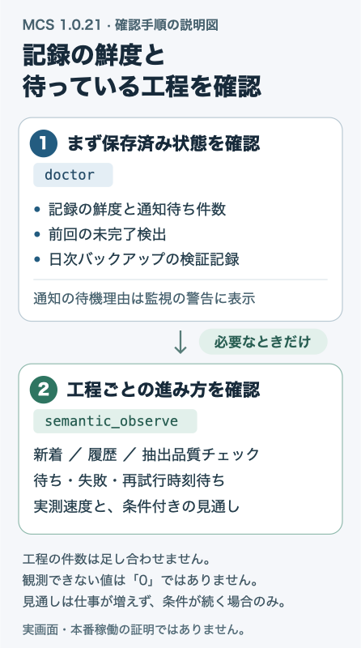

# 1.0.21 処理状況の確認

記録の鮮度と、どの工程で待っているかを確認する手順の説明図です。実画面のスクリーンショットではありません。患者情報、実投稿、架空の処理件数は含みません。



## 表示内容と根拠

| 図の内容 | 現候補の根拠 |
|---|---|
| doctorの保存済み記録の鮮度、通知待ち件数、前回の未完了検出、日次ローカルバックアップ | [mcs_setup.cmd_doctor](../../../mcs/ops/mcs_setup.py)、[operational_status.stored_status / status_lines](../../../mcs/ops/operational_status.py) |
| 通知の待機理由を監視の警告に表示 | [run_check._pending_health / _health](../../../mcs/ingest/run_check.py)、[health_watch._optional_blocks / _reason_rows](../../../mcs/ingest/health_watch.py)、[notify_cards.pending_breakdown](../../../mcs/notify/notify_cards.py) |
| 詳細診断の工程別件数、実測速度、条件付きの見通し | [semantic_observe.observe / main](../../../mcs/ops/semantic_observe.py)、[operational_progress.pipeline_progress / _rates](../../../mcs/ops/operational_progress.py) |
| ローカルバックアップの検証記録 | [maintenance.local_backup_status](../../../mcs/core/maintenance.py) |
| 利用手順と解釈の条件 | [利用ガイド](../../guides/USER_GUIDE.md#cli--処理の残数停滞の確認) |

比較元は前回リリースの `bbca0e09484f9115e88660ba764a7a79071d88e3`。同版にもdoctor・semantic_observeは存在するため、新設コマンドとは説明しません。現候補ではdoctorに保存済み運用記録を追加し、詳細診断に工程別の待ち・速度・見通しを追加しています。照合したソースのhashは[assets.json](assets.json)に記録しています。対象は未コミットのローカル候補であり、最終RC固定後にソースとの一致を再確認します。

- doctorの運用表示は保存済み記録を使います。通知の待機理由の内訳は監視の警告で示し、doctorの待ち件数表示と区別しています。
- 未完了検出は記録から分かった検出であり、中断が発生した正確な時刻や原因を確定するものではありません。
- 日次ローカルバックアップは保存ファイルと既存検証記録の一致を確認します。この表示だけで復元の成功を証明するものではありません。
- 工程の件数には同じ投稿が重なるため合算しません。欠損・古い記録・観測不能を正常や0件に置き換えません。
- 見通しは、十分な同一条件の実績があり、失敗や再試行時刻待ちなどがない場合だけの条件付き表示です。新しい仕事が増えず、設定・処理能力・観測速度が続くことを前提とし、新着流入の完了時刻は予測しません。

実行コマンドは次のとおりです。図はコマンド名を短く表示しています。

```bash
python3 mcs/ops/mcs_setup.py doctor
python3 mcs/ops/semantic_observe.py
```

## ローカル再生成

`operations-check.svg`を正本とします。SVGは390×700、PNGは446×800です。macOSのQuick Lookは縦長SVGを切り取る場合があるため、一時的な正方形ラッパーを800pxで描画し、左右の余白だけを`sips`で除去します。次をリポジトリルートから実行します。新しいライブラリは不要です。

```python
from pathlib import Path
import subprocess
import tempfile
import xml.etree.ElementTree as ET

assets = Path("docs/releases/v1.0.21").resolve()
ET.register_namespace("", "http://www.w3.org/2000/svg")
inner = ET.parse(assets / "operations-check.svg").getroot()
inner.set("x", "155")
inner.set("y", "0")
outer = ET.Element("{http://www.w3.org/2000/svg}svg", {
    "width": "700", "height": "700", "viewBox": "0 0 700 700",
})
outer.append(inner)
with tempfile.TemporaryDirectory(prefix=".render-", dir=assets) as tmp:
    wrapper = Path(tmp) / "operations-check-render.svg"
    ET.ElementTree(outer).write(wrapper, encoding="utf-8", xml_declaration=True)
    subprocess.run(["qlmanage", "-t", "-s", "800", "-o", tmp, str(wrapper)],
                   check=True, timeout=30)
    subprocess.run(["sips", "--cropToHeightWidth", "800", "446",
                    str(wrapper) + ".png", "--out", str(assets / "operations-check.png")],
                   check=True, timeout=30)
```

PNG全体と幅390pxに縮小した画像を開き、見出し・本文・下端注記の欠落や重なりを確認します。フォントやOSによって描画結果が変わり得るため、再生成後は`assets.json`のbytesとSHA-256を更新し、親担当が最終候補との整合と実表示を再確認します。

## 未公開の境界

この資産はローカルの1.0.21候補です。公開URLの到達性、GitHub Releaseでの表示、本番稼働は未検証です。公開承認後、固定した公開コミットのPNGをRelease本文から参照し、URL到達と表示を別々に確認します。画像の作成はpush・Release公開・本番更新の承認を追加しません。
