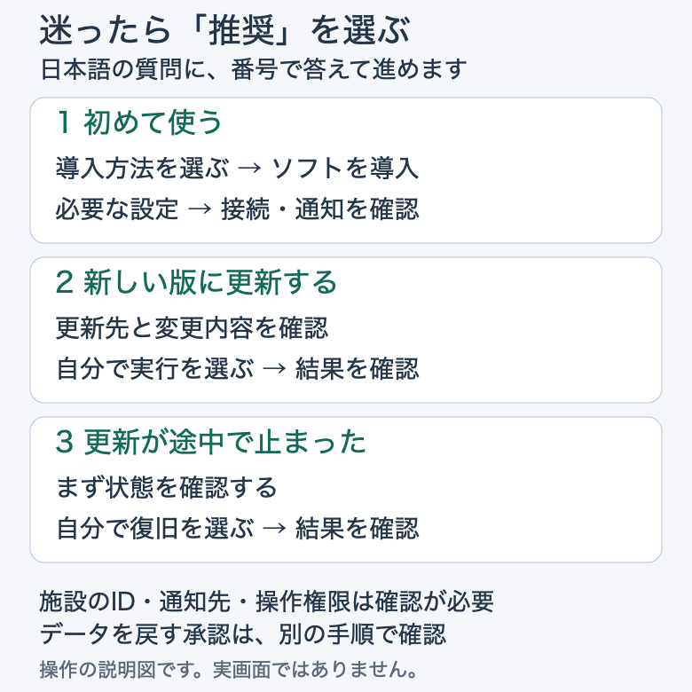

# 1.0.24 操作の説明図

[日本語対話の流れ](guided-lifecycle.png)は、導入・更新・復旧の実装をもとにした説明図です。実画面のキャプチャではありません。患者情報・接続情報は含めません。

比較元は公開済みv1.0.23（1c111228）。従来は英語の導入選択・全設定の確認・明示的な更新コマンドが必要でした。今回の候補は日本語の番号選択・推奨コース・実行前確認へ接続しています。所要時間やミス削減率は計測していません。

原稿は[SVG](guided-lifecycle.svg)。macOSのQuick Lookで780pxに書き出し、全体の文字欠け・重なり・下端を確認しました。再生成する場合は `qlmanage -t -s 780 -o /tmp docs/releases/v1.0.24/guided-lifecycle.svg` の出力を確認してPNGへ反映します。

画像は未公開です。公開する場合はコードとともに配布した後、固定SHAのraw URLへ到達できることとRelease画面での表示を確認してから本文へ追加します。CHANGELOGには未公開URLを埋め込みません。
