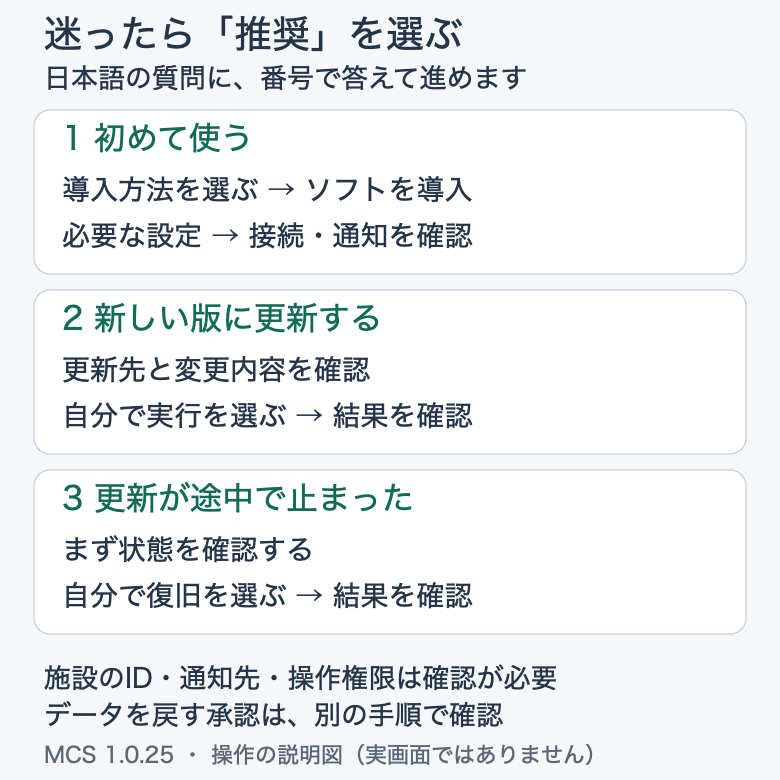

# 1.0.25 導入・更新・復旧の操作フロー

[操作フロー](guided-lifecycle.png)は実装に基づく説明図です。実画面のキャプチャではなく、患者情報・認証情報・接続先は含みません。



比較元は公開・本番反映済みのv1.0.24（`35b5a5531e04441391bfb43b8389a7ca43a5dc94`）。以前も日本語の質問と番号選択がありました。今回、導入後に設定へ進む選択、必要な質問だけの推奨コース、更新・復旧の実行前確認へつなげました。所要時間やミス削減率は計測していません。

| 表示 | 根拠 |
|---|---|
| 導入確認と初期設定への接続 | [install.sh](../../../install.sh)、[EASY_SETUP](../../guides/EASY_SETUP.md) |
| 推奨・詳細コース | [mcs_setup.py](../../../mcs/ops/mcs_setup.py)、[合成回帰](../../../tests/ops/test_setup_guided.py) |
| 計画後に更新を選び、再計画で確認 | [mcs_upgrade.py](../../../scripts/mcs_upgrade.py)、[回帰](../../../tests/ops/test_lifecycle_guides.py) |
| 状態確認と明示的な復旧、既存承認の保持 | [mcs_recover.py](../../../deployment/recovery/mcs_recover.py) |

原稿は[SVG](guided-lifecycle.svg)。前の未公開作業ツリーにあった同フロー原稿を1.0.25の実装へ照合して引き継ぎました。公開済み1.0.24の図やtagは変更していません。

## 再生成と確認

追加依存は不要です。macOSのQuick LookでSVGを780pxのPNGへ書き出し、390px幅でも文字欠け・重なり・下端を確認します。

```sh
qlmanage -t -s 780 -o /tmp docs/releases/v1.0.25/guided-lifecycle.svg
sips -s format png /tmp/guided-lifecycle.svg.png --out docs/releases/v1.0.25/guided-lifecycle.png
```

2026-10-17にローカル描画を確認。画像は固定commit `aaa4aa488373cb9691458e0c4df222ecd5103376` へ反映済みで、認証付きGitHub原本APIから取得したPNGのbytesとSHA256がローカルと一致しました。このリポジトリは非公開のため、未認証のraw URLは404になります。閲覧権限は広げず、[認証付きGitHubの画像ページ](https://github.com/yusuketakuma/hermes-mcs/blob/aaa4aa488373cb9691458e0c4df222ecd5103376/docs/releases/v1.0.25/guided-lifecycle.png)を使います。

この環境ではChromeの表示窓とin-app browserへの接続を利用できず、GitHub Release実画面での描画は未確認です。原本取得の成功を実画面表示の証拠にはしません。
