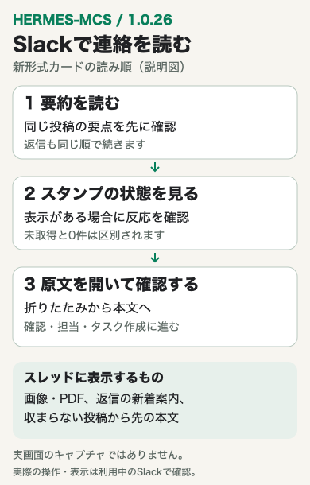

# 1.0.26 リリース資料

[変更一覧](../../../CHANGELOG.md#1026--2026-10-18)と[受入結果](ACCEPTANCE_1.0.26.md)を分けて記録しています。下図は今回のSlack通知の読み順を示す説明図です。個人情報や実投稿は使わず、実画面のキャプチャではありません。

要約の直後にスタンプと原文を置き、同じ投稿を続けて確認できます。添付・後から届いた返信の新着案内・カードに収まらない投稿から先の本文はスレッドへ表示します。新形式カードが対象で、旧形式カードの配置は保持します。[カード全体の説明図](slack-notification.png)も用意しています。

## 変更の根拠

比較元は公開版v1.0.25（`5ecea075500cba976764b508cdaef5004ce8795f`）、今回の実装は`c47b0a8e6e3200f56cc99ad843c1073e4c732b1d`です。旧版の実画面は再現していないため、新版の説明図と文章だけを掲載します。実機の読みやすさ・所要時間・操作ミスの減少は測定していません。

| 表示・動作 | 根拠 |
|---|---|
| 投稿ごとの要約・スタンプ・原文の順 | [通知の表示モデル](../../../mcs/notify/notify_cards.py)、[Slackカード描画](../../../adapters/slack/cards.py) |
| 原文の折りたたみと、収まらない投稿のスレッド表示 | [Slackの表示予算](../../../mcs/notify/present_slack.py)、[利用者ガイド](../../guides/USER_GUIDE.md) |
| 確認・担当・タスクと操作メニュー | [カードの操作](../../../mcs/notify/notify_cards.py)、[Slackの操作処理](../../../adapters/slack/actions.py) |
| 完全合成の表示例と描画方法 | [ギャラリーの生成元](../../../scripts/development/generate_slack_gallery.py)、[ギャラリー更新手順](../../screenshots/slack-gallery/README.md) |

## 画像の由来と確認範囲

カード全体の図は、[現行ギャラリーの02](../../screenshots/slack-gallery/02-notification.png)と、その[SVG原稿](../../screenshots/slack-gallery/02-notification.svg)を同一バイトで保存しました。画像を描き直すコードや依存は追加していません。既存の生成器による整合チェックと、元画像のソース照合の結果を再利用します。

- SVG SHA-256: `7b63f2ae4f03103014df109d1521080bef19a1a235d5da7ceb0dacfe10064953`
- PNG SHA-256: `56892760d2ae48eca1ccb039fadb83e864bdac238607ad2b1008b968a20f098c`

読み順の図は上表の実装と利用者ガイドを根拠にした390×610pxのSVGです。既存のQuick Look＋ImageMagick方式で描画しました。一時コピーのviewportだけを610px四方に広げてQuick Lookで描画し、左上390×610pxを切り出してPNGにしています。新しい描画スクリプトや依存は追加していません。

- 読み順SVG SHA-256: `12189434243b64a017a5251ea3d21ebae4cdf99f5ef328fdf585024c94a1bb9b`
- 読み順PNG SHA-256: `54c3bf8f6dfac5b8373c2b8146d9c445f74e06a84c4fed85a2671bbc45c0de4c`

2026-10-18にPNGを原寸390px幅で開き、主要ラベル・本文・読み順・余白・文字の欠けや重なりを確認しました。カード全体の図は通常幅で確認済みで、細部は画像を開いて拡大できます。ブラウザーのローカルURL拒否と画面取得ツールの制限があったため、目的に合うローカル画像表示ツールで確認しています。実Slack・実スマートフォン・GitHub Releaseでの取得や描画は未確認です。SDKの合成検証を実配信や実画面の成功とは扱いません。

## 公開時の参照

現時点はローカル準備です。CHANGELOGの本文は画像なしでも変更内容と更新操作を読めるようにし、未公開の画像URLを入れていません。公開担当は画像を含む固定commitを反映後、権限を広げず取得できるURLとGitHub Releaseでの表示を確認してください。本文へリンクを追加する場合はCHANGELOGを先に更新し、同じ版の本文をexportします。公開・本番反映の状況は受入結果へ記録します。
