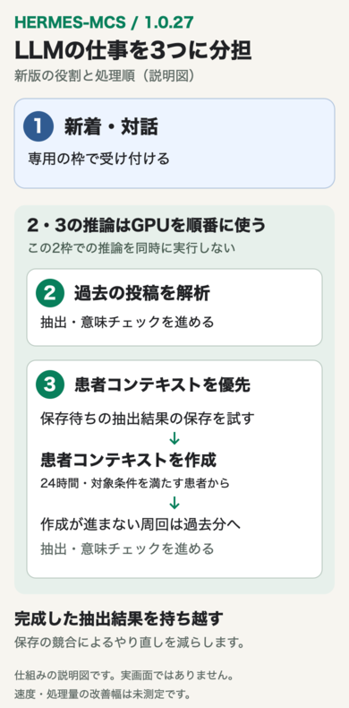

# 1.0.27 リリース資料

[変更一覧](../../../CHANGELOG.md#1027--2026-10-19)・[受入結果](ACCEPTANCE_1.0.27.md)・[統合対応表](integration-manifest.json)。比較元は本番v1.0.26（`982c471b`）、統合基点は`d106bcc8`です。

患者コンテキストを作る時間帯の制限をなくし、解析済みのアクティブ患者から処理します。再試行上限に達した投稿は対象判定から除外します。公開条件は維持し、処理速度の改善量は未測定です。

| 以前 | 今回 | 利用者への効果 |
|---|---|---|
| 患者コンテキストは夜間に作成 | レーン3で24時間作成 | 夜間を待たずに処理を進められる |
| 保存ロック待ちで過去分の完成結果を捨てる場合がある | 所有権と本文を再確認して次の周回へ持ち越す | 同じ入力の不要な再推論を抑える |
| 辞書の初期設定は別操作 | 未設定なら対話中に既定「はい」で提案 | 利用条件の確認から辞書設定へ進める |

## 根拠と確認範囲

レーンの割当と順番待ちは[local_llm.py](../../../mcs/core/local_llm.py)、持ち越しとレーン3の処理順は[extract_llm.py](../../../mcs/extract/v4/extract_llm.py)、対象患者と公開前の再確認は[patient_nightly.py](../../../mcs/extract/patient_nightly.py)を正本とします。

画像は[SVG原稿](llm-lanes.svg)を既存のQuick LookとImageMagickで描画した説明図で、実画面や実測結果ではありません。実投稿・患者情報は使っていません。画像の原寸確認結果は受入票へ記録します。GitHub Release上の画像表示と実チャットの表示は別の確認で、ローカル画像の確認では代替しません。Release本文は画像なしでも理解できる文章とし、未公開URLは含めません。

通常の更新は[更新ガイド](../../guides/UPGRADE_AGENT.md)に従います。サービス設定とworkerを自動更新し、旧`--slot`を新`--lane`へ合わせます。設定・履歴・モデル・既存辞書を保持します。ベンチマークとサーバの`-ub`変更は通常更新では行いません。
