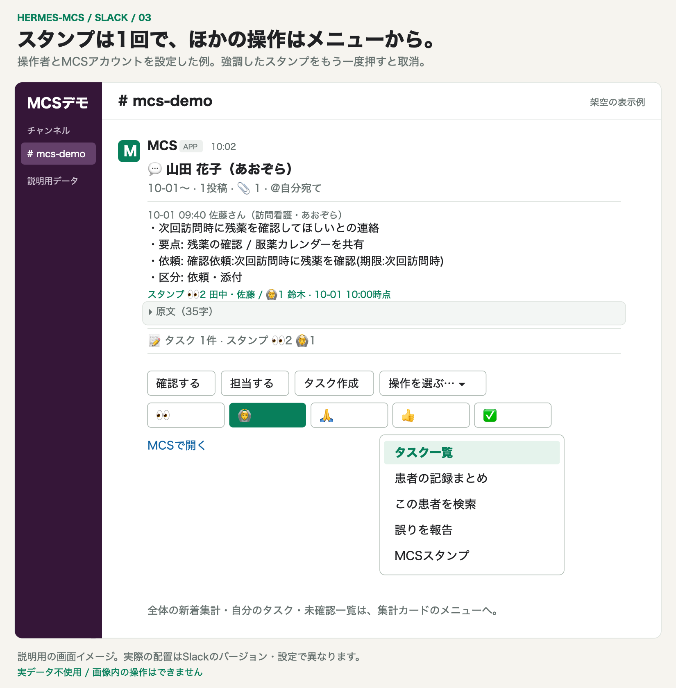

# 1.0.28 リリース資料

状態: 公開前の候補。[受入記録](ACCEPTANCE_1.0.28.md)で完了・未確認を区別します。比較元は公開版v1.0.27（`272512db`）です。通常の更新は[更新ガイド](../../guides/UPGRADE_AGENT.md)に従ってください。

操作者とMCSアカウントを設定したカードの説明図です。表示中の最新投稿へスタンプを付け、自分の同じスタンプをもう一度押すと取り消します。別の投稿はメニューのMCSスタンプから選びます。人物・投稿はすべて架空で、実画面やAPI送信成功の証拠ではありません。

| 以前 | 今回 | 利用者への効果 |
|---|---|---|
| MCSのスタンプは閲覧が中心 | カードから追加・変更・取消を操作 | MCSを開き直さず、対象の投稿に反応できる |
| 投稿後に追加された添付が通知から欠ける場合がある | 元の投稿と配送記録を照合し、追加分を配送 | 画像・PDFを元の会話で確認しやすくなる |
| 変更のない薬剤照合も毎件書き込む | 変化した結果と必要な途中位置だけを保存 | 同じ情報の不要な書込みを抑える |

## 出典と確認範囲

画像は[ギャラリーの正本](../../screenshots/slack-gallery/README.md)から、[SVG原稿](stamp-actions.svg)とPNGを変更せず複製しました。[hashと生成元](visual-source.json)で対応を確認できます。生成元は既存のギャラリー生成器です。画像内の配置は説明用で、実際のチャットの版・設定によって異なります。

操作と復元の契約は[スタンプ管理](../../specs/stamp-management.md)、対象・取消・結果確認の手順は[利用ガイド](../../guides/USER_GUIDE.md)、内部の責務と依存は[リポジトリ構成](../../development/REPOSITORY_STRUCTURE.md)を正本とします。実送信、公開URLとGitHub Release上の画像表示は、ローカルの画像確認とは別に受け入れます。
