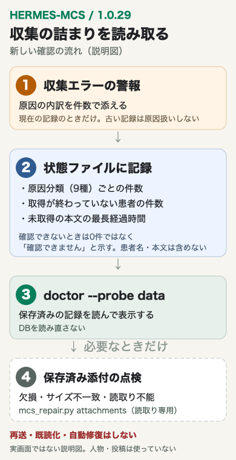

# 1.0.29 リリース資料

状態: 公開前の候補。[受入記録](ACCEPTANCE_1.0.29.md)で完了・未確認を区別します。比較元は公開版v1.0.28（`6940d135`）です。通常の更新は[更新ガイド](../../guides/UPGRADE_AGENT.md)に従ってください。

| 以前 | 今回 | 利用者への効果 |
|---|---|---|
| 収集エラーの警報は種類だけで、原因の見当を付けにくい | 原因の分類と件数、未取得の本文の最長経過時間を警報と診断に表示 | 調査の当たりを付けやすくなる |
| MCSサーバーが混雑を返しても、短い間隔で再試行して問い合わせを続ける | 指定の待ち時間を守り、2回受けた回は残りを次の定期実行へ回す | MCSサーバーへの負荷を抑える |
| 本文を取得できていない親投稿があっても患者を既読にする場合がある | 既読にせず、後続の収集で補完する | 本文の見落としを防ぐ |

新しい診断の流れの説明図です。警報の内訳は現在の記録のときだけ添え、確認できない値は0件ではなく「確認できません」と示します。診断と添付の点検は、再送・既読化・自動修復をしません。通知カードの画面や操作は変わらないため、画面例のギャラリーは変更していません。実画面や実測結果ではなく、人物・投稿は使っていません。

画像は[SVG原稿](collection-diagnostics.svg)を既存のQuick LookとImageMagickで描画しました。[hashと根拠](visual-source.json)で対応を確認できます。GitHub Release上の画像表示は公開後に別に確認し、Release本文には未公開のURLを含めません。画像がなくても、上の比較表と[CHANGELOG](../../../CHANGELOG.md)の本文で変更と必要な操作が分かります。

## 出典と確認範囲

[CHANGELOG](../../../CHANGELOG.md)の1.0.29は、変更記録34件を16項目へまとめています。全件の対応と各記録のhashは[対応表](change-map.json)で確認できます。技術詳細の折りたたみには全34件の詳細と根拠を残しています。

診断の読み方は[収集の診断](../../guides/COLLECTION_DIAGNOSTICS.md)、添付の点検は[保存済み添付の点検](../../guides/ATTACHMENT_RECOVERY.md)、更新時の操作は[更新ガイド](../../guides/UPGRADE_AGENT.md)の1.0.29節を正本とします。本番への適用、稼働確認、GitHubでの公開は受入記録で別々に確認します。
