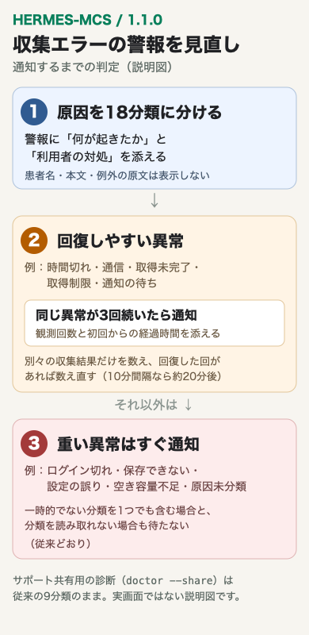

# 1.1.0 リリース資料

状態: 公開前の候補。[受入記録](ACCEPTANCE_1.1.0.md)で完了・未確認を区別します。比較元は公開版v1.0.29（`1feb9fd1`）です。通常の更新は[更新ガイド](../../guides/UPGRADE_AGENT.md)に従ってください。

| 以前 | 今回 | 利用者への効果 |
|---|---|---|
| 収集エラーの警報は原因の分類が9種で対処の案内がなく、すぐ回復する時間切れや通信の失敗でも1回で警報が出る | 18分類ごとに何が起きたかと対処を表示し、自然に回復しやすい異常は同じ異常が3回続いたときに通知 | 対処の当たりを付けやすく、すぐ回復する異常の警報が減る |
| health.jsonでは容量の内訳と保守の遅れが分からない | DB本体の使用量・空きページ量、バックアップの種類別容量、日次・週次保守の経過時間を表示し、日次保守が2日以上完了しないと警告 | 容量の増え方と保守の遅れに早く気づける |
| 同じ内容の返信が別の投稿の本文を再利用することがある | 返信カードの本文・薬剤詳細・タスク・スタンプなどを、そのカードの投稿に合わせる | 別の投稿の内容で操作する取り違えを防ぐ |

収集エラーの警報を出すまでの判定の説明図です。一時的でない分類を1つでも含む場合と、分類を読み取れない場合は待たずに通知します。サポート共有用の診断（`doctor --share`）は従来の9分類のままです。通知カードの画面や操作は変わらないため、画面例のギャラリーは変更していません。実画面や実測結果ではなく、人物・投稿は使っていません。

画像は[SVG原稿](collection-alerts.svg)を既存のQuick LookとImageMagickで描画しました。[hashと根拠](visual-source.json)で対応を確認できます。CHANGELOGとRelease本文には同梱画像の固定tag URLを使います。リポジトリは非公開のため、画像はtag公開後に権限のある利用者だけが表示でき、GitHub上の表示は公開後に別に確認します。画像がなくても、上の比較表と[CHANGELOG](../../../CHANGELOG.md)の本文で変更と必要な操作が分かります。

## この版で提供しないもの

状態監視・診断の送信・遠隔支援・遠隔再起動（CSDC）のコードは同梱しますが、1.1.0では有効にして提供せず、顧客への接続も行いません。新規導入では `sdc.enabled` が未設定のため専用ジョブは登録されません。すでに `sdc.enabled=true` を設定している環境は、この更新で停止・変更されません。CSDCの接続・中央での受入・実機での受入は、この版の完了条件に含めていません。

公開医薬品情報の照会で取得する添付文書・ガイドラインは参考資料です。取得内容の医学的な正確性は評価しておらず、人が原典を確認する前提は変わりません。

## 出典と確認範囲

[CHANGELOG](../../../CHANGELOG.md)の1.1.0は、変更記録132件を17項目へまとめています。全件の対応と各記録のhashは[対応表](change-map.json)で確認できます。技術詳細の折りたたみには全132件の詳細と根拠を残しています。

分類ごとの対処は[収集の診断](../../guides/COLLECTION_DIAGNOSTICS.md)、更新時の操作は[更新ガイド](../../guides/UPGRADE_AGENT.md)を正本とします。本番への適用、稼働確認、GitHubでの公開は受入記録で別々に確認します。
