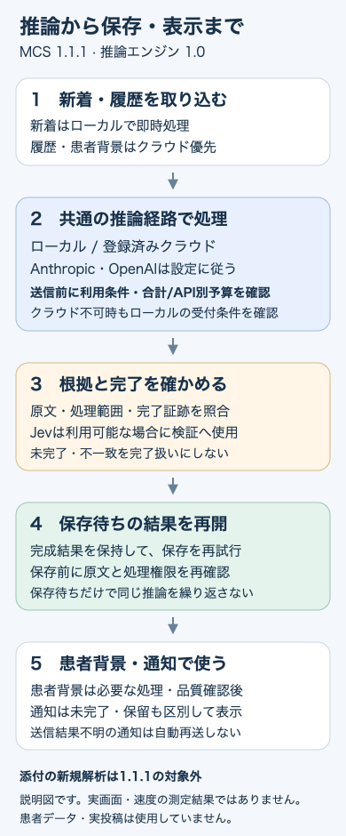

# 1.1.1 — 推論経路と保存待ちの整理

推論エンジンは1.0を維持します。新着の即時処理はローカル、履歴と患者背景は登録・設定したクラウドを優先します。利用条件、合計・API別の予算、原文根拠と完了証跡を確認し、保存待ちの完成結果を再利用します。

実画面や性能の測定結果ではありません。患者データ・実投稿は使用していません。
クラウド利用には登録・有効設定・対象範囲・予算等の条件があります。クラウドが使えない場合のローカル処理も受付条件に従います。[外部送信と費用の条件](../../guides/ANTHROPIC.md)を確認してください。

患者背景は必要な投稿処理と品質確認を終えた対象から生成します。通知では未完了・保留も区別し、送信結果が不明なものを自動で再送しません。原文が変わった場合や処理権限を失った場合は、保持した完成結果をそのまま保存しません。

添付ファイルの新しい解析機能は1.1.1に含めません。
更新には[通常の更新手順](../../guides/UPGRADE_AGENT.md)を使います。本番への適用・稼働確認・公開の状態は[受入票](ACCEPTANCE_1.1.1.md)で確認してください。

説明図の正本は[SVG](inference-flow.svg)です。[出典・hash・描画手順](visual-source.json)に対応を記載します。変更の公開本文は[CHANGELOG](../../../CHANGELOG.md)を参照してください。
