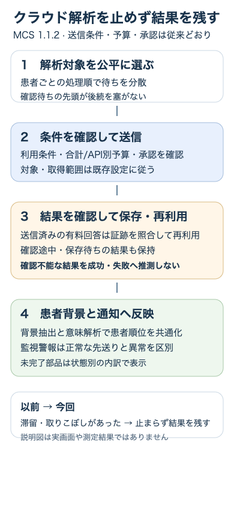

# 1.1.2 — クラウド解析の滞留と結果の取りこぼしを改善

クラウド解析が一部の投稿や他の処理の待ちで止まり続ける問題を修正し、送信済みの有料回答や確認途中の結果を証跡と照合して再利用・保持するようにしました。患者背景の確認と保存は、患者ごとの処理順と期限の扱いを見直し、特定の患者や期限切れで滞留しにくくしています。監視警報では正常な先送りと異常を区別し、未完了部品の内訳を表示します。

実画面や性能の測定結果ではありません。患者データ・実投稿は使用していません。
クラウド利用には登録・有効設定・対象範囲・予算等の条件があり、送信の対象・取得範囲・予算・承認条件は1.1.1から変更ありません。結果が不明なものを成功・失敗へ推測して扱うこともありません。[外部送信と費用の条件](../../guides/ANTHROPIC.md)を確認してください。

更新には[通常の更新手順](../../guides/UPGRADE_AGENT.md)を使います。本番への適用・稼働確認・公開の状態は[受入票](ACCEPTANCE_1.1.2.md)で確認してください。

説明図の正本は[SVG](cloud-continuity.svg)です。[出典・hash・描画手順](visual-source.json)に対応を記載します。変更の公開本文は[CHANGELOG](../../../CHANGELOG.md)を参照してください。
